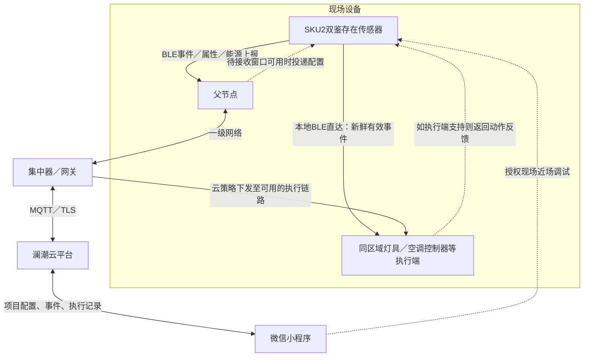
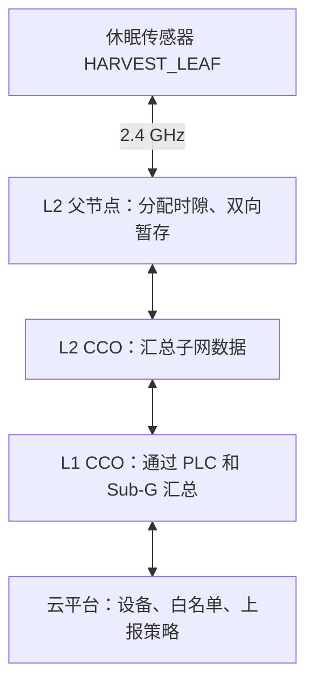
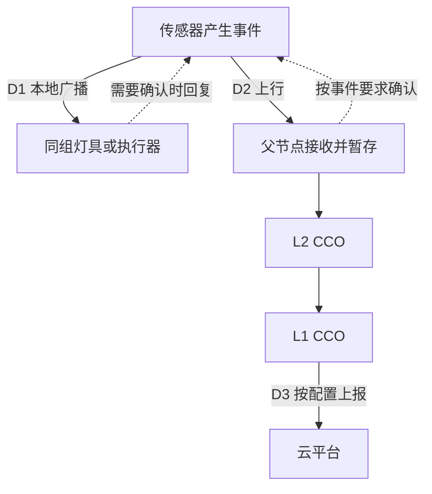
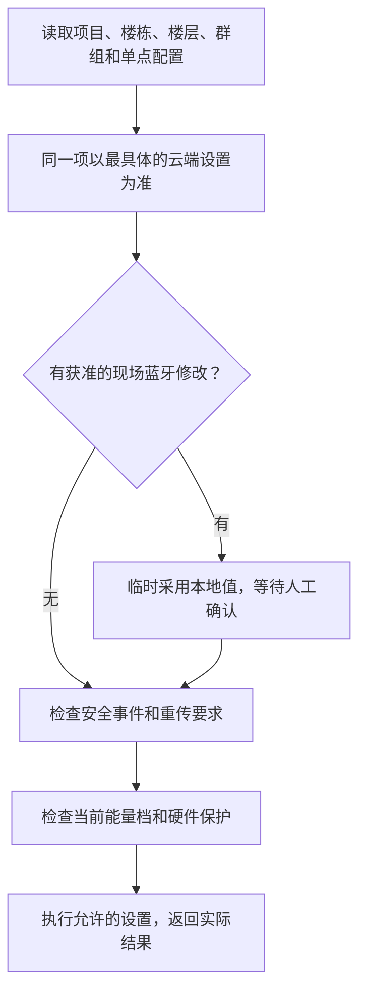
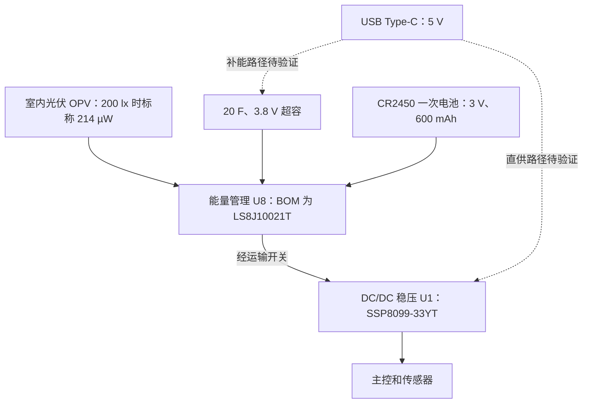
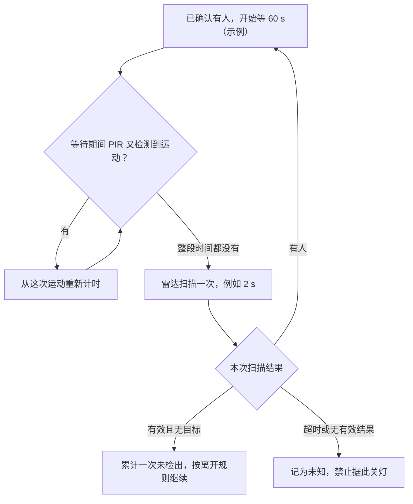
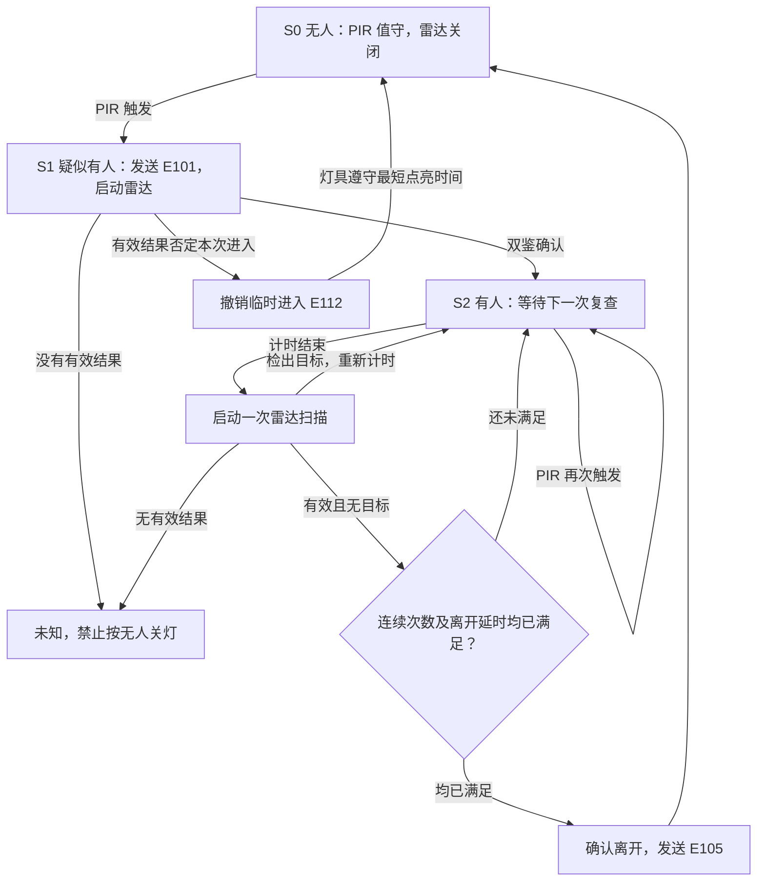
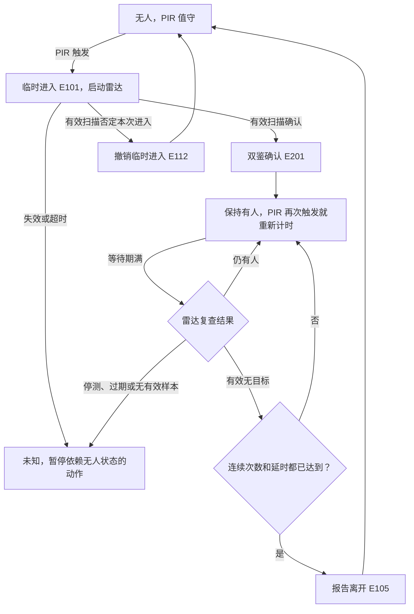
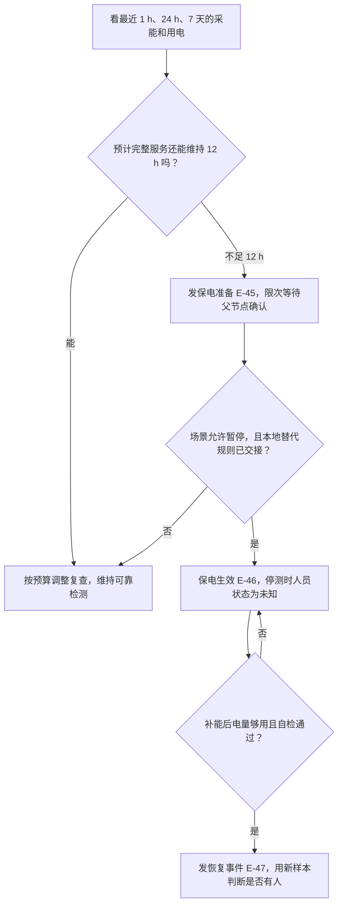
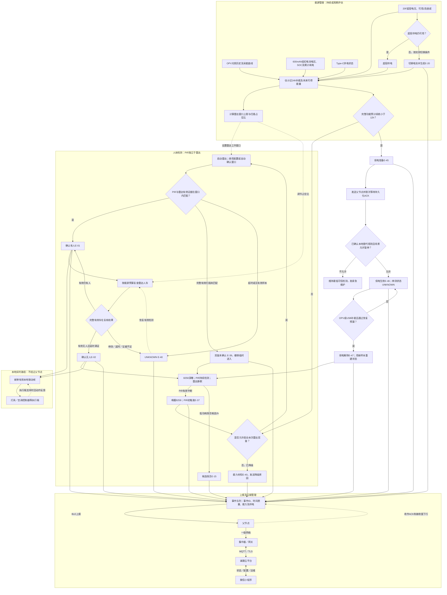

# 澜潮 SKU2 双鉴存在传感器 · 产品需求文档 V2.4

**待评审** · 2026-11-19 · 型号 LC-S-MTS03-PR24-11-001 · 中国大陆、中国香港

有人经过时，PIR 先发现运动；人坐下以后，24 GHz 雷达按需复查。照度用于判断是否需要开灯，也用于估算安装位置能给光伏板提供多少能量。照度小板是否已装配，仍待核实。

| 备用一次电池               | 主储能               | 室内光伏标称输出         |
| -------------------- | ----------------- | ---------------- |
| CR2450，3 V / 600 mAh | 超级电容，20 F / 3.8 V | 200 lx 时为 214 µW |

**目录**

1. [文档控制](#ch-1)
2. [产品概述与本期范围](#ch-2)
3. [使用场景与业务逻辑](#ch-3)
4. [功能需求与软件基线](#ch-4)
5. [硬件基线与非功能需求](#ch-5)
6. [测试验收与阶段交付](#ch-6)
7. [风险、依赖与待决事项](#ch-7)
8. [包材、标识与宣传资料](#ch-8)
9. [附录](#ch-9)

<a id="ch-1"></a>

## 01 文档控制

<a id="sec-1-1"></a>

### 1.1 术语缩写对照表

| 术语          | 本文含义                                                                                                                                          |
| ----------- | --------------------------------------------------------------------------------------------------------------------------------------------- |
| PIR         | 热释电被动红外，用于检测人移动引起的红外变化。                                                                                                                       |
| 24G 人存雷达    | 24 GHz 人体存在雷达，配合 PIR 做移动及静止存在判定。                                                                                                              |
| Lux         | 勒克斯、**光照度（Illuminance）的国际单位**，描述**落在物体表面上有多亮**（人眼加权后的可见光）1Lux = 1 lm/m²；月夜：≈0.1 lux；走廊、卧室暗光：50–100 lux；阅读办公：300–500 lux；晴天室外：10000–100000 lux |
| lm          | 流明，光通量单位。**光通量单位**，衡量一个光源**总共向外发出多少可见光。**；手机手电筒：≈30–80 lm；5W LED 球泡：≈400–500 lm；10W LED 球泡：≈800–1000 lm；家用吸顶灯 24W：≈2000–2400 lm               |
| LPN         | 低功耗节点，通常是指不用市电作为主电源的终端设备。后续用LPN代指本设备。                                                                                                         |
| 父节点         | 一直通电、替传感器收发消息的设备。传感器睡眠时，它先保存消息，等传感器醒来再交给它。支持哪些机型、能连多少台见 D-02。                                                                                 |
| CCO         | CCO 为一级网络的集中器角色。                                                                                                                              |
| SIID、CIID   | SIID 为服务标识，CIID 为条目标识。                                                                                                                        |
| 代理快照        | 指父节点按现有物模型封装转发的子传感器当前值。                                                                                                                       |
| ACK         | 接收方的确认回复。比如，父节点回复“收到事件”，只能证明这一段送到了；要知道灯有没有亮，还要看灯具反馈或照度变化。                                                                                     |
| PDT         | 产品开发团队                                                                                                                                        |
| EVT/DVT/PVT | 分别指工程验证、设计验证、生产验证。                                                                                                                            |
| OTA         | 线上固件升级。                                                                                                                                       |
| PXX         | 第 XX 百分位数。例如 P95 时延为 95% 样本不超过的时延值。                                                                                                           |

**融合、能量与通信用语**

##### 术语

| 术语                | 说明                                                                 |
| ----------------- | ------------------------------------------------------------------ |
| **有效触发角**         | PIR 能可靠触发"有人进入"的水平角度（120°），即产品对外承诺的探测角                             |
| **有效保持角**         | 人已进入有人态后，雷达能继续维持"有人"的角度（150°）；外环不可触发                               |
| **T_radar_delay** | 雷达延迟确认时间：从最后一次 PIR 触发开始计时，到期才启动雷达；PIR 每次触发即重置                      |
| T_scan            | 雷达单次扫描时长，≤5 s，典型 2 s                                               |
| W_verify          | 允许雷达完成这次确认的时间。从启动到拿到有效结果需要 T_scan，因此至少要等够 T_scan。                  |
| PIR 门控            | 雷达仅在 PIR 触发后才启动，无人态完全断电                                            |
| 乐观翻转 + 校验回滚       | 快开时，PIR 先报“疑似有人”。雷达完整扫描后给出有效的否定结果，就撤销本次临时进入并报 E112；超时或没有有效数据时记为未知。 |
| 进入回滚（E112）        | 例如，走廊很暗，PIR 先触发临时开灯。雷达完成扫描并有效否定这次进入后，设备撤销临时动作；灯具仍须亮满最短点亮时间。        |
| 设备心跳（E102）        | 设备存活 + 存在状态的周期上报，用于区分"无人"与"失联"                                     |
| 上报方式 I/A/H/L      | 即时上报（I）／聚合上报（A）／随心跳上报（H）／仅本地记录（L）                                  |
| 四层配置仲裁            | 能量底线 > 安全硬约束 > 云端基线 > 本地配置（需人工确认）                                  |
| 运输模式              | 开关 OFF 后负载隔离；待机电流和库存可用期按 20 F 实装测量。                                |
| 三重一致性校验           | 镭雕码 / 内部存储 / 实际 MAC 三者逐字段比对                                        |
| 扫 A 装 B           | 扫了 A 的码却装了 B 设备，靠"镭雕 MAC = 上报 MAC"拦截                               |
| 形态 A / 形态 B       | 微能量供能 / USB 长期供电                                                   |

<a id="sec-1-2"></a>

### 1.2 变更记录

| 日期         | 版本号         | 类型      | 变更内容和依据                                                                                                                                   | 受影响的需求及验收                                                                               |
| ---------- | ----------- | ------- | ----------------------------------------------------------------------------------------------------------------------------------------- | --------------------------------------------------------------------------------------- |
| 2026-11-17 | V2.1        | 基线      | 主 PRD 已记录的版本。                                                                                                                             | 适用本 SKU 的共用及专项要求。                                                                       |
| 2026-11-17 | V2.1-01     | 拆分／补充   | 从主 PRD 提取 SKU2，在本文包含全部适用公共要求，补齐中国大陆和中国香港的安规、EMC、认证及环境机械验收。                                                                                | NFR-05、NFR-06、NFR-08，TC-40～TC-42、TC-61～TC-65，D-12。                                      |
| 2026-11-18 | **V2.1-02** | 需求补充／归并 | 以 V2.1-01 为基线，确认 SKU2 的 20F 超容、600mAh 一次电池，补足能源预测、雷达窗口、USB维护、独立事件、12h保电门槛；修订本地直达拓扑；专题矩阵及 EVT 五年模拟移入附录。专题名称为《能源管理与生态协同逻辑 V2.3》，不是 PRD 版本号。 | FR-ENERGY-01～06、FR-SKU2-01～04、FR-EVT-03、E-37～E-47、TC-66～TC-75、D-07、D-15～D-18、附录9.3～9.6。 |
| 2026-11-18 | V2.2        | 合并评审稿   | 保留九章，BOM 校订实装，V4.68 逐字段复用；功能、非功能及事件以 HTML 的矩阵为主。                                                                                          | SKU2、54 条主事件、协议适配、能量预测与验证。                                                              |
| 2026-11-19 | V2.3        | 功能需求评审稿 | 按功能点重组软件需求，列出触发、处理、硬件前提与验收条件。                                                                                                             | 第 4 章及全文导航；第 5 章沿用 V2.2。                                                                |
| 2026-11-19 | V2.4        | 文字与格式修订 | 软件主需求改用现场操作来说明，精简需求来源和重复的验收追踪；流程图改为 Mermaid。                                                                                              | FR-605 增加现场例子；54 条主事件逐行注明云端上报方式。                                                        |

<a id="sec-1-3"></a>

### 1.3 评审记录

| 日期 | 版本   | 评审角色  | 状态      |
| -- | ---- | ----- | ------- |
| 待排 | V2.4 | PDT团队 | **待评审** |

<a id="sec-1-4"></a>

### 1.4 需求来源与基线

| 依据      | 受控来源                                                                                                                                        | 本版使用范围                             |
| ------- | ------------------------------------------------------------------------------------------------------------------------------------------- | ---------------------------------- |
| SKU2 主稿 | [多合一存在传感器-SKU2-双鉴存在传感器-V2.1-02.md](https://chatgpt.com/library?file_id=libfile_c60ec72beb5c8191996fc86d4fc1cddb\&account_id=personal)       | 九章顺序、SKU 专项需求、TC 和 D 编号、能源预测与运维。   |
| 功能与事件   | [澜潮\_微能量双鉴存在传感器\_产品需求文档\_PRD\_v2.0.html](https://chatgpt.com/library?file_id=libfile_6a66599fbeec8191bac69a986d785f78\&account_id=personal) | 功能及性能矩阵、第七章 54 条主事件、六套模板和回滚规则。     |
| 实装物料    | [LC-PIR01-BL-C3-2\_matched.xlsx](https://chatgpt.com/library?file_id=libfile_3ef3576099a08191b929d76849d87048\&account_id=personal)         | 工作表「PIR+24G传感器」。器件额定值、位号、成品与包材编码。  |
| 线协议     | [LC物模型定义总表V4.68(1).xlsx](https://chatgpt.com/library?file_id=libfile_dac11421a3288191bec5a2c014dff7ce\&account_id=personal)                 | 「多合一传感器」「物模型事件上报」「事件上报」「类型」「变更说明」。 |

##### 本轮参数与差异处理

| 评审项      | 本版执行口径                                                                               | 签核 / 证据                           |
| -------- | ------------------------------------------------------------------------------------ | --------------------------------- |
| 备电、储能与采光 | CR2450 3 V／600 mAh，20 F／3.8 V，OPV 标称 214 µW @ 200 lx。以受载电压窗口、漏电和转换效率推算可用能量。          | BOM R4／21／46；D-07、TC-67／74        |
| 照度与防拆    | 照度是 SKU2 必需能力，分表缺独立照度件，四项用途待装配和标定。防拆能力缺实装依据，E407 保留并按能力开放。                           | D-01／09；TC-11～13、TC-64            |
| 进入和离开    | 快开模板的 E101 是临时进入；E201 记录双鉴确认；E105 需要有效空判和离开延时。确认后开灯模板仍可选。                            | FR-103～108、FR-103、FR-402；TC-73／75 |
| 心跳与聚合    | 事件主表 H 档随 300–1800 s 心跳。MD 的 2 h 为低功耗保活候选，需另定工作配置；1/5 min 可作端内统计窗，CL 的 A 档最快 15 min。 | D-02／05；实现返回实际值及版本                |
| 配置生效与审计  | 事务成功或拒绝均应回执并可读回。E504 是成功审计事件，默认 P2 / A / 1 h / 可禁用；E505 为不可禁用的实时拒绝事件。                | §4.2.2、§4.2.3；TC-44／70            |
| 部署数量与用时  | 同区连续批量作业以 >400 点位／人日为目标；单点从开箱到入网的平均 ≤8 min 另计。分别记录批量节拍、异常返工和端到端工时。                   | D-02／13；FAE、TE                    |
| 外壳与使用边界  | IP30 是设计目标，IP20 作为基础验证项。操作、运输、长期储存按整机与器件许可条件签核；披露经试验覆盖的工况。                           | D-09／12；TC-38～42／64／65            |
| 三种电流口径   | 雷达 BOM 的 31 µA、峰值 82 mA @3.3 V、扫描窗 ≤150 µA 目标按各自工况记录。整机、模组和瞬态应分别测量。                  | D-07／15；TC-20／23／69／74            |

MRD、PPR 的正式版本与签核记录待产品负责人补充。

<a id="ch-2"></a>

## 02 产品概述与本期范围

<a id="sec-2-1"></a>

### 2.1 产品概述

<a id="part-50"></a>

#### 现场痛点

在售的产品对空间环境感知能力有限，不能识别人是否真正存在于这个空间内，导致灯具、暖通新风等生态的联动策略受限，不能很好的服务于负荷端的能源管控解决方案。

背景：

在售的产品对空间环境感知能力有限，我们要完善负荷端的能源管控解决方案。

<a id="part-58"></a>

#### 产品定位

面向室内空间的**低功耗人体存在**感知与生态联动传感器。

<a id="part-62"></a>

#### 用户价值

- 有**人**进入了吗？ PIR检测人体移动，辅助识别**人员**进入及活动。
- **人**还在吗？ 24GHz毫米波雷达检测人体存在，包括部分静止、微动状态。
- 生态设备联动？ 光照度传感器提供环境亮度参考，辅助照明节点策略；PIR+24G双鉴人存，辅助暖通新风节点策略。

<a id="part-70"></a>

#### 产品定义

双鉴存在传感器是一款采用OPV微能量光伏板＋超级电容做主供电、纽扣电池备用供电的低功耗人体存在传感器，集成PIR、24GHz毫米波雷达、光照度检测、BLE通信模块，适用在具有一定有效光照时长的办公室、会议室、教室等室内空间与澜潮智能生态设备协同使用。


设备通过PIR与雷达双鉴识别人体活动及存在状态：**本地BLE联动由本设备直达同区域兼容执行端，不经父节点；云端路径经父节点、集中器／网关到云平台**，用于业务事件、能源健康、规则配置与运维记录。外部供电及网络不可用时按签核的降级规则处理，不把未知状态等同无人。

<a id="part-76"></a>

#### 产品基线与适用范围

以 SKU2 BOM 为准：**20F/3.8V超容、600mAh CR2450一次电池、OPV参考功率214μW@200lx**。拟通过光照历史、超容可用能量、电池健康和人体状态共同优化雷达工作窗口，以**有条件的五年有效服务**为目标；允许按维护计划USB补能，不能把五年解释为免维护。

##### 背景与要解决的问题

| 现有方案        | 致命缺陷                  | 现场表现                                          |
| ----------- | --------------------- | --------------------------------------------- |
| 纯 PIR 人体感应  | 只对**移动**热源响应，静止即判无人   | 办公位静坐 5 分钟灯就灭；被迫把延时调到 20–30 min，节能率回落到 30% 以下 |
| 纯 24G 雷达    | 对金属摆动、管道、穿墙敏感；常驻工作耗电高 | 卷帘门、管道、窗帘导致"无人常亮"；电池型产品几个月没电                  |
| 市电/电池型存在传感器 | 需布线或 1–2 年换电池         | 改造布线成本高于设备本身；万级点位无法规模化运维                      |

初次进入时以 PIR 唤醒雷达校验，确认后以 PIR 重置计时，静默时雷达复查。现场以机身码绑定项目及位置。

##### 双形态定位

| 形态                | 供能方式                                   | 适用场景                                | 能力差                                  |
| ----------------- | -------------------------------------- | ----------------------------------- | ------------------------------------ |
| **A<br />微能量**    | OPV + 20 F 超容                          | 办公、走廊、会议室等有有效受光时长的点位；≥30 lx 仅作踏勘候选。 | PIR 常开；首次雷达校验，保持阶段默认延迟 60 s，按能源窗口调整。 |
| **B<br />纽扣电池**   | CR2450 600 mAh 备用                      | OPV+超容不能满足当前供电能量，由电源管理IC自动切换到纽扣电池供电 |                                      |
| **C<br />USB 外供** | USB 5 V 持续外供为目标形态。整机供电和超容补能由 TC-71 验证。 | 地库、无窗库房等长期低光且有合适电源的位置。              | 雷达延迟可缩至 15–30 s；用完整负载剖面验证稳定工作。       |

##### 产品边界

#### 本产品做（In Scope）

- PIR 门控 + 24G 延迟确认的双鉴存在检测
- 微能量、备用电池与 USB 双供能，自动识别切换
- 光照四用途：联动 / 安装质检 / 免开灯 / **灯具故障辅助判断**
- 56 条事件的全量定义与上报策略配置
- 2.4G 纯叶子终端，经 L2 CCO → L1 CCO 上联
- 背胶（3M 为候选）随手贴；镭雕设备码 + App 位置录入
- 双档运输开关（运输模式 + 手动复位）
- 无孔化外观

#### 本产品不做（Out of Scope）

- 雷达不做独立触发源，只在 PIR 之后启动
- 不做低频保底扫描（已按方案 1 定案）
- 不做中继/路由；不做 Sub-G、不做 PLC
- 不做距离分档 
- 多人计数（转预留）
- 不做室外、雨淋
- 不做粗糙易脱落墙面

<a id="sec-2-2"></a>

### 2.2 产品目标与成功指标

| 目标    | 指标与目前口径                                                                                                                        | 释义或备注                                                        |
| ----- | ------------------------------------------------------------------------------------------------------------------------------ | ------------------------------------------------------------ |
| 入网与部署 | 1）首次配网成功率建议≥98%；<br />2）单点从开箱到组网成功平均≤8min。                                                                                     | 先从小程序扫码到展示，再记录完整安装调整及与生态设备组网时长。                              |
| 人存检测  | 1）双鉴静坐30min的「有人」有效时长占比建议≥99.5%；<br />2）空置静态误触发建议≤1次/24h。                                                                       | 含动物及机械运动误触发验证，具体阈值、样本量由D-08签核。                               |
| 联动与上报 | 1）本地直达从事件判定到负荷实动P95≤1s；<br />2）云端路径从可消费事件到执行端下发P95≤3s；<br />3）断云30min本地直达可用率≥95%；<br />4）LPN在线率≥99%。                           | 本地与云端路径分别测量；本地直达不经父节点。                                       |
| 安全    | 1）本地与云端链路加密；<br />2）本地联动帧防复制/防重放；<br />3）安装防拆事件化。                                                                              | LPN BLE帧保护、云平台安全和执行端动作互证；防拆目前是候选，下一版本需硬件支持。                  |
| 功耗与维护 | 1）**有条件五年有效服务**：BOM 20F＋600mAh；照度历史、光时、PIR触发、雷达持续扫描、BLE、老化进入寿命模型；<br />2）支持定期及预警USB补电／换电；<br />3）预计完整检测剩余续航＜12 h 且场景允许时进入保电决策。 | 不代表免维护；测五年**检测服务可用率**及供电生存时间。HW、TE、D-07/D-18、TC-20～23/67/72。 |
| 事件可配置 | LPN业务事件有独立配置、读回、权限、频率、格式及上报信息，关键告警与配置回执不可关闭。                                                                                   | §4.2 保留原有业务编号与 E-37～E-47 的扩展；三通道主矩阵见 §4.2.3；老快照继续可用。         |

<a id="sec-2-3"></a>

### 2.3 SKU、产品型号与出厂编码

| SKU  | 产品名称及能力 | 主要模组                 | MAC类别 | 型号                     | MAC示例               |
| ---- | ------- | -------------------- | ----- | ---------------------- | ------------------- |
| SKU2 | 双鉴存在传感器 | PIR + 24G 人存雷达 + 光照度 | 41／C1 | LC-S-MTS03-PR24-11-001 | `00 C1 41 XX XX XX` |

铭牌MAC二维码、硬件版本及能力集以本 SKU 的出厂档案核对，登记与防错见 D-01。

<a id="sec-2-4"></a>

### 2.4 用户角色与 PDT 分工

| 用户角色      | 主要任务                       | 所需能力或权限                                                                    |
| --------- | -------------------------- | -------------------------------------------------------------------------- |
| 实施调试（FAE） | 选型、布点、安装、扫码、诊断入网、标定组别、验证功能 | 验证PIR唤醒、静止存在、安装点光照度及生态设备联动。                                                |
| 项目管理员／运维  | 管理配置、策略、离线告警、升级和换机         | 按授权访问点位及告警，读回实际生效配置、失败原因与操作记录。                                             |
| 空间使用者     | 使用稳定照明与暖通，必要时手动调节          | 1）只访问授权控制能力；2）LPN策略优先级低于用户主控优先级，用户采取原厂控制器主动控制后，LPN不可更改当前状态（目前LPN做不到，留作待决）。 |

| PDT领域     | 主责工程师或接口人       | 本期职责与交付                                                     |
| --------- | --------------- | ----------------------------------------------------------- |
| 产品        | 张涛              | SKU和场景基线、需求及待决签核。                                           |
| ID、MD     | 睿鑫光电（外协）；张涛、黄伟宁 | 面壳、镜片、安装件及结构图、包材设计，核对本SKU传感与开窗要求。                           |
| HW        | 潘志强             | 硬件方案选型、原理图、PCB layout等，保证预设功能实现。                            |
| FW        | 朱上志             | BSP、HAL、应用层搭建，保证预设功能实现。                                     |
| 云平台、微信小程序 | 由张涛与周盟东对接       | 物模型与配置、权限、路由、状态和联动、事件解析、调试导引和反馈。                            |
| TE        | 由金文聪指派          | 测试主管依据PRD制定测试用例并指定本产品主责测试人员。                                |
| PE        | 郑映              | 参与NPI及工装设计，制定SOP和产测方案，输出出厂检测报告。                             |
| 采购        | 待确认             | 待确认。                                                        |
| 交付        | 张涛              | 交付电子档资料和工厂检测合格的整机。电子档包括规格书、使用手册、发行说明、合规资料集；PVT、MP整机到仓库视为交付。 |

##### 目标客户与角色

| 角色        | 核心诉求                    | 成功判据                                |
| --------- | ----------------------- | ----------------------------------- |
| 物业公司（付费方） | 电费下降、投诉不上升、不用管电池        | 照明能耗降 60%+，地库 85%+；年度零维护工单          |
| 场内售电方     | 可量化节能收益                 | 能耗大屏按点位/分区出节能率，可用于结算                |
| 工程安装商     | 装得快、录入不麻烦               | 单人单日 >400 点位（含拨开关与扫码）；扫码一次成功        |
| 系统集成/运维   | 远程可控；点位可追溯；**灯具故障可被发现** | 90% 异常远程可判；可按点位/群组调整上报策略；开灯无响应可自动上报 |

<a id="ch-3"></a>

## 03 使用场景与业务逻辑

<a id="sec-3-1"></a>

### 3.1 系统拓扑



本地动作直接到同组执行端。父节点负责上行缓存和下行投递，小程序经授权可近场读回。

本版按**本地直达、云端上报和授权近场调试三条路径**定义。

1. **本地通信路径：** SKU2 → 同区域已授权的执行端（BLE直接发送，**不经父节点**）；执行成功与否以实际可用的执行端回执为准，不能把发出广播视为物理动作完成。
2. **云端通信路径：** SKU2 → 父节点 → 集中器／网关 → 澜潮云平台 → 微信小程序。云策略需要执行时，由平台经可用执行链路到执行端，不必回经SKU2。
3. **近场通信路径：** 授权的微信小程序 ↔ SKU2，用于安装、调试与读回，需核对硬件能力、窗口、电量及权限。
4. **一致性规则：** 同一事件的本地与云端消费按 `eventId`、有效期与规则版本去重，避免同一灯具重复动作；旧代理快照兼容接口保持可用。

##### 上联路径



上行发送事件和属性；下行的配置、策略和升级包先暂存，等设备醒来再送达。每个父节点连接最多 8 台作为满载验证目标。

##### 唤醒窗口与父节点时隙编排

| 机制     | 要求                      | 说明                             |
| ------ | ----------------------- | ------------------------------ |
| 唤醒窗口长度 | 100–500 ms（暂定）          | 形态 C 可取上限提升下行成功率               |
| 唤醒时刻协商 | 节点与父节点协商基准时刻与周期         | 入网或参数变更时协商                     |
| 时隙编排   | 父节点编排各子节点唤醒窗口；单父节点 ≤8 台 | 8×500 ms=4 s，相对 300 s 周期占 1.3% |
| 窗口超时   | 无下行 → 立即继续休眠            | 不做无意义等待                        |
| 交互维持   | 有下行或有上传 → 按交互需求维持       | 需约定最长维持上限                      |
| 外部触发唤醒 | 仅 PIR 可随时唤醒；雷达不作为触发源    | —                              |

8 台上限的代价：按办公 30 m²/台算，单父节点覆盖约 240 m²，2000 m² 楼层需 8–9 个父节点，需计入网络规划成本。

##### 三条硬约束

| # | 约束                         | 原因与影响                                                                                         |
| - | -------------------------- | --------------------------------------------------------------------------------------------- |
| 1 | **不可作为中继 / 路由节点**          | 中继需 7×24 常收，功耗 mA 级。误编为父节点会陷入"能量耗尽—重启—再被选为父"死循环。入网须带 `devClass=HARVEST_LEAF`、`canRelay=false` |
| 2 | **仅 2.4G，不接 PLC、不用 Sub-G** | 无市电耦合无法做 PLC；统一 2.4G 单模                                                                       |
| 3 | **父节点必须缓存 OTA 包**          | 节点长期休眠无法维持长连接下载；资源不足走小分片+唤醒逐片下发                                                               |

##### 双向暂存与失败回退

| 方向       | 机制                                  | 溢出处理                             | 节点侧配合                      |
| -------- | ----------------------------------- | -------------------------------- | -------------------------- |
| **下行**   | 父节点为休眠子节点暂存下行报文，唤醒窗口内投递             | 溢出则上游返回失败，云侧重试                   | 窗口内未收到即继续休眠                |
| **本地广播** | **不经树形路径**：2.4G 泛洪组播直达同群组灯节点，TTL ≤4 | 超 TTL 自然丢弃；无确认则重播 2 次，仍无确认报 E606 | 灯侧按 `evtSeq` 去重后执行，并回短 ACK |
| **上行**   | 父节点接收后暂存再转发，防父节点离线丢报文               | 超暂存深度则**通知发送失败**，节点写入事件缓存，下次唤醒重传 | "未确认→本地缓存→重传"；缓存满时上报丢弃条数   |

上行暂存比下行更重要：下行可重发，上行丢失是事件永久丢失。建议"父节点 ACK 后才删本地缓存"的两阶段语义。

<a id="sec-3-2"></a>


### 3.2 人存场景与业务闭环

| 场景    | 有效光照条件             | 人员活动特征  | 生态交互逻辑         |
| ----- | ------------------ | ------- | -------------- |
| 办公室   | 工作时段持续照明           | 久坐、走动   | 有人保持照明，无人延时关闭  |
| 会议室   | 使用时段有照明，空闲时可能关灯    | 久坐、微动   | 有人维持灯光/空调，无人节能 |
| 教室    | 白天自然光或人工照明         | 久坐、走动   | 按占用状态及照度调节照明功率 |
| 医院候诊区 | 通常长时间照明            | 久坐、走动   | 人体存在监测、分区照明联动  |
| 独立办公间 | 工作时段有光，非工作时段可能无光   | 久坐、短暂离开 | 有人维持照明，无人延时节能  |
| 地下停车场 | 部分区域长期低照度（建议USB供电） | 快速移动    | 人/车来灯亮、无人/车低亮； |
| 卫生间   | 使用时有光，空闲时通常无光      | 静止、微动   | 有人保持照明，无人关闭    |

##### 典型场景与形态选择

| 场景          | 推荐形态       | 推荐姿态          | 无人延时   | 特殊约束                      |
| ----------- | ---------- | ------------- | ------ | ------------------------- |
| 开放办公区       | 微能量        | 顶装 / 斜装       | 15 min | 必须检出静坐；避开空调出风口            |
| 地下车库        | **USB 外供** | 顶装 / 倒装       | 3 min  | 建议就近取 5 V；取电困难点位退化为微能量+电池 |
| 走廊 / 楼梯间    | 微能量        | 斜装（2.0–2.4 m） | 30 s   | 重不漏检；白天照度足可启用免开灯          |
| 卫生间         | 微能量        | 顶装 / 斜装       | 60 s   | 隔间遮挡，PIR 视线受阻             |
| 会议室         | 微能量        | 顶装            | 5 min  | 幕布摆动、长时间静坐                |
| 设备机房 / 密闭库房 | **USB 外供** | 斜装（门内侧）       | 2 min  | 完全无光，微能量不可行               |

勘测同时记录照度、光谱、有效光时及人员活动。≥30 lx 和 <10 lx 是旧稿的选型起点；低光但有电源可部署经验证的 USB 形态。其余点位按 §9.4 计算维护需求。

##### 安装、扫码与点位验收

> 现场执行。FAE 开箱检查、设备通电，用微信「澜潮智联」扫码安装，核对机身 MAC、设备名称、所属项目、设备类型、设备型号及位置。项目、类型与型号取授权下拉选项。装好后验证 PIR 首触发、雷达静坐保持、安装点照度、同组执行端和云端记录。

##### 四种安装姿态

| 姿态     | 推荐高度/角度                | 适用场景           | 探测特性           |
| ------ | ---------------------- | -------------- | -------------- |
| **顶装** | 吊顶 2.6–3.2 m，垂直向下      | 办公大开间、会议室、地库   | 对称覆盖；静坐检出好     |
| **斜装** | 墙面 2.0–2.4 m，下倾 20–45° | 走廊、门框内侧、楼梯口、立柱 | **对人流方向检出率最高** |
| **侧装** | 墙面/立柱 1.2–2.0 m        | 货架侧板、管井旁、隔断上沿  | 水平扇形，适合横向动线    |
| **倒装** | 梁下/桥架下                 | 地库、厂房          | 同顶装，注意金属梁反射    |

姿态必须写入配置（`mountMode`）。顶装是"俯视锥"、侧装是"水平扇"，距离-能量映射与微动阈值完全不同；用同一套参数会让侧装/斜装点位的误报与漏检显著恶化。

##### 背胶附着面清单

| 基材        | 适用性     | 处理要求            | 风险提示                            |
| --------- | ------- | --------------- | ------------------------------- |
| 乳胶漆墙面/吊顶  | 可用（有条件） | 确认漆面牢固；酒精擦净除尘干透 | **劣质乳胶漆会整片脱落**，连带撕下设备；现场做胶带拉拔试验 |
| 瓷砖/玻璃/金属  | 优       | 酒精除油、干透         | 金属低温易结露影响初粘                     |
| 矿棉板/石膏板   | 需评估     | 加装背板或改卡扣固定      | 表层疏松，胶贴可能带走表层                   |
| 木饰面/三聚氰胺板 | 优       | 除尘即可            | —                               |
| 粗糙水泥/砖墙   | 不可用     | —               | 接触面积不足                          |
| 粉化/起皮/潮湿墙 | 不可用     | —               | 必须改卡扣或打孔                        |

##### 镭雕设备码与位置录入

###### 镭雕码内容与工艺

| 要素        | 要求                                                        | 说明                                                    |
| --------- | --------------------------------------------------------- | ----------------------------------------------------- |
| **承载内容**  | `modelCode` + `MAC`(12 位) + `batch` + `mfgDate` + `hwVer` | 一扫带出全部出厂信息，消除手输 MAC 的错录风险。<br />当前版本只有出厂编码+MAC，后期会改革。 |
| 码制        | QR                                                        | 需兼容手机摄像头与工业扫码枪                                        |
| 尺寸与位置     | ≥8×8 mm；侧面凹槽，避开探测窗与 USB 口                                 | 与开关、USB 口同区，用同色盖片遮蔽                                   |
| **对比度**   | PCS ≥0.3；深色壳用浅色打标，浅色壳用深色打标                                | 深色壳对比度是最大风险，打样阶段必须实测                                  |
| 耐磨耐污      | 酒精擦拭 50 次后仍可识读                                            | 设备装在高处，后期难清洁                                          |
| **扫码成功率** | 一次 ≥99.00%；两次内 ≥99.90%                                    | 列入来料与出货检验项                                            |

###### 产线写入与三重一致性校验

| # | 工序         | 动作                                   | 合格判定               |
| - | ---------- | ------------------------------------ | ------------------ |
| 1 | 镭雕         | 激光打标机在外壳底面刻码（型号+MAC+批次+日期+hwVer）     | 可读、对比度达标           |
| 2 | **扫码读码**   | 产线扫码枪读取镭雕内容，自动录入产线系统                 | 一次读取成功；失败则重刻或判废    |
| 3 | **写入内部存储** | 经测试工装（USB，**开关可保持 OFF**）写入设备非易失存储专用区 | 写入成功回读校验值          |
| 4 | **回读比对**   | 从设备读回内部存储，与扫码结果逐字段比对                 | **完全一致；不一致不得出厂**   |
| 5 | MAC 一致性    | 核对内部存储 MAC 与芯片实际广播 MAC               | 一致；否则判为标错/改装       |
| 6 | 预充与运输模式    | 超容预充至 3.5 V → 拨开关至 OFF → 包装          | 待机电流 ≤2.5 µA 为抽检目标 |

**三重一致性校验的价值：**&#x956D;雕码（物理铭牌）、内部存储（产线写入）、设备运行时上报的出厂通信地址三者必须一致。任一层被篡改或错标都会暴露：  
 · **换壳/改标** → 镭雕码与实际 MAC 不匹配；  
 · **写入失败或错写** → 内部存储与镭雕码不匹配；  
 · **扫 A 装 B** → App 扫码得到的 MAC 与设备上报 MAC 不匹配。  
 三道校验成本极低（都是软件比对），但能堵住产品全生命周期的身份类事故。建议写入后**内部存储区设为只读**。

###### App 位置录入要求（决定 400 点位能否达成）

| # | 功能          | 要求                            | 省下的时间        |
| - | ----------- | ----------------------------- | ------------ |
| 1 | **位置四级结构**  | 楼栋 / 楼层 / 区域 / 点位号，与云端图纸范围对应  | 基础结构         |
| 2 | **位置记忆**    | 记住上一次录入的位置，同区域连续安装自动预填        | 每点位省 12–18 s |
| 3 | **点位号自动递增** | 扫下一个码时序号自动 +1（A01→A02），支持手动跳号 | 每点位省 5–8 s   |
| 4 | 平面图选点（可选）   | 有楼层图纸时直接点选，自动填充四级位置           | 适用有 CAD 图纸项目 |
| 5 | 重复校验        | 同位置重复绑定、同设备重复登记即时拦截           | 防错绑          |
| 6 | 离线暂存        | 无网时本地暂存，恢复后批量提交               | —            |

###### 节拍重算

| # | 位置录入方式            | 录入耗时       | 单点位节拍      | 400 点位所需工时        |
| - | ----------------- | ---------- | ---------- | ----------------- |
| A | **位置记忆 + 序号自动递增** | **约 10 s** | **约 57 s** | 6.3 h（可行）         |
| B | 每次完整选四级位置         | 约 25 s     | 约 72 s     | 8.0 h（实际约 325 点位） |
| C | 现场只扫码，位置事后补录      | 约 6 s      | 约 53 s     | 5.9 h，但有时序错配风险    |

**方案 A 动作拆解（57 s）：**&#x79FB;动定位 15 s + 撕膜贴附 10 s + 压合 6 s + **拨开关 4 s** + 扫镭雕码 5 s + 位置确认 5 s + 姿态选择 4 s + 转场 8 s。

**400 点位/人日成立的前提是 App 必须实现"位置记忆 + 点位号自动递增"。**&#x82E5;每次从头选四级位置，单点位多 15 s，日产能降到约 325——**400 指标就不成立**。这两项软件工作量很小，但对交付速度影响是决定性的，建议列为 App 的 P0，与固件同步开发。

##### 白名单机制

| 环节         | 动作                                     | 失败处理                            |
| ---------- | -------------------------------------- | ------------------------------- |
| 绑定提交       | 扫镭雕码自动带入设备信息，叠加现场录入的四级位置与姿态，提交云端       | 重复绑定/位置冲突 → 拒绝并提示               |
| **设备身份校验** | 镭雕码中的 MAC 与设备实际上报的 MAC 必须一致，防"扫 A 装 B" | 不一致 → 拒绝绑定并告警（E509）             |
| 白名单校验      | 核对设备是否属本项目、位置是否在图纸内、是否被占用              | 未通过 → 可入网但**不得输出联动指令**，标"待核"并告警 |
| 放行         | 通过后写入白名单，设备获得业务授权与 `locCode`           | —                               |
| 变更留痕       | 位置变更、设备替换记录操作人、时间、旧值新值                 | —                               |

##### 安装流程（顺序不可颠倒）

1. **取件**：按箱取件。
2. **能量核查**：检查超容电压；<3 V 则 USB 补电至 3.5 V 再装（<10 min 为目标，样机验收后发布）。
3. **基材判定**：对照 11.2；乳胶漆面做拉拔试验。
4. **粘贴**：酒精擦拭 → 干透 → 撕膜 → 压合 ≥10 s。
5. **拨开关至通电**：将底部双档开关从 OFF 拨到 ON（指甲或小工具，力度 3–5 N）。**必须先通电再扫码**——设备通电才能入网，扫码登记时才能即时校验在线状态。
6. **扫码绑定**：扫镭雕码（自动带出型号/MAC/批次）→ App 录入位置（默认沿用上次+序号递增）→ 选姿态与倾角 → 提交。
7. **白名单校验**：等待云端返回；未通过现场处理。
8. **入网确认**：App 显示上线即完成。
9. **分批自检**：2 h 后平台出报告与返工清单（含照度评估与策略核对）。

**现场自纠正机制：**&#x82E5;安装工忘记拨 ON，设备不通电、扫码后无法入网，App 会提示"设备未上线"。文案中必须明确写"**请确认底部开关已拨至 ON**"，把提示变成纠正动作。

##### 安装位置要求

| 要素            | 要求                                                  | 违反后果                    |
| ------------- | --------------------------------------------------- | ----------------------- |
| 安装高度          | 顶装 2.6–3.2 m；斜装 2.0–2.4 m；侧装 1.2–2.0 m              | 微动检测失效或覆盖不足             |
| 采光面朝向         | 朝向室内光源或窗户，不得朝暗角                                     | 照度不足 → E309 告警 + 电池加速消耗 |
| 远离气流源         | 距空调出风口 ≥1.5 m、新风 ≥1 m                               | PIR 温度扰动 → 回滚率升高        |
| 远离金属摆动体       | 距卷帘门/吊扇/管道 ≥2 m                                     | 雷达虚警率抬升                 |
| 避开玻璃正对        | 不得正对玻璃，水平偏移 ≥30°                                    | 穿墙检测致邻室误触发              |
| 布点密度          | 办公 25–35 m²/台；走廊 8–12 m/台；地库 2–3 车位/台（按 120° 触发角核算） | 过疏漏检，过密互相干扰             |
| 父节点容量         | 单父节点下挂 ≤8 台                                         | 超限需增加父节点或迁移             |
| USB 取电位（形态 B） | 就近 5 V 源，线长 ≤3 m，走线隐蔽                               | 线缆外露影响观感、易被拉扯           |

##### 会议室案例：快开、双鉴确认与判离

| 现场时刻           | 本地动作                                                   | 父节点及云端证据                                    |
| -------------- | ------------------------------------------------------ | ------------------------------------------- |
| 夜间有人走入，PIR 初触发 | 快开模板由 E101 触发临时开灯。照度门控满足且灯支持确认时等待短 ACK。                | 记录 PIR 时刻及 evtSeq；云端可按 A 档 15 min 汇聚。       |
| 雷达在有效窗内确认      | E201 表达双鉴确认。确认后开灯模板在此刻执行一次已授权动作；快开模板只更新状态。             | E201 仍按主表默认仅本地记录。云端需要确认边沿时启用相应订阅／模板，保留事件身份。 |
| 人员静坐、随后离开      | PIR 无新脉冲后启动雷达复查；连续有效空判且延时满足才由 E105 联动。雷达停测则更新 UNKNOWN。 | 分开保存灯侧收件、父节点接管、云端入库以及照度变化。用同一动作 ID 核对重复投递。  |

<a id="ch-4"></a>

## 04 功能需求与软件基线

<a id="sec-4-1"></a>


### 4.1 软件功能需求

每条主需求列出触发条件、处理顺序和验收目标。研发按需求 ID 实现，测试按对应样机、运行模式和有效输入验证。

<a id="sec-4-1-1"></a>

#### 4.1.1 PIR 与 24 GHz 雷达双鉴时序

例如，会议室里的人坐着没动，PIR 安静只说明它没看到新的动作。设备要等雷达复查；如果雷达没返回有效结果，就显示“未知”，灯继续遵守原来的保护规则。

先验证 PIR 在深睡时可唤醒主控、雷达能受控启动且能返回有效样本。缺失任何一项时，把受影响的判断标为未知，并向平台报告原因。无有效扫描不能判无人，也不能据此关灯。

<a id="sec-4-1-1-1"></a>

##### 4.1.1.1 无人值守与进入复核

| ID     | 需求描述                                                                              | 优先级 | 验收标准                                     |
| ------ | --------------------------------------------------------------------------------- | --- | ---------------------------------------- |
| FR-102 | 无人时只让 PIR 值守，关闭雷达。样机要验证两件事：PIR 能唤醒深睡的主控，关闭后的雷达漏电也达标。                              | P0  | 实测无人态雷达供电与漏电是否达到已签核的关断指标；同时验证 PIR 能唤醒主控。 |
| FR-101 | PIR 检测到运动时，记下触发时间，再开雷达确认是否有人。                                                     | P0  | 径向 0.5 m/s 穿越检出率 >99%                    |
| FR-103 | 选择“快开”时，PIR 一触发就记为“疑似有人”并发送 E101。如果房间够暗且规则允许，先开灯。选择“确认后开灯”时，等雷达确认再开。              | P0  | 触发到上报 ≤300 ms                            |
| FR-104 | 给雷达足够的启动和扫描时间。确认有目标就记 E201。取得有效结果、但与本次进入不符时，按模板撤销临时动作并记 E112。扫描超时或没有有效数据时，记为“未知”。 | P0  | W_verify ≥ T_scan；慢响应不得误回滚               |

<a id="sec-4-1-1-2"></a>

##### 4.1.1.2 有人保持、延迟复查与判离

| ID     | 需求描述                                                                          | 优先级 | 验收标准                                     |
| ------ | ----------------------------------------------------------------------------- | --- | ---------------------------------------- |
| FR-105 | 确认有人后开始计时，默认等 60 s。期间只要 PIR 再次检测到运动，就从头计时。整段时间都没有动静，雷达才复查一次。                  | P0  | PIR 活跃期间雷达启动次数为 0；PIR 静默满 60 s 后启动 1 次扫描 |
| FR-106 | 复查时雷达仍看到人，就保持“有人”并重新计时。雷达完整扫了一次、结果有效且没看到目标，才算一次“未检出”。缺少有效结果时标为未知。             | P0  | 检出后计时器正确重置；未检出进入 N_leave 计数              |
| FR-107 | 离开前要连续几次没扫到目标，由 N_leave 设置，可选 2～8 次。达到次数后进入等待阶段。中途又发现人，就取消这次离开判断。             | P0  | 只出现一次有效未检出时，从“有人”误变为“无人”的比例为 0%          |
| FR-108 | 连续未检出达到要求后，再等 T_leave（可设 10 s～30 min）。等候结束时，无人的证据仍有效才发送离开事件 E105。中途确认有人就取消。   | P0  | 误差 ≤±1 s；断电保持                            |
| FR-116 | 手动可选 15、30、60、120、300 s 五档。自动模式按电量选用已批准的间隔，平台应显示设备实际用了多少秒。低电 L4 的 180 s 仍待验证。 | P0  | 验证五档读写与自动延长；自动 180 s 的实现和能力位由 D-05 签核。   |
| FR-110 | 确认有人后，雷达在扫描期间留意静坐、翻身等小动作。看到有效微动就继续保持“有人”。有效距离和安装条件由样机实测。                      | P1  | 5 m 内微动检出率 ≥90%                          |
| FR-111 | 只有实装雷达能稳定分清静止、微动和走动，才分别报告这三档；其余情况只报告已经验证的人体存在信息。                              | P1  | 按实装雷达能输出的活动等级测试，分类一致性目标 ≥85%。            |

<a id="sec-4-1-1-3"></a>

##### 4.1.1.3 通道故障、回滚与异常翻转

| ID     | 需求描述                                                               | 优先级 | 验收标准                                      |
| ------ | ------------------------------------------------------------------ | --- | ----------------------------------------- |
| FR-112 | 确认 PIR 故障时，上报 E205，并提示“双鉴不可用”。暂停需要 PIR 唤醒的自动判断，待 PIR 恢复并取得新数据后再判断。 | P0  | 可诊断的 PIR 电气故障以 60 s 为告警目标；镜片被遮挡或长时间零触发另验。 |
| FR-113 | 雷达故障时上报 E204。PIR 仍能报告有人动过，但人是否还在、是否已经离开，都显示“未知”。                   | P0  | 可识别的雷达故障以 60 s 为告警目标；单次未检出目标不得触发故障。       |
| FR-114 | 统计最近 24 h 首次雷达复查多少次、其中多少次撤销了临时进入。撤销比例超过设定值就告警，同时保留统计时段和样本数。        | P1  | 24 h 回滚率 >20% 触发告警                        |
| FR-115 | 持续统计最近一段时间内“有人”和“无人”来回切换的次数。过于频繁时上报 E110，供现场检查出风口等干扰源。             | P1  | 对出风口安装，1 min 内翻转 ≥3 次即触发 E110             |

<a id="sec-4-1-2"></a>

#### 4.1.2 光照采集与照明判断

照度有两个用途：判断现场是否需要开灯，以及评估安装点能不能给光伏板足够的光。前者看照度门限，后者还得看实际补进了多少电。

<a id="sec-4-1-2-1"></a>

##### 4.1.2.1 暗环境开灯与白天免开灯

| ID     | 需求描述                                                                                    | 优先级 | 验收标准                                                                                                                            |
| ------ | --------------------------------------------------------------------------------------- | --- | ------------------------------------------------------------------------------------------------------------------------------- |
| FR-601 | 同组照度有效、光线低于开灯门限，且满足当前规则的人员条件时，才自动开灯。保留开关灯的照度差，避免照度在门限附近波动时反复开关。                         | P0  | 阈值 10–1000 lux 可配，20% 滞回                                                                                                        |
| FR-603 | 白天即使有人经过，只要光线已足够，就跳过本次自动开灯，记录原因。人员事件照常记录和上报。                                            | P0  | 阈值可配；有人事件照常上报                                                                                                                   |
| FR-605 | 光线持续充足时，如果当前场景允许，就减少雷达复查次数来省电。平台能读到设备实际采用的间隔。每次复查仍须留够扫描时间；连续几次有效扫描都没看到人，并等满离开延时，才能判为无人。 | P1  | 让办公室照度持续高于免开灯门限。在允许延长间隔的场景下，例如从每 60 秒查一次改为每 120 秒查一次，比较平台显示值与设备两次复查的实测间隔。让人员静坐后再离场，核对设备能保持“有人”，且只在满足离开条件后报“无人”。60 秒和 120 秒仅为举例。 |

<a id="sec-4-1-2-2"></a>

##### 4.1.2.2 安装采光、遮挡与开灯反馈

| ID     | 需求描述                                                                                 | 优先级 | 验收标准                                                                |
| ------ | ------------------------------------------------------------------------------------ | --- | ------------------------------------------------------------------- |
| FR-602 | 在已标定的安装点统计连续 48 h 的日均照度。低于项目门槛时上报 E309，提醒复查位置。要判断光伏能否补够电，还要看超容电压的变化。                 | P0  | 连续 48 h 日均低于门槛触发 E309                                               |
| FR-604 | 开灯前低于 300 lx，且亮度指令至少为 70% 时，先记下原照度，等 T_check 后再测。连续两次亮度增加都没达到要求时上报 E605，提醒检查灯、通信或遮挡。 | P1  | 增量阈值自适应（取"预期增量 30%"与 20 lux 的较大值）；**连续 2 次开灯无效才上报**；T_check 默认 10 s |
| FR-606 | 记录安装点有效照度的最低、最高和平均值。如果长期比该点位平时暗，标记“疑似遮挡”，请现场核查。                                      | P1  | 遮挡 24 h 内触发 E310                                                    |

<a id="sec-4-1-2-3"></a>


| PDT 领域       | 责任团队  | 行为、交付物与依赖                     |
| ------------ | ----- | ----------------------------- |
| HW、FW        | 采集和标定 | 量程、响应、时间、有效性、传感器失效与补偿。        |
| ID、MD        | 外观及结构 | 透光、通风、支架间距、探测和发射开窗、装配和底座图。    |
| 网关、云平台、微信小程序 | 策略与交互 | 配置、候选输入、目标照度来源、状态新鲜度、点位及联动运维。 |
| TE、PE、交付     | 验证和现场 | 标准仪器比对、治具、工艺校准、试点点位和失效整改。     |

<a id="sec-4-1-3"></a>

#### 4.1.3 能源管理与供电切换

设备可以从室内光伏补能，平时用超容储能，必要时用一次电池，有常供电能力的话也可以采用USB常供电。节电时可以少查几次；如果电量低到必须停测，平台要显示“未知”。

OPV 的 214 µW 是 200 lx 条件下的面板标称输出。净充电、供电源识别、USB 补能和电池接管门限，以实装 U8(BOM的物料号)、电源测点及负载测试为准。实测前只下发可验证的运行档位。

<a id="sec-4-1-3-1"></a>

##### 4.1.3.1 入网、能量估算与低电调度

| ID     | 需求描述                                                                         | 优先级 | 验收标准                                              |
| ------ | ---------------------------------------------------------------------------- | --- | ------------------------------------------------- |
| FR-201 | 入网前先看超容电压，再确认它能带得动设备。弱光入网测试以超容 ≥3 V 为前提。仅凭现场照度无法判断能否从没电状态启动或长期工作。            | P0  | 前提：超容 ≥3 V                                        |
| FR-202 | 根据实际能用的电压范围估算超容剩余能量，另外估算一次电池的余量。用带负载的实测值校准并记录误差，平台显示估算结果是否有效。                | P0  | 全区间实测对比                                           |
| FR-203 | 根据有效的能源数据选 L1～L5 档。换档后调整采样、复查和上报的节奏，并把实际设置报给平台。硬件保护随时优先。                     | P0  | 电量边界目标误差 ≤±3%；常规分级维持双鉴，受控保电准入和硬件保护见 FR-ENERGY-04。 |
| FR-204 | 电量低时，依次检查雷达多久复查、心跳和汇总多久上报、怎样发送、发射功率多大。只在批准范围内调整，让平台读到实际设置。为省电跳过的扫描不能算作“没有人”。 | P0  | 生效且可回读；低电时 `N_leave` 同步加大                         |

<a id="sec-4-1-3-2"></a>

##### 4.1.3.2 欠压保护、电池接管与恢复

| ID      | 需求描述                                                                    | 优先级 | 验收标准                                      |
| ------- | ----------------------------------------------------------------------- | --- | ----------------------------------------- |
| FR-205  | 在样机上逐步降低电压，测出负载何时开始不稳定、硬件何时切断输出。软件只能在供电仍可靠时保存和恢复状态。                     | P0  | TC-74 测降压关断、恢复回差和低温负载波形。2.5 V 为旧方案的试验对照点。 |
| FR-205b | 1）到达预警点时先记录欠压事件；2.7 V 为候选值。 2）实际进入保护和恢复时分别记录，门限按 U8 实装及板测确认。            | P0  | E311 区分预警与保护，记录实际门限；回升后报告解除。              |
| FR-206  | 降低超容电压，测出备用电池何时开始供电；再提高电压，测出何时切回超容。联调先用 2.6 V 和 0.1 V 回差作参考，切换规则以实测为准。  | P0  | 下扫／上扫与负载阶跃对照。记录两端实测门限和实际供电源。              |
| FR-206b | 1）按可观测的电压、带载状态和供电路径区分未接入、待机、供电、低电、耗尽与异常。 2）硬件读数无法区分的状态显示未知，并保留最后一次有效读数。 | P0  | 逐项注入可观测条件并核对状态；无法区分的输入应返回未知。              |
| FR-212  | 完全无光、改用电池时，设备继续做基本检测并定期报平安。用标称 600 mAh 电池，按实际温度和负载验证能用多久。               | P1  | 完全无光、日均 ≤11 µA 下 ≥2 年                     |
| FR-213  | 记录超容充电有多快、断光后电压降多少，以及电池带负载时的电压。持续超出已验证范围时上报 E307，提醒维护人员检查。              | P1  | 充电斜率异常或自放电过快触发 E307                       |

<a id="sec-4-1-3-3"></a>

##### 4.1.3.3 Type-C 外供、补能与运行模式

| ID     | 需求描述                                                                                         | 优先级 | 验收标准                                                     |
| ------ | -------------------------------------------------------------------------------------------- | --- | -------------------------------------------------------- |
| FR-209 | 接入 USB 5 V 后，分别验证能否持续带动整机、能否给 20 F 超容补能。必须阻止电流倒灌进 CR2450 一次电池。边补能边检测、拔电和冷启动都通过样机测试后，再开放对应模式。 | P0  | 以 5 V 输入验证超容 2.5→3.5 V 的 <10 min 目标及 ≤5 s 状态切换；覆盖热与限流条件。 |
| FR-210 | 能可靠识别稳定外电时，切到已验证的外供档。拔电后按设备实际剩余能量选择运行档，并告诉平台现在用哪一档。                                          | P0  | 形态 B 连续 72 h 无低电降级；拔电 ≤5 s 平滑回切                          |
| FR-211 | 外电持续供电时，测纽扣电池支路的电流。验证不会倒灌、漏电也在允许范围后，再给出电池实际消耗指标。                                             | P0  | 用源表测电池电流，并随时间累加得到实际耗电量；另记录每月端电压的变化（原目标 ≤5 mV）。           |

<a id="sec-4-1-3-4"></a>

##### 4.1.3.4 运输、重启、末次上报与升级准入

| ID     | 需求描述                                                           | 优先级 | 验收标准                                                        |
| ------ | -------------------------------------------------------------- | --- | ----------------------------------------------------------- |
| FR-215 | 拨到运输档时，按实际接线断开相应负载。确认开关位置、复位行为和漏电后，给产线写清楚应该怎么拨、怎么查。            | P0  | OFF 整机 ≤2.5 µA 为目标。分别测电容漏电、管理芯片、其他支路。                       |
| FR-216 | 每次开机都查看复位标志和电源状态，在 E305 中说明是拨动开关、看门狗复位、供电恢复还是软件重启。分不清原因就写“未知”。 | P0  | 对每种可观测复位原因做故障注入；不可区分的原因上报未知。                                |
| FR-217 | 运输期间停止正常检测和上报。用实装的 20 F 超容测库存期间的电压下降，据此确定能存多久、出库前是否要补能。        | P0  | 6 个月压降 <1 V 为待验证目标。按 180 天、20 F 折算，恒定总漏电须 <1.29 µA，归入 D-07。 |
| FR-207 | 发现即将断电时，用预留电量尝试发出最后一次状态，记录是否送达。突然掉电或网络已断时，这次上报可能送不到。           | P0  | 100 次断电成功率 ≥95%                                             |
| FR-208 | 实测发完最后一条状态需要多少电，再设置预留电量和保护门限。普通任务不能提前用光这部分电量，验收时模拟断电检查。        | P0  | 以样机实测确认预留机制、末次上报所需电量和最低带载电压；隔离方式由硬件评审签核。                    |
| FR-214 | 升级前检查供电和储能，确认剩余电量足够完成安装。电不够就拒绝，并明确告诉平台原因。供电恢复后可以重新申请。          | P0  | 返回明确拒绝码                                                     |

<a id="sec-4-1-3-5"></a>

##### 4.1.3.5 SKU2 **新增能源与运维需求（P0优先，未冻结值须实测）：**

| ID           | 需求描述                                                                                                                               | 优先级 | 验收标准及证据                                                    |
| ------------ | ---------------------------------------------------------------------------------------------------------------------------------- | --- | ---------------------------------------------------------- |
| FR-ENERGY-01 | 1）光照历史与实际补能 采集安装点照度、有效受光时长，至少支持最近1h、24h、7天趋势；通过经实测校准的照度—OPV输出曲线估算补能，结合超容电压变化校正。 2）照度不可直接等同于采能功率。                                   | P0  | TC-67、TC-72；输出照度／光源／入射角、补能功率与偏差曲线。                         |
| FR-ENERGY-02 | 1）双储能独立测量 按BOM 20F超容＋600mAh CR2450建模；分别测量超容电压／可用能量、一次电池带载电压／估计剩余容量、供电源和历史切换。 2）超容低于2.6V的切换门槛及恢复回差以实装U8验证，不能用一次电池反向充电。              | P0  | TC-68、TC-74；源表与示波器记录切换、无重启／状态恢复、无反充和事件E-20。                |
| FR-ENERGY-03 | 1）联合能源预测 端侧短期预测结合超容SOC、OPV近期补能、电池SOC、PIR／雷达扫描与BLE负载估算未来12h可维持完整功能的时间；云端根据历史和老化模型预测5年目标达成与维护周期。 2）预测区间、可信度及模型版本可读。                  | P0  | TC-67、TC-72；对照实测逐日收支、预测误差、异常点位及版本。                         |
| FR-ENERGY-04 | 1）雷达降耗与保电边界 低能量阶段优先收紧雷达扫描窗口与占空比，不仅凭L3电压区间关闭雷达；只有预测剩余正常功能续航＜12h且场景允许暂停时进入保电流程，涉及的人存状态变为UNKNOWN，不得作为无人自动关灯证据。 2）硬件不可恢复欠压保护仍有最高安全优先级。 | P0  | TC-68、TC-69、TC-75；检查12h边界、雷达实际状态、E-40/E-42/E-45～47及负荷安全降级。 |
| FR-ENERGY-05 | 1）USB补能与日常运维 支持定期能源健康复核与低电量／持续亏电触发的USB补电工单；记录连接、充电结果及断电后运行能力。 2）USB补超容不等于给不可充电CR2450充电。 3）插入后仍须满足超容可用能量阈值及功耗预算才恢复完整检测。             | P0  | TC-71；记录VBUS、超容充放、维护时长、切换事件及电池隔离；检查拆线后未达阈值的再次保电。           |
| FR-ENERGY-06 | 1）PIR独立唤醒 在SoC深睡、雷达关闭时PIR应保持有效，并通过独立GPIO事件唤醒TLSR8258，且不依赖2h心跳。 2）原理图指向PB1/IO2，需验证深睡期间PIR供电轨和固件唤醒配置。                                | P0  | TC-66；验证最低电压、高低温、反复触发下唤醒成功率／延迟／整机睡眠电流。                     |

分级行为评审方案如下。S-04 采用超容电压的五级方案，待 D-07 按本机电路和测量数据收敛。

| 当前运行条件         | 本 SKU 行为                                              | 对外状态与事件                          |
| -------------- | ----------------------------------------------------- | -------------------------------- |
| 超容主供电、能量充足     | PIR持续值守；雷达按已签核窗口完成首次双鉴及有效存在复核；低功耗候选配置的 2 h 保活。        | 上报实际供电源、能力、配置版本、能源摘要。            |
| 超容主供电、预计补能不足   | PIR仍值守；自动收紧雷达的非必要扫描／占空比，不能无条件缩短到无法判人的时长。              | E-09、E-43及能源等级变化；策略实际值可读。        |
| 切换至600mAh一次电池  | 按电池电压＋温度＋累计耗电估计容量，另行分级；**不因已切电池就立即关闭雷达**。             | E-20每次有效切换必报；长期电池供电触发维护建议。       |
| 预测完整功能剩余续航＜12h | 生成保电准备事件；等待父节点接收确认及本地策略交接，优先轻度保电（保留可行的PIR）；深度停测须场景授权。 | E-45／E-46，存在状态UNKNOWN，禁止以停测推断无人。 |
| 外部USB补能或OPV恢复  | 检查回差、能量余量、PIR唤醒与雷达工作预算，达标后恢复；短时插拔未达标继续保护。             | E-20、E-47与维护记录；实际恢复状态上报。         |

**阈值来源说明：** 原S-04的3.0～3.3V、2.8～3.0V、2.6～2.8V属于旧评审梯度；BOM给出2.6V欠压点，但切换到电池和切回超容的真实阈值、回差须按本机电源管理实测。**L3 首先调整通信和雷达窗口；受控暂停须通过＜12 h 保电准入**；不得据此绕过硬件欠压保护。

| PDT 领域    | 责任团队    | 行为、交付物与依赖                        |
| --------- | ------- | -------------------------------- |
| HW、MD     | 电源与结构   | 出电源树、切换和隔离数据、冷态及脉冲余量、电池仓及运输状态方案。 |
| FW        | 端侧固件    | 按电源可测能力实现分级、回差及保护。切换后续接日志、校时与配置。 |
| 云平台、微信小程序 | 设备与运维   | 展示实际周期、供电源、限制原因和最后证据时间。          |
| TE        | 硬件与系统测试 | 按本 SKU 提交波形、能量实测和恢复证据。           |

<a id="sec-4-1-4"></a>

#### 4.1.4 通信、配网与时间同步

传感器大部分时间在睡觉。父节点替它暂存消息，等它醒来再交付；有人经过时，PIR 可以主动把它叫醒。

设备作为低功耗叶节点接入。父节点的并发数、缓存和时隙由兼容机型的联调结果决定；配置下发后，界面以终端回读作为生效依据。

<a id="sec-4-1-4-1"></a>

##### 4.1.4.1 扫码入网与组网角色

| ID      | 需求描述                                                                    | 优先级 | 验收标准                                          |
| ------- | ----------------------------------------------------------------------- | --- | --------------------------------------------- |
| FR-301  | 安装人员用“澜潮智联”小程序扫机身码，核对型号、地址和批次，再填安装位置。云端核对项目权限和白名单，通过后允许入网，失败时说明原因。      | P0  | 扫码一次成功 ≥99.5%；<br />录入+提交 ≤10 s               |
| FR-301b | 1）连续安装时沿用上一个点位的区域并递增序号。 <br />2）FAE 核对实际位置后提交，允许更正区域和编号。                | P0  | 同区域连续安装无需重选；<br />单点位录入 ≤10 s                 |
| FR-302  | 设备入网时声明 HARVEST_LEAF、canRelay=false、maxHopDepth=3。父节点把它登记为休眠终端，不分配转发任务。 | P0  | 拓扑中永不为父节点<br />【我认为如果后续由USB持久化供电可以考虑自动升级为父节点】 |
| FR-313  | 与父节点失联后先尝试重连。原路径仍不可用，就改连兼容的父节点，并更新路由记录。                                 | P0  | 父节点失联后 ≤3 min 重挂载                             |

<a id="sec-4-1-4-2"></a>

##### 4.1.4.2 唤醒时隙、校时与分片升级

| ID     | 需求描述                                                            | 优先级 | 验收标准                |
| ------ | --------------------------------------------------------------- | --- | ------------------- |
| FR-303 | 设备与父节点约好每次何时醒来、醒多久。父节点为各台设备错开时段，用同时挂 8 台设备验证满载情况。               | P0  | 8 台满载无碰撞（丢包 <1%）    |
| FR-304 | 设备醒来后，在约好的时段内等父节点发消息。没任务就继续睡眠，有任务可延长收发时间，最长不超过规定上限。             | P0  | 超时后电流回落 ≤5 s        |
| FR-305 | 即使主控深睡，PIR 也能单独唤醒它。用样机检查唤醒引脚、供电和实际耗时。定期心跳按自己的周期运行。              | P0  | 触发到发出上报 ≤1 s        |
| FR-307 | 有可靠的对时时刻后，将它与设备时钟比较。偏差达到 100 ms 就校正，再验证误差并保存这次对时记录。             | P0  | 90 ms 不触发、110 ms 触发 |
| FR-308 | 设备记录持续递增的本地计时。接入端用已知的对时时刻还原 UTC，云端另记收件时间。断网补报时按事情发生时间与时钟可信程度排序。 | P0  | 补报事件排序正确率 100%      |
| FR-312 | 父节点暂存匹配的升级包，趁设备每次醒来分段发送。终端检查版本、完整性和电量。传输中断后，从上次确认收到的位置继续。       | P1  | 两条路径均成功；中断可续传       |

<a id="sec-4-1-4-3"></a>

##### 4.1.4.3 SKU2 实现条件与验收追踪

适用本 SKU，来源 S-04 §3、S-06、S-07。P0，网关／协议与 FW 牵头。网络角色和容量见 D-02，身份和权限见 D-01、D-11。

| ID        | 需求描述                                                                                                                                                 | 优先级 | 验收标准及证据                                  |
| --------- | ---------------------------------------------------------------------------------------------------------------------------------------------------- | --- | ---------------------------------------- |
| FR-3.1-01 | 1）低功耗角色 终端入网提供可核对的设备身份、供电能力和版本，平台拓扑可见。 2）低功耗终端作为叶节点，父节点和中继由兼容常电设备承担。 3）父节点记录子节点及当前路径。                                                                | P0  | TC-01、TC-46、TC-54。                       |
| FR-3.1-03 | 1）入网可观测 入网或调试可查看未配网、发现、鉴权、入网、待绑定、在线、离线／连接未知及重入网。 2）区分项目权限、型号不符、父节点满载及超时。 3）授权近场按机型确认可读状态及最后失败原因。                                                     | P0  | TC-01～TC-03、TC-54。                       |
| FR-3.1-04 | 1）型号校验 入网前核对项目授权和设备工单档案。 2）SKU 运行能力与物理配置不符时拒绝绑定和不适用的配置，提示铭牌或档案核对，保留失败日志。                                                                             | P0  | TC-02、TC-43、TC-46。                       |
| FR-3.1-05 | 1）绑定、换绑与重置 一机一密及授权扫码。 2）身份关联项目、空间和点位。 3）换绑使原目标路由及规则引用失效，指令队列按授权重新校验。 4）换机、解绑、恢复出厂的配置、校准和档案保留策略按 D-11。                                                | P0  | TC-35、TC-52。核对来源、操作及重复提交。                |
| FR-3.1-08 | 1）心跳和在线判定 低功耗保活 2 h 作为独立候选配置；标准 H 档 300–1800 s，低电模式据实回报实际间隔。 2）父节点记录最近握手时间，云端按实际周期和路径证据判定。 3）父节点失联时其子节点显示连接未知。 4）E-15 上报规则与协议保活相互独立。                 | P0  | TC-04、TC-20、TC-54。验证连续丢失、父节点断云、父节点断电和恢复。 |
| FR-NET-01 | 1）容量、下行和父节点重选 验证可带载机型、节点满载拒绝、并发确认、退避与换父路由。 2）云端区分入队、待取件、终端接收、已生效、失败和超时。 3）按子设备、优先级、指令有效期管理队列。 4）路径变化更新 D-02 的路由并登记 E-27。 5）缓存满返回可定位原因，重复下发按指令 ID 幂等。 | P0  | TC-44、TC-54。覆盖已满、换父、同目标重试与多目标部分失败。       |
| FR-3.4-06 | 1）版本兼容 以固件、父节点、集中器、云和小程序组合定义支持矩阵。 2）旧快照继续按现行协议读写和消费。 3）新增能力按版本和 SKU 开放，未知版本保留可诊断信息。                                                                  | P0  | TC-46。覆盖同网新旧设备、降级与升级后读回。                 |

S-04 给出的参考条件是每个父节点连接 8 台低功耗设备，8 台同时上报时在 1 s 内确认，连续错过 3 次心跳后判为离线。每父节点直挂与集中器总容量在签核时使用独立口径。换父、缓存确认与近场能力见 D-02、D-04。现场布点以实测覆盖为据。

| PDT 领域    | 责任团队      | 行为、交付物与依赖                           |
| --------- | --------- | ----------------------------------- |
| FW        | 终端接入      | 发现、鉴权、睡眠唤醒、心跳、重入网、角色和实际能力上报。        |
| 网关／协议     | 终端和 L1 互通 | 兼容矩阵、父节点资格、寻址、换父路径、接收及下行时序、缓存和并发报告。 |
| 云平台、微信小程序 | 项目建档与交互   | 绑定权限、失败原因、连接未知、命令生命周期、版本门控和回执。      |
| PE、TE     | 工单及系统测试   | 核验设备档案、错误 SKU、重复操作、离线与恢复样例。         |

<a id="sec-4-1-5"></a>

#### 4.1.5 事件生成、配置与上报

同一次人员进入有三个不同的结果：附近灯具是否收到、父节点是否收好、云平台何时能看到。三者分开记录，便于判断问题出在哪一段。

事件由有效采样、状态变化或配置结果触发。设备、父节点和云端分别记录各自的确认结果。逐事件默认值、锁定项和场景模板见第 4.2.3 节。

<a id="sec-4-1-5-1"></a>

##### 4.1.5.1 三条上报通道与本地联动确认

| ID      | 需求描述                                                                    | 优先级 | 验收标准                                            |
| ------- | ----------------------------------------------------------------------- | --- | ----------------------------------------------- |
| FR-309  | 每条事件分别设置是否启用、要不要通知附近灯具、要不要父节点确认、怎样报给云端。设备检查重播、重传、汇总周期、每包条数和锁定项，并返回实际设置。 | P0  | 54 条逐条可配；回读一致；硬约束不可突破                           |
| FR-309b | 1）联动事件向同组灯具发送 2.4 GHz 广播，TTL ≤4。 2）要求短确认时，超时最多重播两次；三次均无确认则记录 E606。      | P0  | E101 触发到灯亮 ≤300 ms（4 跳内）；3 次无确认上报 E606          |
| FR-309c | 1）三条出口独立排队，本地动作直接执行。 2）父节点离线时按策略缓存上行数据，云端送达状态按真实链路更新。                   | P0  | 父节点离线时本地仍执行、待上行事件缓存；广播丢包时上行照常；云端断链后恢复并按原事件身份补报。 |

<a id="sec-4-1-5-2"></a>

##### 4.1.5.2 确认、断链缓存与补报

| ID     | 需求描述                                                      | 优先级 | 验收标准                                                                         |
| ------ | --------------------------------------------------------- | --- | ---------------------------------------------------------------------------- |
| FR-306 | 发出事件后先留一份副本，等对应的父节点确认收到再删除。云端是否已经存好，由云端另外确认。              | P0  | 注入 500 次 ACK 丢失，事件零丢失                                                        |
| FR-310 | 断网时先把事件存到设备，目标至少能存 256 条。恢复后优先补报重要事件。存满时按规则腾出空间，并记下丢了多少条。 | P1  | 缓存 ≥256 条；按最大断链事件量定容。要覆盖 24 h／300 条且零丢失，需有效容量 ≥300 条或经验证的无损分级暂存。超限按 E508 对账。 |
| FR-311 | 缓存满而丢弃事件时，累计丢弃条数。网络可用后，通过 E508 的 dropCnt 字段上报。            | P1  | E508 正确上报 dropCnt                                                            |

<a id="sec-4-1-5-3"></a>

##### 4.1.5.3 SKU2 实现条件与验收追踪

适用本 SKU，来源 S-01、S-04 §4、S-05 §4–§7、S-06、S-07。P0，FW 与云平台共同牵头。格式、逐事件要求与兼容映射见 §4.2、D-03～D-05。

| ID        | 需求描述                                                                                                                                                              | 优先级 | 验收标准及证据                                           |
| --------- | ----------------------------------------------------------------------------------------------------------------------------------------------------------------- | --- | ------------------------------------------------- |
| FR-3.1-06 | 1）逐事件独立配置 每一事件有自己的配置键和读回项，分别提供开关、频率／触发方式、上报格式及信息。 2）允许写入项受 SKU、等级、供电与运维权限约束。 3）关键告警与配置生效回执实时锁定。 4）关闭某个可配置事件时，传感采样、同类其他事件、心跳、旧快照和独立本地策略照常。 5）有关联云规则时提示影响并按已批准规则处理。 | P0  | TC-44、TC-48。逐行验证可写、锁定、跨 SKU 与配置隔离。                |
| FR-3.1-07 | 1）汇聚与抑制 按事件分别配置频率、最小间隔、窗口和约定聚合函数。 2）保留该事件的计数、首末时刻和定义的摘要，保证 ID 可去重。 3）关键事件用直接逐条上报。 4）对报送失败保留本地计数并在可用链路按策略带出。                                                       | P0  | TC-45。生成 5 次本 SKU 支持的同类型事件与一条关键告警，逐条比对直接、汇聚与告警出口。 |
| FR-EVT-01 | 1）旧快照兼容与逐事件接口 现有父节点代理快照服务继续供旧消费者使用。 2）新增多合一专用事件字典、配置读写及回执。 3）云端按源节点、接口版本和事件配置解析，使用实际有效字段。                                                                         | P0  | TC-46、TC-56。核对快照与新增事件的源节点和语义，阻止错译及联动重复。           |
| FR-EVT-02 | 1）事件时间与质量 在触发或确认时记录本地时基，在线取得可用时间锚点，保留发生时间、首次入库时间和质量。 2）跨重启、无法授时、当日计数无日期锚点或误差超预算时标记时间降级。 3）恢复后仅在连续时基内回填。                                                           | P0  | TC-47。断链、跨日、掉电重启及时间不足分别验证，保留参考仪器时间。               |
| FR-3.1-02 | 1）断链缓存与回补 区分终端到父节点、父节点到云端的确认责任。 2）断链时按能量和容量保留待递送事件。 3）恢复后先检查时基，关键实时优先，历史重试保持原身份，按有限速顺序恢复。 4）陈旧补报入历史，实时策略等新有效事件。                                                   | P0  | TC-04、TC-05、TC-29、TC-49。覆盖溢出、并发恢复、重复、乱序及确认丢失。     |
| FR-3.3-04 | 1）配置原子性及读回 一份多事件配置中逐项验证，整份原子生效。 2）设备提交成功后返回版本、结果和可核对的实际值。 3）掉电恢复采用完整有效版本。 4）同一配置请求重试保持结果一致。 5）设备当前版本优先作为生效证据。                                                     | P0  | TC-27、TC-44、TC-48。断开接收或写入时供电后检查前后版本。校验拒绝不会提交剩余条目。 |

| PDT 领域 | 责任团队       | 行为、交付物与依赖                                         |
| ------ | ---------- | ------------------------------------------------- |
| FW     | 事件生产、配置及存储 | 实现逐键配置、校验与持久化、事件时间、队列与成功结果证据。上报信息遵守 SKU 及格式的字段约定。 |
| 网关／协议  | 路由、缓存及封装   | 交付上下行映射、旧快照保留、时间锚点、重试和接收容量。按业务优先级投递。              |
| 云平台    | 物模型、入库和配置  | 拆分事件和代理快照，解析、去重、时间标记、审计、规则订阅、配置状态与实际值。            |
| 微信小程序  | 运维配置       | 显示每个适用事件的配置，明确可写、只读和等待生效。查看发生时间、最新状态及失败项。         |
| TE     | 接口与恢复测试    | 按本 SKU 逐事件验证。覆盖批量、陈旧值、旧链路及失败恢复。                   |

<a id="sec-4-1-6"></a>

#### 4.1.6 本地策略与灯具联动

现场设备按已经生效的规则控制灯具。比如，会议室开了快开模式，进入时可以先亮灯；雷达随后否定这次进入时，灯仍要亮够最短时间才能撤销。

本地灯控依赖已绑定的目标组、已生效规则和当前可用的传感输入。空间状态为未知时暂停无人关灯；补报的历史动作只用于追溯。

<a id="sec-4-1-6-1"></a>

##### 4.1.6.1 规则执行与动作保护

| ID     | 需求描述                                                        | 优先级 | 验收标准                                                          |
| ------ | ----------------------------------------------------------- | --- | ------------------------------------------------------------- |
| FR-401 | 设备按当前时段、有效照度和人员状态执行本地规则。断网时继续使用已生效的配置，并记录做了什么。              | P0  | 断网仍生效；切换 ≤1 s                                                 |
| FR-402 | 如果要撤销刚才的临时开灯，灯具先检查已经亮了多久。至少亮满规定时间（默认 10 s）才允许撤销，避免灯刚亮就灭。    | P0  | 回滚不产生可见闪灯                                                     |
| FR-403 | 保存已授权的组 ID 及各组规则。多个组同时有动作时分别处理，用实装设备验证最多能保存多少组。             | P1  | 槽位满配无丢失                                                       |
| FR-404 | 本地规则触发时，用 2.4 GHz 组播给目标组，最多转发 4 跳。记录从触发到目标设备实际动作花了多久。       | P1  | 端到端 ≤500 ms                                                   |
| FR-405 | 发出开灯指令后，按 FR-604 的条件，既看灯是否回了确认，也看现场照度是否真的上升。连续两次异常时上报 E605。 | P1  | 按 E605 的 <300 lx、下发亮度 ≥70%、连续两次门槛验证；<100 lx 全亮用作对照，误报目标 ≤10%。 |
| FR-406 | 断电恢复后，先读原配置，再查时钟。确认当前时间后，按此刻的规则重新判断。过期动作只保存在历史记录里。          | P1  | 掉电 4 h 恢复后不误触发                                                |

<a id="sec-4-1-6-2"></a>

##### 4.1.6.2 SKU2 实现条件与验收追踪

来源 S-04 §3.5、§6。适用本 SKU 第 3.2 节的场景。P0 主链路由云平台与网关牵头，辅助交互 P1。角色、策略优先级和依赖见 D-10、D-11。

| ID                  | 需求描述                                                                                                                            | 优先级 | 验收标准及证据                  |
| ------------------- | ------------------------------------------------------------------------------------------------------------------------------- | --- | ------------------------ |
| FR-3.3-03、FR-3.7-08 | 1）本地与云端裁决 每次动作引用规则、来源、目标及指令 ID。 2）在已签核的本地优先窗口按优先级裁决。 3）同优先级才按可信时序处理。 4）无法比较时间或重复到达的请求，按已批准版本、幂等和超时规则处理。 5）桥接时防止同一事件、本地和云端各执行一次。 | P0  | TC-28、TC-29、TC-31。       |
| FR-3.7-05、FR-3.7-09 | 1）手动接管 已接入且可观测的手动操作优先于自动规则。 2）抑制期间保留感知事件和审计，恢复后以当前有效输入重评。 3）手动操作后暂停自动控制多久，由 D-10 确认。S-04 Q9 的候选时长为 4 h。                         | P0  | TC-33。                   |
| FR-3.7-10           | 1）联动追溯 记录规则及版本、触发事件 ID、发生时刻及质量、判定端、指令和目标、受理与物理证据、失败原因及耗时。 2）多目标记录各目标和总体结果。                                                      | P0  | TC-28、TC-29、TC-31、TC-51。 |
| FR-3.6-01           | 1）小程序状态 优先读取已授权的最近有效值，标注来源、最近采样或事件时间和数据新鲜度。 2）首次无有效样本或路径不可用时显示明确状态。 3）设置页展示实际 SKU 能力及逐事件配置。                                     | P0  | TC-36、TC-44、TC-46。       |
| FR-3.6-02           | 1）场景预设 按 SKU 和空间呈现可用设置及建议。 2）现场确认后写入并记录版本，实例覆盖、回读和后续修改留痕。                                                                       | P1  | TC-44、TC-52。             |
| FR-3.7-11、FR-3.7-12 | 1）联动诊断 在设备或空间详情查看最近的规则、输入和动作证据并可标记误动作，授权下附该时点有效读数。 2）决策条数和留存按 D-11。                                                             | P1  | TC-51、TC-58。             |

| PDT 领域    | 责任团队    | 行为、交付物与依赖                          |
| --------- | ------- | ---------------------------------- |
| 网关、执行端 FW | 项目本地策略  | 提供可运行的目标组、优先级执行、本地日志和可观测动作。        |
| 云平台       | 编排及运维   | 对账、去重、时效、同端垂直规则和跨点位记录。             |
| 微信小程序     | 管理与现场视图 | 设备、事件和趋势，配置推荐值，操作回执，失败、陈旧、未知与诊断可读。 |
| TE        | 场景验证    | 采集与适用执行设备的实际动作对齐，验证手动接管、断云和恢复。     |

<a id="sec-4-1-7"></a>

#### 4.1.7 运维、诊断与配置

运维人员需要看得出设备有没有故障、实际使用哪组参数、现场改动是否已获确认。下面分别列出怎么检查和谁能修改。

自检项目以实装器件和开放诊断接口为准。没有硬件证据时输出“疑似”或“未支持”，供现场复核。

<a id="sec-4-1-7-1"></a>

##### 4.1.7.1 通道自检、点位复核与工单

| ID      | 需求描述                                                           | 优先级 | 验收标准                                    |
| ------- | -------------------------------------------------------------- | --- | --------------------------------------- |
| FR-501  | PIR 以每 6 h 自检一次为目标，读取硬件支持的状态。发现明确故障就告警。长时间没人经过的情况按 FR-501b 处理。 | P0  | 按硬件支持的测点逐项注入故障，记录可识别项目和未覆盖项目。           |
| FR-501b | 1）采集与通信均正常时，统计连续无 PIR 触发天数。 2）达到 7 天时报告疑似失效，提示检查点位和镜片。         | P0  | 贴镜片 7 天可上报 E113                         |
| FR-502  | 启动雷达自检，检查模组提供的诊断数据和回复。只报告已用样机验证、确实能区分的故障。等不到有效回复就标记雷达不可用。      | P1  | 按模组开放接口注入可重复的故障；仅验收已验证的诊断项。             |
| FR-503  | 先核对这批设备有没有防拆输入，再决定能否启用。当前 SKU2 物料表未列防拆器件，界面显示未支持，并关闭相应事件入口。    | P0  | 装配并签核后验证事件 E407，目标 ≤5 s；未装配版本拒绝开启并回读原因。 |
| FR-504  | 检查传感器的长期数据，先排除休眠、断网和缺少样本。只有观察到可识别的遮挡特征，才报“疑似遮挡”，由现场复查。         | P1  | 在确认通道可观测后验证遮挡与正常暗环境的区分，24 h 为候选发现时限。    |
| FR-506  | 设备入网后，批量检查供电和已装传感器，把异常设备、安装位置和原因列入返工清单。                        | P0  | 2 h 内出报告                                |
| FR-507  | 安装前读取有效的超容电压。低于 3 V 时，小程序提示用 USB 给超容补能，然后重新测量。                 | P0  | App 可见提示与指引                             |

<a id="sec-4-1-7-2"></a>

##### 4.1.7.2 参数下发、现场调试与权限

| ID     | 需求描述                                                             | 优先级 | 验收标准                            |
| ------ | ---------------------------------------------------------------- | --- | ------------------------------- |
| FR-508 | 修改参数前核对项目权限、设备是否支持、数值是否超范围。写入成功后读出设备实际使用的值和版本。被拒绝时保留原值，记录 E505。  | P0  | 成功率 ≥99.5%；非法值返回 E505           |
| FR-509 | 授权人员每次最多可调试 10 min。到时自动退出，并恢复原运行策略。                              | P1  | 本版现场调试时限取 ≤10 min，结束后回读状态并验证恢复。 |
| FR-510 | 核对设备、点位和项目是否符合白名单。发现身份冲突或操作人员无权绑定，就拒绝并记录原因。                      | P0  | 伪造/错位绑定可拦截；变更留痕                 |
| FR-511 | 现场先打开维护模式，再用小程序通过 BLE 直连设备。核对权限后才能改参数；修改后读出实际结果，并记下是谁通过哪个入口修改的。  | P0  | 触发维护模式后可连；配置 ≤3 min             |
| FR-512 | 本地修改生效后，新版本先标为“待确认”。72 h 没人确认就告警；满 7 天仍未确认，按规则恢复原配置，并提前 24 h 通知。 | P0  | 三态流转正确；回退前 24 h 通知              |

<a id="sec-4-1-7-3"></a>

##### 4.1.7.3 SKU2 实现条件与验收追踪

适用本 SKU。来源 S-04 §3.2～§3.3、§5、S-06、S-07 §8.3.1。产品／FW 牵头。认证算法、保留期、升级和工装见 D-11～D-13。

| ID                  | 需求描述                                                                                                            | 优先级 | 验收标准及证据            |
| ------------------- | --------------------------------------------------------------------------------------------------------------- | --- | ------------------ |
| FR-3.6-09           | 1）鉴权与防重放 配网、关键配置、联动与控制按项目鉴权及完整性校验。 2）重复、过期、跨项目或越权请求隔离。 3）鉴权失败只回报必要原因，引导合法重试。 4）一机一密的产测生成、轮换及具体帧校验过程由签核安全规格给出。   | P0  | TC-03、TC-55。       |
| FR-3.6-03           | 1）OTA 与恢复 按兼容版本和能量、信号预检，记录开始、拒绝、成功、失败和回滚。 2）升级期间验证本地感知、关键事件留存、休眠收件与数据持久化。 3）中断后可恢复到可服务的版本，重入网、配置、标定与路由可对账。      | P0  | TC-24～TC-26、TC-49。 |
| FR-3.6-04           | 1）批量升级 支持按项目／批次灰度，分设备展示进度与失败。 2）支持暂停，待批准失败阈值触发停止发起新任务，已有任务按其安全阶段收敛。 3）与命令队列优先级一起验证。                             | P1  | TC-57。             |
| FR-3.2-11           | 1）校准持久化 适用 SKU 的出厂与现场标定数据采用可迁移的版本记录。 2）正常升级保留校准。 3）标定算法变化时附迁移判断及重新标定要求。                                         | P0  | TC-24、TC-35。       |
| FR-3.6-05           | 1）数据访问控制 使用项目或空间权限访问照度、空间存在状态及运行状态。 2）现场告知和授权随项目资料交付。 3）数据用途、保留、删除及审计见 §4.2.6。                                  | P0  | TC-37、TC-55。       |
| FR-3.6-06           | 1）现场调试 授权读版本、供电、信号、入网状态与失败原因，按 SKU 强制采样、自检及模拟触发。 2）模拟数据带测试标记，隔离正式统计和现场动作。 3）现场调试按 FR-509 的 10 min 上限退出。         | P1  | TC-56、TC-58。       |
| FR-3.6-07           | 1）日志及可追溯 记录状态、故障、复位原因、配置、绑定和联动。 2）导出按项目权限审计，隐藏密钥和无关人员数据。 3）通信失败先按策略重试、恢复链路并检查能量，再选复位等恢复动作。 4）复位恢复版本、持久化配置与时间服务。 | P0  | TC-37、TC-55、TC-58。 |
| FR-3.4-07、FR-3.4-08 | 1）出厂身份与能力防错 产线交叉核对工单、实物模组、烧录身份、读回能力位及铭牌。 2）检测缺装、错装和错误型号，未通过的设备留在产测流程。 3）正常运行时型号及硬件能力只读，功能配置在具备能力的范围内校验。         | P0  | TC-02、TC-43、TC-46。 |
| FR-3.6-08           | 1）产测证据 按 SKU 验证 PCBA、传感、供电、版本和成品阶段。 2）以设备身份查询批次、测试结果、标定、工位与时间。 3）产测工装协议见 S-06 的 0x8009、8389 条目。                 | P0  | TC-43、TC-59。       |
| FR-3.4-09           | 1）指示灯管理 在线默认熄灭，配网、故障及重置根据样机确认的灯语给出可区分反馈。 2）支持按场景关闭普通指示，低电时符合能量降级，关键现场状态可在小程序读取。                                 | P1  | TC-01、TC-58。       |

| PDT 领域   | 责任团队  | 行为、交付物与依赖                        |
| -------- | ----- | -------------------------------- |
| HW、FW、PE | 终端及产测 | 烧录及校准、首件防错、版本与诊断、分区、看门狗及安全升级。    |
| 网关、云平台   | 协议和运维 | 节点与项目隔离、密钥与指令审计、任务和版本编排、掉电及失败证据。 |
| 微信小程序    | 运维界面  | 授权、状态和操作结果的展示，调试与正式运行区分。         |
| TE       | 单端及联调 | 定位注入异常的复位、升级、鉴权、数据回读和取证。         |

<a id="sec-4-2"></a>

### 4.2 物模型、数据链路与接口

<a id="sec-4-2-1"></a>

#### 4.2.1 对象、上报模式与格式

| 对象   | 接口依据                                   | 实现与评审范围                                                        |
| ---- | -------------------------------------- | -------------------------------------------------------------- |
| 协议属性 | V4.68 的 SIID / CIID、类型、GET / PUT、单位和枚举 | 下表逐行列出适用项；按 SKU 能力和协议版本开放。                                     |
| 业务属性 | HTML 逐项属性表及 SKU2 补充                    | HTML 汇总写 40 项。按其明细拆开复合字段为 40 个具名字段；按下面的逐行权限评审。模型发布清单由 D-03 冻结。 |
| 业务事件 | §4.2.3 六类 54 条主事件                      | 表内 24 条不可禁用，30 条可禁用；SKU2 增补语义单列。E 编号为业务标识。                     |
| 业务服务 | HTML 的 11 项服务及 MD 补充                   | 校准、能源、融合、运维和配置服务需要权限、输入输出及错误码；新增线编码由 D-03 登记。                  |

##### V4.68 协议字段 · 多合一传感器

| SIID / CIID       | 名称（V4.68）    | 类型       | 权限        | 单位、范围、默认或说明                                                                                              | SKU2 使用条件                    | 行  |
| ----------------- | ------------ | -------- | --------- | -------------------------------------------------------------------------------------------------------- | ---------------------------- | -- |
| `0x8009 / 0x6001` | 软件版本         | `string` | `GET`     | 最大128字符                                                                                                  | 设备与固件                        | 3  |
| `0x8009 / 0x6003` | 成品工装检测       | `enum`   | `GET`     | 0：还没检测，1：已经检测                                                                                            | 工装 / 授权维护                    | 4  |
| `0x8009 / 0x6004` | OTA文件时间戳     | `uint32` | `GET`     | OTA文件时间戳                                                                                                 | 设备与固件                        | 5  |
| `0x8009 / 0x6005` | 当前运行固件校验信息   | `uint32` | `GET`     | 当前蓝牙程序固件CRC32值，用于差分升级匹配旧版本                                                                               | 设备与固件                        | 6  |
| `0x8009 / 0x6006` | OTA调试信息      | `string` | `GET`     | 获取当前ota的一些状态信息                                                                                           | 设备与固件                        | 7  |
| `0x8009 / 0x6007` | 差分文件定时升级时间   | `uint32` | `GET/PUT` | 使用澜潮时间戳，单位：秒                                                                                             | 设备与固件                        | 8  |
| `0x8009 / 0x6008` | 差分包生成时间      | `uint32` | `GET`     | 单位：秒                                                                                                     | 设备与固件                        | 9  |
| `0x8009 / 0x6103` | 成品工装检测完成写入   | `enum`   | `GET/PUT` | 0：还没检测，1：已经检测                                                                                            | 工装 / 授权维护                    | 10 |
| `0x8004 / 0x6050` | 总计运行时间       | `uint32` | `GET`     | 单位:s                                                                                                     | 设备与固件                        | 13 |
| `0x8004 / 0x60F0` | 本次复位运行时间     | `uint32` | `GET`     | 单位:s                                                                                                     | 设备与固件                        | 14 |
| `0x8203 / 0x6240` | 功率           | `enum`   | `GET/PUT` | 原表未给取值范围                                                                                                 | 设备与固件                        | 16 |
| `0x8203 / 0x6001` | 软件版本         | `string` | `GET`     | 原表未给取值范围                                                                                                 | 设备与固件                        | 17 |
| `0x8203 / 0x6103` | 设备类型         | `uint16` | `GET`     | 原表未给取值范围                                                                                                 | 设备与固件                        | 18 |
| `0x8203 / 0x60F1` | 复位次数         | `uint32` | `GET`     | 原表未给取值范围                                                                                                 | 设备与固件                        | 19 |
| `0x8203 / 0x60F0` | 本次复位运行时间     | `uint32` | `GET`     | 原表未给取值范围                                                                                                 | 设备与固件                        | 20 |
| `0x8235 / 0x6201` | 光照度          | `uint16` | `GET`     | 单位：lux                                                                                                   | 照度装配与标定后开放                   | 22 |
| `0x8235 / 0x6204` | 热释电传感器       | `enum`   | `GET`     | 0-无人 1-有人；是融合阶段的值                                                                                        | 融合阶段状态；有效性另传                 | 25 |
| `0x8235 / 0x6205` | 电量           | `uint16` | `GET`     | 单位：mV                                                                                                    | mV；测量节点须联调确认                 | 26 |
| `0x8235 / 0x6206` | 供电默认         | `uint16` | `GET`     | 0：电容供电 1：电池供电 2：USB供电                                                                                    | 设备与固件                        | 27 |
| `0x8235 / 0x6207` | 雷达状态         | `uint16` | `GET`     | 0-无人 1-有人                                                                                                | 设备与固件                        | 28 |
| `0x8235 / 0x620A` | 光照历史记录       | `array`  | `GET`     | 读取光照历史记录；配合多合一app才使用这个CCID                                                                               | 配套 App；按支持版本                 | 29 |
| `0x8236 / 0x6201` | 传感器功能配置      | `enum`   | `GET/PUT` | 按BIT位使能传感器的功能；产品1：雷达+PIR 写入 6 产品2：温度+湿度+照度 写入 9 产品3：温度+红外 写入24                                           | 旧掩码 6 的含义为雷达 + PIR；新增照度能力须登记 | 33 |
| `0x8236 / 0x6202` | 唤醒时间配置       | `uint16` | `GET/PUT` | 单位：s；广播帧发送 唤醒多少S之后进入休眠                                                                                   | 设备与固件                        | 34 |
| `0x8236 / 0x6205` | 广播时间配置       | `uint16` | `GET/PUT` | 单位：s；广播帧广播多少S                                                                                            | 设备与固件                        | 35 |
| `0x8236 / 0x620B` | 光照度阈值配置      | `uint16` | `GET/PUT` | 单位：lux                                                                                                   | 照度装配与标定后开放                   | 36 |
| `0x8236 / 0x6310` | 出厂模式         | `enum`   | `GET/PUT` | 1表示出厂模式 0 使用模式                                                                                           | 工装 / 授权维护                    | 38 |
| `0x8236 / 0x6210` | 父节点MAC配置     | `array`  | `GET/PUT` | 原表未给取值范围                                                                                                 | 授权网络配置                       | 39 |
| `0x8236 / 0x620A` | 环境历史存储间隔     | `uint16` | `GET/PUT` | 5～3600s；配合多合一app才使用这个CCID                                                                                | 配套 App；按支持版本                 | 40 |
| `0x8236 / 0x6215` | 父节点MAC范围限制列表 | `array`  | `GET/PUT` | 允许存储4个                                                                                                   | 授权网络配置                       | 41 |
| `0x8388 / 0x6630` | 雷达参数配置       | `array`  | `GET/PUT` | 原表未给取值范围                                                                                                 | 雷达模组；按机型解析                   | 44 |
| `0x8388 / 0x6633` | 获取软件版本号      | `string` | `GET/PUT` | 原表未给取值范围                                                                                                 | 雷达模组；按机型解析                   | 45 |
| `0x8237 / 0x6205` | 触发阈值         | `enum`   | `GET/PUT` | 1~254；该值越高，越不容易触发，默认18。                                                                                  | 设备与固件                        | 47 |
| `0x8237 / 0x6206` | 触发保护时间       | `uint16` | `GET/PUT` | 支持 0、700、1300、2000、2700、3300、3800、4500、5200、5800、6500、7200，默认0。 单位：ms；；PIR触发后的硬件盲区时间，期间不产生新的有效运动触发。默认0ms | 设备与固件                        | 48 |
| `0x8237 / 0x6207` | 有效脉冲次数       | `enum`   | `GET/PUT` | 1、2、3、4次；设置需要感应到几次脉冲，才判定有人体移动 默认2                                                                        | 设备与固件                        | 49 |
| `0x8237 / 0x6208` | 检测脉冲扫描窗口     | `enum`   | `GET/PUT` | 只支持2、4、6、8秒；在窗口内累计有效脉冲；其他条件相同时，窗口越大、要求脉冲数越少，越容易触发 默认4秒。                                                  | 设备与固件                        | 50 |
| `0x8237 / 0x6209` | PIR状态复查间隔    | `uint32` | `GET/PUT` | 1～300秒；默认60秒，用于有人状态下的PIR定时复查，不影响首次检测有人后的立即上报。                                                            | 设备与固件                        | 51 |
| `0x8237 / 0x620A` | 是否要求脉冲极性相反   | `enum`   | `GET/PUT` | 0-要求 1-无此要求；默认0。                                                                                         | 设备与固件                        | 52 |
| `0x8389 / 0x6512` | 产测模式         | `enum`   | `GET/PUT` | 2-PCB测试，1 成品产测未测试 0 测试完成可生产                                                                              | 工装 / 授权维护                    | 76 |
| `0x8389 / 0x6513` | 热释电传感器       | `enum`   | `GET`     | 0-无人 1-有人；实时读取的                                                                                          | 工装 / 授权维护                    | 77 |


> 同号字段按服务和版本解码。8235/6204 为融合阶段 GET 枚举，8389/6513 为工装读取的实时 PIR。8235/6205 用 mV，代理快照 battery 以 0.1 V 为单位。8236/6202 用秒，不能直接承载 wWake 的毫秒值。

> SKU 裁剪。V4.68 的温度、湿度、温湿历史、温变阈值与 8402 红外服务归相关 SKU；SKU2 复用既有代理时按规定填入无效标记。8009/6104 在该表仅有编号，预留待定义。

##### 业务属性 · 复用与待登记项

| 业务分组     | 属性                             | 建议类型        | 应用读写 | 更新时机  | 业务语义                                                    | V4.68 对应或登记状态                                     |
| -------- | ------------------------------ | ----------- | ---- | ----- | ------------------------------------------------------- | ------------------------------------------------- |
| 存在与探测    | `presenceState`                | enum        | R    | 变化+周期 | 业务展示可含无人、疑似有人、有人、微动；另表达待判离、未知与能力降级。保留原字段 0/1 的线编码。      | 8235/6204（融合 0/1）＋6207（雷达 0/1）。多态与有效性另登记。         |
| 存在与探测    | `actLevel`                     | uint8       | R    | 变化    | 1 静 / 2 微动 / 3 走动                                       | 应用层扩展；D-03 登记接口与版本。                               |
| 存在与探测    | `radarGate`                    | enum        | R    | 变化    | 雷达门控状态：关闭 / 待延迟确认 / 扫描中                                 | 应用层扩展；D-03 登记接口与版本。                               |
| 存在与探测    | `rollbackCnt`                  | uint16      | R    | 周期    | 累计进入回滚次数                                                | 应用层扩展；D-03 登记接口与版本。                               |
| 存在与探测    | `tRadarDelay`                  | uint16      | RW   | 变化    | 雷达延迟确认时间（s），15/30/60/120/300 五档                         | 扩展；与 8237/6209 的 PIR 复查及 8236/6202 的唤醒分别配置。       |
| 存在与探测    | `tScan`                        | uint16      | R    | 周期    | 雷达实测单次扫描时长（ms），模组标定值                                    | 雷达标定读值；8388/6630 结构需协议确认。                         |
| 存在与探测    | `wVerify / nLeave / tLeave`    | uint16/8/16 | RW   | 变化    | 校验窗口 / 离开判决次数 / 无人确认延时                                  | 新增融合参数；PIR 脉冲窗沿用 8237/6208。                       |
| 存在与探测    | `pirSens / radarSens`          | uint8       | RW   | 变化    | 灵敏度档位 1–5                                               | 8237/6205 为 1–254 的 PIR 触发阈值；应用档位须映射校准。           |
| 能量与电源    | `powerSource`                  | enum        | R    | 变化    | HARVEST / USB_CHARGING / USB_ONLINE                     | 8235/6206 已定义超容、电池和 USB。充电进行中另需可观测信号。             |
| 能量与电源    | `energyLevel`                  | uint8       | R    | 变化    | 5 级能量档位 L1–L5                                           | 应用层扩展；D-03 登记接口与版本。                               |
| 能量与电源    | `soc / vcap / pHarvest`        | uint8/16/16 | R    | 变化/周期 | 荷电 % / 超容电压 mV / 采集功率 µW                                | 8235/6205 是 mV 读值。SOC、超容专用电压及采能功率需单独登记。           |
| 能量与电源    | `capUv`                        | enum        | R    | 变化    | 预警和保护状态；比较点由 D-07 实测冻结，U8 物料 UV 标注为 2.6 V。              | 应用层扩展；D-03 登记接口与版本。                               |
| 能量与电源    | `capHealth / batHealth`        | uint8       | R    | 周期    | 超容 / 电池健康度 0–100                                        | 应用层扩展；D-03 登记接口与版本。                               |
| 能量与电源    | `batStatus`                    | enum        | R    | 变化    | 未接入 / 待机 / 供电中 / 低电 / 耗尽 / 异常                           | 应用层扩展；D-03 登记接口与版本。                               |
| 能量与电源    | `vbat / batLife / batIn`       | 16/8/bool   | R    | 周期/变化 | 电池电压 mV / 剩余寿命月 / 是否切入                                  | 复用电压前确认 8235/6205 的测点；寿命和切入态另登记。                  |
| 能量与电源    | `protState`                    | bitmap      | R    | 变化    | 保护状态位：欠压 / 电池耗尽 / 过流 / 过温                               | 应用层扩展；D-03 登记接口与版本。                               |
| 能量与电源    | `bootCause`                    | enum        | R    | 上电时   | POWER_SWITCH_ON / WATCHDOG / POWER_RECOVER / SOFT_RESET | 应用层扩展；D-03 登记接口与版本。                               |
| 能量与电源    | `factoryId`                    | string      | R    | 上电时   | 产线写入的身份信息（只读），用于三重一致性比对                                 | 8203/6103 是设备类型。产线身份单独登记并校验。                      |
| 能量与电源    | `swState`                      | bool        | R    | 上电时   | 开关状态回读（仅 ON 时有意义）                                       | 应用层扩展；D-03 登记接口与版本。                               |
| 光照       | `lux / luxAvgDay`              | uint16      | R    | 变化/周期 | 当前照度（最小/最大/均值）/ 日均照度                                    | 8235/6201 GET，uint16，lx；历史 8235/620A。日均值及统计口径另登记。 |
| 光照       | `daylightMode`                 | enum        | RW   | 变化    | OFF / 免开灯 / 降频                                          | 8236/620B 是单个照度阈值；门控模式和独立阈值需配置扩展。                 |
| 光照       | `luxDelta`                     | int16       | R    | 校验时   | 开灯响应校验的照度变化量（lux）                                       | 应用层扩展；D-03 登记接口与版本。                               |
| 光照       | `lightFaultCnt`                | uint16      | R    | 周期    | 累计"开灯无响应"判定次数                                           | 应用层扩展；D-03 登记接口与版本。                               |
| 安装、身份与通信 | `mountMode / tiltDeg`          | enum/int8   | RW   | 变化    | 顶装 / 侧装 / 斜装，及倾角                                        | 应用层扩展；D-03 登记接口与版本。                               |
| 安装、身份与通信 | `locCode / whitelistState`     | string/enum | RW   | 变化    | App 录入的四级位置码 / 白名单状态                                    | 位置由授权安装角色提交；白名单结论由校验方产生。D-03 分别定义权限。              |
| 安装、身份与通信 | `wWake`                        | uint16      | RW   | 变化    | 唤醒窗口 ms（100–500）                                        | 8236/6202 是秒级唤醒配置，毫秒窗口须另登记。                       |
| 安装、身份与通信 | `reportCycle / reportBatchMax` | enum/8      | RW   | 变化    | 聚合周期 / 单次条数上限                                           | 父节点旧服务 7002/7003/7005/7007 按原语义；新事件逐项配置见本章。       |
| 安装、身份与通信 | `clockSkew`                    | int16       | R    | 每次校时  | 本次校时修正量 ms                                              | 应用层扩展；D-03 登记接口与版本。                               |


##### 业务服务 · 接口与权限

| 服务                   | 优先级 | 入参 / 出参与回读                                                                                         | 接口状态                |
| -------------------- | --- | -------------------------------------------------------------------------------------------------- | ------------------- |
| `checkLightResponse` | P1  | 入：T_check、期望照度增量；出：实测 luxDelta、判定结果                                                                | 业务服务草案；协议层由 D-03 登记 |
| `setReportPolicy`    | P0  | 入：事件 ID 列表 + 三通道参数（本地广播开关与是否需灯确认、本地重播次数、父节点上行方式、云端上报方式、聚合周期、条数上限、重传次数、启用状态）或模板 ID；出：逐条生效确认含"实际执行值" | 业务服务草案；协议层由 D-03 登记 |
| `enterMaintenance`   | P0  | 入：时长（≤30 min）、鉴权码；出：长唤醒窗口开启确认                                                                      | 业务服务草案；协议层由 D-03 登记 |
| `bindLocation`       | P0  | 入：镭雕码（型号+MAC+批次+日期+hwVer）、四级位置、姿态、倾角；出：白名单校验结果                                                     | 业务服务草案；协议层由 D-03 登记 |
| `startCalibration`   | P0  | 入：通道、时长；出：标定结果码                                                                                    | 业务服务草案；协议层由 D-03 登记 |
| `setMountMode`       | P0  | 入：姿态、倾角；出：生效确认                                                                                     | 业务服务草案；协议层由 D-03 登记 |
| `setFusionParams`    | P0  | 入：wVerify、tRadarDelay、nLeave、tLeave                                                                | 业务服务草案；协议层由 D-03 登记 |
| `setWakePlan`        | P0  | 入：唤醒窗口、周期、基准时刻                                                                                     | 业务服务草案；协议层由 D-03 登记 |
| `setDaylightPolicy`  | P1  | 入：免开灯阈值、降频档、滞回、开灯校验阈值                                                                              | 业务服务草案；协议层由 D-03 登记 |
| `armSecurity`        | P1  | 入：布防状态、时段、滞留阈值                                                                                     | 业务服务草案；协议层由 D-03 登记 |
| `readDiagSnapshot`   | P1  | 入：无；出：通道/电源/照度/最近 8 条事件/回滚次数/当前策略摘要                                                                | 业务服务草案；协议层由 D-03 登记 |

##### 生产、消费与事件封装

> 统计窗口与报送档位。M0–M5 表示内部统计、按需读取及抑制语义。CL 仅用 §4.2.3 的 I / A / H / L；M1 的 1/5 min 可用于内部统计，A 档最短 15 min。D/A 表示直接／汇聚报文格式。

本期边界已确认。保留 V4.68 的子传感器代理快照及消费接口，新增面向多合一的逐事件上报、配置与生效回执。快照、读取属性、业务事件、设备服务和告警各有独立的触发、权限和时效。§4.2.3 的 E 编号是本 PRD 的稳定业务标识，新增的 SIID、CIID、掩码位、配置结构及字节布局由 D-03 联合登记。按事件域或分服务分配，校验 16 位掩码容量及解析边界。

| 对象        | 生产与消费                                     | 版本及时间                                  |
| --------- | ----------------------------------------- | -------------------------------------- |
| 现有属性及代理快照 | FW、本地接收节点或网关 → 云平台、现有策略或小程序。提供当前值、供电及版本等。 | 以 V4.68 为准。每个字段按所在服务、结构版和有效标记解码。       |
| 新增逐事件     | 终端、父节点或云端判定后生产 → 网关或云事件入口 → 规则、历史、告警或运维。  | 使用事件字典、配置版本、独立身份和实际发生时间。实时与回补独立识别。     |
| 配置和命令     | 授权用户或云策略 → 网关／父节点 → 实际执行端。                | 请求、父节点投递、端侧应用／执行分阶段确认。配置成功后读回且记录 E-19。 |

继承 T8 §4–§5 的配置概念。本期事件格式 D 为直接上报，A 为可汇聚上报。直接传输一条有效事件记录，汇聚可装载多条记录。按窗口统计时使用对应聚合函数，每种记录仍带足以还原其时间与源设备的信息。在 V4.68 的直接结构中一次只有一个有效掩码位，在支持汇聚的结构中按低位到高位解析多个事件的数据。新服务是否沿用该编码由 D-03 冻结。

| 模式      | 节奏、格式及数据口径                                                         |
| ------- | ------------------------------------------------------------------ |
| M0 实时   | 触发即入实时发送队列，D，逐条保留。关键告警与配置回执锁定，业务去抖发生在确认前，后续只对重复传输做幂等。链路恢复按 §4.2.4。 |
| M1 分钟聚合 | 事件表指定 1、5 或 15 min 的适用白名单。收集首末、计数及极值等，窗结束可按配置直报摘要或由网关汇聚。           |
| M2 小时聚合 | 1 h 窗，适合非实时统计。输出按事件定义的 LAST、COUNT、MIN_MAX 或 DURATION。              |
| M3 日聚合  | UTC 自然日，依赖可信日期锚点。按规定错峰，时间不可信时标记区间、暂存或仅出滚动窗口，策略见 D-04。              |
| M4 按需   | 授权请求触发一次读或诊断响应，采用现有 GET 或经登记的应答，页面标注读值时间。                          |
| M5 抑制   | 本地计数和留痕，计数可按约定并入成功快照或供诊断读取。上报失败不再触发失败事件的实时上报。                      |

云平台将业务事件归一到以下字段。现有定长载荷由接入端按已知信息映射。新增线协议字段及版本由 D-03 登记。

| 字段                                                        | 类型及语义                                                          |
| --------------------------------------------------------- | -------------------------------------------------------------- |
| `eventId`、`eventType`                                     | 去重标识为字符串，事件类型为 §4.2.3 的业务 ID。重传、补报、代理路径切换保持同一业务记录的身份。          |
| `deviceId`、`origin`                                       | 源设备标识、生产端枚举（终端、父节点、执行端或云）。父节点代理保留子节点归属，链路信息独立记录。               |
| `eventTime`、`eventTimeQuality`、`recvTime`                 | 云事件发生时间建议用 UTC 毫秒，无可用时间锚点时为空并标记质量。云接收时间单记。时钟误差估计和归档规则见 §4.2.4。 |
| `schemaVersion`、`configVersion`、`reportMode`、`isBackfill` | 载荷及配置版本、上报模式和补报标记。适用设备保留可验证的启动代次与序列供对账。                        |
| `payload`                                                 | 按事件表定义的业务对象，包含必报字段及当前权限、格式和配置允许的选填字段。采用表列单位及登记的编码。             |

<a id="sec-4-2-2"></a>

#### 4.2.2 每个事件的配置项与生效

> 配置成功有两条证据。设备在当前请求上返回成功、拒绝或失败，带请求 ID、配置版本和实际执行值。随后 E504 或 E505 按主表策略形成审计事件。关闭可选的 E504 云端审计仍需完成事务回执。

配置键由「设备或发布模板、SKU 能力、事件 ID」组成。小程序逐事件维护，平台批量应用时展开到设备和事件，设备、父节点或云端在事件产生或上报的责任位置校验和执行。每行事件都提供以下独立配置视图。产测固化的物理能力、协议总开关和业务策略保持各自权限。

| 配置项       | 字段与读写约定                                                                                              | 验证及异常                                                                      |
| --------- | ---------------------------------------------------------------------------------------------------- | -------------------------------------------------------------------------- |
| 上报开关      | `enabled`，布尔。每个可配事件单独启停。L 为锁定可读，R 为在定义范围内可写。D-05 签核管理权限。                                             | 关闭仅影响该逻辑事件的主动上报。告警保护、采样、其他事件、协议保活、旧快照和单独的控制回执按对应契约处理。业务规则引用被关事件前须可见影响。     |
| 频率与触发     | `mode`、`periodSec`、`minIntervalSec`、`windowSec`、`reduce` 及行级阈值／回差／稳定时间。实际能力由事件行定义。                   | 立即型的周期显示「按触发」，通过阈值／时段判断触发的项按表校验。窗口整包校验。配置 0 代表仅变化的场合限于表中定义的周期项。            |
| 上报格式      | `format` 指定 D/A。固定格式事件显示其结构版本和允许的上报方式。M0 采用 D。                                                       | 服务及掩码分配随版本生效。原生定长帧保持完整格式及保留位，额外字段通过已登记的新格式提供。                              |
| 上报信息      | `fields` 是该事件的选填字段集合，必报项目与结构版只读。设备端和代理以每行规定的单位、取值和权限处理。                                              | 缺失、无效、过期都有相应表示。权限外或 SKU 缺失的字段不生效，选填字段的关闭不会改变其他事件。                          |
| 上报确认与重试   | `ackPolicy`、`ackTimeoutSec`、`retryMax`、`eventTtlSec`、`offlineCacheEnable`；按事件优先级和运行能源预算设定。           | 父节点收件、云端入库、执行端动作三种确认不能混用；关键事件须确认并在预算内限次重试。新字段须由 D-03/D-05 登记，旧版不认识时不得假装生效。 |
| 本地联动与云端记录 | `localLinkageEnable`、`cloudRecordEnable`、`reasonCode`、`capabilityState`、`timeQuality`（各字段是否可写按事件确定）。 | 本地直达不经父节点，互不依赖；关闭普通云报送不自动停用本地检测；P0关键告警和必要能力状态不允许全局关闭。                      |
| 生效回执与版本   | `configVersion`、请求 ID、目标设备、失败项、实际值与执行端，支持 GET 读回。                                                    | 云端保留请求值和实际值，队列接受后显示待生效。配置生效或执行失败有终态。只接受完整有效版本，写入失败保留原配置。                   |

配置过程沿用 T8 §5.6 的逐项校验、原子生效、回执和持久化。平台提交或发布版本 → 责任端验证事件支持、锁定、参数范围、字段和格式 → 在定义的接收窗生效 → 发送不可关闭的 E-19 并支持读回。锁定项、未知事件和无该能力的写入返回原因。仅对现有明确规定的字段沿用钳制规则，新字段越界拒绝并保留有效配置。以请求 ID 区分重试，以配置版本阻止晚到的旧版本覆盖。批量跨设备返回单设备结果。新版本切换前已生成的待报记录仍用原配置与事件身份解析。

各行的冻结默认值、允许范围和可配选填字段由 D-05 签核。按事件独立应用开关、频率、格式和选填字段。关键告警及 E-19 的开启状态与实时模式受端侧校验，批量模板和一般报送总开关也须遵循该约束。S-04 中的阈值和时间供评审参考。

<a id="sec-4-2-3"></a>

#### 4.2.3 事件定义与上报配置体系（逐事件定义与配置表）

本节是全文档的核心依据：54 条事件逐条给出**定义**（触发条件 + 含义），并把事件出口拆成**三条独立通道**——本地广播、父节点上行、云端上报——分别规定默认方式、周期与可禁用性。研发可直接按此实现，测试可直接按此验收。

<a id="sec-4-2-3-1"></a>

##### 4.2.3.1 六条设计原则

1. **每条事件必须有可判定的触发条件。**"有人离开"不是一个名字，而是一组明确条件：离开判决计数达标 + 连续 N_leave 次雷达判无目标。没有触发条件的事件等于没有定义。
2. **三条出口必须分开定义，不能用一个"上报方式"字段笼统表达。**"要多快送到灯"和"要多省送到云"是两个正交需求。用同一个字段同时表达，结果只能二选一——要么为了开灯快而全部即时上云（耗电），要么为了省电而让开灯变慢（体验崩）。拆成三条后，两者可以同时最优。
3. **上报方式是设备行为，必须是有限枚举。**&#x8BBE;备是休眠终端，无法响应任意节奏。所有配置必须落在设备能执行的有限档位内。
4. **三级硬约束不可被配置突破。**&#x2460; 能量底线 ② 安全合规类（防拆、滞留、双鉴失效必须即时且不可禁用）③ 数据完整性（缓存溢出、白名单失败、联动确认超时必须报）。
5. **本地配置是受控变更，必须经云端人工确认。**&#x751F;效后进入"待确认"态，授权人员确认才固化基线；72 h 未确认告警，7 天自动回退。
6. **聚合不是丢弃，是延迟。**&#x805A;合类事件仍完整记录在本地缓存，周期到达打包上报；期间若发生更高优先级事件，打包一并提前发送。

<a id="sec-4-2-3-2"></a>

##### 4.2.3.2 三通道出口模型

一条事件从设备发出，可能走三条完全不同的路。三者的目的、时延、确认语义、失败处理都不一样，必须分别配置、分别监控。

| 通道           | 标识   | 目的                      | 典型时延                                    | 确认语义                          | 失败处理                                         |
| ------------ | ---- | ----------------------- | --------------------------------------- | ----------------------------- | -------------------------------------------- |
| **D1 本地广播**  | `LB` | **立即让灯/执行器动作**，不等网络、不等云 | **≤300 ms**（泛洪，≤4 跳）                    | **灯侧 ACK** 经父节点回传，代表"指令已被灯收到" | 重播 2 次（间隔随机 20–50 ms 防碰撞）；3 次无确认 → 上报 E606   |
| **D2 父节点上行** | `UL` | **把事件交进网络，保证不丢**        | 1 个唤醒窗口内（100–500 ms 命中，最长 ≤5 min）       | **父节点 ACK**，代表"事件已进入父节点暂存队列"  | 未 ACK 则本地保留、下次唤醒重传；父节点暂存溢出须回通知（见 §3.1 的双向暂存） |
| **D3 云端上报**  | `CL` | **可运营、可统计、可追溯**         | I ≤1 s／A 15 min–24 h／H 300–1800 s／L 不上报 | 父节点 ACK 即视为"设备侧完成投递"          | 按 A 档缓存、补报；缓存溢出报 E508                        |



例如，有人进入时，本地广播最多转发 4 跳，灯亮目标为 300 ms 内。父节点另外确认收件，云端可每 15 min 汇总一次。这三个动作各按自己的规则执行。

父节点 ACK 证明已接管缓存。云端独立按设备、启动代次和 evtSeq 检查序号缺口并请求补报；以入库记录及去重结果证明云端完成交付。

<a id="sec-4-2-3-3"></a>

##### 4.2.3.3 本地广播与灯侧确认

为什么本地必须单独占一条通道：云端往返最短也是一个唤醒窗口（秒级），而开灯要求 **≤300 ms 用户可感知**。两者差一个数量级，不可能用同一条路满足。

| 要素   | 设计                                                                                   |
| ---- | ------------------------------------------------------------------------------------ |
| 承载方式 | 2.4G 泛洪组播，**TTL ≤4 跳**；携带群组 ID（32 个 group-ID 槽位）、动作码、`evtSeq`、需确认标志                  |
| 时延预算 | 组帧 ≤30 ms + 空口 ≤15 ms/跳 + 灯侧处理 ≤50 ms → **典型单跳 ≤120 ms，4 跳 ≤300 ms**                 |
| 确认机制 | 灯侧回**短 ACK 帧**（不含业务载荷），由**父节点汇聚后回传**给本设备（这正是"由父节点确认灯是否收到"的落地方式）；超时 `T_ack` 默认 200 ms |
| 重播策略 | 超时未确认 → 重播，最多 2 次，间隔**随机 20–50 ms**（打散碰撞）；3 次仍无确认 → 上报 E606                          |
| 去重   | 灯侧按 `evtSeq` 去重，避免重播导致重复动作或重复计时                                                      |
| 空口代价 | 单次约 35 ms 占空（发 15 ms + 收窗 20 ms）。按 60 次/日计，占用可忽略；但密集部署仍须限制 TTL 与群组规模（≤8 台/父节点）       |

E606 记录短 ACK 超时，E605 记录开灯后的照度响应不足。云端结合回执与照度证据分派通信或灯具排查；同时出现时先查通信。

<a id="sec-4-2-3-4"></a>

##### 4.2.3.4 云端上报四档

云端上报（D3）的节奏只有四档，但**每一档的周期、条数、重传都可配**，不写死在固件里。

| 标识 | 方式                | 时延                                                          | 设备行为                            | 适用                           |
| -- | ----------------- | ----------------------------------------------------------- | ------------------------------- | ---------------------------- |
| I  | **即时 Immediate**  | ≤1 s（P1）<br />≤300 ms（P0 场景）                                | 事件发生立即组帧发出，按配置重传 0–2 次，不等唤醒窗口   | 安全类、故障类、必须实时可见的主事件           |
| A  | **聚合 Aggregate**  | 周期 **15 min / 30 min / 1 h / 2 h / 6 h / 12 h / 24 h 七档任选** | 写入环形缓存，到期打包上报；超条数上限则拆包或按优先级保留   | 统计类、诊断类、**业务主事件（靠本地广播保证即时）** |
| H  | **随心跳 Heartbeat** | 跟随心跳周期 300–1800 s 可配                                        | 不单独发帧，挂在下次心跳帧中捎带，最省电            | 低频状态类                        |
| L  | **仅本地 Local**     | 不主动上报                                                       | 只记本地缓存，可由 `readDiagSnapshot` 读出 | 调试类、高频低价值类                   |

E101/E105 的云端聚合周期只影响报表可见时间。现场开关灯由 D1 执行；确需云端实时可见的场景选择 I 并计入能耗。

<a id="sec-4-2-3-5"></a>

##### 4.2.3.5 每条事件可配置的八个维度

| 维度         | 可选值                                             | 默认             | 约束                                             |
| ---------- | ----------------------------------------------- | -------------- | ---------------------------------------------- |
| **本地广播**   | 关 / 广播 / 广播+灯侧确认                                | 见矩阵            | 动作类事件（开灯、关灯、撤销）建议"广播+确认"；纯上报类事件关闭              |
| **本地重播次数** | 0 / 1 / 2 次                                     | 2              | 仅"广播+确认"有效；重播间隔随机 20–50 ms                     |
| **父节点上行**  | 不上行 / 送达 / 必须 ACK                               | 见矩阵            | P0 强制 ACK；其他事件先按主矩阵。E606 等明确写“送达”的例外仍保留不可禁用属性。 |
| 云端上报方式     | I / A / H / L                                   | 见矩阵            | P0 类只能 I；安全类只能 I                               |
| **聚合周期**   | 15 min / 30 min / 1 h / 2 h / 6 h / 12 h / 24 h | 见矩阵            | 仅对 A 档有效，**七档全部可配，无硬编码**                       |
| 单次条数上限     | 4 / 8 / 16 / 32 条/包                             | 16             | 超限按优先级保留，其余延至下包                                |
| 重传次数       | 0 / 1 / 2 次                                     | P0=2、P1=1、P2=0 | 仅对 I 档有效；能量临界强制降为 1                            |
| 启用状态       | 启用 / 禁用                                         | 启用             | **P0 与安全类不可禁用**，下发禁用将被拒绝并回 E505                |

<a id="matrix54"></a>

##### 4.2.3.6 全量事件定义与三通道配置矩阵（54 条）

看“有人进入”（E101）这一行就能分清三列：灯具要回复确认，父节点也要确认收到；云端默认每 15 min 汇总上报。现场开灯不用等这 15 min。

"定义"列为研发可实现、测试可验收的触发条件与含义。**列值均为建议默认值，除硬约束外全部可配。**&#x56FE;例：灯确认 本地广播且要求灯侧 ACK ／广播 本地广播不要求确认 ／不广播 仅走网络 ／ACK 父节点须回确认 ／送达 父节点收到即可。

**E1xx 存在检测（业务主干）**

| 编号   | 事件名称     | 定义（触发条件与含义）                                                                                   | 级别 | 本地广播 | 父节点 | 云端       | 建议周期   | 可禁用 |
| ---- | -------- | --------------------------------------------------------------------------------------------- | -- | ---- | --- | -------- | ------ | --- |
| E101 | 有人进入     | 原本无人时，PIR 一触发就记为“疑似有人”，同时开雷达确认。使用快开规则且光线够暗时，传感器直接通知同组灯具开灯，目标 ≤300 ms。云端可以稍后汇总，现场开灯无需等待。       | P1 | 灯确认  | ACK | 聚合上报（A）  | 15 min | 否   |
| E102 | **设备心跳** | 设备定期报告“我在线”和当前人员状态。平台可据此区分房间无人和设备失联。                                                          | P2 | 不广播  | 送达  | 随心跳上报（H） | 随心跳    | 是   |
| E103 | 微动存在     | 进入“疑似有人”或“确定有人”后，雷达识别出不到大动作门限的小动作，例如静坐时轻微移动或翻身。这个事件用于判断已进入的人是否还在。                             | P1 | 不广播  | 送达  | 聚合上报（A）  | 1 h    | 是   |
| E104 | 活动强度升级   | 活动分为静止（1）、微动（2）、走动（3）。从低档升到高档，并且至少保持 5 s 时记一次，可用于分级调光。                                        | P1 | 广播   | 送达  | 聚合上报（A）  | 1 h    | 是   |
| E105 | 有人离开     | 雷达连续 N_leave 次完成有效扫描都未发现目标，且已等满离开延时 T_leave，才从“有人”改为“无人”。设备按生效规则通知灯具关灯并要求确认，云端按配置接收停留时长和活动占比。 | P1 | 灯确认  | ACK | 聚合上报（A）  | 15 min | 否   |
| E109 | 滞留超时     | 布防时段内，连续存在时长 ≥ `T_loiter`（默认 600 s）。安防场景唯一的业务级 P0。                                            | P0 | 不广播  | ACK | 即时上报（I）  | —      | 否   |
| E110 | 状态抖动异常   | 最近 1 min 内，“有人”和“无人”之间切换了至少 3 次。请现场检查是否受到出风口、窗帘干扰，或灵敏度设得太高。                                   | P1 | 不广播  | 送达  | 聚合上报（A）  | 1 h    | 是   |
| E111 | 停留时长统计   | 一个完整"有人"周期结束时，汇总本次停留总时长与活动占比。可随 E105 携带，也可按周期独立聚合，供人流分析使用。                                    | P1 | 不广播  | 送达  | 聚合上报（A）  | 1 h    | 是   |
| E112 | **进入回滚** | 快开后，雷达在规定时间内完成扫描，并取得否定本次进入的有效结果，就撤销临时进入，通知灯具撤销临时动作。灯仍要亮满最短时间。若超时或没有有效样本，记为未知。                 | P1 | 广播   | ACK | 聚合上报（A）  | 1 h    | 是   |
| E113 | PIR 疑似失效 | 采集和通信都正常，却连续 7 天没有一次 PIR 触发，报“疑似失效”，请检查安装位置和镜片。                                               | P1 | 不广播  | ACK | 即时上报（I）  | —      | 否   |

**E2xx 双鉴融合与降级**

| 编号   | 事件名称                  | 定义（触发条件与含义）                                                                   | 级别 | 本地广播 | 父节点 | 云端       | 建议周期 | 可禁用 |
| ---- | --------------------- | ----------------------------------------------------------------------------- | -- | ---- | --- | -------- | ---- | --- |
| E201 | 双鉴一致确认                | 有人进入时，PIR 和雷达在同一次确认窗口 W_verify 内都检测到目标，设备确认“有人”。默认只存在本地，供检查两个传感器的判断是否一致。      | P2 | 不广播  | 送达  | 仅本地记录（L） | —    | 是   |
| E202 | 单鉴命中                  | 两路传感器中，只有一路检测到目标。默认在本地记下这次差异，供 E203 或后续误报排查使用。                                | P2 | 不广播  | 送达  | 仅本地记录（L） | —    | 是   |
| E203 | 双鉴冲突                  | PIR 检测到运动，雷达却连续至少 3 次没有回波；或者雷达持续看到明显目标，PIR 长时间没有信号。检查热源直射、穿墙探测或 PIR 镜片被遮挡等情况。 | P1 | 不广播  | 送达  | 聚合上报（A）  | 6 h  | 是   |
| E204 | 雷达通道降级                | 雷达自检异常，或连续多个确认周期拿不到有效回波，而 PIR 仍在触发。此时只报 PIR 检测到的运动，无法确认静坐的人是否还在。              | P0 | 不广播  | ACK | 即时上报（I）  | —    | 否   |
| E205 | PIR 通道故障<br />（双鉴不可用） | PIR 自检失败，或雷达持续检测到活动、PIR 却长期没有输出。此时依靠 PIR 唤醒雷达的双鉴检测不可用。                        | P0 | 不广播  | ACK | 即时上报（I）  | —    | 否   |
| E206 | 双鉴失效                  | PIR 和雷达都不可用。平台暂停这个点位的自动联动，避免用无效数据开关灯。                                         | P0 | 不广播  | ACK | 即时上报（I）  | —    | 否   |
| E207 | 通道恢复                  | 发生过故障的通道重新通过自检，且连续 M 个周期都稳定（建议 M=10），恢复正常判断可信度。与 E204、E205 配对使用。              | P1 | 不广播  | 送达  | 即时上报（I）  | —    | 是   |

**E3xx 能量与电源**

| 编号   | 事件名称           | 定义（触发条件与含义）                                                                                          | 级别 | 本地广播 | 父节点 | 云端       | 建议周期 | 可禁用 |
| ---- | -------------- | ---------------------------------------------------------------------------------------------------- | -- | ---- | --- | -------- | ---- | --- |
| E301 | 能量采集恢复         | 光伏采到的功率从最低可用值以下回升，进入工作范围并持续至少 T_ok。与“采能不足”事件 E308 配对。                                                | P1 | 不广播  | 送达  | 随心跳上报（H） | 随心跳  | 是   |
| E302 | 能量不足预警         | SOC <30%（可配，5% 滞回）。触发云端降级策略：拉长聚合周期、停 P2。                                                             | P1 | 不广播  | ACK | 即时上报（I）  | —    | 否   |
| E303 | 能量临界           | 能量临界，例如校准 SOC <10% 时按已签核的档位拉长雷达延迟、压缩 P2，记录实际能力。进入检测保电另按 12 h 门槛。                                     | P0 | 不广播  | ACK | 即时上报（I）  | —    | 否   |
| E304 | 临终上报 Last Gasp | 超容电压降到预留电量的门限时，立即发送最后一次状态、还有几条数据待补报，以及原因码。设备给这次发送单独留电，任何上报策略都不能把它关闭。                                 | P0 | 不广播  | ACK | 即时上报（I）  | —    | 否   |
| E305 | 上电启动           | 设备冷启动，携带 `bootCause`（开关拨通/看门狗/能量恢复/软复位）与 `factoryId`。区分"人为拨开关"与"异常复位"的关键依据。                          | P0 | 不广播  | ACK | 即时上报（I）  | —    | 否   |
| E306 | 保护性深休眠         | 预计完整功能还能运行不足 12 h，现场场景允许暂停检测，且本地替代规则已经交接时，设备可进入深睡。报告暂停哪些功能及原因，人员状态标为未知。硬件欠压可提前触发保护，USB 稳定供电时应避免进入深睡。 | P1 | 不广播  | 送达  | 即时上报（I）  | —    | 是   |
| E307 | 储能异常           | 超容充电速度异常，或停止补能后电量掉得过快。可据此排查超容老化、漏电是否增大，并修正寿命预测。                                                      | P1 | 不广播  | 送达  | 聚合上报（A）  | 6 h  | 是   |
| E308 | 采集源异常          | 光伏采到的功率长期低于最低可用值。检查面板是否被挡住、积灰，或装在背光面。                                                                | P1 | 不广播  | 送达  | 聚合上报（A）  | 6 h  | 是   |
| E309 | 安装照度不足         | 连续 48 h 的日均照度低于场景门槛（默认 30 lx），提醒复查安装位置和朝向，必要时改用 USB 供电。                                              | P1 | 不广播  | 送达  | 即时上报（I）  | —    | 是   |
| E310 | 采光面被遮挡         | 照度突然下降并持续至少 24 h，例如面板前新贴了海报或堆了物品。它与 E308 分开记录：这里记录变暗，E308 记录实际收到的光伏功率不足。                             | P1 | 不广播  | 送达  | 聚合上报（A）  | 6 h  | 是   |
| E311 | 超容欠压           | 超容跌入预警或硬件保护区间时分别报告，并带当时电压与门限版本。2.7 V 为预警建议值，BOM U8 标注 UV 2.6 V；整机输出关断、切换与恢复按 D-07／TC-74 实测冻结。        | P0 | 不广播  | ACK | 即时上报（I）  | —    | 否   |
| E312 | 备用电池低电         | 备用电池端电压低于门限。提示维护人员检查备用供电；如果光伏采能也不足，设备可能很快进入临界电量。                                                     | P1 | 不广播  | ACK | 即时上报（I）  | —    | 否   |
| E313 | 备用电池耗尽/异常      | 电池耗尽，或接触不良/内阻变大导致电压跳变。若同时无光照，设备即将离线，必须立即上报。                                                          | P0 | 不广播  | ACK | 即时上报（I）  | —    | 否   |
| E314 | 电池切入/退出        | 记录电池切入与退出的次数及累计供电时长。用于评估电池消耗速度、判断是否需要改 USB 供电。                                                       | P2 | 不广播  | 送达  | 聚合上报（A）  | 1 h  | 是   |
| E315 | 超容健康度下降        | 健康度（基于充放电斜率与内阻估算）跌破 70%。储能是整机寿命短板，此事件用于寿命预警与批量更换计划。                                                  | P1 | 不广播  | 送达  | 聚合上报（A）  | 24 h | 是   |

**E4xx 健康自检与安防**

| 编号   | 事件名称      | 定义（触发条件与含义）                                                           | 级别 | 本地广播 | 父节点 | 云端      | 建议周期 | 可禁用 |
| ---- | --------- | --------------------------------------------------------------------- | -- | ---- | --- | ------- | ---- | --- |
| E401 | 周期自检报告    | 按周期汇总 PIR / 雷达 / 电源 / 存储各项自检结果，含明细码。24 h 默认，形态 B 可缩至 6 h。             | P2 | 不广播  | 送达  | 聚合上报（A） | 24 h | 是   |
| E402 | 雷达自检失败    | 雷达自检发现本振或锁相环（PLL）失锁、回波底噪超出允许范围，或模数转换器（ADC）读数饱和。通常同时出现雷达降级事件 E204。     | P0 | 不广播  | ACK | 即时上报（I） | —    | 否   |
| E403 | PIR 自检失败  | PIR 的偏置电压超出允许范围，或者信号线路开路、短路。设备依靠 PIR 唤醒雷达，所以这项故障按 P0 处理。              | P0 | 不广播  | ACK | 即时上报（I） | —    | 否   |
| E407 | 防拆 / 胶贴脱落 | 设备具备经确认的防拆输入时，壳体分离、离墙或胶贴脱落产生事件并带原因码。SKU2 当前 BOM 未确认防拆件；能力未开放时返回“不支持”。 | P0 | 不广播  | ACK | 即时上报（I） | —    | 否   |
| E408 | 探测窗遮挡     | PIR 长期零输出但雷达持续有人，或回波强度持续异常偏高。指向镜片被贴、脏污、被遮挡。                           | P1 | 不广播  | 送达  | 即时上报（I） | —    | 是   |

**E5xx 生命周期与运维**

| 编号   | 事件名称    | 定义（触发条件与含义）                                                                                            | 级别 | 本地广播 | 父节点 | 云端       | 建议周期 | 可禁用 |
| ---- | ------- | ------------------------------------------------------------------------------------------------------ | -- | ---- | --- | -------- | ---- | --- |
| E501 | 设备上线    | 入网成功，或断链后重连成功。携带父节点、信号质量、上电批次号。                                                                        | P1 | 不广播  | ACK | 即时上报（I）  | —    | 否   |
| E502 | 链路恢复补报  | 离线期间缓存的事件批量补报完成，携带丢失条数与补报条数。补报事件沿用设备相对时刻并附校时还原后的 UTC。                                                  | P1 | 不广播  | ACK | 即时上报（I）  | —    | 否   |
| E503 | 入网完成    | 首次配网完成，携带网关标识与链路质量。                                                                                    | P1 | 不广播  | ACK | 即时上报（I）  | —    | 否   |
| E504 | 配置生效    | 参数已通过检查。返回修改来源 src（CLOUD 或 LOCAL）、确认状态 confirmState（待确认、已确认或已回退）、操作人及修改前后的值。平台同时显示“要求设置的值”和“设备实际使用的值”。 | P2 | 不广播  | 送达  | 聚合上报（A）  | 1 h  | 是   |
| E505 | 配置拒绝    | 设置了非法值、数值超出允许范围，或尝试关闭必须保留的事件时，拒绝修改并返回具体原因码。                                                            | P1 | 不广播  | ACK | 即时上报（I）  | —    | 否   |
| E506 | OTA 状态  | 下载中/校验/安装/成功/失败/回滚。失败与回滚强制上报；升级前须校验能量余额。                                                               | P1 | 不广播  | 送达  | 即时上报（I）  | —    | 是   |
| E507 | 时钟偏差    | 按需校时的修正量（<100 ms 不校，≥100 ms 触发，校后 <20 ms）。随心跳上报 `clockSkew`。                                           | P1 | 不广播  | 送达  | 随心跳上报（H） | 随心跳  | 是   |
| E508 | 缓存溢出    | 本地事件队列存满，按规则丢弃最旧事件时，报告丢弃条数和最旧序号，方便平台查出哪一段记录有缺口。                                                        | P1 | 不广播  | ACK | 即时上报（I）  | —    | 否   |
| E509 | 白名单校验失败 | 设备不属于项目、位置超出授权范围或已被占用、扫码地址与设备上报的出厂身份不一致时拒绝，并保留脱敏原因。                                                    | P1 | 不广播  | ACK | 即时上报（I）  | —    | 否   |
| E510 | 供能形态变更  | HARVEST ↔ USB 切换记录，含切换时刻与切换时的 SOC/电压。随心跳捎带。                                                            | P2 | 不广播  | 送达  | 随心跳上报（H） | 随心跳  | 是   |
| E511 | 位置绑定变更  | 点位位置或设备替换的记录，含操作人、时间、旧值与新值。审计用途。                                                                       | P2 | 不广播  | 送达  | 聚合上报（A）  | 24 h | 是   |

**E6xx 光照与联动**

| 编号   | 事件名称         | 定义（触发条件与含义）                                                                                                       | 级别 | 本地广播 | 父节点 | 云端       | 建议周期 | 可禁用 |
| ---- | ------------ | ----------------------------------------------------------------------------------------------------------------- | -- | ---- | --- | -------- | ---- | --- |
| E601 | 照度阈值穿越       | 照度跨过设定门限时记录，留出 20% 的回差，避免在门限附近反复触发。事件中要写清用途：灯具联动、光线够亮免开灯，或减少雷达复查。                                                 | P2 | 不广播  | 送达  | 聚合上报（A）  | 6 h  | 是   |
| E602 | 本地联动执行反馈     | 本地策略引擎（组 ID 槽位）执行结果。默认仅本地，排查联动问题时临时改为聚合上云。                                                                        | P2 | 不广播  | 送达  | 仅本地记录（L） | —    | 是   |
| E603 | 群组联动触发       | 2.4G 泛洪组播的触发记录，含跳数与 TTL。用于评估泛洪风暴与跳数分布。                                                                            | P2 | 不广播  | 送达  | 仅本地记录（L） | —    | 是   |
| E604 | 免开灯判定生效      | 照度高于免开灯阈值，故**不下发开灯指令**，但仍正常上报有人事件（供空调/人流统计）。节能统计用。                                                                | P2 | 不广播  | 送达  | 聚合上报（A）  | 6 h  | 是   |
| E605 | **照明回路疑似故障** | 开灯前照度低于 300 lx 且下发亮度 ≥70% 时，等 T_check（默认 10 s）检查现场是否变亮。照度至少应增加“预期增量的 30%”与“20 lx”中的较大值。连续两次未达标才上报，提示现场排查灯具、驱动或通信。 | P1 | 不广播  | 送达  | 即时上报（I）  | —    | 是   |
| E606 | **联动确认超时**   | 本地广播联动指令后没等到灯具确认，重播两次仍无回复就报告。先查灯具是否离线、组 ID 有没有配错、无线信道是否拥堵。E606 看灯有没有回复，E605 看现场有没有变亮；两者同时出现时先查通信。                 | P1 | 不广播  | 送达  | 聚合上报（A）  | 1 h  | 否   |

合计 54 条：**不可禁用 24 条**（安全、故障、能量底线、数据完整性），**可禁用 30 条**。

<a id="sec-4-2-3-7"></a>

##### 4.2.3.7 配置通道：云端下发 与 本地蓝牙

| 维度       | 云端下发（主通道）                                 | 本地手机蓝牙（辅助通道）                                       |
| -------- | ----------------------------------------- | -------------------------------------------------- |
| 路径       | 云 → 网关 → L1 CCO → L2 CCO → 父节点暂存 → 唤醒窗口投递 | 手机 App → BLE 直连设备                                  |
| 前置条件     | 设备在线、父节点有暂存余量                             | 授权 FAE 按已验证的扫码／近场唤醒流程进入维护窗口；独立按键长按方式须核对实装能力。       |
| 生效时延     | 1 个唤醒周期内（默认 ≤5 min）                       | 即时（≤3 s）                                           |
| **确认机制** | 直接生效并经回执确认，即为基线                           | **生效后进入"待确认"态并上报云端，由人工确认后固化基线**；三态：待确认 / 已确认 / 已回退 |
| 有效期      | 长期有效                                      | 待确认期上限：**72 h 告警升级，7 天未确认自动回退基线**                  |
| 适用场景     | 批量配置、按群组/项目统一策略、远程运维                      | 现场调试、离线点位、单点异常排查、安装期快速验证                           |
| 权限       | 项目管理员及以上；留操作日志                            | 现场技术人员；需输入设备鉴权码                                    |

**为什么必须有本地蓝牙通道：**&#x2460;**离线点位**——网络未覆盖或父节点故障时云端下不到；②**安装期调参**——装完想立刻验证灵敏度，等云端往返太慢；③**误报排查**——临时把某点位切成"仅本地记录"观察，不影响整层策略。  
 但必须是"受控变更"而非"永久改写"，否则现场调完就忘，云端看到的策略与设备实际行为不一致——这是运维事故的经典来源。

<a id="sec-4-2-3-8"></a>

##### 4.2.3.8 配置优先级与冲突仲裁



优先顺序从高到低为能量底线、安全与数据完整性、云端长期配置、现场蓝牙修改。按原图，L3 起把 P2 改为随心跳上报，L4 起停发 P2，L5 只保 P0。原图还把 24 条不可禁用事件统称为“即时上报、至少重传一次”，但逐行配置中，E101、E105 等不可禁用事件默认聚合上报。这两项分别表示能否关闭、何时送到云端。本表保留逐行默认值，两处不一致的限制由 D-05 确认。现场蓝牙修改满 7 天未获确认就回退，提前 24 h 通知。

**最容易出的运维事故：低电时配置"看着生效、实际被强制改写"。**&#x4E3E;例：云端把 E102 配成"聚合 15 min"，但设备在 L4 档 P2 已停发。若设备不回执实际执行档，运维会以为"配了 15 min 为什么没数据"。  
 因此**每次下发必须在回执中同时返回"配置值"与"当前实际执行值"**，不一致时置告警标记。这条要写进 `setReportPolicy` 出参定义。

<a id="sec-4-2-3-9"></a>

##### 4.2.3.9 场景配置模板（六套）

| 模板              | 适用场景      | 核心差异         | 典型配置                                                                                                             |
| --------------- | --------- | ------------ | ---------------------------------------------------------------------------------------------------------------- |
| **T1 办公标准**     | 开放办公、会议室  | 平衡型          | E101/E105 本地广播+灯确认、云端 15 min；E103 1 h；E112 1 h；自检 24 h；T_radar_delay 60 s                                        |
| **T2 地库（形态 B）** | 地下车库      | 能量充裕，可细化     | P1 全部即时；聚合可缩至 15 min；自检 6 h；T_radar_delay 15–30 s                                                                |
| **T3 走廊节能**     | 走廊、楼梯间    | 重省电          | E101/E105 本地广播并收灯确认，云端 A 档 6 h；E103 可关；E601 6 h；E102 如使用 H 则跟随 300–1800 s 心跳。6 h 仅可作为聚合统计周期。T_radar_delay 120 s。 |
| **T4 安防加强**     | 布防区域、仓库   | 安全事件全即时+重传 2 | E101/E105 按场景改 I；E109 即时重传 2 次。E407 限已装配防拆能力；E408 即时。E110 如启用可按 A 1 h；E601/E604 按需要关闭。                           |
| **T5 极限省电**     | 弱光点位      | 仅保命          | 仅 P0/P1 放行；P2 全停；心跳 900–1800 s；T_radar_delay 300 s                                                               |
| **T6 诊断排查**     | 误报治理、现场调试 | 全量上云         | E201/E202/E602/E603 由 L 改 A（15 min）；E112 15 min；E605/E606 即时；建议 7 天有效                                            |

模板应用后可逐条微调；微调后标记"自定义"，便于统计偏离基线的点位。T6 建议设有效期，到期自动回归。

<a id="sec-4-2-3-10"></a>

##### 4.2.3.10 配置生效、回读与回滚

| 步 | 动作        | 设备行为                                                       | 失败处理                        |
| - | --------- | ---------------------------------------------------------- | --------------------------- |
| 1 | 下发        | 接收配置帧，逐条校验（枚举合法、周期在范围、是否触碰硬约束）                             | 校验不过 → 回 E505，带具体原因码        |
| 2 | 生效        | 写入配置区（掉电保持），刷新上报调度表                                        | 写入失败 → 保持原配置并回拒绝            |
| 3 | 回执        | 回 E504，**同时携带"配置值"与"当前实际执行值"**                             | 两者不一致 → 云端标记"能量强制降级"，不视为失败  |
| 4 | 回读核对      | 支持 `readDiagSnapshot` 读取当前完整策略摘要                           | 云端每日自动核对，偏差告警               |
| 5 | 回滚        | 云端保留最近 5 版快照，可一键回滚                                         | 回滚同样走 1–3 步                 |
| 6 | **上报待确认** | 本地配置生效后立即上报 E504（来源 = LOCAL，状态 = PENDING_CONFIRM），携带变更明细   | 上报失败则短重试 ≤3 次，仍失败标记"未同步"并告警 |
| 7 | **人工确认**  | 云端展示"配置待确认"列表；确认 → 固化为基线（来源升级 CLOUD_APPROVED）；拒绝 → 设备回退原基线 | 确认人需项目管理员权限，全程留痕            |
| 8 | **超时处置**  | 72 h 未确认 → 告警升级并进待办；7 天未确认 → 自动回退基线并上报                     | 回退前 24 h 提前通知，避免现场突发行为变化    |

<a id="sec-4-2-3-11"></a>

##### 4.2.3.11 上报能耗与配额

两个口径分开算：**本地广播**是动作帧（短、频次随人流量），**云端上报**是数据帧（长、频次随策略）。

| 单次动作            | 能耗构成                      | 单次能耗                               | 说明              |
| --------------- | ------------------------- | ---------------------------------- | --------------- |
| 本地广播一次（含灯侧确认收窗） | 发 15 ms + 收窗 20 ms × 5 mA | **约 0.05 µAh**                     | 最快的一类，几乎可忽略     |
| 父节点 ACK 等待窗     | 额外 50 ms 接收 × 5 mA        | 约 0.07 µAh                         | 仅"必须 ACK"的事件产生  |
| 云端即时上报一次        | 200 ms × 5 mA（含唤醒/组帧/发射）  | **约 0.28 µAh**                     | 即时档的主成本         |
| 聚合打包（一包含 8 条）   | 约 260 ms × 5 mA           | 约 0.36 µAh／包<br />（折合 0.045 µAh／条） | **聚合省电的本质就在这里** |

| 配置组合        | 日均本地广播 | 日均云端上报          | 合计能耗/日           | 占整机预算                                                                                                            |
| ----------- | ------ | --------------- | ---------------- | ---------------------------------------------------------------------------------------------------------------- |
| T1 办公标准     | 约 60 次 | 约 40 次          | 约 14 µAh         | **约 6%** 占比很低                                                                                                    |
| T3 走廊节能     | 约 20 次 | 约 12 次          | 约 4 µAh          | E101/E105 本地广播并收灯确认，云端 A 档 6 h；E103 可关；E601 6 h；E102 如使用 H 则跟随 300–1800 s 心跳。6 h 仅可作为聚合统计周期。T_radar_delay 120 s。 |
| T5 极限省电     | 约 8 次  | 约 6 次           | <2 µAh           | <1%                                                                                                              |
| **T6 诊断排查** | 约 60 次 | **约 300–800 次** | **约 87–227 µAh** | **36–95%** 占比显著升高                                                                                                |

配额核算采用实测电荷 × 次数；同时记录 PIR 常开、雷达扫描、BLE 收发和后备电池支出。表中按约 240 µAh/日计算的占比为模板示例，SKU2 的实测预算见 §9.4。

<a id="sec-4-2-3-12"></a>

##### 4.2.3.12 SKU2 旧编号、补充事件与载荷映射

> 如何读此表。E-xx 保留 MD 的条件、字段和测试来源。已有同义事件使用 E101–E606 主表默认值；仅有相关性的事件按触发阶段分别处理。下表“关 / ACK / I”等依次为本地广播、父节点上行、云端方式。新增行是登记候选。

| 原业务 ID / 名称    | 主表对应 / 扩展          | 触发与复用条件                                                                        | 必报及可选载荷                                                                            | 三通道口径或主表项                         | 处理与确认                                                         |
| -------------- | ------------------ | ------------------------------------------------------------------------------ | ---------------------------------------------------------------------------------- | --------------------------------- | ------------------------------------------------------------- |
| E-01 确认有人      | E201               | FW，双鉴融合确认人体存在，由无人或未知转为有人。<br />双鉴窗口内确认的边沿。E101 只代表 PIR 初触发。                    | 人感状态 1、双鉴融合来源。选填上一有效状态时长或验证过的质量说明。                                                 | E201                              | 生产端、有效期和允许上报的字段按配置版本管理。                                       |
| E-02 确认无人      | E105               | FW，存在状态已有效解除并达到无人延时。<br />连续有效空判与无人延时均满足。                                      | 状态 0、语义来源、实际延时 s。选填前一状态持续 s。                                                       | E105                              | 生产端、有效期和允许上报的字段按配置版本管理。                                       |
| E-03 照度越上限     | E601               | FW。有效照度超过配置上限并持续。<br />按方向 UP 和独立上限区分。                                         | 照度 lx、上限、越上方向。汇聚时给计数、首末时间、最高值。可选原始及修正来源。                                           | E601                              | 生产端、有效期和允许上报的字段按配置版本管理。                                       |
| E-04 照度越下限     | E601               | FW。有效照度低于配置下限并持续。<br />按方向 DOWN 和独立下限区分。                                       | 照度 lx、下限、越下方向。汇聚时给计数、首末时间、最低值。可选校准版本。                                              | E601                              | 生产端、有效期和允许上报的字段按配置版本管理。                                       |
| E-21 照度变化／周期值  | 扩展                 | FW。有效照度变化越门槛或达到本事件兜底周期。<br />照度变化或周期样本；E601 专指阈值跨越。                            | 照度 lx、有效性和原因（变化／周期）。汇聚含最小、最大、计数、首末时间。可选原始值、修正后值、K 版本。                              | 关 / 送达 / A；趋势按 15 min 起配或按需读取     | 生产端、有效期和允许上报的字段按配置版本管理。                                       |
| E-09 低电量告警     | E302 / E312        | 固件检测到对应电源的低电或极低边沿；按主表及 D-07 的电压／SOC、持续时间和回差。<br />按对象拆分：系统可用能量预警、电池端低电。        | 电源、观测值及单位、低电等级、告警实例。                                                               | E302/E312                         | 生产端、有效期和允许上报的字段按配置版本管理。                                       |
| E-10 极低电量告警    | E303 / E313        | 固件检测到对应电源的低电或极低边沿；按主表及 D-07 的电压／SOC、持续时间和回差。<br />按对象判断；极低系统能量与电池耗尽分别产出。       | 电源、观测值及单位、极低等级、告警实例、可用功能级别。                                                        | E303/E313                         | 生产端、有效期和允许上报的字段按配置版本管理。                                       |
| E-11 储能充电状态变化  | 扩展                 | 能判定储能充电态的固件，FW。储能状态变化并稳定。<br />储能充电态真实变化；确有电流或充电状态证据才开放。                       | 储能对象、旧／新充电态。选填有效电容电压 mV。                                                           | 关 / 送达 / H；有权限可开                  | 生产端、有效期和允许上报的字段按配置版本管理。                                       |
| E-13 传感器故障告警   | E402 / E403 等      | FW，任一已装配的传感组件出现自检、读写或有效性故障。<br />雷达、PIR 按对应自检故障。照度等无对应码时作为扩展。                  | 组件类型、故障原因、告警实例。选填状态或诊断计数。适用组件包括 PIR、24G 雷达和照度。                                     | 对应主表；其他已装配组件：关 / ACK / I          | 生产端、有效期和允许上报的字段按配置版本管理。                                       |
| E-14 防拆预留      | E407               | 本 SKU 无已确认的防拆件。<br />防拆硬件能力待装配确认。能力未开时显示不支持；开启后按主表硬约束。                         | 保留业务 ID。勿用缺报或磁吸安装推定防拆。                                                             | E407                              | 生产端、有效期和允许上报的字段按配置版本管理。                                       |
| E-15 周期心跳记录    | E102               | FW 采集，父节点记录保活。<br />心跳业务记录和协议保活各自计时。                                           | 有效周期、版本、供电、电量及实际有的状态。可选信号、失败计数或配置允许的快照。                                            | E102                              | 生产端、有效期和允许上报的字段按配置版本管理。                                       |
| E-16 日统计       | E111 或日统计扩展        | FW 或云，以约定统计责任端为准。统计窗口结束后触发。<br />停留统计可复用；能源和多指标日汇总另登记。                         | 窗起止、计数、有效性及覆盖。可带存在时长、触发计数及照度统计。                                                    | E111；日汇总：关 / 送达 / A 24 h          | 生产端、有效期和允许上报的字段按配置版本管理。                                       |
| E-17 本地联动执行    | E602 / E603 / E606 | 启用相应策略的版本，由执行责任端生产。规则产生动作或明确失败。<br />执行反馈、群组触发、确认超时分别取证。                       | 规则及版本、触发来源、执行 ID 和结果。选填目标和耗时。汇聚保留计数和首末时间。                                          | 按对应主表                             | 生产端、有效期和允许上报的字段按配置版本管理。                                       |
| E-20 供电来源切换    | E314 / E510        | 可观测供电源切换的版本，FW。切换稳定后生成。<br />备用电池切入/退出与采能/USB形态变更分开；供电切换应留痕。                   | 旧、新电源模式及切换原因。选填电池／电容有效测值。                                                          | 事件按主表；关键供电变更交付证据另存                | 生产端、有效期和允许上报的字段按配置版本管理。                                       |
| E-24 传感器故障解除   | E207 或恢复扩展         | FW，已激活的 E-13 对应组件恢复并通过有效检查。<br />双鉴通道恢复走 E207；其他已装配组件解除关联原告警。                  | 组件、解除原因及关联告警实例。适用组件包括 PIR、24G 雷达和照度。                                               | E207；其他恢复：关 / ACK / I             | 生产端、有效期和允许上报的字段按配置版本管理。                                       |
| E-25 低电量解除     | 扩展                 | FW。E-09 的对应电源回升过回差并稳定。<br />低电预警解除，带告警实例及回差。                                   | 电源、观测值及单位、对应 E-09 告警实例。                                                            | 关 / ACK / I；锁定                    | 生产端、有效期和允许上报的字段按配置版本管理。                                       |
| E-26 极低电量解除    | 扩展                 | FW。E-10 对应电源回升过回差并稳定。<br />极低能量解除，另报实际可恢复能力。                                   | 电源、观测值及单位、对应 E-10 告警实例和功能恢复情况。                                                     | 关 / ACK / I；锁定                    | 生产端、有效期和允许上报的字段按配置版本管理。                                       |
| E-18 入网／重入成功   | E503 / E501        | FW／父节点，首次入网或有效重入完成。<br />首次配网完成与运行链路恢复分开。                                      | V4.68 物模型事件上报第 3 行的 version、time_ms、source_mac、access_seq、flags、父节点和软硬件版本等。原生字段固定。 | 按对应主表                             | 生产端、有效期和允许上报的字段按配置版本管理。                                       |
| E-19 事件配置生效回执  | E504 / E505        | 配置责任端应用或拒绝整份已送达配置。<br />配置事务必须有终态回执。成功审计事件 E504 可聚合，拒绝 E505 按主表。               | 请求 ID、配置版本、结果、成功项数或拒绝项及原因。选填生效配置摘要用于对账。                                            | 事务必须回执；事件按主表                      | 生产端、有效期和允许上报的字段按配置版本管理。                                       |
| E-27 父节点变更     | 扩展                 | FW 或网关，已确认换父。<br />独立换父，携带新旧路由；E501 可作为同次上线证据。                                 | 源设备、原父、新父、换父原因。选填经授权的信号和连接状态。                                                      | 关 / ACK / I                       | 生产端、有效期和允许上报的字段按配置版本管理。                                       |
| E-28 离线告警      | 扩展                 | 父节点／云按实际心跳阈值和可达性判定。<br />父节点/云判定离线；责任端本地生成，父节点失联时子节点显示未知。                      | 子节点、最后握手及判定时间、实际周期、原因、告警实例。                                                        | 云侧生成／父侧上行；I                       | 生产端、有效期和允许上报的字段按配置版本管理。                                       |
| E-29 连接恢复／离线解除 | E501 或解除扩展         | 父节点／云确认 E-28 对应设备重新有有效握手。<br />重连上线可关联离线解除实例；E502 表示补报完成。                      | 子节点、恢复时间、路径、告警实例。选填离线时长。                                                           | E501；云侧解除按实例入库                    | 生产端、有效期和允许上报的字段按配置版本管理。                                       |
| E-30 OTA 关键阶段  | E506               | 可升级版本，终端／任务责任端确认开始、完成、失败或回滚。<br />按 OTA 阶段区分，失败/回滚强制记录。                        | 任务 ID、阶段、当前／目标版本、结果或原因。选填当前有效进度。复用或扩展 OTA 接口需登记。                                   | E506                              | 生产端、有效期和允许上报的字段按配置版本管理。                                       |
| E-31 异常复位      | E305               | FW。启动检测到看门狗、异常断电或其他异常原因。<br />按 bootCause 筛选异常复位。                              | 原因、启动代次及可用运行时长。汇聚时计数和首末时间，可选恢复结果。                                                  | E305                              | 生产端、有效期和允许上报的字段按配置版本管理。                                       |
| E-32 入网拒绝／鉴权失败 | E509 或拒入扩展         | 实际拒绝的责任端。<br />仅白名单拒绝映射 E509；其余鉴权失败脱敏处理。                                       | 阶段、允许的设备标识或匿名关联 ID、失败原因。凭据不进入业务载荷。                                                 | E509；其他拒入：关 / ACK / I             | 生产端、有效期和允许上报的字段按配置版本管理。                                       |
| E-33 上报失败计数    | E508 或统计扩展         | FW 或代理。事件重试失败或缓存满。<br />溢出按 E508；其他失败计数独立汇总，避免失败递归上报。                          | 失败计数、原因类别、窗口及可用队列统计。选填丢弃数。                                                         | E508；普通计数：关 / 送达 / H              | 生产端、有效期和允许上报的字段按配置版本管理。                                       |
| E-34 C7 接收诊断   | V4.68 诊断 bit8 · C7 | 支持该诊断的父节点及固件，父节点接收 C7 并产生诊断。<br />父节点直接上报接收诊断，保留原布局。                           | type=0xC7、len、终端 MAC、序号、有效位、保留范围内的 PIR／雷达／照度。原生字段固定。未装配的组件字段置无效，截断字段保持缺失。          | 无本地动作 / 父端生成 / 旧协议直接              | 生产端、有效期和允许上报的字段按配置版本管理。                                       |
| E-35 绑定诊断      | V4.68 诊断 bit8 · D1 | 具备兼容诊断功能的版本，父节点完成绑定操作。<br />父节点直接上报绑定诊断；按旧父端能力启停。                              | type=0xD1、len、子 MAC、来源、业务结果、调试序号和对应来源字段。原生字段固定。                                    | 无本地动作 / 父端生成 / 旧协议直接              | 生产端、有效期和允许上报的字段按配置版本管理。                                       |
| E-36 解绑诊断      | V4.68 诊断 bit8 · D0 | 具备兼容诊断功能的版本，父节点完成解绑操作。<br />父节点直接上报解绑诊断；保留结果码。                                 | type=0xD0、len、解绑前的子节点 MAC、来源、业务结果、调试序号和对应来源字段。原生字段固定。                              | 无本地动作 / 父端生成 / 旧协议直接              | 生产端、有效期和允许上报的字段按配置版本管理。                                       |
| E-37 PIR初触发    | E101 或诊断计数         | FW：PIR有效边沿且防抖通过。<br />PIR 初触发在快开路径生成 E101，原始脉冲计数不重复驱动动作。                       | 触发时刻、源、PIR配置版；选填脉冲数。                                                               | E101；原始调试数据仅本地                    | 唤醒8258、选择快开／确认后动作；记录候选证据。 汇聚可不逐次ACK。                          |
| E-38 雷达扫描诊断    | 扩展                 | FW：雷达扫描窗口启动／完成或按窗口统计。<br />按窗口记录启动、结束、时长、电荷；诊断授权后可上报统计。                        | 扫描次数、累计时长、工作模式、能耗估计；选填距离门。                                                         | 关 / 不上行 / L；授权统计 A 1 h            | 仅本机调试、统计能量。 默认不要求。                                            |
| E-39 双鉴未确认     | E112 或未确认扩展        | FW：雷达窗口完整结束仍不能确认；区别雷达故障、证据不足。<br />仅已产生临时进入且有有效否证时回滚。证据不足保留未知。                 | 结果原因、窗口时长、证据质量；选填次数。                                                               | E112；未动作诊断默认 L                    | 取消临时动作或保持原规则；不直接宣称无人。 按统计策略。                                  |
| E-40 存在状态未知／降级 | 扩展                 | FW：雷达停测、证据过期、配置不支持或硬件失效造成占用不可确认。<br />UNKNOWN 表示证据不足，DEGRADED 为能力标志。禁止由未知推断无人。 | 旧状态、新状态、不可用原因、检测能力、事件时间质量。                                                         | 能力失效通知 / ACK / I；锁定               | 立即失效旧占用推断；通知本地策略禁止仅凭UNKNOWN关灯。 父节点ACK；断链缓存。                   |
| E-41 自动窗口策略改变  | 扩展                 | FW：雷达窗口或占空比调整且实际生效。<br />记录雷达窗口实际值、供电和策略版本。                                    | 新旧窗口、占空比、供电模式、原因码、策略版本。                                                            | 关 / 送达 / A 1 h；诊断可 I              | 使用新窗口，保留前后配置版本。 默认非关键，可汇聚。                                    |
| E-42 雷达能力关闭／恢复 | E204 / E207 或扩展    | FW：因电源或故障关闭／恢复雷达功能。<br />故障降级与恢复复用通道事件；因能源停测使用独立原因。                            | 雷达启用状态、原因、供电、功能级别、时间。                                                              | E204/E207；能源停测恢复：关 / ACK / I      | PIR独立运行；限制不存在证据的照明策略。 父节点ACK；重试不无限。                           |
| E-43 持续补能赤字    | 扩展                 | FW／云：连续有效统计窗的预计补能量小于估计耗能且达到签核阈值。<br />比较多窗估计采能与实际负载；记录持续亏损与解除。                 | 时间窗、累计采能/耗能、误差范围、光照覆盖率。                                                            | 关 / ACK / I 首次；趋势 A 1 h           | 收紧非必要雷达扫描；不直接停雷达。 告警边沿父节点ACK。                                 |
| E-44 五年服务风险预警  | 扩展                 | 云或FW：按已服役时长＋预测剩余服务期估算未达5年目标。<br />五年服务预算按预测区间给维护建议；云端计算时直接入库。                  | 预测总年限区间、剩余服务时长、模型版本、置信区间、原因。                                                       | 关 / 端产 ACK 或云端入库 / I 变级；A 24 h 趋势 | 仍保持可用双鉴；按能源预算收紧窗口。 新等级父节点ACK或云端入库确认。                          |
| E-45 保电准备      | 扩展                 | FW：按保守预算预测完整检测剩余续航＜12h，且进入准备流程。<br />正常完整检测预计不足 12 h，保存证据并执行保电准备。              | 12h预测依据、供电/储能、电池状况、拟停功能、原因。                                                        | 本地能力交接 / 持久化 ACK / I；P0 锁定        | 向本地执行规则声明能力将降级；准备持久化事件。 父节点持久化ACK；超时限次重试并本地缓存，安全欠压保护不等待无限ACK。 |
| E-46 保电已生效     | E306 或扩展           | FW：实际进入轻度或深度保电。<br />深度停测可关联 E306；轻度保电保留实际能运行的功能。                              | 模式、仍可用能力、预计恢复条件、状态UNKNOWN。                                                         | 本地能力交接 / ACK / I；P0 锁定            | 仅运行获批准的最低服务；深度停测不得代表无人。 父节点ACK；失败待补报。                         |
| E-47 保电解除／恢复   | 扩展                 | FW：供电和能源回升且经过完整功能恢复检查。<br />能量恢复、能力自检合格后结束保电并重新采样。                             | 恢复来源、当前供电、储能、功能级别、关联保护实例。                                                          | 本地能力恢复 / ACK / I；P0 锁定            | 恢复PIR、雷达及重新确认状态；过期旧事件不能重放开关灯。 父节点ACK；与E-46配对。                 |


**各类载荷的来源与适用条件**

人体存在的发生时间取融合确认边沿。照度越限发生时间取满足单项阈值和持续条件的时刻，上下限配置及回差独立。照度比较采用同一校准口径。事件上报与旧快照并行。

E-03、E-04 的上下限由项目配置。门槛未配置时仅运行适用的采样与快照。E-21 的周期与阈值单独配置，事件启动后可先选仅变化的周期初值 0。需要连续有效输入的场景按新鲜度要求配置兜底周期。变化触发采用同一校准、编码和有效基线，百分比变化在参考值可用时参与。聚合与回补保留采样时刻。

低电候选采用有效电量和上下行回差，具体采用 SOC 或观测电压由 D-07 确认。各级告警独立锁存并与各自解除事件配对，同一采样跨多个门槛时按实际门槛状态生成。以设备、告警类别、组件和告警实例关联解除。持续告警的重复提示按状态抑制，状态变化及时上报。

E-34～E-36 的载荷复用 V4.68。已有父节点用同一个 bit8 放行诊断载荷，新增接口逐 subtype 切换由有支持的父节点实现并联调。对旧版本只显示其实际支持的共享诊断门控。诊断选择状态独立于业务事件及绑定事务。

E-11 依赖实际可测的储能充电态，E-17 依赖已部署的本地动作证据，E-20 依赖可测供电源，E-30 依赖支持的 OTA，E-34～E-36 只在兼容且授权的诊断环境启用。未装配能力的配置不可写，逻辑事件和前端入口按能力裁剪。旧快照对定长字段继续使用它的无效标志。

| 事件条目                                                        | 定义依据及本期变更                                                                        |
| ----------------------------------------------------------- | -------------------------------------------------------------------------------- |
| E-01、E-02、E-03、E-04、E-09、E-10、E-11、E-13、E-14、E-15、E-16、E-17 | 按 SKU 裁剪，补齐独立配置、原生映射及解除事件。E-14 继续预留。                                             |
| E-18、E-27、E-32                                              | S-06「物模型事件上报」F000/0000 与「事件上报」的入网和网络定义，参照 S-04 §3.6、§3.9 的重入和换父。E-32 仅映射适用的脱敏结果。 |
| E-19、E-33                                                   | S-05 §5.6 的配置回执及 §5.2 的失败抑制。                                                     |
| E-20、E-21                                                   | S-04 §2.2.3 的供电切换、§6.4 的照度更新及 S-06 电源和照度属性。                                      |
| E-24～E-26、E-28、E-29、E-31                                    | S-04 §3.6、§4.4、§5.1 的告警、解除及复位。                                                   |
| OTA（E-30）                                                   | S-07 §8.3.1 OTA 基线及 S-05 §3.10 的阶段事件，升级任务状态接口待联调。                                |
| E-34～E-36                                                   | S-06「物模型事件上报」R5 的 bit8 调试定义。新增接口提供独立授权、启停及调试窗口。                                  |

**USB维护事件映射：** USB接入／拔出时如实际供电来源改变，优先复用E-20；充电开始／停止且硬件可测时使用E-11；每日能源及寿命指标使用E-16聚合并扩展选填字段，不重复创造同义事件。`RADAR_DISABLED`为E-42的停止子态，不另行占用ID。E-37～E-47均为**待登记业务ID**，不能直接据此写入现有V4.68协议报文。

**MD 各事件的独立配置、统计窗口与报文格式（对照）**

> 历史配置的使用范围。下表保留 MD 对采样、统计窗、字段封装和角色的取值建议。主表已有对应项时，发往云端的方式、可禁用状态和默认周期取 §4.2.3.6。与实装条件相关的阈值由 D-05／D-07 签核。

| MD 业务编号        | 源稿级别 / 权限建议        | 触发、统计节奏候选                                                             | 格式或处理要求                        |
| -------------- | ------------------ | --------------------------------------------------------------------- | ------------------------------ |
| E-01 确认有人      | P1，开/R             | 默认 M0，逐个有效边沿。可配置业务启停与 D-05 的抑制参数。用于实时规则时保留 M0。                        | D                              |
| E-02 确认无人      | P1，开/R             | 默认 M0，逐边沿。延时见 FR-108，延时内有效恢复则撤销本次触发。                                  | D                              |
| E-03 照度越上限     | P1，开/R             | M0 默认，可选 M1 1／5 min。独立上限、约 30 s 持续和 10% 回差为候选。                        | D/A                            |
| E-04 照度越下限     | P1，开/R             | M0 默认，可选 M1 1／5 min。独立下限、约 30 s 持续和 10% 回差为候选。                        | D/A                            |
| E-21 照度变化／周期值  | P2，关/R，恒照度场景按需开启   | 默认 M0，变化门槛 50 lx 或 20% 为候选，独立兜底周期，0 为仅变化。可选 M1 1／5 min 的 MIN_MAX 作趋势。 | D/A                            |
| E-09 低电量告警     | P0，开/L             | M0，进入时立即。持续态无需反复发送，提醒规则见 D-05、D-07。                                   | D                              |
| E-10 极低电量告警    | P0，开/L             | M0，进入时立即。必须优先保留及交付。                                                   | D                              |
| E-11 储能充电状态变化  | P2，关/R             | 默认并入下一次心跳批次，LAST。按确认电源方案可切 M0。                                        | D/A                            |
| E-13 传感器故障告警   | P0，开/L             | M0，每次进入故障即报。有效 0 lx 或持续无活动按 FR-3.2-12 判断。                             | D                              |
| E-14 防拆预留      | 保留，关/L             | 无。配置视图显示能力未启用，拒绝写入。                                                   | 不发送                            |
| E-15 周期心跳记录    | P2，开/L             | 正常 2 h 的评审初值。实际降级周期可读，当前配置以心跳协议为准。每次到期处理。                             | D，按生效周期                        |
| E-16 日统计       | P2，开/R             | M3 默认。可切 M2。用 COUNT、DURATION 等实际指标。                                   | D/A                            |
| E-17 本地联动执行    | P1，开/R             | M0 默认，可选 M1 1 min 的 COUNT，只适用于运维统计。每一应用周期的执行 ID 独立去重。                 | D/A                            |
| E-20 供电来源切换    | P0，开/L（V2.1-02强化）  | M0，逐个有效切换，不允许关闭。回差与最小间隔按 D-07。                                        | D                              |
| E-24 传感器故障解除   | P0，开/L             | M0，每次有效恢复即报。                                                          | D                              |
| E-25 低电量解除     | P0，开/L             | M0，解除边沿即报。                                                            | D                              |
| E-26 极低电量解除    | P0，开/L             | M0，解除边沿即报。                                                            | D                              |
| E-18 入网／重入成功   | P0，开/L             | M0，每个有效入网事务一次。                                                        | D，现有 F000/0000（兼容性核验）          |
| E-19 事件配置生效回执  | P0，开/L             | M0，每份终态即时，重试同 ID。                                                     | D                              |
| E-27 父节点变更     | P1，开/R             | M0 默认，允许按 D-05 配窗口限流，路由更新按事务实时处理。                                     | D                              |
| E-28 离线告警      | P0，开/L             | M0，首次确认离线一次。父节点不可达时记录路径未知。                                            | D，父节点上报或云事件                    |
| E-29 连接恢复／离线解除 | P0，开/L             | M0，每次恢复一次。重入可同时有 E-18，按业务身份关联。                                        | D                              |
| E-30 OTA 关键阶段  | P0，开/L             | M0，阶段变化触发。阶段内进度按任务接口更新。                                               | D                              |
| E-31 异常复位      | P1，开/R             | M0 默认，可配 M1 5 min 的 COUNT。关键故障告警独立。                                   | D/A                            |
| E-32 入网拒绝／鉴权失败 | P0，开/L             | M0，按有效入网事务去重，重复无效流量计数策略见 D-11。                                        | D                              |
| E-33 上报失败计数    | P3，开/R             | 默认 M5，仅保留计数，可选 M3 汇总。成功通讯后或诊断请求时获取。                                   | A 或按需诊断                        |
| E-34 C7 接收诊断   | P3，关/R，仅授权诊断       | 默认关。启用后按兼容的原生直接模式及各事件独立调试时段处理。                                        | D，27 B 诊断体                     |
| E-35 绑定诊断      | P3，关/R，仅授权诊断       | 默认关。启用后逐事务按已授权诊断窗口送出。                                                 | D，27 B 诊断体                     |
| E-36 解绑诊断      | P3，关/R，仅授权诊断       | 默认关。启用后逐事务按已授权诊断窗口送出。                                                 | D，27 B 诊断体                     |
| E-37 PIR初触发    | P2，关/R，按场景可开。      | 默认M5；可M1 1/5min COUNT，调试M0。                                           | 按需统计运动次数；不等于确认有人。              |
| E-38 雷达扫描诊断    | P3，关/R，授权。         | M5默认；M2 1h统计；调试窗口M0。                                                  | 仅授权诊断用，避免逐次通信耗能。               |
| E-39 双鉴未确认     | P2，关/R。            | M5默认；M1 1/5min COUNT可选。                                               | 统计候选失败及原因。                     |
| E-40 存在状态未知／降级 | P1，开/L。            | M0状态变化实时，禁用汇聚。                                                        | 更新设备能力与占用有效性，显示最后可信时间。         |
| E-41 自动窗口策略改变  | P2，关/R。            | 默认M2 1h LAST；可M0状态变化。                                                 | 记录节能调整及趋势；实时控制以读回为准。           |
| E-42 雷达能力关闭／恢复 | P1，开/L。            | M0每个状态有效变化。                                                           | 功能受限可视，关联E-40或恢复状态。            |
| E-43 持续补能赤字    | P1，开/R；异常解除配对记录。   | 默认M2 1h LAST或M3日统计，关键首次边沿M0。                                          | 标记低采光风险、发现场维护建议。               |
| E-44 五年服务风险预警  | P1，开/R；预警分级不可越权关闭。 | 新等级M0；持续趋势M3。                                                         | 分成4～5、3～4、2～3、1～2、＜1年梯度生成维护建议。 |
| E-45 保电准备      | P0，开/L。            | M0逐次，不汇聚。                                                             | 父节点必须确认接收，云端生成紧急维护。            |
| E-46 保电已生效     | P0，开/L。            | M0逐次。                                                                 | 显示已降低或中止的人存功能并派工。              |
| E-47 保电解除／恢复   | P0，开/L。            | M0逐次。                                                                 | 关闭对应保护告警，记录恢复与维护结果。            |


<a id="sec-4-2-4"></a>

#### 4.2.4 时标、确认、缓存及恢复

- **发生时刻** 触发确认时记录本地 tick 和启动会话。正常有锚点时换算为 UTC 发生时间。S-04 提出事件唤醒后约 1 s 内与父节点校时并倒推。D-04 以真实全温 RC、唤醒时间、授时延迟和时基连续性复核 100 ms 目标。聚合同时记录实际窗口起止与首末发生时刻。
- **时间质量** 可使用 S-05 的 SYNC、CORRECTED、FREERUN、DEGRADED、UNSYNC 分类，门槛按本机实测签核。冷启动、时钟无锚点或误差无法界定时保留相对 tick 与会话，云端展示时标未知或降级。重启前后分会话回填，有连续时基和有效锚点的记录才允许修正。云端接收时间只用于接入时序与延迟定位。时基无效时暂停依赖绝对时间的规则，恢复后由最新有效输入重评。
- **协议时间** V4.68 `time_ms` 在入网上报定义为当日毫秒。接入须按日期和时基证据推导具体发生时刻。旧汇聚结构的单条记录没有独立时间字段，展示可核实的时间来源。V1.5 的 `properties[].time` 及「澜潮时间戳」字段按各自协议解读，统一映射见 D-04。T8 的 20 ppm、60 min 可信窗和 3 s 断电保持仅用于 T8。
- **确认点** 终端取得父节点收件确认、网关收到云端应用响应、云端入库、终端配置生效分别留证。按责任端确认交接、持久化和重试归属。事件重传与历史回补使用相同身份，不以 MQTT 请求 ID 或事件时间作为事件主键。建议新接口使用项目、源设备、生产端空间、启动代次及序号组合，序号回绕与跨节点代理由 D-03、D-04 统一。
- 恢复队列 终端到父节点中断由终端缓存，父节点上行中断由父节点或网关缓存。配置预留关键事件区域，普通事件超限按规则淘汰并可见缺口。S-04 曾列出最低 16 条、建议至少 200 条，实际容量需通过断网测试确认。节点、父节点各给出记录大小、容量、掉电保持、Flash 分区、日写入和目标断链覆盖。关键事件、升级包、日志、标定与配置的配额按实测分配。
- **补报与消费** 先验证授时时基，标记补报并按优先级、原序号和可用发生时刻限速恢复。实时关键事件优先。确认按实际收到的记录或连续区间推进，存在缺口时从缺口重试。历史事件去重入库，告警当前状态按最新有效证据更新。实时联动只消费新鲜可信的实时输入。掉电窗口由硬件验证，优先保证已提交记录的完整性。
- **V1.5 网关↔云** 使用 MQTT/TLS 和 JSON。事件上行 `/sys/comm/d2s/${productKey}/${deviceName}`，方法 `thing.event.post`。响应从 `/sys/comm/s2d/${productKey}/${deviceName}` 返回，方法 `thing.event.post.reply`，通过 `id` 关联。属性上报为 `thing.event.property.post`，与事件独立。配置既有属性采用 §8.3.9 的 `thing.service.property.set/get` 及对应 `.reply`，BLE 为该控制接口的 `channel=2`。§8.3.2 的文件／KV 推送、§8.3.11 的 `thing.proxy.data` 数据透传和 OTA 各按已确认使用场景。沿用适用的 200、460、429、9021 等公共码语义。新增事件配置和业务终态映射见 D-03，休眠排队在应用层呈现。

<a id="sec-4-2-5"></a>

#### 4.2.5 V4.68 复用与兼容映射

以下 SIID/CIID 用十六进制书写。行号按工作表实际行定位。旧服务的默认、字段宽度和固定布局以对应工作表为准。新增能力通过配置版本及支持矩阵启用。

| 现有物模型或事件                                                    | 适用 SKU／来源 → 消费者           | 类型、权限、已定义内容                                                                                                                           | 版本、失效及复用边界                                                                                     |
| ----------------------------------------------------------- | ------------------------- | ------------------------------------------------------------------------------------------------------------------------------------- | ---------------------------------------------------------------------------------------------- |
| `8235/6201` 光照度                                             | FW → 本地或云的点位数据            | `uint16`，GET，lx。                                                                                                                      | 「多合一传感器」21–31 行。与旧代理 `lux` 独立解码。带标定、原始值、超量程语义的版本映射待签核。                                         |
| `8235/6204` PIR 状态、`8235/6207` 雷达状态                         | FW → 策略和诊断                | 6204 为 `enum`，GET，0/1，原表注明融合阶段。6207 为 `uint16`，GET，0/1。                                                                               | 「多合一传感器」25、28 行。核验融合证据和雷达状态。                                                                   |
| `8235/6205` 电量、`8235/6206` 供电                               | FW → 运维                   | `uint16`，GET。电量 mV，模式 0 超容、1 电池、2 USB。                                                                                                | 「多合一传感器」26–27 行。电压换算百分比按实测模型。有效性、缺测与来源分开。                                                      |
| `8235/620A`、`8236/620A` 照度历史                                | FW → 授权调试                 | 照度历史 `array` GET。环境历史存储间隔 `uint16` GET/PUT，5–3600 s。                                                                                  | 「多合一传感器」29–31、40 行注明配套 App。存储间隔与逐事件上报各自配置。                                                     |
| `8236/6201` 功能、`6202` 唤醒、`6205` 广播                          | 产测／授权配置 → FW              | 功能 `enum` GET/PUT，资料例值 6＝雷达+PIR，9＝温湿度+照度，24＝温度+红外。时间字段为 `uint16` GET/PUT，s。                                                           | 「多合一传感器」33–35 行。四款新版能力映射由编码和 FW 登记，产测和运行时权限分别定义。                                               |
| `8236/620B` 照度阈值                                            | 授权配置 → FW                 | 照度 `uint16`，单位 lx，GET/PUT。                                                                                                            | 「多合一传感器」第 36 行。现有照度单阈值保留，独立上下限、回差和每事件设置走新接口。                                                   |
| `8236/6210`、`6215` 父节点配置                                    | 授权管理 → FW                 | `array` GET/PUT，父 MAC 及范围限制列表，列表允许存 4 个。                                                                                              | 「多合一传感器」39、41 行。可用类型、编码、路由变更与白名单校验见 D-02。                                                      |
| `8237/6205～620A` PIR 配置                                     | 产测或授权运维 → FW              | GET/PUT。6205 阈值 1–254 默认 18。6206 触发保护时间 ms，默认 0。6207 脉冲 1–4 默认 2。6208 窗 2/4/6/8 s 默认 4。6209 复查 1–300 s 默认 60。620A 极性 0 要求、1 不要求，默认 0。 | 「多合一传感器」46–52 行。保护时间仅接受 0、700、1300、2000、2700、3300、3800、4500、5200、5800、6500、7200 ms。复查间隔用于有人状态。 |
| `8388/6630`、`8388/6633` 雷达                                  | FW ↔ 调试工具                 | 6630 参数 `array`，6633 软件版本 `string`，原表 GET/PUT。                                                                                        | 「多合一传感器」43–45 行。独立《人体存在传感器》表相同 ID 有不同语义，对应 SKU 和固件限定。                                          |
| `8009/6001`、`6003～6008`、`8203/6103`、`8389/6512`、`8389/6513` | 按固件与装配，FW → 运维及工装         | 软件版本、成品检测、升级信息及设备类型。6512 产测阶段 2 PCB、1 成品未测、0 完成，GET/PUT。6513 PIR 实时值，GET，装有 PIR 的工装使用。                                                | 「多合一传感器」2–20、75–77 行，操作权限遵循原行和产测授权。                                                            |
| `F000/0000` 入网                                              | 有支持的 节点或代理 → 云端           | `array` REPORT，仅直接。含 version、当日 time_ms、source_mac、access_seq、flags、parent_mac、软硬件版本及校验等。                                             | 「物模型事件上报」2–3 行。映射 E-18，实测重入网、生产端与时间锚点。                                                         |
| 旧事件 CODE `0x05`、`0x07`、`0x0A`、`0x0F`、`0x10`                 | 支持旧链路的设备或父节点 → 旧解析器       | 电池电压（0.1 V）、入网、BLE 网络性能、旧传感器信息及 PCO 信息。0x0F 为含 ver/seq、s8 温度及 u16 照度的旧结构。                                                             | 「事件上报」6、8、11、23、24 行。与代理和新事件分版本。0x06 原拒入记录中的凭据不进入新事件。                                          |
| `A001/6001` bit7、`A006/6001` bit4、`A002/6001` bit5          | D7、D8、面板等实际可用父节点 → 云端代理快照 | `array` REPORT，对应掩码 `0x0080`、`0x0010`、`0x0020`。对应行列明传感业务体 21 B。                                                                       | 「物模型事件上报」5、40、13 行。维护直接／汇聚的版本约定与既有消费。23 B 历史说明的口径待 D-03 核实。                                    |
| `A001/A006/A004` 的诊断 bit8                                   | 文档所列灯或放大器 → 授权诊断消费者       | 掩码 `0x0100`，直接上报。业务体 27 B，含 6 B 报送设备 MAC。C7、D1、D0 子类型见 E-34～E-36。                                                                     | 「物模型事件上报」R5。A004 的 6001 主表为保留，需核实实际版本。防止用 C7 截断数据解码温湿。                                         |
| `7002/7003/7005/7007`，对应 D7、D8、面板等各自服务                      | 父节点既有配置                   | GET/PUT。总开关 0/1，各事件掩码为 `uint16`。7005 为 ACK 等待秒，低于 30 钳 30，上限 65535，默认 60。7007 低 16 位按该服务掩码配置直报或汇聚，默认直报。                               | 「物模型事件上报」6–9、14–17、41–44 行。总开关默认关。D7、D8 的 7003 默认为 4，面板为 0。该设置对应该旧服务，逐事件开关按本 SKU 的新配置项执行。      |
| `7008/7009/700A`，支持的 CCO 或放大器                               | 汇聚责任端 → 旧事件链路             | GET/PUT。汇聚开关默认开。空闲与最长等待范围 1–60 s，默认分别 2 s、8 s。                                                                                        | 「物模型事件上报」18–20、29–31、45–47 行。待联调核对适用机型与同源记录排序。                                                 |

**旧快照和诊断的解析要点**

- 21 B 代理快照以子设备 MAC 为归属依据。父节点或网关的地址另存用于链路诊断。字段包括 `product_type`、状态／供电／产测位、`temp`、`hum`、`lux`、`battery`、软硬件版本与 `msg_seq`。人体 0 无人、1 有人、`0x3` 无效。温度为 s8 ℃，`0x80` 无效。湿度 `0xFF`、照度 `0xFFFF`、电池 `0xFF` 无效。电池单位为 0.1 V。软件版本 `0xFFFF`、硬件版本 `0xFF` 为无效。快照携带 0 个有效人体信号时保持未知。
- V4.68 `product_type` 现有 0～3 有各自历史定义。新一代档案按已确认能力和版本加载，待登记的新枚举及兼容策略必须与旧记录可区分。变更说明 V4.64 提到 23 B，父节点明细标 21 B，解析前按实际版本抓包校准。
- C7 诊断正文去掉报送方 MAC 后固定 21 B，C7 `len=24` 仅表示原始数据长度，诊断结构只保留首 19 B。D0、D1 的 len 为 19。低位定义及小端按 R5。C7 的供电位为 0 未知、1 超容、2 电池、3 USB，编码区别于快照和属性。温、湿及 C7 独立序号被截断，不能用有效位补值。D0、D1 的结果码表达绑定业务结果。日志头 type/len 顺序需按实际版本识别，未知类型保留原文供授权诊断。
- 在新旧并行部署中，以该设备的已启用能力、事件来源与配置版本选择业务订阅，限制同类快照和事件投入同一动作。当前值由最新有效测量更新，迟到旧数据保留历史。接口验收用冻结后的 V4.68 映射、V1.5 JSON 外层和新事件规格样例。

**V2.1-02 新增：V4.68复用后的能力缺口与物模型扩展要求**

| 当前缺口           | 已有机制                                          | 新PRD应增加的能力／推荐承载                                                                                         | 决策与测试                                  |
| -------------- | --------------------------------------------- | ------------------------------------------------------------------------------------------------------- | -------------------------------------- |
| 超容、电池的能源信息不完整  | `8235/6205`一个电量mV字段、`6206`供电源枚举               | 必须分别取得**超容电压／SOC或可用J、电池带载电压／SOC及可信度、供电切换原因**，以及光伏历史补能和预算误差。新增带版本的属性或能源状态对象，绝不更改旧字段单位。                   | FR-ENERGY-02/03、D-03/D-07；TC-67、TC-68。 |
| 存在状态语义不完整      | 旧`6204/6207`为0/1，旧代理快照另有无效位                   | 新状态至少区分 **OCCUPIED、UNOCCUPIED、PENDING_LEAVE、UNKNOWN、DEGRADED**，附最后有效检测时刻、原因、能力级别；旧0/1快照保持兼容，不能将未知映射成无人。 | FR-ENERGY-04、D-03/D-10；TC-75。          |
| 每事件新配置键与接口尚未落地 | 原旧服务7002/7003/7005/7007，当前PRD §4.2.2 已定义逐事件需求 | 将本PRD既定的独立开关、频率、格式、fields、权限、配置回执**落实到新版本接口**，新增事件ACK、重试、TTL、本地联动开关及能源限制；检查16位掩码容量、版本和不可关闭事件。           | FR-EVT-03、D-03/D-05；TC-70。             |

**FR-EVT-03（P0）：** D-03须提供明确的新旧SIID/CIID、事件编码和属性扩展映射，并让PDT确认每项功能有可读、可配、可拒绝及可观测的行为。旧代理快照及既有事件接口继续可用，未知SKU或未装配功能不能虚报有效数据。

<a id="sec-4-2-6"></a>

#### 4.2.6 数据、权限和现场运维

| 对象            | 来源、用途与界面                                     | 保留及权限                                 |
| ------------- | -------------------------------------------- | ------------------------------------- |
| 即时状态、环境值、空间占用 | 终端／代理 → 云或授权近场。展示最后有效值、失效原因、数据来源、时间和新鲜度。     | 按项目、空间和角色可见。环境历史和趋势查询遵从版本能力。          |
| 事件、属性时序、聚合    | 接入后用于策略、能效分析和故障回溯。补报和时间降级标志可检索。              | 按项目签核保留及删除流程后启用。                      |
| 配置、标定与审计      | 配置版本及读回、应用结果、绑定／解绑、换机、升级和诊断留痕。               | 按项目权限和最小可见范围执行。解绑、退役、数据删除及备份同步见 D-11。 |
| 诊断日志、运行计数     | 失败、复位、开窗、回执、联动与功耗的可观察指标。调试标注来源、软件版本并与现场数据区分。 | 授权导出脱敏。分区和隐私规则由 D-04、D-11 确认。         |

交付确认项目管理员、现场调试与只读运维的边界。人员数据按空间级活动／存在使用，研制、售后和宣发共用此口径。设备、网关和云端日志以必要运行信息为主，凭据不进入普通日志或事件。

<a id="ch-5"></a>

## 05 硬件基线与非功能需求

<a id="sec-5-1"></a>


### 5.1 硬件基线

##### SKU2 专用 BOM · 关键物料

| 项目         | 物料编码               | BOM 规格原文                                                                                                | 位号   | 数量 | 产品口径与验证                                            | BOM 行 |
| ---------- | ------------------ | ------------------------------------------------------------------------------------------------------- | ---- | -- | -------------------------------------------------- | ----- |
| 成品         | `2439030101000226` | 成品 PIR+24G传感器                                                                                           | —    | —  | SKU2 分表的成品编码。与市场型号及铭牌分别核对。                         | 2     |
| 电池座        | `2436020301000002` | 电池座 MY-2450-03 电池扣 适用CR2450 SMT 美阳                                                                      | BT3  | 1  | 与 CR2450 组合验证换电和振动接触。                              | 3     |
| 一次电池       | `2425010201000003` | 纽扣电池 CR2450 Henli Max 600mAh 3V -20~+60C°宇峰电池                                                           | —    | 1  | 标称电压与容量用于预算。USB 或 OPV 只允许给可充储能支路补能。                | 4     |
| 主储能        | `2417050301000007` | 超级电容 HBA-3R8-J206F-AYJ0813(A14) 20F 3.8V Φ8*13mm 3.5mm 72hrs/1uA -30~70°C DIP 凯美                        | E1   | 1  | 3.8 V 是器件额定值；72 h／1 µA 是物料表条件。整机可用能量按工作电压窗口计算。     | 21    |
| BLE 主控     | `2410010103000002` | 蓝牙SOC TLSR8258F512ET32 RISC 24MHz 32bit FLASH=512KB SRAM=64KB 1.8V~~3.6V -40~~+85℃ QFN32_5*5 SMT Telink | IC1  | 1  | 核对深睡 GPIO 唤醒、实际可用 Flash 与 OTA 分区。                  | 22    |
| 24 GHz 雷达  | `2426020104000010` | 存在雷达模组 RKB1161A3 3.3-5V 24GHz 31uA 峰值<82mA@3.3V> 矽杰微                                                    | P1   | 1  | 31 µA 的测试模式待查。获取首帧时间和完整扫描电荷；82 mA 用于瞬态供电校核。        | 28    |
| 电源变换       | `2410030201000019` | DC/DC控制器 SSP8099-33YT 0.9~~5.2V 3.3V 300mA 1uA 2uA 1MHz -40~~+85℃ TDFN-6AL-2×2 SMT 上海矽朋                 | U1   | 1  | 实装 3.3 V 供电输出按带载、低温及瞬态验证。                          | 37    |
| PIR        | `2428010201000006` | 热释电传感器 C14FN 1.8V~~5.5V <4.3uA@3.3V> -20℃~~+85℃ TO-5-4 DIP                                              | U6   | 1  | 4.3 µA @ 3.3 V。持续值守及 SoC 独立唤醒见 TC-66。              | 38    |
| 菲涅尔透镜      | `2437030101000143` | 五金零件 菲涅尔透镜 120°013120Z                                                                                  | —    | 1  | 120° 为透镜标称视场。整机有效触发角与雷达维持角分别验证。                    | 39    |
| 采能管理       | `2410060101000045` | 芯片 LS8J10021T VIN≥2V 10uA~~10mA 2.3V~~5.5V OVP3.58 UV2.6V -40 ℃~85 ℃ TQFN-14L SMT 聆思                    | U8   | 1  | BOM 标注 OVP 3.58 V、UV 2.6 V。整机切换点、恢复回差与反灌隔离见 TC-74。 | 40    |
| USB 接口     | `2436020501000035` | USB连接器 TYPE-C 6P 母座卧贴 6P 3A SMD -30~+85℃ SMT 首韩                                                         | USB1 | 1  | 6P 母座证明接口装配；充电、直供与工装通信分别验证。                        | 41    |
| 运输开关       | `2427010102000002` | 拨码开关 MSS22C02-H2.5 125 双刀双掷 6脚两档 立贴 手柄高度2.5m                                                            | J1   | 1  | 双刀双掷、两档。开关哪一极切换哪条电源支路由图纸和实测确定。                     | 45    |
| OPV 采能     | `2425010301000003` | 有机太阳能电池 50*40*1.2-4-R-0 43X37mm 2.9V@214uW@200lux -20℃~+50℃ 追光科技                                        | —    | 1  | 200 lx 单点数据；依安装的光谱、方向及有效光时验证。                      | 46    |
| 背胶铁片       | `2437030101000144` | 五金零件 背胶铁片 30mm直径 0.5mm厚度                                                                                | —    | 1  | φ30 mm、厚 0.5 mm 为铁片尺寸，胶层另按工艺确认。                    | 47    |
| 安装磁柱       | `2437030101000145` | 五金零件 钕铁硼 磁柱 1208-M4（外牙）                                                                                 | —    | 1  | 与 M4 连接和支架一起验收。                                    | 48    |
| Type-C 保护塞 | `2437030101000146` | 五金零件 RZ190 Type-C硅胶塞 硅胶 白色 7*17*1.8                                                                     | —    | 1  | 工作状态防护等级必须由整机试验确认。                                 | 49    |
| 可调支架       | `2437030101000163` | 五金零件 多功能可调支架 30MM圆盘 PC材质 带背胶 深圳市龙岗区平湖利昌隆塑胶五金制品厂（1688）                                                   | —    | 1  | 样机为背胶圆盘；吸顶固定需单独完成承载验证。                             | 50    |
| 面壳         | `2437030101000138` | 五金零件 多合一传感器面壳 前模NAK80 ABS 白色 V0级 素材纹面                                                                   | —    | 1  | 白色 ABS；物料的 V0 标注与整机防火验证分别归档。                       | 51    |
| 底壳         | `2437030101000139` | 五金零件 多合一传感器底壳 后模718H ABS 白色 V0级 素材纹面 带M4铜螺母                                                             | —    | 1  | M4 铜螺母，供固定和拆装验证。                                   | 52    |
| 铭牌镜片       | `2437030101000165` | 五金零件 PIR+24G传感器铭牌 镜片 0.5厚度PC 带丝印                                                                        | —    | 1  | 0.5 mm PC 丝印；核验透光、扫描和识别。                           | 53    |
| 主 PCB      | `2434010101000138` | PCB LC-PIR01-BL-C3 2层 4.55cm*7.22cm FR-4 无铅喷锡 绿油 白字 1.2mm 双面 1盎司 建滔                                     | —    | 1  | 4.55 × 7.22 cm 是 PCB 外形；整机外廓由结构确认。                 | 59    |

##### 整机装配与工程样机

| 基线项       | 适用 SKU／版本   | 样机参数及条件                                                                                                                  | 来源、状态及影响                                                   |
| --------- | ----------- | ------------------------------------------------------------------------------------------------------------------------ | ---------------------------------------------------------- |
| 主板与 BLE   | SKU2 BOM 分表 | PCB `LC-PIR01-BL-C3`，45.5 × 72.2 mm、2 层、FR-4、厚 1.2 mm。TLSR8258F512ET32，24 MHz、512 KB Flash、64 KB SRAM 按物料描述。BLE 2.4 GHz。 | S-08 样机物料。确认生产板号、天线、协议栈及可用存储。用结构图核对主板的安装空间。D-01、D-02、D-04。 |
| 微光及储能     | SKU2 BOM 分表 | 有机太阳能板 43 × 37 mm，物料标称 2.9 V、214 μW @ 200 lx。20 F／3.8 V 超级电容，LS8J10021T。本 SKU 分表列 SSP8099-33YT。                          | S-08 样机物料。核对实装电源树和输入输出曲线。TC-20、TC-23。                      |
| 一次电池与 USB | SKU2 BOM 分表 | CR2450 3 V，标称 600 mAh，Type-C 6P 母座和硅胶塞。电池更换方案、电容充电、USB 持续供电和数据通道待验证。                                                     | S-08 样机物料。S-04 的 400 mAh／50 F 为另一评审方案。D-07。                |
| PIR       | SKU2        | C14FN，BOM 标 4.3 μA @ 3.3 V。菲涅尔透镜、窗口、视场和灵敏度需结构和工装确认。                                                                      | S-08。TC-09、TC-53。                                          |
| 24G 雷达    | SKU2        | RKB1161A3，24 GHz、3.3–5 V，物料描述 31 μA，峰值 82 mA @ 3.3 V。                                                                    | 31 μA 对应的模式和已含占空比须查证。TC-20 的折算以实测状态电荷为准。                   |
| 照度小板      | SKU2        | 核对照度器件、镜片透光及空间。S-08「PIR+24G传感器」分表缺照度小板。                                                                                  | 按已确认的 SKU2 能力补照度件及照度窗，确认小板和整机。D-01、D-09。                   |
| 外壳及装配     | SKU2        | 样机为白色 ABS 面底壳、PC 0.5 mm 铭牌镜片、M4 铜螺母、Φ30 mm 铁片及支架。结构核对 PIR 透镜、照度窗、24G 透波与铭牌。                                              | S-08。按本 SKU 的最终结构与铭牌验收。TC-43、TC-60。                        |
| 工装与运行身份   | SKU2        | 样机 BOM 为 MSS22C02-H2.5 双刀双掷两档。出厂固化型号和能力，工装验证装配、身份及读回。                                                                    | 对照原理图，用工装验证两档开关能区分哪些装配状态。D-01、TC-43。                       |

| SKU  | 安装候选工况                    | 应验证的现场限制                        |
| ---- | ------------------------- | ------------------------------- |
| SKU2 | 安装高度和方向按 §3.2 选择，并在工位上实测。 | 玻璃隔断外误检、金属反射、热源、摆动遮挡，照度窗与工作面校准。 |

**硬件核对限制（D-07）：** 当前 BOM 选用 20F/3.8V 超容、600mAh CR2450、LS8J10021T；主板原理图 U8 的文字标注为 LS6821、E1 标注保留“20F/50F”，并存在Type-C VBUS检测及PIR OUT→8258 PB1/IO2连接。**本 PRD 不据此认定USB必然可给超容充电，也不将深睡GPIO唤醒视为整机已验收能力**；需要原理图版本核对、固件配置和电源波形证据。详细测试见TC-66、TC-71、TC-74。

现场交付逐点记录基面、安装高度和姿态。磁吸需要可导磁接触面或通过已验证承载的背胶铁片。铝、玻璃以及易掉粉基面按已验证的支架或固定结构交付。高湿、半室外及特殊用途点位交付范围随 D-09、D-12 确认。

##### 电源路径与供电验证



供能功能图。实线为供能关系，USB 虚线为待 TC-71／TC-74 验证的直供与超容补能路径。

| 路径       | 需求                                  | 实装验证                                          |
| -------- | ----------------------------------- | --------------------------------------------- |
| 微光主供电    | OPV 经管理电路向储能补给；超容承担主供电，备用电池按带载条件切入。 | 记录 U8、J1、U1 的输入/输出、开关位置、切换回差及雷达脉冲压降。          |
| USB 补超容  | 维护或产线可给 20 F 超容补能。输入限流目标 ≤300 mA。   | 同时记录 VBUS、超容和一次电池支流；确认充电路径、反向隔离和边充边检。         |
| USB 持续外供 | 5 V 作为弱光点位的外供方案。运输档旁路与工装写入是待验证设计。   | TC-71/74 分别测 ON/OFF、插拔、充满/未满拔出；写入功能按实际工装端口签核。 |

##### 两种供能形态的行为差异

| 项目                              | 形态 A 微能量                                                  | 形态 B USB 外供                                               |
| ------------------------------- | --------------------------------------------------------- | --------------------------------------------------------- |
| **雷达延迟确认**<br />`T_radar_delay` | **60 s 起步**（能量不足延长至 120 / 300 s）                          | 可缩至 **15–30 s**                                           |
| 雷达单次扫描                          | T_scan ≤5 s，典型 2 s（由模组实测标定写入固件，两形态相同）                     | T_scan ≤5 s，典型 2 s（由模组实测标定写入固件，两形态相同）                     |
| **雷达占空比**                       | 2 s ÷ 60 s ≈ **3.3%**（且 PIR 活跃时长为 0）                      | 2 s ÷ 15 s ≈ 13%                                          |
| 微动灵敏度                           | 默认档                                                       | **可上调 1 档**                                               |
| 事件上报                            | 受 5 级能量策略约束，P2 可能被压缩                                      | 全量上报，不受限                                                  |
| 电池寿命顾虑                          | 按点位收支、温度、脉冲与老化预测                                          | 验证 USB 状态下电池支路电流                                          |
| 充电中行为                           | —                                                         | 设计目标为补能期间继续检测；TC-71 同测超容和电池支路                             |
| 识别与切换                           | 自动识别 USB 插入/拔出，≤5 s 切换供能模式并上报 `powerSource`；切换过程检测不中断、不重启 | 自动识别 USB 插入/拔出，≤5 s 切换供能模式并上报 `powerSource`；切换过程检测不中断、不重启 |

输入目标 5 V，源能力 ≥500 mA、限流目标 ≤300 mA，验证边充边检、温升和反灌。补能时间由 TC-71 实测。

##### 覆盖角：触发角 120° 与保持角 150°

以内圈验证首次触发，以外圈验证已确认人员的保持。安装点按整机触发角布点；雷达保持角作为附加余量。

| 区域（以安装点垂线为 0°）   | PIR 触发角<br />（全角 120°） | 雷达保持角<br />（全角 150°） | 实际能力                                                   |
| ---------------- | ---------------------- | -------------------- | ------------------------------------------------------ |
| **0°–60°（核心区）**  | 可触发                    | 可保持                  | **完整双鉴**：能发现人，也能维持"有人"                                 |
| **60°–75°（外环区）** | 不可触发                   | 可保持                  | **只能保持**：若人先在内圈被发现、再走到外环，雷达能继续维持；若人**只在外环且不动**，永远不会被发现 |
| >75°             | 不可触发                   | 不可保持                 | 无能力                                                    |

##### 外观设计要求：无孔化与隐私观感

| # | 设计要求           | 具体做法                                                    | 要避免的观感       |
| - | -------------- | ------------------------------------------------------- | ------------ |
| 1 | **整机无开孔**      | 外壳与菲涅尔透镜一体化注塑；雷达天线内置透波盖板（PC/ABS，同色同材质）；无麦克风孔、无散热孔、无外露螺丝 | "这里有收音/摄像元件" |
| 2 | **透镜不留同心圆**    | 菲涅尔分区纹理做在**内侧**，外表面为均匀雾面或细皮纹                            | 同心圆环极具"镜头"联想 |
| 3 | **不出现拟眼造型**    | 探测区做成整片半透明装饰环或整面窗口，不做小而圆的独立开孔                           | "两只眼睛"或"一只眼" |
| 4 | **无外露状态灯**     | LED 用隐藏导光柱（仅调试模式透光），量产出货状态完全不可见                         | 红灯常亮＝"正在录制"  |
| 5 | 表面避免镜面         | 哑光、细皮纹或细磨砂                                              | 镜面反光像镜头镀膜    |
| 6 | 形态贴近"环境设施"     | 圆或方圆扁平盘（Φ90×32 mm 内），视觉接近烟感/温控；白、灰双色                    | "安防监控设备"     |
| 7 | **USB 口与开关隐蔽** | 同置于底面凹槽、同色盖片遮蔽、与镭雕码同区                                   | 外露接口＝"可被改装"  |

##### 接口与结构设计目标

| 对象         | 验证目标及边界                                                                                                  |
| ---------- | -------------------------------------------------------------------------------------------------------- |
| 电源管理与替代    | 早期方案提出 MPPT 冷启动 <300 mV、低静态电流和二供。SKU2 以 LS8J10021T（VIN≥2 V，OVP 3.58 V、UV 2.6 V）实装为基线；低压冷启动能力以供应商资料和波形决定。 |
| Type-C 与开关 | 接头插拔 ≥500 次、开关 ≥5000 次为目标。开关接触电阻初始 ≤100 mΩ、老化后 ≤300 mΩ 为验证输入。J1 的双档不能直接推导出四个独立编码。                        |
| 结构、光学与安装   | 透镜标称 120°。有效保持角 ≥150° 为探测测试目标。整机外形曾考虑 Φ90 × 32 mm 方案；现板 45.5 × 72.2 mm，等最终结构图签核。质量 ≤100 g 为设计参考。         |
| BLE、雷达及照度  | 2.4 GHz BLE；24 GHz 雷达。24.0–24.25 GHz 为候选验证窗口，天线、频谱、角度、光照窗与量程以整机测试为准。                                     |

<a id="sec-5-2"></a>

### 5.2 非功能需求与合规

##### 性能指标与验收方法

> 填表口径。目标值用于本轮评审。验收报告须记录样机版本、供电状态、安装姿态、负载、样本数和实测值。器件额定值见 §5.1。

每个指标都给出"定义 / 测试口径"，避免研发与测试对同一名词理解不一致。未标注测试条件的指标不可用于对外宣传。

| 指标                | 定义 / 测试口径                                           | 目标值                                           | 测试条件                            | 验收方法                                                        |
| ----------------- | --------------------------------------------------- | --------------------------------------------- | ------------------------------- | ----------------------------------------------------------- |
| 移动检出率             | 目标在标准路径上径向穿越探测区 N 次，设备成功上报"有人进入"（E101）的次数占比         | >99%                                          | 3 m 高，25 ℃，0.5–1.5 m/s 径向，N=100 | N=100 时，严格 >99% 要求本组零漏检；另报样本量、漏检数和区间。                       |
| **本地联动时延**        | 从 E101 判定成立，到同群组灯节点收到并执行开灯指令（本地广播路径，4 跳内）           | <300 ms                                       | 4 跳链路，含 1 次重播                   | 200 次取 P95；链路丢包 30% 时由重播覆盖                                  |
| 进入响应时延            | 从 PIR 输出有效触发信号，到设备完成 E101 组帧并发出空口的时长                | ≤300 ms                                       | PIR 触发瞬间打点                      | 100 次取 P95                                                  |
| **T_scan 单次扫描时长** | 雷达从上电到输出首个有效检测结果的时长，是校验窗口的下限                        | ≤5 s，典型 2 s                                   | 常温 3 m 目标；另测 -10 ℃ 的延长量         | 200 次取 P95；低温延长量纳入 W_verify 设计                              |
| **雷达扫描期平均电流**     | 在 T_scan 窗口内对雷达供电电流做积分平均，衡量模组是否适合微能量                | ≤150 µA                                       | 扫描窗口内积分测量                       | 源表积分；**作为选型红线，一票否决**                                        |
| **校验窗口 W_verify** | 从雷达启动到允许做出 AND 判决的最长等待时间，必须 ≥ T_scan                | ≥ T_scan（默认 +1 s）                             | 注入雷达慢响应（4 s）                    | 慢响应时不得误判回滚                                                  |
| 回滚时延              | 从"疑似有人"翻转，到雷达确认无目标并发出 E112 的时长                      | ≤ T_scan + 1 s                                | PIR 触发但雷达无目标                    | P95 达标                                                      |
| 静止漏报率             | 人在探测区内持续静坐期间，设备错误翻转回"无人"（发出 E105）的次数                | <1 次/72h                                      | 3 m 内持续静坐，72 h 分段轮换（含夜间）        | 统计误判离开次数，应为 0                                               |
| 净空场误报率            | 无人环境下，**经回滚纠正后仍保持"有人"**&#x7684;错误次数（已回滚的不计入）        | <1 次/72h                                      | 类空场：无人 + 空调气流/窗帘/卷帘门/管道         | 净误报 0 次；同时统计回滚触发次数 ≤5 次/72h                                 |
| 有效触发角             | 整机能够可靠触发 E101 的水平全角。BOM 透镜标称 120°，对外值取 DVT 整机结果。    | 120°                                          | 3 m 半径圆周，每 15° 一点               | 逐点实测，边界处检出率 ≥90%                                            |
| 有效保持角             | 人已进入有人态后，雷达能继续维持"有人"的水平角度范围                         | ≥150°                                         | 先在内圈触发，再移动至各角度保持                | 逐 15° 验证维持能力；**不作对外探测角承诺**                                  |
| 无人态平均电流           | 无人、雷达全关、按默认策略上报心跳时的整机平均工作电流                         | ≤11 µA                                        | 无人 72 h，常温，200 lux 8 h/日        | 源表长时记录取平均                                                   |
| 有人静止态平均电流         | 有人且 PIR 无触发（静坐），雷达按 T_radar_delay=60 s 周期扫描时的平均电流   | ≤17 µA                                        | 持续静坐，雷达每 60 s 扫描 2 s            | 同上                                                          |
| 有人活跃态平均电流         | 有人且 PIR 频繁触发（计时器不断重置），雷达全程不启动时的平均电流                 | ≤12 µA                                        | 每分钟至少 1 次 PIR 触发                | 同上；验证雷达启动次数为 0                                              |
| 日均平均电流（办公）        | 有人 12 h / 无人 12 h、其中一半时间静止的加权平均                     | ≤12 µA                                        | 按实际使用剖面运行 72 h 以上               | 同上                                                          |
| 形态 B 平均电流         | USB 5 V 供电、雷达延迟 15–30 s 时的输入端平均电流                   | ≤120 µA @5 V                                  | T_radar_delay=15 s（占空 13%）      | 源表 ≥72 h；不触发 USB 源过流                                        |
| 形态切换时延            | 从 USB 插拔动作到 `powerSource` 更新并完成行为切换的时长              | ≤5 s                                          | 插/拔 USB                         | 检测不中断、不重启                                                   |
| 补电时长              | 边充边检状态下，超容从 2.5 V 充至 3.5 V 的时间（检测持续运行，不做降频让流）       | <10 min                                       | 检测正常运行中充电，5 V 源                 | 记录充电曲线；检测无中断                                                |
| **运输模式待机电流**      | 开关拨至 OFF 后，整机剩余电流（含超容漏电与能量管理 IC 静态）                 | ≤2.5 µA                                       | 超容预充 3.5 V，开关 OFF               | 源表记录 ≥72 h，并分别量测 E1 漏电与管理芯片、其他支路的静态电流。                      |
| **库存自放电**         | 运输模式下静置 6 个月，超容电压下降量（ΔV = I·t/C）                    | 6 个月压降 <1 V 为目标                               | 3.5 V 起，常温暗置 6 个月               | 20 F、180 天按恒定漏电计算上限 <1.29 µA。记录荷电、温区、老化和实测压降。               |
| 开关机械寿命            | 开关在额定负载下可完成的通断操作次数，及老化后的接触电阻                        | ≥5000 次，老化后 ≤300 mΩ                           | 寿命试验后复测；振动中不得自行跳变               | 完成后量测接触电阻与通断可靠性                                             |
| 上报策略下发时延          | 从云端/App 发出配置，到收到 E504 回执的时长                         | ≤5 min（云端）<br />≤3 s（本地）                      | 单条与 54 条批量两种规模                  | 分别计时                                                        |
| 配置回读一致率           | 下发后通过 `readDiagSnapshot` 读回的配置与下发值一致的比例（含"实际执行值"字段） | 100%                                          | 54 条逐条下发并回读                     | 逐条比对，不含能量强制降级项                                              |
| **开灯响应检出率**       | 在暗环境（<100 lux）全亮场景下，人为制造"开灯无效"时 E605 能正确上报的比例       | ≥90%，误报 ≤10%                                  | 断开灯具 / 断通信两种故障各 20 次            | 统计检出与误报；记录 luxDelta 分布，用于定阈                                 |
| 校时精度              | 校时完成后设备本地时间与父节点参考时钟的偏差                              | 校后 <20 ms；门限 100 ms                           | 单跳 2.4G                         | 90 ms 不触发、110 ms 触发；校后 100 次均 <20 ms                        |
| 唤醒窗口              | 节点定时开窗接收下行的时长，与窗口内下行投递成功率                           | 100–500 ms 可配；成功率 ≥98%                        | 父节点在窗口内投递                       | 窗口内接收统计                                                     |
| 无光续航（仅超容）         | 满电后无任何光照、无人状态，仅靠超容可运行的天数                            | 记录可用天数；旧 30 天目标列入可行性差异                        | 20 F，测试起点 3.5 V，按实测切换门限结束。      | 3.5→2.6 V 理想 54.9 J；10 µA @3.3 V 的理想上限约 19.3 天。实测计入漏电、转换损失。 |
| 纯电池续航             | 完全无光，仅靠 CR2450 3 V、600 mAh，含温区、脉冲与转换损失。             | 原目标 ≥2 年；五年服务按点位和维护计划另验                       | 按测得日均负载折到统一电压，记录电池有效容量和能量。      | 带载模拟、放电曲线和实测能耗交叉核验。                                         |
| 照度精度              | 安装点照度与溯源照度计的差值；另测经 K 标定的工作面估值。                      | 0–2000 lx 旧整体目标 ±15%；0 lx 用绝对误差、分段细则见 NFR-03。 | 多点校准后逐档验证                       | 逐档比对                                                        |
| 安装照度告警有效性         | 故意背光/遮挡安装的点位，能在 48 h 内触发 E309 的比例                   | ≥95%，误报 ≤5%                                   | 20 个背光点位                        | 统计触发率                                                       |
| 背胶持粘力             | 粘贴后承受的垂直拉力与设备重量的比值，及长期老化后的保持能力                      | ≥3 倍重量，5 年不脱落                                 | 石膏板/乳胶漆/瓷砖/金属四基材                | 常温 90 天 + 高温高湿 30 天 + 剥离力测试                                 |
| 镭雕码扫码成功率          | 单次扫码即可正确读出全部字段的比例                                   | 一次 ≥99.5%，两次内 ≥99.9%                          | 手机摄像头 + 工业扫码枪；酒精擦拭 50 次后        | 各 500 次统计                                                   |
| 位置录入时延            | 从扫完码到提交完成的时长（位置记忆+序号递增模式）                           | ≤10 s                                         | 同区域连续录入                         | 100 点位取 P95                                                 |
| 安装效率              | 标准同区连续作业的重复安装节拍；完整点位交付工时另外统计。                       | >400 点位/人日                                    | 标准场景，3 人 × 3 天                  | 分开记录批量标准点位、返工点、全流程安装调试时间。                                   |


##### 可靠性、供电与隐私要求

| 类别          | 要求                                  | 说明                                            |
| ----------- | ----------------------------------- | --------------------------------------------- |
| 工作温度        | 整机验证起点 −10～+45 ℃；+55 ℃ 为扩展目标        | OPV 物料上限 +50 ℃；扩展上限须由 HW 核实器件条件并完成整机验证。       |
| 存储温度        | −20～+60 ℃ 为整机候选；+70 ℃ 为旧稿扩展工况       | 电池物料范围 −20～+60 ℃；核对运输、储存与使用的不同器件条件。           |
| 工作湿度        | 10%～90% RH 非凝露为主测区间；0%～95% RH 为扩展摸底 | 以最终壳体、持续时间、负载、恢复判据和试验记录签核。                    |
| 防护等级        | IP30 为目标；IP20 为基础样机验证项              | 均待 TC-64。报告列明 Type-C 塞、接口盖、透镜与实际安装状态。         |
| 胶贴可靠性       | 常温 5 年不脱落；持粘力 ≥3 倍重量                | 四基材分别验证；高温高湿 30 天 + 冷热冲击后复测                   |
| **开关可靠性**   | 寿命 ≥5000 次；镀金触点；振动中不跳变              | 微电流工况下未镀金会氧化，表现为"偶发不上电"                       |
| USB 长期插电可靠性 | 连续插电 ≥2 年无异常                        | 验证超容浮充寿命、发热与接口氧化；建议评估周期维护的必要性                 |
| 外观隐私合规      | 整机无开孔、无音频元件、无镜头形态                   | 须有自证声明或第三方检测；随箱附隐私声明卡                         |
| 无线合规        | 大陆 BLE 无线电准入分类和测试要求待签核              | 按实际型号、频段、发射和附件准备证据；大陆、香港分别见 §5.2.4。           |
| 雷达合规        | 24.0–24.25 GHz ISM，功率符合当地限值         | 逐国核对                                          |
| 电池合规        | CR2450 一次锂电池；按随设备或独立运输状态核对资料        | 收集实装电芯的测试概要和供应商资料，运输适用条件见 §5.2.4。             |
| USB 安全      | 防反灌、限流 ≤300 mA、ESD 保护               | 防劣质充电器损坏电路                                    |
| 配置安全        | 本地蓝牙需鉴权码；配置变更全留痕；需云端确认              | 防未授权修改上报策略掩盖故障                                |
| 环保          | RoHS / 无卤；储能与电池可回收                  | 电池属受控废弃物                                      |
| 隐私          | 无摄像、无音频、无身份识别；雷达不上传原始中频             | 写入宣传口径与隐私声明卡                                  |
| 寿命          | 有条件的五年有效检测服务                        | 依点位采能、负载、一次电池健康和维护频次确定。用 TC-72 给出覆盖率及换电／补能次数。 |

##### SKU2 非功能需求与测试索引

| 需求 ID／类别        | 适用范围                   | 指标及测量口径                                                                                                                                                     | 牵头、状态与验收                                               |
| --------------- | ---------------------- | ----------------------------------------------------------------------------------------------------------------------------------------------------------- | ------------------------------------------------------ |
| NFR-01 时效、覆盖及入网 | 本 SKU BLE              | 分开统计节点确认、云接入、本地实动和云编排四种时延。S-04 父节点 8 并发 1 s 确认为候选。成功率计入重试，按完成的唯一事件／应送的唯一事件，离线另做回补验收。                                                                        | FW、网关、TE。D-02、D-04、D-05。TC-01、TC-28、TC-29、TC-49、TC-54。 |
| NFR-02 能量及寿命    | SKU2，重点雷达启动／维持与 BLE 上报 | **以20F超容及600mAh电池为当前BOM基线**，对各供电模式和温区量测休眠、PIR持续值守、采样、切换、收发、重试、OTA、雷达启动与扫描；考虑漏电、容量衰减、温度、ESR与转换效率，产出可用能量区间。至少覆盖照度×光时×活动频次×持续存在时长及寿命末期变化。输出条件性五年服务率与预测补电/换电需求。 | HW、FW、TE。目标待实测。D-07。TC-20～TC-23、TC-34、TC-38。           |
| NFR-03 照度测量     | 本 SKU 照度               | 测试需覆盖量程切换点和超量程输入。标准光源测传感误差，标定后工作面候选 ±15%。                                                                                                                   | HW、TE。待冻结量程、精度、分辨率及现有编码。D-09。TC-11、TC-12、TC-13、TC-51。  |
| NFR-04 人感性能     | SKU2                   | S-04 的 2–8 m 分档、误报与高温表现作对照。定义有效区域、探测概率、误报次数的分母及观察时长。                                                                                                        | FW、HW、TE。待实测。D-08、D-09。TC-06～TC-10、TC-28、TC-53。        |
| NFR-07 安全、隐私与隔离 | 本 SKU 及各接入端            | 网关↔云按 S-07 的 MQTT/TLS 和身份机制。节点接入及关键帧按公司协议完成完整性、防重放和隔离。审计、数据可见与固件校验在授权内验证。                                                                                   | 安全、FW、云平台、TE。协议签核待定。TC-03、TC-37、TC-55、TC-56。           |

功耗预算按统一测量点计。对跨电压的来源以 Wh 或统一参考电压折算，台架量测休眠、采样、收发、雷达启动／维持与 BLE 上报的互斥时段及重叠成本。S-04 的典型 50／100／500 lx、10 h 和 SKU 高频触发工况提供对照。5 年指标与布局、供电、收件实测及电池有效容量联动评审。续航估算、低光保护及实测结果逐项记录。

<a id="sec-5-2-1"></a>

#### 5.2.1 安规类

NFR-08 安规与市场准入。目标市场为中国大陆及中国香港。安规测试以最终整机、申报电源和配件组合为对象，由认证与 HW 在送检前签核适用条款及报告版本。对应 TC-61、TC-63 和 D-12。

| 市场／对象        | 项目安规依据与适用条件                                                                                                                                                                                                                                                                                                                                                                                  |
| ------------ | -------------------------------------------------------------------------------------------------------------------------------------------------------------------------------------------------------------------------------------------------------------------------------------------------------------------------------------------------------------------------------------------- |
| 中国大陆整机       | 按 **GB 4943.1-2022** 作为本项目安规设计和验证基线。认证按最终用途、额定电源、外部接线及附件确认标准适用范围和准入路径。[国家标准题录](https://openstd.samr.gov.cn/bzgk/std/newGbInfo?hcno=862145EBF14F5CC3771FC64CE94A48DF)                                                                                                                                                                                                                         |
| 中国香港整机       | 按 **IEC 62368-1** 作为本项目安规设计和验证基线，送检候选为 **IEC 62368-1:2023 第 4 版**（IEC 公布的 2025-08 更正版）。认证确认报告认可版次。按机电工程署指引核对仅用特低电压的终端本体，以及随附市电适配器各自的《电气产品（安全）规例》适用性。适配器适用时核验香港插头、安全规格及符合安全规格证明书。[IEC 标准](https://webstore.iec.ch/en/publication/69308) · [香港机电工程署指引](https://www.emsd.gov.hk/en/electricity_safety/publications/guidance_notes_guidelines/outline_of_electrical_products_safety_regulation/) |
| CR2450 一次锂电池 | 核对大陆 **GB 8897.4-2008** 电池证据。香港电池安全评审参考 **IEC 60086-4:2025**，核对供应商实装型号、制造商、报告版本与批次。整机验证电池仓、防反装及误接触、热与异常供电。微光／USB 补能路径须与一次电池隔离。[大陆原电池安全标准](https://openstd.samr.gov.cn/bzgk/std/newGbInfo?hcno=9282A6AA8971AFB6E5C3D5EFE1BB5AF2) · [IEC 原电池安全标准](https://webstore.iec.ch/en/publication/71814)                                                                                                |

核对雷达启动及同时上报时的电源余量、温升和外壳防护，测试使用最终雷达、天线和透波件。

<a id="sec-5-2-2"></a>

#### 5.2.2 可靠性

NFR-05 稳定性与兼容。 范围包括掉电、缓存满、重启、并发补报、升级失败、现场弱网、网络互扰和长时间运行。按实装版本和 Flash 分区核对 S-04 的参考升级包大小（<80 KB）。

长稳和重复操作记录异常复位、数据或配置保留、功能恢复和固件版本。试验方案覆盖发布的各供电模式和本 SKU 典型负载。TE 按试点工况签核持续时间、循环次数和样本量。FW、网关与 TE 负责，待测。TC-04、TC-05、TC-24～TC-27、TC-46～TC-49、TC-54、TC-57。

<a id="sec-5-2-3"></a>

#### 5.2.3 EMC 电磁兼容

NFR-08 的整机 EMC 由 HW、TE 和认证联合验证。预检按最终 PCB、外壳、天线、供电与端口配置进行。按适用标准核查辐射与传导发射、静电放电、射频抗扰度及其他端口适用项，记录测试布置、等级、性能判据及恢复。抗扰度见 TC-40，整机发射与工况见 TC-62。

| 市场   | 整机 EMC 验证依据                                                                                                                                                                                                                                                                |
| ---- | -------------------------------------------------------------------------------------------------------------------------------------------------------------------------------------------------------------------------------------------------------------------------- |
| 中国大陆 | 按产品归类评估 **GB/T 9254.1-2021** 发射及 **GB/T 9254.2-2021** 抗扰度，签核适用端口、设备类别、试验等级及判据。[发射标准](https://openstd.samr.gov.cn/bzgk/std/newGbInfo?hcno=31097AEFDC65417E6DA038A48FB63DEC) · [抗扰度标准](https://openstd.samr.gov.cn/bzgk/std/newGbInfo?hcno=F2A7BE5EA02711FB5666CCD22630CFF8) |
| 中国香港 | 整机发射与抗扰度分别以 **CISPR 32:2015+A1:2019** 和 **CISPR 35:2016** 为候选。实验室按设备用途、接口及供电确认适用标准和版本。无线的 OFCA 路径见 §5.2.4。[CISPR 32](https://webstore.iec.ch/en/publication/65836) · [CISPR 35](https://webstore.iec.ch/en/publication/25667)                                              |

雷达启动、维持扫描与 BLE 连发同测。记录射频共存、误判、丢包率和恢复，保留雷达单开、BLE 单开和同时工作的对照。

<a id="sec-5-2-4"></a>

#### 5.2.4 合规与认证

| 范围             | 核验事项及上市证据                                                                                                                                                                                                                                                                                                                                                                                                                                 |
| -------------- | ----------------------------------------------------------------------------------------------------------------------------------------------------------------------------------------------------------------------------------------------------------------------------------------------------------------------------------------------------------------------------------------------------------------------------------------- |
| 大陆 2.4 GHz BLE | 按工信部无〔2021〕129 号及附件核验频率、天线、功率、杂散及型号核准适用性。2019 年第 52 号公告附件的通用微功率 F 类排除了该频段的蓝牙技术设备。用最终整机配置确认型号核准或适用路径并归档。[工信部无〔2021〕129 号](https://wap.miit.gov.cn/jgsj/wgj/wjfb/art/2021/art_58b24430cb93476fb18a51fe7a350b61.html) · [微功率目录附件](https://www.miit.gov.cn/cms_files/filemanager/oldfile/miit/n1146285/n1146352/n3054355/n3057735/n3057748/n8004149/c8006552/part/8006563.pdf)                                                                |
| 香港 2.4 GHz BLE | 对照 Cap. 106Z 附表 2 和 OFCA 短程器件指引核对频段、功率及杂散。指引将满足豁免条件的 Bluetooth 列入免领牌，自愿验证列明 HKCA 1035。由认可机构按实际调制、功率及送检路径确认适用规格和标识。[香港 OFCA 短程器件指引](https://www.ofca.gov.hk/sc/consumer_focus/guide/help_for_consumers/information_on_radio_applications/short_range_devices/index.html)                                                                                                                                                                   |
| 大陆 CCC 与材料     | 整机和市电配件分别按销售配置核对 CCC 目录及实施规则。按中国 RoHS 管理办法及上市时点适用目录核对材料声明、标识、限用物质与合格评定。GB 26572-2025 自 2027-08-01 实施，届时适用产品按新标准核对。[CCC 目录与界定](https://www.cnca.gov.cn/zwxx/gg/zjgg/art/2023/art_31ce43f5837d408cb2023ec693615ada.html) · [中国 RoHS 管理办法](https://www.miit.gov.cn/jgsj/jns/qjsc/art/2020/art_0ffb0deb9185404aa94afe3b852dcc6f.html) · [GB 26572-2025](https://openstd.samr.gov.cn/bzgk/std/newGbInfo?hcno=279928A31DAA3737BD0205BD3A0A4857) |
| 香港商品安全与标签      | 按实际销售对象核对 Cap. 456／456A。属于相关消费品的安全警告须用清晰、显眼的中文及英文。外箱、内附说明和铭牌上的产品、电池与合规标记须与实际供货一致。[香港海关消费品安全](https://www.customs.gov.hk/en/service-enforcement-information/consumer-protection/goods-safety/index.html)                                                                                                                                                                                                                                   |
| 锂电池运输          | 按装于设备、随设备包装或独立运输及实际运输方式确认归类、包装、防误动作及所需文件。核验供应商 UN 38.3 对应证据及适用文件要求。组装、备件或承运方式变化时复核。[联合国试验和标准手册 §38.3](https://unece.org/transport/dangerous-goods/rev8-files)                                                                                                                                                                                                                                                                             |

**24 GHz 雷达的准入**

- 大陆按工信部 2019 年第 52 号公告附件的通用微功率 H 类核验。目录列明 24–24.25 GHz 和发射功率 ≤20 mW e.i.r.p.。需用最终雷达、天线、外壳和固件验证频率、发射功率、杂散及适用条款。满足目录全部适用条件后，按公告适用微功率豁免，并在说明书体现相应条款及使用条件。[工信部第 52 号公告及附件](https://www.miit.gov.cn/jgsj/wgj/wjfb/art/2020/art_792ab84586c34b64bb391eb6496c0953.html)
- 香港频率划分表将 24–24.25 GHz 列为 ISM 应用频段。由认证负责人提交雷达用途、实际频谱、功率、天线和整机形态，请 OFCA 或认可认证机构确认适用的设备规格、牌照或豁免及标识。HKCA 1007 第 6 版有自身适用范围，需取得归类结论后引用。上市评审需要该整机配置的书面结论与检验记录。[香港频率划分表](https://www.ofca.gov.hk/filemanager/ofca/en/content_144/hk_freq_table_en.pdf) · [HKCA 1007 第 6 版](https://www.ofca.gov.hk/filemanager/ofca/en/content_401/hkca1007.pdf) · [OFCA 设备认证](https://www.ofca.gov.hk/en/industry_focus/standards/tel_standards/telecom/index.html)

NFR-08 对应 TC-61～TC-63。认证在 D-12 台账记录两地的归类、报告、证书或豁免依据、试验配置和签核状态。以最终型号、HW/FW、天线、电池、附件和标签版作为证据索引。

<a id="sec-5-2-5"></a>

#### 5.2.5 环境与机械

NFR-06 适用于本 SKU 的室内安装和装箱运输。MD、HW 和 TE 按实物配置验证温湿度、振动、跌落、固定承载、Type-C 插拔及电池仓开合。保留试前基线和试后检查，覆盖 TC-38～TC-42、TC-60、TC-64、TC-65。高湿或半室外点位按 D-09、D-12 的环境及外壳验收结果确认。

<a id="sec-5-2-5-1"></a>

##### 5.2.5.1 温度、湿度

主测范围与扩展工况见 §5.2 可靠性表。以 −10、25、+45 ℃ 测运行与恢复，必要时评估 +55 ℃ 扩展目标。存储、运输及湿度按物料边界、是否通电、驻留时间和样本数签核；复核点位 TC-38、TC-41。

<a id="sec-5-2-5-2"></a>

##### 5.2.5.2 振动、跌落

按最终安装状态和交付包装核验裸机、安装件和运输包装。裸机跌落沿用 TC-39 的候选条件。包装振动和跌落沿用 TC-42。新增 TC-65，记录裸机或安装态振动的频段、方向、夹具和周期。试后检查外壳、电池仓、固定件、接口、采集和上报。

<a id="sec-5-2-5-3"></a>

##### 5.2.5.3 IP 等级

以 **IP30 为设计目标，IP20 为基础验证项**。按量产壳体与实际安装配置核验以下部位的防护表现，即PIR 透镜、照度窗、雷达壳体接缝、接口盖、电池盖及其正常使用状态。大陆按 GB/T 4208-2017（含第 1 号修改单）核验，香港验证参考 IEC 60529（第 2.2 版）。TC-64 记录试样状态、结论及适用范围。规格、标签及说明采用签核的防护等级和安装条件。[大陆 IP 代码标准](https://openstd.samr.gov.cn/bzgk/std/newGbInfo?hcno=09CCED55688D4116ED89659C1E7526F8) · [IEC 60529](https://webstore.iec.ch/en/publication/2452)

<a id="ch-6"></a>

## 06 测试验收与阶段交付

<a id="sec-6-1"></a>


### 6.1 验收表

| 层级          | 测试内容                          | 执行方      | 通过标准                                      |
| ----------- | ----------------------------- | -------- | ----------------------------------------- |
| 单元测试        | 门控状态机、延迟确认计时器、回滚、上报调度表、SOC、锁时 | 研发       | 语句覆盖 ≥80%，分支覆盖 ≥70%                       |
| 算法离线验证      | 样本集回归；四姿态分别回归                 | 算法 + 测试  | 移动 >99%；静止与净误报 <1次/72h                    |
| EVT 验证      | 三态功耗、雷达扫描电流、形态切换、边充边检、开关待机    | 硬件 + 测试  | 无人 ≤11 µA、静止 ≤17 µA、活跃 ≤12 µA、扫描期 ≤150 µA |
| **事件定义验证**  | 54 条事件逐条构造触发条件，验证是否按定义产生      | 研发 + 测试  | 每条事件均可稳定复现；无误触发                           |
| 配置体系验证      | 54 条逐条下发；硬约束拒绝；本地待确认流程        | 研发 + 云端  | 回读一致率 100%；不可禁用事件拒绝率 100%                 |
| DVT 场景验证    | 暗室标准路径、类空场 7×24 h、六场景实景       | 测试       | §5.2 性能矩阵达标或书面让步                          |
| **光照四用途验证** | 联动 / 安装质检 / 免开灯 / 灯具故障判断分别验证  | 测试 + 云端  | E605 检出率 ≥90%、误报 ≤10%                     |
| 外观隐私评审      | 无孔、无镜头感、无可见 LED 的实物评审         | 结构 + 产品  | 盲测 10 人，≥9 人不认为是摄像设备                      |
| 胶贴与开关可靠性    | 四基材胶贴老化；开关 5000 次寿命与振动        | 结构 + 测试  | 无脱落；开关不跳变、接触电阻达标                          |
| 安装效率        | 3 人 × 3 天实测（含拨开关与扫码全流程）       | 工艺 + 测试  | 均值 >400 点位/人日                             |
| 现场小批试点      | ≥200 点位，≥30 天，含形态 A/B 混合      | FAE + 测试 | 误报工单 ≤1 次/点位/月；离线率 ≤1%                    |
| 系统联调        | L2 网络、CCO、云平台、白名单、配置下发、能耗大屏   | 系统 + 云端  | 端到端 ≤3 s；拓扑无该设备作父节点                       |

##### 关键专项测试

| #  | 专项                       | 方法                                              | 判定                                           |
| -- | ------------------------ | ----------------------------------------------- | -------------------------------------------- |
| 1  | **延迟确认计时器重置**            | 有人态下每 58 s 注入一次 PIR 触发，持续 30 min                | 雷达启动次数为 0；状态始终维持有人                           |
| 2  | **静止确认与离开判决**            | PIR 静默 60 s 后雷达扫描；再静默多个周期                       | 按 N_leave 次数准确翻转；单次不翻转                       |
| 3  | **T_scan 与 W_verify 关系** | 常温与 -10 ℃ 各测 200 次；注入慢响应 4 s                    | T_scan P95 ≤5 s；慢响应不得误回滚                     |
| 4  | 54 条事件定义复现               | 逐条构造触发条件                                        | 全部可稳定复现，无误触发                                 |
| 5  | 硬约束不可突破                  | 尝试禁用 24 条、把 P0 改 A 档                            | 全部拒绝并回 E505                                  |
| 6  | 本地配置待确认三态                | 本地改 10 条 → 确认/拒绝/超时三分支                          | 三态正确；7 天自动回退并告警                              |
| 7  | 能量底线强制改写                 | 配置 P2 为 15 min 后再拉低到 L4                         | P2 停发；回执"实际执行值"正确                            |
| 8  | **开灯响应校验**               | 断开灯具 20 次 / 断通信 20 次 / 正常 20 次                  | 故障检出 ≥90%；正常不误报 ≤10%                         |
| 9  | 形态 A/B 切换                | 运行中反复插拔 USB 100 次                               | ≤5 s 切换；检测不中断；无重启                            |
| 10 | **运输模式与开关**              | 开关 OFF 待机电流；振动后状态；5000 次寿命；核验 OFF 下的 USB 工装写入能力 | 待机 ≤2.5 µA；不跳变；USB 旁路可用                      |
| 11 | 上电原因识别                   | 分别模拟开关拨通/看门狗/能量恢复/软复位                           | 四种 `bootCause` 均正确                           |
| 12 | **三重一致性校验**              | 篡改镭雕码 / 错写内部存储 / MAC 不一致                        | 均在对应环节拦截；不一致不得出厂                             |
| 13 | 镭雕码与位置绑定                 | 正常/重复/跨项目/扫A装B/位置越界                             | MAC 不一致必须拦截                                  |
| 14 | App 位置记忆与递增              | 同区域连续录入 50 个点位                                  | 单点位 ≤10 s；序号无跳号重号                            |
| 15 | 回滚时序与灯具无闪                | PIR 触发但雷达无目标                                    | 翻转 ≤300 ms；回滚 ≤T_scan+1 s；无可见闪灯              |
| 16 | 静止漏报 72 h                | 真人静坐分段轮换                                        | 0 次                                          |
| 17 | 类空场净误报 72 h              | 无人 + 空调/窗帘/卷帘干扰                                 | 净误报 0 次；回滚 ≤5 次                              |
| 18 | ≤8 台/父节点满载               | 满载 + 尝试挂第 9 台                                   | 无碰撞；第 9 台被拒或迁移                               |
| 19 | 上行可靠投递                   | ACK 丢失 500 次、父节点离线、暂存溢出                         | 事件零丢失                                        |
| 20 | 随机断电鲁棒性                  | 断电 500 次                                        | 变砖 0 次；配置与缓存不丢                               |
| 21 | **本地广播与灯侧确认**            | 4 跳链路下 200 次开灯；注入 30% 丢包；灯拒回 ACK                | 4 跳内 ≤300 ms；丢包由重播覆盖；3 次无确认正确上报 E606         |
| 22 | **三通道互不阻塞**              | 父节点离线 / 广播全丢 / 云端断链 三组故障交叉注入                    | 本地动作不等待云端；上行不可达则缓存，云链路恢复后去重补报。分别核对三条路径的交付证据。 |

##### SKU2 验收用例与证据

用例均待执行。适用用例沿用主 PRD 编号，TC-61～TC-65 补充两地安规、EMC、准入、IP 和振动验证。每次记录样机代次、终端和父节点固件、平台和小程序版本、供电、网络、场景、工装、样本及结果。量化候选在测试方案中签核。实时链路超时计为失败，补报与首报分别统计。

| 验收 ID     | 对应需求                                                                                                          | 层级与 SKU            | 前置、动作及测量起止                                                                                | 判定阈值或结果                                                               | 主责及证据                          |
| --------- | ------------------------------------------------------------------------------------------------------------- | ------------------ | ----------------------------------------------------------------------------------------- | --------------------------------------------------------------------- | ------------------------------ |
| TC-01     | FR-3.1-01、FR-3.1-03、FR-3.4-09、NFR-01                                                                          | 联调，SKU2            | 兼容父节点在线，3 m 起步复测办公覆盖。扫码开始到在线、绑定完成。按 SKU 记录首次尝试。                                           | 角色、档案和入网状态可见，首次成功率候选 ≥98%，单次完成候选 ≤60 s。                               | TE，状态迁移、配网日志。                  |
| TC-02     | FR-3.1-04、FR-3.4-08                                                                                           | 联调，SKU2            | 对每个实物提交至少一种不匹配的工单档案及运行时改型号请求。                                                             | 拒绝错误绑定或写入并显示原因，合法档案能入网。                                               | TE／PE，工单与状态。                   |
| TC-03     | FR-3.1-03、FR-3.6-09                                                                                           | 联调，SKU2            | 用测试凭据模拟无权、重复失败再合法配网。                                                                      | 失败被拒，合规恢复，限制次数/时长按 D-11。                                              | TE，脱敏审计。                       |
| TC-04     | FR-3.1-02、FR-3.1-08、NFR-05                                                                                    | 联调，SKU2            | 分别断开父节点和父节点上行 30 min，故障前后各产生多类事件。记录恢复到补完时刻。                                               | 路径未知与离线区分。历史按实际时标回补且不误动作。                                             | TE，射频、网关和云记录。                  |
| TC-05     | FR-3.1-02、NFR-05                                                                                              | 单端／联调，SKU2         | 按实装缓存配置生成超配额事件，包含关键和低级记录，重启再补。                                                            | 关键保留、普通淘汰、计数与可见缺口符合配置，落盘记录完整。                                         | FW／TE，队列和持久化读回。                |
| TC-06     | FR-102、FR-104、NFR-04                                                                                          | 单端／现场，SKU2         | 吸顶约 3 m，工位静坐 30 min，按确认网格和姿态测。                                                            | 静坐时段保持，统计 M-02 和边界半径。异常按原因可查。                                         | TE，标准时钟及判定日志。                  |
| TC-07     | FR-108、FR-104、NFR-04                                                                                          | 单端，SKU2            | 启用 120 s 候选。由有效无人判定开始计时。                                                                  | 产生对应 E-02，计时误差候选 ±5 s，语义符合 SKU。                                       | TE，人感原始输入与事件。                  |
| TC-08     | FR-108、FR-104                                                                                                 | 单端，SKU2            | 120 s 延时，期间 60 s 时重新有效触发。                                                                 | 取消原判定并重新计时，延时内小程序及联动状态正确。                                             | TE，事件和动作日志。                    |
| TC-09     | NFR-04                                                                                                        | 单端／现场，SKU2         | 标准安装，30 cm 高移动热源、出风、窗帘等逐项持续触发。                                                            | 误报按签核场景阈值统计，区分样机对不同干扰的响应。                                             | TE，场景录像或记录。                    |
| TC-10     | NFR-04、D-09                                                                                                   | 现场，SKU2            | 隔断内空置，隔断外反复走动，比较正常安装和边界安装。                                                                | 隔断外活动不误驱动已批准点位的规则，异常可归因。                                              | 交付／TE，安装、距离与事件。                |
| TC-11     | FR-3.2-05、NFR-03                                                                                              | 单端，SKU2            | 标准光源缓升和下降，覆盖两个分段边界，记录参考值和设备样本。                                                            | 误差及连续性满足分段口径。                                                         | TE，照度曲线。                       |
| TC-12     | FR-3.2-07、FR-3.2-08、NFR-03                                                                                    | 单端／现场，SKU2         | 稳定照明，记录工作面 400 lx、原始值 620 lx 的计算例。配置后重启读回。                                                | K 约 0.645，按实际量化存储。工作面误差验证和原值、修正值能追溯。                                  | HW／TE，标准表及配置。                  |
| TC-13     | FR-3.2-05、FR-3.2-12、NFR-03                                                                                    | 单端／联调，SKU2         | 超真实量程、遮光、有效 0 lx 与传感失败分别输入。                                                               | 正确区分有效零与超量程，原生无效值映射正确，失效数据不参与策略。                                      | TE，接入样例、策略日志。                  |
| TC-20     | FR-102、FR-3.4-02、FR-3.4-03、FR-3.1-08、FR-3.2-06、NFR-02                                                         | 单端，SKU2            | 功耗仪连续测不少于一个完整典型日，含休眠、事件、心跳、接收窗及工作态。记录参考电压。                                                | 构建实际分项功耗，供当前续航评审。                                                     | HW／TE，积分曲线。                    |
| TC-21     | NFR-02                                                                                                        | 工程验证，SKU2          | 多照度、光时、温区和触发频次组合，老化或等效寿命末期验证。                                                             | 按实测能量和容量推算并记录适用条件。5 年目标待签核。                                           | HW／TE，实测矩阵与模型。                 |
| TC-22     | FR-102、FR-3.6-10、NFR-02                                                                                       | 单端，SKU2            | 静默测雷达供电，记录 PIR 唤醒至有效数据，再进入维持。尝试下发越过门控的连续扫描。                                               | 实测关断、启动和维持候选指标，适配有效确认时限。越界配置被拒绝，读回值和通路电流符合原档。                         | HW／TE，电流、配置及雷达输出。              |
| TC-23     | FR-3.4-02、FR-4.5-01、NFR-02                                                                                    | 单端，SKU2            | 冷态和老化等效。测雷达启动或维持与 BLE 上报重叠。                                                               | 核对带载跌落、最坏余量、能发／拒绝和恢复。                                                 | HW／TE，示波器和状态。                  |
| TC-24     | FR-3.2-11、FR-3.6-03、NFR-05                                                                                    | 联调，SKU2            | 合适能量和网络、分批升级，计任务开始至健康版本重新在线。                                                              | 新版本可追溯，参数标定保留，耗时按实际支持组合。                                              | FW／TE，版本和配置记录。                 |
| TC-25     | FR-3.6-03、NFR-05                                                                                              | 联调，SKU2            | 升级传输及切换阶段分别断电或损坏包，再上电。                                                                    | 可恢复到健康版本，配置和权限隔离，标明失败或回滚。                                             | TE，升级、启动和任务日志。                 |
| TC-26     | FR-3.6-03                                                                                                     | 联调，SKU2            | 升级传输时触发本 SKU 感知与关键事件。                                                                     | 采集及关键留存按确认升级阶段工作，恢复后对账。                                               | TE，抓包、版本和事件。                   |
| TC-27     | FR-3.3-04、NFR-05                                                                                              | 联调，SKU2            | 下发多事件参数，在校验、写入和切换时注入中断。                                                                   | 只出现原完整版本或新完整版本，回执和读回一致。                                               | FW／TE，两个版本的读回。                 |
| TC-28     | FR-104、FR-3.3-03、FR-601、FR-3.7-10、NFR-01、NFR-04                                                               | 联调，SKU2            | 人体出现、PIR 有效边沿、融合确认及灯具实动分别同步记录，覆盖高低照度。                                                     | 签核 P95 及照度门控，无需开灯时仍可见事件。                                              | TE，人体、事件与灯具动作。                 |
| TC-29     | FR-3.1-02、FR-3.3-03、FR-3.7-10、NFR-01                                                                          | 联调，SKU2（有本地联动）     | 断云 30 min 保留本地路径，触发规则并恢复云端。                                                               | 依规则本地动作，记录 M-06，历史回补或链路恢复不造成重复动作。                                     | TE，动作和策略对账。                    |
| TC-31     | FR-3.3-03、FR-3.7-08、FR-3.7-10                                                                                 | 联调，SKU2（有同目标的跨端联动） | 发相反本地和云规则，覆盖同优先级、延迟和时钟降级。                                                                 | 按签核的优先级、有效期及顺序只执行应执行动作，可追溯冲突。                                         | TE，动作与仲裁日志。                    |
| TC-32     | D-10（多点位人员判断）                                                                                                 | 现场／联调，SKU2         | 三点分别有人、无人及连接未知，再全部有效无人。                                                                   | 有有效有人即保持，全部新鲜无人达延时才退出，未知按失效策略。                                        | TE，组状态和动作证据。                   |
| TC-33     | FR-3.7-05、FR-3.7-09                                                                                           | 联调，SKU2（部署手动控制）    | 手动接管后触发自动规则，待接管期结束。                                                                       | 按确认时长抑制并保留感知、原因及复评结果。                                                 | TE，面板／小程序和日志。                  |
| TC-34     | FR-3.4-04、NFR-02                                                                                              | 单端／现场，SKU2         | 已绑定并标定，移出电池后更换，量测重新可用。                                                                    | 保留绑定、配置和校准，重校时间。30 s 候选及工况留证。                                         | TE／交付，读回及时间。                   |
| TC-35     | FR-3.1-05、FR-3.2-11                                                                                           | 联调，SKU2            | 已绑定且有待处理命令，授权换绑、二次确认重置。                                                                   | 旧空间路由和规则失效，配置／校准按保留策略处理，审计可查。                                         | TE，权限及持久化记录。                   |
| TC-36     | FR-3.6-01                                                                                                     | 联调，SKU2            | 延迟云接口并设旧值、有效新值及无采样三种状态。                                                                   | 最近值和有效时间可辨，空数据、故障和加载区分。                                               | TE，小程序界面、接入时间。                 |
| TC-37     | FR-3.6-05、FR-3.6-07、NFR-07                                                                                    | 联调，SKU2            | 用不同项目角色查设备、下载日志和历史数据。                                                                     | 项目隔离、角色控制、空间级数据和最小必要日志符合权限。                                           | TE／安全，审计与界面。                   |
| TC-38     | FR-3.4-03、FR-4.5-01、NFR-02、NFR-06                                                                             | 单端，SKU2            | 低温和边界源压下触发雷达启动与运行限制，随后恢复。                                                                 | 区分保护、失败及恢复，关键告警及其解除准确，无连续复位。                                          | HW／TE，电压、告警。                   |
| TC-39     | FR-3.4-05、NFR-06                                                                                              | 单端，SKU2            | 裸机按签核的多面跌落，候选 1 m。                                                                        | 机械与功能正常，安装件和电池仓无松脱。                                                   | MD／TE，检测报告。                    |
| TC-40     | NFR-06、NFR-08                                                                                                 | 单端，SKU2            | 按 §5.2.3 签核的抗扰度工况配置裸机或外设与工作模式，核对具体操作、等级和性能判据。                                             | 达到经签核的恢复和性能判据，D-12 明确等级。                                              | TE／认证，实验报告。                    |
| TC-41     | NFR-06、NFR-08                                                                                                 | 单端，SKU2            | 高低温箱，候选 −10 ℃、+45 ℃ 各运行 4 h，记录长稳。                                                         | 采集、上报及供电模式在签核范围内符合要求。                                                 | HW／TE，温区记录。                    |
| TC-42     | FR-6.2-01、NFR-06、NFR-08                                                                                       | 试产，SKU2            | 最终装箱状态做适用跌落、振动和运输模拟。                                                                      | 功能、件数、标签和防护符合已批准包装。                                                   | PE／TE，包装验收及报告。                 |
| TC-43     | FR-3.1-04、FR-3.4-07、FR-3.4-08、FR-3.6-08                                                                       | 产测，SKU2            | 逐类注入错型号、错铭牌、缺装或错装PIR、24G 雷达和照度的样机。                                                        | 产测拒绝流转，正确物料、档案与物模型读回通过。                                               | PE／TE，工装逐项证据。                  |
| TC-44     | FR-3.1-06、FR-3.3-04、FR-NET-01、FR-3.6-01、FR-3.6-02、FR-3.6-10                                                   | 联调，SKU2            | 按 §4.2.3 对每事件和适用 SKU 复核默认值，触发事件并检查频率、格式及载荷。修改单事件，检查目标、同设备的其他事件及未选设备。覆盖跨 SKU、越权、离线批量和重启读回。 | 每行按权限成功读回或明确拒绝。离线待生效与实际版本可见。关闭 E-03 后 E-04 仍可触发，采样、心跳和旧快照照常。          | FW／网关／云／TE，逐事件前后配置、触发日志、上报及页面。 |
| TC-45     | FR-3.1-07、FR-3.2-06                                                                                           | 联调，SKU2            | 向上报层输入 5 次已满足触发条件的同类事件，穿插另一事件和关键告警，切换 D/A、窗口及字段。                                          | 直接和汇聚记录按冻结的格式正确解析。V4.68 兼容帧按掩码顺序解析。计数、首末及极值正确，关键告警实时直报。关闭指定字段仅影响目标事件。 | TE，触发器时间线、网关抓包与云记录。            |
| TC-46     | FR-3.1-01、FR-3.1-04、FR-3.4-06、FR-3.4-08、FR-EVT-01、FR-3.2-12、FR-3.6-01、NFR-05                                  | 联调，SKU2            | 在新旧父节点和云版本上重放脱敏快照样例及真实报送，覆盖不同掩码、无效字段、未登记版本、旧枚举 3、新旧并行。                                    | 旧消费通过。源 MAC、字段长度及无效值正确，新设备可读回独立配置。缺失能力不生成有效测量，旧快照和新事件没有重复动作。          | 网关／云／TE，版本矩阵、抓包和脚本记录。          |
| TC-47     | FR-EVT-02、NFR-05                                                                                              | 单端／联调，SKU2         | 可同步计时工具。在线、重连、冷启动、掉电再启、跨日及错过校时窗分别注入事件。                                                    | 使用发生时间和对应质量。可回填会话顺序正确，未知或失准明确可查。按可信样本统计 P99，与 100 ms 候选对比。            | FW／网关／TE，参考时标、误差和接入记录。         |
| TC-48     | FR-3.1-06、FR-3.3-04、FR-3.4-03、NFR-05                                                                          | 联调，SKU2            | 尝试关闭 E-09、E-13、E-19 或写入聚合格式，尝试用批量或总开关覆盖。分别触发告警、解除与配置成功、拒绝及设备复位。                           | 锁定配置保持可读，写入拒绝且合并提交原子。保留关键直报及实际配置回执，配对可核验。                             | FW／云／TE，配置、事件及回执完整链路。          |
| TC-49     | FR-3.1-02、FR-3.6-03、NFR-01、NFR-05                                                                             | 联调，SKU2            | 中断终端或上行链路，制造丢 ACK、重复、乱序、跨会话、序号回绕、缓存压力，再并发恢复。                                              | 关键事件优先，待补报身份稳定，入库一次。校时、历史及实时策略边界正确，缺口可见。容量、限流及耗时符合 D-04。              | TE，端侧、父节点、云三份记录及动作日志。          |
| TC-51     | FR-3.2-07、FR-3.2-12、FR-3.7-01、FR-3.7-02、FR-601、D-10、FR-3.7-10～FR-3.7-12、NFR-03                                | 联调／现场，SKU2         | 标定后用阶跃和日光变化，注入坏值、陈旧及多点差异，测工作面与实际灯具动作。                                                     | 编排消费有效值，实时与历史区分。失效按策略回落，恢复后可收敛。候选校准偏差 ±15%，步长及间隔按 D-10。日志可解释。         | 网关／TE／交付，仪器、事件、规则及实动。          |
| TC-52     | FR-3.1-05、FR-3.2-07、FR-3.2-08、FR-3.4-05、FR-3.5-01、FR-3.5-04、FR-3.5-05、FR-3.5-06、FR-3.5-07、FR-3.6-02、FR-6.2-01 | 现场，SKU2            | 各基面开箱、安装、入网、信号、标定、换绑、功能及场景调试。现场核验PIR 唤醒、静止存在、照度与照明门控。                                     | 物料和标签可核对，SKU 点位表字段齐全、结果可查。所用型号与装配一致，验证通过后移交。记录 M-12。                  | 交付／TE，小程序、点位表、照片、项目报告。         |
| TC-53     | FR-104、FR-107、FR-108、NFR-04                                                                                   | 单端及场景，SKU2         | 横走、静坐、短进出、静态空场、35–40 ℃ 候选高温，按距离和角度网格，每点记录有效移动、雷达、状态和时延。                                   | 输出检测范围、静止保持、误报漏报、温差影响及最长确认。按 D-08 冻结指标比对，E-01/E-02 语义符合 SKU。          | HW／TE，工装、区域及统计报告。              |
| TC-54     | FR-3.1-01、FR-3.1-03、FR-3.1-08、FR-NET-01、FR-3.5-04、NFR-01、NFR-05                                               | 联调／现场，SKU2         | 按签核拓扑做父节点满载、并发上报、多父重选及多目标失败。初测含每父节点 8 个和第 9 个申请。分别关闭父节点或云并恢复。                             | 角色、并发确认、路径、队列满、占用及心跳判定符合 D-02，区分单父与网关总容量。                             | 网关／TE，拓扑、时延和队列证据。              |
| TC-55     | FR-3.6-05、FR-3.6-07、FR-3.6-09、NFR-07                                                                          | 系统联调，SKU2          | 用授权测试环境提交低权限、跨项目、过期或重复动作请求，验证签名校验失败路径。                                                    | 拒绝相关请求，合法业务可恢复。鉴权、诊断、密钥与日志访问符合批准范围。                                   | 安全／TE，脱敏审计。                    |
| TC-56     | FR-EVT-01、FR-3.2-12、FR-3.6-06、NFR-07                                                                          | 联调，SKU2（父节点支持诊断）   | 输入 27 B C7、D0、D1，分别启用单 subtype，覆盖截断、未知类型、原生头顺序、操作被拒及背景业务。                                 | 类型、长度、MAC、有效位和状态语义正确。截断字段和本 SKU 不具备的测量保持未知。独立诊断项只影响目标类型，旧共享门控按版本。     | FW／云／TE，原始和解析记录。               |
| TC-57     | FR-3.6-04、NFR-05                                                                                              | 联调，SKU2（支持 OTA）    | 批量灰度时对部分设备注入低电、版本不匹配和断链，再暂停和恢复。                                                           | 失败和成功逐设备可查，错误率触发规则按 D-11，已有任务安全收敛。                                    | FW／网关／TE，任务状态及版本。              |
| TC-58     | FR-3.4-09、FR-3.6-06、FR-3.6-07、FR-3.7-11、FR-3.7-12                                                             | 联调，SKU2            | 启用、退出和超时结束诊断。模拟事件、复位及查看误动作。                                                               | 指示、权限、测试标记、结果和复位证据正确。设备返回正常供电模式。                                      | FW／小程序／TE，截图、日志、功耗。            |
| TC-59     | FR-3.6-08                                                                                                     | 产测，SKU2            | 使用当前工装出厂，模拟本 SKU 的传感验证失败，抽查贴标与追溯。                                                         | 通过样机具备批次、工位、校准、版本和完整检测记录。                                             | PE／TE，工装数据。                    |
| TC-60     | FR-3.4-05、FR-3.5-01、NFR-06                                                                                    | 结构与现场，SKU2         | 按样机和签核基面测磁吸保持、支架和背胶。                                                                      | 使用实物重量及固定方式核定安全余量。持续承载、老化后及拆装无不合规位移。                                  | MD／TE，基面、拉力与环境数据。              |
| TC-61     | NFR-08                                                                                                        | 安规／DVT，SKU2        | 按两地签核条款测试最终主机、一次电池、储能及适用的 USB 配件，覆盖正常使用及实验室确认的异常工况。                                       | 适用项目符合 §5.2.1 的判据，结果对应实际交付配置。                                         | 认证／HW／TE，安规报告、关键件和电池证据。        |
| TC-62     | NFR-08                                                                                                        | EMC／DVT，SKU2       | 按 §5.2.3 的端口与供电方案运行整机，覆盖待机、24 GHz 雷达单开、BLE 单开和同时工作和支持的有线配置，测量发射并关联 TC-40 的抗扰度结果。          | 实测满足签核标准、限值与功能判据。记录最不利配置和干扰后的恢复。                                      | HW／TE／认证，发射及抗扰度记录。             |
| TC-63     | NFR-08                                                                                                        | 准入／试产，SKU2         | 用最终整机和射频配置核对两地 BLE 频段、功率和杂散，并对 24 GHz 雷达单独归类与测量。复核产品归类、证书或豁免、标签、附件、电池运输及材料证据。             | 两地准入结论分别签核，实物型号、版本、天线、电池、附件与签核文件一致。                                   | 认证／产品／PE，两地准入台账与标签版面。          |
| TC-64     | NFR-06                                                                                                        | 结构／DVT，SKU2        | 用最终外壳、接口盖、电池盖及透镜或开孔做 IP 试验，记录装配与安装姿态。                                                     | 达到 §5.2.5.3 经签核的 IP 目标。测后验基本功能，签核条件与规格一致。                             | MD／TE，报告、试样照片和配置。              |
| TC-65     | NFR-06、FR-3.4-05                                                                                              | 结构／DVT，SKU2        | 对裸机或实际支架固定态实施签核的振动工况，试前试后核查电池仓、安装件、接口和本款采集、上报。                                            | 无脱落或不合规松动，样机功能、固定和电池防护符合判据。                                           | MD／TE，夹具、振动记录及后测证据。            |
| **TC-66** | FR-ENERGY-06、FR-102                                                                                           | 单端／EVT             | 8258进入深睡，PIR接通并连续检测，记录PB1/IO2中断、VRLOAD、唤醒时刻；涵盖-10/25/+45℃及低电压。                            | 证明PIR无需等2h心跳即可唤醒，记录唤醒成功率、P95时延及整机深睡电流；未达标不得宣称能力。                      | HW／FW／TE，示波器与日志。               |
| **TC-67** | FR-ENERGY-01～03、NFR-02                                                                                        | 能源／EVT             | 测0/50/100/200/500/1000lx下不同光源、入射角、受光时长，追踪20F容量、SOC和补能功率；再测温区。                             | 提交OPV采能曲线、历史趋势估算误差和短期预算偏差区间。                                          | HW／TE，光源箱、电源与积分曲线。             |
| **TC-68** | FR-ENERGY-02～04、FR-ENERGY-04                                                                                  | 电源／EVT             | 超容缓降经过2.6V、转电池、回升、反复跨越阈值；电池不同SOC和雷达峰值负载叠加。                                                | 供电切换不中断关键服务或按定义恢复，切换事件E-20必报；低电不在预测≥12h情况下直接关闭雷达，保留硬件保护。              | HW／FW／TE，电压电流波形及事件。            |
| **TC-69** | FR-102、FR-116、FR-ENERGY-04                                                                                    | 算法／EVT             | 手动与自动模式分别改变超容SOC、近24h补能及电池状态，走入、静坐、离开。                                                    | 测PIR窗口与雷达窗口独立性，雷达实际开启时长/占空比、存在保持率、状态未知处理及配置读回。                        | FW／算法／TE，场景与电流同步记录。            |
| **TC-70** | FR-EVT-03、FR-116                                                                                              | 接口／联调              | 按E-37～E-47逐项测试开关、权限、ACK、重试、TTL和汇聚；旧快照同时消费。                                                | 不可关事件被拒绝写关，配置原子生效，独立事件互不影响，旧消费者不重复联动。                                 | FW／协议／云／TE，抓包及读回。              |
| **TC-71** | FR-ENERGY-05、NFR-02                                                                                           | 电源／运维EVT           | Type-C插拔、短时供电、恢复阈值、USB带载与超容充电测量，检查电池逆向电流。                                                 | 识别实际USB可供电／补能能力；短时插拔未达恢复条件则保持保护；不得给一次电池反充。                            | HW／FW／TE，USB电流与超容曲线。           |
| **TC-72** | FR-ENERGY-01/03/05、NFR-02                                                                                     | 模型／EVT             | 使用至少30天真实环境照度及占用记录，回放低光、高频、长时静坐，注入老化参数，做1825天逐日模拟。                                        | 出具五年服务率、USB补电/换电次数、预测误差及适用场景边界，不将加速老化当成真实五年等价。                        | HW／FW／TE／产品，模型与原始数据。           |
| **TC-73** | FR-103、FR-402、FR-3.3-03                                                                                       | 本地联动／联调            | 断开父节点或云，SKU2以BLE直达已配对灯具/执行端，分别试快开和确认后开灯。                                                  | 本地不经父节点仍满足签核时延；发送、执行回执及实际负荷动作分开记录，重复帧不重复执行。                           | FW／执行端／TE，抓包与动作证据。             |
| **TC-74** | FR-ENERGY-02、D-07                                                                                             | HW／EVT             | 实装BOM与原理图U8电源管理功能核对，测20F超容、600mAh电池、电源回差、ESR及高低温峰值。                                       | 形成单一受控硬件基线，电源切换和20F可用能量区间可复核。                                         | HW／采购／TE，BOM、图纸、波形。            |
| **TC-75** | FR-ENERGY-04、FR-EVT-03                                                                                        | 系统／联调              | 雷达停测、数据过期、LPN通信断开及保电状态分别注入，验证现场灯具策略。                                                      | 有人、无人、待判离、未知、降级不混淆；未知不触发无人关灯，能力恢复后只根据新有效样本执行。                         | FW／执行端／网关／云／TE。                |


本 SKU 使用功耗仪及源表、射频和并发台架、事件时标参考、结构治具及PIR／雷达场景工装、可编程光源和可溯源照度计。现场检出、成功率及分位数的样本量由 TE 按适用验收项签核。量产版、试点版与软件兼容组合分别留证。

<a id="sec-6-2"></a>

### 6.2 阶段交付及出口条件

> 计划采用相对周。T0 为项目批准的启动日，评审时补入实际日期及责任人。

##### 阶段计划

| 阶段      | 周期           | 关键交付物                             | 出口条件                            |
| ------- | ------------ | --------------------------------- | ------------------------------- |
| M0 需求冻结 | T0 – T+2W    | 当前版本 PRD 会签、事件主表、物模型登记初版与雷达验证方案   | 三方会签；提交雷达扫描期电荷、首帧时间、接口能力及未达项处置。 |
| M1 EVT  | T+3 – T+10W  | 功能样机、三态功耗、延迟确认链路、开关与运输模式、配置体系原型   | 无人 ≤12 µA；开关待机 ≤2.5 µA；配置回读打通   |
| M2 DVT  | T+11 – T+20W | 四姿态算法回归、指标实测、胶贴老化、光照四用途、白名单与配置联调  | 指标达标；E605 检出率达标；配置回读 100%       |
| M3 PVT  | T+21 – T+26W | 小批试产、安装工艺（含 App 位置录入）、后台自检平台、认证送测 | 直通率 ≥95%；安装实测 >400              |
| M4 MP   | T+27 – T+30W | 量产固件、施工手册、隐私声明卡、FAE 培训包           | 试点 30 天达标；认证到位                  |

| 阶段         | 交付物                                                                  | 出口条件                                                              | 牵头团队及待决事项                                     |
| ---------- | -------------------------------------------------------------------- | ----------------------------------------------------------------- | --------------------------------------------- |
| 需求及架构评审    | 当前版本 PRD、本 SKU 能力与已知差异、Mermaid系统拓扑、雷达窗口与20F/600mAh能源模型、USB维护及EVT验证计划 | 产品确认范围、关键策略与指标工况。样机和供应配置有负责人。                                     | 产品、架构、HW，D-01、D-02、D-07、D-14。                 |
| 物模型及接口冻结   | 签核物模型、事件码和配置表、旧快照兼容矩阵、上下行样例、时间及确认协议                                  | 端到端支持矩阵可配测。各事件配置、必报字段、版本、时间和确认对象可对齐。                              | 协议、FW、云平台、TE，D-03、D-04、D-05。                  |
| EVT／DVT 样机 | 本 SKU HW/BOM、结构与 FW 版本、功耗、检测、标定、现场安装及诊断证据                            | 照度硬件可用，双鉴门控、照度及功耗通过测试。24 GHz 射频样品、天线及固件具备两地预检依据。                  | HW、MD、FW、TE，D-01、D-07、D-08、D-09。              |
| 系统联调       | 终端到云链路、配置、补报及策略报告，升级和回退记录                                            | TC-44～TC-49及TC-70、TC-73、TC-75等关键用例按适用版本通过。断云和恢复、旧快照、新事件与状态消费完成对账。 | 网关、云、小程序、FW、TE，D-02、D-03、D-04、D-05、D-10、D-11。 |
| PVT 与项目试点  | 产测工装、兼容与合规报告、包材、安装说明、点位验收、培训和售后诊断                                    | 批次、标定及标识追溯完整。点位按本款能力验收。两地分别取得适用的准入证据，包装、附件及宣发与验证范围一致。             | PE、认证、交付、产品，D-09、D-12～D-14。                   |

<a id="ch-7"></a>


## 07 风险、依赖与待决事项

##### 风险登记

| #   | 风险                              | 等级  | 影响                                | 缓解措施                                                       |
| --- | ------------------------------- | --- | --------------------------------- | ---------------------------------------------------------- |
| R1  | **雷达模组扫描电流超标**                  | 高   | 若只能满功率 25 mA 扫描，PIR 门控在微能量下不成立    | M0 一票否决式实测；备选低功耗模组 2–3 家                                   |
| R2  | **T_scan 低温延长导致误回滚**            | 高   | 冬季"开灯后又灭"集中爆发                     | 优先选带 DRDY 模组；否则 W_verify 按最坏 5.5 s 固定；-10 ℃ 专项             |
| R3  | **延迟确认过长导致"人坐下后很久才发现走了"**       | 中高  | 低电档 6 × 300 s 约 30 min，另核实际确认延时。  | 限制低电档仅用于能量确紧张的少数点位；N_leave 与延迟联动；云端标记降级点位                  |
| R4  | 开灯响应校验误判                        | 中高  | 白天高照度、调光场景、多灯共用一传感器时误报 E605       | 按 FR-604／E605：开灯前 &lt;300 lx、亮度 ≥70%、连续两次异常；并核灯侧回执。        |
| R5  | 位置录入拖累安装效率                      | 高   | 400 点位/人日不达标                      | App 位置记忆+序号递增列 P0；M2 完成、M3 实测；未落实则下调至 325                  |
| R6  | 镭雕码对比度不足                        | 中高  | 深色壳体扫不上或误识                        | 打样四色实测 PCS；必要时浅底打标；来料 100% 扫码检验                            |
| R7  | 开关漏拨/误拨/氧化                      | 高   | 漏拨则不上电；氧化则"偶发不上电"，最难排查            | 产线 100% 记录 + 抽检电流；镀金触点；App 提示；振动测试                         |
| R8  | PIR 失效导致静默失效                    | 高   | 用户以为正常，实际无检测能力                    | PIR 自检 6 h + 7 天零触发判据 + 后台批量自检                             |
| R9  | 背胶在劣质墙面脱落                       | 高   | 吊顶掉落砸人；整批返工                       | 现场拉拔与基材清单；吸顶防坠及固定件专项验证。防拆或脱落事件待硬件支持。                       |
| R10 | 外观被误认为摄像头                       | 高   | 员工投诉导致整层推进受阻                      | 无孔化设计；盲测评审；隐私声明卡                                           |
| R11 | 移动 >99% 与静止漏报 &lt;1次/72h 不可同时达成 | 高   | DVT 可能卡关                          | M0 确认让步优先级（建议优先保静止漏报）                                      |
| R12 | 父节点未实现时隙编排与双向暂存                 | 高   | 短窗口下大面积丢包                         | 写入 L2 协议强制项；8 台限容；专项测试 18、19                               |
| R13 | 54 条事件配置的运维复杂度                  | 中高  | 现场不知该配什么，配置错乱                     | 以模板为主、逐条微调为辅；默认即推荐值；偏离基线点位单独标记                             |
| R14 | **灯具侧不支持短 ACK 回执**              | 高   | 本地广播无法确认送达，关灯成功率无从保证；E606 失效      | M0 前与灯具团队确认协议；若不支持，退化为"广播不确认 + 灯具侧自觉重试"，并在验收口径中删去"关灯成功率"承诺 |
| R15 | **三通道配置项过多，现场配错**               | 中高  | 误关本地广播导致开灯变慢，或误把 P0 配成 L 档导致事件不上云 | 硬约束兜底 + 六套模板 + 偏离基线标记；App 侧对"关闭关键事件本地广播"二次确认               |

##### 待决事项（M0 前关闭）

**方案决策与 SKU2 证据状态**

| #   | 事项                   | 决策方      | 结论 / 待定内容                                                   |
| --- | -------------------- | -------- | ----------------------------------------------------------- |
| 1   | 雷达模组型号               | 硬件 + 算法  | BOM 选型 RKB1161A3。扫描 ≤150 µA、T_scan ≤5 s、DRDY 为验证目标，待提供实装证据。 |
| 2   | 扫码方案                 | 产品线      | 沿用机身码及小程序位置录入。工艺、码制、尺寸、对比度和可扫描率由产线样件验收。                     |
| 3   | 光照通道                 | 产品线      | SKU2 产品定义已含照度及四个用途。当前 BOM 分表未列独立照度件；小板与整机证据由 D-01 关闭。       |
| 4   | 本地配置确认机制             | 产品线      | 关闭 云端人工确认；72 h 告警、7 天回退                                     |
| 5   | 能量拓扑与开关位置            | 硬件       | BOM 器件已核对；三源切换、开关断路位置、USB 直供及充电支路待 TC-71/74 波形。             |
| 6   | 低电档 T_radar_delay 上限 | 产品线 + 算法 | 关闭 **300 s**，同时减少鉴别次数；N_leave 同步加大到 6                       |
| 7   | E605 生效条件是否放宽        | 产品线 + 云端 | 关闭 **放宽**：&lt;300 lux 且亮度 ≥70% 档；阈值自适应；连续 2 次无效才报           |
| 8   | 事件上报是否区分出口           | 产品线 + 云端 | 关闭 拆为本地广播 / 父节点上行 / 云端上报三通道，周期全可配                           |

**仍待决**

| #   | 事项                   | 决策方          | 结论 / 待定内容                                                     |
| --- | -------------------- | ------------ | ------------------------------------------------------------- |
| 9   | **灯侧确认协议能否作为灯具侧强制项** | 灯具团队 + 产品    | E101/E105 的"广播+灯确认"依赖灯具固件回 ACK；若灯具侧不支持，只能退化为"广播不确认"，关灯成功率无法保证 |
| 10  | **最大点亮时长兜底是否由灯具侧实现** | 灯具团队         | 低电档最坏判离可达 30 min；建议灯具侧强制上限（默认 30 min），避免长时间空亮                 |
| 11  | App 位置记忆与序号递增能否按期交付  | 产品线 + App 团队 | 列 P0，与固件同步开发；缺此项日安装量降至约 340                                   |
| 12  | 是否需要"按群组批量配置"粒度      | 云端 + 产品      | 建议支持项目/楼栋/楼层/群组/单点五级                                          |
| 13  | 事件清单与物模型 JSON 交付时点   | 产品线          | PRD 定稿后 1 周内                                                  |

##### SKU2 待决事项、责任与关闭证据

| ID       | 待决事项及资料差异                                                                                                                | SKU、影响及节点                          | 拟确认角色及所需证据                                                 | 状态                                      |
| -------- | ------------------------------------------------------------------------------------------------------------------------ | ---------------------------------- | ---------------------------------------------------------- | --------------------------------------- |
| D-01     | 照度小板、开窗及整机装配，核对 BOM 名称、正式型号、MAC 号段、能力集、铭牌与工装。                                                                            | SKU2，架构评审及备料前确认。                   | 产品、ID、MD、HW、PE、编码管理。提供结构图、元件级 BOM 和工装，核对新旧型号、号段与两档开关的电气接法。 | 功能组合已确认，物料与编码待确认。                       |
| D-02     | 父节点型号与资格，BLE 协议栈，常电父节点、网关及本地策略角色、近场能力、父节点直挂与网关总规模、实际心跳及离线门槛。S-04 参考直挂 8、连续 3 个周期。                                        | SKU2，接入、收件、本地运行，架构及联调前。            | 网关、FW、云平台、TE。提供网络拓扑、现网协议、支持版本、并发及路由证据。                     | 待确认。                                    |
| D-03     | 多合一新 SIID/CIID、掩码、配置及 ACK 字节编码，旧快照 21/23 B 版型、产品枚举及有效标记。确认本 SKU 的有效性及数据语义。                                               | SKU2，事件联调与存量兼容，接口冻结前确认。            | 协议、FW、网关、云平台。提交逐 SKU 编码表、原生帧样例、掩码容量与无效值测试。                 | 兼容旧快照并新增逐事件接口已确认，编码及版本映射待冻结。            |
| D-04     | 事件时间、日期锚点、全温 RC、失准降级、缓存、确认和保序。按具体工况评估 S-04 的 100 ms 时间精度。用实际事件量验证 S-04 中的缓存参考值（最低 16 条，建议 200 条）。                        | SKU2，重连、跨日、故障审计及统计，接口冻结和联调前确认。     | HW、FW、网关、云、TE。给出时基误差、时间字段转换、Flash 图、离线覆盖、ACK 交接及完整抓包。      | 待确认。                                    |
| D-05     | 各事件默认周期、阈值、窗口、字段白名单、选配诊断、告警实例和角色权限。相关时延与成功率按在线、并发和供电模式签核。                                                                | SKU2，配置与权限冻结和验收。                   | 产品、协议、FW、云、TE。确认事件逐行矩阵、拒绝码、配置读回、小程序样例及测试分布。                | 关键告警与配置回执实时锁定已确认，其余参数待冻结。               |
| D-07     | **仅按 SKU2 BOM 的 20F／600mAh 作为当前硬件预算基线**，核对LS8J10021T实装、原理图U8标注差异、供电优先级、低电恢复、USB、照度门槛及5年寿命；历史50F／400mAh方案仅作为来源差异，不参与当前测算。 | SKU2，重点雷达启动／维持与 BLE 上报。样机及规格承诺前确认。 | HW、FW、TE、产品。输出电源树、带载和量产差异、低电分级、光照与触发矩阵、RC 和储能实测。           | 待实测。                                    |
| D-08     | PIR 活动与双鉴融合阈值、确认窗口、启动有效时延、无人延时、是否快开。用样机测出 PIR 快开的响应时间和误开次数（S-04）。                                                        | SKU2，DVT 前确认。                      | 产品、算法、FW、HW、TE。提供有效时序、实测曲线、误判/漏判统计和安装条件。                   | 待验证。                                    |
| D-09     | 照度上限、K 精度、原始／工作面值、安装高度、环境、基面承载及整机尺寸。提供光源箱、透光、安装及试点数据。                                                                    | SKU2，开模及现场部署前确认。                   | ID、MD、HW、TE、交付。                                            | 待实测。                                    |
| D-10     | 本地与云端策略执行位置、冲突窗口和手动时效（S-04 Q9 候选为 4 h），环境新鲜度、未知点位处理、目标照度来源。                                                              | SKU2 的场景，避免重复动作和误关，联调前确认。          | 产品、执行端、网关、FW、云。确认兼容机型、点位规则、异常处置及时延证据。                      | 待确认。                                    |
| D-11     | 鉴权、敏感帧完整性、近场诊断、配置解绑、数据保留／删除、OTA 分区、签名校验、分包与回退，以及日志管理的权限。                                                                 | SKU2，产测、网络及运维，接口冻结与试产前确认。          | 安全、FW、网关、云、TE。提供授权协议、版本地图、审批规则、回退测试与保留方案。                  | 待确认。                                    |
| D-12     | 大陆和香港安规、EMC、BLE、附件准入、材料、标签和锂一次电池运输。按最终 SKU 核验标准版次、供电与配件组合。 另行完成 24 GHz 雷达的大陆 H 类适用性及香港 OFCA 准入确认。                        | SKU2，DVT 前冻结送检口径，上市前签核实际供货配置。      | 产品、认证、HW、TE。按 §5.2 汇总标准适用矩阵、试验报告、证书或豁免依据及包装标签版。            | 大陆与香港市场已确认。适用性及证据待签核。法规核对日期 2026-11-17。 |
| D-13     | 试产工装、供应商与替代件、包材清单、说明书和点位报告交付形式。重点为本 SKU 的传感部件、储能、弱光板及适用小板。                                                               | SKU2，备料、试产和现场交付。                   | HW、采购、PE、交付。提供确认 BOM、替代件验证、产测和包装样张。                        | 待确认。                                    |
| D-14     | MRD 及项目目标、负责人、成本与售价、量产节点、数量、目标点位及培训计划。                                                                                   | SKU2，计划与范围评审。                      | 产品、项目管理、供应链。提供 MRD 版本、试点点位、各领域接口人、规格及号段签核计划。               | 待补。                                     |
| **D-15** | 自动雷达窗口参数、初次双鉴/持续检测/无人复核的最小有效区间、手动/自动模式及性能底线。                                                                             | 影响能耗与静态存在可靠性，接口冻结前确认。              | 产品、FW、算法、HW、TE，按附录9.3、TC-69签核模式及回读。                        | 待验证。                                    |
| **D-16** | E-37～E-47扩展事件接口、旧E事件复用、不可关告警、字段及ACK责任。                                                                                   | 影响事件扩展、旧代理快照兼容。                    | 协议、FW、父节点、云平台、TE，按§4.2.3、TC-70提供样例及版本。                     | 待编码冻结。                                  |
| **D-17** | Type-C VBUS供电与充电回路、深睡GPIO唤醒、外部电源检测、一次电池隔离及保护恢复。                                                                          | 影响USB维护和可恢复保电。                     | HW、FW、TE按原理图版本、TC-66/71/74出证。                              | 待硬件与EVT核实。                              |
| **D-18** | 五年有效服务目标、保电仅在预测＜12h时准入、维护补电与换电周期、加速寿命模型。                                                                                 | 影响产品承诺与运维合同。                       | 产品、HW、FW、TE、交付按附录9.4～9.6及TC-72签核。                          | 待模型校准和PDT决议。                            |

<a id="ch-8"></a>

## 08 包材、标识与宣传资料

##### SKU2 当前包装物料

| 物料    | BOM 说明                                         | 物料编码               | 数量  | 分表行 |
| ----- | ---------------------------------------------- | ------------------ | --- | --- |
| 内包装盒  | 纸箱 多合一传感器内包装 标准牛皮纸飞机盒 长宽高80*85*32mm(内径尺寸)      | `2437070101000061` | 1   | 54  |
| EPE 袋 | 珍珠棉 珍珠棉袋 白色 EPE 8*16cm 0.5mm 1688：东莞市厚街宏盛包装制品厂 | `2437070701000020` | 1   | 55  |
| CPE 袋 | CPE平口磨砂袋 CPE 7*12cm 10丝 1688 深圳市恒兴源科技有限公司      | `2437070501000010` | 1   | 56  |
| 包装贴纸  | 内包装贴纸 亚银贴纸 50*40mm*1500张一卷 天猫：易创达办公专营店         | `2437070101000021` | 1   | 57  |
| 合格证   | 合格证 产品通用合格证 尺寸40X40mm 文富设计                     | `2437070101000019` | 1   | 58  |

FR-6.2-01 安装交付完整性，P1，适用SKU2。包装标签、箱内物料、安装说明与实际型号一致，提供按 SKU 可执行的安装／调试方法。随箱和选配件及数量经 PE、采购和交付签核。TC-42、TC-52 以开箱、逐点安装和实物标签核对为证据。

| 交付项     | SKU／市场与内容                                                | 规格、证据及主责                                                                          |
| ------- | -------------------------------------------------------- | --------------------------------------------------------------------------------- |
| 外包装与标签  | SKU2。型号、品名、设备标识、二维码、必要批次／生产日期及应用标记，二维码需能对应后台设备。          | S-08 的内盒 80 × 85 × 32 mm 内尺寸，贴纸 50 × 40 mm，合格证 40 × 40 mm 为样机来源。PE、设计确认外箱、标签和运输版。 |
| 大陆与香港标识 | 按 §5.2 分别审核标签、安全说明、附件及外箱。香港消费品安全警告按适用范围提供中文及英文。          | 用签核的实物和标签版本检查，两地证据归入 D-12 并关联 TC-63。                                              |
| 箱内物料    | 主机、一次电池、安装附件、合格证、快速安装与更换说明。M4 螺钉及膨胀管、铁片数量、支架是否标配待签核。     | 配套电池和运输状态按证据冻结。未随机附带的耗材在选型或说明中列明。PE、采购、交付逐 SKU 核验。                                |
| 安装资料    | 按 SKU 给出三类固定方式、适用基面、开关或供电步骤、扫码、PIR 唤醒、静止存在、照度与照明门控及现场验收。 | ID/MD、FW、交付提供图和实物、测试及版本。认证确定所需安全标识和电池说明。                                          |
| 宣传图与术语  | 本 SKU 产品图、PIR + 24G 人存雷达 + 光照度能力、室内使用及联动条件。              | 产品审校能力、规格、节能和续航文字的实测条件。                                                           |

| PDT 领域   | 责任团队  | 交付及依赖                        |
| -------- | ----- | ---------------------------- |
| ID、MD、PE | 结构与物料 | 标识与随箱物校对，按支持的安装方式试装并复核运输包装。  |
| 产品、交付、认证 | 内容及验收 | 签核用语、图及售后诊断。试点记录缺件、错件或不适用条件。 |

<a id="ch-9"></a>

## 09 附录

<a id="sec-9-1"></a>

### 9.1 参考资料

| 来源          | 定位                                                          | 评审用途                                                                                                     |
| ----------- | ----------------------------------------------------------- | -------------------------------------------------------------------------------------------------------- |
| S-01、S-03   | 本轮决议与 WorkBuddy 版本                                          | 需求承接、SKU、产品历史和验收 ID。                                                                                     |
| S-04        | 系统基线、能源、通信、时间、可靠性、品类与试验                                     | 分维度整理、参考工况和待决口径。                                                                                         |
| S-05        | §2–§7、§9                                                    | 分域、逐事件配置、报告格式、时标质量与恢复。                                                                                   |
| S-06        | 多合一传感器、物模型事件上报、事件上报、变更说明、类型，以及对应父节点及产测工作表                   | 属性、权限、代理、多端和版本对照。                                                                                        |
| S-07        | §7.1、§8.1～§8.2、§8.3.1～§8.3.2、§8.3.6、§8.3.9、§8.3.11          | Topic、JSON、应用确认、配置、事件、属性和透传。                                                                             |
| S-08、S-09   | §1.4 的 BOM、模板与编写规范                                          | 物料与工艺依据，PRD 结构和需求验收。                                                                                     |
| 项目编码及设计资料待补 | 《澜潮智能设备出厂编码规则》《03-智能设备号段登记》、项目 MRD、签核的 BLE 协议、量产结构及原理图和测试报告 | 按 D-01、D-02、D-03、D-04、D-05、D-07、D-08、D-09、D-10、D-11、D-12、D-13、D-14、D-15、D-16、D-17、D-18 在阶段评审补充签核版本及存放位置。 |
| 两地合规        | §5.2 所列官方来源，核对日期 2026-11-17                                 | 安规、EMC、无线、电池运输和环境机械。                                                                                     |

##### 协议交付要求

##### 事件清单与物模型交付要求

| 交付物          | 内容要求                                                                   | 验收口径                                        |
| ------------ | ---------------------------------------------------------------------- | ------------------------------------------- |
| **事件清单**     | 54 条事件逐条含：编号、名称、**定义（触发条件与含义）**、级别、三通道默认值（本地广播 / 父节点 / 云端方式）、建议周期、可禁用性 | 与§4.2.3.6 矩阵逐字段一致；不可禁用 24 条不得被配置关闭          |
| **属性清单**     | 具名属性及 SKU2 扩展的数据类型、读写权限、上报时机、取值范围与单位                                   | 可读写属性仅 `tRadarDelay`、`daylightMode`、`wWake` |
| **服务清单**     | 11 项服务的入参、出参、错误码                                                       | `setReportPolicy` 出参须含"配置值"与"实际执行值"两套字段     |
| **物模型 JSON** | 按平台物模型规范生成，可直接导入                                                       | 导入后事件与属性数量与文档一致，无告警                         |
| **配置字段字典**   | 三通道配置项的键名、枚举、默认值、取值范围                                                  | 与 §4.2.3.5 配置维度表一一对应                        |
| **参数默认值表**   | 六个模板（T1–T6）的完整参数取值                                                     | 模板可一键下发并回读一致                                |

##### 源稿引用的项目附件

| 索引   | 文件                                                                                                                              |
| ---- | ------------------------------------------------------------------------------------------------------------------------------- |
| S-04 | [低功耗传感器节点 · 产品研发目标与确认清单 v1.2](https://chatgpt.com/library?file_id=libfile_be365a5081cc8191987c922f92afee92&account_id=personal) |
| S-07 | [澜潮物联网云平台网关通信协议 V1.5](https://chatgpt.com/library?file_id=libfile_05a9ceace75c81918729881d22eeb836&account_id=personal)         |
| 硬件附件 | [LC-PIR01-BL-C3 主板原理图](https://chatgpt.com/library?file_id=libfile_d8c7d534bfd08191a1d75ec5e5b33be3&account_id=personal)        |
| 硬件附件 | [top 小板 A1](https://chatgpt.com/library?file_id=libfile_8c3e110d2af08191aeafd70251bbb51c&account_id=personal)                   |

**参考 HTML 十五章在本版的位置**

| 参考 HTML 原章节     | 本版位置                 | 归入的内容                        |
| --------------- | -------------------- | ---------------------------- |
| 一、产品概述与双形态定位    | [§2.1](#sec-2-1)     | 双形态、产品边界及安装条件                |
| 二、目标场景与用户价值     | [§3.2](#sec-3-2)     | 角色另见 §2.4                    |
| 三、产品形态、硬件与外观    | [§5.1](#sec-5-1)     | SKU2 实装与原方案分歧逐项核对            |
| 四、系统架构与组网上联路径   | [§3.1](#sec-3-1)     | 组网、上下行暂存与现场直达                |
| 五、功能需求          | [§4.1](#sec-4-1)     | 74 项主表需求与 SKU2 专项            |
| 六、物模型           | [§4.2.1](#sec-4-2-1) | 40 个具名业务属性、11 项服务、V4.68 线协议  |
| 七、事件定义与上报配置体系   | [§4.2.3](#sec-4-2-3) | 11 个原主题、54 项主事件及 SKU2 业务编号对照 |
| 八、性能指标与验收方法     | [§5.2](#sec-5-2)     | 34 项性能目标与 SKU2 非功能补充         |
| 九、能量预算与续航模型     | [§9.4](#sec-9-4)     | 三态功耗、日收支、能量等级与校准             |
| 十、双鉴融合逻辑与雷达时序   | [§9.3](#sec-9-3)     | 门控状态机、残余风险及参数                |
| 十一、安装工艺、扫码录入与效率 | [§3.2](#sec-3-2)     | 贴装、扫码、云端白名单与产线核验             |
| 十二、可靠性、合规与隐私    | [§5.2](#sec-5-2)     | 中国大陆、香港及机械环境细项               |
| 十三、测试与验收计划      | [§6.1](#sec-6-1)     | 专项测试与 TC 用例                  |
| 十四、项目计划、风险与待决事项 | [§6.2](#sec-6-2)     | 计划表；风险 R1～R15 与待决台账在 §7      |
| 十五、附录           | [§9.1](#sec-9-1)     | 协议交付项；术语补充在 §1.1             |

<a id="sec-9-2"></a>

### 9.2 报文示例与图示

**网关到云的事件封装示意**（FR-EVT-01、FR-EVT-02，S-07 §8.3.6.2）

上行 Topic 为 `/sys/comm/d2s/${productKey}/${deviceName}`。示意采用 V1.5 的外层和一条 `properties` 记录。SIID、CIID、value 编码、address 的层级及 ACK 使用待 D-03 冻结。time 的具体来源和质量映射见 D-04。

```json
{
  "id": "req-demo-001",
  "version": "1.0",
  "sys": { "ack": 0 },
  "params": {
    "siid": "<登记的事件服务>",
    "address": "<协议地址>",
    "properties": [
      {
        "ciid": "<登记的事件条目>",
        "value": "<按版本编码的事件载荷>",
        "time": 1524448722000
      }
    ]
  },
  "method": "thing.event.post"
}
```

云端应答用同一请求 ID 的 `thing.event.post.reply`，其业务确认范围见 §4.2.4。示例时间值取自 V1.5 示例。E-01 例为双鉴确认有人，携带源设备、状态及事件发生时间。单独关闭 E-03，E-04 保持原配置且读回可核对。TC-44 验证独立配置，TC-46 核对旧快照消费者。

<a id="sec-9-3"></a>


### 9.3 双鉴优先级与检测窗口（《能源管理与生态协同逻辑 V2.3》专题参考）

本节为 **FR-102～04、D-08/D-15** 的评审支撑，放在附录而不是正文中的独立“第三章”。PIR优先级高不意味着必须同时持续给雷达供电。PIR初触发提供运动候选证据；雷达启动后结合两传感器在有效时窗内的证据完成首次确认；确认有人后，雷达的有效存在证据可以维持有人，**PIR无新脉冲不能推出无人**。

| 工作阶段       | PIR供电与有效窗口                                              | 雷达开启时间／窗口                                        | 检测结果与动作                                    | 能源／参数约束                                 |
| ---------- | ------------------------------------------------------- | ------------------------------------------------ | ------------------------------------------ | --------------------------------------- |
| 无人深睡       | PIR持续供电监测，PIR脉冲采样窗口沿用`8237/6208`的2/4/6/8s；窗口不是PIR仅供电几秒。 | 关闭或模块已签核的最低静默态。                                  | 8258深睡，PIR有效中断可唤醒。低功耗候选保活为 2 h，独立于 PIR 唤醒。 | 需TC-66证明深睡PIR供电与PB1/IO2唤醒。              |
| 初触发        | 记录PIR有效运动证据；持续值守，进行防抖。                                  | 启动后首次确认窗口候选3～5s，时间从雷达输出有效数据起计算。                  | 可选“先临时开灯后撤销”或“确认后再开灯”，由D-08冻结。             | 若雷达启动或有效数据时延超出窗口，应调整确认窗，不能强判无人。         |
| 首次双鉴成功     | PIR独立继续工作。                                              | 首次窗口内目标证据满足签核的融合条件。                              | 产生E-01确认有人；本地直达执行端，同时上传父节点。                | 不承诺单凭双鉴即可完成人/动物可靠分类，干扰验证仍按原PRD TC-09执行。 |
| 有人保持／静坐    | PIR保持供电；无脉冲不取消占用。                                       | 优先按云端允许范围选周期扫描，候选1～10s周期；单次持续时间/占空比由雷达实测。        | 有效存在证据维持有人，状态可依据有效性转待判离或未知。                | 自动策略综合超容剩余J、近24h OPV补能、电池可用量和目标场景的漏检约束。 |
| 疑似离开       | PIR继续值守，若重新有效触发则复评。                                     | 完整无人复核窗口与连续扫描次数均可配；离开延时按 FR-108 配置（10 s～30 min）。 | 只在完整有效扫描证据与无人延时均成立时产生E-02。                 | 低电减少扫描时，证据不足则标记UNKNOWN，不能省略验证直接关灯。      |
| 能源受限       | PIR优先保留，保持正常运动检测能力。                                     | 从云端允许的安全范围中收紧非必要检测窗口，尽量保持首次双鉴和基本静态存在能力。          | E-41报告窗口变化，必要时E-40报告能力变化。                  | **不因进入旧L3电压档位就直接关闭雷达**，安全硬件欠压保护除外。      |
| 正常服务续航＜12h | 依据保电策略决定PIR是否仍可用。                                       | 在业务授权且已移交负荷降级规则后可暂停。                             | E-45准备、E-46生效；人存状态UNKNOWN。                 | TC-68验证保护切换与父节点ACK；保电服务不计入完整检测服务时间。     |

**双窗口配置要求：** 云端或授权近场设置`windowMode=MANUAL/AUTO`、`pirPulseWindowSec`、`radarConfirmWindowSec`、`radarRescanPeriodSec`、`radarOnTimeMs`、`vacantReviewSec`、`occupancyHoldSec`、`minRadarWindowSec/maxRadarWindowSec`、`energyStrategyVersion`。每个字段需要单位、权限、允许范围、默认值、读回、超限拒绝与版本。`pirPulseWindowSec`必须保留现有`8237/6208`的语义；新雷达字段按D-03另行分配编码，不可借用同名旧字段。

**自动窗口规则：** `雷达允许能量 = 可用超容能量 + 预测补能 − PIR/SoC/通信等保底负载 − 安全储备`。备用电池单独追踪、不可视为可再生能源补能。每次调整受 **检测性能最小有效时长、场景、能源约束、最新配置版本**共同限定。一次锂电SOC建议依据电压、温度、带载压降及累计消耗估计，不能把单一开路电压简单映射为年数。

##### 雷达延迟确认、门控时序与残余风险

三个时间参数必须分清：T_scan（单次扫描时长）、T_radar_delay（延迟确认时间）、W_verify（校验窗口）。保持阶段的雷达启动**由 PIR 活动动态推迟**，而非固定周期。

##### 三个时间参数

| 参数         | 符号              | 取值                                    | 定义与约束                                                 |
| ---------- | --------------- | ------------------------------------- | ----------------------------------------------------- |
| **单次扫描时长** | ≤5 s、典型 2 s 为目标 | 随温度、供电、目标和模式实测；用 P95／最差时长确定 W_verify。 | 雷达从上电到输出有效结果的时长，由模组实测标定写入固件（只读 `tScan`）。低温/远距会延长      |
| **延迟确认时间** | `T_radar_delay` | 15/30/60/120/180/300 s                | 有人态下，**从"最后一次 PIR 触发"开始计时**；到期才启动雷达扫描。**PIR 每次触发即重置** |
| **校验窗口**   | `W_verify`      | 默认 T_scan+1 s                         | **硬约束：W_verify ≥ T_scan**。小于 T_scan 会导致雷达未出结果就判回滚     |

##### 延迟确认机制

完成进入校验后，每次新的有效 PIR 触发重置保持计时器；静默到期时再启动雷达复查。



原图的时间例子里，之前的几次 PIR 触发都让计时重新开始；直到第 600 s 才需要开一次雷达。这里的时刻和扫描时长只用来说明工作方式。

##### 三段式逻辑

| 状态迁移                | 触发与通道                     | 判决逻辑                                                                                                         | 设计意图                                    |
| ------------------- | ------------------------- | ------------------------------------------------------------------------------------------------------------ | --------------------------------------- |
| **无人 → 疑似有人**       | 仅 PIR 可触发                 | PIR 触发 → 立即置"疑似有人"并上报 E101（≤300 ms，灯已亮）→ **同时给雷达上电扫描**（进入阶段不等 60 s，必须立即校验）                                   | 开灯速度由 PIR 保证；进入阶段必须快校验，否则灯会白亮很久         |
| **疑似有人 → 确定有人**     | AND 校验                    | 雷达在 `W_verify` 内出结果：检出 → 确认，**启动 60 s 延迟确认计时器**；未检出 → 回滚并上报 E112                                             | 用事后校验滤掉 PIR 误触发                         |
| **有人 → 有人**<br>（保持） | **PIR 重置计时器**<br>+ 到期雷达确认 | ① PIR 任意触发 → **重置 `T_radar_delay` 计时器**，雷达不启动<br>② 计时器到期 → 启动雷达扫描 `T_scan`<br>③ 检出 → 维持有人并重置计时器；未检出 → 进入离开判决 | **PIR 活跃时雷达零启动**，这是省电核心；静止满 60 s 才让雷达确认 |
| **有人 → 无人**<br>（离开） | 仅雷达 + 多次判决                | 连续 `N_leave` 次（2–8）判无目标才翻转，单次不翻转；PIR 不参与                                                                     | 关灯不可逆，必须最保守                             |

##### 门控状态机



原图的电流估算为无人约 8～11 µA、有人计时约 9～12 µA、有人复查约 14～17 µA，实测条件见 §9.4。首次校验窗口 W_verify 至少覆盖一次扫描 T_scan。灯具默认至少亮 10 s。

##### 三个残留风险的处置（不做保底扫描）

| #   | 残余风险            | 表现                                      | 已收敛的缓解手段                                                                            |
| --- | --------------- | --------------------------------------- | ----------------------------------------------------------------------------------- |
| 1   | PIR 失效 → 产品静默失效 | 镜片被贴、信号链开路时雷达永不启动，**彻底失效且不自知**          | ① PIR 自检提至 6 h ② "采集正常+通信正常+连续 7 天零触发"→E113 ③ 后台批量自检 ④ 安装期遮蔽即被发现（E408）              |
| 2   | 极限静止检出盲区        | 人被判无人后完全不动且 PIR 无触发，系统停在 S0、雷达关闭，无法重新发现 | ① `N_leave` 4–6 次 ② `T_leave` ≥3 min ③ 保持态 `T_radar_delay` ≤60 s ④ 布点冗余 ⑤ 规格书明示适用边界 |
| 3   | 外环 60°–75° 不可触发 | 人只在该环带从静止开始，永远不会被发现                     | ① 规格书标"触发角 120°" ② 布点按 120° 计算 ③ 外环作容错余量而非设计余量                                      |

**请在投标与方案文档中主动写明：**本产品**不承诺"在完全无人活动的封闭空间中长期检测人的存在"**，且**外环 60°–75° 区域不能作为设计覆盖使用**。此类场景（单独值班室、ICU 陪护、大进深侧向区域）应改用常供电 + 常开雷达方案。事前说明成本远低于事后解释。

##### 雷达模组：模组验收目标

| 约束项         | 红线值              | 理由与不满足的后果                                              |
| ----------- | ---------------- | ------------------------------------------------------ |
| **扫描期平均电流** | ≤150 µA，窗口积分设计目标 | RKB1161A3 的 BOM 标注 31 µA 和峰值 82 mA；需记录上电、首个有效结果、关断全过程。 |
| 单次扫描时长      | ≤5 s、典型 2 s 为目标  | 随温度、供电、目标和模式实测；用 P95／最差时长确定 W_verify。                  |
| **数据就绪信号**  | DRDY 接线与固件读取待核对  | 有就绪信号则以有效指示开窗；否则测量首帧有效时长与低温余量。                         |
| 保持角（器件）     | ≥150°            | 支撑外环维持能力；与 PIR 120° 触发角形成互补                            |
| 微动灵敏度       | 可检出 ≤0.05 m/s    | 决定静止漏报指标能否达标                                           |
| 抗干扰能力       | 金属摆动/管道/穿墙抑制     | 决定空场净误报率                                               |

BOM 确定 SKU2 使用 RKB1161A3。以下为扫描、接口与算法验收输入；供应商能力和整机结果按实装版本分别归档。

##### 关键参数汇总

| 参数         | 符号              | 形态 A                                           | 形态 B                     | 调优方向 |
| ---------- | --------------- | ---------------------------------------------- | ------------------------ | ---- |
| 雷达单次扫描     | `T_scan`        | ≤5 s，典型 2 s（模组标定，只读）                           | ≤5 s，典型 2 s（模组标定，只读）     | —    |
| 校验窗口       | `W_verify`      | `T_scan`+1 s，硬约束 ≥T_scan                       | `T_scan`+1 s，硬约束 ≥T_scan | —    |
| **延迟确认时间** | `T_radar_delay` | **60 s**（低电延长至 300 s）                          | 15–30 s                  | —    |
| 离开判决次数     | `N_leave`       | 3（低电 5–6）                                      | 3                        | —    |
| 无人确认延时     | `T_leave`       | 按场景 30 s–15 min                                | 同左                       | —    |
| 开灯校验窗口     | `T_check`       | 10 s                                           | 同左                       | —    |
| 开灯判定阈值     | `TH_lux_up`     | max（预期增量×30%，20 lx）；前置照度 &lt;300 lx 且下发亮度 ≥70% | 同左                       | —    |
| 免开灯阈值      | `TH_day`        | 150–300 lux 可配                                 | 同左                       | —    |
| 校时门限       | `TH_sync`       | 100 ms                                         | 100 ms                   | —    |

<a id="sec-9-4"></a>

### 9.4 20 F 超容与 600 mAh 纽扣电池的工程预算及五年预测

本节为 **FR-ENERGY-01～05、NFR-02、D-07/D-18** 的**EVT前预算草案**。参数来源以SKU2 BOM为准；其中转换效率、温度、老化等修正系数均为**假设范围，未经过本器件验证**，不能当作量产寿命承诺。

<a id="sec-9-4-1"></a>

#### 9.4.1 超容电能预算

以20F、3.5V估计正常上限、2.6V估计切电池参考阈值：

E₀ = ½ × 20 F × (3.5² − 2.6²) V² = **54.9 J**

实际输出到负载的可用能量估算：`E_usable = E0 × 容量倍率 × 温度可用系数 × 容量保持率 × 转换效率`。漏电按时间积分另行扣除，不重复乘系数。容量偏差、温度、五年老化及效率采用如下**仅供EVT边界探索**的组合：

| 因素            | 保守场景        | 典型场景 | 乐观场景 | EVT需提供              |
| ------------- | ----------- | ---- | ---- | ------------------- |
| 初始容量倍率（相对20F） | 0.80        | 1.00 | 1.20 | 批次／温区分布与公差证据        |
| 温度可用系数        | 0.70        | 0.90 | 1.00 | -10/25/+45℃实测容量、ESR |
| DC/DC及供电路径效率  | 0.72        | 0.85 | 0.90 | 各电流／电压点效率曲线         |
| 五年后容量保持率      | 0.65        | 0.80 | 0.90 | 日历老化＋循环寿命模型         |
| 超容持续漏电        | 1～5μA（待测区间） | 需测   | 需测   | 电压／温度／老化依赖关系        |

| 时间点                   | 保守可用能量 | 典型可用能量 | 乐观可用能量 | 折合3.3V负载电量   |
| --------------------- | ------ | ------ | ------ | ------------ |
| 新品（尚不计漏电随时间消耗）        | 22.1J  | 42.0J  | 59.3J  | 1.86～4.99mAh |
| 五年后等效老化状态（尚不计漏电随时间消耗） | 14.4J  | 33.6J  | 53.4J  | 1.21～4.49mAh |

注意：高温或低温带载可能因ESR瞬态压降先于理论能量耗尽而停止雷达启动。这里3.5V/2.6V是预算电压，**BOM电源管理U8的真实切换、充电截止与回差必须按TC-74核对**。

<a id="sec-9-4-2"></a>

#### 9.4.2 OPV采能预算

SKU2 BOM记录OPV约`214μW@200lx`。若一天存在10小时200lx受光，理想日输入为 `2.14mWh`，按3.3V等效约`648μAh`；若可用于负载的整体有效比例暂取55%～85%，则估算为 **357～551μAh/天**。这只是单点工况推导，不能把50/100/500lx直接按线性外推；实际受光方向、光谱、室内照明开启时序需要现场测量。光照传感器采样历史必须与OPV充电曲线联合校准。

<a id="sec-9-4-3"></a>

#### 9.4.3 PIR常开、雷达和BLE的日能耗敏感性

本轮先使用器件参数与测试负载假设：PIR 4.3μA、SoC深睡1μA、电源路径约1.2μA、超容漏电约1μA，基础合计约7.5μA＝180μAh/天；BLE心跳每2h一次，暂按20mA×50ms；每次运动事件上报暂按20mA×100ms；**雷达扫描暂按5mA×2s/次**，这是历史测试假设而非BOM 31μA对应工况。若原整机基流已包含PIR或漏电，必须去重后重算。

| 日均PIR运动事件次数 | 假设雷达单次工作 | 预计日总耗电   | 与200lx×10h有效补能357～551μAh比较 |
| ----------- | -------- | -------- | -------------------------- |
| 0           | 关闭       | 约183μAh  | 盈余约174～368μAh              |
| 50          | 5mA×2s   | 约350μAh  | 盈余约7～201μAh                |
| 150         | 5mA×2s   | 约683μAh  | 亏损约132～326μAh              |
| 300         | 5mA×2s   | 约1183μAh | 亏损约632～826μAh              |

**风险：** 这张表不包含人员静坐时的完整连续存在检测成本，只是触发频次敏感性示例。雷达BOM标注`31μA`及`峰值82mA`未说明对应模式，不应将31μA直接认定为持续人存平均电流，也不应将82mA直接当作常态电流。待TE拿到雷达扫描电流波形、启动能量、有效数据延时及低占空比平均耗电后，必须替换5mA×2s的假设。

<a id="sec-9-4-4"></a>

#### 9.4.4 一次电池五年可用预算

BOM为3V、600mAh不可充CR2450。若按60%～85%的**假设**可用容量（综合低温、脉冲、老化等不确定性），则电池端有效约360～510mAh；折到3.3V等效约327～464mAh。若完全依靠电池五年（43800h），只容许约**7.5～10.6μA的3.3V平均负载**；而PIR标称已有4.3μA。故长期电池兜底会显著影响五年目标，USB补超容**不会恢复**一次电池已消耗容量，电池寿命及维护必须单独记录。

<a id="sec-9-4-5"></a>

#### 9.4.5 预测时间尺度与寿命梯度

- 端侧短期：最近1h/24h/7天光照与充电、超容J、电池电压/温度及最近检测任务，输出`未来12h可维持完整功能时间`（保守区间）。
- 云端长期：按安装点每日光时、真实检测负载、季节、老化曲线及人工USB维护，输出`已服役年数＋预测剩余服务年数`及置信区间；以五年**有效检测服务**为目标，而不是仅看设备能否上电。
- 预测总服务年限≥5年：正常；4～5年：关注补能；3～4年：收紧非必要雷达窗口并建议维护；2～3年：优先整改点位及USB补电；1～2年：严重维护；＜1年：紧急维护。**这些年限梯度只影响预警及窗口策略，不直接关雷达。**
- **保电准入另行计算：只有预测完整检测正常续航＜12h且业务场景允许降级时进入保护决策**；本地与云端必须标记UNKNOWN／功能受限，硬件欠压自保护优先。

##### 三态功耗与部署剖面

| 状态或场景             | 需实测的负载                                             | 旧 HTML 消耗目标 / 新基线核算                                                                           |
| ----------------- | -------------------------------------------------- | --------------------------------------------------------------------------------------------- |
| 无人                | PIR 持续值守，雷达静默，SoC 休眠、照度采样和保活。                      | 整机 ≤11 µA 目标。BOM PIR 4.3 µA @3.3 V；E1 漏电按电压、温区与老化积分。                                          |
| 有人活跃              | 首次校验后每次有效 PIR 重置保持计时器。                             | 整机 ≤12 µA 目标；有新动作、BLE 和初次校验分别计费。                                                              |
| 有人静止              | T_radar_delay 到期后扫一次；积分上电、首个有效样本至关断。               | 目标 ≤17 µA；2 s / 60 s = 3.33% 为占空示例，USB 2 s / 15 s = 13.33%。                                   |
| 办公 / 会议 / 走廊 / 地库 | 旧模型假设分别约 288 / 190 / 110 / 330 µAh/日。按实测计入静坐与事件负载。 | 长期低光优先核对外供条件；逐点比较采到的电和设备耗电，单个照度值无法给出平衡光照或五年结论。                                                |
| 暗储与仓储             | 仅超容无光时长按 E可用 ÷ P负载，运输态按 ΔV = I漏 × t / C。           | 20 F、3.5→2.6 V、10 µA @3.3 V 理想 19.3 天。180 天压降 &lt;1 V 要求总平均漏电 &lt;1.29 µA。出厂预充、库龄、补能阈值需实测后冻结。 |
| 一次电池和 USB         | 分别量测电池支出和 USB 补能后的完整检测时长。                          | 600 mAh × 3 V = 1.8 Wh 标称。折算时显式列出温度/脉冲折减和转换效率。                                                |

##### 能量档与检测保电

> 两道门槛。L1–L5 调节任务节奏。预测完整检测剩余正常续航＜12 h 且场景允许时才进入软件保电决策；硬件欠压自保护可以抢占。

##### 五级能量策略（与延迟确认联动）

| 等级  | 超容电压                 | T_radar_delay | 心跳/聚合          | 上报方式强制改写      | 发射功率 | 其他           |
| --- | -------------------- | ------------- | -------------- | ------------- | ---- | ------------ |
| L1  | ≥3.35 V              | 30 s          | 300 s / 15 min | 按配置执行         | 100% | 全功能          |
| L2  | 3.2–3.35 V           | **60 s（默认）**  | 300 s / 1 h    | 按配置执行         | 100% | 默认档          |
| L3  | 3.0–3.2 V            | 120 s         | 600 s / 6 h    | P2 由 A 转 H    | 75%  | 积分时间加长       |
| L4  | 2.7–3.0 V            | 180 s         | 900 s / 24 h   | P2 停发；仅 P0/P1 | 50%  | N_leave 加至 5 |
| L5  | &lt;2.7 V（实际供电源单独测量） | 300 s         | 1800 s / 24 h  | 仅 P0          | 25%  | N_leave 加至 6 |

> 判离上限。若低电档 N_leave=6、延迟 300 s，判离可能约 30 min。灯具的最大点亮时间可作为独立策略交由项目签核；对 UNKNOWN 状态禁止使用无人自动关灯规则。

<a id="sec-9-5"></a>

### 9.5 双鉴、能源及生态协同流程图



首次双鉴、静止维持与有效判离。雷达停测、证据过期均触发能力更新。



供电预测与保电交接。硬件欠压可抢占软件流程，恢复后以新样本重建占用状态。

**完整流程图可编辑源文（Mermaid）**



**联动裁决补充：** PIR快开模式可在D1之后向执行端直发“临时开灯”事件，若D4未确认再按已批准规则撤销；确认后执行模式仅由OCC触发。照度门控与人员状态需在执行规则中组合，光照不足不是雷达工作的唯一准入条件。`ACK`只表示父节点收件；灯具实动及云端入库分别取证。上报优先级及独立开关见§4.2.3，断链缓存与状态恢复见§4.2.4。

<a id="sec-9-6"></a>

### 9.6 五年服务的EVT近似验证与长期运维方案

本节将原话题“EVT阶段如何逼近真实五年数据”整理为 **TC-66～TC-75、D-18** 的验证输入。目标是通过真实短期数据及经过校准的模型推断五年，**不能宣称用30天或2000次循环等同真实五年**。

| EVT阶段     | 测试／模型                                                      | 关键输入、组合和观察量                                               | 必须交付证据                                               |
| --------- | ---------------------------------------------------------- | --------------------------------------------------------- | ---------------------------------------------------- |
| ① 功耗分解    | 整机深睡、PIR值守、8258唤醒、雷达启动/连续/周期扫描、BLE上报/重试、2h心跳、照度采样、USB电源切换。 | 用功耗仪/示波器积分每个模式的电荷，测雷达与BLE同时开启的脉冲最低电压；区分测量基流是否已包含PIR/超容漏电。 | 状态功耗表（μA、μAh/次、J/次）、模式切换能量、雷达平均与峰值实测。TC-20/22/23/66。 |
| ② OPV曲线   | 0/50/100/200/500/1000lx，4/8/10/16h受光；不同光谱、受光角、温区。          | 采能功率、充电路径效率、照度历史与OPV能量变化，墙装/顶装点位差异。                       | 带测量不确定度的照度—补能功率表、实际有效受光门槛。TC-67。                     |
| ③ 20F超容   | 满充→低电、20F容量偏差、ESR及漏电、温度与循环老化。                              | 实装3.5V附近上限、2.6V附近切换、回差；雷达峰值与BLE发送重叠压降。                    | 新品／末期可用J区间、受载提前降级门槛、容量保持与ESR曲线。TC-68/74。             |
| ④ 电池与USB  | CR2450 600mAh电池的带载放电、脉冲、电压/温度/SOC校准、失光切电池；USB短时和长时维护。      | 一次电池是否被完全隔离于充电支路；USB拔出时未达恢复门槛的再次保护；低电配置读回。                | 电池消耗预测模型、USB补电有效性和更换决策。TC-68/71。                     |
| ⑤ 真人及真实场景 | 办公室静坐、会议室长时占用、教室高频、人行走廊短通过；至少30天现场光照与人员活动记录。               | PIR日触发次数、确认成功率、雷达累计开机时间、真正有人小时、误开误关、联动结果及平均能源收支。          | 真实负载样本库及不同窗口策略的人存性能—能耗曲线。TC-06～10/69/73。             |
| ⑥ 五年逐日模拟  | 以1825天为目标，输入每日随机光照、季节、占用、设备老化及定期USB补能／换电事件。                | 对不同采光、触发频率、温区、不确定性分布做保守/典型/乐观模拟；输出每年能力可用率与补能需求。           | 条件性五年有效服务概率、5年电池耗量、保电时段、建议维护周期、参数敏感性与偏差。TC-72。       |
| ⑦ 加速与回归   | 超容日历老化／等效循环、长期低电缓冲、断电恢复、配置原子性与事件缺口。                        | 建议至少覆盖按每日一次循环估算的1825次及额外裕量，例如≥2000等效循环；但循环加速不代替日历老化。      | 加速后重新测能耗及容量、形成更新的模型版本，DVT/PVT回归项。TC-21/38/49/72。     |

**五年仿真最小输出：** 每日`OPV补能J`、`PIR+雷达+SoC+BLE耗能J`、`超容剩余J`、`电池已耗mAh`、`切换次数`、`检测有效服务时长`、`计划／非计划USB补能次数`、`风险等级`及`剩余正常续航h`。模型应使用真实电流积分而不是仅把标称电流乘时间；每次更新版本保存假设和实测数据来源。

**运维补电触发：** 建议投运后7～14天做首轮采能校核、云端每月看能源健康并按季度复核现场；连续补能赤字、频繁切电池、五年目标预警或低电告警时提前安排USB补电或更换电池。**USB补超容不能恢复不可充一次电池的消耗**，长期低光应调整安装点或供电方案。维保周期需结合实测亏损率核算，不能承诺“季度充电一次即可保障五年”。

**保电与恢复：** 仅当保守预测`完整功能剩余正常续航＜12h`且项目允许功能降级时生成E-45，向父节点请求持久化ACK并限次重试；获批准后轻度保电优先保留PIR，极端情况下深度停测须同步UNKNOWN及替代照明策略。Type-C或OPV补能后，以**能源回升＋负载启动预算＋回差＋新鲜检测样本**作为恢复条件；外部供电持续时间短，未恢复阈值就拔线时继续保电，不能因插过USB即标记正常。

**评审结论：** 是否可宣称五年，应先冻结实际安装照度／光时、目标静态存在保持率、雷达平均功耗、必要USB补电周期和维护边界；如果这些条件下仍出现长期能量赤字，优先复核硬件及安装方案，不默认牺牲人体存在核心性能。
