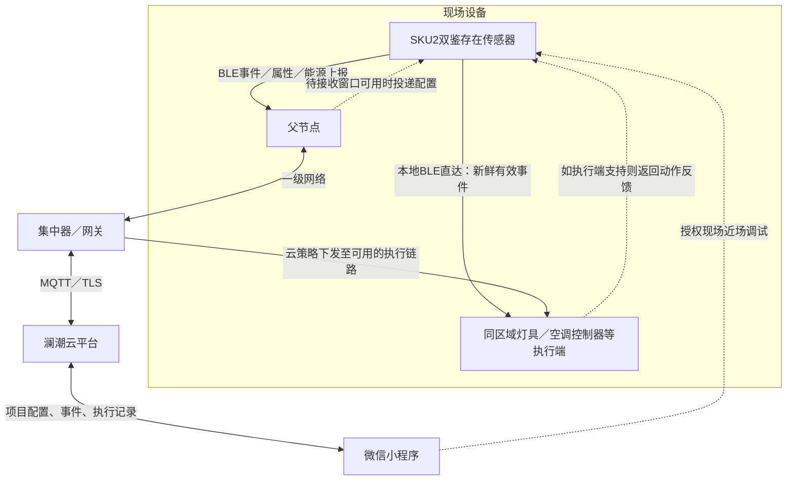
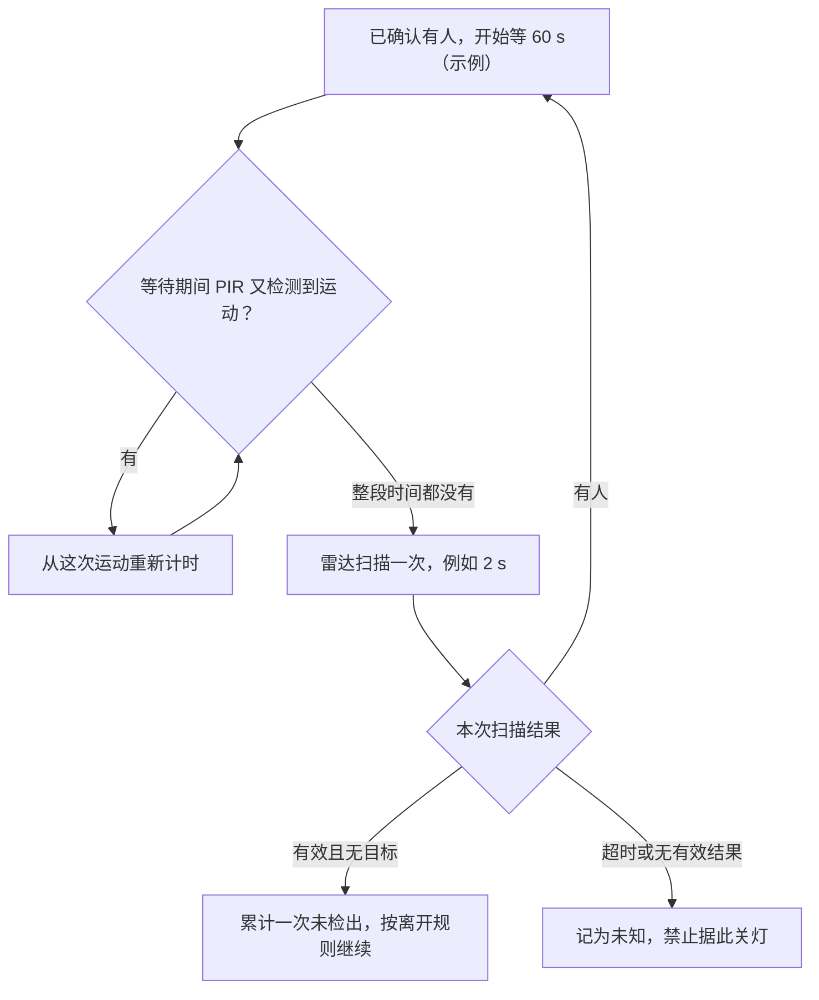
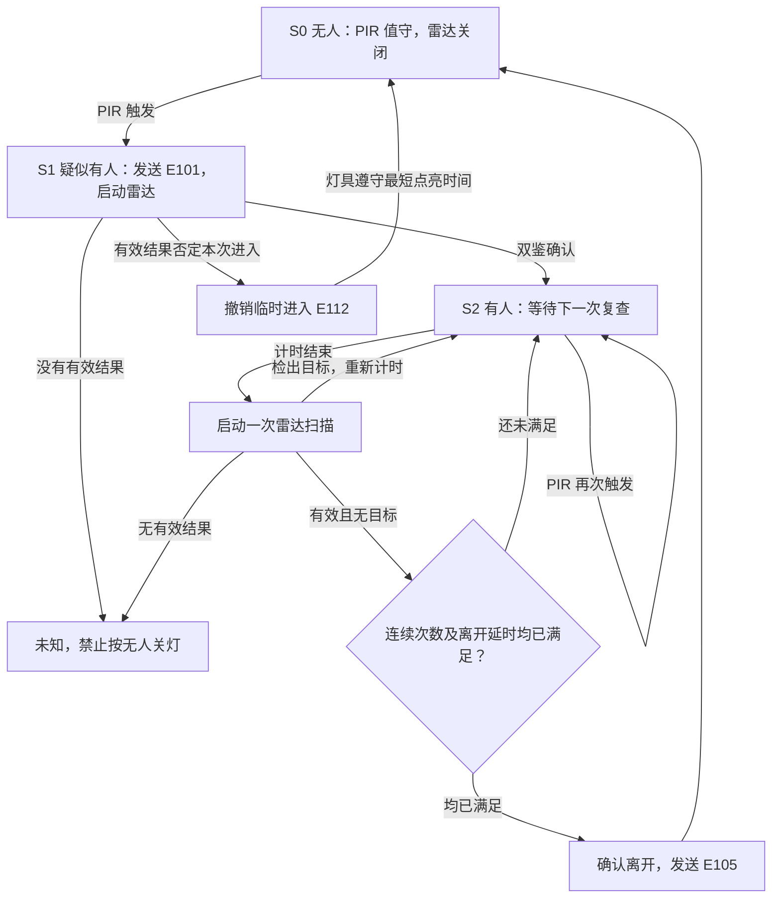
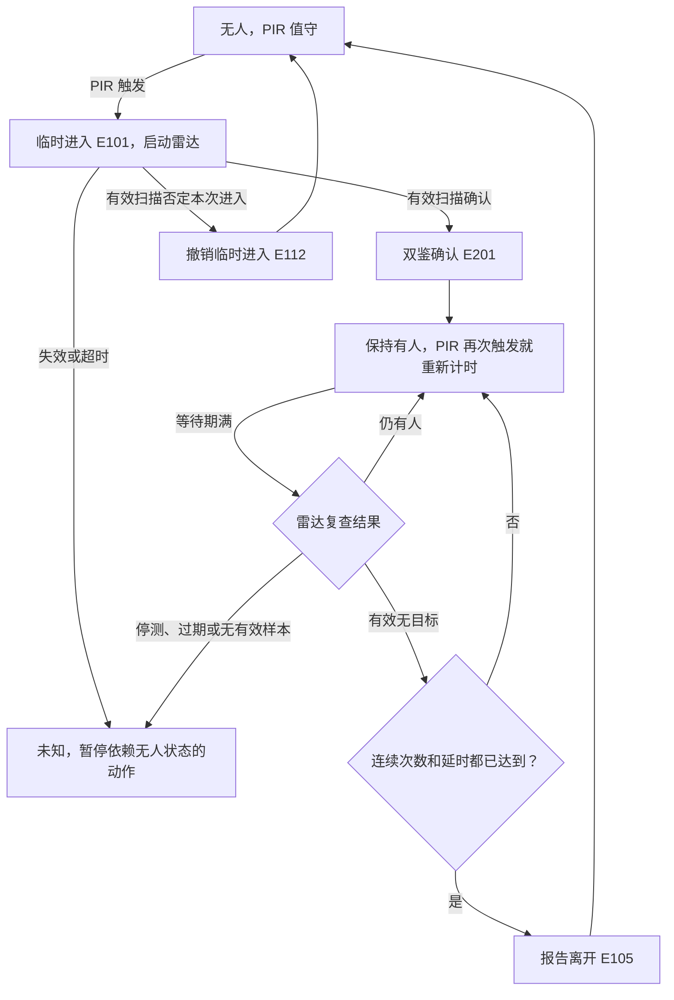
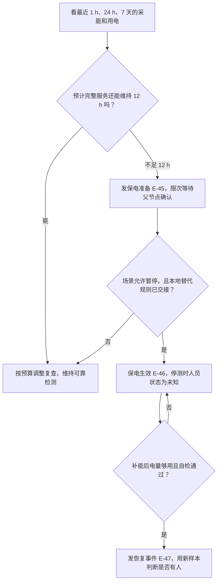
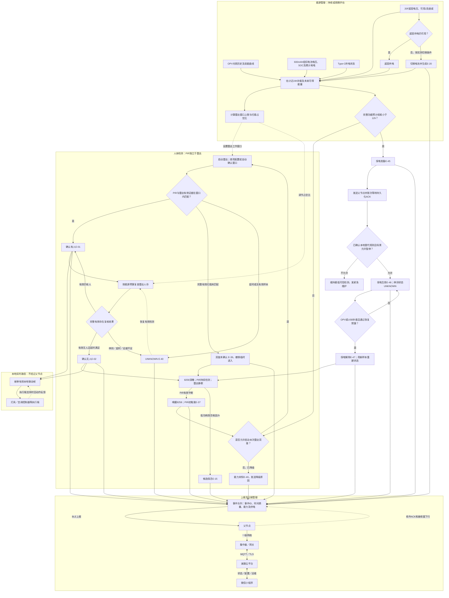

# 澜潮 SKU2 双鉴存在传感器 · 产品需求文档 V2.4

**待评审** · 2026-11-19 · 型号 LC-S-MTS03-PR24-11-001 · 中国大陆、中国香港

会议室里，有人推门进来，PIR 先发现动作。房间够暗、选了“快开”时，灯可以先亮；选了“确认后开灯”，就等雷达确认。人坐下看书，PIR 可能一直没动静。设备默认等 60 秒再用雷达看一次，只有连续几次有效扫描都没看到人、又等满离开延时，才报“无人”。雷达没拿到有效结果时记为“未知”，不能据此关灯。

| 备用一次电池               | 主储能               | 室内光伏标称输出         |
| -------------------- | ----------------- | ---------------- |
| CR2450，3 V / 600 mAh | 超级电容，20 F / 3.8 V | 200 lx 时为 214 µW |

**按问题找内容**

想知道设备装在哪、怎么用，从第 2、3 章读起。要查某个事件怎样开灯、多久报云，直接看[54 条事件配置表](澜潮_SKU2_双鉴存在传感器_PRD_V2.4_功能需求---2.md#matrix54)。要判断样机是否达标，查[验收用例与证据](澜潮_SKU2_双鉴存在传感器_PRD_V2.4_非功能需求---2.md#tc-list)。照度小板是否装配、USB 能否给超容补能都待实测，见[硬件基线](澜潮_SKU2_双鉴存在传感器_PRD_V2.4_非功能需求---2.md#sec-5-1)。

**目录**

1. [文档控制](#ch-1)
2. [产品概述与本期范围](#ch-2)
3. [使用场景与业务逻辑](#ch-3)
4. [功能需求与软件基线](澜潮_SKU2_双鉴存在传感器_PRD_V2.4_功能需求---2.md#ch-4)
5. [硬件基线与非功能需求](澜潮_SKU2_双鉴存在传感器_PRD_V2.4_非功能需求---2.md#ch-5)
6. [测试验收与阶段交付](#ch-6)
7. [风险、依赖与待决事项](#ch-7)
8. [包材、标识与宣传资料](#ch-8)
9. [附录](#ch-9)

同套文档　[主文档](澜潮_SKU2_双鉴存在传感器_PRD_V2.4---2.md) · [功能需求](澜潮_SKU2_双鉴存在传感器_PRD_V2.4_功能需求---2.md) · [非功能需求与验收](澜潮_SKU2_双鉴存在传感器_PRD_V2.4_非功能需求---2.md)

<a id="ch-1"></a>

## 01 文档控制

<a id="sec-1-1"></a>

### 1.1 术语缩写对照表

| 术语          | 本文含义                                                                    |
| ----------- | ----------------------------------------------------------------------- |
| PIR         | 热释电被动红外，用于检测人移动引起的红外变化。                                                 |
| 24G 人存雷达    | 24 GHz 人体存在雷达，配合 PIR 做移动及静止存在判定。                                        |
| Lux         | 勒克斯（lx），表示落在物体表面上的光有多亮。1 lx = 1 lm/m²。走廊暗光约 50～100 lx，阅读办公约 300～500 lx。 |
| lm          | 流明，表示光源总共发出多少可见光。比如一个 5 W LED 球泡约为 400～500 lm。                          |
| LPN         | 低功耗节点，通常是指不用市电作为主电源的终端设备。后续用LPN代指本设备。                                   |
| 父节点         | 一直通电、替传感器收发消息的设备。传感器睡眠时，它先保存消息，等传感器醒来再交给它。支持哪些机型、能连多少台见 D-02。           |
| CCO         | CCO 为一级网络的集中器角色。                                                        |
| SIID、CIID   | SIID 为服务标识，CIID 为条目标识。                                                  |
| 代理快照        | 指父节点按现有物模型封装转发的子传感器当前值。                                                 |
| ACK         | 接收方的确认回复。比如，父节点回复“收到事件”，只能证明这一段送到了；要知道灯有没有亮，还要看灯具反馈或照度变化。               |
| PDT         | 产品开发团队                                                                  |
| EVT/DVT/PVT | 分别指工程验证、设计验证、生产验证。                                                      |
| OTA         | 线上固件升级。                                                                 |
| PXX         | 第 XX 百分位数。例如 P95 时延为 95% 样本不超过的时延值。                                     |

| 术语                | 说明                                                                 |
| ----------------- | ------------------------------------------------------------------ |
| **有效触发角**         | PIR 能可靠触发"有人进入"的水平角度（120°），即产品对外承诺的探测角                             |
| **有效保持角**         | 人已进入有人态后，雷达能继续维持"有人"的角度（150°）；外环不可触发                               |
| **T_radar_delay** | 雷达延迟确认时间：从最后一次 PIR 触发开始计时，到期才启动雷达；PIR 每次触发即重置                      |
| T_scan            | 雷达单次扫描时长，≤5 s，典型 2 s                                               |
| W_verify          | 允许雷达完成这次确认的时间。从启动到拿到有效结果需要 T_scan，因此至少要等够 T_scan。                  |
| PIR 门控            | 雷达仅在 PIR 触发后才启动，无人态完全断电                                            |
| 乐观翻转 + 校验回滚       | 快开时，PIR 先报“疑似有人”。雷达完整扫描后给出有效的否定结果，就撤销本次临时进入并报 E112；超时或没有有效数据时记为未知。 |
| 进入回滚（E112）        | 例如，走廊很暗，PIR 先触发临时开灯。雷达完成扫描并有效否定这次进入后，设备撤销临时动作；灯具仍须亮满最短点亮时间。        |
| 设备心跳（E102）        | 设备存活 + 存在状态的周期上报，用于区分"无人"与"失联"                                     |
| 上报方式 I/A/H/L      | 即时上报（I）／聚合上报（A）／随心跳上报（H）／仅本地记录（L）                                  |
| 四层配置仲裁            | 能量底线 > 安全硬约束 > 云端基线 > 本地配置（需人工确认）                                  |
| 运输模式              | 开关 OFF 后负载隔离；待机电流和库存可用期按 20 F 实装测量。                                |
| 三重一致性校验           | 镭雕码 / 内部存储 / 实际 MAC 三者逐字段比对                                        |
| 扫 A 装 B           | 扫了 A 的码却装了 B 设备，靠"镭雕 MAC = 上报 MAC"拦截                               |
| 形态 A / 形态 B       | 微能量供能 / USB 长期供电                                                   |

<a id="sec-1-2"></a>

### 1.2 变更记录

| 日期         | 版本号     | 类型      | 变更内容和依据                                                                                    | 受影响的需求及验收                                                                                |
| ---------- | ------- | ------- | ------------------------------------------------------------------------------------------ | ---------------------------------------------------------------------------------------- |
| 2026-11-17 | V2.1    | 基线      | 主 PRD 记录的版本。                                                                               | SKU2 共用及专项要求。                                                                            |
| 2026-11-17 | V2.1-01 | 拆分／补充   | 单列 SKU2，补齐大陆、香港的安规、EMC、认证和环境机械验收。                                                          | NFR-05、NFR-06、NFR-08，TC-40～TC-42、TC-61～TC-65，D-12。                                       |
| 2026-11-18 | V2.1-02 | 补充／归并   | 明确 20 F 超容和 600 mAh 备电，补充雷达窗口、能源预测、USB 维护、独立事件和 12 h 保电门槛，修订本地直达路径。《能源管理与生态协同逻辑 V2.3》为专题名。 | FR-ENERGY-01～06、FR-SKU2-01～04、FR-EVT-03、E-37～E-47、TC-66～TC-75、D-07、D-15～D-18，附录 9.3～9.6。 |
| 2026-11-18 | V2.2    | 合并评审稿   | 保留九章，BOM 校订实装，V4.68 逐字段复用；功能、非功能及事件以 HTML 的矩阵为主。                                           | SKU2、54 条主事件、协议适配、能量预测与验证。                                                               |
| 2026-11-19 | V2.3    | 功能需求评审稿 | 按功能点重组软件需求，列出触发、处理、硬件前提与验收条件。                                                              | 第 4 章及全文导航；第 5 章沿用 V2.2。                                                                 |
| 2026-11-19 | V2.4    | 文字与格式修订 | 软件主需求改用现场操作来说明，精简需求来源和重复的验收追踪；流程图改为 Mermaid。                                               | FR-605 增加现场例子；54 条主事件逐行注明云端上报方式。                                                         |

<a id="sec-1-3"></a>

### 1.3 评审记录

| 日期  | 版本   | 评审角色  | 状态      |
| --- | ---- | ----- | ------- |
| 待排  | V2.4 | PDT团队 | **待评审** |

<a id="sec-1-4"></a>

### 1.4 需求来源与基线

| 依据      | 受控来源                                                                                                                                        | 本版使用范围                             |
| ------- | ------------------------------------------------------------------------------------------------------------------------------------------- | ---------------------------------- |
| SKU2 主稿 | [多合一存在传感器-SKU2-双鉴存在传感器-V2.1-02.md](https://chatgpt.com/library?file_id=libfile_c60ec72beb5c8191996fc86d4fc1cddb\&account_id=personal)       | 九章顺序、SKU 专项需求、TC 和 D 编号、能源预测与运维。   |
| 功能与事件   | [澜潮\_微能量双鉴存在传感器\_产品需求文档\_PRD\_v2.0.html](https://chatgpt.com/library?file_id=libfile_6a66599fbeec8191bac69a986d785f78\&account_id=personal) | 功能及性能矩阵、第七章 54 条主事件、六套模板和回滚规则。     |
| 实装物料    | [LC-PIR01-BL-C3-2\_matched.xlsx](https://chatgpt.com/library?file_id=libfile_3ef3576099a08191b929d76849d87048\&account_id=personal)         | 工作表「PIR+24G传感器」。器件额定值、位号、成品与包材编码。  |
| 线协议     | [LC物模型定义总表V4.68(1).xlsx](https://chatgpt.com/library?file_id=libfile_dac11421a3288191bec5a2c014dff7ce\&account_id=personal)                 | 「多合一传感器」「物模型事件上报」「事件上报」「类型」「变更说明」。 |

##### 本轮参数与差异处理

| 评审项      | 本版执行口径                                                                               | 签核 / 证据                           |
| -------- | ------------------------------------------------------------------------------------ | --------------------------------- |
| 备电、储能与采光 | CR2450 3 V／600 mAh，20 F／3.8 V，OPV 标称 214 µW @ 200 lx。以受载电压窗口、漏电和转换效率推算可用能量。          | BOM R4／21／46；D-07、TC-67／74        |
| 照度与防拆    | 照度是 SKU2 必需能力，分表缺独立照度件，四项用途待装配和标定。防拆能力缺实装依据，E407 保留并按能力开放。                           | D-01／09；TC-11～13、TC-64            |
| 进入和离开    | 快开模板的 E101 是临时进入；E201 记录双鉴确认；E105 需要有效空判和离开延时。确认后开灯模板仍可选。                            | FR-103～108、FR-103、FR-402；TC-73／75 |
| 心跳与聚合    | 事件主表 H 档随 300–1800 s 心跳。MD 的 2 h 为低功耗保活候选，需另定工作配置；1/5 min 可作端内统计窗，CL 的 A 档最快 15 min。 | D-02／05；实现返回实际值及版本                |
| 配置生效与审计  | 事务成功或拒绝均应回执并可读回。E504 是成功审计事件，默认 P2 / A / 1 h / 可禁用；E505 为不可禁用的实时拒绝事件。                | §4.2.2、§4.2.3；TC-44／70            |
| 部署数量与用时  | 同区连续批量作业以 >400 点位／人日为目标；单点从开箱到入网的平均 ≤8 min 另计。分别记录批量节拍、异常返工和端到端工时。                   | D-02／13；FAE、TE                    |
| 外壳与使用边界  | IP30 是设计目标，IP20 作为基础验证项。操作、运输、长期储存按整机与器件许可条件签核；披露经试验覆盖的工况。                           | D-09／12；TC-38～42／64／65            |
| 三种电流口径   | 雷达 BOM 的 31 µA、峰值 82 mA @3.3 V、扫描窗 ≤150 µA 目标按各自工况记录。整机、模组和瞬态应分别测量。                  | D-07／15；TC-20／23／69／74            |

MRD、PPR 的正式版本与签核记录待产品负责人补充。

<a id="ch-2"></a>

## 02 产品概述与本期范围

<a id="sec-2-1"></a>

### 2.1 产品概述

<a id="part-50"></a>

#### 现场痛点

会议室里只装 PIR，人静坐时可能熄灯；只靠常开雷达，又容易受卷帘门或管道干扰，还会多耗电。SKU2 用 PIR 发现进入、用雷达复查人是否还在，让照明、暖通和新风按房间的实际使用情况动作。

#### 设备怎样工作

办公室、会议室和教室等有一定光照的室内点位，平时靠室内光伏给超容补能，能量不足时由备用纽扣电池接管。照度用于照明判断，也用于估算采能。

同区域的灯具可以直接收到传感器的 BLE 消息。要把事件、能源状态发给平台，或从平台接收配置，则要经过父节点和集中器／网关。断网或供电不足时，按已签核的规则降级。

<a id="part-76"></a>

#### 产品基线与适用范围

以 SKU2 BOM 为准：**20F/3.8V超容、600mAh CR2450一次电池、OPV参考功率214μW@200lx**。拟通过光照历史、超容可用能量、电池健康和人体状态共同优化雷达工作窗口，以**有条件的五年有效服务**为目标；允许按维护计划USB补能，不能把五年解释为免维护。

##### 现场为什么需要双鉴

| 现有方案        | 致命缺陷                  | 现场表现                                          |
| ----------- | --------------------- | --------------------------------------------- |
| 纯 PIR 人体感应  | 只对**移动**热源响应，静止即判无人   | 办公位静坐 5 分钟灯就灭；被迫把延时调到 20–30 min，节能率回落到 30% 以下 |
| 纯 24G 雷达    | 对金属摆动、管道、穿墙敏感；常驻工作耗电高 | 卷帘门、管道、窗帘导致"无人常亮"；电池型产品几个月没电                  |
| 市电/电池型存在传感器 | 需布线或 1–2 年换电池         | 改造布线成本高于设备本身；万级点位无法规模化运维                      |

初次进入时以 PIR 唤醒雷达校验，确认后以 PIR 重置计时，静默时雷达复查。现场以机身码绑定项目及位置。

##### 现场供电怎么选

| 形态                | 供能方式                                   | 适用场景                                | 能力差                                  |
| ----------------- | -------------------------------------- | ----------------------------------- | ------------------------------------ |
| **A<br />微能量**    | OPV + 20 F 超容                          | 办公、走廊、会议室等有有效受光时长的点位；≥30 lx 仅作踏勘候选。 | PIR 常开；首次雷达校验，保持阶段默认延迟 60 s，按能源窗口调整。 |
| **B<br />纽扣电池**   | CR2450 600 mAh 备用                      | OPV+超容不能满足当前供电能量，由电源管理IC自动切换到纽扣电池供电 |                                      |
| **C<br />USB 外供** | USB 5 V 持续外供为目标形态。整机供电和超容补能由 TC-71 验证。 | 地库、无窗库房等长期低光且有合适电源的位置。              | 雷达延迟可缩至 15–30 s；用完整负载剖面验证稳定工作。       |

##### 产品边界

#### 本产品做（In Scope）

- PIR 门控 + 24G 延迟确认的双鉴存在检测
- 微能量、备用电池与 USB 双供能，自动识别切换
- 光照四用途：联动 / 安装质检 / 免开灯 / **灯具故障辅助判断**
- 事件定义与上报策略逐条配置。范围清单原写 56 条，[事件主表](澜潮_SKU2_双鉴存在传感器_PRD_V2.4_功能需求---2.md#matrix54)实际列出 54 条，编号与配置按主表查，数量差异待评审确认。
- 2.4G 纯叶子终端，经 L2 CCO → L1 CCO 上联
- 背胶（3M 为候选）随手贴；镭雕设备码 + App 位置录入
- 双档运输开关（运输模式 + 手动复位）
- 无孔化外观

#### 本产品不做（Out of Scope）

- 雷达不做独立触发源，只在 PIR 之后启动
- 不做低频保底扫描（已按方案 1 定案）
- 不做中继/路由；不做 Sub-G、不做 PLC
- 不做距离分档 
- 多人计数（转预留）
- 不做室外、雨淋
- 不做粗糙易脱落墙面

<a id="sec-2-2"></a>

### 2.2 产品目标与成功指标

| 目标    | 指标与目前口径                                                                                                                        | 释义或备注                                                        |
| ----- | ------------------------------------------------------------------------------------------------------------------------------ | ------------------------------------------------------------ |
| 入网与部署 | 1）首次配网成功率建议≥98%；<br />2）单点从开箱到组网成功平均≤8min。                                                                                     | 先从小程序扫码到展示，再记录完整安装调整及与生态设备组网时长。                              |
| 人存检测  | 1）双鉴静坐30min的「有人」有效时长占比建议≥99.5%；<br />2）空置静态误触发建议≤1次/24h。                                                                       | 含动物及机械运动误触发验证，具体阈值、样本量由D-08签核。                               |
| 联动与上报 | 1）本地直达从事件判定到负荷实动P95≤1s；<br />2）云端路径从可消费事件到执行端下发P95≤3s；<br />3）断云30min本地直达可用率≥95%；<br />4）LPN在线率≥99%。                           | 本地与云端路径分别测量；本地直达不经父节点。                                       |
| 安全    | 1）本地与云端链路加密；<br />2）本地联动帧防复制/防重放；<br />3）安装防拆事件化。                                                                              | LPN BLE帧保护、云平台安全和执行端动作互证；防拆目前是候选，下一版本需硬件支持。                  |
| 功耗与维护 | 1）**有条件五年有效服务**：BOM 20F＋600mAh；照度历史、光时、PIR触发、雷达持续扫描、BLE、老化进入寿命模型；<br />2）支持定期及预警USB补电／换电；<br />3）预计完整检测剩余续航＜12 h 且场景允许时进入保电决策。 | 不代表免维护；测五年**检测服务可用率**及供电生存时间。HW、TE、D-07/D-18、TC-20～23/67/72。 |
| 事件可配置 | LPN业务事件有独立配置、读回、权限、频率、格式及上报信息，关键告警与配置回执不可关闭。                                                                                   | §4.2 保留原有业务编号与 E-37～E-47 的扩展；三通道主矩阵见 §4.2.3；老快照继续可用。         |

<a id="sec-2-3"></a>

### 2.3 SKU、产品型号与出厂编码

| SKU  | 产品名称及能力 | 主要模组                 | MAC类别 | 型号                     | MAC示例               |
| ---- | ------- | -------------------- | ----- | ---------------------- | ------------------- |
| SKU2 | 双鉴存在传感器 | PIR + 24G 人存雷达 + 光照度 | 41／C1 | LC-S-MTS03-PR24-11-001 | `00 C1 41 XX XX XX` |

铭牌MAC二维码、硬件版本及能力集以本 SKU 的出厂档案核对，登记与防错见 D-01。

<a id="sec-2-4"></a>

### 2.4 用户角色与 PDT 分工

| 用户角色      | 主要任务                       | 所需能力或权限                                                                    |
| --------- | -------------------------- | -------------------------------------------------------------------------- |
| 实施调试（FAE） | 选型、布点、安装、扫码、诊断入网、标定组别、验证功能 | 验证PIR唤醒、静止存在、安装点光照度及生态设备联动。                                                |
| 项目管理员／运维  | 管理配置、策略、离线告警、升级和换机         | 按授权访问点位及告警，读回实际生效配置、失败原因与操作记录。                                             |
| 空间使用者     | 使用稳定照明与暖通，必要时手动调节          | 1）只访问授权控制能力；2）LPN策略优先级低于用户主控优先级，用户采取原厂控制器主动控制后，LPN不可更改当前状态（目前LPN做不到，留作待决）。 |

| PDT领域     | 主责工程师或接口人       | 本期职责与交付                                                     |
| --------- | --------------- | ----------------------------------------------------------- |
| 产品        | 张涛              | SKU和场景基线、需求及待决签核。                                           |
| ID、MD     | 睿鑫光电（外协）；张涛、黄伟宁 | 面壳、镜片、安装件及结构图、包材设计，核对本SKU传感与开窗要求。                           |
| HW        | 潘志强             | 硬件方案选型、原理图、PCB layout等，保证预设功能实现。                            |
| FW        | 朱上志             | BSP、HAL、应用层搭建，保证预设功能实现。                                     |
| 云平台、微信小程序 | 由张涛与周盟东对接       | 物模型与配置、权限、路由、状态和联动、事件解析、调试导引和反馈。                            |
| TE        | 由金文聪指派          | 测试主管依据PRD制定测试用例并指定本产品主责测试人员。                                |
| PE        | 郑映              | 参与NPI及工装设计，制定SOP和产测方案，输出出厂检测报告。                             |
| 供应链       | 杨波              | 对电子物料和包材物料的交期负责。                                            |
| 交付        | 张涛              | 交付电子档资料和工厂检测合格的整机。电子档包括规格书、使用手册、发行说明、合规资料集；PVT、MP整机到仓库视为交付。 |

##### 目标客户与角色

| 角色         | 核心诉求                    | 成功判据                                          |
| ---------- | ----------------------- | --------------------------------------------- |
| 物业公司
（付费方） | 1）电费下降、不用管电池
2）可量化节能收益  | 1）照明能耗降 60%+，地库 85%+；年度零维护工单
2）能耗大屏按点位/分区出节能率 |
| 工程安装商      | 装得快、录入不麻烦               | 单人单日 >400 点位（含拨开关与扫码）；扫码一次成功                  |
| 系统集成/运维    | 远程可控；点位可追溯；**灯具故障可被发现** | 90% 异常远程可判；可按点位/群组调整上报策略；开灯无响应可自动上报           |

<a id="ch-3"></a>

## 03 使用场景与业务逻辑

### 3.1 系统拓扑



本地动作直接到同组执行端。父节点负责上行缓存和下行投递，小程序经授权可近场读回。

本版按**本地直达、云端上报和授权近场调试三条路径**定义。

1. **本地通信路径：** SKU2 → 同区域已授权的执行端（BLE直接发送，**不经父节点**）；执行成功与否以实际可用的执行端回执为准，不能把发出广播视为物理动作完成。
2. **云端通信路径：** SKU2 → 父节点 → 集中器／网关 → 澜潮云平台 → 微信小程序。云策略需要执行时，由平台经可用执行链路到执行端，不必回经SKU2。
3. **近场通信路径：** 授权的微信小程序 ↔ SKU2，用于安装、调试与读回，需核对硬件能力、窗口、电量及权限。
4. **一致性规则：** 同一事件的本地与云端消费按 `eventId`、有效期与规则版本去重，避免同一灯具重复动作；旧代理快照兼容接口保持可用。


##### 唤醒窗口与父节点时隙编排

| 机制     | 要求                      | 说明                             |
| ------ | ----------------------- | ------------------------------ |
| 唤醒窗口长度 | 100–500 ms（暂定）          | 形态 C 可取上限提升下行成功率               |
| 唤醒时刻协商 | 节点与父节点协商基准时刻与周期         | 入网或参数变更时协商                     |
| 时隙编排   | 父节点编排各子节点唤醒窗口；单父节点 ≤8 台 | 8×500 ms=4 s，相对 300 s 周期占 1.3% |
| 窗口超时   | 无下行 → 立即继续休眠            | 不做无意义等待                        |
| 交互维持   | 有下行或有上传 → 按交互需求维持       | 需约定最长维持上限                      |
| 外部触发唤醒 | 仅 PIR 可随时唤醒；雷达不作为触发源    | —                              |

8 台上限的代价：按办公 30 m²/台算，单父节点覆盖约 240 m²，2000 m² 楼层需 8–9 个父节点，需计入网络规划成本。

##### 三条硬约束

| #   | 约束                         | 原因与影响                                                                                         |
| --- | -------------------------- | --------------------------------------------------------------------------------------------- |
| 1   | **不可作为中继 / 路由节点**          | 中继需 7×24 常收，功耗 mA 级。误编为父节点会陷入"能量耗尽—重启—再被选为父"死循环。入网须带 `devClass=HARVEST_LEAF`、`canRelay=false` |
| 2   | **仅 2.4G，不接 PLC、不用 Sub-G** | 无市电耦合无法做 PLC；统一 2.4G 单模                                                                       |
| 3   | **父节点必须缓存 OTA 包**          | 节点长期休眠无法维持长连接下载；资源不足走小分片+唤醒逐片下发                                                               |

##### 双向暂存与失败回退

| 方向       | 机制                                  | 溢出处理                             | 节点侧配合                      |
| -------- | ----------------------------------- | -------------------------------- | -------------------------- |
| **下行**   | 父节点为休眠子节点暂存下行报文，唤醒窗口内投递             | 溢出则上游返回失败，云侧重试                   | 窗口内未收到即继续休眠                |
| **本地广播** | **不经树形路径**：2.4G 泛洪组播直达同群组灯节点，TTL ≤4 | 超 TTL 自然丢弃；无确认则重播 2 次，仍无确认报 E606 | 灯侧按 `evtSeq` 去重后执行，并回短 ACK |
| **上行**   | 父节点接收后暂存再转发，防父节点离线丢报文               | 超暂存深度则**通知发送失败**，节点写入事件缓存，下次唤醒重传 | "未确认→本地缓存→重传"；缓存满时上报丢弃条数   |

上行暂存比下行更重要：下行可重发，上行丢失是事件永久丢失。建议"父节点 ACK 后才删本地缓存"的两阶段语义。

<a id="sec-3-2"></a>

### 3.2 人存场景与业务闭环

| 场景    | 有效光照条件             | 人员活动特征  | 生态交互逻辑         |
| ----- | ------------------ | ------- | -------------- |
| 办公室   | 工作时段持续照明           | 久坐、走动   | 有人保持照明，无人延时关闭  |
| 会议室   | 使用时段有照明，空闲时可能关灯    | 久坐、微动   | 有人维持灯光/空调，无人节能 |
| 教室    | 白天自然光或人工照明         | 久坐、走动   | 按占用状态及照度调节照明功率 |
| 医院候诊区 | 通常长时间照明            | 久坐、走动   | 人体存在监测、分区照明联动  |
| 独立办公间 | 工作时段有光，非工作时段可能无光   | 久坐、短暂离开 | 有人维持照明，无人延时节能  |
| 地下停车场 | 部分区域长期低照度（建议USB供电） | 快速移动    | 人/车来灯亮、无人/车低亮； |
| 卫生间   | 使用时有光，空闲时通常无光      | 静止、微动   | 有人保持照明，无人关闭    |

##### 典型场景与形态选择

| 场景          | 推荐形态       | 推荐姿态          | 无人延时   | 特殊约束                      |
| ----------- | ---------- | ------------- | ------ | ------------------------- |
| 开放办公区       | 微能量        | 顶装 / 斜装       | 15 min | 必须检出静坐；避开空调出风口            |
| 地下车库        | **USB 外供** | 顶装 / 倒装       | 3 min  | 建议就近取 5 V；取电困难点位退化为微能量+电池 |
| 走廊 / 楼梯间    | 微能量        | 斜装（2.0–2.4 m） | 30 s   | 重不漏检；白天照度足可启用免开灯          |
| 卫生间         | 微能量        | 顶装 / 斜装       | 60 s   | 隔间遮挡，PIR 视线受阻             |
| 会议室         | 微能量        | 顶装            | 5 min  | 幕布摆动、长时间静坐                |
| 设备机房 / 密闭库房 | **USB 外供** | 斜装（门内侧）       | 2 min  | 完全无光，微能量不可行               |

勘测同时记录照度、光谱、有效光时及人员活动。≥30 lx 和 <10 lx 是旧稿的选型起点；低光但有电源可部署经验证的 USB 形态。其余点位按 §9.4 计算维护需求。

##### 安装、扫码与点位验收

> 现场执行。FAE 开箱检查、设备通电，用微信「澜潮智联」扫码安装，核对机身 MAC、设备名称、所属项目、设备类型、设备型号及位置。项目、类型与型号取授权下拉选项。装好后验证 PIR 首触发、雷达静坐保持、安装点照度、同组执行端和云端记录。

##### 四种安装姿态

| 姿态     | 推荐高度/角度                | 适用场景           | 探测特性           |
| ------ | ---------------------- | -------------- | -------------- |
| **顶装** | 吊顶 2.6–3.2 m，垂直向下      | 办公大开间、会议室、地库   | 对称覆盖；静坐检出好     |
| **斜装** | 墙面 2.0–2.4 m，下倾 20–45° | 走廊、门框内侧、楼梯口、立柱 | **对人流方向检出率最高** |
| **侧装** | 墙面/立柱 1.2–2.0 m        | 货架侧板、管井旁、隔断上沿  | 水平扇形，适合横向动线    |
| **倒装** | 梁下/桥架下                 | 地库、厂房          | 同顶装，注意金属梁反射    |

姿态必须写入配置（`mountMode`）。顶装是"俯视锥"、侧装是"水平扇"，距离-能量映射与微动阈值完全不同；用同一套参数会让侧装/斜装点位的误报与漏检显著恶化。

##### 背胶附着面清单

| 基材        | 适用性     | 处理要求            | 风险提示                            |
| --------- | ------- | --------------- | ------------------------------- |
| 乳胶漆墙面/吊顶  | 可用（有条件） | 确认漆面牢固；酒精擦净除尘干透 | **劣质乳胶漆会整片脱落**，连带撕下设备；现场做胶带拉拔试验 |
| 瓷砖/玻璃/金属  | 优       | 酒精除油、干透         | 金属低温易结露影响初粘                     |
| 矿棉板/石膏板   | 需评估     | 加装背板或改卡扣固定      | 表层疏松，胶贴可能带走表层                   |
| 木饰面/三聚氰胺板 | 优       | 除尘即可            | —                               |
| 粗糙水泥/砖墙   | 不可用     | —               | 接触面积不足                          |
| 粉化/起皮/潮湿墙 | 不可用     | —               | 必须改卡扣或打孔                        |

##### 镭雕设备码与位置录入

###### 镭雕码内容与工艺

| 要素        | 要求                                                        | 说明                                                    |
| --------- | --------------------------------------------------------- | ----------------------------------------------------- |
| **承载内容**  | `modelCode` + `MAC`(12 位) + `batch` + `mfgDate` + `hwVer` | 一扫带出全部出厂信息，消除手输 MAC 的错录风险。<br />当前版本只有出厂编码+MAC，后期会改革。 |
| 码制        | QR                                                        | 需兼容手机摄像头与工业扫码枪                                        |
| 尺寸与位置     | ≥8×8 mm；侧面凹槽，避开探测窗与 USB 口                                 | 与开关、USB 口同区，用同色盖片遮蔽                                   |
| **对比度**   | PCS ≥0.3；深色壳用浅色打标，浅色壳用深色打标                                | 深色壳对比度是最大风险，打样阶段必须实测                                  |
| 耐磨耐污      | 酒精擦拭 50 次后仍可识读                                            | 设备装在高处，后期难清洁                                          |
| **扫码成功率** | 一次 ≥99.00%；两次内 ≥99.90%                                    | 列入来料与出货检验项                                            |

###### 产线写入与三重一致性校验

| #   | 工序         | 动作                                   | 合格判定               |
| --- | ---------- | ------------------------------------ | ------------------ |
| 1   | 镭雕         | 激光打标机在外壳底面刻码（型号+MAC+批次+日期+hwVer）     | 可读、对比度达标           |
| 2   | **扫码读码**   | 产线扫码枪读取镭雕内容，自动录入产线系统                 | 一次读取成功；失败则重刻或判废    |
| 3   | **写入内部存储** | 经测试工装（USB，**开关可保持 OFF**）写入设备非易失存储专用区 | 写入成功回读校验值          |
| 4   | **回读比对**   | 从设备读回内部存储，与扫码结果逐字段比对                 | **完全一致；不一致不得出厂**   |
| 5   | MAC 一致性    | 核对内部存储 MAC 与芯片实际广播 MAC               | 一致；否则判为标错/改装       |
| 6   | 预充与运输模式    | 超容预充至 3.5 V → 拨开关至 OFF → 包装          | 待机电流 ≤2.5 µA 为抽检目标 |

镭雕码、内部存储和设备实际广播的 MAC 要对得上。这样，换错外壳、工装写错、扫了 A 却装了 B 都能发现。建议完成校验后把内部身份存储区设为只读。

###### App 位置录入要求（决定 400 点位能否达成）

| #   | 功能          | 要求                            | 省下的时间        |
| --- | ----------- | ----------------------------- | ------------ |
| 1   | **位置四级结构**  | 楼栋 / 楼层 / 区域 / 点位号，与云端图纸范围对应  | 基础结构         |
| 2   | **位置记忆**    | 记住上一次录入的位置，同区域连续安装自动预填        | 每点位省 12–18 s |
| 3   | **点位号自动递增** | 扫下一个码时序号自动 +1（A01→A02），支持手动跳号 | 每点位省 5–8 s   |
| 4   | 平面图选点（可选）   | 有楼层图纸时直接点选，自动填充四级位置           | 适用有 CAD 图纸项目 |
| 5   | 重复校验        | 同位置重复绑定、同设备重复登记即时拦截           | 防错绑          |
| 6   | 离线暂存        | 无网时本地暂存，恢复后批量提交               | —            |

###### 节拍重算

| #   | 位置录入方式            | 录入耗时       | 单点位节拍      | 400 点位所需工时        |
| --- | ----------------- | ---------- | ---------- | ----------------- |
| A   | **位置记忆 + 序号自动递增** | **约 10 s** | **约 57 s** | 6.3 h（可行）         |
| B   | 每次完整选四级位置         | 约 25 s     | 约 72 s     | 8.0 h（实际约 325 点位） |
| C   | 现场只扫码，位置事后补录      | 约 6 s      | 约 53 s     | 5.9 h，但有时序错配风险    |

**方案 A 动作拆解（57 s）：**移动定位 15 s + 撕膜贴附 10 s + 压合 6 s + **拨开关 4 s** + 扫镭雕码 5 s + 位置确认 5 s + 姿态选择 4 s + 转场 8 s。

要达到每人每天 400 个点位，App 得记住上一个位置，并把点位号自动加一。每次重选四级位置会多花约 15 秒，日安装量约降到 325 个。这两项建议按 P0 与固件同步开发。

##### 白名单机制

| 环节         | 动作                                     | 失败处理                            |
| ---------- | -------------------------------------- | ------------------------------- |
| 绑定提交       | 扫镭雕码自动带入设备信息，叠加现场录入的四级位置与姿态，提交云端       | 重复绑定/位置冲突 → 拒绝并提示               |
| **设备身份校验** | 镭雕码中的 MAC 与设备实际上报的 MAC 必须一致，防"扫 A 装 B" | 不一致 → 拒绝绑定并告警（E509）             |
| 白名单校验      | 核对设备是否属本项目、位置是否在图纸内、是否被占用              | 未通过 → 可入网但**不得输出联动指令**，标"待核"并告警 |
| 放行         | 通过后写入白名单，设备获得业务授权与 `locCode`           | —                               |
| 变更留痕       | 位置变更、设备替换记录操作人、时间、旧值新值                 | —                               |

##### 安装流程（顺序不可颠倒）

1. **取件**：按箱取件。
2. **能量核查**：检查超容电压；<3 V 则 USB 补电至 3.5 V 再装（<10 min 为目标，样机验收后发布）。
3. **基材判定**：对照 11.2；乳胶漆面做拉拔试验。
4. **粘贴**：酒精擦拭 → 干透 → 撕膜 → 压合 ≥10 s。
5. **拨开关至通电**：将底部双档开关从 OFF 拨到 ON（指甲或小工具，力度 3–5 N）。**必须先通电再扫码**——设备通电才能入网，扫码登记时才能即时校验在线状态。
6. **扫码绑定**：扫镭雕码（自动带出型号/MAC/批次）→ App 录入位置（默认沿用上次+序号递增）→ 选姿态与倾角 → 提交。
7. **白名单校验**：等待云端返回；未通过现场处理。
8. **入网确认**：App 显示上线即完成。
9. **分批自检**：2 h 后平台出报告与返工清单（含照度评估与策略核对）。

扫码后设备仍未上线，App 提示“请确认底部开关已拨至 ON”。

##### 安装位置要求

| 要素            | 要求                                                  | 违反后果                    |
| ------------- | --------------------------------------------------- | ----------------------- |
| 安装高度          | 顶装 2.6–3.2 m；斜装 2.0–2.4 m；侧装 1.2–2.0 m              | 微动检测失效或覆盖不足             |
| 采光面朝向         | 朝向室内光源或窗户，不得朝暗角                                     | 照度不足 → E309 告警 + 电池加速消耗 |
| 远离气流源         | 距空调出风口 ≥1.5 m、新风 ≥1 m                               | PIR 温度扰动 → 回滚率升高        |
| 远离金属摆动体       | 距卷帘门/吊扇/管道 ≥2 m                                     | 雷达虚警率抬升                 |
| 避开玻璃正对        | 不得正对玻璃，水平偏移 ≥30°                                    | 穿墙检测致邻室误触发              |
| 布点密度          | 办公 25–35 m²/台；走廊 8–12 m/台；地库 2–3 车位/台（按 120° 触发角核算） | 过疏漏检，过密互相干扰             |
| 父节点容量         | 单父节点下挂 ≤8 台                                         | 超限需增加父节点或迁移             |
| USB 取电位（形态 B） | 就近 5 V 源，线长 ≤3 m，走线隐蔽                               | 线缆外露影响观感、易被拉扯           |

##### 会议室案例：快开、双鉴确认与判离

| 现场时刻           | 本地动作                                                   | 父节点及云端证据                                    |
| -------------- | ------------------------------------------------------ | ------------------------------------------- |
| 夜间有人走入，PIR 初触发 | 快开模板由 E101 触发临时开灯。照度门控满足且灯支持确认时等待短 ACK。                | 记录 PIR 时刻及 evtSeq；云端可按 A 档 15 min 汇聚。       |
| 雷达在有效窗内确认      | E201 表达双鉴确认。确认后开灯模板在此刻执行一次已授权动作；快开模板只更新状态。             | E201 仍按主表默认仅本地记录。云端需要确认边沿时启用相应订阅／模板，保留事件身份。 |
| 人员静坐、随后离开      | PIR 无新脉冲后启动雷达复查；连续有效空判且延时满足才由 E105 联动。雷达停测则更新 UNKNOWN。 | 分开保存灯侧收件、父节点接管、云端入库以及照度变化。用同一动作 ID 核对重复投递。  |

<a id="ch-6"></a>

## 06 测试验收与阶段交付

用例和判定方法见[6.1 验收表](澜潮_SKU2_双鉴存在传感器_PRD_V2.4_非功能需求---2.md#sec-6-1)。阶段评审按下列出口条件检查。

<a id="sec-6-2"></a>

### 6.2 阶段交付及出口条件

> 计划采用相对周。T0 为项目批准的启动日，评审时补入实际日期及责任人。

##### 阶段计划

| 阶段      | 周期           | 关键交付物                             | 出口条件                            |
| ------- | ------------ | --------------------------------- | ------------------------------- |
| M0 需求冻结 | T0 – T+2W    | 当前版本 PRD 会签、事件主表、物模型登记初版与雷达验证方案   | 三方会签；提交雷达扫描期电荷、首帧时间、接口能力及未达项处置。 |
| M1 EVT  | T+3 – T+10W  | 功能样机、三态功耗、延迟确认链路、开关与运输模式、配置体系原型   | 无人 ≤12 µA；开关待机 ≤2.5 µA；配置回读打通   |
| M2 DVT  | T+11 – T+20W | 四姿态算法回归、指标实测、胶贴老化、光照四用途、白名单与配置联调  | 指标达标；E605 检出率达标；配置回读 100%       |
| M3 PVT  | T+21 – T+26W | 小批试产、安装工艺（含 App 位置录入）、后台自检平台、认证送测 | 直通率 ≥95%；安装实测 >400              |
| M4 MP   | T+27 – T+30W | 量产固件、施工手册、隐私声明卡、FAE 培训包           | 试点 30 天达标；认证到位                  |

| 阶段         | 交付物                                                                  | 出口条件                                                              | 牵头团队及待决事项                                     |
| ---------- | -------------------------------------------------------------------- | ----------------------------------------------------------------- | --------------------------------------------- |
| 需求及架构评审    | 当前版本 PRD、本 SKU 能力与已知差异、Mermaid系统拓扑、雷达窗口与20F/600mAh能源模型、USB维护及EVT验证计划 | 产品确认范围、关键策略与指标工况。样机和供应配置有负责人。                                     | 产品、架构、HW，D-01、D-02、D-07、D-14。                 |
| 物模型及接口冻结   | 签核物模型、事件码和配置表、旧快照兼容矩阵、上下行样例、时间及确认协议                                  | 端到端支持矩阵可配测。各事件配置、必报字段、版本、时间和确认对象可对齐。                              | 协议、FW、云平台、TE，D-03、D-04、D-05。                  |
| EVT／DVT 样机 | 本 SKU HW/BOM、结构与 FW 版本、功耗、检测、标定、现场安装及诊断证据                            | 照度硬件可用，双鉴门控、照度及功耗通过测试。24 GHz 射频样品、天线及固件具备两地预检依据。                  | HW、MD、FW、TE，D-01、D-07、D-08、D-09。              |
| 系统联调       | 终端到云链路、配置、补报及策略报告，升级和回退记录                                            | TC-44～TC-49及TC-70、TC-73、TC-75等关键用例按适用版本通过。断云和恢复、旧快照、新事件与状态消费完成对账。 | 网关、云、小程序、FW、TE，D-02、D-03、D-04、D-05、D-10、D-11。 |
| PVT 与项目试点  | 产测工装、兼容与合规报告、包材、安装说明、点位验收、培训和售后诊断                                    | 批次、标定及标识追溯完整。点位按本款能力验收。两地分别取得适用的准入证据，包装、附件及宣发与验证范围一致。             | PE、认证、交付、产品，D-09、D-12～D-14。                   |

<a id="ch-7"></a>

## 07 风险、依赖与待决事项

##### 风险登记

| #   | 风险                              | 等级  | 影响                                | 缓解措施                                                       |
| --- | ------------------------------- | --- | --------------------------------- | ---------------------------------------------------------- |
| R1  | **雷达模组扫描电流超标**                  | 高   | 若只能满功率 25 mA 扫描，PIR 门控在微能量下不成立    | M0 一票否决式实测；备选低功耗模组 2–3 家                                   |
| R2  | **T_scan 低温延长导致误回滚**            | 高   | 冬季"开灯后又灭"集中爆发                     | 优先选带 DRDY 模组(data ready)；否则 W_verify 按最坏 5.5 s 固定；-10 ℃ 专项 |
| R3  | **延迟确认过长导致"人坐下后很久才发现走了"**       | 中高  | 低电档 6 × 300 s 约 30 min，另核实际确认延时。  | 限制低电档仅用于能量确紧张的少数点位；N_leave 与延迟联动；云端标记降级点位                  |
| R4  | 开灯响应校验误判                        | 中高  | 白天高照度、调光场景、多灯共用一传感器时误报 E605       | 按 FR-604／E605：开灯前 &lt;300 lx、亮度 ≥70%、连续两次异常；并核灯侧回执。        |
| R5  | 位置录入拖累安装效率                      | 高   | 400 点位/人日不达标                      | App 位置记忆+序号递增列 P0；M2 完成、M3 实测；未落实则下调至 325                  |
| R6  | 镭雕码对比度不足                        | 中高  | 深色壳体扫不上或误识                        | 打样四色实测 PCS；必要时浅底打标；来料 100% 扫码检验                            |
| R7  | 开关漏拨/误拨/氧化                      | 高   | 漏拨则不上电；氧化则"偶发不上电"，最难排查            | 产线 100% 记录 + 抽检电流；镀金触点；App 提示；振动测试                         |
| R8  | PIR 失效导致静默失效                    | 高   | 用户以为正常，实际无检测能力                    | PIR 自检 6 h + 7 天零触发判据 + 后台批量自检                             |
| R9  | 背胶在劣质墙面脱落                       | 高   | 吊顶掉落砸人；整批返工                       | 现场拉拔与基材清单；吸顶防坠及固定件专项验证。防拆或脱落事件待硬件支持。                       |
| R10 | 外观被误认为摄像头                       | 高   | 员工投诉导致整层推进受阻                      | 无孔化设计；盲测评审；隐私声明卡                                           |
| R11 | 移动 >99% 与静止漏报 &lt;1次/72h 不可同时达成 | 高   | DVT 可能卡关                          | M0 确认让步优先级（建议优先保静止漏报）                                      |
| R12 | 父节点未实现时隙编排与双向暂存                 | 高   | 短窗口下大面积丢包                         | 写入 L2 协议强制项；8 台限容；专项测试 18、19                               |
| R13 | 54 条事件配置的运维复杂度                  | 中高  | 现场不知该配什么，配置错乱                     | 以模板为主、逐条微调为辅；默认即推荐值；偏离基线点位单独标记                             |
| R14 | **灯具侧不支持短 ACK 回执**              | 高   | 本地广播无法确认送达，关灯成功率无从保证；E606 失效      | M0 前与灯具团队确认协议；若不支持，退化为"广播不确认 + 灯具侧自觉重试"，并在验收口径中删去"关灯成功率"承诺 |
| R15 | **三通道配置项过多，现场配错**               | 中高  | 误关本地广播导致开灯变慢，或误把 P0 配成 L 档导致事件不上云 | 硬约束兜底 + 六套模板 + 偏离基线标记；App 侧对"关闭关键事件本地广播"二次确认               |

##### 待决事项（M0 前关闭）

**方案决策与 SKU2 证据状态**

| #   | 事项                   | 决策方      | 结论 / 待定内容                                                   |
| --- | -------------------- | -------- | ----------------------------------------------------------- |
| 1   | 雷达模组型号               | 硬件 + 算法  | BOM 选型 RKB1161A3。扫描 ≤150 µA、T_scan ≤5 s、DRDY 为验证目标，待提供实装证据。 |
| 2   | 扫码方案                 | 产品线      | 沿用机身码及小程序位置录入。工艺、码制、尺寸、对比度和可扫描率由产线样件验收。                     |
| 3   | 光照通道                 | 产品线      | SKU2 产品定义已含照度及四个用途。当前 BOM 分表未列独立照度件；小板与整机证据由 D-01 关闭。       |
| 4   | 本地配置确认机制             | 产品线      | 关闭 云端人工确认；72 h 告警、7 天回退                                     |
| 5   | 能量拓扑与开关位置            | 硬件       | BOM 器件已核对；三源切换、开关断路位置、USB 直供及充电支路待 TC-71/74 波形。             |
| 6   | 低电档 T_radar_delay 上限 | 产品线 + 算法 | 关闭 **300 s**，同时减少鉴别次数；N_leave 同步加大到 6                       |
| 7   | E605 生效条件是否放宽        | 产品线 + 云端 | 关闭 **放宽**：&lt;300 lux 且亮度 ≥70% 档；阈值自适应；连续 2 次无效才报           |
| 8   | 事件上报是否区分出口           | 产品线 + 云端 | 关闭 拆为本地广播 / 父节点上行 / 云端上报三通道，周期全可配                           |

**仍待决**

| #   | 事项                   | 决策方          | 结论 / 待定内容                                                     |
| --- | -------------------- | ------------ | ------------------------------------------------------------- |
| 9   | **灯侧确认协议能否作为灯具侧强制项** | 灯具团队 + 产品    | E101/E105 的"广播+灯确认"依赖灯具固件回 ACK；若灯具侧不支持，只能退化为"广播不确认"，关灯成功率无法保证 |
| 10  | **最大点亮时长兜底是否由灯具侧实现** | 灯具团队         | 低电档最坏判离可达 30 min；建议灯具侧强制上限（默认 30 min），避免长时间空亮                 |
| 11  | App 位置记忆与序号递增能否按期交付  | 产品线 + App 团队 | 列 P0，与固件同步开发；缺此项日安装量降至约 340                                   |
| 12  | 是否需要"按群组批量配置"粒度      | 云端 + 产品      | 建议支持项目/楼栋/楼层/群组/单点五级                                          |
| 13  | 事件清单与物模型 JSON 交付时点   | 产品线          | PRD 定稿后 1 周内                                                  |

##### SKU2 待决事项、责任与关闭证据

| ID       | 待决事项及资料差异                                                                                                                | SKU、影响及节点                          | 拟确认角色及所需证据                                                 | 状态                                      |
| -------- | ------------------------------------------------------------------------------------------------------------------------ | ---------------------------------- | ---------------------------------------------------------- | --------------------------------------- |
| D-01     | 照度小板、开窗及整机装配，核对 BOM 名称、正式型号、MAC 号段、能力集、铭牌与工装。                                                                            | SKU2，架构评审及备料前确认。                   | 产品、ID、MD、HW、PE、编码管理。提供结构图、元件级 BOM 和工装，核对新旧型号、号段与两档开关的电气接法。 | 功能组合已确认，物料与编码待确认。                       |
| D-02     | 父节点型号与资格，BLE 协议栈，常电父节点、网关及本地策略角色、近场能力、父节点直挂与网关总规模、实际心跳及离线门槛。S-04 参考直挂 8、连续 3 个周期。                                        | SKU2，接入、收件、本地运行，架构及联调前。            | 网关、FW、云平台、TE。提供网络拓扑、现网协议、支持版本、并发及路由证据。                     | 待确认。                                    |
| D-03     | 多合一新 SIID/CIID、掩码、配置及 ACK 字节编码，旧快照 21/23 B 版型、产品枚举及有效标记。确认本 SKU 的有效性及数据语义。                                               | SKU2，事件联调与存量兼容，接口冻结前确认。            | 协议、FW、网关、云平台。提交逐 SKU 编码表、原生帧样例、掩码容量与无效值测试。                 | 兼容旧快照并新增逐事件接口已确认，编码及版本映射待冻结。            |
| D-04     | 事件时间、日期锚点、全温 RC、失准降级、缓存、确认和保序。按具体工况评估 S-04 的 100 ms 时间精度。用实际事件量验证 S-04 中的缓存参考值（最低 16 条，建议 200 条）。                        | SKU2，重连、跨日、故障审计及统计，接口冻结和联调前确认。     | HW、FW、网关、云、TE。给出时基误差、时间字段转换、Flash 图、离线覆盖、ACK 交接及完整抓包。      | 待确认。                                    |
| D-05     | 各事件默认周期、阈值、窗口、字段白名单、选配诊断、告警实例和角色权限。相关时延与成功率按在线、并发和供电模式签核。                                                                | SKU2，配置与权限冻结和验收。                   | 产品、协议、FW、云、TE。确认事件逐行矩阵、拒绝码、配置读回、小程序样例及测试分布。                | 关键告警与配置回执实时锁定已确认，其余参数待冻结。               |
| D-07     | **仅按 SKU2 BOM 的 20F／600mAh 作为当前硬件预算基线**，核对LS8J10021T实装、原理图U8标注差异、供电优先级、低电恢复、USB、照度门槛及5年寿命；历史50F／400mAh方案仅作为来源差异，不参与当前测算。 | SKU2，重点雷达启动／维持与 BLE 上报。样机及规格承诺前确认。 | HW、FW、TE、产品。输出电源树、带载和量产差异、低电分级、光照与触发矩阵、RC 和储能实测。           | 待实测。                                    |
| D-08     | PIR 活动与双鉴融合阈值、确认窗口、启动有效时延、无人延时、是否快开。用样机测出 PIR 快开的响应时间和误开次数（S-04）。                                                        | SKU2，DVT 前确认。                      | 产品、算法、FW、HW、TE。提供有效时序、实测曲线、误判/漏判统计和安装条件。                   | 待验证。                                    |
| D-09     | 照度上限、K 精度、原始／工作面值、安装高度、环境、基面承载及整机尺寸。提供光源箱、透光、安装及试点数据。                                                                    | SKU2，开模及现场部署前确认。                   | ID、MD、HW、TE、交付。                                            | 待实测。                                    |
| D-10     | 本地与云端策略执行位置、冲突窗口和手动时效（S-04 Q9 候选为 4 h），环境新鲜度、未知点位处理、目标照度来源。                                                              | SKU2 的场景，避免重复动作和误关，联调前确认。          | 产品、执行端、网关、FW、云。确认兼容机型、点位规则、异常处置及时延证据。                      | 待确认。                                    |
| D-11     | 鉴权、敏感帧完整性、近场诊断、配置解绑、数据保留／删除、OTA 分区、签名校验、分包与回退，以及日志管理的权限。                                                                 | SKU2，产测、网络及运维，接口冻结与试产前确认。          | 安全、FW、网关、云、TE。提供授权协议、版本地图、审批规则、回退测试与保留方案。                  | 待确认。                                    |
| D-12     | 大陆和香港安规、EMC、BLE、附件准入、材料、标签和锂一次电池运输。按最终 SKU 核验标准版次、供电与配件组合。 另行完成 24 GHz 雷达的大陆 H 类适用性及香港 OFCA 准入确认。                        | SKU2，DVT 前冻结送检口径，上市前签核实际供货配置。      | 产品、认证、HW、TE。按 §5.2 汇总标准适用矩阵、试验报告、证书或豁免依据及包装标签版。            | 大陆与香港市场已确认。适用性及证据待签核。法规核对日期 2026-11-17。 |
| D-13     | 试产工装、供应商与替代件、包材清单、说明书和点位报告交付形式。重点为本 SKU 的传感部件、储能、弱光板及适用小板。                                                               | SKU2，备料、试产和现场交付。                   | HW、采购、PE、交付。提供确认 BOM、替代件验证、产测和包装样张。                        | 待确认。                                    |
| D-14     | MRD 及项目目标、负责人、成本与售价、量产节点、数量、目标点位及培训计划。                                                                                   | SKU2，计划与范围评审。                      | 产品、项目管理、供应链。提供 MRD 版本、试点点位、各领域接口人、规格及号段签核计划。               | 待补。                                     |
| **D-15** | 自动雷达窗口参数、初次双鉴/持续检测/无人复核的最小有效区间、手动/自动模式及性能底线。                                                                             | 影响能耗与静态存在可靠性，接口冻结前确认。              | 产品、FW、算法、HW、TE，按附录9.3、TC-69签核模式及回读。                        | 待验证。                                    |
| **D-16** | E-37～E-47扩展事件接口、旧E事件复用、不可关告警、字段及ACK责任。                                                                                   | 影响事件扩展、旧代理快照兼容。                    | 协议、FW、父节点、云平台、TE，按§4.2.3、TC-70提供样例及版本。                     | 待编码冻结。                                  |
| **D-17** | Type-C VBUS供电与充电回路、深睡GPIO唤醒、外部电源检测、一次电池隔离及保护恢复。                                                                          | 影响USB维护和可恢复保电。                     | HW、FW、TE按原理图版本、TC-66/71/74出证。                              | 待硬件与EVT核实。                              |
| **D-18** | 五年有效服务目标、保电仅在预测＜12h时准入、维护补电与换电周期、加速寿命模型。                                                                                 | 影响产品承诺与运维合同。                       | 产品、HW、FW、TE、交付按附录9.4～9.6及TC-72签核。                          | 待模型校准和PDT决议。                            |

<a id="ch-8"></a>

## 08 包材、标识与宣传资料

##### SKU2 当前包装物料

| 物料    | BOM 说明                                         | 物料编码               | 数量  | 分表行 |
| ----- | ---------------------------------------------- | ------------------ | --- | --- |
| 内包装盒  | 纸箱 多合一传感器内包装 标准牛皮纸飞机盒 长宽高80*85*32mm(内径尺寸)      | `2437070101000061` | 1   | 54  |
| EPE 袋 | 珍珠棉 珍珠棉袋 白色 EPE 8*16cm 0.5mm 1688：东莞市厚街宏盛包装制品厂 | `2437070701000020` | 1   | 55  |
| CPE 袋 | CPE平口磨砂袋 CPE 7*12cm 10丝 1688 深圳市恒兴源科技有限公司      | `2437070501000010` | 1   | 56  |
| 包装贴纸  | 内包装贴纸 亚银贴纸 50*40mm*1500张一卷 天猫：易创达办公专营店         | `2437070101000021` | 1   | 57  |
| 合格证   | 合格证 产品通用合格证 尺寸40X40mm 文富设计                     | `2437070101000019` | 1   | 58  |

FR-6.2-01 安装交付完整性，P1，适用SKU2。包装标签、箱内物料、安装说明与实际型号一致，提供按 SKU 可执行的安装／调试方法。随箱和选配件及数量经 PE、采购和交付签核。TC-42、TC-52 以开箱、逐点安装和实物标签核对为证据。

| 交付项     | SKU／市场与内容                                                | 规格、证据及主责                                                                          |
| ------- | -------------------------------------------------------- | --------------------------------------------------------------------------------- |
| 外包装与标签  | SKU2。型号、品名、设备标识、二维码、必要批次／生产日期及应用标记，二维码需能对应后台设备。          | S-08 的内盒 80 × 85 × 32 mm 内尺寸，贴纸 50 × 40 mm，合格证 40 × 40 mm 为样机来源。PE、设计确认外箱、标签和运输版。 |
| 大陆与香港标识 | 按 §5.2 分别审核标签、安全说明、附件及外箱。香港消费品安全警告按适用范围提供中文及英文。          | 用签核的实物和标签版本检查，两地证据归入 D-12 并关联 TC-63。                                              |
| 箱内物料    | 主机、一次电池、安装附件、合格证、快速安装与更换说明。M4 螺钉及膨胀管、铁片数量、支架是否标配待签核。     | 配套电池和运输状态按证据冻结。未随机附带的耗材在选型或说明中列明。PE、采购、交付逐 SKU 核验。                                |
| 安装资料    | 按 SKU 给出三类固定方式、适用基面、开关或供电步骤、扫码、PIR 唤醒、静止存在、照度与照明门控及现场验收。 | ID/MD、FW、交付提供图和实物、测试及版本。认证确定所需安全标识和电池说明。                                          |
| 宣传图与术语  | 本 SKU 产品图、PIR + 24G 人存雷达 + 光照度能力、室内使用及联动条件。              | 产品审校能力、规格、节能和续航文字的实测条件。                                                           |

| PDT 领域   | 责任团队  | 交付及依赖                        |
| -------- | ----- | ---------------------------- |
| ID、MD、PE | 结构与物料 | 标识与随箱物校对，按支持的安装方式试装并复核运输包装。  |
| 产品、交付、认证 | 内容及验收 | 签核用语、图及售后诊断。试点记录缺件、错件或不适用条件。 |

<a id="ch-9"></a>

## 09 附录

<a id="sec-9-1"></a>

### 9.1 参考资料

| 来源          | 定位                                                          | 评审用途                                                                                                     |
| ----------- | ----------------------------------------------------------- | -------------------------------------------------------------------------------------------------------- |
| S-01、S-03   | 本轮决议与 WorkBuddy 版本                                          | 需求承接、SKU、产品历史和验收 ID。                                                                                     |
| S-04        | 系统基线、能源、通信、时间、可靠性、品类与试验                                     | 分维度整理、参考工况和待决口径。                                                                                         |
| S-05        | §2–§7、§9                                                    | 分域、逐事件配置、报告格式、时标质量与恢复。                                                                                   |
| S-06        | 多合一传感器、物模型事件上报、事件上报、变更说明、类型，以及对应父节点及产测工作表                   | 属性、权限、代理、多端和版本对照。                                                                                        |
| S-07        | §7.1、§8.1～§8.2、§8.3.1～§8.3.2、§8.3.6、§8.3.9、§8.3.11          | Topic、JSON、应用确认、配置、事件、属性和透传。                                                                             |
| S-08、S-09   | §1.4 的 BOM、模板与编写规范                                          | 物料与工艺依据，PRD 结构和需求验收。                                                                                     |
| 项目编码及设计资料待补 | 《澜潮智能设备出厂编码规则》《03-智能设备号段登记》、项目 MRD、签核的 BLE 协议、量产结构及原理图和测试报告 | 按 D-01、D-02、D-03、D-04、D-05、D-07、D-08、D-09、D-10、D-11、D-12、D-13、D-14、D-15、D-16、D-17、D-18 在阶段评审补充签核版本及存放位置。 |
| 两地合规        | §5.2 所列官方来源，核对日期 2026-11-17                                 | 安规、EMC、无线、电池运输和环境机械。                                                                                     |

##### 协议、事件与物模型交付要求

| 交付物          | 内容要求                                                                   | 验收口径                                        |
| ------------ | ---------------------------------------------------------------------- | ------------------------------------------- |
| **事件清单**     | 54 条事件逐条含：编号、名称、**定义（触发条件与含义）**、级别、三通道默认值（本地广播 / 父节点 / 云端方式）、建议周期、可禁用性 | 与§4.2.3.6 矩阵逐字段一致；不可禁用 24 条不得被配置关闭          |
| **属性清单**     | 具名属性及 SKU2 扩展的数据类型、读写权限、上报时机、取值范围与单位                                   | 可读写属性仅 `tRadarDelay`、`daylightMode`、`wWake` |
| **服务清单**     | 11 项服务的入参、出参、错误码                                                       | `setReportPolicy` 出参须含"配置值"与"实际执行值"两套字段     |
| **物模型 JSON** | 按平台物模型规范生成，可直接导入                                                       | 导入后事件与属性数量与文档一致，无告警                         |
| **配置字段字典**   | 三通道配置项的键名、枚举、默认值、取值范围                                                  | 与 §4.2.3.5 配置维度表一一对应                        |
| **参数默认值表**   | 六个模板（T1–T6）的完整参数取值                                                     | 模板可一键下发并回读一致                                |

##### 源稿引用的项目附件

| 索引   | 文件                                                                                                                              |
| ---- | ------------------------------------------------------------------------------------------------------------------------------- |
| S-04 | [低功耗传感器节点 · 产品研发目标与确认清单 v1.2](https://chatgpt.com/library?file_id=libfile_be365a5081cc8191987c922f92afee92&account_id=personal) |
| S-07 | [澜潮物联网云平台网关通信协议 V1.5](https://chatgpt.com/library?file_id=libfile_05a9ceace75c81918729881d22eeb836&account_id=personal)         |
| 硬件附件 | [LC-PIR01-BL-C3 主板原理图](https://chatgpt.com/library?file_id=libfile_d8c7d534bfd08191a1d75ec5e5b33be3&account_id=personal)        |
| 硬件附件 | [top 小板 A1](https://chatgpt.com/library?file_id=libfile_8c3e110d2af08191aeafd70251bbb51c&account_id=personal)                   |

**参考 HTML 十五章在本版的位置**

| 参考 HTML 原章节     | 本版位置                                                     | 归入的内容                        |
| --------------- | -------------------------------------------------------- | ---------------------------- |
| 一、产品概述与双形态定位    | [§2.1](#sec-2-1)                                         | 双形态、产品边界及安装条件                |
| 二、目标场景与用户价值     | [§3.2](#sec-3-2)                                         | 角色另见 §2.4                    |
| 三、产品形态、硬件与外观    | [§5.1](澜潮_SKU2_双鉴存在传感器_PRD_V2.4_非功能需求---2.md#sec-5-1)    | SKU2 实装与原方案分歧逐项核对            |
| 四、系统架构与组网上联路径   | [§3.1](#sec-3-1)                                         | 组网、上下行暂存与现场直达                |
| 五、功能需求          | [§4.1](澜潮_SKU2_双鉴存在传感器_PRD_V2.4_功能需求---2.md#sec-4-1)     | 74 项主表需求与 SKU2 专项            |
| 六、物模型           | [§4.2.1](澜潮_SKU2_双鉴存在传感器_PRD_V2.4_功能需求---2.md#sec-4-2-1) | 40 个具名业务属性、11 项服务、V4.68 线协议  |
| 七、事件定义与上报配置体系   | [§4.2.3](澜潮_SKU2_双鉴存在传感器_PRD_V2.4_功能需求---2.md#sec-4-2-3) | 11 个原主题、54 项主事件及 SKU2 业务编号对照 |
| 八、性能指标与验收方法     | [§5.2](澜潮_SKU2_双鉴存在传感器_PRD_V2.4_非功能需求---2.md#sec-5-2)    | 34 项性能目标与 SKU2 非功能补充         |
| 九、能量预算与续航模型     | [§9.4](澜潮_SKU2_双鉴存在传感器_PRD_V2.4_非功能需求---2.md#sec-9-4)    | 三态功耗、日收支、能量等级与校准             |
| 十、双鉴融合逻辑与雷达时序   | [§9.3](#sec-9-3)                                         | 门控状态机、残余风险及参数                |
| 十一、安装工艺、扫码录入与效率 | [§3.2](#sec-3-2)                                         | 贴装、扫码、云端白名单与产线核验             |
| 十二、可靠性、合规与隐私    | [§5.2](澜潮_SKU2_双鉴存在传感器_PRD_V2.4_非功能需求---2.md#sec-5-2)    | 中国大陆、香港及机械环境细项               |
| 十三、测试与验收计划      | [§6.1](澜潮_SKU2_双鉴存在传感器_PRD_V2.4_非功能需求---2.md#sec-6-1)    | 专项测试与 TC 用例                  |
| 十四、项目计划、风险与待决事项 | [§6.2](#sec-6-2)                                         | 计划表；风险 R1～R15 与待决台账在 §7      |
| 十五、附录           | [§9.1](#sec-9-1)                                         | 协议交付项；术语补充在 §1.1             |

<a id="sec-9-2"></a>

### 9.2 报文示例与图示

**网关到云的事件封装示意**（FR-EVT-01、FR-EVT-02，S-07 §8.3.6.2）

上行 Topic 为 `/sys/comm/d2s/${productKey}/${deviceName}`。示意采用 V1.5 的外层和一条 `properties` 记录。SIID、CIID、value 编码、address 的层级及 ACK 使用待 D-03 冻结。time 的具体来源和质量映射见 D-04。

```json
{
  "id": "req-demo-001",
  "version": "1.0",
  "sys": { "ack": 0 },
  "params": {
    "siid": "<登记的事件服务>",
    "address": "<协议地址>",
    "properties": [
      {
        "ciid": "<登记的事件条目>",
        "value": "<按版本编码的事件载荷>",
        "time": 1524448722000
      }
    ]
  },
  "method": "thing.event.post"
}
```

云端应答用同一请求 ID 的 `thing.event.post.reply`，其业务确认范围见 §4.2.4。示例时间值取自 V1.5 示例。E-01 例为双鉴确认有人，携带源设备、状态及事件发生时间。单独关闭 E-03，E-04 保持原配置且读回可核对。TC-44 验证独立配置，TC-46 核对旧快照消费者。

#### 旧编号和协议对照

对照旧系统时，先找业务编号，再看哪些字段能直接复用。新事件的现场动作及上报默认值见[功能需求中的事件主表](澜潮_SKU2_双鉴存在传感器_PRD_V2.4_功能需求---2.md#matrix54)。

<a id="sec-4-2-3-12"></a>

##### 4.2.3.12 SKU2 旧编号、补充事件与载荷映射

> 如何读此表。E-xx 保留 MD 的条件、字段和测试来源。已有同义事件使用 E101–E606 主表默认值；仅有相关性的事件按触发阶段分别处理。下表“关 / ACK / I”等依次为本地广播、父节点上行、云端方式。新增行是登记候选。

旧编号 E-01 至 E-36 中，表内各项的生产端、有效期和允许上报的字段均按配置版本管理。E-37 起另列各自的处理与确认要求。

| 原业务 ID / 名称    | 主表对应 / 扩展          | 触发与复用条件                                                                  | 必报及可选载荷                                                                            | 三通道口径或主表项                     |
| -------------- | ------------------ | ------------------------------------------------------------------------ | ---------------------------------------------------------------------------------- | ----------------------------- |
| E-01 确认有人      | E201               | FW，双鉴融合确认人体存在，由无人或未知转为有人。<br />双鉴窗口内确认的边沿。E101 只代表 PIR 初触发。              | 人感状态 1、双鉴融合来源。选填上一有效状态时长或验证过的质量说明。                                                 | E201                          |
| E-02 确认无人      | E105               | FW，存在状态已有效解除并达到无人延时。<br />连续有效空判与无人延时均满足。                                | 状态 0、语义来源、实际延时 s。选填前一状态持续 s。                                                       | E105                          |
| E-03 照度越上限     | E601               | FW。有效照度超过配置上限并持续。<br />按方向 UP 和独立上限区分。                                   | 照度 lx、上限、越上方向。汇聚时给计数、首末时间、最高值。可选原始及修正来源。                                           | E601                          |
| E-04 照度越下限     | E601               | FW。有效照度低于配置下限并持续。<br />按方向 DOWN 和独立下限区分。                                 | 照度 lx、下限、越下方向。汇聚时给计数、首末时间、最低值。可选校准版本。                                              | E601                          |
| E-21 照度变化／周期值  | 扩展                 | FW。有效照度变化越门槛或达到本事件兜底周期。<br />照度变化或周期样本；E601 专指阈值跨越。                      | 照度 lx、有效性和原因（变化／周期）。汇聚含最小、最大、计数、首末时间。可选原始值、修正后值、K 版本。                              | 关 / 送达 / A；趋势按 15 min 起配或按需读取 |
| E-09 低电量告警     | E302 / E312        | 固件检测到对应电源的低电或极低边沿；按主表及 D-07 的电压／SOC、持续时间和回差。<br />按对象拆分：系统可用能量预警、电池端低电。  | 电源、观测值及单位、低电等级、告警实例。                                                               | E302/E312                     |
| E-10 极低电量告警    | E303 / E313        | 固件检测到对应电源的低电或极低边沿；按主表及 D-07 的电压／SOC、持续时间和回差。<br />按对象判断；极低系统能量与电池耗尽分别产出。 | 电源、观测值及单位、极低等级、告警实例、可用功能级别。                                                        | E303/E313                     |
| E-11 储能充电状态变化  | 扩展                 | 能判定储能充电态的固件，FW。储能状态变化并稳定。<br />储能充电态真实变化；确有电流或充电状态证据才开放。                 | 储能对象、旧／新充电态。选填有效电容电压 mV。                                                           | 关 / 送达 / H；有权限可开              |
| E-13 传感器故障告警   | E402 / E403 等      | FW，任一已装配的传感组件出现自检、读写或有效性故障。<br />雷达、PIR 按对应自检故障。照度等无对应码时作为扩展。            | 组件类型、故障原因、告警实例。选填状态或诊断计数。适用组件包括 PIR、24G 雷达和照度。                                     | 对应主表；其他已装配组件：关 / ACK / I      |
| E-14 防拆预留      | E407               | 本 SKU 无已确认的防拆件。<br />防拆硬件能力待装配确认。能力未开时显示不支持；开启后按主表硬约束。                   | 保留业务 ID。勿用缺报或磁吸安装推定防拆。                                                             | E407                          |
| E-15 周期心跳记录    | E102               | FW 采集，父节点记录保活。<br />心跳业务记录和协议保活各自计时。                                     | 有效周期、版本、供电、电量及实际有的状态。可选信号、失败计数或配置允许的快照。                                            | E102                          |
| E-16 日统计       | E111 或日统计扩展        | FW 或云，以约定统计责任端为准。统计窗口结束后触发。<br />停留统计可复用；能源和多指标日汇总另登记。                   | 窗起止、计数、有效性及覆盖。可带存在时长、触发计数及照度统计。                                                    | E111；日汇总：关 / 送达 / A 24 h      |
| E-17 本地联动执行    | E602 / E603 / E606 | 启用相应策略的版本，由执行责任端生产。规则产生动作或明确失败。<br />执行反馈、群组触发、确认超时分别取证。                 | 规则及版本、触发来源、执行 ID 和结果。选填目标和耗时。汇聚保留计数和首末时间。                                          | 按对应主表                         |
| E-20 供电来源切换    | E314 / E510        | 可观测供电源切换的版本，FW。切换稳定后生成。<br />备用电池切入/退出与采能/USB形态变更分开；供电切换应留痕。             | 旧、新电源模式及切换原因。选填电池／电容有效测值。                                                          | 事件按主表；关键供电变更交付证据另存            |
| E-24 传感器故障解除   | E207 或恢复扩展         | FW，已激活的 E-13 对应组件恢复并通过有效检查。<br />双鉴通道恢复走 E207；其他已装配组件解除关联原告警。            | 组件、解除原因及关联告警实例。适用组件包括 PIR、24G 雷达和照度。                                               | E207；其他恢复：关 / ACK / I         |
| E-25 低电量解除     | 扩展                 | FW。E-09 的对应电源回升过回差并稳定。<br />低电预警解除，带告警实例及回差。                             | 电源、观测值及单位、对应 E-09 告警实例。                                                            | 关 / ACK / I；锁定                |
| E-26 极低电量解除    | 扩展                 | FW。E-10 对应电源回升过回差并稳定。<br />极低能量解除，另报实际可恢复能力。                             | 电源、观测值及单位、对应 E-10 告警实例和功能恢复情况。                                                     | 关 / ACK / I；锁定                |
| E-18 入网／重入成功   | E503 / E501        | FW／父节点，首次入网或有效重入完成。<br />首次配网完成与运行链路恢复分开。                                | V4.68 物模型事件上报第 3 行的 version、time_ms、source_mac、access_seq、flags、父节点和软硬件版本等。原生字段固定。 | 按对应主表                         |
| E-19 事件配置生效回执  | E504 / E505        | 配置责任端应用或拒绝整份已送达配置。<br />配置事务必须有终态回执。成功审计事件 E504 可聚合，拒绝 E505 按主表。         | 请求 ID、配置版本、结果、成功项数或拒绝项及原因。选填生效配置摘要用于对账。                                            | 事务必须回执；事件按主表                  |
| E-27 父节点变更     | 扩展                 | FW 或网关，已确认换父。<br />独立换父，携带新旧路由；E501 可作为同次上线证据。                           | 源设备、原父、新父、换父原因。选填经授权的信号和连接状态。                                                      | 关 / ACK / I                   |
| E-28 离线告警      | 扩展                 | 父节点／云按实际心跳阈值和可达性判定。<br />父节点/云判定离线；责任端本地生成，父节点失联时子节点显示未知。                | 子节点、最后握手及判定时间、实际周期、原因、告警实例。                                                        | 云侧生成／父侧上行；I                   |
| E-29 连接恢复／离线解除 | E501 或解除扩展         | 父节点／云确认 E-28 对应设备重新有有效握手。<br />重连上线可关联离线解除实例；E502 表示补报完成。                | 子节点、恢复时间、路径、告警实例。选填离线时长。                                                           | E501；云侧解除按实例入库                |
| E-30 OTA 关键阶段  | E506               | 可升级版本，终端／任务责任端确认开始、完成、失败或回滚。<br />按 OTA 阶段区分，失败/回滚强制记录。                  | 任务 ID、阶段、当前／目标版本、结果或原因。选填当前有效进度。复用或扩展 OTA 接口需登记。                                   | E506                          |
| E-31 异常复位      | E305               | FW。启动检测到看门狗、异常断电或其他异常原因。<br />按 bootCause 筛选异常复位。                        | 原因、启动代次及可用运行时长。汇聚时计数和首末时间，可选恢复结果。                                                  | E305                          |
| E-32 入网拒绝／鉴权失败 | E509 或拒入扩展         | 实际拒绝的责任端。<br />仅白名单拒绝映射 E509；其余鉴权失败脱敏处理。                                 | 阶段、允许的设备标识或匿名关联 ID、失败原因。凭据不进入业务载荷。                                                 | E509；其他拒入：关 / ACK / I         |
| E-33 上报失败计数    | E508 或统计扩展         | FW 或代理。事件重试失败或缓存满。<br />溢出按 E508；其他失败计数独立汇总，避免失败递归上报。                    | 失败计数、原因类别、窗口及可用队列统计。选填丢弃数。                                                         | E508；普通计数：关 / 送达 / H          |
| E-34 C7 接收诊断   | V4.68 诊断 bit8 · C7 | 支持该诊断的父节点及固件，父节点接收 C7 并产生诊断。<br />父节点直接上报接收诊断，保留原布局。                     | type=0xC7、len、终端 MAC、序号、有效位、保留范围内的 PIR／雷达／照度。原生字段固定。未装配的组件字段置无效，截断字段保持缺失。          | 无本地动作 / 父端生成 / 旧协议直接          |
| E-35 绑定诊断      | V4.68 诊断 bit8 · D1 | 具备兼容诊断功能的版本，父节点完成绑定操作。<br />父节点直接上报绑定诊断；按旧父端能力启停。                        | type=0xD1、len、子 MAC、来源、业务结果、调试序号和对应来源字段。原生字段固定。                                    | 无本地动作 / 父端生成 / 旧协议直接          |
| E-36 解绑诊断      | V4.68 诊断 bit8 · D0 | 具备兼容诊断功能的版本，父节点完成解绑操作。<br />父节点直接上报解绑诊断；保留结果码。                           | type=0xD0、len、解绑前的子节点 MAC、来源、业务结果、调试序号和对应来源字段。原生字段固定。                              | 无本地动作 / 父端生成 / 旧协议直接          |

**补充事件与确认要求**

| 原业务 ID / 名称    | 主表对应 / 扩展       | 触发与复用条件                                                                        | 必报及可选载荷                      | 三通道口径或主表项                         | 处理与确认                                                         |
| -------------- | --------------- | ------------------------------------------------------------------------------ | ---------------------------- | --------------------------------- | ------------------------------------------------------------- |
| E-37 PIR初触发    | E101 或诊断计数      | FW：PIR有效边沿且防抖通过。<br />PIR 初触发在快开路径生成 E101，原始脉冲计数不重复驱动动作。                       | 触发时刻、源、PIR配置版；选填脉冲数。         | E101；原始调试数据仅本地                    | 唤醒8258、选择快开／确认后动作；记录候选证据。 汇聚可不逐次ACK。                          |
| E-38 雷达扫描诊断    | 扩展              | FW：雷达扫描窗口启动／完成或按窗口统计。<br />按窗口记录启动、结束、时长、电荷；诊断授权后可上报统计。                        | 扫描次数、累计时长、工作模式、能耗估计；选填距离门。   | 关 / 不上行 / L；授权统计 A 1 h            | 仅本机调试、统计能量。 默认不要求。                                            |
| E-39 双鉴未确认     | E112 或未确认扩展     | FW：雷达窗口完整结束仍不能确认；区别雷达故障、证据不足。<br />仅已产生临时进入且有有效否证时回滚。证据不足保留未知。                 | 结果原因、窗口时长、证据质量；选填次数。         | E112；未动作诊断默认 L                    | 取消临时动作或保持原规则；不直接宣称无人。 按统计策略。                                  |
| E-40 存在状态未知／降级 | 扩展              | FW：雷达停测、证据过期、配置不支持或硬件失效造成占用不可确认。<br />UNKNOWN 表示证据不足，DEGRADED 为能力标志。禁止由未知推断无人。 | 旧状态、新状态、不可用原因、检测能力、事件时间质量。   | 能力失效通知 / ACK / I；锁定               | 立即失效旧占用推断；通知本地策略禁止仅凭UNKNOWN关灯。 父节点ACK；断链缓存。                   |
| E-41 自动窗口策略改变  | 扩展              | FW：雷达窗口或占空比调整且实际生效。<br />记录雷达窗口实际值、供电和策略版本。                                    | 新旧窗口、占空比、供电模式、原因码、策略版本。      | 关 / 送达 / A 1 h；诊断可 I              | 使用新窗口，保留前后配置版本。 默认非关键，可汇聚。                                    |
| E-42 雷达能力关闭／恢复 | E204 / E207 或扩展 | FW：因电源或故障关闭／恢复雷达功能。<br />故障降级与恢复复用通道事件；因能源停测使用独立原因。                            | 雷达启用状态、原因、供电、功能级别、时间。        | E204/E207；能源停测恢复：关 / ACK / I      | PIR独立运行；限制不存在证据的照明策略。 父节点ACK；重试不无限。                           |
| E-43 持续补能赤字    | 扩展              | FW／云：连续有效统计窗的预计补能量小于估计耗能且达到签核阈值。<br />比较多窗估计采能与实际负载；记录持续亏损与解除。                 | 时间窗、累计采能/耗能、误差范围、光照覆盖率。      | 关 / ACK / I 首次；趋势 A 1 h           | 收紧非必要雷达扫描；不直接停雷达。 告警边沿父节点ACK。                                 |
| E-44 五年服务风险预警  | 扩展              | 云或FW：按已服役时长＋预测剩余服务期估算未达5年目标。<br />五年服务预算按预测区间给维护建议；云端计算时直接入库。                  | 预测总年限区间、剩余服务时长、模型版本、置信区间、原因。 | 关 / 端产 ACK 或云端入库 / I 变级；A 24 h 趋势 | 仍保持可用双鉴；按能源预算收紧窗口。 新等级父节点ACK或云端入库确认。                          |
| E-45 保电准备      | 扩展              | FW：按保守预算预测完整检测剩余续航＜12h，且进入准备流程。<br />正常完整检测预计不足 12 h，保存证据并执行保电准备。              | 12h预测依据、供电/储能、电池状况、拟停功能、原因。  | 本地能力交接 / 持久化 ACK / I；P0 锁定        | 向本地执行规则声明能力将降级；准备持久化事件。 父节点持久化ACK；超时限次重试并本地缓存，安全欠压保护不等待无限ACK。 |
| E-46 保电已生效     | E306 或扩展        | FW：实际进入轻度或深度保电。<br />深度停测可关联 E306；轻度保电保留实际能运行的功能。                              | 模式、仍可用能力、预计恢复条件、状态UNKNOWN。   | 本地能力交接 / ACK / I；P0 锁定            | 仅运行获批准的最低服务；深度停测不得代表无人。 父节点ACK；失败待补报。                         |
| E-47 保电解除／恢复   | 扩展              | FW：供电和能源回升且经过完整功能恢复检查。<br />能量恢复、能力自检合格后结束保电并重新采样。                             | 恢复来源、当前供电、储能、功能级别、关联保护实例。    | 本地能力恢复 / ACK / I；P0 锁定            | 恢复PIR、雷达及重新确认状态；过期旧事件不能重放开关灯。 父节点ACK；与E-46配对。                 |

**各类载荷的来源与适用条件**

人体存在的发生时间取融合确认边沿。照度越限发生时间取满足单项阈值和持续条件的时刻，上下限配置及回差独立。照度比较采用同一校准口径。事件上报与旧快照并行。

E-03、E-04 的上下限由项目配置。门槛未配置时仅运行适用的采样与快照。E-21 的周期与阈值单独配置，事件启动后可先选仅变化的周期初值 0。需要连续有效输入的场景按新鲜度要求配置兜底周期。变化触发采用同一校准、编码和有效基线，百分比变化在参考值可用时参与。聚合与回补保留采样时刻。

低电候选采用有效电量和上下行回差，具体采用 SOC 或观测电压由 D-07 确认。各级告警独立锁存并与各自解除事件配对，同一采样跨多个门槛时按实际门槛状态生成。以设备、告警类别、组件和告警实例关联解除。持续告警的重复提示按状态抑制，状态变化及时上报。

E-34～E-36 的载荷复用 V4.68。已有父节点用同一个 bit8 放行诊断载荷，新增接口逐 subtype 切换由有支持的父节点实现并联调。对旧版本只显示其实际支持的共享诊断门控。诊断选择状态独立于业务事件及绑定事务。

E-11 依赖实际可测的储能充电态，E-17 依赖已部署的本地动作证据，E-20 依赖可测供电源，E-30 依赖支持的 OTA，E-34～E-36 只在兼容且授权的诊断环境启用。未装配能力的配置不可写，逻辑事件和前端入口按能力裁剪。旧快照对定长字段继续使用它的无效标志。

| 事件条目                                                        | 定义依据及本期变更                                                                        |
| ----------------------------------------------------------- | -------------------------------------------------------------------------------- |
| E-01、E-02、E-03、E-04、E-09、E-10、E-11、E-13、E-14、E-15、E-16、E-17 | 按 SKU 裁剪，补齐独立配置、原生映射及解除事件。E-14 继续预留。                                             |
| E-18、E-27、E-32                                              | S-06「物模型事件上报」F000/0000 与「事件上报」的入网和网络定义，参照 S-04 §3.6、§3.9 的重入和换父。E-32 仅映射适用的脱敏结果。 |
| E-19、E-33                                                   | S-05 §5.6 的配置回执及 §5.2 的失败抑制。                                                     |
| E-20、E-21                                                   | S-04 §2.2.3 的供电切换、§6.4 的照度更新及 S-06 电源和照度属性。                                      |
| E-24～E-26、E-28、E-29、E-31                                    | S-04 §3.6、§4.4、§5.1 的告警、解除及复位。                                                   |
| OTA（E-30）                                                   | S-07 §8.3.1 OTA 基线及 S-05 §3.10 的阶段事件，升级任务状态接口待联调。                                |
| E-34～E-36                                                   | S-06「物模型事件上报」R5 的 bit8 调试定义。新增接口提供独立授权、启停及调试窗口。                                  |

**USB维护事件映射：** USB接入／拔出时如实际供电来源改变，优先复用E-20；充电开始／停止且硬件可测时使用E-11；每日能源及寿命指标使用E-16聚合并扩展选填字段，不重复创造同义事件。`RADAR_DISABLED`为E-42的停止子态，不另行占用ID。E-37～E-47均为**待登记业务ID**，不能直接据此写入现有V4.68协议报文。

**MD 各事件的独立配置、统计窗口与报文格式（对照）**

> 历史配置的使用范围。下表保留 MD 对采样、统计窗、字段封装和角色的取值建议。主表已有对应项时，发往云端的方式、可禁用状态和默认周期取 §4.2.3.6。与实装条件相关的阈值由 D-05／D-07 签核。

| MD 业务编号        | 源稿级别 / 权限建议        | 触发、统计节奏候选                                                             | 格式或处理要求                        |
| -------------- | ------------------ | --------------------------------------------------------------------- | ------------------------------ |
| E-01 确认有人      | P1，开/R             | 默认 M0，逐个有效边沿。可配置业务启停与 D-05 的抑制参数。用于实时规则时保留 M0。                        | D                              |
| E-02 确认无人      | P1，开/R             | 默认 M0，逐边沿。延时见 FR-108，延时内有效恢复则撤销本次触发。                                  | D                              |
| E-03 照度越上限     | P1，开/R             | M0 默认，可选 M1 1／5 min。独立上限、约 30 s 持续和 10% 回差为候选。                        | D/A                            |
| E-04 照度越下限     | P1，开/R             | M0 默认，可选 M1 1／5 min。独立下限、约 30 s 持续和 10% 回差为候选。                        | D/A                            |
| E-21 照度变化／周期值  | P2，关/R，恒照度场景按需开启   | 默认 M0，变化门槛 50 lx 或 20% 为候选，独立兜底周期，0 为仅变化。可选 M1 1／5 min 的 MIN_MAX 作趋势。 | D/A                            |
| E-09 低电量告警     | P0，开/L             | M0，进入时立即。持续态无需反复发送，提醒规则见 D-05、D-07。                                   | D                              |
| E-10 极低电量告警    | P0，开/L             | M0，进入时立即。必须优先保留及交付。                                                   | D                              |
| E-11 储能充电状态变化  | P2，关/R             | 默认并入下一次心跳批次，LAST。按确认电源方案可切 M0。                                        | D/A                            |
| E-13 传感器故障告警   | P0，开/L             | M0，每次进入故障即报。有效 0 lx 或持续无活动按 FR-3.2-12 判断。                             | D                              |
| E-14 防拆预留      | 保留，关/L             | 无。配置视图显示能力未启用，拒绝写入。                                                   | 不发送                            |
| E-15 周期心跳记录    | P2，开/L             | 正常 2 h 的评审初值。实际降级周期可读，当前配置以心跳协议为准。每次到期处理。                             | D，按生效周期                        |
| E-16 日统计       | P2，开/R             | M3 默认。可切 M2。用 COUNT、DURATION 等实际指标。                                   | D/A                            |
| E-17 本地联动执行    | P1，开/R             | M0 默认，可选 M1 1 min 的 COUNT，只适用于运维统计。每一应用周期的执行 ID 独立去重。                 | D/A                            |
| E-20 供电来源切换    | P0，开/L（V2.1-02强化）  | M0，逐个有效切换，不允许关闭。回差与最小间隔按 D-07。                                        | D                              |
| E-24 传感器故障解除   | P0，开/L             | M0，每次有效恢复即报。                                                          | D                              |
| E-25 低电量解除     | P0，开/L             | M0，解除边沿即报。                                                            | D                              |
| E-26 极低电量解除    | P0，开/L             | M0，解除边沿即报。                                                            | D                              |
| E-18 入网／重入成功   | P0，开/L             | M0，每个有效入网事务一次。                                                        | D，现有 F000/0000（兼容性核验）          |
| E-19 事件配置生效回执  | P0，开/L             | M0，每份终态即时，重试同 ID。                                                     | D                              |
| E-27 父节点变更     | P1，开/R             | M0 默认，允许按 D-05 配窗口限流，路由更新按事务实时处理。                                     | D                              |
| E-28 离线告警      | P0，开/L             | M0，首次确认离线一次。父节点不可达时记录路径未知。                                            | D，父节点上报或云事件                    |
| E-29 连接恢复／离线解除 | P0，开/L             | M0，每次恢复一次。重入可同时有 E-18，按业务身份关联。                                        | D                              |
| E-30 OTA 关键阶段  | P0，开/L             | M0，阶段变化触发。阶段内进度按任务接口更新。                                               | D                              |
| E-31 异常复位      | P1，开/R             | M0 默认，可配 M1 5 min 的 COUNT。关键故障告警独立。                                   | D/A                            |
| E-32 入网拒绝／鉴权失败 | P0，开/L             | M0，按有效入网事务去重，重复无效流量计数策略见 D-11。                                        | D                              |
| E-33 上报失败计数    | P3，开/R             | 默认 M5，仅保留计数，可选 M3 汇总。成功通讯后或诊断请求时获取。                                   | A 或按需诊断                        |
| E-34 C7 接收诊断   | P3，关/R，仅授权诊断       | 默认关。启用后按兼容的原生直接模式及各事件独立调试时段处理。                                        | D，27 B 诊断体                     |
| E-35 绑定诊断      | P3，关/R，仅授权诊断       | 默认关。启用后逐事务按已授权诊断窗口送出。                                                 | D，27 B 诊断体                     |
| E-36 解绑诊断      | P3，关/R，仅授权诊断       | 默认关。启用后逐事务按已授权诊断窗口送出。                                                 | D，27 B 诊断体                     |
| E-37 PIR初触发    | P2，关/R，按场景可开。      | 默认M5；可M1 1/5min COUNT，调试M0。                                           | 按需统计运动次数；不等于确认有人。              |
| E-38 雷达扫描诊断    | P3，关/R，授权。         | M5默认；M2 1h统计；调试窗口M0。                                                  | 仅授权诊断用，避免逐次通信耗能。               |
| E-39 双鉴未确认     | P2，关/R。            | M5默认；M1 1/5min COUNT可选。                                               | 统计候选失败及原因。                     |
| E-40 存在状态未知／降级 | P1，开/L。            | M0状态变化实时，禁用汇聚。                                                        | 更新设备能力与占用有效性，显示最后可信时间。         |
| E-41 自动窗口策略改变  | P2，关/R。            | 默认M2 1h LAST；可M0状态变化。                                                 | 记录节能调整及趋势；实时控制以读回为准。           |
| E-42 雷达能力关闭／恢复 | P1，开/L。            | M0每个状态有效变化。                                                           | 功能受限可视，关联E-40或恢复状态。            |
| E-43 持续补能赤字    | P1，开/R；异常解除配对记录。   | 默认M2 1h LAST或M3日统计，关键首次边沿M0。                                          | 标记低采光风险、发现场维护建议。               |
| E-44 五年服务风险预警  | P1，开/R；预警分级不可越权关闭。 | 新等级M0；持续趋势M3。                                                         | 分成4～5、3～4、2～3、1～2、＜1年梯度生成维护建议。 |
| E-45 保电准备      | P0，开/L。            | M0逐次，不汇聚。                                                             | 父节点必须确认接收，云端生成紧急维护。            |
| E-46 保电已生效     | P0，开/L。            | M0逐次。                                                                 | 显示已降低或中止的人存功能并派工。              |
| E-47 保电解除／恢复   | P0，开/L。            | M0逐次。                                                                 | 关闭对应保护告警，记录恢复与维护结果。            |

<a id="sec-4-2-5"></a>

#### 4.2.5 V4.68 复用与兼容映射

以下 SIID/CIID 用十六进制书写。行号按工作表实际行定位。旧服务的默认、字段宽度和固定布局以对应工作表为准。新增能力通过配置版本及支持矩阵启用。

| 现有物模型或事件                                                    | 适用 SKU／来源 → 消费者           | 类型、权限、已定义内容                                                                                                                           | 版本、失效及复用边界                                                                                     |
| ----------------------------------------------------------- | ------------------------- | ------------------------------------------------------------------------------------------------------------------------------------- | ---------------------------------------------------------------------------------------------- |
| `8235/6201` 光照度                                             | FW → 本地或云的点位数据            | `uint16`，GET，lx。                                                                                                                      | 「多合一传感器」21–31 行。与旧代理 `lux` 独立解码。带标定、原始值、超量程语义的版本映射待签核。                                         |
| `8235/6204` PIR 状态、`8235/6207` 雷达状态                         | FW → 策略和诊断                | 6204 为 `enum`，GET，0/1，原表注明融合阶段。6207 为 `uint16`，GET，0/1。                                                                               | 「多合一传感器」25、28 行。核验融合证据和雷达状态。                                                                   |
| `8235/6205` 电量、`8235/6206` 供电                               | FW → 运维                   | `uint16`，GET。电量 mV，模式 0 超容、1 电池、2 USB。                                                                                                | 「多合一传感器」26–27 行。电压换算百分比按实测模型。有效性、缺测与来源分开。                                                      |
| `8235/620A`、`8236/620A` 照度历史                                | FW → 授权调试                 | 照度历史 `array` GET。环境历史存储间隔 `uint16` GET/PUT，5–3600 s。                                                                                  | 「多合一传感器」29–31、40 行注明配套 App。存储间隔与逐事件上报各自配置。                                                     |
| `8236/6201` 功能、`6202` 唤醒、`6205` 广播                          | 产测／授权配置 → FW              | 功能 `enum` GET/PUT，资料例值 6＝雷达+PIR，9＝温湿度+照度，24＝温度+红外。时间字段为 `uint16` GET/PUT，s。                                                           | 「多合一传感器」33–35 行。四款新版能力映射由编码和 FW 登记，产测和运行时权限分别定义。                                               |
| `8236/620B` 照度阈值                                            | 授权配置 → FW                 | 照度 `uint16`，单位 lx，GET/PUT。                                                                                                            | 「多合一传感器」第 36 行。现有照度单阈值保留，独立上下限、回差和每事件设置走新接口。                                                   |
| `8236/6210`、`6215` 父节点配置                                    | 授权管理 → FW                 | `array` GET/PUT，父 MAC 及范围限制列表，列表允许存 4 个。                                                                                              | 「多合一传感器」39、41 行。可用类型、编码、路由变更与白名单校验见 D-02。                                                      |
| `8237/6205～620A` PIR 配置                                     | 产测或授权运维 → FW              | GET/PUT。6205 阈值 1–254 默认 18。6206 触发保护时间 ms，默认 0。6207 脉冲 1–4 默认 2。6208 窗 2/4/6/8 s 默认 4。6209 复查 1–300 s 默认 60。620A 极性 0 要求、1 不要求，默认 0。 | 「多合一传感器」46–52 行。保护时间仅接受 0、700、1300、2000、2700、3300、3800、4500、5200、5800、6500、7200 ms。复查间隔用于有人状态。 |
| `8388/6630`、`8388/6633` 雷达                                  | FW ↔ 调试工具                 | 6630 参数 `array`，6633 软件版本 `string`，原表 GET/PUT。                                                                                        | 「多合一传感器」43–45 行。独立《人体存在传感器》表相同 ID 有不同语义，对应 SKU 和固件限定。                                          |
| `8009/6001`、`6003～6008`、`8203/6103`、`8389/6512`、`8389/6513` | 按固件与装配，FW → 运维及工装         | 软件版本、成品检测、升级信息及设备类型。6512 产测阶段 2 PCB、1 成品未测、0 完成，GET/PUT。6513 PIR 实时值，GET，装有 PIR 的工装使用。                                                | 「多合一传感器」2–20、75–77 行，操作权限遵循原行和产测授权。                                                            |
| `F000/0000` 入网                                              | 有支持的 节点或代理 → 云端           | `array` REPORT，仅直接。含 version、当日 time_ms、source_mac、access_seq、flags、parent_mac、软硬件版本及校验等。                                             | 「物模型事件上报」2–3 行。映射 E-18，实测重入网、生产端与时间锚点。                                                         |
| 旧事件 CODE `0x05`、`0x07`、`0x0A`、`0x0F`、`0x10`                 | 支持旧链路的设备或父节点 → 旧解析器       | 电池电压（0.1 V）、入网、BLE 网络性能、旧传感器信息及 PCO 信息。0x0F 为含 ver/seq、s8 温度及 u16 照度的旧结构。                                                             | 「事件上报」6、8、11、23、24 行。与代理和新事件分版本。0x06 原拒入记录中的凭据不进入新事件。                                          |
| `A001/6001` bit7、`A006/6001` bit4、`A002/6001` bit5          | D7、D8、面板等实际可用父节点 → 云端代理快照 | `array` REPORT，对应掩码 `0x0080`、`0x0010`、`0x0020`。对应行列明传感业务体 21 B。                                                                       | 「物模型事件上报」5、40、13 行。维护直接／汇聚的版本约定与既有消费。23 B 历史说明的口径待 D-03 核实。                                    |
| `A001/A006/A004` 的诊断 bit8                                   | 文档所列灯或放大器 → 授权诊断消费者       | 掩码 `0x0100`，直接上报。业务体 27 B，含 6 B 报送设备 MAC。C7、D1、D0 子类型见 E-34～E-36。                                                                     | 「物模型事件上报」R5。A004 的 6001 主表为保留，需核实实际版本。防止用 C7 截断数据解码温湿。                                         |
| `7002/7003/7005/7007`，对应 D7、D8、面板等各自服务                      | 父节点既有配置                   | GET/PUT。总开关 0/1，各事件掩码为 `uint16`。7005 为 ACK 等待秒，低于 30 钳 30，上限 65535，默认 60。7007 低 16 位按该服务掩码配置直报或汇聚，默认直报。                               | 「物模型事件上报」6–9、14–17、41–44 行。总开关默认关。D7、D8 的 7003 默认为 4，面板为 0。该设置对应该旧服务，逐事件开关按本 SKU 的新配置项执行。      |
| `7008/7009/700A`，支持的 CCO 或放大器                               | 汇聚责任端 → 旧事件链路             | GET/PUT。汇聚开关默认开。空闲与最长等待范围 1–60 s，默认分别 2 s、8 s。                                                                                        | 「物模型事件上报」18–20、29–31、45–47 行。待联调核对适用机型与同源记录排序。                                                 |

**旧快照和诊断的解析要点**

- 21 B 代理快照以子设备 MAC 为归属依据。父节点或网关的地址另存用于链路诊断。字段包括 `product_type`、状态／供电／产测位、`temp`、`hum`、`lux`、`battery`、软硬件版本与 `msg_seq`。人体 0 无人、1 有人、`0x3` 无效。温度为 s8 ℃，`0x80` 无效。湿度 `0xFF`、照度 `0xFFFF`、电池 `0xFF` 无效。电池单位为 0.1 V。软件版本 `0xFFFF`、硬件版本 `0xFF` 为无效。快照携带 0 个有效人体信号时保持未知。
- V4.68 `product_type` 现有 0～3 有各自历史定义。新一代档案按已确认能力和版本加载，待登记的新枚举及兼容策略必须与旧记录可区分。变更说明 V4.64 提到 23 B，父节点明细标 21 B，解析前按实际版本抓包校准。
- C7 诊断正文去掉报送方 MAC 后固定 21 B，C7 `len=24` 仅表示原始数据长度，诊断结构只保留首 19 B。D0、D1 的 len 为 19。低位定义及小端按 R5。C7 的供电位为 0 未知、1 超容、2 电池、3 USB，编码区别于快照和属性。温、湿及 C7 独立序号被截断，不能用有效位补值。D0、D1 的结果码表达绑定业务结果。日志头 type/len 顺序需按实际版本识别，未知类型保留原文供授权诊断。
- 在新旧并行部署中，以该设备的已启用能力、事件来源与配置版本选择业务订阅，限制同类快照和事件投入同一动作。当前值由最新有效测量更新，迟到旧数据保留历史。接口验收用冻结后的 V4.68 映射、V1.5 JSON 外层和新事件规格样例。

**V2.1-02 新增：V4.68复用后的能力缺口与物模型扩展要求**

| 当前缺口           | 已有机制                                          | 新PRD应增加的能力／推荐承载                                                                                         | 决策与测试                                  |
| -------------- | --------------------------------------------- | ------------------------------------------------------------------------------------------------------- | -------------------------------------- |
| 超容、电池的能源信息不完整  | `8235/6205`一个电量mV字段、`6206`供电源枚举               | 必须分别取得**超容电压／SOC或可用J、电池带载电压／SOC及可信度、供电切换原因**，以及光伏历史补能和预算误差。新增带版本的属性或能源状态对象，绝不更改旧字段单位。                   | FR-ENERGY-02/03、D-03/D-07；TC-67、TC-68。 |
| 存在状态语义不完整      | 旧`6204/6207`为0/1，旧代理快照另有无效位                   | 新状态至少区分 **OCCUPIED、UNOCCUPIED、PENDING_LEAVE、UNKNOWN、DEGRADED**，附最后有效检测时刻、原因、能力级别；旧0/1快照保持兼容，不能将未知映射成无人。 | FR-ENERGY-04、D-03/D-10；TC-75。          |
| 每事件新配置键与接口尚未落地 | 原旧服务7002/7003/7005/7007，当前PRD §4.2.2 已定义逐事件需求 | 将本PRD既定的独立开关、频率、格式、fields、权限、配置回执**落实到新版本接口**，新增事件ACK、重试、TTL、本地联动开关及能源限制；检查16位掩码容量、版本和不可关闭事件。           | FR-EVT-03、D-03/D-05；TC-70。             |

**FR-EVT-03（P0）：** D-03须提供明确的新旧SIID/CIID、事件编码和属性扩展映射，并让PDT确认每项功能有可读、可配、可拒绝及可观测的行为。旧代理快照及既有事件接口继续可用，未知SKU或未装配功能不能虚报有效数据。

<a id="sec-9-3"></a>

### 9.3 双鉴优先级与检测窗口（《能源管理与生态协同逻辑 V2.3》专题参考）

本节供评审 FR-102～04、D-08 和 D-15 时查阅。PIR 负责唤醒雷达；进入时要在有效窗内取得双鉴证据。确认有人后，PIR 没看到新动作，雷达仍可用有效样本维持“有人”。下表标为候选的数值仍需验证，日常复查时序见[双鉴功能需求](澜潮_SKU2_双鉴存在传感器_PRD_V2.4_功能需求---2.md#sec-4-1-1)。

| 工作阶段       | PIR供电与有效窗口                                              | 雷达开启时间／窗口                                        | 检测结果与动作                                    | 能源／参数约束                                 |
| ---------- | ------------------------------------------------------- | ------------------------------------------------ | ------------------------------------------ | --------------------------------------- |
| 无人深睡       | PIR持续供电监测，PIR脉冲采样窗口沿用`8237/6208`的2/4/6/8s；窗口不是PIR仅供电几秒。 | 关闭或模块已签核的最低静默态。                                  | 8258深睡，PIR有效中断可唤醒。低功耗候选保活为 2 h，独立于 PIR 唤醒。 | 需TC-66证明深睡PIR供电与PB1/IO2唤醒。              |
| 初触发        | 记录PIR有效运动证据；持续值守，进行防抖。                                  | 启动后首次确认窗口候选3～5s，时间从雷达输出有效数据起计算。                  | 可选“先临时开灯后撤销”或“确认后再开灯”，由D-08冻结。             | 若雷达启动或有效数据时延超出窗口，应调整确认窗，不能强判无人。         |
| 首次双鉴成功     | PIR独立继续工作。                                              | 首次窗口内目标证据满足签核的融合条件。                              | 产生E-01确认有人；本地直达执行端，同时上传父节点。                | 不承诺单凭双鉴即可完成人/动物可靠分类，干扰验证仍按原PRD TC-09执行。 |
| 有人保持／静坐    | PIR保持供电；无脉冲不取消占用。                                       | 优先按云端允许范围选周期扫描，候选1～10s周期；单次持续时间/占空比由雷达实测。        | 有效存在证据维持有人，状态可依据有效性转待判离或未知。                | 自动策略综合超容剩余J、近24h OPV补能、电池可用量和目标场景的漏检约束。 |
| 疑似离开       | PIR继续值守，若重新有效触发则复评。                                     | 完整无人复核窗口与连续扫描次数均可配；离开延时按 FR-108 配置（10 s～30 min）。 | 只在完整有效扫描证据与无人延时均成立时产生E-02。                 | 低电减少扫描时，证据不足则标记UNKNOWN，不能省略验证直接关灯。      |
| 能源受限       | PIR优先保留，保持正常运动检测能力。                                     | 从云端允许的安全范围中收紧非必要检测窗口，尽量保持首次双鉴和基本静态存在能力。          | E-41报告窗口变化，必要时E-40报告能力变化。                  | **不因进入旧L3电压档位就直接关闭雷达**，安全硬件欠压保护除外。      |
| 正常服务续航＜12h | 依据保电策略决定PIR是否仍可用。                                       | 在业务授权且已移交负荷降级规则后可暂停。                             | E-45准备、E-46生效；人存状态UNKNOWN。                 | TC-68验证保护切换与父节点ACK；保电服务不计入完整检测服务时间。     |

**双窗口配置要求：** 云端或授权近场设置`windowMode=MANUAL/AUTO`、`pirPulseWindowSec`、`radarConfirmWindowSec`、`radarRescanPeriodSec`、`radarOnTimeMs`、`vacantReviewSec`、`occupancyHoldSec`、`minRadarWindowSec/maxRadarWindowSec`、`energyStrategyVersion`。每个字段需要单位、权限、允许范围、默认值、读回、超限拒绝与版本。`pirPulseWindowSec`必须保留现有`8237/6208`的语义；新雷达字段按D-03另行分配编码，不可借用同名旧字段。

**自动窗口规则：** `雷达允许能量 = 可用超容能量 + 预测补能 − PIR/SoC/通信等保底负载 − 安全储备`。备用电池单独追踪、不可视为可再生能源补能。每次调整受 **检测性能最小有效时长、场景、能源约束、最新配置版本**共同限定。一次锂电SOC建议依据电压、温度、带载压降及累计消耗估计，不能把单一开路电压简单映射为年数。

##### 雷达延迟确认、门控时序与残余风险

三个时间参数必须分清：T_scan（单次扫描时长）、T_radar_delay（延迟确认时间）、W_verify（校验窗口）。保持阶段的雷达启动**由 PIR 活动动态推迟**，而非固定周期。

##### 三个时间参数

| 参数         | 符号              | 取值                                    | 定义与约束                                                 |
| ---------- | --------------- | ------------------------------------- | ----------------------------------------------------- |
| **单次扫描时长** | ≤5 s、典型 2 s 为目标 | 随温度、供电、目标和模式实测；用 P95／最差时长确定 W_verify。 | 雷达从上电到输出有效结果的时长，由模组实测标定写入固件（只读 `tScan`）。低温/远距会延长      |
| **延迟确认时间** | `T_radar_delay` | 15/30/60/120/180/300 s                | 有人态下，**从"最后一次 PIR 触发"开始计时**；到期才启动雷达扫描。**PIR 每次触发即重置** |
| **校验窗口**   | `W_verify`      | 默认 T_scan+1 s                         | **硬约束：W_verify ≥ T_scan**。小于 T_scan 会导致雷达未出结果就判回滚     |

##### 延迟确认机制

完成进入校验后，每次新的有效 PIR 触发重置保持计时器；静默到期时再启动雷达复查。



原图的时间例子里，之前的几次 PIR 触发都让计时重新开始；直到第 600 s 才需要开一次雷达。这里的时刻和扫描时长只用来说明工作方式。

##### 三段式逻辑

| 状态迁移                | 触发与通道                     | 判决逻辑                                                                                                         | 设计意图                                    |
| ------------------- | ------------------------- | ------------------------------------------------------------------------------------------------------------ | --------------------------------------- |
| **无人 → 疑似有人**       | 仅 PIR 可触发                 | PIR 触发 → 立即置"疑似有人"并上报 E101（≤300 ms，灯已亮）→ **同时给雷达上电扫描**（进入阶段不等 60 s，必须立即校验）                                   | 开灯速度由 PIR 保证；进入阶段必须快校验，否则灯会白亮很久         |
| **疑似有人 → 确定有人**     | AND 校验                    | 雷达在 `W_verify` 内出结果：检出 → 确认，**启动 60 s 延迟确认计时器**；未检出 → 回滚并上报 E112                                             | 用事后校验滤掉 PIR 误触发                         |
| **有人 → 有人**<br>（保持） | **PIR 重置计时器**<br>+ 到期雷达确认 | ① PIR 任意触发 → **重置 `T_radar_delay` 计时器**，雷达不启动<br>② 计时器到期 → 启动雷达扫描 `T_scan`<br>③ 检出 → 维持有人并重置计时器；未检出 → 进入离开判决 | **PIR 活跃时雷达零启动**，这是省电核心；静止满 60 s 才让雷达确认 |
| **有人 → 无人**<br>（离开） | 仅雷达 + 多次判决                | 连续 `N_leave` 次（2–8）判无目标才翻转，单次不翻转；PIR 不参与                                                                     | 关灯不可逆，必须最保守                             |

##### 门控状态机



原图的电流估算为无人约 8～11 µA、有人计时约 9～12 µA、有人复查约 14～17 µA，实测条件见 §9.4。首次校验窗口 W_verify 至少覆盖一次扫描 T_scan。灯具默认至少亮 10 s。

##### 三个残留风险的处置（不做保底扫描）

| #   | 残余风险            | 表现                                      | 已收敛的缓解手段                                                                            |
| --- | --------------- | --------------------------------------- | ----------------------------------------------------------------------------------- |
| 1   | PIR 失效 → 产品静默失效 | 镜片被贴、信号链开路时雷达永不启动，**彻底失效且不自知**          | ① PIR 自检提至 6 h ② "采集正常+通信正常+连续 7 天零触发"→E113 ③ 后台批量自检 ④ 安装期遮蔽即被发现（E408）              |
| 2   | 极限静止检出盲区        | 人被判无人后完全不动且 PIR 无触发，系统停在 S0、雷达关闭，无法重新发现 | ① `N_leave` 4–6 次 ② `T_leave` ≥3 min ③ 保持态 `T_radar_delay` ≤60 s ④ 布点冗余 ⑤ 规格书明示适用边界 |
| 3   | 外环 60°–75° 不可触发 | 人只在该环带从静止开始，永远不会被发现                     | ① 规格书标"触发角 120°" ② 布点按 120° 计算 ③ 外环作容错余量而非设计余量                                      |

**请在投标与方案文档中主动写明：**本产品**不承诺"在完全无人活动的封闭空间中长期检测人的存在"**，且**外环 60°–75° 区域不能作为设计覆盖使用**。此类场景（单独值班室、ICU 陪护、大进深侧向区域）应改用常供电 + 常开雷达方案。事前说明成本远低于事后解释。

##### 雷达模组：模组验收目标

| 约束项         | 红线值              | 理由与不满足的后果                                              |
| ----------- | ---------------- | ------------------------------------------------------ |
| **扫描期平均电流** | ≤150 µA，窗口积分设计目标 | RKB1161A3 的 BOM 标注 31 µA 和峰值 82 mA；需记录上电、首个有效结果、关断全过程。 |
| 单次扫描时长      | ≤5 s、典型 2 s 为目标  | 随温度、供电、目标和模式实测；用 P95／最差时长确定 W_verify。                  |
| **数据就绪信号**  | DRDY 接线与固件读取待核对  | 有就绪信号则以有效指示开窗；否则测量首帧有效时长与低温余量。                         |
| 保持角（器件）     | ≥150°            | 支撑外环维持能力；与 PIR 120° 触发角形成互补                            |
| 微动灵敏度       | 可检出 ≤0.05 m/s    | 决定静止漏报指标能否达标                                           |
| 抗干扰能力       | 金属摆动/管道/穿墙抑制     | 决定空场净误报率                                               |

BOM 确定 SKU2 使用 RKB1161A3。以下为扫描、接口与算法验收输入；供应商能力和整机结果按实装版本分别归档。

##### 关键参数汇总

| 参数         | 符号              | 形态 A                                           | 形态 B                     | 调优方向 |
| ---------- | --------------- | ---------------------------------------------- | ------------------------ | ---- |
| 雷达单次扫描     | `T_scan`        | ≤5 s，典型 2 s（模组标定，只读）                           | ≤5 s，典型 2 s（模组标定，只读）     | —    |
| 校验窗口       | `W_verify`      | `T_scan`+1 s，硬约束 ≥T_scan                       | `T_scan`+1 s，硬约束 ≥T_scan | —    |
| **延迟确认时间** | `T_radar_delay` | **60 s**（低电延长至 300 s）                          | 15–30 s                  | —    |
| 离开判决次数     | `N_leave`       | 3（低电 5–6）                                      | 3                        | —    |
| 无人确认延时     | `T_leave`       | 按场景 30 s–15 min                                | 同左                       | —    |
| 开灯校验窗口     | `T_check`       | 10 s                                           | 同左                       | —    |
| 开灯判定阈值     | `TH_lux_up`     | max（预期增量×30%，20 lx）；前置照度 &lt;300 lx 且下发亮度 ≥70% | 同左                       | —    |
| 免开灯阈值      | `TH_day`        | 150–300 lux 可配                                 | 同左                       | —    |
| 校时门限       | `TH_sync`       | 100 ms                                         | 100 ms                   | —    |

### 9.4 能量预算与五年预测

超容还能用多久、采光够不够、纽扣电池要撑多久，见[非功能需求中的能源预算](澜潮_SKU2_双鉴存在传感器_PRD_V2.4_非功能需求---2.md#sec-9-4)。

<a id="sec-9-5"></a>

### 9.5 双鉴、能源及生态协同流程图



首次双鉴、静止维持与有效判离。雷达停测、证据过期均触发能力更新。



供电预测与保电交接。硬件欠压可抢占软件流程，恢复后以新样本重建占用状态。

**完整流程图可编辑源文（Mermaid）**



**联动裁决补充：** PIR快开模式可在D1之后向执行端直发“临时开灯”事件，若D4未确认再按已批准规则撤销；确认后执行模式仅由OCC触发。照度门控与人员状态需在执行规则中组合，光照不足不是雷达工作的唯一准入条件。`ACK`只表示父节点收件；灯具实动及云端入库分别取证。上报优先级及独立开关见§4.2.3，断链缓存与状态恢复见§4.2.4。

### 9.6 五年服务验证与运维

五年预测用哪些实测数据校准、何时安排 USB 补电或换电池，见[非功能需求中的验证与运维方案](澜潮_SKU2_双鉴存在传感器_PRD_V2.4_非功能需求---2.md#sec-9-6)。
