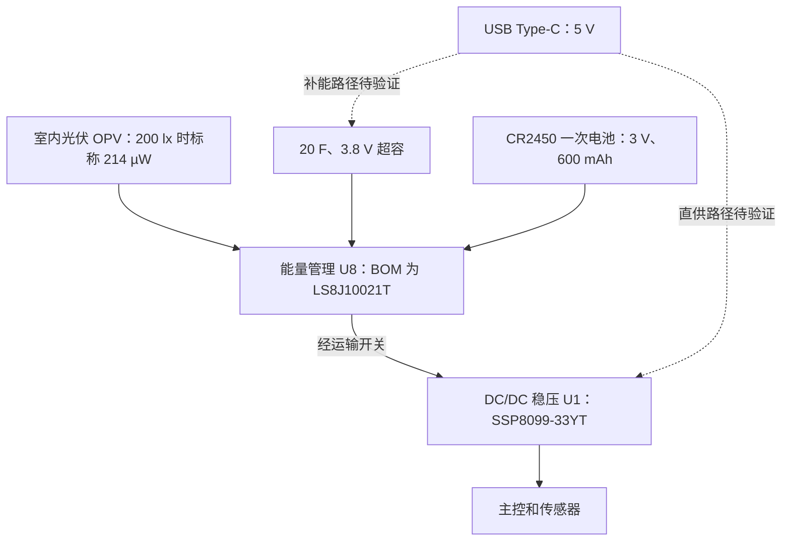

# 澜潮 SKU2 双鉴存在传感器 · 非功能需求与验收 V2.4

**待评审** · 2026-11-19 · 型号 LC-S-MTS03-PR24-11-001 · 中国大陆、中国香港

同套文档　[主文档](澜潮_SKU2_双鉴存在传感器_PRD_V2.4---2.md) · [功能需求](澜潮_SKU2_双鉴存在传感器_PRD_V2.4_功能需求---2.md) · [非功能需求与验收](澜潮_SKU2_双鉴存在传感器_PRD_V2.4_非功能需求---2.md)

先看样机装了什么，再按指标找用例。比如验证“人坐着灯还亮”，先核对 PIR 和雷达的覆盖范围，再按 TC-06 做 30 分钟静坐测试。核对五年服务时，还要算采能、耗电和维护次数。

[实装硬件](#sec-5-1) · [性能与合规](#sec-5-2) · [验收方法](#sec-6-1) · [逐项用例](#tc-list) · [能量预算](#sec-9-4) · [五年验证与运维](#sec-9-6)

## 05 硬件基线与非功能需求

### 5.1 硬件基线

##### SKU2 专用 BOM · 关键物料

| 项目         | 物料编码               | BOM 规格原文                                                                                                | 位号   | 数量  | 产品口径与验证                                            | BOM 行 |
| ---------- | ------------------ | ------------------------------------------------------------------------------------------------------- | ---- | --- | -------------------------------------------------- | ----- |
| 成品         | `2439030101000226` | 成品 PIR+24G传感器                                                                                           | —    | —   | SKU2 分表的成品编码。与市场型号及铭牌分别核对。                         | 2     |
| 电池座        | `2436020301000002` | 电池座 MY-2450-03 电池扣 适用CR2450 SMT 美阳                                                                      | BT3  | 1   | 与 CR2450 组合验证换电和振动接触。                              | 3     |
| 一次电池       | `2425010201000003` | 纽扣电池 CR2450 Henli Max 600mAh 3V -20~+60C°宇峰电池                                                           | —    | 1   | 标称电压与容量用于预算。USB 或 OPV 只允许给可充储能支路补能。                | 4     |
| 主储能        | `2417050301000007` | 超级电容 HBA-3R8-J206F-AYJ0813(A14) 20F 3.8V Φ8*13mm 3.5mm 72hrs/1uA -30~70°C DIP 凯美                        | E1   | 1   | 3.8 V 是器件额定值；72 h／1 µA 是物料表条件。整机可用能量按工作电压窗口计算。     | 21    |
| BLE 主控     | `2410010103000002` | 蓝牙SOC TLSR8258F512ET32 RISC 24MHz 32bit FLASH=512KB SRAM=64KB 1.8V~~3.6V -40~~+85℃ QFN32_5*5 SMT Telink | IC1  | 1   | 核对深睡 GPIO 唤醒、实际可用 Flash 与 OTA 分区。                  | 22    |
| 24 GHz 雷达  | `2426020104000010` | 存在雷达模组 RKB1161A3 3.3-5V 24GHz 31uA 峰值<82mA@3.3V> 矽杰微                                                    | P1   | 1   | 31 µA 的测试模式待查。获取首帧时间和完整扫描电荷；82 mA 用于瞬态供电校核。        | 28    |
| 电源变换       | `2410030201000019` | DC/DC控制器 SSP8099-33YT 0.9~~5.2V 3.3V 300mA 1uA 2uA 1MHz -40~~+85℃ TDFN-6AL-2×2 SMT 上海矽朋                 | U1   | 1   | 实装 3.3 V 供电输出按带载、低温及瞬态验证。                          | 37    |
| PIR        | `2428010201000006` | 热释电传感器 C14FN 1.8V~~5.5V <4.3uA@3.3V> -20℃~~+85℃ TO-5-4 DIP                                              | U6   | 1   | 4.3 µA @ 3.3 V。持续值守及 SoC 独立唤醒见 TC-66。              | 38    |
| 菲涅尔透镜      | `2437030101000143` | 五金零件 菲涅尔透镜 120°013120Z                                                                                  | —    | 1   | 120° 为透镜标称视场。整机有效触发角与雷达维持角分别验证。                    | 39    |
| 采能管理       | `2410060101000045` | 芯片 LS8J10021T VIN≥2V 10uA~~10mA 2.3V~~5.5V OVP3.58 UV2.6V -40 ℃~85 ℃ TQFN-14L SMT 聆思                    | U8   | 1   | BOM 标注 OVP 3.58 V、UV 2.6 V。整机切换点、恢复回差与反灌隔离见 TC-74。 | 40    |
| USB 接口     | `2436020501000035` | USB连接器 TYPE-C 6P 母座卧贴 6P 3A SMD -30~+85℃ SMT 首韩                                                         | USB1 | 1   | 6P 母座证明接口装配；充电、直供与工装通信分别验证。                        | 41    |
| 运输开关       | `2427010102000002` | 拨码开关 MSS22C02-H2.5 125 双刀双掷 6脚两档 立贴 手柄高度2.5m                                                            | J1   | 1   | 双刀双掷、两档。开关哪一极切换哪条电源支路由图纸和实测确定。                     | 45    |
| OPV 采能     | `2425010301000003` | 有机太阳能电池 50*40*1.2-4-R-0 43X37mm 2.9V@214uW@200lux -20℃~+50℃ 追光科技                                        | —    | 1   | 200 lx 单点数据；依安装的光谱、方向及有效光时验证。                      | 46    |
| 背胶铁片       | `2437030101000144` | 五金零件 背胶铁片 30mm直径 0.5mm厚度                                                                                | —    | 1   | φ30 mm、厚 0.5 mm 为铁片尺寸，胶层另按工艺确认。                    | 47    |
| 安装磁柱       | `2437030101000145` | 五金零件 钕铁硼 磁柱 1208-M4（外牙）                                                                                 | —    | 1   | 与 M4 连接和支架一起验收。                                    | 48    |
| Type-C 保护塞 | `2437030101000146` | 五金零件 RZ190 Type-C硅胶塞 硅胶 白色 7*17*1.8                                                                     | —    | 1   | 工作状态防护等级必须由整机试验确认。                                 | 49    |
| 可调支架       | `2437030101000163` | 五金零件 多功能可调支架 30MM圆盘 PC材质 带背胶 深圳市龙岗区平湖利昌隆塑胶五金制品厂（1688）                                                   | —    | 1   | 样机为背胶圆盘；吸顶固定需单独完成承载验证。                             | 50    |
| 面壳         | `2437030101000138` | 五金零件 多合一传感器面壳 前模NAK80 ABS 白色 V0级 素材纹面                                                                   | —    | 1   | 白色 ABS；物料的 V0 标注与整机防火验证分别归档。                       | 51    |
| 底壳         | `2437030101000139` | 五金零件 多合一传感器底壳 后模718H ABS 白色 V0级 素材纹面 带M4铜螺母                                                             | —    | 1   | M4 铜螺母，供固定和拆装验证。                                   | 52    |
| 铭牌镜片       | `2437030101000165` | 五金零件 PIR+24G传感器铭牌 镜片 0.5厚度PC 带丝印                                                                        | —    | 1   | 0.5 mm PC 丝印；核验透光、扫描和识别。                           | 53    |
| 主 PCB      | `2434010101000138` | PCB LC-PIR01-BL-C3 2层 4.55cm*7.22cm FR-4 无铅喷锡 绿油 白字 1.2mm 双面 1盎司 建滔                                     | —    | 1   | 4.55 × 7.22 cm 是 PCB 外形；整机外廓由结构确认。                 | 59    |

##### 整机装配与工程样机

| 基线项       | 适用 SKU／版本   | 样机参数及条件                                                                                                                  | 来源、状态及影响                                                   |
| --------- | ----------- | ------------------------------------------------------------------------------------------------------------------------ | ---------------------------------------------------------- |
| 主板与 BLE   | SKU2 BOM 分表 | PCB `LC-PIR01-BL-C3`，45.5 × 72.2 mm、2 层、FR-4、厚 1.2 mm。TLSR8258F512ET32，24 MHz、512 KB Flash、64 KB SRAM 按物料描述。BLE 2.4 GHz。 | S-08 样机物料。确认生产板号、天线、协议栈及可用存储。用结构图核对主板的安装空间。D-01、D-02、D-04。 |
| 微光及储能     | SKU2 BOM 分表 | 有机太阳能板 43 × 37 mm，物料标称 2.9 V、214 μW @ 200 lx。20 F／3.8 V 超级电容，LS8J10021T。本 SKU 分表列 SSP8099-33YT。                          | S-08 样机物料。核对实装电源树和输入输出曲线。TC-20、TC-23。                      |
| 一次电池与 USB | SKU2 BOM 分表 | CR2450 3 V，标称 600 mAh，Type-C 6P 母座和硅胶塞。电池更换方案、电容充电、USB 持续供电和数据通道待验证。                                                     | S-08 样机物料。S-04 的 400 mAh／50 F 为另一评审方案。D-07。                |
| PIR       | SKU2        | C14FN，BOM 标 4.3 μA @ 3.3 V。菲涅尔透镜、窗口、视场和灵敏度需结构和工装确认。                                                                      | S-08。TC-09、TC-53。                                          |
| 24G 雷达    | SKU2        | RKB1161A3，24 GHz、3.3–5 V，物料描述 31 μA，峰值 82 mA @ 3.3 V。                                                                    | 31 μA 对应的模式和已含占空比须查证。TC-20 的折算以实测状态电荷为准。                   |
| 照度小板      | SKU2        | 核对照度器件、镜片透光及空间。S-08「PIR+24G传感器」分表缺照度小板。                                                                                  | 按已确认的 SKU2 能力补照度件及照度窗，确认小板和整机。D-01、D-09。                   |
| 外壳及装配     | SKU2        | 样机为白色 ABS 面底壳、PC 0.5 mm 铭牌镜片、M4 铜螺母、Φ30 mm 铁片及支架。结构核对 PIR 透镜、照度窗、24G 透波与铭牌。                                              | S-08。按本 SKU 的最终结构与铭牌验收。TC-43、TC-60。                        |
| 工装与运行身份   | SKU2        | 样机 BOM 为 MSS22C02-H2.5 双刀双掷两档。出厂固化型号和能力，工装验证装配、身份及读回。                                                                    | 对照原理图，用工装验证两档开关能区分哪些装配状态。D-01、TC-43。                       |

| SKU  | 安装候选工况                    | 应验证的现场限制                        |
| ---- | ------------------------- | ------------------------------- |
| SKU2 | 安装高度和方向按 §3.2 选择，并在工位上实测。 | 玻璃隔断外误检、金属反射、热源、摆动遮挡，照度窗与工作面校准。 |

**硬件核对限制（D-07）：** 当前 BOM 选用 20F/3.8V 超容、600mAh CR2450、LS8J10021T；主板原理图 U8 的文字标注为 LS6821、E1 标注保留“20F/50F”，并存在Type-C VBUS检测及PIR OUT→8258 PB1/IO2连接。**本 PRD 不据此认定USB必然可给超容充电，也不将深睡GPIO唤醒视为整机已验收能力**；需要原理图版本核对、固件配置和电源波形证据。详细测试见TC-66、TC-71、TC-74。

现场交付逐点记录基面、安装高度和姿态。磁吸需要可导磁接触面或通过已验证承载的背胶铁片。铝、玻璃以及易掉粉基面按已验证的支架或固定结构交付。高湿、半室外及特殊用途点位交付范围随 D-09、D-12 确认。

##### 电源路径与供电验证

供能功能图。实线为供能关系，USB 虚线为待 TC-71／TC-74 验证的直供与超容补能路径。

| 路径       | 需求                                  | 实装验证                                          |
| -------- | ----------------------------------- | --------------------------------------------- |
| 微光主供电    | OPV 经管理电路向储能补给；超容承担主供电，备用电池按带载条件切入。 | 记录 U8、J1、U1 的输入/输出、开关位置、切换回差及雷达脉冲压降。          |
| USB 补超容  | 维护或产线可给 20 F 超容补能。输入限流目标 ≤300 mA。   | 同时记录 VBUS、超容和一次电池支流；确认充电路径、反向隔离和边充边检。         |
| USB 持续外供 | 5 V 作为弱光点位的外供方案。运输档旁路与工装写入是待验证设计。   | TC-71/74 分别测 ON/OFF、插拔、充满/未满拔出；写入功能按实际工装端口签核。 |

##### 两种供能形态的行为差异

| 项目                              | 形态 A 微能量                                                  | 形态 B USB 外供                                               |
| ------------------------------- | --------------------------------------------------------- | --------------------------------------------------------- |
| **雷达延迟确认** `T_radar_delay` | **60 s 起步**（能量不足延长至 120 / 300 s）                          | 可缩至 **15–30 s**                                           |
| 雷达单次扫描                          | T_scan ≤5 s，典型 2 s（由模组实测标定写入固件，两形态相同）                     | T_scan ≤5 s，典型 2 s（由模组实测标定写入固件，两形态相同）                     |
| **雷达占空比**                       | 2 s ÷ 60 s ≈ **3.3%**（且 PIR 活跃时长为 0）                      | 2 s ÷ 15 s ≈ 13%                                          |
| 微动灵敏度                           | 默认档                                                       | **可上调 1 档**                                               |
| 事件上报                            | 受 5 级能量策略约束，P2 可能被压缩                                      | 全量上报，不受限                                                  |
| 电池寿命顾虑                          | 按点位收支、温度、脉冲与老化预测                                          | 验证 USB 状态下电池支路电流                                          |
| 充电中行为                           | —                                                         | 设计目标为补能期间继续检测；TC-71 同测超容和电池支路                             |
| 识别与切换                           | 自动识别 USB 插入/拔出，≤5 s 切换供能模式并上报 `powerSource`；切换过程检测不中断、不重启 | 自动识别 USB 插入/拔出，≤5 s 切换供能模式并上报 `powerSource`；切换过程检测不中断、不重启 |

输入目标 5 V，源能力 ≥500 mA、限流目标 ≤300 mA，验证边充边检、温升和反灌。补能时间由 TC-71 实测。

##### 覆盖角：触发角 120° 与保持角 150°

以内圈验证首次触发，以外圈验证已确认人员的保持。安装点按整机触发角布点；雷达保持角作为附加余量。

| 区域（以安装点垂线为 0°）   | PIR 触发角 （全角 120°） | 雷达保持角 （全角 150°） | 实际能力                                                   |
| ---------------- | ---------------------- | -------------------- | ------------------------------------------------------ |
| **0°–60°（核心区）**  | 可触发                    | 可保持                  | **完整双鉴**：能发现人，也能维持"有人"                                 |
| **60°–75°（外环区）** | 不可触发                   | 可保持                  | **只能保持**：若人先在内圈被发现、再走到外环，雷达能继续维持；若人**只在外环且不动**，永远不会被发现 |
| >75°             | 不可触发                   | 不可保持                 | 无能力                                                    |

##### 外观设计要求：无孔化与隐私观感

| #   | 设计要求           | 具体做法                                                    | 要避免的观感       |
| --- | -------------- | ------------------------------------------------------- | ------------ |
| 1   | **整机无开孔**      | 外壳与菲涅尔透镜一体化注塑；雷达天线内置透波盖板（PC/ABS，同色同材质）；无麦克风孔、无散热孔、无外露螺丝 | "这里有收音/摄像元件" |
| 2   | **透镜不留同心圆**    | 菲涅尔分区纹理做在**内侧**，外表面为均匀雾面或细皮纹                            | 同心圆环极具"镜头"联想 |
| 3   | **不出现拟眼造型**    | 探测区做成整片半透明装饰环或整面窗口，不做小而圆的独立开孔                           | "两只眼睛"或"一只眼" |
| 4   | **无外露状态灯**     | LED 用隐藏导光柱（仅调试模式透光），量产出货状态完全不可见                         | 红灯常亮＝"正在录制"  |
| 5   | 表面避免镜面         | 哑光、细皮纹或细磨砂                                              | 镜面反光像镜头镀膜    |
| 6   | 形态贴近"环境设施"     | 圆或方圆扁平盘（Φ90×32 mm 内），视觉接近烟感/温控；白、灰双色                    | "安防监控设备"     |
| 7   | **USB 口与开关隐蔽** | 同置于底面凹槽、同色盖片遮蔽、与镭雕码同区                                   | 外露接口＝"可被改装"  |

##### 接口与结构设计目标

| 对象         | 验证目标及边界                                                                                                  |
| ---------- | -------------------------------------------------------------------------------------------------------- |
| 电源管理与替代    | 早期方案提出 MPPT 冷启动 <300 mV、低静态电流和二供。SKU2 以 LS8J10021T（VIN≥2 V，OVP 3.58 V、UV 2.6 V）实装为基线；低压冷启动能力以供应商资料和波形决定。 |
| Type-C 与开关 | 接头插拔 ≥500 次、开关 ≥5000 次为目标。开关接触电阻初始 ≤100 mΩ、老化后 ≤300 mΩ 为验证输入。J1 的双档不能直接推导出四个独立编码。                        |
| 结构、光学与安装   | 透镜标称 120°。有效保持角 ≥150° 为探测测试目标。整机外形曾考虑 Φ90 × 32 mm 方案；现板 45.5 × 72.2 mm，等最终结构图签核。质量 ≤100 g 为设计参考。         |
| BLE、雷达及照度  | 2.4 GHz BLE；24 GHz 雷达。24.0–24.25 GHz 为候选验证窗口，天线、频谱、角度、光照窗与量程以整机测试为准。                                     |

### 5.2 非功能需求与合规

##### 性能指标与验收方法

> 填表口径。目标值用于本轮评审。验收报告须记录样机版本、供电状态、安装姿态、负载、样本数和实测值。器件额定值见 §5.1。

每个指标都给出"定义 / 测试口径"，避免研发与测试对同一名词理解不一致。未标注测试条件的指标不可用于对外宣传。

| 指标                | 定义 / 测试口径                                           | 目标值                                           | 测试条件                            | 验收方法                                                        |
| ----------------- | --------------------------------------------------- | --------------------------------------------- | ------------------------------- | ----------------------------------------------------------- |
| 移动检出率             | 目标在标准路径上径向穿越探测区 N 次，设备成功上报"有人进入"（E101）的次数占比         | >99%                                          | 3 m 高，25 ℃，0.5–1.5 m/s 径向，N=100 | N=100 时，严格 >99% 要求本组零漏检；另报样本量、漏检数和区间。                       |
| **本地联动时延**        | 从 E101 判定成立，到同群组灯节点收到并执行开灯指令（本地广播路径，4 跳内）           | <300 ms                                       | 4 跳链路，含 1 次重播                   | 200 次取 P95；链路丢包 30% 时由重播覆盖                                  |
| 进入响应时延            | 从 PIR 输出有效触发信号，到设备完成 E101 组帧并发出空口的时长                | ≤300 ms                                       | PIR 触发瞬间打点                      | 100 次取 P95                                                  |
| **T_scan 单次扫描时长** | 雷达从上电到输出首个有效检测结果的时长，是校验窗口的下限                        | ≤5 s，典型 2 s                                   | 常温 3 m 目标；另测 -10 ℃ 的延长量         | 200 次取 P95；低温延长量纳入 W_verify 设计                              |
| **雷达扫描期平均电流**     | 在 T_scan 窗口内对雷达供电电流做积分平均，衡量模组是否适合微能量                | ≤150 µA                                       | 扫描窗口内积分测量                       | 源表积分；**作为选型红线，一票否决**                                        |
| **校验窗口 W_verify** | 从雷达启动到允许做出 AND 判决的最长等待时间，必须 ≥ T_scan                | ≥ T_scan（默认 +1 s）                             | 注入雷达慢响应（4 s）                    | 慢响应时不得误判回滚                                                  |
| 回滚时延              | 从"疑似有人"翻转，到雷达确认无目标并发出 E112 的时长                      | ≤ T_scan + 1 s                                | PIR 触发但雷达无目标                    | P95 达标                                                      |
| 静止漏报率             | 人在探测区内持续静坐期间，设备错误翻转回"无人"（发出 E105）的次数                | <1 次/72h                                      | 3 m 内持续静坐，72 h 分段轮换（含夜间）        | 统计误判离开次数，应为 0                                               |
| 净空场误报率            | 无人环境下，**经回滚纠正后仍保持"有人"**的错误次数（已回滚的不计入）               | <1 次/72h                                      | 类空场：无人 + 空调气流/窗帘/卷帘门/管道         | 净误报 0 次；同时统计回滚触发次数 ≤5 次/72h                                 |
| 有效触发角             | 整机能够可靠触发 E101 的水平全角。BOM 透镜标称 120°，对外值取 DVT 整机结果。    | 120°                                          | 3 m 半径圆周，每 15° 一点               | 逐点实测，边界处检出率 ≥90%                                            |
| 有效保持角             | 人已进入有人态后，雷达能继续维持"有人"的水平角度范围                         | ≥150°                                         | 先在内圈触发，再移动至各角度保持                | 逐 15° 验证维持能力；**不作对外探测角承诺**                                  |
| 无人态平均电流           | 无人、雷达全关、按默认策略上报心跳时的整机平均工作电流                         | ≤11 µA                                        | 无人 72 h，常温，200 lux 8 h/日        | 源表长时记录取平均                                                   |
| 有人静止态平均电流         | 有人且 PIR 无触发（静坐），雷达按 T_radar_delay=60 s 周期扫描时的平均电流   | ≤17 µA                                        | 持续静坐，雷达每 60 s 扫描 2 s            | 同上                                                          |
| 有人活跃态平均电流         | 有人且 PIR 频繁触发（计时器不断重置），雷达全程不启动时的平均电流                 | ≤12 µA                                        | 每分钟至少 1 次 PIR 触发                | 同上；验证雷达启动次数为 0                                              |
| 日均平均电流（办公）        | 有人 12 h / 无人 12 h、其中一半时间静止的加权平均                     | ≤12 µA                                        | 按实际使用剖面运行 72 h 以上               | 同上                                                          |
| 形态 B 平均电流         | USB 5 V 供电、雷达延迟 15–30 s 时的输入端平均电流                   | ≤120 µA @5 V                                  | T_radar_delay=15 s（占空 13%）      | 源表 ≥72 h；不触发 USB 源过流                                        |
| 形态切换时延            | 从 USB 插拔动作到 `powerSource` 更新并完成行为切换的时长              | ≤5 s                                          | 插/拔 USB                         | 检测不中断、不重启                                                   |
| 补电时长              | 边充边检状态下，超容从 2.5 V 充至 3.5 V 的时间（检测持续运行，不做降频让流）       | <10 min                                       | 检测正常运行中充电，5 V 源                 | 记录充电曲线；检测无中断                                                |
| **运输模式待机电流**      | 开关拨至 OFF 后，整机剩余电流（含超容漏电与能量管理 IC 静态）                 | ≤2.5 µA                                       | 超容预充 3.5 V，开关 OFF               | 源表记录 ≥72 h，并分别量测 E1 漏电与管理芯片、其他支路的静态电流。                      |
| **库存自放电**         | 运输模式下静置 6 个月，超容电压下降量（ΔV = I·t/C）                    | 6 个月压降 <1 V 为目标                               | 3.5 V 起，常温暗置 6 个月               | 20 F、180 天按恒定漏电计算上限 <1.29 µA。记录荷电、温区、老化和实测压降。               |
| 开关机械寿命            | 开关在额定负载下可完成的通断操作次数，及老化后的接触电阻                        | ≥5000 次，老化后 ≤300 mΩ                           | 寿命试验后复测；振动中不得自行跳变               | 完成后量测接触电阻与通断可靠性                                             |
| 上报策略下发时延          | 从云端/App 发出配置，到收到 E504 回执的时长                         | ≤5 min（云端） ≤3 s（本地）                      | 单条与 54 条批量两种规模                  | 分别计时                                                        |
| 配置回读一致率           | 下发后通过 `readDiagSnapshot` 读回的配置与下发值一致的比例（含"实际执行值"字段） | 100%                                          | 54 条逐条下发并回读                     | 逐条比对，不含能量强制降级项                                              |
| **开灯响应检出率**       | 在暗环境（<100 lux）全亮场景下，人为制造"开灯无效"时 E605 能正确上报的比例       | ≥90%，误报 ≤10%                                  | 断开灯具 / 断通信两种故障各 20 次            | 统计检出与误报；记录 luxDelta 分布，用于定阈                                 |
| 校时精度              | 校时完成后设备本地时间与父节点参考时钟的偏差                              | 校后 <20 ms；门限 100 ms                           | 单跳 2.4G                         | 90 ms 不触发、110 ms 触发；校后 100 次均 <20 ms                        |
| 唤醒窗口              | 节点定时开窗接收下行的时长，与窗口内下行投递成功率                           | 100–500 ms 可配；成功率 ≥98%                        | 父节点在窗口内投递                       | 窗口内接收统计                                                     |
| 无光续航（仅超容）         | 满电后无任何光照、无人状态，仅靠超容可运行的天数                            | 记录可用天数；旧 30 天目标列入可行性差异                        | 20 F，测试起点 3.5 V，按实测切换门限结束。      | 3.5→2.6 V 理想 54.9 J；10 µA @3.3 V 的理想上限约 19.3 天。实测计入漏电、转换损失。 |
| 纯电池续航             | 完全无光，仅靠 CR2450 3 V、600 mAh，含温区、脉冲与转换损失。             | 原目标 ≥2 年；五年服务按点位和维护计划另验                       | 按测得日均负载折到统一电压，记录电池有效容量和能量。      | 带载模拟、放电曲线和实测能耗交叉核验。                                         |
| 照度精度              | 安装点照度与溯源照度计的差值；另测经 K 标定的工作面估值。                      | 0–2000 lx 旧整体目标 ±15%；0 lx 用绝对误差、分段细则见 NFR-03。 | 多点校准后逐档验证                       | 逐档比对                                                        |
| 安装照度告警有效性         | 故意背光/遮挡安装的点位，能在 48 h 内触发 E309 的比例                   | ≥95%，误报 ≤5%                                   | 20 个背光点位                        | 统计触发率                                                       |
| 背胶持粘力             | 粘贴后承受的垂直拉力与设备重量的比值，及长期老化后的保持能力                      | ≥3 倍重量，5 年不脱落                                 | 石膏板/乳胶漆/瓷砖/金属四基材                | 常温 90 天 + 高温高湿 30 天 + 剥离力测试                                 |
| 镭雕码扫码成功率          | 单次扫码即可正确读出全部字段的比例                                   | 一次 ≥99.5%，两次内 ≥99.9%                          | 手机摄像头 + 工业扫码枪；酒精擦拭 50 次后        | 各 500 次统计                                                   |
| 位置录入时延            | 从扫完码到提交完成的时长（位置记忆+序号递增模式）                           | ≤10 s                                         | 同区域连续录入                         | 100 点位取 P95                                                 |
| 安装效率              | 标准同区连续作业的重复安装节拍；完整点位交付工时另外统计。                       | >400 点位/人日                                    | 标准场景，3 人 × 3 天                  | 分开记录批量标准点位、返工点、全流程安装调试时间。                                   |

##### 可靠性、供电与隐私要求

| 类别          | 要求                                  | 说明                                            |
| ----------- | ----------------------------------- | --------------------------------------------- |
| 工作温度        | 整机验证起点 −10～+45 ℃；+55 ℃ 为扩展目标        | OPV 物料上限 +50 ℃；扩展上限须由 HW 核实器件条件并完成整机验证。       |
| 存储温度        | −20～+60 ℃ 为整机候选；+70 ℃ 为旧稿扩展工况       | 电池物料范围 −20～+60 ℃；核对运输、储存与使用的不同器件条件。           |
| 工作湿度        | 10%～90% RH 非凝露为主测区间；0%～95% RH 为扩展摸底 | 以最终壳体、持续时间、负载、恢复判据和试验记录签核。                    |
| 防护等级        | IP30 为目标；IP20 为基础样机验证项              | 均待 TC-64。报告列明 Type-C 塞、接口盖、透镜与实际安装状态。         |
| 胶贴可靠性       | 常温 5 年不脱落；持粘力 ≥3 倍重量                | 四基材分别验证；高温高湿 30 天 + 冷热冲击后复测                   |
| **开关可靠性**   | 寿命 ≥5000 次；镀金触点；振动中不跳变              | 微电流工况下未镀金会氧化，表现为"偶发不上电"                       |
| USB 长期插电可靠性 | 连续插电 ≥5 年无异常                        | 验证超容浮充寿命、发热与接口氧化；建议评估周期维护的必要性                 |
| 外观隐私合规      | 整机无开孔、无音频元件、无镜头形态                   | 须有自证声明或第三方检测；随箱附隐私声明卡                         |
| 无线合规        | 大陆 BLE 无线电准入分类和测试要求待签核              | 按实际型号、频段、发射和附件准备证据；大陆、香港分别见 §5.2.4。           |
| 雷达合规        | 24.0–24.25 GHz ISM，功率符合当地限值         | 逐国核对                                          |
| 电池合规        | CR2450 一次锂电池；按随设备或独立运输状态核对资料        | 收集实装电芯的测试概要和供应商资料，运输适用条件见 §5.2.4。             |
| USB 安全      | 防反灌、限流 ≤300 mA、ESD 保护               | 防劣质充电器损坏电路                                    |
| 配置安全        | 本地蓝牙需鉴权码；配置变更全留痕；需云端确认              | 防未授权修改上报策略掩盖故障                                |
| 环保          | RoHS / 无卤；储能与电池可回收                  | 电池属受控废弃物                                      |
| 隐私          | 无摄像、无音频、无身份识别；雷达不上传原始中频             | 写入宣传口径与隐私声明卡                                  |
| 寿命          | 有条件的五年有效检测服务                        | 依点位采能、负载、一次电池健康和维护频次确定。用 TC-72 给出覆盖率及换电／补能次数。 |

##### SKU2 非功能需求与测试索引

| 需求 ID／类别        | 适用范围                   | 指标及测量口径                                                                                                                                                     | 牵头、状态与验收                                               |
| --------------- | ---------------------- | ----------------------------------------------------------------------------------------------------------------------------------------------------------- | ------------------------------------------------------ |
| NFR-01 时效、覆盖及入网 | 本 SKU BLE              | 分开统计节点确认、云接入、本地实动和云编排四种时延。S-04 父节点 8 并发 1 s 确认为候选。成功率计入重试，按完成的唯一事件／应送的唯一事件，离线另做回补验收。                                                                        | FW、网关、TE。D-02、D-04、D-05。TC-01、TC-28、TC-29、TC-49、TC-54。 |
| NFR-02 能量及寿命    | SKU2，重点雷达启动／维持与 BLE 上报 | **以20F超容及600mAh电池为当前BOM基线**，对各供电模式和温区量测休眠、PIR持续值守、采样、切换、收发、重试、OTA、雷达启动与扫描；考虑漏电、容量衰减、温度、ESR与转换效率，产出可用能量区间。至少覆盖照度×光时×活动频次×持续存在时长及寿命末期变化。输出条件性五年服务率与预测补电/换电需求。 | HW、FW、TE。目标待实测。D-07。TC-20～TC-23、TC-34、TC-38。           |
| NFR-03 照度测量     | 本 SKU 照度               | 测试需覆盖量程切换点和超量程输入。标准光源测传感误差，标定后工作面候选 ±15%。                                                                                                                   | HW、TE。待冻结量程、精度、分辨率及现有编码。D-09。TC-11、TC-12、TC-13、TC-51。  |
| NFR-04 人感性能     | SKU2                   | S-04 的 2–8 m 分档、误报与高温表现作对照。定义有效区域、探测概率、误报次数的分母及观察时长。                                                                                                        | FW、HW、TE。待实测。D-08、D-09。TC-06～TC-10、TC-28、TC-53。        |
| NFR-07 安全、隐私与隔离 | 本 SKU 及各接入端            | 网关↔云按 S-07 的 MQTT/TLS 和身份机制。节点接入及关键帧按公司协议完成完整性、防重放和隔离。审计、数据可见与固件校验在授权内验证。                                                                                   | 安全、FW、云平台、TE。协议签核待定。TC-03、TC-37、TC-55、TC-56。           |

功耗预算按统一测量点计。对跨电压的来源以 Wh 或统一参考电压折算，台架量测休眠、采样、收发、雷达启动／维持与 BLE 上报的互斥时段及重叠成本。S-04 的典型 50／100／500 lx、10 h 和 SKU 高频触发工况提供对照。5 年指标与布局、供电、收件实测及电池有效容量联动评审。续航估算、低光保护及实测结果逐项记录。

#### 5.2.1 安规类

NFR-08 安规与市场准入。目标市场为中国大陆及中国香港。安规测试以最终整机、申报电源和配件组合为对象，由认证与 HW 在送检前签核适用条款及报告版本。对应 TC-61、TC-63 和 D-12。

| 市场／对象        | 项目安规依据与适用条件                                                                                                                                                                                                                                                                                                                                                                                  |
| ------------ | -------------------------------------------------------------------------------------------------------------------------------------------------------------------------------------------------------------------------------------------------------------------------------------------------------------------------------------------------------------------------------------------- |
| 中国大陆整机       | 按 **GB 4943.1-2022** 作为本项目安规设计和验证基线。认证按最终用途、额定电源、外部接线及附件确认标准适用范围和准入路径。[国家标准题录](https://openstd.samr.gov.cn/bzgk/std/newGbInfo?hcno=862145EBF14F5CC3771FC64CE94A48DF)                                                                                                                                                                                                                         |
| 中国香港整机       | 按 **IEC 62368-1** 作为本项目安规设计和验证基线，送检候选为 **IEC 62368-1:2023 第 4 版**（IEC 公布的 2025-08 更正版）。认证确认报告认可版次。按机电工程署指引核对仅用特低电压的终端本体，以及随附市电适配器各自的《电气产品（安全）规例》适用性。适配器适用时核验香港插头、安全规格及符合安全规格证明书。[IEC 标准](https://webstore.iec.ch/en/publication/69308) · [香港机电工程署指引](https://www.emsd.gov.hk/en/electricity_safety/publications/guidance_notes_guidelines/outline_of_electrical_products_safety_regulation/) |
| CR2450 一次锂电池 | 核对大陆 **GB 8897.4-2008** 电池证据。香港电池安全评审参考 **IEC 60086-4:2025**，核对供应商实装型号、制造商、报告版本与批次。整机验证电池仓、防反装及误接触、热与异常供电。微光／USB 补能路径须与一次电池隔离。[大陆原电池安全标准](https://openstd.samr.gov.cn/bzgk/std/newGbInfo?hcno=9282A6AA8971AFB6E5C3D5EFE1BB5AF2) · [IEC 原电池安全标准](https://webstore.iec.ch/en/publication/71814)                                                                                                |

核对雷达启动及同时上报时的电源余量、温升和外壳防护，测试使用最终雷达、天线和透波件。

#### 5.2.2 可靠性

NFR-05 稳定性与兼容。 范围包括掉电、缓存满、重启、并发补报、升级失败、现场弱网、网络互扰和长时间运行。按实装版本和 Flash 分区核对 S-04 的参考升级包大小（<80 KB）。

长稳和重复操作记录异常复位、数据或配置保留、功能恢复和固件版本。试验方案覆盖发布的各供电模式和本 SKU 典型负载。TE 按试点工况签核持续时间、循环次数和样本量。FW、网关与 TE 负责，待测。TC-04、TC-05、TC-24～TC-27、TC-46～TC-49、TC-54、TC-57。

#### 5.2.3 EMC 电磁兼容

NFR-08 的整机 EMC 由 HW、TE 和认证联合验证。预检按最终 PCB、外壳、天线、供电与端口配置进行。按适用标准核查辐射与传导发射、静电放电、射频抗扰度及其他端口适用项，记录测试布置、等级、性能判据及恢复。抗扰度见 TC-40，整机发射与工况见 TC-62。

| 市场   | 整机 EMC 验证依据                                                                                                                                                                                                                                                                |
| ---- | -------------------------------------------------------------------------------------------------------------------------------------------------------------------------------------------------------------------------------------------------------------------------- |
| 中国大陆 | 按产品归类评估 **GB/T 9254.1-2021** 发射及 **GB/T 9254.2-2021** 抗扰度，签核适用端口、设备类别、试验等级及判据。[发射标准](https://openstd.samr.gov.cn/bzgk/std/newGbInfo?hcno=31097AEFDC65417E6DA038A48FB63DEC) · [抗扰度标准](https://openstd.samr.gov.cn/bzgk/std/newGbInfo?hcno=F2A7BE5EA02711FB5666CCD22630CFF8) |
| 中国香港 | 整机发射与抗扰度分别以 **CISPR 32:2015+A1:2019** 和 **CISPR 35:2016** 为候选。实验室按设备用途、接口及供电确认适用标准和版本。无线的 OFCA 路径见 §5.2.4。[CISPR 32](https://webstore.iec.ch/en/publication/65836) · [CISPR 35](https://webstore.iec.ch/en/publication/25667)                                              |

雷达启动、维持扫描与 BLE 连发同测。记录射频共存、误判、丢包率和恢复，保留雷达单开、BLE 单开和同时工作的对照。

#### 5.2.4 合规与认证

| 范围             | 核验事项及上市证据                                                                                                                                                                                                                                                                                                                                                                                                                                 |
| -------------- | ----------------------------------------------------------------------------------------------------------------------------------------------------------------------------------------------------------------------------------------------------------------------------------------------------------------------------------------------------------------------------------------------------------------------------------------- |
| 大陆 2.4 GHz BLE | 按工信部无〔2021〕129 号及附件核验频率、天线、功率、杂散及型号核准适用性。2019 年第 52 号公告附件的通用微功率 F 类排除了该频段的蓝牙技术设备。用最终整机配置确认型号核准或适用路径并归档。[工信部无〔2021〕129 号](https://wap.miit.gov.cn/jgsj/wgj/wjfb/art/2021/art_58b24430cb93476fb18a51fe7a350b61.html) · [微功率目录附件](https://www.miit.gov.cn/cms_files/filemanager/oldfile/miit/n1146285/n1146352/n3054355/n3057735/n3057748/n8004149/c8006552/part/8006563.pdf)                                                                |
| 香港 2.4 GHz BLE | 对照 Cap. 106Z 附表 2 和 OFCA 短程器件指引核对频段、功率及杂散。指引将满足豁免条件的 Bluetooth 列入免领牌，自愿验证列明 HKCA 1035。由认可机构按实际调制、功率及送检路径确认适用规格和标识。[香港 OFCA 短程器件指引](https://www.ofca.gov.hk/sc/consumer_focus/guide/help_for_consumers/information_on_radio_applications/short_range_devices/index.html)                                                                                                                                                                   |
| 大陆 CCC 与材料     | 整机和市电配件分别按销售配置核对 CCC 目录及实施规则。按中国 RoHS 管理办法及上市时点适用目录核对材料声明、标识、限用物质与合格评定。GB 26572-2025 自 2027-08-01 实施，届时适用产品按新标准核对。[CCC 目录与界定](https://www.cnca.gov.cn/zwxx/gg/zjgg/art/2023/art_31ce43f5837d408cb2023ec693615ada.html) · [中国 RoHS 管理办法](https://www.miit.gov.cn/jgsj/jns/qjsc/art/2020/art_0ffb0deb9185404aa94afe3b852dcc6f.html) · [GB 26572-2025](https://openstd.samr.gov.cn/bzgk/std/newGbInfo?hcno=279928A31DAA3737BD0205BD3A0A4857) |
| 香港商品安全与标签      | 按实际销售对象核对 Cap. 456／456A。属于相关消费品的安全警告须用清晰、显眼的中文及英文。外箱、内附说明和铭牌上的产品、电池与合规标记须与实际供货一致。[香港海关消费品安全](https://www.customs.gov.hk/en/service-enforcement-information/consumer-protection/goods-safety/index.html)                                                                                                                                                                                                                                   |
| 锂电池运输          | 按装于设备、随设备包装或独立运输及实际运输方式确认归类、包装、防误动作及所需文件。核验供应商 UN 38.3 对应证据及适用文件要求。组装、备件或承运方式变化时复核。[联合国试验和标准手册 §38.3](https://unece.org/transport/dangerous-goods/rev8-files)                                                                                                                                                                                                                                                                             |

**24 GHz 雷达的准入**

- 大陆按工信部 2019 年第 52 号公告附件的通用微功率 H 类核验。目录列明 24–24.25 GHz 和发射功率 ≤20 mW e.i.r.p.。需用最终雷达、天线、外壳和固件验证频率、发射功率、杂散及适用条款。满足目录全部适用条件后，按公告适用微功率豁免，并在说明书体现相应条款及使用条件。[工信部第 52 号公告及附件](https://www.miit.gov.cn/jgsj/wgj/wjfb/art/2020/art_792ab84586c34b64bb391eb6496c0953.html)
- 香港频率划分表将 24–24.25 GHz 列为 ISM 应用频段。由认证负责人提交雷达用途、实际频谱、功率、天线和整机形态，请 OFCA 或认可认证机构确认适用的设备规格、牌照或豁免及标识。HKCA 1007 第 6 版有自身适用范围，需取得归类结论后引用。上市评审需要该整机配置的书面结论与检验记录。[香港频率划分表](https://www.ofca.gov.hk/filemanager/ofca/en/content_144/hk_freq_table_en.pdf) · [HKCA 1007 第 6 版](https://www.ofca.gov.hk/filemanager/ofca/en/content_401/hkca1007.pdf) · [OFCA 设备认证](https://www.ofca.gov.hk/en/industry_focus/standards/tel_standards/telecom/index.html)

NFR-08 对应 TC-61～TC-63。认证在 D-12 台账记录两地的归类、报告、证书或豁免依据、试验配置和签核状态。以最终型号、HW/FW、天线、电池、附件和标签版作为证据索引。

#### 5.2.5 环境与机械

NFR-06 适用于本 SKU 的室内安装和装箱运输。MD、HW 和 TE 按实物配置验证温湿度、振动、跌落、固定承载、Type-C 插拔及电池仓开合。保留试前基线和试后检查，覆盖 TC-38～TC-42、TC-60、TC-64、TC-65。高湿或半室外点位按 D-09、D-12 的环境及外壳验收结果确认。

##### 5.2.5.1 温度、湿度

主测范围与扩展工况见 §5.2 可靠性表。以 −10、25、+45 ℃ 测运行与恢复，必要时评估 +55 ℃ 扩展目标。存储、运输及湿度按物料边界、是否通电、驻留时间和样本数签核；复核点位 TC-38、TC-41。

##### 5.2.5.2 振动、跌落

按最终安装状态和交付包装核验裸机、安装件和运输包装。裸机跌落沿用 TC-39 的候选条件。包装振动和跌落沿用 TC-42。新增 TC-65，记录裸机或安装态振动的频段、方向、夹具和周期。试后检查外壳、电池仓、固定件、接口、采集和上报。

##### 5.2.5.3 IP 等级

以 **IP30 为设计目标，IP20 为基础验证项**。按量产壳体与实际安装配置核验以下部位的防护表现，即PIR 透镜、照度窗、雷达壳体接缝、接口盖、电池盖及其正常使用状态。大陆按 GB/T 4208-2017（含第 1 号修改单）核验，香港验证参考 IEC 60529（第 2.2 版）。TC-64 记录试样状态、结论及适用范围。规格、标签及说明采用签核的防护等级和安装条件。[大陆 IP 代码标准](https://openstd.samr.gov.cn/bzgk/std/newGbInfo?hcno=09CCED55688D4116ED89659C1E7526F8) · [IEC 60529](https://webstore.iec.ch/en/publication/2452)

## 06 测试验收

### 6.1 验收表

| 层级          | 测试内容                          | 执行方      | 通过标准                                      |
| ----------- | ----------------------------- | -------- | ----------------------------------------- |
| 单元测试        | 门控状态机、延迟确认计时器、回滚、上报调度表、SOC、锁时 | 研发       | 语句覆盖 ≥80%，分支覆盖 ≥70%                       |
| 算法离线验证      | 样本集回归；四姿态分别回归                 | 算法 + 测试  | 移动 >99%；静止与净误报 <1次/72h                    |
| EVT 验证      | 三态功耗、雷达扫描电流、形态切换、边充边检、开关待机    | 硬件 + 测试  | 无人 ≤11 µA、静止 ≤17 µA、活跃 ≤12 µA、扫描期 ≤150 µA |
| **事件定义验证**  | 54 条事件逐条构造触发条件，验证是否按定义产生      | 研发 + 测试  | 每条事件均可稳定复现；无误触发                           |
| 配置体系验证      | 54 条逐条下发；硬约束拒绝；本地待确认流程        | 研发 + 云端  | 回读一致率 100%；不可禁用事件拒绝率 100%                 |
| DVT 场景验证    | 暗室标准路径、类空场 7×24 h、六场景实景       | 测试       | §5.2 性能矩阵达标或书面让步                          |
| **光照四用途验证** | 联动 / 安装质检 / 免开灯 / 灯具故障判断分别验证  | 测试 + 云端  | E605 检出率 ≥90%、误报 ≤10%                     |
| 外观隐私评审      | 无孔、无镜头感、无可见 LED 的实物评审         | 结构 + 产品  | 盲测 10 人，≥9 人不认为是摄像设备                      |
| 胶贴与开关可靠性    | 四基材胶贴老化；开关 5000 次寿命与振动        | 结构 + 测试  | 无脱落；开关不跳变、接触电阻达标                          |
| 安装效率        | 3 人 × 3 天实测（含拨开关与扫码全流程）       | 工艺 + 测试  | 均值 >400 点位/人日                             |
| 现场小批试点      | ≥200 点位，≥30 天，含形态 A/B 混合      | FAE + 测试 | 误报工单 ≤1 次/点位/月；离线率 ≤1%                    |
| 系统联调        | L2 网络、CCO、云平台、白名单、配置下发、能耗大屏   | 系统 + 云端  | 端到端 ≤3 s；拓扑无该设备作父节点                       |

##### 关键专项测试

| #   | 专项                       | 方法                                              | 判定                                           |
| --- | ------------------------ | ----------------------------------------------- | -------------------------------------------- |
| 1   | **延迟确认计时器重置**            | 有人态下每 58 s 注入一次 PIR 触发，持续 30 min                | 雷达启动次数为 0；状态始终维持有人                           |
| 2   | **静止确认与离开判决**            | PIR 静默 60 s 后雷达扫描；再静默多个周期                       | 按 N_leave 次数准确翻转；单次不翻转                       |
| 3   | **T_scan 与 W_verify 关系** | 常温与 -10 ℃ 各测 200 次；注入慢响应 4 s                    | T_scan P95 ≤5 s；慢响应不得误回滚                     |
| 4   | 54 条事件定义复现               | 逐条构造触发条件                                        | 全部可稳定复现，无误触发                                 |
| 5   | 硬约束不可突破                  | 尝试禁用 24 条、把 P0 改 A 档                            | 全部拒绝并回 E505                                  |
| 6   | 本地配置待确认三态                | 本地改 10 条 → 确认/拒绝/超时三分支                          | 三态正确；7 天自动回退并告警                              |
| 7   | 能量底线强制改写                 | 配置 P2 为 15 min 后再拉低到 L4                         | P2 停发；回执"实际执行值"正确                            |
| 8   | **开灯响应校验**               | 断开灯具 20 次 / 断通信 20 次 / 正常 20 次                  | 故障检出 ≥90%；正常不误报 ≤10%                         |
| 9   | 形态 A/B 切换                | 运行中反复插拔 USB 100 次                               | ≤5 s 切换；检测不中断；无重启                            |
| 10  | **运输模式与开关**              | 开关 OFF 待机电流；振动后状态；5000 次寿命；核验 OFF 下的 USB 工装写入能力 | 待机 ≤2.5 µA；不跳变；USB 旁路可用                      |
| 11  | 上电原因识别                   | 分别模拟开关拨通/看门狗/能量恢复/软复位                           | 四种 `bootCause` 均正确                           |
| 12  | **三重一致性校验**              | 篡改镭雕码 / 错写内部存储 / MAC 不一致                        | 均在对应环节拦截；不一致不得出厂                             |
| 13  | 镭雕码与位置绑定                 | 正常/重复/跨项目/扫A装B/位置越界                             | MAC 不一致必须拦截                                  |
| 14  | App 位置记忆与递增              | 同区域连续录入 50 个点位                                  | 单点位 ≤10 s；序号无跳号重号                            |
| 15  | 回滚时序与灯具无闪                | PIR 触发但雷达无目标                                    | 翻转 ≤300 ms；回滚 ≤T_scan+1 s；无可见闪灯              |
| 16  | 静止漏报 72 h                | 真人静坐分段轮换                                        | 0 次                                          |
| 17  | 类空场净误报 72 h              | 无人 + 空调/窗帘/卷帘干扰                                 | 净误报 0 次；回滚 ≤5 次                              |
| 18  | ≤8 台/父节点满载               | 满载 + 尝试挂第 9 台                                   | 无碰撞；第 9 台被拒或迁移                               |
| 19  | 上行可靠投递                   | ACK 丢失 500 次、父节点离线、暂存溢出                         | 事件零丢失                                        |
| 20  | 随机断电鲁棒性                  | 断电 500 次                                        | 变砖 0 次；配置与缓存不丢                               |
| 21  | **本地广播与灯侧确认**            | 4 跳链路下 200 次开灯；注入 30% 丢包；灯拒回 ACK                | 4 跳内 ≤300 ms；丢包由重播覆盖；3 次无确认正确上报 E606         |
| 22  | **三通道互不阻塞**              | 父节点离线 / 广播全丢 / 云端断链 三组故障交叉注入                    | 本地动作不等待云端；上行不可达则缓存，云链路恢复后去重补报。分别核对三条路径的交付证据。 |

##### SKU2 验收用例与证据

用例均待执行。适用用例沿用主 PRD 编号，TC-61～TC-65 补充两地安规、EMC、准入、IP 和振动验证。每次记录样机代次、终端和父节点固件、平台和小程序版本、供电、网络、场景、工装、样本及结果。量化候选在测试方案中签核。实时链路超时计为失败，补报与首报分别统计。 下表各项均针对 SKU2。

**入网、断链与缓存**

| 验收 ID | 对应需求                                 | 层级与 SKU | 前置、动作及测量起止                                      | 判定阈值或结果                                 | 主责及证据           |
| ----- | ------------------------------------ | ------- | ----------------------------------------------- | --------------------------------------- | --------------- |
| TC-01 | FR-3.1-01、FR-3.1-03、FR-3.4-09、NFR-01 | 联调      | 兼容父节点在线，3 m 起步复测办公覆盖。扫码开始到在线、绑定完成。按 SKU 记录首次尝试。 | 角色、档案和入网状态可见，首次成功率候选 ≥98%，单次完成候选 ≤60 s。 | TE，状态迁移、配网日志。   |
| TC-02 | FR-3.1-04、FR-3.4-08                  | 联调      | 对每个实物提交至少一种不匹配的工单档案及运行时改型号请求。                   | 拒绝错误绑定或写入并显示原因，合法档案能入网。                 | TE／PE，工单与状态。    |
| TC-03 | FR-3.1-03、FR-3.6-09                  | 联调      | 用测试凭据模拟无权、重复失败再合法配网。                            | 失败被拒，合规恢复，限制次数/时长按 D-11。                | TE，脱敏审计。        |
| TC-04 | FR-3.1-02、FR-3.1-08、NFR-05           | 联调      | 分别断开父节点和父节点上行 30 min，故障前后各产生多类事件。记录恢复到补完时刻。     | 路径未知与离线区分。历史按实际时标回补且不误动作。               | TE，射频、网关和云记录。   |
| TC-05 | FR-3.1-02、NFR-05                     | 单端／联调   | 按实装缓存配置生成超配额事件，包含关键和低级记录，重启再补。                  | 关键保留、普通淘汰、计数与可见缺口符合配置，落盘记录完整。           | FW／TE，队列和持久化读回。 |

**人体检测与照度**

| 验收 ID | 对应需求                       | 层级与 SKU | 前置、动作及测量起止                                 | 判定阈值或结果                              | 主责及证据           |
| ----- | -------------------------- | ------- | ------------------------------------------ | ------------------------------------ | --------------- |
| TC-06 | FR-102、FR-104、NFR-04       | 单端／现场   | 吸顶约 3 m，工位静坐 30 min，按确认网格和姿态测。             | 静坐时段保持，统计 M-02 和边界半径。异常按原因可查。        | TE，标准时钟及判定日志。   |
| TC-07 | FR-108、FR-104、NFR-04       | 单端      | 启用 120 s 候选。由有效无人判定开始计时。                   | 产生对应 E-02，计时误差候选 ±5 s，语义符合 SKU。      | TE，人感原始输入与事件。   |
| TC-08 | FR-108、FR-104              | 单端      | 120 s 延时，期间 60 s 时重新有效触发。                  | 取消原判定并重新计时，延时内小程序及联动状态正确。            | TE，事件和动作日志。     |
| TC-09 | NFR-04                     | 单端／现场   | 标准安装，30 cm 高移动热源、出风、窗帘等逐项持续触发。             | 误报按签核场景阈值统计，区分样机对不同干扰的响应。            | TE，场景录像或记录。     |
| TC-10 | NFR-04、D-09                | 现场      | 隔断内空置，隔断外反复走动，比较正常安装和边界安装。                 | 隔断外活动不误驱动已批准点位的规则，异常可归因。             | 交付／TE，安装、距离与事件。 |
| TC-11 | FR-3.2-05、NFR-03           | 单端      | 标准光源缓升和下降，覆盖两个分段边界，记录参考值和设备样本。             | 误差及连续性满足分段口径。                        | TE，照度曲线。        |
| TC-12 | FR-3.2-07、FR-3.2-08、NFR-03 | 单端／现场   | 稳定照明，记录工作面 400 lx、原始值 620 lx 的计算例。配置后重启读回。 | K 约 0.645，按实际量化存储。工作面误差验证和原值、修正值能追溯。 | HW／TE，标准表及配置。   |
| TC-13 | FR-3.2-05、FR-3.2-12、NFR-03 | 单端／联调   | 超真实量程、遮光、有效 0 lx 与传感失败分别输入。                | 正确区分有效零与超量程，原生无效值映射正确，失效数据不参与策略。     | TE，接入样例、策略日志。   |

**能耗、升级与配置写入**

| 验收 ID | 对应需求                                                  | 层级与 SKU | 前置、动作及测量起止                                  | 判定阈值或结果                                       | 主责及证据             |
| ----- | ----------------------------------------------------- | ------- | ------------------------------------------- | --------------------------------------------- | ----------------- |
| TC-20 | FR-102、FR-3.4-02、FR-3.4-03、FR-3.1-08、FR-3.2-06、NFR-02 | 单端      | 功耗仪连续测不少于一个完整典型日，含休眠、事件、心跳、接收窗及工作态。记录参考电压。  | 构建实际分项功耗，供当前续航评审。                             | HW／TE，积分曲线。       |
| TC-21 | NFR-02                                                | 工程验证    | 多照度、光时、温区和触发频次组合，老化或等效寿命末期验证。               | 按实测能量和容量推算并记录适用条件。5 年目标待签核。                   | HW／TE，实测矩阵与模型。    |
| TC-22 | FR-102、FR-3.6-10、NFR-02                               | 单端      | 静默测雷达供电，记录 PIR 唤醒至有效数据，再进入维持。尝试下发越过门控的连续扫描。 | 实测关断、启动和维持候选指标，适配有效确认时限。越界配置被拒绝，读回值和通路电流符合原档。 | HW／TE，电流、配置及雷达输出。 |
| TC-23 | FR-3.4-02、FR-4.5-01、NFR-02                            | 单端      | 冷态和老化等效。测雷达启动或维持与 BLE 上报重叠。                 | 核对带载跌落、最坏余量、能发／拒绝和恢复。                         | HW／TE，示波器和状态。     |
| TC-24 | FR-3.2-11、FR-3.6-03、NFR-05                            | 联调      | 合适能量和网络、分批升级，计任务开始至健康版本重新在线。                | 新版本可追溯，参数标定保留，耗时按实际支持组合。                      | FW／TE，版本和配置记录。    |
| TC-25 | FR-3.6-03、NFR-05                                      | 联调      | 升级传输及切换阶段分别断电或损坏包，再上电。                      | 可恢复到健康版本，配置和权限隔离，标明失败或回滚。                     | TE，升级、启动和任务日志。    |
| TC-26 | FR-3.6-03                                             | 联调      | 升级传输时触发本 SKU 感知与关键事件。                       | 采集及关键留存按确认升级阶段工作，恢复后对账。                       | TE，抓包、版本和事件。      |
| TC-27 | FR-3.3-04、NFR-05                                      | 联调      | 下发多事件参数，在校验、写入和切换时注入中断。                     | 只出现原完整版本或新完整版本，回执和读回一致。                       | FW／TE，两个版本的读回。    |

**联动、接管与权限**

| 验收 ID | 对应需求                                            | 层级与 SKU            | 前置、动作及测量起止                            | 判定阈值或结果                           | 主责及证据          |
| ----- | ----------------------------------------------- | ------------------ | ------------------------------------- | --------------------------------- | -------------- |
| TC-28 | FR-104、FR-3.3-03、FR-601、FR-3.7-10、NFR-01、NFR-04 | 联调                 | 人体出现、PIR 有效边沿、融合确认及灯具实动分别同步记录，覆盖高低照度。 | 签核 P95 及照度门控，无需开灯时仍可见事件。          | TE，人体、事件与灯具动作。 |
| TC-29 | FR-3.1-02、FR-3.3-03、FR-3.7-10、NFR-01            | 联调，SKU2（有本地联动）     | 断云 30 min 保留本地路径，触发规则并恢复云端。           | 依规则本地动作，记录 M-06，历史回补或链路恢复不造成重复动作。 | TE，动作和策略对账。    |
| TC-31 | FR-3.3-03、FR-3.7-08、FR-3.7-10                   | 联调，SKU2（有同目标的跨端联动） | 发相反本地和云规则，覆盖同优先级、延迟和时钟降级。             | 按签核的优先级、有效期及顺序只执行应执行动作，可追溯冲突。     | TE，动作与仲裁日志。    |
| TC-32 | D-10（多点位人员判断）                                   | 现场／联调              | 三点分别有人、无人及连接未知，再全部有效无人。               | 有有效有人即保持，全部新鲜无人达延时才退出，未知按失效策略。    | TE，组状态和动作证据。   |
| TC-33 | FR-3.7-05、FR-3.7-09                             | 联调，SKU2（部署手动控制）    | 手动接管后触发自动规则，待接管期结束。                   | 按确认时长抑制并保留感知、原因及复评结果。             | TE，面板／小程序和日志。  |
| TC-34 | FR-3.4-04、NFR-02                                | 单端／现场              | 已绑定并标定，移出电池后更换，量测重新可用。                | 保留绑定、配置和校准，重校时间。30 s 候选及工况留证。     | TE／交付，读回及时间。   |
| TC-35 | FR-3.1-05、FR-3.2-11                             | 联调                 | 已绑定且有待处理命令，授权换绑、二次确认重置。               | 旧空间路由和规则失效，配置／校准按保留策略处理，审计可查。     | TE，权限及持久化记录。   |
| TC-36 | FR-3.6-01                                       | 联调                 | 延迟云接口并设旧值、有效新值及无采样三种状态。               | 最近值和有效时间可辨，空数据、故障和加载区分。           | TE，小程序界面、接入时间。 |
| TC-37 | FR-3.6-05、FR-3.6-07、NFR-07                      | 联调                 | 用不同项目角色查设备、下载日志和历史数据。                 | 项目隔离、角色控制、空间级数据和最小必要日志符合权限。       | TE／安全，审计与界面。   |

**环境、运输与出厂检查**

| 验收 ID | 对应需求                                    | 层级与 SKU | 前置、动作及测量起止                                    | 判定阈值或结果                      | 主责及证据          |
| ----- | --------------------------------------- | ------- | --------------------------------------------- | ---------------------------- | -------------- |
| TC-38 | FR-3.4-03、FR-4.5-01、NFR-02、NFR-06       | 单端      | 低温和边界源压下触发雷达启动与运行限制，随后恢复。                     | 区分保护、失败及恢复，关键告警及其解除准确，无连续复位。 | HW／TE，电压、告警。   |
| TC-39 | FR-3.4-05、NFR-06                        | 单端      | 裸机按签核的多面跌落，候选 1 m。                            | 机械与功能正常，安装件和电池仓无松脱。          | MD／TE，检测报告。    |
| TC-40 | NFR-06、NFR-08                           | 单端      | 按 §5.2.3 签核的抗扰度工况配置裸机或外设与工作模式，核对具体操作、等级和性能判据。 | 达到经签核的恢复和性能判据，D-12 明确等级。     | TE／认证，实验报告。    |
| TC-41 | NFR-06、NFR-08                           | 单端      | 高低温箱，候选 −10 ℃、+45 ℃ 各运行 4 h，记录长稳。             | 采集、上报及供电模式在签核范围内符合要求。        | HW／TE，温区记录。    |
| TC-42 | FR-6.2-01、NFR-06、NFR-08                 | 试产      | 最终装箱状态做适用跌落、振动和运输模拟。                          | 功能、件数、标签和防护符合已批准包装。          | PE／TE，包装验收及报告。 |
| TC-43 | FR-3.1-04、FR-3.4-07、FR-3.4-08、FR-3.6-08 | 产测      | 逐类注入错型号、错铭牌、缺装或错装PIR、24G 雷达和照度的样机。            | 产测拒绝流转，正确物料、档案与物模型读回通过。      | PE／TE，工装逐项证据。  |

**事件配置、时标与补报**

| 验收 ID | 对应需求                                                                         | 层级与 SKU | 前置、动作及测量起止                                                                                | 判定阈值或结果                                                               | 主责及证据                          |
| ----- | ---------------------------------------------------------------------------- | ------- | ----------------------------------------------------------------------------------------- | --------------------------------------------------------------------- | ------------------------------ |
| TC-44 | FR-3.1-06、FR-3.3-04、FR-NET-01、FR-3.6-01、FR-3.6-02、FR-3.6-10                  | 联调      | 按 §4.2.3 对每事件和适用 SKU 复核默认值，触发事件并检查频率、格式及载荷。修改单事件，检查目标、同设备的其他事件及未选设备。覆盖跨 SKU、越权、离线批量和重启读回。 | 每行按权限成功读回或明确拒绝。离线待生效与实际版本可见。关闭 E-03 后 E-04 仍可触发，采样、心跳和旧快照照常。          | FW／网关／云／TE，逐事件前后配置、触发日志、上报及页面。 |
| TC-45 | FR-3.1-07、FR-3.2-06                                                          | 联调      | 向上报层输入 5 次已满足触发条件的同类事件，穿插另一事件和关键告警，切换 D/A、窗口及字段。                                          | 直接和汇聚记录按冻结的格式正确解析。V4.68 兼容帧按掩码顺序解析。计数、首末及极值正确，关键告警实时直报。关闭指定字段仅影响目标事件。 | TE，触发器时间线、网关抓包与云记录。            |
| TC-46 | FR-3.1-01、FR-3.1-04、FR-3.4-06、FR-3.4-08、FR-EVT-01、FR-3.2-12、FR-3.6-01、NFR-05 | 联调      | 在新旧父节点和云版本上重放脱敏快照样例及真实报送，覆盖不同掩码、无效字段、未登记版本、旧枚举 3、新旧并行。                                    | 旧消费通过。源 MAC、字段长度及无效值正确，新设备可读回独立配置。缺失能力不生成有效测量，旧快照和新事件没有重复动作。          | 网关／云／TE，版本矩阵、抓包和脚本记录。          |
| TC-47 | FR-EVT-02、NFR-05                                                             | 单端／联调   | 可同步计时工具。在线、重连、冷启动、掉电再启、跨日及错过校时窗分别注入事件。                                                    | 使用发生时间和对应质量。可回填会话顺序正确，未知或失准明确可查。按可信样本统计 P99，与 100 ms 候选对比。            | FW／网关／TE，参考时标、误差和接入记录。         |
| TC-48 | FR-3.1-06、FR-3.3-04、FR-3.4-03、NFR-05                                         | 联调      | 尝试关闭 E-09、E-13、E-19 或写入聚合格式，尝试用批量或总开关覆盖。分别触发告警、解除与配置成功、拒绝及设备复位。                           | 锁定配置保持可读，写入拒绝且合并提交原子。保留关键直报及实际配置回执，配对可核验。                             | FW／云／TE，配置、事件及回执完整链路。          |
| TC-49 | FR-3.1-02、FR-3.6-03、NFR-01、NFR-05                                            | 联调      | 中断终端或上行链路，制造丢 ACK、重复、乱序、跨会话、序号回绕、缓存压力，再并发恢复。                                              | 关键事件优先，待补报身份稳定，入库一次。校时、历史及实时策略边界正确，缺口可见。容量、限流及耗时符合 D-04。              | TE，端侧、父节点、云三份记录及动作日志。          |

**系统联调与现场安装**

| 验收 ID | 对应需求                                                                                                          | 层级与 SKU          | 前置、动作及测量起止                                                    | 判定阈值或结果                                                           | 主责及证据                  |
| ----- | ------------------------------------------------------------------------------------------------------------- | ---------------- | ------------------------------------------------------------- | ----------------------------------------------------------------- | ---------------------- |
| TC-51 | FR-3.2-07、FR-3.2-12、FR-3.7-01、FR-3.7-02、FR-601、D-10、FR-3.7-10～FR-3.7-12、NFR-03                                | 联调／现场            | 标定后用阶跃和日光变化，注入坏值、陈旧及多点差异，测工作面与实际灯具动作。                         | 编排消费有效值，实时与历史区分。失效按策略回落，恢复后可收敛。候选校准偏差 ±15%，步长及间隔按 D-10。日志可解释。     | 网关／TE／交付，仪器、事件、规则及实动。  |
| TC-52 | FR-3.1-05、FR-3.2-07、FR-3.2-08、FR-3.4-05、FR-3.5-01、FR-3.5-04、FR-3.5-05、FR-3.5-06、FR-3.5-07、FR-3.6-02、FR-6.2-01 | 现场               | 各基面开箱、安装、入网、信号、标定、换绑、功能及场景调试。现场核验PIR 唤醒、静止存在、照度与照明门控。         | 物料和标签可核对，SKU 点位表字段齐全、结果可查。所用型号与装配一致，验证通过后移交。记录 M-12。              | 交付／TE，小程序、点位表、照片、项目报告。 |
| TC-53 | FR-104、FR-107、FR-108、NFR-04                                                                                   | 单端及场景            | 横走、静坐、短进出、静态空场、35–40 ℃ 候选高温，按距离和角度网格，每点记录有效移动、雷达、状态和时延。       | 输出检测范围、静止保持、误报漏报、温差影响及最长确认。按 D-08 冻结指标比对，E-01/E-02 语义符合 SKU。      | HW／TE，工装、区域及统计报告。      |
| TC-54 | FR-3.1-01、FR-3.1-03、FR-3.1-08、FR-NET-01、FR-3.5-04、NFR-01、NFR-05                                               | 联调／现场            | 按签核拓扑做父节点满载、并发上报、多父重选及多目标失败。初测含每父节点 8 个和第 9 个申请。分别关闭父节点或云并恢复。 | 角色、并发确认、路径、队列满、占用及心跳判定符合 D-02，区分单父与网关总容量。                         | 网关／TE，拓扑、时延和队列证据。      |
| TC-55 | FR-3.6-05、FR-3.6-07、FR-3.6-09、NFR-07                                                                          | 系统联调             | 用授权测试环境提交低权限、跨项目、过期或重复动作请求，验证签名校验失败路径。                        | 拒绝相关请求，合法业务可恢复。鉴权、诊断、密钥与日志访问符合批准范围。                               | 安全／TE，脱敏审计。            |
| TC-56 | FR-EVT-01、FR-3.2-12、FR-3.6-06、NFR-07                                                                          | 联调，SKU2（父节点支持诊断） | 输入 27 B C7、D0、D1，分别启用单 subtype，覆盖截断、未知类型、原生头顺序、操作被拒及背景业务。     | 类型、长度、MAC、有效位和状态语义正确。截断字段和本 SKU 不具备的测量保持未知。独立诊断项只影响目标类型，旧共享门控按版本。 | FW／云／TE，原始和解析记录。       |
| TC-57 | FR-3.6-04、NFR-05                                                                                              | 联调，SKU2（支持 OTA）  | 批量灰度时对部分设备注入低电、版本不匹配和断链，再暂停和恢复。                               | 失败和成功逐设备可查，错误率触发规则按 D-11，已有任务安全收敛。                                | FW／网关／TE，任务状态及版本。      |
| TC-58 | FR-3.4-09、FR-3.6-06、FR-3.6-07、FR-3.7-11、FR-3.7-12                                                             | 联调               | 启用、退出和超时结束诊断。模拟事件、复位及查看误动作。                                   | 指示、权限、测试标记、结果和复位证据正确。设备返回正常供电模式。                                  | FW／小程序／TE，截图、日志、功耗。    |
| TC-59 | FR-3.6-08                                                                                                     | 产测               | 使用当前工装出厂，模拟本 SKU 的传感验证失败，抽查贴标与追溯。                             | 通过样机具备批次、工位、校准、版本和完整检测记录。                                         | PE／TE，工装数据。            |
| TC-60 | FR-3.4-05、FR-3.5-01、NFR-06                                                                                    | 结构与现场            | 按样机和签核基面测磁吸保持、支架和背胶。                                          | 使用实物重量及固定方式核定安全余量。持续承载、老化后及拆装无不合规位移。                              | MD／TE，基面、拉力与环境数据。      |

**安规、无线与机械可靠性**

| 验收 ID | 对应需求             | 层级与 SKU | 前置、动作及测量起止                                                                       | 判定阈值或结果                                   | 主责及证据                   |
| ----- | ---------------- | ------- | -------------------------------------------------------------------------------- | ----------------------------------------- | ----------------------- |
| TC-61 | NFR-08           | 安规／DVT  | 按两地签核条款测试最终主机、一次电池、储能及适用的 USB 配件，覆盖正常使用及实验室确认的异常工况。                              | 适用项目符合 §5.2.1 的判据，结果对应实际交付配置。             | 认证／HW／TE，安规报告、关键件和电池证据。 |
| TC-62 | NFR-08           | EMC／DVT | 按 §5.2.3 的端口与供电方案运行整机，覆盖待机、24 GHz 雷达单开、BLE 单开和同时工作和支持的有线配置，测量发射并关联 TC-40 的抗扰度结果。 | 实测满足签核标准、限值与功能判据。记录最不利配置和干扰后的恢复。          | HW／TE／认证，发射及抗扰度记录。      |
| TC-63 | NFR-08           | 准入／试产   | 用最终整机和射频配置核对两地 BLE 频段、功率和杂散，并对 24 GHz 雷达单独归类与测量。复核产品归类、证书或豁免、标签、附件、电池运输及材料证据。    | 两地准入结论分别签核，实物型号、版本、天线、电池、附件与签核文件一致。       | 认证／产品／PE，两地准入台账与标签版面。   |
| TC-64 | NFR-06           | 结构／DVT  | 用最终外壳、接口盖、电池盖及透镜或开孔做 IP 试验，记录装配与安装姿态。                                            | 达到 §5.2.5.3 经签核的 IP 目标。测后验基本功能，签核条件与规格一致。 | MD／TE，报告、试样照片和配置。       |
| TC-65 | NFR-06、FR-3.4-05 | 结构／DVT  | 对裸机或实际支架固定态实施签核的振动工况，试前试后核查电池仓、安装件、接口和本款采集、上报。                                   | 无脱落或不合规松动，样机功能、固定和电池防护符合判据。               | MD／TE，夹具、振动记录及后测证据。     |

**SKU2 专项验证**

| 验收 ID     | 对应需求                         | 层级与 SKU  | 前置、动作及测量起止                                                     | 判定阈值或结果                                                  | 主责及证据                |
| --------- | ---------------------------- | -------- | -------------------------------------------------------------- | -------------------------------------------------------- | -------------------- |
| **TC-66** | FR-ENERGY-06、FR-102          | 单端／EVT   | 8258进入深睡，PIR接通并连续检测，记录PB1/IO2中断、VRLOAD、唤醒时刻；涵盖-10/25/+45℃及低电压。 | 证明PIR无需等2h心跳即可唤醒，记录唤醒成功率、P95时延及整机深睡电流；未达标不得宣称能力。         | HW／FW／TE，示波器与日志。     |
| **TC-67** | FR-ENERGY-01～03、NFR-02       | 能源／EVT   | 测0/50/100/200/500/1000lx下不同光源、入射角、受光时长，追踪20F容量、SOC和补能功率；再测温区。  | 提交OPV采能曲线、历史趋势估算误差和短期预算偏差区间。                             | HW／TE，光源箱、电源与积分曲线。   |
| **TC-68** | FR-ENERGY-02～04、FR-ENERGY-04 | 电源／EVT   | 超容缓降经过2.6V、转电池、回升、反复跨越阈值；电池不同SOC和雷达峰值负载叠加。                     | 供电切换不中断关键服务或按定义恢复，切换事件E-20必报；低电不在预测≥12h情况下直接关闭雷达，保留硬件保护。 | HW／FW／TE，电压电流波形及事件。  |
| **TC-69** | FR-102、FR-116、FR-ENERGY-04   | 算法／EVT   | 手动与自动模式分别改变超容SOC、近24h补能及电池状态，走入、静坐、离开。                         | 测PIR窗口与雷达窗口独立性，雷达实际开启时长/占空比、存在保持率、状态未知处理及配置读回。           | FW／算法／TE，场景与电流同步记录。  |
| **TC-70** | FR-EVT-03、FR-116             | 接口／联调    | 按E-37～E-47逐项测试开关、权限、ACK、重试、TTL和汇聚；旧快照同时消费。                     | 不可关事件被拒绝写关，配置原子生效，独立事件互不影响，旧消费者不重复联动。                    | FW／协议／云／TE，抓包及读回。    |
| **TC-71** | FR-ENERGY-05、NFR-02          | 电源／运维EVT | Type-C插拔、短时供电、恢复阈值、USB带载与超容充电测量，检查电池逆向电流。                      | 识别实际USB可供电／补能能力；短时插拔未达恢复条件则保持保护；不得给一次电池反充。               | HW／FW／TE，USB电流与超容曲线。 |
| **TC-72** | FR-ENERGY-01/03/05、NFR-02    | 模型／EVT   | 使用至少30天真实环境照度及占用记录，回放低光、高频、长时静坐，注入老化参数，做1825天逐日模拟。             | 出具五年服务率、USB补电/换电次数、预测误差及适用场景边界，不将加速老化当成真实五年等价。           | HW／FW／TE／产品，模型与原始数据。 |
| **TC-73** | FR-103、FR-402、FR-3.3-03      | 本地联动／联调  | 断开父节点或云，SKU2以BLE直达已配对灯具/执行端，分别试快开和确认后开灯。                       | 本地不经父节点仍满足签核时延；发送、执行回执及实际负荷动作分开记录，重复帧不重复执行。              | FW／执行端／TE，抓包与动作证据。   |
| **TC-74** | FR-ENERGY-02、D-07            | HW／EVT   | 实装BOM与原理图U8电源管理功能核对，测20F超容、600mAh电池、电源回差、ESR及高低温峰值。            | 形成单一受控硬件基线，电源切换和20F可用能量区间可复核。                            | HW／采购／TE，BOM、图纸、波形。  |
| **TC-75** | FR-ENERGY-04、FR-EVT-03       | 系统／联调    | 雷达停测、数据过期、LPN通信断开及保电状态分别注入，验证现场灯具策略。                           | 有人、无人、待判离、未知、降级不混淆；未知不触发无人关灯，能力恢复后只根据新有效样本执行。            | FW／执行端／网关／云／TE。      |

本 SKU 使用功耗仪及源表、射频和并发台架、事件时标参考、结构治具及PIR／雷达场景工装、可编程光源和可溯源照度计。现场检出、成功率及分位数的样本量由 TE 按适用验收项签核。量产版、试点版与软件兼容组合分别留证。

阶段交付和出口条件见[主文档第 6.2 节](澜潮_SKU2_双鉴存在传感器_PRD_V2.4---2.md#sec-6-2)。

## 附录 · 能源预算与长期验证

### 9.4 20 F 超容与 600 mAh 纽扣电池的工程预算及五年预测

本节为 **FR-ENERGY-01～05、NFR-02、D-07/D-18** 的**EVT前预算草案**。参数来源以SKU2 BOM为准；其中转换效率、温度、老化等修正系数均为**假设范围，未经过本器件验证**，不能当作量产寿命承诺。

#### 9.4.1 超容电能预算

以20F、3.5V估计正常上限、2.6V估计切电池参考阈值：

E₀ = ½ × 20 F × (3.5² − 2.6²) V² = **54.9 J**

实际输出到负载的可用能量估算：`E_usable = E0 × 容量倍率 × 温度可用系数 × 容量保持率 × 转换效率`。漏电按时间积分另行扣除，不重复乘系数。容量偏差、温度、五年老化及效率采用如下**仅供EVT边界探索**的组合：

| 因素            | 保守场景        | 典型场景 | 乐观场景 | EVT需提供              |
| ------------- | ----------- | ---- | ---- | ------------------- |
| 初始容量倍率（相对20F） | 0.80        | 1.00 | 1.20 | 批次／温区分布与公差证据        |
| 温度可用系数        | 0.70        | 0.90 | 1.00 | -10/25/+45℃实测容量、ESR |
| DC/DC及供电路径效率  | 0.72        | 0.85 | 0.90 | 各电流／电压点效率曲线         |
| 五年后容量保持率      | 0.65        | 0.80 | 0.90 | 日历老化＋循环寿命模型         |
| 超容持续漏电        | 1～5μA（待测区间） | 需测   | 需测   | 电压／温度／老化依赖关系        |

| 时间点                   | 保守可用能量 | 典型可用能量 | 乐观可用能量 | 折合3.3V负载电量   |
| --------------------- | ------ | ------ | ------ | ------------ |
| 新品（尚不计漏电随时间消耗）        | 22.1J  | 42.0J  | 59.3J  | 1.86～4.99mAh |
| 五年后等效老化状态（尚不计漏电随时间消耗） | 14.4J  | 33.6J  | 53.4J  | 1.21～4.49mAh |

注意：高温或低温带载可能因ESR瞬态压降先于理论能量耗尽而停止雷达启动。这里3.5V/2.6V是预算电压，**BOM电源管理U8的真实切换、充电截止与回差必须按TC-74核对**。

#### 9.4.2 OPV采能预算

SKU2 BOM记录OPV约`214μW@200lx`。若一天存在10小时200lx受光，理想日输入为 `2.14mWh`，按3.3V等效约`648μAh`；若可用于负载的整体有效比例暂取55%～85%，则估算为 **357～551μAh/天**。这只是单点工况推导，不能把50/100/500lx直接按线性外推；实际受光方向、光谱、室内照明开启时序需要现场测量。光照传感器采样历史必须与OPV充电曲线联合校准。

#### 9.4.3 PIR常开、雷达和BLE的日能耗敏感性

本轮先使用器件参数与测试负载假设：PIR 4.3μA、SoC深睡1μA、电源路径约1.2μA、超容漏电约1μA，基础合计约7.5μA＝180μAh/天；BLE心跳每2h一次，暂按20mA×50ms；每次运动事件上报暂按20mA×100ms；**雷达扫描暂按5mA×2s/次**，这是历史测试假设而非BOM 31μA对应工况。若原整机基流已包含PIR或漏电，必须去重后重算。

| 日均PIR运动事件次数 | 假设雷达单次工作 | 预计日总耗电   | 与200lx×10h有效补能357～551μAh比较 |
| ----------- | -------- | -------- | -------------------------- |
| 0           | 关闭       | 约183μAh  | 盈余约174～368μAh              |
| 50          | 5mA×2s   | 约350μAh  | 盈余约7～201μAh                |
| 150         | 5mA×2s   | 约683μAh  | 亏损约132～326μAh              |
| 300         | 5mA×2s   | 约1183μAh | 亏损约632～826μAh              |

**风险：** 这张表不包含人员静坐时的完整连续存在检测成本，只是触发频次敏感性示例。雷达BOM标注`31μA`及`峰值82mA`未说明对应模式，不应将31μA直接认定为持续人存平均电流，也不应将82mA直接当作常态电流。待TE拿到雷达扫描电流波形、启动能量、有效数据延时及低占空比平均耗电后，必须替换5mA×2s的假设。

#### 9.4.4 一次电池五年可用预算

BOM为3V、600mAh不可充CR2450。若按60%～85%的**假设**可用容量（综合低温、脉冲、老化等不确定性），则电池端有效约360～510mAh；折到3.3V等效约327～464mAh。若完全依靠电池五年（43800h），只容许约**7.5～10.6μA的3.3V平均负载**；而PIR标称已有4.3μA。故长期电池兜底会显著影响五年目标，USB补超容**不会恢复**一次电池已消耗容量，电池寿命及维护必须单独记录。

#### 9.4.5 预测时间尺度与寿命梯度

- 端侧短期：最近1h/24h/7天光照与充电、超容J、电池电压/温度及最近检测任务，输出`未来12h可维持完整功能时间`（保守区间）。
- 云端长期：按安装点每日光时、真实检测负载、季节、老化曲线及人工USB维护，输出`已服役年数＋预测剩余服务年数`及置信区间；以五年**有效检测服务**为目标，而不是仅看设备能否上电。
- 预测总服务年限≥5年：正常；4～5年：关注补能；3～4年：收紧非必要雷达窗口并建议维护；2～3年：优先整改点位及USB补电；1～2年：严重维护；＜1年：紧急维护。**这些年限梯度只影响预警及窗口策略，不直接关雷达。**
- **保电准入另行计算：只有预测完整检测正常续航＜12h且业务场景允许降级时进入保护决策**；本地与云端必须标记UNKNOWN／功能受限，硬件欠压自保护优先。

##### 三态功耗与部署剖面

| 状态或场景             | 需实测的负载                                             | 旧 HTML 消耗目标 / 新基线核算                                                                           |
| ----------------- | -------------------------------------------------- | --------------------------------------------------------------------------------------------- |
| 无人                | PIR 持续值守，雷达静默，SoC 休眠、照度采样和保活。                      | 整机 ≤11 µA 目标。BOM PIR 4.3 µA @3.3 V；E1 漏电按电压、温区与老化积分。                                          |
| 有人活跃              | 首次校验后每次有效 PIR 重置保持计时器。                             | 整机 ≤12 µA 目标；有新动作、BLE 和初次校验分别计费。                                                              |
| 有人静止              | T_radar_delay 到期后扫一次；积分上电、首个有效样本至关断。               | 目标 ≤17 µA；2 s / 60 s = 3.33% 为占空示例，USB 2 s / 15 s = 13.33%。                                   |
| 办公 / 会议 / 走廊 / 地库 | 旧模型假设分别约 288 / 190 / 110 / 330 µAh/日。按实测计入静坐与事件负载。 | 长期低光优先核对外供条件；逐点比较采到的电和设备耗电，单个照度值无法给出平衡光照或五年结论。                                                |
| 暗储与仓储             | 仅超容无光时长按 E可用 ÷ P负载，运输态按 ΔV = I漏 × t / C。           | 20 F、3.5→2.6 V、10 µA @3.3 V 理想 19.3 天。180 天压降 &lt;1 V 要求总平均漏电 &lt;1.29 µA。出厂预充、库龄、补能阈值需实测后冻结。 |
| 一次电池和 USB         | 分别量测电池支出和 USB 补能后的完整检测时长。                          | 600 mAh × 3 V = 1.8 Wh 标称。折算时显式列出温度/脉冲折减和转换效率。                                                |

##### 能量档与检测保电

> 两道门槛。L1–L5 调节任务节奏。预测完整检测剩余正常续航＜12 h 且场景允许时才进入软件保电决策；硬件欠压自保护可以抢占。

##### 五级能量策略（与延迟确认联动）

| 等级  | 超容电压                 | T_radar_delay | 心跳/聚合          | 上报方式强制改写      | 发射功率 | 其他           |
| --- | -------------------- | ------------- | -------------- | ------------- | ---- | ------------ |
| L1  | ≥3.35 V              | 30 s          | 300 s / 15 min | 按配置执行         | 100% | 全功能          |
| L2  | 3.2–3.35 V           | **60 s（默认）**  | 300 s / 1 h    | 按配置执行         | 100% | 默认档          |
| L3  | 3.0–3.2 V            | 120 s         | 600 s / 6 h    | P2 由 A 转 H    | 75%  | 积分时间加长       |
| L4  | 2.7–3.0 V            | 180 s         | 900 s / 24 h   | P2 停发；仅 P0/P1 | 50%  | N_leave 加至 5 |
| L5  | &lt;2.7 V（实际供电源单独测量） | 300 s         | 1800 s / 24 h  | 仅 P0          | 25%  | N_leave 加至 6 |

> 判离上限。若低电档 N_leave=6、延迟 300 s，判离可能约 30 min。灯具的最大点亮时间可作为独立策略交由项目签核；对 UNKNOWN 状态禁止使用无人自动关灯规则。

### 9.6 五年服务的EVT近似验证与长期运维方案

用样机的短期实测数据校准模型，再估算五年的服务情况。30 天试点或 2000 次循环都不能直接当作真实运行了五年。验证结果用于 TC-66～TC-75 和 D-18。

| EVT阶段     | 测试／模型                                                      | 关键输入、组合和观察量                                               | 必须交付证据                                               |
| --------- | ---------------------------------------------------------- | --------------------------------------------------------- | ---------------------------------------------------- |
| ① 功耗分解    | 整机深睡、PIR值守、8258唤醒、雷达启动/连续/周期扫描、BLE上报/重试、2h心跳、照度采样、USB电源切换。 | 用功耗仪/示波器积分每个模式的电荷，测雷达与BLE同时开启的脉冲最低电压；区分测量基流是否已包含PIR/超容漏电。 | 状态功耗表（μA、μAh/次、J/次）、模式切换能量、雷达平均与峰值实测。TC-20/22/23/66。 |
| ② OPV曲线   | 0/50/100/200/500/1000lx，4/8/10/16h受光；不同光谱、受光角、温区。          | 采能功率、充电路径效率、照度历史与OPV能量变化，墙装/顶装点位差异。                       | 带测量不确定度的照度—补能功率表、实际有效受光门槛。TC-67。                     |
| ③ 20F超容   | 满充→低电、20F容量偏差、ESR及漏电、温度与循环老化。                              | 实装3.5V附近上限、2.6V附近切换、回差；雷达峰值与BLE发送重叠压降。                    | 新品／末期可用J区间、受载提前降级门槛、容量保持与ESR曲线。TC-68/74。             |
| ④ 电池与USB  | CR2450 600mAh电池的带载放电、脉冲、电压/温度/SOC校准、失光切电池；USB短时和长时维护。      | 一次电池是否被完全隔离于充电支路；USB拔出时未达恢复门槛的再次保护；低电配置读回。                | 电池消耗预测模型、USB补电有效性和更换决策。TC-68/71。                     |
| ⑤ 真人及真实场景 | 办公室静坐、会议室长时占用、教室高频、人行走廊短通过；至少30天现场光照与人员活动记录。               | PIR日触发次数、确认成功率、雷达累计开机时间、真正有人小时、误开误关、联动结果及平均能源收支。          | 真实负载样本库及不同窗口策略的人存性能—能耗曲线。TC-06～10/69/73。             |
| ⑥ 五年逐日模拟  | 以1825天为目标，输入每日随机光照、季节、占用、设备老化及定期USB补能／换电事件。                | 对不同采光、触发频率、温区、不确定性分布做保守/典型/乐观模拟；输出每年能力可用率与补能需求。           | 条件性五年有效服务概率、5年电池耗量、保电时段、建议维护周期、参数敏感性与偏差。TC-72。       |
| ⑦ 加速与回归   | 超容日历老化／等效循环、长期低电缓冲、断电恢复、配置原子性与事件缺口。                        | 建议至少覆盖按每日一次循环估算的1825次及额外裕量，例如≥2000等效循环；但循环加速不代替日历老化。      | 加速后重新测能耗及容量、形成更新的模型版本，DVT/PVT回归项。TC-21/38/49/72。     |

**五年仿真最小输出：** 每日`OPV补能J`、`PIR+雷达+SoC+BLE耗能J`、`超容剩余J`、`电池已耗mAh`、`切换次数`、`检测有效服务时长`、`计划／非计划USB补能次数`、`风险等级`及`剩余正常续航h`。模型应使用真实电流积分而不是仅把标称电流乘时间；每次更新版本保存假设和实测数据来源。

**运维补电触发：** 建议投运后7～14天做首轮采能校核、云端每月看能源健康并按季度复核现场；连续补能赤字、频繁切电池、五年目标预警或低电告警时提前安排USB补电或更换电池。**USB补超容不能恢复不可充一次电池的消耗**，长期低光应调整安装点或供电方案。维保周期需结合实测亏损率核算，不能承诺“季度充电一次即可保障五年”。

**保电与恢复：** 仅当保守预测`完整功能剩余正常续航＜12h`且项目允许功能降级时生成E-45，向父节点请求持久化ACK并限次重试；获批准后轻度保电优先保留PIR，极端情况下深度停测须同步UNKNOWN及替代照明策略。Type-C或OPV补能后，以**能源回升＋负载启动预算＋回差＋新鲜检测样本**作为恢复条件；外部供电持续时间短，未恢复阈值就拔线时继续保电，不能因插过USB即标记正常。

**评审结论：** 是否可宣称五年，应先冻结实际安装照度／光时、目标静态存在保持率、雷达平均功耗、必要USB补电周期和维护边界；如果这些条件下仍出现长期能量赤字，优先复核硬件及安装方案，不默认牺牲人体存在核心性能。
