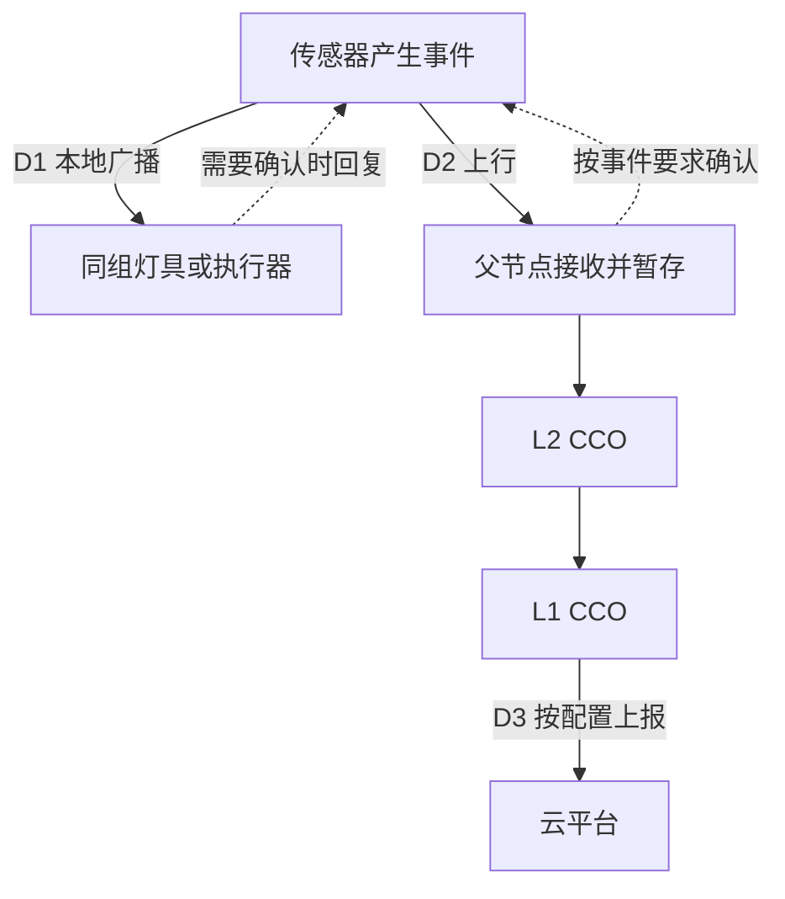
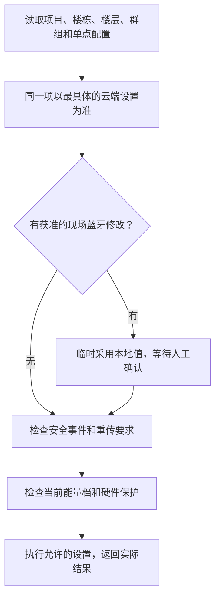

# 澜潮 SKU2 双鉴存在传感器 · 功能需求 V2.5

**待评审** · 2026-11-19 · 型号 LC-S-MTS03-PR24-11-001 · 中国大陆、中国香港

同套文档　[主文档](澜潮_SKU2_双鉴存在传感器_PRD_V2.4---2.md) · [功能需求](澜潮_SKU2_双鉴存在传感器_PRD_V2.5_功能需求---2.md) · [非功能需求与验收](澜潮_SKU2_双鉴存在传感器_PRD_V2.4_非功能需求---2.md)

看设备遇到情况怎么做，读 4.1；按事件编号查默认值，读 4.2。比如夜间进会议室，E101 可以先让灯亮，E201 记录雷达确认。要查灯有没有亮，还要看灯侧回执和现场照度。

[双鉴时序](#sec-4-1-1) · [光照与照明](#sec-4-1-2) · [能源与供电](#sec-4-1-3) · [通信与配网](#sec-4-1-4) · [事件上报](#sec-4-1-5) · [本地联动](#sec-4-1-6) · [运维诊断](#sec-4-1-7) · [4.1.8 OTA 固件升级](#sec-4-1-8) · [4.1.9 设备授时与校时](#sec-4-1-9) · [物模型与接口](#sec-4-2) · [54 条事件配置表](#matrix54)

## 04 功能需求与软件基线

### 4.1 软件功能需求

每条主需求列出触发条件、处理顺序和验收目标。研发按需求 ID 实现，测试按对应样机、运行模式和有效输入验证。

#### 4.1.1 PIR 与 24 GHz 雷达双鉴时序

例如，会议室里的人坐着没动，PIR 安静只说明它没看到新的动作。设备要等雷达复查；如果雷达没返回有效结果，就显示“未知”，灯继续遵守原来的保护规则。

先验证 PIR 在深睡时可唤醒主控、雷达能受控启动且能返回有效样本。缺失任何一项时，把受影响的判断标为未知，并向平台报告原因。无有效扫描不能判无人，也不能据此关灯。

##### 4.1.1.1 无人值守与进入复核

| ID     | 需求描述                                                                              | 优先级 | 验收标准                                     |
| ------ | --------------------------------------------------------------------------------- | --- | ---------------------------------------- |
| FR-102 | 无人时只让 PIR 值守，关闭雷达。样机要验证两件事：PIR 能唤醒深睡的主控，关闭后的雷达漏电也达标。                              | P0  | 实测无人态雷达供电与漏电是否达到已签核的关断指标；同时验证 PIR 能唤醒主控。 |
| FR-101 | PIR 检测到运动时，记下触发时间，再开雷达确认是否有人。                                                     | P0  | 径向 0.5 m/s 穿越检出率 >99%                    |
| FR-103 | 选择“快开”时，PIR 一触发就记为“疑似有人”并发送 E101。如果房间够暗且规则允许，先开灯。选择“确认后开灯”时，等雷达确认再开。              | P0  | 触发到上报 ≤300 ms                            |
| FR-104 | 给雷达足够的启动和扫描时间。确认有目标就记 E201。取得有效结果、但与本次进入不符时，按模板撤销临时动作并记 E112。扫描超时或没有有效数据时，记为“未知”。 | P0  | W_verify ≥ T_scan；慢响应不得误回滚               |

##### 4.1.1.2 有人保持、延迟复查与判离

| ID     | 需求描述                                                                          | 优先级 | 验收标准                                     |
| ------ | ----------------------------------------------------------------------------- | --- | ---------------------------------------- |
| FR-105 | 确认有人后开始计时，默认等 60 s。期间只要 PIR 再次检测到运动，就从头计时。整段时间都没有动静，雷达才复查一次。                  | P0  | PIR 活跃期间雷达启动次数为 0；PIR 静默满 60 s 后启动 1 次扫描 |
| FR-106 | 复查时雷达仍看到人，就保持“有人”并重新计时。雷达完整扫了一次、结果有效且没看到目标，才算一次“未检出”。缺少有效结果时标为未知。             | P0  | 检出后计时器正确重置；未检出进入 N_leave 计数              |
| FR-107 | 离开前要连续几次没扫到目标，由 N_leave 设置，可选 2～8 次。达到次数后进入等待阶段。中途又发现人，就取消这次离开判断。             | P0  | 只出现一次有效未检出时，从“有人”误变为“无人”的比例为 0%          |
| FR-108 | 连续未检出达到要求后，再等 T_leave（可设 10 s～30 min）。等候结束时，无人的证据仍有效才发送离开事件 E105。中途确认有人就取消。   | P0  | 误差 ≤±1 s；断电保持                            |
| FR-116 | 手动可选 15、30、60、120、300 s 五档。自动模式按电量选用已批准的间隔，平台应显示设备实际用了多少秒。低电 L4 的 180 s 仍待验证。 | P0  | 验证五档读写与自动延长；自动 180 s 的实现和能力位由 D-05 签核。   |
| FR-110 | 确认有人后，雷达在扫描期间留意静坐、翻身等小动作。看到有效微动就继续保持“有人”。有效距离和安装条件由样机实测。                      | P1  | 5 m 内微动检出率 ≥90%                          |
| FR-111 | 只有实装雷达能稳定分清静止、微动和走动，才分别报告这三档；其余情况只报告已经验证的人体存在信息。                              | P1  | 按实装雷达能输出的活动等级测试，分类一致性目标 ≥85%。            |

##### 4.1.1.3 通道故障、回滚与异常翻转

| ID     | 需求描述                                                               | 优先级 | 验收标准                                      |
| ------ | ------------------------------------------------------------------ | --- | ----------------------------------------- |
| FR-112 | 确认 PIR 故障时，上报 E205，并提示“双鉴不可用”。暂停需要 PIR 唤醒的自动判断，待 PIR 恢复并取得新数据后再判断。 | P0  | 可诊断的 PIR 电气故障以 60 s 为告警目标；镜片被遮挡或长时间零触发另验。 |
| FR-113 | 雷达故障时上报 E204。PIR 仍能报告有人动过，但人是否还在、是否已经离开，都显示“未知”。                   | P0  | 可识别的雷达故障以 60 s 为告警目标；单次未检出目标不得触发故障。       |
| FR-114 | 统计最近 24 h 首次雷达复查多少次、其中多少次撤销了临时进入。撤销比例超过设定值就告警，同时保留统计时段和样本数。        | P1  | 24 h 回滚率 >20% 触发告警                        |
| FR-115 | 持续统计最近一段时间内“有人”和“无人”来回切换的次数。过于频繁时上报 E110，供现场检查出风口等干扰源。             | P1  | 对出风口安装，1 min 内翻转 ≥3 次即触发 E110             |

#### 4.1.2 光照采集与照明判断

照度有两个用途：判断现场是否需要开灯，以及评估安装点能不能给光伏板足够的光。前者看照度门限，后者还得看实际补进了多少电。

##### 4.1.2.1 暗环境开灯与白天免开灯

| ID     | 需求描述                                                                                    | 优先级 | 验收标准                                                                                                                            |
| ------ | --------------------------------------------------------------------------------------- | --- | ------------------------------------------------------------------------------------------------------------------------------- |
| FR-601 | 同组照度有效、光线低于开灯门限，且满足当前规则的人员条件时，才自动开灯。保留开关灯的照度差，避免照度在门限附近波动时反复开关。                         | P0  | 阈值 10–1000 lux 可配，20% 滞回                                                                                                        |
| FR-603 | 白天即使有人经过，只要光线已足够，就跳过本次自动开灯，记录原因。人员事件照常记录和上报。                                            | P0  | 阈值可配；有人事件照常上报                                                                                                                   |
| FR-605 | 光线持续充足时，如果当前场景允许，就减少雷达复查次数来省电。平台能读到设备实际采用的间隔。每次复查仍须留够扫描时间；连续几次有效扫描都没看到人，并等满离开延时，才能判为无人。 | P1  | 让办公室照度持续高于免开灯门限。在允许延长间隔的场景下，例如从每 60 秒查一次改为每 120 秒查一次，比较平台显示值与设备两次复查的实测间隔。让人员静坐后再离场，核对设备能保持“有人”，且只在满足离开条件后报“无人”。60 秒和 120 秒仅为举例。 |

##### 4.1.2.2 安装采光、遮挡与开灯反馈

| ID     | 需求描述                                                                                 | 优先级 | 验收标准                                                                |
| ------ | ------------------------------------------------------------------------------------ | --- | ------------------------------------------------------------------- |
| FR-602 | 在已标定的安装点统计连续 48 h 的日均照度。低于项目门槛时上报 E309，提醒复查位置。要判断光伏能否补够电，还要看超容电压的变化。                 | P0  | 连续 48 h 日均低于门槛触发 E309                                               |
| FR-604 | 开灯前低于 300 lx，且亮度指令至少为 70% 时，先记下原照度，等 T_check 后再测。连续两次亮度增加都没达到要求时上报 E605，提醒检查灯、通信或遮挡。 | P1  | 增量阈值自适应（取"预期增量 30%"与 20 lux 的较大值）；**连续 2 次开灯无效才上报**；T_check 默认 10 s |
| FR-606 | 记录安装点有效照度的最低、最高和平均值。如果长期比该点位平时暗，标记“疑似遮挡”，请现场核查。                                      | P1  | 遮挡 24 h 内触发 E310                                                    |

##### 4.1.2.3 SKU2 实现条件与验收追踪

E605 表示开灯后的照度响应异常。后台同时查看短 ACK、照度增量和下发亮度，安排通信、灯具或驱动排查。

感知、安装与移交按本 SKU 的PIR、24G 雷达和照度能力执行。来源 S-04 §6.4、S-06。P0，HW、FW 牵头感知，MD、交付牵头安装。量程和安装工况见 §5、D-09。

| ID                  | 需求描述                                                                                                        | 优先级 | 验收标准及证据                  |
| ------------------- | ----------------------------------------------------------------------------------------------------------- | --- | ------------------------ |
| FR-3.2-05           | 1）照度分段 照度随标准光源连续变化，在低、中、高量程切换时输出连续。 2）保留超量程或无效质量标记，遵守现有链路无效值。                                               | P0  | TC-11、TC-13。             |
| FR-3.2-06           | 1）采样与上报 采样、阈值判定、事件上报、周期快照和环境历史读出各有口径。 2）照度按本 SKU 的参数采样，允许变化和周期策略按 §4.2 独立运行。                                | P0  | TC-20、TC-44、TC-45。       |
| FR-3.2-07、FR-3.2-08 | 1）照度标定与朝向 照度计在工作面标定，以同时的非零有效原始照度计算 K。 2）工作面修正值、原始值、K 版本与标定时刻可追溯。 3）朝向、遮挡不适合点位时给出提示。                         | P0  | TC-12、TC-51、TC-52。       |
| FR-3.2-12           | 1）有效性 区分真实零值、超量程、传感器故障、能力缺失、未校准和数据过期。 2）验证失败或有效性缺失时对应字段退出实时联动和统计分母，展示有效样本数或比例。 3）疑似长期无变化用工况和自检支撑。           | P0  | TC-13、TC-46、TC-51、TC-56。 |
| FR-3.7-01、FR-3.7-02 | 1）照度策略输入 在同组选择已标定有效参考点。 2）目标值指现场标定采用的当前工作面值或项目预设值，保存来源。 3）调光设置步长、回差、最小间隔和失效时保持策略。 4）组内多个有效点可按签核的选点或中位数规则使用。 | P0  | TC-51。                   |
| FR-3.4-05、FR-3.5-01 | 1）基面及承载 针对可导磁面或带背胶铁片的磁吸、背胶支架及 M4 螺接分别签核。 2）按铝扣板、矿棉板、石膏板、玻璃及混凝土的固定条件选择安装件。 3）验证持久承载及维护移除。                    | P0  | TC-39、TC-52、TC-60。       |
| FR-3.5-04～FR-3.5-06 | 1）覆盖及点位验收 点位表包含楼层、房间、SKU、安装方式、高度、朝向、父节点、信号、实际标定、关联规则和验收结果。 2）现场核对PIR 唤醒、静止存在、照度与照明门控及适用的联动。                 | P0  | TC-52、TC-54。             |
| FR-3.5-07           | 1）验收资料导出 项目端提供点位、结果、失败原因及整改信息。 2）平台自动生成 PDF 的范围随 D-13 确认，试点可用签核的记录表交付。                                      | P1  | TC-52。                   |

| PDT 领域       | 责任团队  | 行为、交付物与依赖                     |
| ------------ | ----- | ----------------------------- |
| HW、FW        | 采集和标定 | 量程、响应、时间、有效性、传感器失效与补偿。        |
| ID、MD        | 外观及结构 | 透光、通风、支架间距、探测和发射开窗、装配和底座图。    |
| 网关、云平台、微信小程序 | 策略与交互 | 配置、候选输入、目标照度来源、状态新鲜度、点位及联动运维。 |
| TE、PE、交付     | 验证和现场 | 标准仪器比对、治具、工艺校准、试点点位和失效整改。     |

#### 4.1.3 能源管理与供电切换

设备可以从室内光伏补能，平时用超容储能，必要时用一次电池，有常供电能力的话也可以采用USB常供电。节电时可以少查几次；如果电量低到必须停测，平台要显示“未知”。

OPV 的 214 µW 是 200 lx 条件下的面板标称输出。净充电、供电源识别、USB 补能和电池接管门限，以实装 U8(BOM的物料号)、电源测点及负载测试为准。实测前只下发可验证的运行档位。

##### 4.1.3.1 入网、能量估算与低电调度

| ID     | 需求描述                                                                         | 优先级 | 验收标准                                              |
| ------ | ---------------------------------------------------------------------------- | --- | ------------------------------------------------- |
| FR-201 | 入网前先看超容电压，再确认它能带得动设备。弱光入网测试以超容 ≥3 V 为前提。仅凭现场照度无法判断能否从没电状态启动或长期工作。            | P0  | 前提：超容 ≥3 V                                        |
| FR-202 | 根据实际能用的电压范围估算超容剩余能量，另外估算一次电池的余量。用带负载的实测值校准并记录误差，平台显示估算结果是否有效。                | P0  | 全区间实测对比                                           |
| FR-203 | 根据有效的能源数据选 L1～L5 档。换档后调整采样、复查和上报的节奏，并把实际设置报给平台。硬件保护随时优先。                     | P0  | 电量边界目标误差 ≤±3%；常规分级维持双鉴，受控保电准入和硬件保护见 FR-ENERGY-04。 |
| FR-204 | 电量低时，依次检查雷达多久复查、心跳和汇总多久上报、怎样发送、发射功率多大。只在批准范围内调整，让平台读到实际设置。为省电跳过的扫描不能算作“没有人”。 | P0  | 生效且可回读；低电时 `N_leave` 同步加大                         |

##### 4.1.3.2 欠压保护、电池接管与恢复

| ID      | 需求描述                                                                    | 优先级 | 验收标准                                      |
| ------- | ----------------------------------------------------------------------- | --- | ----------------------------------------- |
| FR-205  | 在样机上逐步降低电压，测出负载何时开始不稳定、硬件何时切断输出。软件只能在供电仍可靠时保存和恢复状态。                     | P0  | TC-74 测降压关断、恢复回差和低温负载波形。2.5 V 为旧方案的试验对照点。 |
| FR-205b | 1）到达预警点时先记录欠压事件；2.7 V 为候选值。 2）实际进入保护和恢复时分别记录，门限按 U8 实装及板测确认。            | P0  | E311 区分预警与保护，记录实际门限；回升后报告解除。              |
| FR-206  | 电池切入门限 2.6 V，带 0.1 V 滞回                                                 | P0  | 切入/退出稳定，不频繁启停                             |
| FR-206b | 1）按可观测的电压、带载状态和供电路径区分未接入、待机、供电、低电、耗尽与异常。 2）硬件读数无法区分的状态显示未知，并保留最后一次有效读数。 | P0  | 逐项注入可观测条件并核对状态；无法区分的输入应返回未知。              |
| FR-212  | 完全无光、改用电池时，设备继续做基本检测并定期报平安。用标称 600 mAh 电池，按实际温度和负载验证能用多久。               | P1  | 完全无光、日均 ≤11 µA 下 ≥2 年                     |
| FR-213  | 记录超容充电有多快、断光后电压降多少，以及电池带负载时的电压。持续超出已验证范围时上报 E307，提醒维护人员检查。              | P1  | 充电斜率异常或自放电过快触发 E307                       |

##### 4.1.3.3 Type-C 外供、补能与运行模式

| ID     | 需求描述                                                                                         | 优先级 | 验收标准                                                     |
| ------ | -------------------------------------------------------------------------------------------- | --- | -------------------------------------------------------- |
| FR-209 | 接入 USB 5 V 后，分别验证能否持续带动整机、能否给 20 F 超容补能。必须阻止电流倒灌进 CR2450 一次电池。边补能边检测、拔电和冷启动都通过样机测试后，再开放对应模式。 | P0  | 以 5 V 输入验证超容 2.5→3.5 V 的 <10 min 目标及 ≤5 s 状态切换；覆盖热与限流条件。 |
| FR-210 | 能可靠识别稳定外电时，切到已验证的外供档。拔电后按设备实际剩余能量选择运行档，并告诉平台现在用哪一档。                                          | P0  | 形态 B 连续 72 h 无低电降级；拔电 ≤5 s 平滑回切                          |
| FR-211 | 外电持续供电时，测纽扣电池支路的电流。验证不会倒灌、漏电也在允许范围后，再给出电池实际消耗指标。                                             | P0  | 用源表测电池电流，并随时间累加得到实际耗电量；另记录每月端电压的变化（原目标 ≤5 mV）。           |

##### 4.1.3.4 运输、重启与末次上报

| ID     | 需求描述                                                           | 优先级 | 验收标准                                                        |
| ------ | -------------------------------------------------------------- | --- | ----------------------------------------------------------- |
| FR-215 | 拨到运输档时，按实际接线断开相应负载。确认开关位置、复位行为和漏电后，给产线写清楚应该怎么拨、怎么查。            | P0  | OFF 整机 ≤2.5 µA 为目标。分别测电容漏电、管理芯片、其他支路。                       |
| FR-216 | 每次开机都查看复位标志和电源状态，在 E305 中说明是拨动开关、看门狗复位、供电恢复还是软件重启。分不清原因就写“未知”。 | P0  | 对每种可观测复位原因做故障注入；不可区分的原因上报未知。                                |
| FR-217 | 运输期间停止正常检测和上报。用实装的 20 F 超容测库存期间的电压下降，据此确定能存多久、出库前是否要补能。        | P0  | 6 个月压降 <1 V 为待验证目标。按 180 天、20 F 折算，恒定总漏电须 <1.29 µA，归入 D-07。 |
| FR-207 | 发现即将断电时，用预留电量尝试发出最后一次状态，记录是否送达。突然掉电或网络已断时，这次上报可能送不到。           | P0  | 100 次断电成功率 ≥95%                                             |
| FR-208 | 实测发完最后一条状态需要多少电，再设置预留电量和保护门限。普通任务不能提前用光这部分电量，验收时模拟断电检查。        | P0  | 以样机实测确认预留机制、末次上报所需电量和最低带载电压；隔离方式由硬件评审签核。                    |

升级前怎么判断电量够不够，见[4.1.8 OTA 固件升级](#sec-4-1-8)。

##### 4.1.3.5 SKU2 实现条件与验收追踪

适用本 SKU 的样机OPV+超容组合供电和纽扣电池路径，来源 S-04 §2、S-08。峰值关注雷达启动／维持与 BLE 上报。P0，HW 牵头。选型、阈值与寿命证据见 D-07。

| ID        | 需求描述                                                                                                                                         | 优先级 | 验收标准及证据                                      |
| --------- | -------------------------------------------------------------------------------------------------------------------------------------------- | --- | -------------------------------------------- |
| FR-3.4-02 | 1）电源切换及脉冲负载 稳定供电时采集、入网和事件处理可持续。 2）验证弱光、储能、一次电池及适用的 USB 路径。 3）在雷达启动／维持与 BLE 上报的重叠工况及冷态、寿命末端验证电压余量。 4）由电源设计保证一次电池与可充电路径隔离。 5）可判定的供电源切换触发 E-20。 | P0  | TC-20、TC-23。保留源表、示波器及电源切换事件记录，检查功能连续或按定义恢复。  |
| FR-3.4-03 | 1）低电量行为 按确认的电压、SOC 或带载余量分级。 2）阈值与回差形成同一表，分别验证进入、退出和冷启动。 3）状态切换生成 E-09、E-10、E-25、E-26 对应告警或解除。 4）云端可见当前供电源、功能退化和有效心跳周期。 5）供电耗尽的显示使用明确证据或标注推测。 | P0  | TC-20、TC-38、TC-48。分级行为与 §4.2 表一致，低电与恢复上报可配对。 |
| FR-3.4-04 | 1）更换电池 更换同规格一次电池后恢复入网、原绑定、参数及标定。 2）启动后校时，处置重启前已到期的业务。                                                                                        | P0  | TC-34。前后配置读回、事件及回网时长一致可查。                    |
| FR-4.5-01 | 1）峰值负载保护 低温或可用能量不足时校验雷达启动余量，能量不足按低电分级限制扫描。 2）恢复后按当前有效触发重新评估。                                                                                 | P0  | TC-23、TC-38。注入低温及源压跌落，记录保护、雷达启动是否发生和恢复。      |
| FR-3.6-10 | 1）受控边界 云端和近场配置均须通过端侧的硬件能力、运行模式和功耗约束校验。 2）接收到超能力设置时返回原因并保留原有效配置。 3）SKU2 门控所依赖的关断能力应在规则发布时核验。                                                  | P0  | TC-22、TC-44。尝试对 SKU2 下发无门控扫描，核对响应、读回和电流。     |

##### 4.1.3.6 能源与运维专项需求

优先落实 P0，未冻结的数值须用样机实测。

| ID           | 需求描述                                                                                                                               | 优先级 | 验收标准及证据                                                    |
| ------------ | ---------------------------------------------------------------------------------------------------------------------------------- | --- | ---------------------------------------------------------- |
| FR-ENERGY-01 | 1）光照历史与实际补能 采集安装点照度、有效受光时长，至少支持最近1h、24h、7天趋势；通过经实测校准的照度—OPV输出曲线估算补能，结合超容电压变化校正。 2）照度不可直接等同于采能功率。                                   | P0  | TC-67、TC-72；输出照度／光源／入射角、补能功率与偏差曲线。                         |
| FR-ENERGY-02 | 1）双储能独立测量 按BOM 20F超容＋600mAh CR2450建模；分别测量超容电压／可用能量、一次电池带载电压／估计剩余容量、供电源和历史切换。 2）超容低于2.6V的切换门槛及恢复回差以实装U8验证，不能用一次电池反向充电。              | P0  | TC-68、TC-74；源表与示波器记录切换、无重启／状态恢复、无反充和事件E-20。                |
| FR-ENERGY-03 | 1）联合能源预测 端侧短期预测结合超容SOC、OPV近期补能、电池SOC、PIR／雷达扫描与BLE负载估算未来12h可维持完整功能的时间；云端根据历史和老化模型预测5年目标达成与维护周期。 2）预测区间、可信度及模型版本可读。                  | P0  | TC-67、TC-72；对照实测逐日收支、预测误差、异常点位及版本。                         |
| FR-ENERGY-04 | 1）雷达降耗与保电边界 低能量阶段优先收紧雷达扫描窗口与占空比，不仅凭L3电压区间关闭雷达；只有预测剩余正常功能续航＜12h且场景允许暂停时进入保电流程，涉及的人存状态变为UNKNOWN，不得作为无人自动关灯证据。 2）硬件不可恢复欠压保护仍有最高安全优先级。 | P0  | TC-68、TC-69、TC-75；检查12h边界、雷达实际状态、E-40/E-42/E-45～47及负荷安全降级。 |
| FR-ENERGY-05 | 1）USB补能与日常运维 支持定期能源健康复核与低电量／持续亏电触发的USB补电工单；记录连接、充电结果及断电后运行能力。 2）USB补超容不等于给不可充电CR2450充电。 3）插入后仍须满足超容可用能量阈值及功耗预算才恢复完整检测。             | P0  | TC-71；记录VBUS、超容充放、维护时长、切换事件及电池隔离；检查拆线后未达阈值的再次保电。           |
| FR-ENERGY-06 | 1）PIR独立唤醒 在SoC深睡、雷达关闭时PIR应保持有效，并通过独立GPIO事件唤醒TLSR8258，且不依赖2h心跳。 2）原理图指向PB1/IO2，需验证深睡期间PIR供电轨和固件唤醒配置。                                | P0  | TC-66；验证最低电压、高低温、反复触发下唤醒成功率／延迟／整机睡眠电流。                     |

分级行为评审方案如下。S-04 采用超容电压的五级方案，待 D-07 按本机电路和测量数据收敛。

| 当前运行条件         | 本 SKU 行为                                              | 对外状态与事件                          |
| -------------- | ----------------------------------------------------- | -------------------------------- |
| 超容主供电、能量充足     | PIR持续值守；雷达按已签核窗口完成首次双鉴及有效存在复核；低功耗候选配置的 2 h 保活。        | 上报实际供电源、能力、配置版本、能源摘要。            |
| 超容主供电、预计补能不足   | PIR仍值守；自动收紧雷达的非必要扫描／占空比，不能无条件缩短到无法判人的时长。              | E-09、E-43及能源等级变化；策略实际值可读。        |
| 切换至600mAh一次电池  | 按电池电压＋温度＋累计耗电估计容量，另行分级；**不因已切电池就立即关闭雷达**。             | E-20每次有效切换必报；长期电池供电触发维护建议。       |
| 预测完整功能剩余续航＜12h | 生成保电准备事件；等待父节点接收确认及本地策略交接，优先轻度保电（保留可行的PIR）；深度停测须场景授权。 | E-45／E-46，存在状态UNKNOWN，禁止以停测推断无人。 |
| 外部USB补能或OPV恢复  | 检查回差、能量余量、PIR唤醒与雷达工作预算，达标后恢复；短时插拔未达标继续保护。             | E-20、E-47与维护记录；实际恢复状态上报。         |

**阈值来源说明：** 原S-04的3.0～3.3V、2.8～3.0V、2.6～2.8V属于旧评审梯度；BOM给出2.6V欠压点，但切换到电池和切回超容的真实阈值、回差须按本机电源管理实测。**L3 首先调整通信和雷达窗口；受控暂停须通过＜12 h 保电准入**；不得据此绕过硬件欠压保护。

| PDT 领域    | 责任团队    | 行为、交付物与依赖                        |
| --------- | ------- | -------------------------------- |
| HW、MD     | 电源与结构   | 出电源树、切换和隔离数据、冷态及脉冲余量、电池仓及运输状态方案。 |
| FW        | 端侧固件    | 按电源可测能力实现分级、回差及保护。切换后续接日志、校时与配置。 |
| 云平台、微信小程序 | 设备与运维   | 展示实际周期、供电源、限制原因和最后证据时间。          |
| TE        | 硬件与系统测试 | 按本 SKU 提交波形、能量实测和恢复证据。           |

#### 4.1.4 通信与配网

传感器大部分时间在睡觉。父节点替它暂存消息，等它醒来再交付；有人经过时，PIR 可以主动把它叫醒。

设备作为低功耗叶节点接入。父节点的并发数、缓存和时隙由兼容机型的联调结果决定；配置下发后，界面以终端回读作为生效依据。

##### 4.1.4.1 扫码入网与组网角色

| ID      | 需求描述                                                                    | 优先级 | 验收标准                                          |
| ------- | ----------------------------------------------------------------------- | --- | --------------------------------------------- |
| FR-301  | 安装人员用“澜潮智联”小程序扫机身码，核对型号、地址和批次，再填安装位置。云端核对项目权限和白名单，通过后允许入网，失败时说明原因。      | P0  | 扫码一次成功 ≥99.5%； 录入+提交 ≤10 s               |
| FR-301b | 1）连续安装时沿用上一个点位的区域并递增序号。  2）FAE 核对实际位置后提交，允许更正区域和编号。                | P0  | 同区域连续安装无需重选； 单点位录入 ≤10 s                 |
| FR-302  | 设备入网时声明 HARVEST_LEAF、canRelay=false、maxHopDepth=3。父节点把它登记为休眠终端，不分配转发任务。 | P0  | 拓扑中永不为父节点 【我认为如果后续由USB持久化供电可以考虑自动升级为父节点】 |
| FR-313  | 与父节点失联后先尝试重连。原路径仍不可用，就改连兼容的父节点，并更新路由记录。                                 | P0  | 父节点失联后 ≤3 min 重挂载                             |

##### 4.1.4.2 唤醒时隙与收发窗口

| ID     | 需求描述                                                | 优先级 | 验收标准             |
| ------ | --------------------------------------------------- | --- | ---------------- |
| FR-303 | 设备与父节点约好每次何时醒来、醒多久。父节点为各台设备错开时段，用同时挂 8 台设备验证满载情况。   | P0  | 8 台满载无碰撞（丢包 <1%） |
| FR-304 | 设备醒来后，在约好的时段内等父节点发消息。没任务就继续睡眠，有任务可延长收发时间，最长不超过规定上限。 | P0  | 超时后电流回落 ≤5 s     |
| FR-305 | 即使主控深睡，PIR 也能单独唤醒它。用样机检查唤醒引脚、供电和实际耗时。定期心跳按自己的周期运行。  | P0  | 触发到发出上报 ≤1 s     |

设备利用唤醒窗口接收升级包或向父节点对时。操作和验收分别见[4.1.8 OTA 固件升级](#sec-4-1-8)、[4.1.9 设备授时与校时](#sec-4-1-9)。

##### 4.1.4.3 SKU2 实现条件与验收追踪

适用本 SKU，来源 S-04 §3、S-06、S-07。P0，网关／协议与 FW 牵头。网络角色和容量见 D-02，身份和权限见 D-01、D-11。

| ID        | 需求描述                                                                                                                                                 | 优先级 | 验收标准及证据                                  |
| --------- | ---------------------------------------------------------------------------------------------------------------------------------------------------- | --- | ---------------------------------------- |
| FR-3.1-01 | 1）低功耗角色 终端入网提供可核对的设备身份、供电能力和版本，平台拓扑可见。 2）低功耗终端作为叶节点，父节点和中继由兼容常电设备承担。 3）父节点记录子节点及当前路径。                                                                | P0  | TC-01、TC-46、TC-54。                       |
| FR-3.1-03 | 1）入网可观测 入网或调试可查看未配网、发现、鉴权、入网、待绑定、在线、离线／连接未知及重入网。 2）区分项目权限、型号不符、父节点满载及超时。 3）授权近场按机型确认可读状态及最后失败原因。                                                     | P0  | TC-01～TC-03、TC-54。                       |
| FR-3.1-04 | 1）型号校验 入网前核对项目授权和设备工单档案。 2）SKU 运行能力与物理配置不符时拒绝绑定和不适用的配置，提示铭牌或档案核对，保留失败日志。                                                                             | P0  | TC-02、TC-43、TC-46。                       |
| FR-3.1-05 | 1）绑定、换绑与重置 一机一密及授权扫码。 2）身份关联项目、空间和点位。 3）换绑使原目标路由及规则引用失效，指令队列按授权重新校验。 4）换机、解绑、恢复出厂的配置、校准和档案保留策略按 D-11。                                                | P0  | TC-35、TC-52。核对来源、操作及重复提交。                |
| FR-3.1-08 | 1）心跳和在线判定 低功耗保活 2 h 作为独立候选配置；标准 H 档 300–1800 s，低电模式据实回报实际间隔。 2）父节点记录最近握手时间，云端按实际周期和路径证据判定。 3）父节点失联时其子节点显示连接未知。 4）E-15 上报规则与协议保活相互独立。                 | P0  | TC-04、TC-20、TC-54。验证连续丢失、父节点断云、父节点断电和恢复。 |
| FR-NET-01 | 1）容量、下行和父节点重选 验证可带载机型、节点满载拒绝、并发确认、退避与换父路由。 2）云端区分入队、待取件、终端接收、已生效、失败和超时。 3）按子设备、优先级、指令有效期管理队列。 4）路径变化更新 D-02 的路由并登记 E-27。 5）缓存满返回可定位原因，重复下发按指令 ID 幂等。 | P0  | TC-44、TC-54。覆盖已满、换父、同目标重试与多目标部分失败。       |
| FR-3.4-06 | 1）版本兼容 以固件、父节点、集中器、云和小程序组合定义支持矩阵。 2）旧快照继续按现行协议读写和消费。 3）新增能力按版本和 SKU 开放，未知版本保留可诊断信息。                                                                  | P0  | TC-46。覆盖同网新旧设备、降级与升级后读回。                 |

S-04 给出的参考条件是每个父节点连接 8 台低功耗设备，8 台同时上报时在 1 s 内确认，连续错过 3 次心跳后判为离线。每父节点直挂与集中器总容量在签核时使用独立口径。换父、缓存确认与近场能力见 D-02、D-04。现场布点以实测覆盖为据。

| PDT 领域    | 责任团队      | 行为、交付物与依赖                           |
| --------- | --------- | ----------------------------------- |
| FW        | 终端接入      | 发现、鉴权、睡眠唤醒、心跳、重入网、角色和实际能力上报。        |
| 网关／协议     | 终端和 L1 互通 | 兼容矩阵、父节点资格、寻址、换父路径、接收及下行时序、缓存和并发报告。 |
| 云平台、微信小程序 | 项目建档与交互   | 绑定权限、失败原因、连接未知、命令生命周期、版本门控和回执。      |
| PE、TE     | 工单及系统测试   | 核验设备档案、错误 SKU、重复操作、离线与恢复样例。         |

#### 4.1.5 事件生成、配置与上报

同一次人员进入有三个不同的结果：附近灯具是否收到、父节点是否收好、云平台何时能看到。三者分开记录，便于判断问题出在哪一段。

事件由有效采样、状态变化或配置结果触发。设备、父节点和云端分别记录各自的确认结果。逐事件默认值、锁定项和场景模板见第 4.2.3 节。

##### 4.1.5.1 三条上报通道与本地联动确认

| ID      | 需求描述                                                                    | 优先级 | 验收标准                                            |
| ------- | ----------------------------------------------------------------------- | --- | ----------------------------------------------- |
| FR-309  | 每条事件分别设置是否启用、要不要通知附近灯具、要不要父节点确认、怎样报给云端。设备检查重播、重传、汇总周期、每包条数和锁定项，并返回实际设置。 | P0  | 54 条逐条可配；回读一致；硬约束不可突破                           |
| FR-309b | 1）联动事件向同组灯具发送 2.4 GHz 广播，TTL ≤4。 2）要求短确认时，超时最多重播两次；三次均无确认则记录 E606。      | P0  | E101 触发到灯亮 ≤300 ms（4 跳内）；3 次无确认上报 E606          |
| FR-309c | 1）三条出口独立排队，本地动作直接执行。 2）父节点离线时按策略缓存上行数据，云端送达状态按真实链路更新。                   | P0  | 父节点离线时本地仍执行、待上行事件缓存；广播丢包时上行照常；云端断链后恢复并按原事件身份补报。 |

##### 4.1.5.2 确认、断链缓存与补报

| ID     | 需求描述                                                            | 优先级 | 验收标准                                                                         |
| ------ | --------------------------------------------------------------- | --- | ---------------------------------------------------------------------------- |
| FR-306 | 发出事件后先留一份副本，等对应的父节点确认收到再删除。云端是否已经存好，由云端另外确认。                    | P0  | 注入 500 次 ACK 丢失，事件零丢失                                                        |
| FR-310 | 断网时先把事件存到设备，目标至少能存 256 条。恢复后，分批上报，优先补报重要事件。存满时按规则腾出空间，并记下丢了多少条。 | P1  | 缓存 ≥256 条；按最大断链事件量定容。要覆盖 24 h／300 条且零丢失，需有效容量 ≥300 条或经验证的无损分级暂存。超限按 E508 对账。 |
| FR-311 | 缓存满而丢弃事件时，累计丢弃条数。网络可用后，通过 E508 的 dropCnt 字段上报。                  | P1  | E508 正确上报 dropCnt                                                            |

##### 4.1.5.3 SKU2 实现条件与验收追踪

适用本 SKU，来源 S-01、S-04 §4、S-05 §4–§7、S-06、S-07。P0，FW 与云平台共同牵头。格式、逐事件要求与兼容映射见 §4.2、D-03～D-05。

| ID        | 需求描述                                                                                                                                                              | 优先级 | 验收标准及证据                                           |
| --------- | ----------------------------------------------------------------------------------------------------------------------------------------------------------------- | --- | ------------------------------------------------- |
| FR-3.1-06 | 1）逐事件独立配置 每一事件有自己的配置键和读回项，分别提供开关、频率／触发方式、上报格式及信息。 2）允许写入项受 SKU、等级、供电与运维权限约束。 3）关键告警与配置生效回执实时锁定。 4）关闭某个可配置事件时，传感采样、同类其他事件、心跳、旧快照和独立本地策略照常。 5）有关联云规则时提示影响并按已批准规则处理。 | P0  | TC-44、TC-48。逐行验证可写、锁定、跨 SKU 与配置隔离。                |
| FR-3.1-07 | 1）汇聚与抑制 按事件分别配置频率、最小间隔、窗口和约定聚合函数。 2）保留该事件的计数、首末时刻和定义的摘要，保证 ID 可去重。 3）关键事件用直接逐条上报。 4）对报送失败保留本地计数并在可用链路按策略带出。                                                       | P0  | TC-45。生成 5 次本 SKU 支持的同类型事件与一条关键告警，逐条比对直接、汇聚与告警出口。 |
| FR-EVT-01 | 1）旧快照兼容与逐事件接口 现有父节点代理快照服务继续供旧消费者使用。 2）新增多合一专用事件字典、配置读写及回执。 3）云端按源节点、接口版本和事件配置解析，使用实际有效字段。                                                                         | P0  | TC-46、TC-56。核对快照与新增事件的源节点和语义，阻止错译及联动重复。           |
| FR-3.1-02 | 1）断链缓存与回补 区分终端到父节点、父节点到云端的确认责任。 2）断链时按能量和容量保留待递送事件。 3）恢复后先检查时基，关键实时优先，历史重试保持原身份，按有限速顺序恢复。 4）陈旧补报入历史，实时策略等新有效事件。                                                   | P0  | TC-04、TC-05、TC-29、TC-49。覆盖溢出、并发恢复、重复、乱序及确认丢失。     |
| FR-3.3-04 | 1）配置原子性及读回 一份多事件配置中逐项验证，整份原子生效。 2）设备提交成功后返回版本、结果和可核对的实际值。 3）掉电恢复采用完整有效版本。 4）同一配置请求重试保持结果一致。 5）设备当前版本优先作为生效证据。                                                     | P0  | TC-27、TC-44、TC-48。断开接收或写入时供电后检查前后版本。校验拒绝不会提交剩余条目。 |

| PDT 领域 | 责任团队       | 行为、交付物与依赖                                         |
| ------ | ---------- | ------------------------------------------------- |
| FW     | 事件生产、配置及存储 | 实现逐键配置、校验与持久化、事件时间、队列与成功结果证据。上报信息遵守 SKU 及格式的字段约定。 |
| 网关／协议  | 路由、缓存及封装   | 交付上下行映射、旧快照保留、时间锚点、重试和接收容量。按业务优先级投递。              |
| 云平台    | 物模型、入库和配置  | 拆分事件和代理快照，解析、去重、时间标记、审计、规则订阅、配置状态与实际值。            |
| 微信小程序  | 运维配置       | 显示每个适用事件的配置，明确可写、只读和等待生效。查看发生时间、最新状态及失败项。         |
| TE     | 接口与恢复测试    | 按本 SKU 逐事件验证。覆盖批量、陈旧值、旧链路及失败恢复。                   |

#### 4.1.6 本地策略与灯具联动

现场设备按已经生效的规则控制灯具。比如，会议室开了快开模式，进入时可以先亮灯；雷达随后否定这次进入时，灯仍要亮够最短时间才能撤销。

本地灯控依赖已绑定的目标组、已生效规则和当前可用的传感输入。空间状态为未知时暂停无人关灯；补报的历史动作只用于追溯。

##### 4.1.6.1 规则执行与动作保护

| ID     | 需求描述                                                        | 优先级 | 验收标准                                                          |
| ------ | ----------------------------------------------------------- | --- | ------------------------------------------------------------- |
| FR-401 | 设备按当前时段、有效照度和人员状态执行本地规则。断网时继续使用已生效的配置，并记录做了什么。              | P0  | 断网仍生效；切换 ≤1 s                                                 |
| FR-402 | 如果要撤销刚才的临时开灯，灯具先检查已经亮了多久。至少亮满规定时间（默认 10 s）才允许撤销，避免灯刚亮就灭。    | P0  | 回滚不产生可见闪灯                                                     |
| FR-403 | 保存已授权的组 ID 及各组规则。多个组同时有动作时分别处理，用实装设备验证最多能保存多少组。             | P1  | 槽位满配无丢失                                                       |
| FR-404 | 本地规则触发时，用 2.4 GHz 组播给目标组，最多转发 4 跳。记录从触发到目标设备实际动作花了多久。       | P1  | 端到端 ≤500 ms                                                   |
| FR-405 | 发出开灯指令后，按 FR-604 的条件，既看灯是否回了确认，也看现场照度是否真的上升。连续两次异常时上报 E605。 | P1  | 按 E605 的 <300 lx、下发亮度 ≥70%、连续两次门槛验证；<100 lx 全亮用作对照，误报目标 ≤10%。 |
| FR-406 | 断电恢复后，先读原配置，再查时钟。确认当前时间后，按此刻的规则重新判断。过期动作只保存在历史记录里。          | P1  | 掉电 4 h 恢复后不误触发                                                |

##### 4.1.6.2 SKU2 实现条件与验收追踪

来源 S-04 §3.5、§6。适用本 SKU 第 3.2 节的场景。P0 主链路由云平台与网关牵头，辅助交互 P1。角色、策略优先级和依赖见 D-10、D-11。

| ID                  | 需求描述                                                                                                                            | 优先级 | 验收标准及证据                  |
| ------------------- | ------------------------------------------------------------------------------------------------------------------------------- | --- | ------------------------ |
| FR-3.3-03、FR-3.7-08 | 1）本地与云端裁决 每次动作引用规则、来源、目标及指令 ID。 2）在已签核的本地优先窗口按优先级裁决。 3）同优先级才按可信时序处理。 4）无法比较时间或重复到达的请求，按已批准版本、幂等和超时规则处理。 5）桥接时防止同一事件、本地和云端各执行一次。 | P0  | TC-28、TC-29、TC-31。       |
| FR-3.7-05、FR-3.7-09 | 1）手动接管 已接入且可观测的手动操作优先于自动规则。 2）抑制期间保留感知事件和审计，恢复后以当前有效输入重评。 3）手动操作后暂停自动控制多久，由 D-10 确认。S-04 Q9 的候选时长为 4 h。                         | P0  | TC-33。                   |
| FR-3.7-10           | 1）联动追溯 记录规则及版本、触发事件 ID、发生时刻及质量、判定端、指令和目标、受理与物理证据、失败原因及耗时。 2）多目标记录各目标和总体结果。                                                      | P0  | TC-28、TC-29、TC-31、TC-51。 |
| FR-3.6-01           | 1）小程序状态 优先读取已授权的最近有效值，标注来源、最近采样或事件时间和数据新鲜度。 2）首次无有效样本或路径不可用时显示明确状态。 3）设置页展示实际 SKU 能力及逐事件配置。                                     | P0  | TC-36、TC-44、TC-46。       |
| FR-3.6-02           | 1）场景预设 按 SKU 和空间呈现可用设置及建议。 2）现场确认后写入并记录版本，实例覆盖、回读和后续修改留痕。                                                                       | P1  | TC-44、TC-52。             |
| FR-3.7-11、FR-3.7-12 | 1）联动诊断 在设备或空间详情查看最近的规则、输入和动作证据并可标记误动作，授权下附该时点有效读数。 2）决策条数和留存按 D-11。                                                             | P1  | TC-51、TC-58。             |

| PDT 领域    | 责任团队    | 行为、交付物与依赖                          |
| --------- | ------- | ---------------------------------- |
| 网关、执行端 FW | 项目本地策略  | 提供可运行的目标组、优先级执行、本地日志和可观测动作。        |
| 云平台       | 编排及运维   | 对账、去重、时效、同端垂直规则和跨点位记录。             |
| 微信小程序     | 管理与现场视图 | 设备、事件和趋势，配置推荐值，操作回执，失败、陈旧、未知与诊断可读。 |
| TE        | 场景验证    | 采集与适用执行设备的实际动作对齐，验证手动接管、断云和恢复。     |

#### 4.1.7 运维、诊断与配置

运维人员需要看得出设备有没有故障、实际使用哪组参数、现场改动是否已获确认。下面分别列出怎么检查和谁能修改。

自检项目以实装器件和开放诊断接口为准。没有硬件证据时输出“疑似”或“未支持”，供现场复核。

##### 4.1.7.1 通道自检、点位复核与工单

| ID      | 需求描述                                                           | 优先级 | 验收标准                                    |
| ------- | -------------------------------------------------------------- | --- | --------------------------------------- |
| FR-501  | PIR 以每 6 h 自检一次为目标，读取硬件支持的状态。发现明确故障就告警。长时间没人经过的情况按 FR-501b 处理。 | P0  | 按硬件支持的测点逐项注入故障，记录可识别项目和未覆盖项目。           |
| FR-501b | 1）采集与通信均正常时，统计连续无 PIR 触发天数。 2）达到 3 天时报告疑似失效，提示检查点位和镜片。         | P0  | 镜片被遮挡 3 天可上报 E113                       |
| FR-501c | 【云平台】针对同一个设备连续5天都收到E113，需要做脱敏判定，直到有新的PIR触发事件E101发生             | P3  | 避免长假期无人持续误报                             |
| FR-502  | 启动雷达自检，检查模组提供的诊断数据和回复。只报告已用样机验证、确实能区分的故障。等不到有效回复就标记雷达不可用。      | P1  | 按模组开放接口注入可重复的故障；仅验收已验证的诊断项。             |
| FR-503  | 新迭代的设备需要支持防拆功能                                                 | P1  | 装配并签核后验证事件 E407，目标 ≤5 s；未装配版本拒绝开启并回读原因。 |
| FR-504  | 检查传感器的长期数据，先排除休眠、断网和缺少样本。只有观察到可识别的遮挡特征，才报“疑似遮挡”，由现场复查。         | P1  | 在确认通道可观测后验证遮挡与正常暗环境的区分，24 h 为候选发现时限。    |
| FR-506  | 设备入网后，批量检查供电和已装传感器，把异常设备、安装位置和原因列入返工清单。                        | P0  | 2 h 内出报告                                |
| FR-507  | 安装前读取有效的超容电压。低于 3 V 时，小程序提示用 USB 给超容补能，然后重新测量。                 | P0  | App 可见提示与指引                             |

##### 4.1.7.2 参数下发、现场调试与权限

| ID     | 需求描述                                                                          | 优先级 | 验收标准                            |
| ------ | ----------------------------------------------------------------------------- | --- | ------------------------------- |
| FR-508 | 修改参数前核对项目权限、设备是否支持、数值是否超范围。写入成功后读出设备实际使用的值和版本。被拒绝时保留原值，记录 E505。               | P0  | 成功率 ≥99.5%；非法值返回 E505           |
| FR-509 | 授权人员每次最多可调试 30 min。到时自动退出，并恢复原运行策略。                                           | P2  | 本版现场调试时限取 ≤30 min，结束后回读状态并验证恢复。 |
| FR-510 | 核对设备、点位和项目是否符合白名单。发现身份冲突或操作人员无权绑定，就拒绝并记录原因。                                   | P0  | 伪造/错位绑定可拦截；变更留痕                 |
| FR-511 | 现场先打开维护模式，再用小程序通过 BLE 直连设备。核对权限后才能改参数；修改后读出实际结果，并记下是谁通过哪个入口修改的。               | P0  | 触发维护模式后可连；配置 ≤3 min             |
| FR-512 | 本地修改生效后，新版本先标为“待确认”，由授权人员确认后固化基线。72 h 没人确认就告警；满 7 天仍未确认，按规则恢复原配置，并提前 24 h 通知。 | P0  | 三态流转正确；回退前 24 h 通知              |

##### 4.1.7.3 SKU2 实现条件与验收追踪

适用本 SKU。来源 S-04 §3.2～§3.3、§5、S-06、S-07 §8.3.1。产品／FW 牵头。认证算法、保留期、升级和工装见 D-11～D-13。

| ID                  | 需求描述                                                                                                            | 优先级 | 验收标准及证据            |
| ------------------- | --------------------------------------------------------------------------------------------------------------- | --- | ------------------ |
| FR-3.6-09           | 1）鉴权与防重放 配网、关键配置、联动与控制按项目鉴权及完整性校验。 2）重复、过期、跨项目或越权请求隔离。 3）鉴权失败只回报必要原因，引导合法重试。 4）一机一密的产测生成、轮换及具体帧校验过程由签核安全规格给出。   | P0  | TC-03、TC-55。       |
| FR-3.6-05           | 1）数据访问控制 使用项目或空间权限访问照度、空间存在状态及运行状态。 2）现场告知和授权随项目资料交付。 3）数据用途、保留、删除及审计见 §4.2.6。                                  | P0  | TC-37、TC-55。       |
| FR-3.6-06           | 1）现场调试 授权读版本、供电、信号、入网状态与失败原因，按 SKU 强制采样、自检及模拟触发。 2）模拟数据带测试标记，隔离正式统计和现场动作。 3）现场调试按 FR-509 的 10 min 上限退出。         | P1  | TC-56、TC-58。       |
| FR-3.6-07           | 1）日志及可追溯 记录状态、故障、复位原因、配置、绑定和联动。 2）导出按项目权限审计，隐藏密钥和无关人员数据。 3）通信失败先按策略重试、恢复链路并检查能量，再选复位等恢复动作。 4）复位恢复版本、持久化配置与时间服务。 | P0  | TC-37、TC-55、TC-58。 |
| FR-3.4-07、FR-3.4-08 | 1）出厂身份与能力防错 产线交叉核对工单、实物模组、烧录身份、读回能力位及铭牌。 2）检测缺装、错装和错误型号，未通过的设备留在产测流程。 3）正常运行时型号及硬件能力只读，功能配置在具备能力的范围内校验。         | P0  | TC-02、TC-43、TC-46。 |
| FR-3.6-08           | 1）产测证据 按 SKU 验证 PCBA、传感、供电、版本和成品阶段。 2）以设备身份查询批次、测试结果、标定、工位与时间。 3）产测工装协议见 S-06 的 0x8009、8389 条目。                 | P0  | TC-43、TC-59。       |
| FR-3.4-09           | 1）指示灯管理 在线默认熄灭，配网、故障及重置根据样机确认的灯语给出可区分反馈。 2）支持按场景关闭普通指示，低电时符合能量降级，关键现场状态可在小程序读取。                                 | P1  | TC-01、TC-58。       |

| PDT 领域   | 责任团队  | 行为、交付物与依赖                        |
| -------- | ----- | -------------------------------- |
| HW、FW、PE | 终端及产测 | 烧录及校准、首件防错、版本与诊断、分区、看门狗及安全升级。    |
| 网关、云平台   | 协议和运维 | 节点与项目隔离、密钥与指令审计、任务和版本编排、掉电及失败证据。 |
| 微信小程序    | 运维界面  | 授权、状态和操作结果的展示，调试与正式运行区分。         |
| TE       | 单端及联调 | 定位注入异常的复位、升级、鉴权、数据回读和取证。         |

#### 4.1.8 OTA 固件升级

比如要给一层楼的传感器换固件，运维人员可以先选一批设备试升。传感器平时在睡觉，父节点替它保存升级包，每次醒来传一段。平台按设备显示进度，现场能查到哪台已换好、哪台因电量不足被拒绝、哪台恢复到了原来可用的版本。

| 需求 ID     | 现场怎么做                                                                                         | 优先级 | 怎么验收                                                                    |
| --------- | --------------------------------------------------------------------------------------------- | --- | ----------------------------------------------------------------------- |
| FR-214    | 开始前检查供电和储能，确认电量足以完成安装。电量不足就拒绝这次任务，把原因告诉平台。供电恢复后可以重新申请。                                        | P0  | 用低电设备发起升级，平台能读到明确的拒绝码。                                                  |
| FR-312    | 父节点暂存匹配的升级包，等设备醒来分段发送。终端检查版本、包的完整性和电量。中途断链，重连后从上次确认收到的位置续传。                                   | P1  | 原定的两条升级路径都要走通，并验证断点续传。                                                  |
| FR-3.6-03 | 先检查版本是否兼容、电量和信号是否满足条件。升级过程中按阶段验证本地感知、关键事件留存、休眠收件和数据保存。记录开始、拒绝、成功、失败或回滚。若中断，设备要能回到可工作的版本并重新入网。 | P0  | 正常升级后核对版本、配置、标定和路由。分别在传输和切换阶段模拟断电或包损坏，再核对恢复结果和关键事件。见 TC-24～TC-26、TC-49。 |
| FR-3.2-11 | 出厂和现场标定数据带版本保存。正常升级沿用已有标定；标定算法改变时，要说明哪些数据可迁移、哪些需要现场重标。                                        | P0  | 升级前后读回标定数据并核对。见 TC-24、TC-35。                                            |
| FR-3.6-04 | 需要支持灰度升级。按项目或批次分批升级。运维可逐台查看结果，也可暂停。失败率达到批准的门槛时，停止发起新任务；已开始的任务按各自阶段安全结束。                       | P1  | 在同一批里模拟低电、版本不匹配和断链，验证暂停、恢复、逐台结果及命令队列优先级。失败门槛待 D-11 确认，见 TC-57。          |

**平台怎么知道结果。** E506 记录下载、校验、安装、成功、失败和回滚。失败和回滚必须上报。三通道默认设置见[事件配置表](#matrix54)，固件版本校验和 OTA 状态字段见[物模型与接口](#sec-4-2-1)。

#### 4.1.9 设备授时与校时

比如会议室断网时有人进来，设备先记下“这次开机以来，过了多久发生了这件事”。重新连上父节点后，如果这段计时一直连续，就能用父节点给的可靠时间倒推出人是什么时候进来的。云端另外记录自己收到消息的时间。

| 需求 ID     | 现场怎么做                                                                                           | 优先级 | 怎么验收                                                                  |
| --------- | ----------------------------------------------------------------------------------------------- | --- | --------------------------------------------------------------------- |
| FR-307    | 设备拿到可靠时间后，与自己的时钟比较。偏差小于 100 ms 时保持原值，达到 100 ms 时校正，再测误差并保存本次修正量。                                | P0  | 给出 90 ms 偏差应保持原值，110 ms 应触发校正。E507 的校后目标为误差小于 20 ms，修正量随心跳上报。         |
| FR-308    | 设备持续记本地时间。接入端用可靠的对时时刻还原 UTC 发生时间，云端单独保存收件时间。断网后补报的事件按发生时间和时间可信程度排序。                             | P0  | 在能还原发生时间的记录中，补报事件排序正确率为 100%。                                         |
| FR-EVT-02 | 事件触发或确认时就记下本地计时和本次开机记录，同时保留发生时间、首次入库时间及时间质量。跨重启、拿不到可信时间、日计数缺少日期或误差超出预算时，标记时间未知或降级。只在同一段连续计时内回填。 | P0  | 在线、断链重连、跨日、掉电重启和错过校时窗口时分别触发事件，与参考仪器对照。能还原的顺序应正确，无法还原的记录能看出原因。见 TC-47。 |

**什么时候对时。** S-04 提出事件唤醒后约 1 秒内与父节点对时，这个时限和全温条件下的误差还要按 D-04 实测确认。换电池重启后也要校时（FR-3.4-04）。时间不可信时，先暂停依赖绝对时间的规则；恢复后按当前有效输入重新判断，过期的开关灯动作只保留在历史记录里（FR-406）。协议字段和时间质量分级见[4.2.4 时标、确认、缓存及恢复](#sec-4-2-4)。

### 4.2 物模型、数据链路与接口

#### 4.2.1 对象、上报模式与格式

| 对象   | 接口依据                                   | 实现与评审范围                                                        |
| ---- | -------------------------------------- | -------------------------------------------------------------- |
| 协议属性 | V4.68 的 SIID / CIID、类型、GET / PUT、单位和枚举 | 下表逐行列出适用项；按 SKU 能力和协议版本开放。                                     |
| 业务属性 | HTML 逐项属性表及 SKU2 补充                    | HTML 汇总写 40 项。按其明细拆开复合字段为 40 个具名字段；按下面的逐行权限评审。模型发布清单由 D-03 冻结。 |
| 业务事件 | §4.2.3 六类 54 条主事件                      | 表内 24 条不可禁用，30 条可禁用；SKU2 增补语义单列。E 编号为业务标识。                     |
| 业务服务 | HTML 的 11 项服务及 MD 补充                   | 校准、能源、融合、运维和配置服务需要权限、输入输出及错误码；新增线编码由 D-03 登记。                  |

##### V4.68 协议字段 · 多合一传感器

| SIID / CIID       | 名称（V4.68）    | 类型       | 权限        | 单位、范围、默认或说明                                                                                              | SKU2 使用条件                    | 行   |
| ----------------- | ------------ | -------- | --------- | -------------------------------------------------------------------------------------------------------- | ---------------------------- | --- |
| `0x8009 / 0x6001` | 软件版本         | `string` | `GET`     | 最大128字符                                                                                                  | 设备与固件                        | 3   |
| `0x8009 / 0x6003` | 成品工装检测       | `enum`   | `GET`     | 0：还没检测，1：已经检测                                                                                            | 工装 / 授权维护                    | 4   |
| `0x8009 / 0x6004` | OTA文件时间戳     | `uint32` | `GET`     | OTA文件时间戳                                                                                                 | 设备与固件                        | 5   |
| `0x8009 / 0x6005` | 当前运行固件校验信息   | `uint32` | `GET`     | 当前蓝牙程序固件CRC32值，用于差分升级匹配旧版本                                                                               | 设备与固件                        | 6   |
| `0x8009 / 0x6006` | OTA调试信息      | `string` | `GET`     | 获取当前ota的一些状态信息                                                                                           | 设备与固件                        | 7   |
| `0x8009 / 0x6007` | 差分文件定时升级时间   | `uint32` | `GET/PUT` | 使用澜潮时间戳，单位：秒                                                                                             | 设备与固件                        | 8   |
| `0x8009 / 0x6008` | 差分包生成时间      | `uint32` | `GET`     | 单位：秒                                                                                                     | 设备与固件                        | 9   |
| `0x8009 / 0x6103` | 成品工装检测完成写入   | `enum`   | `GET/PUT` | 0：还没检测，1：已经检测                                                                                            | 工装 / 授权维护                    | 10  |
| `0x8004 / 0x6050` | 总计运行时间       | `uint32` | `GET`     | 单位:s                                                                                                     | 设备与固件                        | 13  |
| `0x8004 / 0x60F0` | 本次复位运行时间     | `uint32` | `GET`     | 单位:s                                                                                                     | 设备与固件                        | 14  |
| `0x8203 / 0x6240` | 功率           | `enum`   | `GET/PUT` | 原表未给取值范围                                                                                                 | 设备与固件                        | 16  |
| `0x8203 / 0x6001` | 软件版本         | `string` | `GET`     | 原表未给取值范围                                                                                                 | 设备与固件                        | 17  |
| `0x8203 / 0x6103` | 设备类型         | `uint16` | `GET`     | 原表未给取值范围                                                                                                 | 设备与固件                        | 18  |
| `0x8203 / 0x60F1` | 复位次数         | `uint32` | `GET`     | 原表未给取值范围                                                                                                 | 设备与固件                        | 19  |
| `0x8203 / 0x60F0` | 本次复位运行时间     | `uint32` | `GET`     | 原表未给取值范围                                                                                                 | 设备与固件                        | 20  |
| `0x8235 / 0x6201` | 光照度          | `uint16` | `GET`     | 单位：lux                                                                                                   | 照度装配与标定后开放                   | 22  |
| `0x8235 / 0x6204` | 热释电传感器       | `enum`   | `GET`     | 0-无人 1-有人；是融合阶段的值                                                                                        | 融合阶段状态；有效性另传                 | 25  |
| `0x8235 / 0x6205` | 电量           | `uint16` | `GET`     | 单位：mV                                                                                                    | mV；测量节点须联调确认                 | 26  |
| `0x8235 / 0x6206` | 供电默认         | `uint16` | `GET`     | 0：电容供电 1：电池供电 2：USB供电                                                                                    | 设备与固件                        | 27  |
| `0x8235 / 0x6207` | 雷达状态         | `uint16` | `GET`     | 0-无人 1-有人                                                                                                | 设备与固件                        | 28  |
| `0x8235 / 0x620A` | 光照历史记录       | `array`  | `GET`     | 读取光照历史记录；配合多合一app才使用这个CCID                                                                               | 配套 App；按支持版本                 | 29  |
| `0x8236 / 0x6201` | 传感器功能配置      | `enum`   | `GET/PUT` | 按BIT位使能传感器的功能；产品1：雷达+PIR 写入 6 产品2：温度+湿度+照度 写入 9 产品3：温度+红外 写入24                                           | 旧掩码 6 的含义为雷达 + PIR；新增照度能力须登记 | 33  |
| `0x8236 / 0x6202` | 唤醒时间配置       | `uint16` | `GET/PUT` | 单位：s；广播帧发送 唤醒多少S之后进入休眠                                                                                   | 设备与固件                        | 34  |
| `0x8236 / 0x6205` | 广播时间配置       | `uint16` | `GET/PUT` | 单位：s；广播帧广播多少S                                                                                            | 设备与固件                        | 35  |
| `0x8236 / 0x620B` | 光照度阈值配置      | `uint16` | `GET/PUT` | 单位：lux                                                                                                   | 照度装配与标定后开放                   | 36  |
| `0x8236 / 0x6310` | 出厂模式         | `enum`   | `GET/PUT` | 1表示出厂模式 0 使用模式                                                                                           | 工装 / 授权维护                    | 38  |
| `0x8236 / 0x6210` | 父节点MAC配置     | `array`  | `GET/PUT` | 原表未给取值范围                                                                                                 | 授权网络配置                       | 39  |
| `0x8236 / 0x620A` | 环境历史存储间隔     | `uint16` | `GET/PUT` | 5～3600s；配合多合一app才使用这个CCID                                                                                | 配套 App；按支持版本                 | 40  |
| `0x8236 / 0x6215` | 父节点MAC范围限制列表 | `array`  | `GET/PUT` | 允许存储4个                                                                                                   | 授权网络配置                       | 41  |
| `0x8388 / 0x6630` | 雷达参数配置       | `array`  | `GET/PUT` | 原表未给取值范围                                                                                                 | 雷达模组；按机型解析                   | 44  |
| `0x8388 / 0x6633` | 获取软件版本号      | `string` | `GET/PUT` | 原表未给取值范围                                                                                                 | 雷达模组；按机型解析                   | 45  |
| `0x8237 / 0x6205` | 触发阈值         | `enum`   | `GET/PUT` | 1~254；该值越高，越不容易触发，默认18。                                                                                  | 设备与固件                        | 47  |
| `0x8237 / 0x6206` | 触发保护时间       | `uint16` | `GET/PUT` | 支持 0、700、1300、2000、2700、3300、3800、4500、5200、5800、6500、7200，默认0。 单位：ms；；PIR触发后的硬件盲区时间，期间不产生新的有效运动触发。默认0ms | 设备与固件                        | 48  |
| `0x8237 / 0x6207` | 有效脉冲次数       | `enum`   | `GET/PUT` | 1、2、3、4次；设置需要感应到几次脉冲，才判定有人体移动 默认2                                                                        | 设备与固件                        | 49  |
| `0x8237 / 0x6208` | 检测脉冲扫描窗口     | `enum`   | `GET/PUT` | 只支持2、4、6、8秒；在窗口内累计有效脉冲；其他条件相同时，窗口越大、要求脉冲数越少，越容易触发 默认4秒。                                                  | 设备与固件                        | 50  |
| `0x8237 / 0x6209` | PIR状态复查间隔    | `uint32` | `GET/PUT` | 1～300秒；默认60秒，用于有人状态下的PIR定时复查，不影响首次检测有人后的立即上报。                                                            | 设备与固件                        | 51  |
| `0x8237 / 0x620A` | 是否要求脉冲极性相反   | `enum`   | `GET/PUT` | 0-要求 1-无此要求；默认0。                                                                                         | 设备与固件                        | 52  |
| `0x8389 / 0x6512` | 产测模式         | `enum`   | `GET/PUT` | 2-PCB测试，1 成品产测未测试 0 测试完成可生产                                                                              | 工装 / 授权维护                    | 76  |
| `0x8389 / 0x6513` | 热释电传感器       | `enum`   | `GET`     | 0-无人 1-有人；实时读取的                                                                                          | 工装 / 授权维护                    | 77  |

> 同号字段按服务和版本解码。8235/6204 为融合阶段 GET 枚举，8389/6513 为工装读取的实时 PIR。8235/6205 用 mV，代理快照 battery 以 0.1 V 为单位。8236/6202 用秒，不能直接承载 wWake 的毫秒值。

> SKU 裁剪。V4.68 的温度、湿度、温湿历史、温变阈值与 8402 红外服务归相关 SKU；SKU2 复用既有代理时按规定填入无效标记。8009/6104 在该表仅有编号，预留待定义。

##### 业务属性 · 复用与待登记项

“待登记”表示应用层需要这个属性，协议组还要在 D-03 登记接口和版本。

| 业务分组     | 属性                             | 建议类型        | 应用读写 | 更新时机  | 业务语义                                                    | V4.68 对应或登记状态                                     |
| -------- | ------------------------------ | ----------- | ---- | ----- | ------------------------------------------------------- | ------------------------------------------------- |
| 存在与探测    | `presenceState`                | enum        | R    | 变化+周期 | 业务展示可含无人、疑似有人、有人、微动；另表达待判离、未知与能力降级。保留原字段 0/1 的线编码。      | 8235/6204（融合 0/1）＋6207（雷达 0/1）。多态与有效性另登记。         |
| 存在与探测    | `actLevel`                     | uint8       | R    | 变化    | 1 静 / 2 微动 / 3 走动                                       | 待登记                                               |
| 存在与探测    | `radarGate`                    | enum        | R    | 变化    | 雷达门控状态：关闭 / 待延迟确认 / 扫描中                                 | 待登记                                               |
| 存在与探测    | `rollbackCnt`                  | uint16      | R    | 周期    | 累计进入回滚次数                                                | 待登记                                               |
| 存在与探测    | `tRadarDelay`                  | uint16      | RW   | 变化    | 雷达延迟确认时间（s），15/30/60/120/300 五档                         | 扩展；与 8237/6209 的 PIR 复查及 8236/6202 的唤醒分别配置。       |
| 存在与探测    | `tScan`                        | uint16      | R    | 周期    | 雷达实测单次扫描时长（ms），模组标定值                                    | 雷达标定读值；8388/6630 结构需协议确认。                         |
| 存在与探测    | `wVerify / nLeave / tLeave`    | uint16/8/16 | RW   | 变化    | 校验窗口 / 离开判决次数 / 无人确认延时                                  | 新增融合参数；PIR 脉冲窗沿用 8237/6208。                       |
| 存在与探测    | `pirSens / radarSens`          | uint8       | RW   | 变化    | 灵敏度档位 1–5                                               | 8237/6205 为 1–254 的 PIR 触发阈值；应用档位须映射校准。           |
| 能量与电源    | `powerSource`                  | enum        | R    | 变化    | HARVEST / USB_CHARGING / USB_ONLINE                     | 8235/6206 已定义超容、电池和 USB。充电进行中另需可观测信号。             |
| 能量与电源    | `energyLevel`                  | uint8       | R    | 变化    | 5 级能量档位 L1–L5                                           | 待登记                                               |
| 能量与电源    | `soc / vcap / pHarvest`        | uint8/16/16 | R    | 变化/周期 | 荷电 % / 超容电压 mV / 采集功率 µW                                | 8235/6205 是 mV 读值。SOC、超容专用电压及采能功率需单独登记。           |
| 能量与电源    | `capUv`                        | enum        | R    | 变化    | 预警和保护状态；比较点由 D-07 实测冻结，U8 物料 UV 标注为 2.6 V。              | 待登记                                               |
| 能量与电源    | `capHealth / batHealth`        | uint8       | R    | 周期    | 超容 / 电池健康度 0–100                                        | 待登记                                               |
| 能量与电源    | `batStatus`                    | enum        | R    | 变化    | 未接入 / 待机 / 供电中 / 低电 / 耗尽 / 异常                           | 待登记                                               |
| 能量与电源    | `vbat / batLife / batIn`       | 16/8/bool   | R    | 周期/变化 | 电池电压 mV / 剩余寿命月 / 是否切入                                  | 复用电压前确认 8235/6205 的测点；寿命和切入态另登记。                  |
| 能量与电源    | `protState`                    | bitmap      | R    | 变化    | 保护状态位：欠压 / 电池耗尽 / 过流 / 过温                               | 待登记                                               |
| 能量与电源    | `bootCause`                    | enum        | R    | 上电时   | POWER_SWITCH_ON / WATCHDOG / POWER_RECOVER / SOFT_RESET | 待登记                                               |
| 能量与电源    | `factoryId`                    | string      | R    | 上电时   | 产线写入的身份信息（只读），用于三重一致性比对                                 | 8203/6103 是设备类型。产线身份单独登记并校验。                      |
| 能量与电源    | `swState`                      | bool        | R    | 上电时   | 开关状态回读（仅 ON 时有意义）                                       | 待登记                                               |
| 光照       | `lux / luxAvgDay`              | uint16      | R    | 变化/周期 | 当前照度（最小/最大/均值）/ 日均照度                                    | 8235/6201 GET，uint16，lx；历史 8235/620A。日均值及统计口径另登记。 |
| 光照       | `daylightMode`                 | enum        | RW   | 变化    | OFF / 免开灯 / 降频                                          | 8236/620B 是单个照度阈值；门控模式和独立阈值需配置扩展。                 |
| 光照       | `luxDelta`                     | int16       | R    | 校验时   | 开灯响应校验的照度变化量（lux）                                       | 待登记                                               |
| 光照       | `lightFaultCnt`                | uint16      | R    | 周期    | 累计"开灯无响应"判定次数                                           | 待登记                                               |
| 安装、身份与通信 | `mountMode / tiltDeg`          | enum/int8   | RW   | 变化    | 顶装 / 侧装 / 斜装，及倾角                                        | 待登记                                               |
| 安装、身份与通信 | `locCode / whitelistState`     | string/enum | RW   | 变化    | App 录入的四级位置码 / 白名单状态                                    | 位置由授权安装角色提交；白名单结论由校验方产生。D-03 分别定义权限。              |
| 安装、身份与通信 | `wWake`                        | uint16      | RW   | 变化    | 唤醒窗口 ms（100–500）                                        | 8236/6202 是秒级唤醒配置，毫秒窗口须另登记。                       |
| 安装、身份与通信 | `reportCycle / reportBatchMax` | enum/8      | RW   | 变化    | 聚合周期 / 单次条数上限                                           | 父节点旧服务 7002/7003/7005/7007 按原语义；新事件逐项配置见本章。       |
| 安装、身份与通信 | `clockSkew`                    | int16       | R    | 每次校时  | 本次校时修正量 ms                                              | 待登记                                               |

##### 业务服务 · 接口与权限

| 服务                   | 优先级 | 入参 / 出参与回读                                                                                         | 接口状态                |
| -------------------- | --- | -------------------------------------------------------------------------------------------------- | ------------------- |
| `checkLightResponse` | P1  | 入：T_check、期望照度增量；出：实测 luxDelta、判定结果                                                                | 业务服务草案；协议层由 D-03 登记 |
| `setReportPolicy`    | P0  | 入：事件 ID 列表 + 三通道参数（本地广播开关与是否需灯确认、本地重播次数、父节点上行方式、云端上报方式、聚合周期、条数上限、重传次数、启用状态）或模板 ID；出：逐条生效确认含"实际执行值" | 业务服务草案；协议层由 D-03 登记 |
| `enterMaintenance`   | P0  | 入：时长（≤30 min）、鉴权码；出：长唤醒窗口开启确认                                                                      | 业务服务草案；协议层由 D-03 登记 |
| `bindLocation`       | P0  | 入：镭雕码（型号+MAC+批次+日期+hwVer）、四级位置、姿态、倾角；出：白名单校验结果                                                     | 业务服务草案；协议层由 D-03 登记 |
| `startCalibration`   | P0  | 入：通道、时长；出：标定结果码                                                                                    | 业务服务草案；协议层由 D-03 登记 |
| `setMountMode`       | P0  | 入：姿态、倾角；出：生效确认                                                                                     | 业务服务草案；协议层由 D-03 登记 |
| `setFusionParams`    | P0  | 入：wVerify、tRadarDelay、nLeave、tLeave                                                                | 业务服务草案；协议层由 D-03 登记 |
| `setWakePlan`        | P0  | 入：唤醒窗口、周期、基准时刻                                                                                     | 业务服务草案；协议层由 D-03 登记 |
| `setDaylightPolicy`  | P1  | 入：免开灯阈值、降频档、滞回、开灯校验阈值                                                                              | 业务服务草案；协议层由 D-03 登记 |
| `armSecurity`        | P1  | 入：布防状态、时段、滞留阈值                                                                                     | 业务服务草案；协议层由 D-03 登记 |
| `readDiagSnapshot`   | P1  | 入：无；出：通道/电源/照度/最近 8 条事件/回滚次数/当前策略摘要                                                                | 业务服务草案；协议层由 D-03 登记 |

##### 生产、消费与事件封装

> 统计窗口与报送档位。M0–M5 表示内部统计、按需读取及抑制语义。CL 仅用 §4.2.3 的 I / A / H / L；M1 的 1/5 min 可用于内部统计，A 档最短 15 min。D/A 表示直接／汇聚报文格式。

本期边界已确认。保留 V4.68 的子传感器代理快照及消费接口，新增面向多合一的逐事件上报、配置与生效回执。快照、读取属性、业务事件、设备服务和告警各有独立的触发、权限和时效。§4.2.3 的 E 编号是本 PRD 的稳定业务标识，新增的 SIID、CIID、掩码位、配置结构及字节布局由 D-03 联合登记。按事件域或分服务分配，校验 16 位掩码容量及解析边界。

| 对象        | 生产与消费                                     | 版本及时间                                  |
| --------- | ----------------------------------------- | -------------------------------------- |
| 现有属性及代理快照 | FW、本地接收节点或网关 → 云平台、现有策略或小程序。提供当前值、供电及版本等。 | 以 V4.68 为准。每个字段按所在服务、结构版和有效标记解码。       |
| 新增逐事件     | 终端、父节点或云端判定后生产 → 网关或云事件入口 → 规则、历史、告警或运维。  | 使用事件字典、配置版本、独立身份和实际发生时间。实时与回补独立识别。     |
| 配置和命令     | 授权用户或云策略 → 网关／父节点 → 实际执行端。                | 请求、父节点投递、端侧应用／执行分阶段确认。配置成功后读回且记录 E-19。 |

继承 T8 §4–§5 的配置概念。本期事件格式 D 为直接上报，A 为可汇聚上报。直接传输一条有效事件记录，汇聚可装载多条记录。按窗口统计时使用对应聚合函数，每种记录仍带足以还原其时间与源设备的信息。在 V4.68 的直接结构中一次只有一个有效掩码位，在支持汇聚的结构中按低位到高位解析多个事件的数据。新服务是否沿用该编码由 D-03 冻结。

| 模式      | 节奏、格式及数据口径                                                         |
| ------- | ------------------------------------------------------------------ |
| M0 实时   | 触发即入实时发送队列，D，逐条保留。关键告警与配置回执锁定，业务去抖发生在确认前，后续只对重复传输做幂等。链路恢复按 §4.2.4。 |
| M1 分钟聚合 | 事件表指定 1、5 或 15 min 的适用白名单。收集首末、计数及极值等，窗结束可按配置直报摘要或由网关汇聚。           |
| M2 小时聚合 | 1 h 窗，适合非实时统计。输出按事件定义的 LAST、COUNT、MIN_MAX 或 DURATION。              |
| M3 日聚合  | UTC 自然日，依赖可信日期锚点。按规定错峰，时间不可信时标记区间、暂存或仅出滚动窗口，策略见 D-04。              |
| M4 按需   | 授权请求触发一次读或诊断响应，采用现有 GET 或经登记的应答，页面标注读值时间。                          |
| M5 抑制   | 本地计数和留痕，计数可按约定并入成功快照或供诊断读取。上报失败不再触发失败事件的实时上报。                      |

云平台将业务事件归一到以下字段。现有定长载荷由接入端按已知信息映射。新增线协议字段及版本由 D-03 登记。

| 字段                                                        | 类型及语义                                                          |
| --------------------------------------------------------- | -------------------------------------------------------------- |
| `eventId`、`eventType`                                     | 去重标识为字符串，事件类型为 §4.2.3 的业务 ID。重传、补报、代理路径切换保持同一业务记录的身份。          |
| `deviceId`、`origin`                                       | 源设备标识、生产端枚举（终端、父节点、执行端或云）。父节点代理保留子节点归属，链路信息独立记录。               |
| `eventTime`、`eventTimeQuality`、`recvTime`                 | 云事件发生时间建议用 UTC 毫秒，无可用时间锚点时为空并标记质量。云接收时间单记。时钟误差估计和归档规则见 §4.2.4。 |
| `schemaVersion`、`configVersion`、`reportMode`、`isBackfill` | 载荷及配置版本、上报模式和补报标记。适用设备保留可验证的启动代次与序列供对账。                        |
| `payload`                                                 | 按事件表定义的业务对象，包含必报字段及当前权限、格式和配置允许的选填字段。采用表列单位及登记的编码。             |

#### 4.2.2 每个事件的配置项与生效

> 配置成功有两条证据。设备在当前请求上返回成功、拒绝或失败，带请求 ID、配置版本和实际执行值。随后 E504 或 E505 按主表策略形成审计事件。关闭可选的 E504 云端审计仍需完成事务回执。

配置键由「设备或发布模板、SKU 能力、事件 ID」组成。小程序逐事件维护，平台批量应用时展开到设备和事件，设备、父节点或云端在事件产生或上报的责任位置校验和执行。每行事件都提供以下独立配置视图。产测固化的物理能力、协议总开关和业务策略保持各自权限。

| 配置项       | 字段与读写约定                                                                                              | 验证及异常                                                                      |
| --------- | ---------------------------------------------------------------------------------------------------- | -------------------------------------------------------------------------- |
| 上报开关      | `enabled`，布尔。每个可配事件单独启停。L 为锁定可读，R 为在定义范围内可写。D-05 签核管理权限。                                             | 关闭仅影响该逻辑事件的主动上报。告警保护、采样、其他事件、协议保活、旧快照和单独的控制回执按对应契约处理。业务规则引用被关事件前须可见影响。     |
| 频率与触发     | `mode`、`periodSec`、`minIntervalSec`、`windowSec`、`reduce` 及行级阈值／回差／稳定时间。实际能力由事件行定义。                   | 立即型的周期显示「按触发」，通过阈值／时段判断触发的项按表校验。窗口整包校验。配置 0 代表仅变化的场合限于表中定义的周期项。            |
| 上报格式      | `format` 指定 D/A。固定格式事件显示其结构版本和允许的上报方式。M0 采用 D。                                                       | 服务及掩码分配随版本生效。原生定长帧保持完整格式及保留位，额外字段通过已登记的新格式提供。                              |
| 上报信息      | `fields` 是该事件的选填字段集合，必报项目与结构版只读。设备端和代理以每行规定的单位、取值和权限处理。                                              | 缺失、无效、过期都有相应表示。权限外或 SKU 缺失的字段不生效，选填字段的关闭不会改变其他事件。                          |
| 上报确认与重试   | `ackPolicy`、`ackTimeoutSec`、`retryMax`、`eventTtlSec`、`offlineCacheEnable`；按事件优先级和运行能源预算设定。           | 父节点收件、云端入库、执行端动作三种确认不能混用；关键事件须确认并在预算内限次重试。新字段须由 D-03/D-05 登记，旧版不认识时不得假装生效。 |
| 本地联动与云端记录 | `localLinkageEnable`、`cloudRecordEnable`、`reasonCode`、`capabilityState`、`timeQuality`（各字段是否可写按事件确定）。 | 本地直达不经父节点，互不依赖；关闭普通云报送不自动停用本地检测；P0关键告警和必要能力状态不允许全局关闭。                      |
| 生效回执与版本   | `configVersion`、请求 ID、目标设备、失败项、实际值与执行端，支持 GET 读回。                                                    | 云端保留请求值和实际值，队列接受后显示待生效。配置生效或执行失败有终态。只接受完整有效版本，写入失败保留原配置。                   |

配置过程沿用 T8 §5.6 的逐项校验、原子生效、回执和持久化。平台提交或发布版本 → 责任端验证事件支持、锁定、参数范围、字段和格式 → 在定义的接收窗生效 → 发送不可关闭的 E-19 并支持读回。锁定项、未知事件和无该能力的写入返回原因。仅对现有明确规定的字段沿用钳制规则，新字段越界拒绝并保留有效配置。以请求 ID 区分重试，以配置版本阻止晚到的旧版本覆盖。批量跨设备返回单设备结果。新版本切换前已生成的待报记录仍用原配置与事件身份解析。

各行的冻结默认值、允许范围和可配选填字段由 D-05 签核。按事件独立应用开关、频率、格式和选填字段。关键告警及 E-19 的开启状态与实时模式受端侧校验，批量模板和一般报送总开关也须遵循该约束。S-04 中的阈值和时间供评审参考。

#### 4.2.3 事件定义与上报配置体系（逐事件定义与配置表）

每一行都回答三个现场问题：附近的灯要不要收到，父节点要不要回执，云端什么时候看到。三条通道分别配置；研发和测试按同一行核对触发条件、默认值和可禁用性。

##### 4.2.3.1 六条设计原则

1. **每条事件必须有可判定的触发条件。**"有人离开"不是一个名字，而是一组明确条件：离开判决计数达标 + 连续 N_leave 次雷达判无目标。没有触发条件的事件等于没有定义。
2. **三条出口必须分开定义，不能用一个"上报方式"字段笼统表达。**"要多快送到灯"和"要多省送到云"是两个正交需求。用同一个字段同时表达，结果只能二选一——要么为了开灯快而全部即时上云（耗电），要么为了省电而让开灯变慢（体验崩）。拆成三条后，两者可以同时最优。
3. **上报方式是设备行为，必须是有限枚举。**设备是休眠终端，无法响应任意节奏。所有配置必须落在设备能执行的有限档位内。
4. **三级硬约束不可被配置突破。**① 能量底线 ② 安全合规类（防拆、滞留、双鉴失效必须即时且不可禁用）③ 数据完整性（缓存溢出、白名单失败、联动确认超时必须报）。
5. **本地配置是受控变更，必须经云端人工确认。**生效后进入"待确认"态，授权人员确认才固化基线；72 h 未确认告警，7 天自动回退。
6. **聚合不是丢弃，是延迟。**聚合类事件仍完整记录在本地缓存，周期到达打包上报；期间若发生更高优先级事件，打包一并提前发送。

##### 4.2.3.2 三通道出口模型

一条事件从设备发出，可能走三条完全不同的路。三者的目的、时延、确认语义、失败处理都不一样，必须分别配置、分别监控。

| 通道           | 标识   | 目的                      | 典型时延                                    | 确认语义                          | 失败处理                                         |
| ------------ | ---- | ----------------------- | --------------------------------------- | ----------------------------- | -------------------------------------------- |
| **D1 本地广播**  | `LB` | **立即让灯/执行器动作**，不等网络、不等云 | **≤300 ms**（泛洪，≤4 跳）                    | **灯侧 ACK** 经父节点回传，代表"指令已被灯收到" | 重播 2 次（间隔随机 20–50 ms 防碰撞）；3 次无确认 → 上报 E606   |
| **D2 父节点上行** | `UL` | **把事件交进网络，保证不丢**        | 1 个唤醒窗口内（100–500 ms 命中，最长 ≤5 min）       | **父节点 ACK**，代表"事件已进入父节点暂存队列"  | 未 ACK 则本地保留、下次唤醒重传；父节点暂存溢出须回通知（见 §3.1 的双向暂存） |
| **D3 云端上报**  | `CL` | **可运营、可统计、可追溯**         | I ≤1 s／A 15 min–24 h／H 300–1800 s／L 不上报 | 父节点 ACK 即视为"设备侧完成投递"          | 按 A 档缓存、补报；缓存溢出报 E508                        |

例如，有人进入时，本地广播最多转发 4 跳，灯亮目标为 300 ms 内。父节点另外确认收件，云端可每 15 min 汇总一次。这三个动作各按自己的规则执行。

父节点 ACK 证明已接管缓存。云端独立按设备、启动代次和 evtSeq 检查序号缺口并请求补报；以入库记录及去重结果证明云端完成交付。

##### 4.2.3.3 本地广播与灯侧确认

为什么本地必须单独占一条通道：云端往返最短也是一个唤醒窗口（秒级），而开灯要求 **≤300 ms 用户可感知**。两者差一个数量级，不可能用同一条路满足。

| 要素   | 设计                                                                                   |
| ---- | ------------------------------------------------------------------------------------ |
| 承载方式 | 2.4G 泛洪组播，**TTL ≤4 跳**；携带群组 ID（32 个 group-ID 槽位）、动作码、`evtSeq`、需确认标志                  |
| 时延预算 | 组帧 ≤30 ms + 空口 ≤15 ms/跳 + 灯侧处理 ≤50 ms → **典型单跳 ≤120 ms，4 跳 ≤300 ms**                 |
| 确认机制 | 灯侧回**短 ACK 帧**（不含业务载荷），由**父节点汇聚后回传**给本设备（这正是"由父节点确认灯是否收到"的落地方式）；超时 `T_ack` 默认 200 ms |
| 重播策略 | 超时未确认 → 重播，最多 2 次，间隔**随机 20–50 ms**（打散碰撞）；3 次仍无确认 → 上报 E606                          |
| 去重   | 灯侧按 `evtSeq` 去重，避免重播导致重复动作或重复计时                                                      |
| 空口代价 | 单次约 35 ms 占空（发 15 ms + 收窗 20 ms）。按 60 次/日计，占用可忽略；但密集部署仍须限制 TTL 与群组规模（≤8 台/父节点）       |

E606 记录短 ACK 超时，E605 记录开灯后的照度响应不足。云端结合回执与照度证据分派通信或灯具排查；同时出现时先查通信。

##### 4.2.3.4 云端上报四档

云端上报（D3）的节奏只有四档，但**每一档的周期、条数、重传都可配**，不写死在固件里。

| 标识  | 方式                | 时延                                                          | 设备行为                            | 适用                           |
| --- | ----------------- | ----------------------------------------------------------- | ------------------------------- | ---------------------------- |
| I   | **即时 Immediate**  | ≤1 s（P1） ≤300 ms（P0 场景）                                | 事件发生立即组帧发出，按配置重传 0–2 次，不等唤醒窗口   | 安全类、故障类、必须实时可见的主事件           |
| A   | **聚合 Aggregate**  | 周期 **15 min / 30 min / 1 h / 2 h / 6 h / 12 h / 24 h 七档任选** | 写入环形缓存，到期打包上报；超条数上限则拆包或按优先级保留   | 统计类、诊断类、**业务主事件（靠本地广播保证即时）** |
| H   | **随心跳 Heartbeat** | 跟随心跳周期 300–1800 s 可配                                        | 不单独发帧，挂在下次心跳帧中捎带，最省电            | 低频状态类                        |
| L   | **仅本地 Local**     | 不主动上报                                                       | 只记本地缓存，可由 `readDiagSnapshot` 读出 | 调试类、高频低价值类                   |

E101/E105 的云端聚合周期只影响报表可见时间。现场开关灯由 D1 执行；确需云端实时可见的场景选择 I 并计入能耗。

##### 4.2.3.5 每条事件可配置的八个维度

| 维度         | 可选值                                             | 默认             | 约束                                             |
| ---------- | ----------------------------------------------- | -------------- | ---------------------------------------------- |
| **本地广播**   | 关 / 广播 / 广播+灯侧确认                                | 见矩阵            | 动作类事件（开灯、关灯、撤销）建议"广播+确认"；纯上报类事件关闭              |
| **本地重播次数** | 0 / 1 / 2 次                                     | 2              | 仅"广播+确认"有效；重播间隔随机 20–50 ms                     |
| **父节点上行**  | 不上行 / 送达 / 必须 ACK                               | 见矩阵            | P0 强制 ACK；其他事件先按主矩阵。E606 等明确写“送达”的例外仍保留不可禁用属性。 |
| 云端上报方式     | I / A / H / L                                   | 见矩阵            | P0 类只能 I；安全类只能 I                               |
| **聚合周期**   | 15 min / 30 min / 1 h / 2 h / 6 h / 12 h / 24 h | 见矩阵            | 仅对 A 档有效，**七档全部可配，无硬编码**                       |
| 单次条数上限     | 4 / 8 / 16 / 32 条/包                             | 16             | 超限按优先级保留，其余延至下包                                |
| 重传次数       | 0 / 1 / 2 次                                     | P0=2、P1=1、P2=0 | 仅对 I 档有效；能量临界强制降为 1                            |
| 启用状态       | 启用 / 禁用                                         | 启用             | **P0 与安全类不可禁用**，下发禁用将被拒绝并回 E505                |

##### 4.2.3.6 全量事件定义与三通道配置矩阵（54 条）

看“有人进入”（E101）这一行就能分清三列：灯具要回复确认，父节点也要确认收到；云端默认每 15 min 汇总上报。现场开灯不用等这 15 min。

表里是建议默认值，调整时仍须遵守硬约束。“灯确认”表示要等灯具回执，“广播”表示只发不等，“不广播”表示不发给附近灯具。父节点的“ACK”要求回执，“送达”只要求收到。

**E1xx 存在检测（业务主干）**

| 编号   | 事件名称     | 定义（触发条件与含义）                                                                                   | 级别  | 本地广播 | 父节点 | 云端       | 建议周期   | 可禁用 |
| ---- | -------- | --------------------------------------------------------------------------------------------- | --- | ---- | --- | -------- | ------ | --- |
| E101 | 有人进入     | 原本无人时，PIR 一触发就记为“疑似有人”，同时开雷达确认。使用快开规则且光线够暗时，传感器直接通知同组灯具开灯，目标 ≤300 ms。云端可以稍后汇总，现场开灯无需等待。       | P1  | 灯确认  | ACK | 聚合上报（A）  | 15 min | 否   |
| E102 | **设备心跳** | 设备定期报告“我在线”和当前人员状态。平台可据此区分房间无人和设备失联。                                                          | P2  | 不广播  | 送达  | 随心跳上报（H） | 随心跳    | 是   |
| E103 | 微动存在     | 进入“疑似有人”或“确定有人”后，雷达识别出不到大动作门限的小动作，例如静坐时轻微移动或翻身。这个事件用于判断已进入的人是否还在。                             | P1  | 不广播  | 送达  | 聚合上报（A）  | 1 h    | 是   |
| E104 | 活动强度升级   | 活动分为静止（1）、微动（2）、走动（3）。从低档升到高档，并且至少保持 5 s 时记一次，可用于分级调光。                                        | P1  | 广播   | 送达  | 聚合上报（A）  | 1 h    | 是   |
| E105 | 有人离开     | 雷达连续 N_leave 次完成有效扫描都未发现目标，且已等满离开延时 T_leave，才从“有人”改为“无人”。设备按生效规则通知灯具关灯并要求确认，云端按配置接收停留时长和活动占比。 | P1  | 灯确认  | ACK | 聚合上报（A）  | 15 min | 否   |
| E109 | 滞留超时     | 布防时段内，连续存在时长 ≥ `T_loiter`（默认 600 s）。安防场景唯一的业务级 P0。                                            | P0  | 不广播  | ACK | 即时上报（I）  | —      | 否   |
| E110 | 状态抖动异常   | 最近 1 min 内，“有人”和“无人”之间切换了至少 3 次。请现场检查是否受到出风口、窗帘干扰，或灵敏度设得太高。                                   | P1  | 不广播  | 送达  | 聚合上报（A）  | 1 h    | 是   |
| E111 | 停留时长统计   | 一个完整"有人"周期结束时，汇总本次停留总时长与活动占比。可随 E105 携带，也可按周期独立聚合，供人流分析使用。                                    | P1  | 不广播  | 送达  | 聚合上报（A）  | 1 h    | 是   |
| E112 | **进入回滚** | 快开后，雷达在规定时间内完成扫描，并取得否定本次进入的有效结果，就撤销临时进入，通知灯具撤销临时动作。灯仍要亮满最短时间。若超时或没有有效样本，记为未知。                 | P1  | 广播   | ACK | 聚合上报（A）  | 1 h    | 是   |
| E113 | PIR 疑似失效 | 采集和通信都正常，却连续 7 天没有一次 PIR 触发，报“疑似失效”，请检查安装位置和镜片。                                               | P1  | 不广播  | ACK | 即时上报（I）  | —      | 否   |

**E2xx 双鉴融合与降级**

| 编号   | 事件名称                  | 定义（触发条件与含义）                                                                   | 级别  | 本地广播 | 父节点 | 云端       | 建议周期 | 可禁用 |
| ---- | --------------------- | ----------------------------------------------------------------------------- | --- | ---- | --- | -------- | ---- | --- |
| E201 | 双鉴一致确认                | 有人进入时，PIR 和雷达在同一次确认窗口 W_verify 内都检测到目标，设备确认“有人”。默认只存在本地，供检查两个传感器的判断是否一致。      | P2  | 不广播  | 送达  | 仅本地记录（L） | —    | 是   |
| E202 | 单鉴命中                  | 两路传感器中，只有一路检测到目标。默认在本地记下这次差异，供 E203 或后续误报排查使用。                                | P2  | 不广播  | 送达  | 仅本地记录（L） | —    | 是   |
| E203 | 双鉴冲突                  | PIR 检测到运动，雷达却连续至少 3 次没有回波；或者雷达持续看到明显目标，PIR 长时间没有信号。检查热源直射、穿墙探测或 PIR 镜片被遮挡等情况。 | P1  | 不广播  | 送达  | 聚合上报（A）  | 6 h  | 是   |
| E204 | 雷达通道降级                | 雷达自检异常，或连续多个确认周期拿不到有效回波，而 PIR 仍在触发。此时只报 PIR 检测到的运动，无法确认静坐的人是否还在。              | P0  | 不广播  | ACK | 即时上报（I）  | —    | 否   |
| E205 | PIR 通道故障 （双鉴不可用） | PIR 自检失败，或雷达持续检测到活动、PIR 却长期没有输出。此时依靠 PIR 唤醒雷达的双鉴检测不可用。                        | P0  | 不广播  | ACK | 即时上报（I）  | —    | 否   |
| E206 | 双鉴失效                  | PIR 和雷达都不可用。平台暂停这个点位的自动联动，避免用无效数据开关灯。                                         | P0  | 不广播  | ACK | 即时上报（I）  | —    | 否   |
| E207 | 通道恢复                  | 发生过故障的通道重新通过自检，且连续 M 个周期都稳定（建议 M=10），恢复正常判断可信度。与 E204、E205 配对使用。              | P1  | 不广播  | 送达  | 即时上报（I）  | —    | 是   |

**E3xx 能量与电源**

| 编号   | 事件名称           | 定义（触发条件与含义）                                                                                          | 级别  | 本地广播 | 父节点 | 云端       | 建议周期 | 可禁用 |
| ---- | -------------- | ---------------------------------------------------------------------------------------------------- | --- | ---- | --- | -------- | ---- | --- |
| E301 | 能量采集恢复         | 光伏采到的功率从最低可用值以下回升，进入工作范围并持续至少 T_ok。与“采能不足”事件 E308 配对。                                                | P1  | 不广播  | 送达  | 随心跳上报（H） | 随心跳  | 是   |
| E302 | 能量不足预警         | SOC <30%（可配，5% 滞回）。触发云端降级策略：拉长聚合周期、停 P2。                                                             | P1  | 不广播  | ACK | 即时上报（I）  | —    | 否   |
| E303 | 能量临界           | 能量临界，例如校准 SOC <10% 时按已签核的档位拉长雷达延迟、压缩 P2，记录实际能力。进入检测保电另按 12 h 门槛。                                     | P0  | 不广播  | ACK | 即时上报（I）  | —    | 否   |
| E304 | 临终上报 Last Gasp | 超容电压降到预留电量的门限时，立即发送最后一次状态、还有几条数据待补报，以及原因码。设备给这次发送单独留电，任何上报策略都不能把它关闭。                                 | P0  | 不广播  | ACK | 即时上报（I）  | —    | 否   |
| E305 | 上电启动           | 设备冷启动，携带 `bootCause`（开关拨通/看门狗/能量恢复/软复位）与 `factoryId`。区分"人为拨开关"与"异常复位"的关键依据。                          | P0  | 不广播  | ACK | 即时上报（I）  | —    | 否   |
| E306 | 保护性深休眠         | 预计完整功能还能运行不足 12 h，现场场景允许暂停检测，且本地替代规则已经交接时，设备可进入深睡。报告暂停哪些功能及原因，人员状态标为未知。硬件欠压可提前触发保护，USB 稳定供电时应避免进入深睡。 | P1  | 不广播  | 送达  | 即时上报（I）  | —    | 是   |
| E307 | 储能异常           | 超容充电速度异常，或停止补能后电量掉得过快。可据此排查超容老化、漏电是否增大，并修正寿命预测。                                                      | P1  | 不广播  | 送达  | 聚合上报（A）  | 6 h  | 是   |
| E308 | 采集源异常          | 光伏采到的功率长期低于最低可用值。检查面板是否被挡住、积灰，或装在背光面。                                                                | P1  | 不广播  | 送达  | 聚合上报（A）  | 6 h  | 是   |
| E309 | 安装照度不足         | 连续 48 h 的日均照度低于场景门槛（默认 30 lx），提醒复查安装位置和朝向，必要时改用 USB 供电。                                              | P1  | 不广播  | 送达  | 即时上报（I）  | —    | 是   |
| E310 | 采光面被遮挡         | 照度突然下降并持续至少 24 h，例如面板前新贴了海报或堆了物品。它与 E308 分开记录：这里记录变暗，E308 记录实际收到的光伏功率不足。                             | P1  | 不广播  | 送达  | 聚合上报（A）  | 6 h  | 是   |
| E311 | 超容欠压           | 超容跌入预警或硬件保护区间时分别报告，并带当时电压与门限版本。2.7 V 为预警建议值，BOM U8 标注 UV 2.6 V；整机输出关断、切换与恢复按 D-07／TC-74 实测冻结。        | P0  | 不广播  | ACK | 即时上报（I）  | —    | 否   |
| E312 | 备用电池低电         | 备用电池端电压低于门限。提示维护人员检查备用供电；如果光伏采能也不足，设备可能很快进入临界电量。                                                     | P1  | 不广播  | ACK | 即时上报（I）  | —    | 否   |
| E313 | 备用电池耗尽/异常      | 电池耗尽，或接触不良/内阻变大导致电压跳变。若同时无光照，设备即将离线，必须立即上报。                                                          | P0  | 不广播  | ACK | 即时上报（I）  | —    | 否   |
| E314 | 电池切入/退出        | 记录电池切入与退出的次数及累计供电时长。用于评估电池消耗速度、判断是否需要改 USB 供电。                                                       | P2  | 不广播  | 送达  | 聚合上报（A）  | 1 h  | 是   |
| E315 | 超容健康度下降        | 健康度（基于充放电斜率与内阻估算）跌破 70%。储能是整机寿命短板，此事件用于寿命预警与批量更换计划。                                                  | P1  | 不广播  | 送达  | 聚合上报（A）  | 24 h | 是   |

**E4xx 健康自检与安防**

| 编号   | 事件名称      | 定义（触发条件与含义）                                                       | 级别  | 本地广播 | 父节点 | 云端      | 建议周期 | 可禁用 |
| ---- | --------- | ----------------------------------------------------------------- | --- | ---- | --- | ------- | ---- | --- |
| E401 | 周期自检报告    | 按周期汇总 PIR / 雷达 / 电源 / 存储各项自检结果，含明细码。24 h 默认，形态 B 可缩至 6 h。         | P2  | 不广播  | 送达  | 聚合上报（A） | 24 h | 是   |
| E402 | 雷达自检失败    | 雷达自检发现本振或锁相环（PLL）失锁、回波底噪超出允许范围，或模数转换器（ADC）读数饱和。通常同时出现雷达降级事件 E204。 | P0  | 不广播  | ACK | 即时上报（I） | —    | 否   |
| E403 | PIR 自检失败  | PIR 的偏置电压超出允许范围，或者信号线路开路、短路。设备依靠 PIR 唤醒雷达，所以这项故障按 P0 处理。          | P0  | 不广播  | ACK | 即时上报（I） | —    | 否   |
| E407 | 防拆 / 胶贴脱落 | 设备具备经确认的防拆输入时，壳体分离、离墙或胶贴脱落产生事件并带原因码。                              | P0  | 不广播  | ACK | 即时上报（I） | —    | 否   |
| E408 | 探测窗遮挡     | PIR 长期零输出但雷达持续有人，或回波强度持续异常偏高。指向镜片被贴、脏污、被遮挡。                       | P1  | 不广播  | 送达  | 即时上报（I） | —    | 是   |

**E5xx 生命周期与运维**

| 编号   | 事件名称    | 定义（触发条件与含义）                                                                                            | 级别  | 本地广播 | 父节点 | 云端       | 建议周期 | 可禁用 |
| ---- | ------- | ------------------------------------------------------------------------------------------------------ | --- | ---- | --- | -------- | ---- | --- |
| E501 | 设备上线    | 入网成功，或断链后重连成功。携带父节点、信号质量、上电批次号。                                                                        | P1  | 不广播  | ACK | 即时上报（I）  | —    | 否   |
| E502 | 链路恢复补报  | 离线期间缓存的事件批量补报完成，携带丢失条数与补报条数。补报事件沿用设备相对时刻并附校时还原后的 UTC。                                                  | P1  | 不广播  | ACK | 即时上报（I）  | —    | 否   |
| E503 | 入网完成    | 首次配网完成，携带网关标识与链路质量。                                                                                    | P1  | 不广播  | ACK | 即时上报（I）  | —    | 否   |
| E504 | 配置生效    | 参数已通过检查。返回修改来源 src（CLOUD 或 LOCAL）、确认状态 confirmState（待确认、已确认或已回退）、操作人及修改前后的值。平台同时显示“要求设置的值”和“设备实际使用的值”。 | P2  | 不广播  | 送达  | 聚合上报（A）  | 1 h  | 是   |
| E505 | 配置拒绝    | 设置了非法值、数值超出允许范围，或尝试关闭必须保留的事件时，拒绝修改并返回具体原因码。                                                            | P1  | 不广播  | ACK | 即时上报（I）  | —    | 否   |
| E506 | OTA 状态  | 下载中/校验/安装/成功/失败/回滚。失败与回滚强制上报；升级前须校验能量余额。                                                               | P1  | 不广播  | 送达  | 即时上报（I）  | —    | 是   |
| E507 | 时钟偏差    | 按需校时的修正量（<100 ms 不校，≥100 ms 触发，校后 <20 ms）。随心跳上报 `clockSkew`。                                           | P1  | 不广播  | 送达  | 随心跳上报（H） | 随心跳  | 是   |
| E508 | 缓存溢出    | 本地事件队列存满，按规则丢弃最旧事件时，报告丢弃条数和最旧序号，方便平台查出哪一段记录有缺口。                                                        | P1  | 不广播  | ACK | 即时上报（I）  | —    | 否   |
| E509 | 白名单校验失败 | 设备不属于项目、位置超出授权范围或已被占用、扫码地址与设备上报的出厂身份不一致时拒绝，并保留脱敏原因。                                                    | P1  | 不广播  | ACK | 即时上报（I）  | —    | 否   |
| E510 | 供能形态变更  | HARVEST ↔ USB 切换记录，含切换时刻与切换时的 SOC/电压。随心跳捎带。                                                            | P2  | 不广播  | 送达  | 随心跳上报（H） | 随心跳  | 是   |
| E511 | 位置绑定变更  | 点位位置或设备替换的记录，含操作人、时间、旧值与新值。审计用途。                                                                       | P2  | 不广播  | 送达  | 聚合上报（A）  | 24 h | 是   |

**E6xx 光照与联动**

| 编号   | 事件名称         | 定义（触发条件与含义）                                                                                                       | 级别  | 本地广播 | 父节点 | 云端       | 建议周期 | 可禁用 |
| ---- | ------------ | ----------------------------------------------------------------------------------------------------------------- | --- | ---- | --- | -------- | ---- | --- |
| E601 | 照度阈值穿越       | 照度跨过设定门限时记录，留出 20% 的回差，避免在门限附近反复触发。事件中要写清用途：灯具联动、光线够亮免开灯，或减少雷达复查。                                                 | P2  | 不广播  | 送达  | 聚合上报（A）  | 6 h  | 是   |
| E602 | 本地联动执行反馈     | 本地策略引擎（组 ID 槽位）执行结果。默认仅本地，排查联动问题时临时改为聚合上云。                                                                        | P2  | 不广播  | 送达  | 仅本地记录（L） | —    | 是   |
| E603 | 群组联动触发       | 2.4G 泛洪组播的触发记录，含跳数与 TTL。用于评估泛洪风暴与跳数分布。                                                                            | P2  | 不广播  | 送达  | 仅本地记录（L） | —    | 是   |
| E604 | 免开灯判定生效      | 照度高于免开灯阈值，故**不下发开灯指令**，但仍正常上报有人事件（供空调/人流统计）。节能统计用。                                                                | P2  | 不广播  | 送达  | 聚合上报（A）  | 6 h  | 是   |
| E605 | **照明回路疑似故障** | 开灯前照度低于 300 lx 且下发亮度 ≥70% 时，等 T_check（默认 10 s）检查现场是否变亮。照度至少应增加“预期增量的 30%”与“20 lx”中的较大值。连续两次未达标才上报，提示现场排查灯具、驱动或通信。 | P1  | 不广播  | 送达  | 即时上报（I）  | —    | 是   |
| E606 | **联动确认超时**   | 本地广播联动指令后没等到灯具确认，重播两次仍无回复就报告。先查灯具是否离线、组 ID 有没有配错、无线信道是否拥堵。E606 看灯有没有回复，E605 看现场有没有变亮；两者同时出现时先查通信。                 | P1  | 不广播  | 送达  | 聚合上报（A）  | 1 h  | 否   |

合计 54 条：**不可禁用 24 条**（安全、故障、能量底线、数据完整性），**可禁用 30 条**。

##### 4.2.3.7 配置通道：云端下发 与 本地蓝牙

| 维度       | 云端下发（主通道）                                 | 本地手机蓝牙（辅助通道）                                       |
| -------- | ----------------------------------------- | -------------------------------------------------- |
| 路径       | 云 → 网关 → L1 CCO → L2 CCO → 父节点暂存 → 唤醒窗口投递 | 手机 App → BLE 直连设备                                  |
| 前置条件     | 设备在线、父节点有暂存余量                             | 授权 FAE 按已验证的扫码／近场唤醒流程进入维护窗口；独立按键长按方式须核对实装能力。       |
| 生效时延     | 1 个唤醒周期内（默认 ≤5 min）                       | 即时（≤3 s）                                           |
| **确认机制** | 直接生效并经回执确认，即为基线                           | **生效后进入"待确认"态并上报云端，由人工确认后固化基线**；三态：待确认 / 已确认 / 已回退 |
| 有效期      | 长期有效                                      | 待确认期上限：**72 h 告警升级，7 天未确认自动回退基线**                  |
| 适用场景     | 批量配置、按群组/项目统一策略、远程运维                      | 现场调试、离线点位、单点异常排查、安装期快速验证                           |
| 权限       | 项目管理员及以上；留操作日志                            | 现场技术人员；需输入设备鉴权码                                    |

本地蓝牙用在三种情况：父节点不通时仍能调参，安装完能当场验证灵敏度，排查误报时能只改一个点位。
 但必须是"受控变更"而非"永久改写"，否则现场调完就忘，云端看到的策略与设备实际行为不一致——这是运维事故的经典来源。

##### 4.2.3.8 配置优先级与冲突仲裁

优先顺序从高到低为能量底线、安全与数据完整性、云端长期配置、现场蓝牙修改。按原图，L3 起把 P2 改为随心跳上报，L4 起停发 P2，L5 只保 P0。原图还把 24 条不可禁用事件统称为“即时上报、至少重传一次”，但逐行配置中，E101、E105 等不可禁用事件默认聚合上报。这两项分别表示能否关闭、何时送到云端。本表保留逐行默认值，两处不一致的限制由 D-05 确认。现场蓝牙修改满 7 天未获确认就回退，提前 24 h 通知。

**最容易出的运维事故：低电时配置"看着生效、实际被强制改写"。**举例：云端把 E102 配成"聚合 15 min"，但设备在 L4 档 P2 已停发。若设备不回执实际执行档，运维会以为"配了 15 min 为什么没数据"。  
 因此**每次下发必须在回执中同时返回"配置值"与"当前实际执行值"**，不一致时置告警标记。这条要写进 `setReportPolicy` 出参定义。

##### 4.2.3.9 场景配置模板（六套）

| 模板              | 适用场景      | 核心差异         | 典型配置                                                                                                             |
| --------------- | --------- | ------------ | ---------------------------------------------------------------------------------------------------------------- |
| **T1 办公标准**     | 开放办公、会议室  | 平衡型          | E101/E105 本地广播+灯确认、云端 15 min；E103 1 h；E112 1 h；自检 24 h；T_radar_delay 60 s                                        |
| **T2 地库（形态 B）** | 地下车库      | 能量充裕，可细化     | P1 全部即时；聚合可缩至 15 min；自检 6 h；T_radar_delay 15–30 s                                                                |
| **T3 走廊节能**     | 走廊、楼梯间    | 重省电          | E101/E105 本地广播并收灯确认，云端 A 档 6 h；E103 可关；E601 6 h；E102 如使用 H 则跟随 300–1800 s 心跳。6 h 仅可作为聚合统计周期。T_radar_delay 120 s。 |
| **T4 安防加强**     | 布防区域、仓库   | 安全事件全即时+重传 2 | E101/E105 按场景改 I；E109 即时重传 2 次。E407 限已装配防拆能力；E408 即时。E110 如启用可按 A 1 h；E601/E604 按需要关闭。                           |
| **T5 极限省电**     | 弱光点位      | 仅保命          | 仅 P0/P1 放行；P2 全停；心跳 900–1800 s；T_radar_delay 300 s                                                               |
| **T6 诊断排查**     | 误报治理、现场调试 | 全量上云         | E201/E202/E602/E603 由 L 改 A（15 min）；E112 15 min；E605/E606 即时；建议 7 天有效                                            |

模板应用后可逐条微调；微调后标记"自定义"，便于统计偏离基线的点位。T6 建议设有效期，到期自动回归。

##### 4.2.3.10 配置生效、回读与回滚

| 步   | 动作        | 设备行为                                                       | 失败处理                        |
| --- | --------- | ---------------------------------------------------------- | --------------------------- |
| 1   | 下发        | 接收配置帧，逐条校验（枚举合法、周期在范围、是否触碰硬约束）                             | 校验不过 → 回 E505，带具体原因码        |
| 2   | 生效        | 写入配置区（掉电保持），刷新上报调度表                                        | 写入失败 → 保持原配置并回拒绝            |
| 3   | 回执        | 回 E504，**同时携带"配置值"与"当前实际执行值"**                             | 两者不一致 → 云端标记"能量强制降级"，不视为失败  |
| 4   | 回读核对      | 支持 `readDiagSnapshot` 读取当前完整策略摘要                           | 云端每日自动核对，偏差告警               |
| 5   | 回滚        | 云端保留最近 5 版快照，可一键回滚                                         | 回滚同样走 1–3 步                 |
| 6   | **上报待确认** | 本地配置生效后立即上报 E504（来源 = LOCAL，状态 = PENDING_CONFIRM），携带变更明细   | 上报失败则短重试 ≤3 次，仍失败标记"未同步"并告警 |
| 7   | **人工确认**  | 云端展示"配置待确认"列表；确认 → 固化为基线（来源升级 CLOUD_APPROVED）；拒绝 → 设备回退原基线 | 确认人需项目管理员权限，全程留痕            |
| 8   | **超时处置**  | 72 h 未确认 → 告警升级并进待办；7 天未确认 → 自动回退基线并上报                     | 回退前 24 h 提前通知，避免现场突发行为变化    |

##### 4.2.3.11 上报能耗与配额

两个口径分开算：**本地广播**是动作帧（短、频次随人流量），**云端上报**是数据帧（长、频次随策略）。

| 单次动作            | 能耗构成                      | 单次能耗                               | 说明              |
| --------------- | ------------------------- | ---------------------------------- | --------------- |
| 本地广播一次（含灯侧确认收窗） | 发 15 ms + 收窗 20 ms × 5 mA | **约 0.05 µAh**                     | 最快的一类，几乎可忽略     |
| 父节点 ACK 等待窗     | 额外 50 ms 接收 × 5 mA        | 约 0.07 µAh                         | 仅"必须 ACK"的事件产生  |
| 云端即时上报一次        | 200 ms × 5 mA（含唤醒/组帧/发射）  | **约 0.28 µAh**                     | 即时档的主成本         |
| 聚合打包（一包含 8 条）   | 约 260 ms × 5 mA           | 约 0.36 µAh／包 （折合 0.045 µAh／条） | **聚合省电的本质就在这里** |

| 配置组合        | 日均本地广播 | 日均云端上报          | 合计能耗/日           | 占整机预算                                                                                                            |
| ----------- | ------ | --------------- | ---------------- | ---------------------------------------------------------------------------------------------------------------- |
| T1 办公标准     | 约 60 次 | 约 40 次          | 约 14 µAh         | **约 6%** 占比很低                                                                                                    |
| T3 走廊节能     | 约 20 次 | 约 12 次          | 约 4 µAh          | E101/E105 本地广播并收灯确认，云端 A 档 6 h；E103 可关；E601 6 h；E102 如使用 H 则跟随 300–1800 s 心跳。6 h 仅可作为聚合统计周期。T_radar_delay 120 s。 |
| T5 极限省电     | 约 8 次  | 约 6 次           | <2 µAh           | <1%                                                                                                              |
| **T6 诊断排查** | 约 60 次 | **约 300–800 次** | **约 87–227 µAh** | **36–95%** 占比显著升高                                                                                                |

配额核算采用实测电荷 × 次数；同时记录 PIR 常开、雷达扫描、BLE 收发和后备电池支出。表中按约 240 µAh/日计算的占比为模板示例，SKU2 的实测预算见 §9.4。

##### 4.2.3.12 旧编号、补充事件与载荷映射

查 E-xx 与主表的对应关系、必报字段或旧统计窗口，见[主文档附录中的逐项对照](澜潮_SKU2_双鉴存在传感器_PRD_V2.4---2.md#sec-4-2-3-12)。

#### 4.2.4 时标、确认、缓存及恢复

- **发生时刻** 触发确认时记录本地 tick 和启动会话。正常有锚点时换算为 UTC 发生时间。S-04 提出事件唤醒后约 1 s 内与父节点校时并倒推。D-04 以真实全温 RC、唤醒时间、授时延迟和时基连续性复核 100 ms 目标。聚合同时记录实际窗口起止与首末发生时刻。
- **时间质量** 可使用 S-05 的 SYNC、CORRECTED、FREERUN、DEGRADED、UNSYNC 分类，门槛按本机实测签核。冷启动、时钟无锚点或误差无法界定时保留相对 tick 与会话，云端展示时标未知或降级。重启前后分会话回填，有连续时基和有效锚点的记录才允许修正。云端接收时间只用于接入时序与延迟定位。时基无效时暂停依赖绝对时间的规则，恢复后由最新有效输入重评。
- **协议时间** V4.68 `time_ms` 在入网上报定义为当日毫秒。接入须按日期和时基证据推导具体发生时刻。旧汇聚结构的单条记录没有独立时间字段，展示可核实的时间来源。V1.5 的 `properties[].time` 及「澜潮时间戳」字段按各自协议解读，统一映射见 D-04。T8 的 20 ppm、60 min 可信窗和 3 s 断电保持仅用于 T8。
- **确认点** 终端取得父节点收件确认、网关收到云端应用响应、云端入库、终端配置生效分别留证。按责任端确认交接、持久化和重试归属。事件重传与历史回补使用相同身份，不以 MQTT 请求 ID 或事件时间作为事件主键。建议新接口使用项目、源设备、生产端空间、启动代次及序号组合，序号回绕与跨节点代理由 D-03、D-04 统一。
- 恢复队列 终端到父节点中断由终端缓存，父节点上行中断由父节点或网关缓存。配置预留关键事件区域，普通事件超限按规则淘汰并可见缺口。S-04 曾列出最低 16 条、建议至少 200 条，实际容量需通过断网测试确认。节点、父节点各给出记录大小、容量、掉电保持、Flash 分区、日写入和目标断链覆盖。关键事件、升级包、日志、标定与配置的配额按实测分配。
- **补报与消费** 先验证授时时基，标记补报并按优先级、原序号和可用发生时刻限速恢复。实时关键事件优先。确认按实际收到的记录或连续区间推进，存在缺口时从缺口重试。历史事件去重入库，告警当前状态按最新有效证据更新。实时联动只消费新鲜可信的实时输入。掉电窗口由硬件验证，优先保证已提交记录的完整性。
- **V1.5 网关↔云** 使用 MQTT/TLS 和 JSON。事件上行 `/sys/comm/d2s/${productKey}/${deviceName}`，方法 `thing.event.post`。响应从 `/sys/comm/s2d/${productKey}/${deviceName}` 返回，方法 `thing.event.post.reply`，通过 `id` 关联。属性上报为 `thing.event.property.post`，与事件独立。配置既有属性采用 §8.3.9 的 `thing.service.property.set/get` 及对应 `.reply`，BLE 为该控制接口的 `channel=2`。§8.3.2 的文件／KV 推送、§8.3.11 的 `thing.proxy.data` 数据透传和 OTA 各按已确认使用场景。沿用适用的 200、460、429、9021 等公共码语义。新增事件配置和业务终态映射见 D-03，休眠排队在应用层呈现。

#### 4.2.5 V4.68 复用与兼容映射

要解析旧快照、C7 诊断或核对新旧字段的单位和无效值，见[主文档附录中的兼容映射](澜潮_SKU2_双鉴存在传感器_PRD_V2.4---2.md#sec-4-2-5)。

#### 4.2.6 数据、权限和现场运维

| 对象            | 来源、用途与界面                                     | 保留及权限                                 |
| ------------- | -------------------------------------------- | ------------------------------------- |
| 即时状态、环境值、空间占用 | 终端／代理 → 云或授权近场。展示最后有效值、失效原因、数据来源、时间和新鲜度。     | 按项目、空间和角色可见。环境历史和趋势查询遵从版本能力。          |
| 事件、属性时序、聚合    | 接入后用于策略、能效分析和故障回溯。补报和时间降级标志可检索。              | 按项目签核保留及删除流程后启用。                      |
| 配置、标定与审计      | 配置版本及读回、应用结果、绑定／解绑、换机、升级和诊断留痕。               | 按项目权限和最小可见范围执行。解绑、退役、数据删除及备份同步见 D-11。 |
| 诊断日志、运行计数     | 失败、复位、开窗、回执、联动与功耗的可观察指标。调试标注来源、软件版本并与现场数据区分。 | 授权导出脱敏。分区和隐私规则由 D-04、D-11 确认。         |

交付确认项目管理员、现场调试与只读运维的边界。人员数据按空间级活动／存在使用，研制、售后和宣发共用此口径。设备、网关和云端日志以必要运行信息为主，凭据不进入普通日志或事件。
