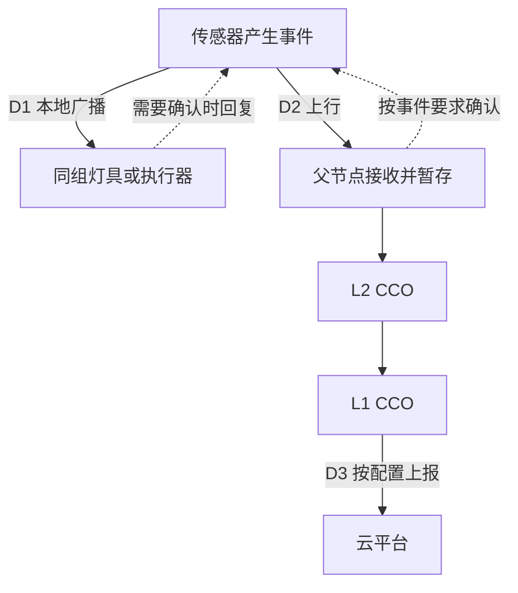
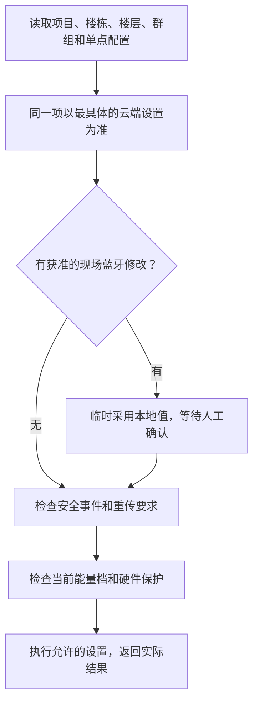

# 澜潮 SKU2 双鉴存在传感器 · 功能需求 V2.7

**待评审** · 2026-11-19 · 型号 LC-S-MTS03-PR24-11-001 · 中国大陆、中国香港

同套文档　[主文档](澜潮_SKU2_双鉴存在传感器_PRD_V2.4---2.md) · [功能需求](澜潮_SKU2_双鉴存在传感器_PRD_V2.7_功能需求---2.md) · [非功能需求与验收](澜潮_SKU2_双鉴存在传感器_PRD_V2.4_非功能需求---2.md)

看设备如何判断和动作，读 [4.1 功能需求](#sec-4-1)。查某个事件何时触发、发给谁，直接看[54 条事件配置表](#matrix54)。做接口联调时再查 [4.2 协议与字段](#sec-4-2)，做样机验收时查[工程细项与测试追踪](#verification-index)。

[双鉴时序](#sec-4-1-1) · [光照与照明](#sec-4-1-2) · [能源与供电](#sec-4-1-3) · [通信与配网](#sec-4-1-4) · [配网鉴权](#pair-auth) · [通信加密与防重放](#sec-4-1-4-4) · [事件上报](#sec-4-1-5) · [本地联动](#sec-4-1-6) · [运维诊断](#sec-4-1-7) · [4.1.8 OTA 固件升级](#sec-4-1-8) · [4.1.9 设备授时与校时](#sec-4-1-9) · [物模型与接口](#sec-4-2) · [54 条事件配置表](#matrix54)

## 04 功能需求与软件基线

### 4.1 软件功能需求

**表格读法。** FR 是需求编号，E 是事件编号，TC 是测试用例，D 是待定事项。P0、P1 等沿用原优先级；写有“建议”“候选”“待验证”的数值须经样机或评审确认。BLE 指低功耗蓝牙，SOC 指估算的剩余电量比例。

#### 4.1.1 PIR 与 24 GHz 雷达双鉴时序

被动红外传感器（PIR）先发现人的移动，雷达再确认人是否还在。人坐着不动时，即使 PIR 没有新信号，也要等雷达复查才能判离。

PIR 须能唤醒深睡主控，雷达须能受控启动并返回有效样本。任一条件不满足，报告原因、状态记“未知”，禁止据此关灯。

##### 4.1.1.1 无人值守与进入复核

|ID|需求描述|优先级|验收标准|
|---|---|---|---|
|FR-102|无人时关闭雷达，仅由 PIR 值守。PIR 须能唤醒深睡主控。|P0|实测无人态雷达供电与漏电是否达到已签核的关断指标；同时验证 PIR 能唤醒主控。|
|FR-101|PIR 检测到移动，记录触发时间并启动雷达确认。|P0|径向 0.5 m/s 穿越检出率 >99%|
|FR-103|快开模式下，PIR 触发即记“疑似有人”并发 E101，光线暗且规则允许就开灯。确认模式等雷达确认后再开灯。|P0|触发到上报 ≤300 ms|
|FR-104|雷达确认有人记 E201；有效扫描否定本次进入，按模板撤销临时动作并记 E112。超时或无有效样本记“未知”。|P0|W_verify ≥ T_scan；慢响应不得误回滚|

##### 4.1.1.2 有人保持、延迟复查与判离

|ID|需求描述|优先级|验收标准|
|---|---|---|---|
|FR-105|确认有人后开始等候，默认 60 s。每次 PIR 触发都重新计时，直到整段时间无动作才启动一次雷达复查。|P0|PIR 活跃期间雷达启动次数为 0；PIR 静默满 60 s 后启动 1 次扫描|
|FR-106|复查检出人，保持“有人”并重新计时。完整有效扫描无目标才计一次“未检出”，无有效结果记“未知”。|P0|检出后计时器正确重置；未检出进入 N_leave 计数|
|FR-107|连续有效未检出达到设定次数（N_leave，2～8 次），开始等待离开。中途发现人即取消。|P0|只出现一次有效未检出时，从“有人”误变为“无人”的比例为 0%|
|FR-108|等满离开延时（T_leave，10 s～30 min），且无人证据仍有效，才发 E105。中途确认有人即取消。|P0|误差 ≤±1 s；断电保持|
|FR-116|手动复查间隔为 15、30、60、120、300 s。自动模式按电量选已批准的间隔，平台显示实际值。L4 的 180 s 待验证。|P0|验证五档读写与自动延长；自动 180 s 的实现和能力位由 D-05 签核。|
|FR-110|雷达检出静坐、翻身等有效微动即保持“有人”。距离和安装条件由样机验证。|P1|5 m 内微动检出率 ≥90%|
|FR-111|静止、微动、走动三档须经实装雷达验证。无法稳定区分时，仅报告已验证的存在状态。|P1|按实装雷达能输出的活动等级测试，分类一致性目标 ≥85%。|

##### 4.1.1.3 通道故障、回滚与异常翻转

|ID|需求描述|优先级|验收标准|
|---|---|---|---|
|FR-112|PIR 故障报 E205，提示“双鉴不可用”，暂停依赖 PIR 唤醒的判断。恢复并取得新样本后重新判断。|P0|可诊断的 PIR 电气故障以 60 s 为告警目标；镜片被遮挡或长时间零触发另验。|
|FR-113|雷达故障报 E204。PIR 仍可报移动，人员是否仍在或已经离开记为“未知”。|P0|可识别的雷达故障以 60 s 为告警目标；单次未检出目标不得触发故障。|
|FR-114|统计近 24 h 首次复查次数和临时进入撤销次数。撤销率超限即告警，保留时段和样本数。|P1|24 h 回滚率 >20% 触发告警|
|FR-115|“有人／无人”在观察期内频繁切换时报 E110，提示检查出风口等干扰源。|P1|对出风口安装，1 min 内翻转 ≥3 次即触发 E110|

#### 4.1.2 光照采集与照明判断

照度（lx）表示现场有多亮，用于判断要不要开灯。评估光伏补能还须看实际充入的能量。

##### 4.1.2.1 暗环境开灯与白天免开灯

|ID|需求描述|优先级|验收标准|
|---|---|---|---|
|FR-601|同组照度有效且低于开灯门限、人员状态也符合规则时才开灯。开、关门限留出差值，避免反复开关。|P0|阈值 10–1000 lux 可配，20% 滞回|
|FR-603|白天光线充足时跳过自动开灯并记录原因，人员事件照常上报。|P0|阈值可配；有人事件照常上报|
|FR-605|持续明亮且场景允许时可减少雷达复查，平台显示实际间隔。每次仍须扫足时间，判离仍须连续有效空判并等满延时。|P1|让办公室照度持续高于免开灯门限。在允许延长间隔的场景下，例如从每 60 秒查一次改为每 120 秒查一次，比较平台显示值与设备两次复查的实测间隔。让人员静坐后再离场，核对设备能保持“有人”，且只在满足离开条件后报“无人”。60 秒和 120 秒仅为举例。|

##### 4.1.2.2 安装采光、遮挡与开灯反馈

|ID|需求描述|优先级|验收标准|
|---|---|---|---|
|FR-602|标定点连续 48 h 的日均照度低于项目门槛，报 E309 并提示复查位置。评估实际补能还须看超容电压变化。|P0|连续 48 h 日均低于门槛触发 E309|
|FR-604|开灯前照度 <300 lx、下发亮度 ≥70% 时，比较开灯前和等待 T_check 后的照度。连续两次增量不足报 E605，排查灯、通信或遮挡。|P1|增量阈值自适应（取"预期增量 30%"与 20 lux 的较大值）；**连续 2 次开灯无效才上报**；T_check 默认 10 s|
|FR-606|记录有效照度的最低、最高和平均值。持续低于该点平常水平时提示“疑似遮挡”，由现场复核。|P1|遮挡 24 h 内触发 E310|

[工程细项：照度标定、布点与交付](#sec-4-1-2-3)

#### 4.1.3 能源管理与供电切换

室内光伏（OPV）给超级电容（超容）补能，一次电池备用。USB 持续外供须经样机验证；低电停测时，人员状态记“未知”。

面板标称 214 µW @ 200 lx。净补能、供电源识别、USB 补能及电池切换门限按电源管理芯片 U8 和整机负载实测；只开放已验证档位。

##### 4.1.3.1 入网、能量估算与低电调度

|ID|需求描述|优先级|验收标准|
|---|---|---|---|
|FR-201|入网前检查超容电压和带载能力。弱光入网测试要求超容 ≥3 V；现场照度不能单独证明可冷启动或长期供电。|P0|前提：超容 ≥3 V|
|FR-202|按可用电压范围估算超容余量，备用一次电池单独估算。用带载测量校准、记录误差，平台显示估算是否有效。|P0|全区间实测对比|
|FR-203|按有效能源数据选 L1～L5 档，调整采样、复查和上报间隔，回报实际值。硬件保护优先。|P0|电量边界目标误差 ≤±3%；常规分级维持双鉴，受控保电准入和硬件保护见 FR-ENERGY-04。|
|FR-204|低电时依次检查雷达复查间隔、心跳与汇总周期、发送方式和发射功率。只在批准范围内调整并回报实际值，跳过扫描不能计为无人。|P0|生效且可回读；低电时 `N_leave` 同步加大|

##### 4.1.3.2 欠压保护、电池接管与恢复

|ID|需求描述|优先级|验收标准|
|---|---|---|---|
|FR-205|样机逐步降压，测出负载失稳点和硬件关断点。仅在供电可靠时保存、恢复状态。|P0|TC-74 测降压关断、恢复回差和低温负载波形。2.5 V 为旧方案的试验对照点。|
|FR-205b|达预警点先记欠压事件（候选 2.7 V），再分别记录保护和恢复。门限按实装 U8 板测确认。|P0|E311 区分预警与保护，记录实际门限；回升后报告解除。|
|FR-206|电池切入门限 2.6 V，带 0.1 V 滞回|P0|切入/退出稳定，不频繁启停|
|FR-206b|按电压、带载状态和供电路径识别未接入、待机、供电、低电、耗尽或异常。无法区分时显示未知及最后有效读数。|P0|逐项注入可观测条件并核对状态；无法区分的输入应返回未知。|
|FR-212|无光转用电池时维持基本检测和心跳。用标称 600 mAh 电池，按实际温度和负载验证续航。|P1|完全无光、日均 ≤11 µA 下 ≥2 年|
|FR-213|记录超容充电速度、断光压降和电池带载电压。持续超出实测正常范围时报 E307。|P1|充电斜率异常或自放电过快触发 E307|

##### 4.1.3.3 Type-C 外供、补能与运行模式

|ID|需求描述|优先级|验收标准|
|---|---|---|---|
|FR-209|USB 5 V 持续供电、给 20 F 超容补能须分别验证，CR2450 禁止反充。边充边测、拔电及冷启动通过样机测试后才开放对应模式。|P0|以 5 V 输入验证超容 2.5→3.5 V 的 <10 min 目标及 ≤5 s 状态切换；覆盖热与限流条件。|
|FR-210|识别到稳定外电后进入已验证的外供档。拔电后按剩余能量选档，平台可查实际档位。|P0|形态 B 连续 72 h 无低电降级；拔电 ≤5 s 平滑回切|
|FR-211|外供时测纽扣电池支路电流。确认无反充、漏电达标后给出电池消耗指标。|P0|用源表测电池电流，并随时间累加得到实际耗电量；另记录每月端电压的变化（原目标 ≤5 mV）。|

##### 4.1.3.4 运输、重启与末次上报

|ID|需求描述|优先级|验收标准|
|---|---|---|---|
|FR-215|运输档按实装接线隔离负载。验证开关位置、复位和漏电，给产线拨档与检查说明。|P0|OFF 整机 ≤2.5 µA 为目标。分别测电容漏电、管理芯片、其他支路。|
|FR-216|每次开机读取复位标志和电源状态。E305 区分拨开关、看门狗、供电恢复和软件复位，无法区分时标未知。|P0|对每种可观测复位原因做故障注入；不可区分的原因上报未知。|
|FR-217|运输时停止检测和常规上报。用实装 20 F 超容的库存压降确定储存期限和出库补能条件。|P0|6 个月压降 <1 V 为待验证目标。按 180 天、20 F 折算，恒定总漏电须 <1.29 µA，归入 D-07。|
|FR-207|即将断电时用预留电量尝试末次上报，记录是否送达。突然掉电或断网可能送达失败。|P0|100 次断电成功率 ≥95%|
|FR-208|实测末次上报耗电后确定预留量与保护门限。普通任务不得动用预留电量，模拟断电验收。|P0|以样机实测确认预留机制、末次上报所需电量和最低带载电压；隔离方式由硬件评审签核。|

升级前怎么判断电量够不够，见[4.1.8 OTA 固件升级](#sec-4-1-8)。

[工程细项：供电切换与低电保护](#sec-4-1-3-5)

##### 4.1.3.6 能源与运维专项需求

优先落实 P0；候选参数须实测。

|ID|需求描述|优先级|验收标准及证据|
|---|---|---|---|
|FR-ENERGY-01|保存照度、有效光时及最近 1 h、24 h、7 天趋势。用实测的照度—光伏输出曲线估算补能，再用超容电压校正。|P0|TC-67、TC-72；输出照度／光源／入射角、补能功率与偏差曲线。|
|FR-ENERGY-02|对 20 F 超容和 600 mAh CR2450 分别记录电压／可用能量、带载电压／剩余容量，以及供电源和切换历史。2.6 V 切入及切回回差由实装 U8 验证，禁止反充。|P0|TC-68、TC-74；源表与示波器记录切换、无重启／状态恢复、无反充和事件E-20。|
|FR-ENERGY-03|端侧结合超容和电池余量、近期采能、PIR／雷达及 BLE 负载，预测未来 12 h 完整服务时长。云端用历史和老化模型估算五年目标及维护周期，提供预测区间、可信度和模型版本。|P0|TC-67、TC-72；对照实测逐日收支、预测误差、异常点位及版本。|
|FR-ENERGY-04|低电先缩短雷达扫描窗口和工作占比。单凭 L3 电压档不能停雷达。仅当完整续航预计＜12 h 且场景允许暂停时进入保电。停测后标未知，禁止据此关灯；硬件欠压保护优先。|P0|TC-68、TC-69、TC-75；检查12h边界、雷达实际状态、E-40/E-42/E-45～47及负荷安全降级。|
|FR-ENERGY-05|定期检查能源健康，低电或持续亏电时生成 USB 补能工单。记录接入、充电结果和拔线后的能力。USB 只补超容，不能充 CR2450；能量和启动预算达标后才恢复完整检测。|P0|TC-71；记录VBUS、超容充放、维护时长、切换事件及电池隔离；检查拆线后未达阈值的再次保电。|
|FR-ENERGY-06|主控深睡且雷达关闭时，PIR 应可通过独立引脚唤醒 TLSR8258，无需等 2 h 心跳。按原理图 PB1/IO2 验证深睡供电及唤醒配置。|P0|TC-66；验证最低电压、高低温、反复触发下唤醒成功率／延迟／整机睡眠电流。|

下表为能源分级评审方案。S-04 的五级电压区间待 D-07 按实装数据确认。

|当前运行条件|本 SKU 行为|对外状态与事件|
|---|---|---|
|超容主供电、能量充足|PIR持续值守；雷达按已签核窗口完成首次双鉴及有效存在复核；低功耗候选配置的 2 h 保活。|上报实际供电源、能力、配置版本、能源摘要。|
|超容主供电、预计补能不足|PIR仍值守；自动收紧雷达的非必要扫描／占空比，不能无条件缩短到无法判人的时长。|E-09、E-43及能源等级变化；策略实际值可读。|
|切换至600mAh一次电池|按电池电压＋温度＋累计耗电估计容量，另行分级；**不因已切电池就立即关闭雷达**。|E-20每次有效切换必报；长期电池供电触发维护建议。|
|预测完整功能剩余续航＜12h|生成保电准备事件；等待父节点接收确认及本地策略交接，优先轻度保电（保留可行的PIR）；深度停测须场景授权。|E-45／E-46，存在状态UNKNOWN，禁止以停测推断无人。|
|外部USB补能或OPV恢复|检查回差、能量余量、PIR唤醒与雷达工作预算，达标后恢复；短时插拔未达标继续保护。|E-20、E-47与维护记录；实际恢复状态上报。|

**电压口径。** S-04 的 3.0～3.3 V、2.8～3.0 V、2.6～2.8 V 为旧评审分档。物料表标注欠压 2.6 V，切入／切回门限和回差（两方向的门限差）以实测为准。L3 先调整通信与雷达窗口；主动停测仍须满足＜12 h 保电条件，硬件保护优先。

#### 4.1.4 通信与配网

父节点是替休眠传感器暂存消息的上级设备，等传感器醒来再投递。人员移动时 PIR 可主动唤醒传感器。

传感器只作叶节点。父节点容量和收发时段按兼容机型联调确认，配置是否生效以设备读回为准。

##### 4.1.4.1 扫码入网、配网鉴权与组网角色

|ID|需求描述|优先级|验收标准|
|---|---|---|---|
|FR-301|用“澜潮智联”扫码，核对型号、地址、批次并录入位置。人员、设备和点位均通过下方鉴权才开通业务，拒绝须说明原因。|P0|扫码一次成功 ≥99.5%； 录入+提交 ≤10 s|
|FR-301b|连续安装时沿用上个区域，点位号自动加一。现场工程师核对后提交，可改区域和编号。|P0|同区域连续安装无需重选； 单点位录入 ≤10 s|
|FR-302|设备入网时声明 HARVEST_LEAF、canRelay=false、maxHopDepth=3。父节点把它登记为休眠终端，不分配转发任务。|P0|拓扑中永不为父节点 【我认为如果后续由USB持久化供电可以考虑自动升级为父节点】|
|FR-313|与父节点失联先重连，失败再接入兼容父节点并更新路由。|P0|父节点失联后 ≤3 min 重挂载|

###### 配网鉴权：安装人、设备、点位

**FR-SEC-01（P0）**　扫码后依次核对三项，再开通业务。

1. **安装人。** 通电后登录小程序，选项目及点位并扫码。账号没有该项目安装权限，即结束申请。
2. **设备。** 核对扫码型号、出厂地址、工单及实机身份。设备用专属凭据证明身份，也须验证配网方授权才接收配置。二维码照片或相同 MAC 地址不能单独通过鉴权。
3. **点位。** 云端核对项目归属、点位范围及占用情况。全通过才保存绑定并显示成功；身份已通过但白名单未通过，设备只显示“待核”，不能联动。离线扫码可暂存，联网复核后放行。
4. **失败重试。** 凭据无效或超时不建绑定，小程序提示原因，日志保留阶段及脱敏结果。白名单拒绝记 E509，其余按实际原因记录。连续失败按 D-11 限制重试；纠正后可重试，同笔申请只建一次绑定。

**验收（TC-01～TC-03、TC-35、TC-55）。** 正确设备和授权人员可绑定；无权限、只有码无凭据、扫 A 装 B 或点位被占用均不放行。待核设备不能开灯，更正后可重新绑定。

##### 4.1.4.2 唤醒时隙与收发窗口

|ID|需求描述|优先级|验收标准|
|---|---|---|---|
|FR-303|与父节点约定唤醒时间和时长，不同设备错开窗口。以 8 台同时挂载验证满载。|P0|8 台满载无碰撞（丢包 <1%）|
|FR-304|唤醒窗口内等候消息。无任务继续睡眠，有任务可延长收发但不得超过上限。|P0|超时后电流回落 ≤5 s|
|FR-305|PIR 可独立唤醒深睡主控。样机验证引脚、供电及耗时，心跳按自己的周期运行。|P0|触发到发出上报 ≤1 s|

设备利用唤醒窗口接收升级包或向父节点对时。操作和验收分别见[4.1.8 OTA 固件升级](#sec-4-1-8)、[4.1.9 设备授时与校时](#sec-4-1-9)。

[工程细项：接入状态、兼容性与父节点容量](#sec-4-1-4-3)

##### 4.1.4.4 通信数据加密与防重放

例如，灯已开但回执丢失，重发后灯可以再次回执，不能重复开灯或重置计时。事后转发同一报文也不能再次执行。

|需求 ID|功能要求|怎么验收|
|---|---|---|
|FR-SEC-02（P0）通信加密|设备↔父节点、设备↔灯具、近场配网和维护链路都须加密凭据、存在状态、配置、指令及回执，并校验来源和完整性。网关↔云沿用 MQTT/TLS 并验证对端身份。加密失败即拒绝，禁止退回明文。|逐段检查上、下行通信。未获授权的一方不能从传输记录中读出上述业务内容。来源不可信、内容校验失败或未经保护的指令均被拒绝，设备状态和配置保持原值。普通日志不含密钥或配网凭据。|
|FR-SEC-03（P0）防重放|接收方验证发送者、授权项目或组、会话及受保护的序号（或等效的时效凭据）。旧包、重复包不得再次开关灯、续计时、改配置或新增业务记录。重启、换父、换绑及尚未校时都须有效。|同一条已处理的指令再次到达，动作次数和计时均不变。旧会话或旧绑定的指令无效，当前授权下的新指令可正常执行。确认丢失后的合法重传可按原协议回执；断网补报的同一事件只入库一次，历史记录不触发现场动作。|

断云时已授权设备仍在本地验权。灯侧按 `evtSeq`（事件序号）、上行按 `eventId`（事件标识）去重；通信安全机制另验来源和时效。

**验收与待定项。** 见 NFR-07、TC-29、TC-49、TC-55。算法、凭据轮换、防重放窗口及重启恢复由 D-11 签核，新字段由 D-03 登记。

#### 4.1.5 事件生成、配置与上报

灯具回执（ACK）表示灯已收件，父节点回执表示接管数据，云端入库另行确认。灯是否真的亮，还要看现场照度。

事件由有效采样、状态变化或配置结果触发。各端分别留证，默认值、锁定项及模板见 [4.2.3](#sec-4-2-3)。

##### 4.1.5.1 三条上报通道与本地联动确认

|ID|需求描述|优先级|验收标准|
|---|---|---|---|
|FR-309|每条事件独立配置启用、本地通知、父节点确认和云端方式。设备校验重播、重传、汇总周期、每包条数及锁定项，回报实际设置。|P0|54 条逐条可配；回读一致；硬约束不可突破|
|FR-309b|同组灯具使用 2.4 GHz 广播，转发上限 TTL ≤4。需灯侧确认时最多重播两次，三次都未确认记 E606。|P0|E101 触发到灯亮 ≤300 ms（4 跳内）；3 次无确认上报 E606|
|FR-309c|三条通道独立排队。本地动作直接执行，父节点离线则缓存上行数据，云端显示实际送达状态。|P0|父节点离线时本地仍执行、待上行事件缓存；广播丢包时上行照常；云端断链后恢复并按原事件身份补报。|

##### 4.1.5.2 确认、断链缓存与补报

|ID|需求描述|优先级|验收标准|
|---|---|---|---|
|FR-306|发送后保留副本，收到对应父节点确认才删除。云端入库另行确认。|P0|注入 500 次 ACK 丢失，事件零丢失|
|FR-310|断网缓存目标 ≥256 条。恢复后分批补报，关键事件优先；存满按规则淘汰并计数。|P1|缓存 ≥256 条；按最大断链事件量定容。要覆盖 24 h／300 条且零丢失，需有效容量 ≥300 条或经验证的无损分级暂存。超限按 E508 对账。|
|FR-311|用 E508 的 dropCnt 字段在恢复联网后报告缓存丢弃总数。|P1|E508 正确上报 dropCnt|

[工程细项：事件配置、缓存与旧快照兼容](#sec-4-1-5-3)

#### 4.1.6 本地策略与灯具联动

本地规则直接控制已绑定的灯组。快开后若雷达有效否定本次进入，灯须亮满最短时间再撤销。

只用当前有效输入联动。人员状态未知时暂停无人关灯，历史补报只供追溯。

##### 4.1.6.1 规则执行与动作保护

|ID|需求描述|优先级|验收标准|
|---|---|---|---|
|FR-401|按当前时段、有效照度和人员状态执行本地规则。断网沿用已生效配置并记录动作。|P0|断网仍生效；切换 ≤1 s|
|FR-402|撤销临时开灯前检查已亮时长。默认至少亮满 10 s，避免刚亮就灭。|P0|回滚不产生可见闪灯|
|FR-403|保存授权组 ID 及规则，多组动作分别处理。可保存组数以样机满配验证。|P1|槽位满配无丢失|
|FR-404|本地触发后通过 2.4 GHz 组播到目标组，最多转发 4 跳，记录触发至实动时长。|P1|端到端 ≤500 ms|
|FR-405|按 FR-604 检查灯侧回执与实际照度增量；照度响应连续两次异常报 E605。|P1|按 E605 的 <300 lx、下发亮度 ≥70%、连续两次门槛验证；<100 lx 全亮用作对照，误报目标 ≤10%。|
|FR-406|来电后读原配置并校时，按当前条件重新判断。过期动作只存历史。|P1|掉电 4 h 恢复后不误触发|

[工程细项：多条规则同时触发、手动接管与追溯](#sec-4-1-6-2)

#### 4.1.7 运维、诊断与配置

小程序应显示设备故障、实际参数及现场修改的确认状态。

自检限实装器件和开放接口；证据不足时显示“疑似”或“未支持”。

##### 4.1.7.1 通道自检、点位复核与工单

|ID|需求描述|优先级|验收标准|
|---|---|---|---|
|FR-501|PIR 自检目标每 6 h 一次，已能明确识别的硬件故障直接告警；长期无活动按 FR-501b 处理。|P0|按硬件支持的测点逐项注入故障，记录可识别项目和未覆盖项目。|
|FR-501b|采集、通信正常且连续 3 天无触发，报疑似失效并提示检查点位和镜片。事件表 E113 写 7 天，两处待统一。|P0|镜片被遮挡 3 天可上报 E113|
|FR-501c|云平台连续 5 天收到同一设备的 E113 后，对重复提醒作抑制判断，直至出现新的 PIR 触发事件 E101。|P3|避免长假期无人持续误报|
|FR-502|自检读取雷达诊断和回复。只报样机验证过的故障，收不到有效回复则标记不可用。|P1|按模组开放接口注入可重复的故障；仅验收已验证的诊断项。|
|FR-503|新迭代的设备需要支持防拆功能|P1|装配并签核后验证事件 E407，目标 ≤5 s；未装配版本拒绝开启并回读原因。|
|FR-504|排除休眠、断网和缺样后，出现可识别遮挡特征才报“疑似遮挡”，交现场复核。|P1|在确认通道可观测后验证遮挡与正常暗环境的区分，24 h 为候选发现时限。|
|FR-506|入网后批查供电和已装传感器。返工清单列异常设备、位置及原因。|P0|2 h 内出报告|
|FR-507|安装前读取有效超容电压。低于 3 V 时提示 USB 补能并复测。|P0|App 可见提示与指引|

##### 4.1.7.2 参数下发、现场调试与权限

|ID|需求描述|优先级|验收标准|
|---|---|---|---|
|FR-508|写参数前核对权限、硬件支持及范围。成功后读回实际值和版本，拒绝则保留原值并记 E505。|P0|成功率 ≥99.5%；非法值返回 E505|
|FR-509|授权调试最长 30 min，到期自动退出并恢复原策略。追踪项 FR-3.6-06 写 10 min，上限待统一。|P2|本版现场调试时限取 ≤30 min，结束后回读状态并验证恢复。|
|FR-510|按白名单核对设备、点位和项目。身份冲突或无绑定权限时拒绝并记录原因。|P0|伪造/错位绑定可拦截；变更留痕|
|FR-511|开启维护模式后，小程序通过低功耗蓝牙（BLE）直连。验权后修改，读回实际结果并记录操作人和入口。|P0|触发维护模式后可连；配置 ≤3 min|
|FR-512|本地改参后标“待确认”，授权确认后成为基线。72 h 未确认告警，满 7 天回退，回退前 24 h 通知。|P0|三态流转正确；回退前 24 h 通知|

[工程细项：权限、调试、日志与产测](#sec-4-1-7-3)

#### 4.1.8 OTA 固件升级

OTA 指远程固件升级。父节点先存升级包，设备每次醒来收一段；平台逐台显示进度和结果。

|需求 ID|现场怎么做|优先级|怎么验收|
|---|---|---|---|
|FR-214|升级前核对供电和储能。电量不足则拒绝并回报原因，供电恢复后可重新申请。|P0|用低电设备发起升级，平台能读到明确的拒绝码。|
|FR-312|父节点缓存匹配的升级包，设备每次醒来接收一段。校验版本、完整性和电量，断链后从上次确认处续传。|P1|原定的两条升级路径都要走通，并验证断点续传。|
|FR-3.6-03|开始前检查版本、电量和信号；各阶段验证感知、关键事件留存、休眠收件和数据持久化。记录开始、拒绝、成功、失败或回滚。中断后恢复到可工作版本并重新入网。|P0|正常升级后核对版本、配置、标定和路由。分别在传输和切换阶段模拟断电或包损坏，再核对恢复结果和关键事件。见 TC-24～TC-26、TC-49。|
|FR-3.2-11|出厂和现场标定按版本保存。正常升级沿用标定；算法变更时说明哪些可迁移、哪些须重标。|P0|升级前后读回标定数据并核对。见 TC-24、TC-35。|
|FR-3.6-04|按项目或批次升级，逐台显示进度和结果。可暂停；达到批准的失败门槛后停止派新任务，已开始的任务安全收尾。|P1|在同一批里模拟低电、版本不匹配和断链，验证暂停、恢复、逐台结果及命令队列优先级。失败门槛待 D-11 确认，见 TC-57。|

E506 记录下载、校验、安装、成功、失败和回滚，失败与回滚强制上报。见[事件配置表](#matrix54)和[固件校验及状态字段](#sec-4-2-1)。

#### 4.1.9 设备授时与校时

授时是取得可信时间，校时是纠正设备时钟。断网时先记事件相对时刻，重连后可据对时记录还原实际发生时间。

|需求 ID|现场怎么做|优先级|怎么验收|
|---|---|---|---|
|FR-307|取得可信时间后比较设备时钟，偏差小于 100 ms 保持原值，达到 100 ms 才校正，随后测误差并保存修正量。|P0|给出 90 ms 偏差应保持原值，110 ms 应触发校正。E507 的校后目标为误差小于 20 ms，修正量随心跳上报。|
|FR-308|设备持续记录本地时间，接入端据对时记录还原 UTC（协调世界时）发生时间，云端另记收件时间。按发生时间及其可信度排列补报事件。|P0|在能还原发生时间的记录中，补报事件排序正确率为 100%。|
|FR-EVT-02|触发或确认时记录本地计时和本次开机标识，保留发生时间、首次入库时间及可信度。跨重启、无可信时间、日计数缺日期或误差超预算时标未知或降级。仅在同一段连续计时内回填。|P0|在线、断链重连、跨日、掉电重启和错过校时窗口时分别触发事件，与参考仪器对照。能还原的顺序应正确，无法还原的记录能看出原因。见 TC-47。|

S-04 建议事件唤醒后约 1 s 内向父节点对时，时限和全温误差待 D-04 实测。换电重启须校时（FR-3.4-04）。时间不可信时暂停依赖绝对时间的规则，恢复后按当前输入判断，过期动作只保留历史（FR-406）。见[时标与恢复](#sec-4-2-4)。

### 4.2 物模型、数据链路与接口

#### 4.2.1 物模型：设备有哪些数据和操作

“属性”是可读或可设置的数据，“服务”是可调用的操作，“事件”是设备要记录或通知的一次变化。
|对象|接口依据|实现与评审范围|
|---|---|---|
|协议属性|V4.68 的 SIID / CIID、类型、GET / PUT、单位和枚举|下表逐行列出适用项；按 SKU 能力和协议版本开放。|
|业务属性|HTML 逐项属性表及 SKU2 补充|HTML 汇总写 40 项。按其明细拆开复合字段为 40 个具名字段；按下面的逐行权限评审。模型发布清单由 D-03 冻结。|
|业务事件|§4.2.3 六类 54 条主事件|表内 24 条不可禁用，30 条可禁用；SKU2 增补语义单列。E 编号为业务标识。|
|业务服务|HTML 的 11 项服务及 MD 补充|校准、能源、融合、运维和配置服务需要权限、输入输出及错误码；新增线编码由 D-03 登记。|

##### V4.68 协议字段 · 多合一传感器

GET 表示读取，PUT 表示写入；数值单位以所在服务的字段为准。

|服务 / 条目标识（SIID / CIID）|名称（V4.68）|类型|权限|单位、范围、默认或说明|SKU2 使用条件|源表行|
|---|---|---|---|---|---|---|
|`0x8009 / 0x6001`|软件版本|`string`|`GET`|最大128字符|设备与固件|3|
|`0x8009 / 0x6003`|成品工装检测|`enum`|`GET`|0：还没检测，1：已经检测|工装 / 授权维护|4|
|`0x8009 / 0x6004`|OTA文件时间戳|`uint32`|`GET`|OTA文件时间戳|设备与固件|5|
|`0x8009 / 0x6005`|当前运行固件校验信息|`uint32`|`GET`|当前蓝牙程序固件CRC32值，用于差分升级匹配旧版本|设备与固件|6|
|`0x8009 / 0x6006`|OTA调试信息|`string`|`GET`|获取当前ota的一些状态信息|设备与固件|7|
|`0x8009 / 0x6007`|差分文件定时升级时间|`uint32`|`GET/PUT`|使用澜潮时间戳，单位：秒|设备与固件|8|
|`0x8009 / 0x6008`|差分包生成时间|`uint32`|`GET`|单位：秒|设备与固件|9|
|`0x8009 / 0x6103`|成品工装检测完成写入|`enum`|`GET/PUT`|0：还没检测，1：已经检测|工装 / 授权维护|10|
|`0x8004 / 0x6050`|总计运行时间|`uint32`|`GET`|单位:s|设备与固件|13|
|`0x8004 / 0x60F0`|本次复位运行时间|`uint32`|`GET`|单位:s|设备与固件|14|
|`0x8203 / 0x6240`|功率|`enum`|`GET/PUT`|原表未给取值范围|设备与固件|16|
|`0x8203 / 0x6001`|软件版本|`string`|`GET`|原表未给取值范围|设备与固件|17|
|`0x8203 / 0x6103`|设备类型|`uint16`|`GET`|原表未给取值范围|设备与固件|18|
|`0x8203 / 0x60F1`|复位次数|`uint32`|`GET`|原表未给取值范围|设备与固件|19|
|`0x8203 / 0x60F0`|本次复位运行时间|`uint32`|`GET`|原表未给取值范围|设备与固件|20|
|`0x8235 / 0x6201`|光照度|`uint16`|`GET`|单位：lux|照度装配与标定后开放|22|
|`0x8235 / 0x6204`|热释电传感器|`enum`|`GET`|0-无人 1-有人；是融合阶段的值|融合阶段状态；有效性另传|25|
|`0x8235 / 0x6205`|电量|`uint16`|`GET`|单位：mV|mV；测量节点须联调确认|26|
|`0x8235 / 0x6206`|供电默认|`uint16`|`GET`|0：电容供电 1：电池供电 2：USB供电|设备与固件|27|
|`0x8235 / 0x6207`|雷达状态|`uint16`|`GET`|0-无人 1-有人|设备与固件|28|
|`0x8235 / 0x620A`|光照历史记录|`array`|`GET`|读取光照历史记录；配合多合一app才使用这个CCID|配套 App；按支持版本|29|
|`0x8236 / 0x6201`|传感器功能配置|`enum`|`GET/PUT`|按BIT位使能传感器的功能；产品1：雷达+PIR 写入 6 产品2：温度+湿度+照度 写入 9 产品3：温度+红外 写入24|旧掩码 6 的含义为雷达 + PIR；新增照度能力须登记|33|
|`0x8236 / 0x6202`|唤醒时间配置|`uint16`|`GET/PUT`|单位：s；广播帧发送 唤醒多少S之后进入休眠|设备与固件|34|
|`0x8236 / 0x6205`|广播时间配置|`uint16`|`GET/PUT`|单位：s；广播帧广播多少S|设备与固件|35|
|`0x8236 / 0x620B`|光照度阈值配置|`uint16`|`GET/PUT`|单位：lux|照度装配与标定后开放|36|
|`0x8236 / 0x6310`|出厂模式|`enum`|`GET/PUT`|1表示出厂模式 0 使用模式|工装 / 授权维护|38|
|`0x8236 / 0x6210`|父节点MAC配置|`array`|`GET/PUT`|原表未给取值范围|授权网络配置|39|
|`0x8236 / 0x620A`|环境历史存储间隔|`uint16`|`GET/PUT`|5～3600s；配合多合一app才使用这个CCID|配套 App；按支持版本|40|
|`0x8236 / 0x6215`|父节点MAC范围限制列表|`array`|`GET/PUT`|允许存储4个|授权网络配置|41|
|`0x8388 / 0x6630`|雷达参数配置|`array`|`GET/PUT`|原表未给取值范围|雷达模组；按机型解析|44|
|`0x8388 / 0x6633`|获取软件版本号|`string`|`GET/PUT`|原表未给取值范围|雷达模组；按机型解析|45|
|`0x8237 / 0x6205`|触发阈值|`enum`|`GET/PUT`|1~254；该值越高，越不容易触发，默认18。|设备与固件|47|
|`0x8237 / 0x6206`|触发保护时间|`uint16`|`GET/PUT`|支持 0、700、1300、2000、2700、3300、3800、4500、5200、5800、6500、7200，默认0。 单位：ms；；PIR触发后的硬件盲区时间，期间不产生新的有效运动触发。默认0ms|设备与固件|48|
|`0x8237 / 0x6207`|有效脉冲次数|`enum`|`GET/PUT`|1、2、3、4次；设置需要感应到几次脉冲，才判定有人体移动 默认2|设备与固件|49|
|`0x8237 / 0x6208`|检测脉冲扫描窗口|`enum`|`GET/PUT`|只支持2、4、6、8秒；在窗口内累计有效脉冲；其他条件相同时，窗口越大、要求脉冲数越少，越容易触发 默认4秒。|设备与固件|50|
|`0x8237 / 0x6209`|PIR状态复查间隔|`uint32`|`GET/PUT`|1～300秒；默认60秒，用于有人状态下的PIR定时复查，不影响首次检测有人后的立即上报。|设备与固件|51|
|`0x8237 / 0x620A`|是否要求脉冲极性相反|`enum`|`GET/PUT`|0-要求 1-无此要求；默认0。|设备与固件|52|
|`0x8389 / 0x6512`|产测模式|`enum`|`GET/PUT`|2-PCB测试，1 成品产测未测试 0 测试完成可生产|工装 / 授权维护|76|
|`0x8389 / 0x6513`|热释电传感器|`enum`|`GET`|0-无人 1-有人；实时读取的|工装 / 授权维护|77|

> 解码先看服务和版本。8235/6204 为融合值，8389/6513 为工装读取的实时 PIR。8235/6205 单位 mV，代理快照 battery 单位 0.1 V。8236/6202 单位秒，不能直接写入毫秒级的 wWake。

> V4.68 的温湿度、温湿历史、温变阈值及 8402 红外服务属于其他 SKU。SKU2 旧代理按规定填无效值；8009/6104 仅预留编号。

##### 业务属性 · 复用与待登记项

“待登记”指应用需要该属性，接口和版本仍由协议组在 D-03 登记。R 为只读，RW 为可读写。

|业务分组|属性|建议类型|应用读写|更新时机|业务语义|V4.68 对应或登记状态|
|---|---|---|---|---|---|---|
|存在与探测|`presenceState`|enum|R|变化+周期|业务展示可含无人、疑似有人、有人、微动；另表达待判离、未知与能力降级。保留原字段 0/1 的线编码。|8235/6204（融合 0/1）＋6207（雷达 0/1）。多态与有效性另登记。|
|存在与探测|`actLevel`|uint8|R|变化|1 静 / 2 微动 / 3 走动|待登记|
|存在与探测|`radarGate`|enum|R|变化|雷达门控状态：关闭 / 待延迟确认 / 扫描中|待登记|
|存在与探测|`rollbackCnt`|uint16|R|周期|累计进入回滚次数|待登记|
|存在与探测|`tRadarDelay`|uint16|RW|变化|雷达延迟确认时间（s），15/30/60/120/300 五档|扩展；与 8237/6209 的 PIR 复查及 8236/6202 的唤醒分别配置。|
|存在与探测|`tScan`|uint16|R|周期|雷达实测单次扫描时长（ms），模组标定值|雷达标定读值；8388/6630 结构需协议确认。|
|存在与探测|`wVerify / nLeave / tLeave`|uint16/8/16|RW|变化|校验窗口 / 离开判决次数 / 无人确认延时|新增融合参数；PIR 脉冲窗沿用 8237/6208。|
|存在与探测|`pirSens / radarSens`|uint8|RW|变化|灵敏度档位 1–5|8237/6205 为 1–254 的 PIR 触发阈值；应用档位须映射校准。|
|能量与电源|`powerSource`|enum|R|变化|HARVEST / USB_CHARGING / USB_ONLINE|8235/6206 已定义超容、电池和 USB。充电进行中另需可观测信号。|
|能量与电源|`energyLevel`|uint8|R|变化|5 级能量档位 L1–L5|待登记|
|能量与电源|`soc / vcap / pHarvest`|uint8/16/16|R|变化/周期|荷电 % / 超容电压 mV / 采集功率 µW|8235/6205 是 mV 读值。SOC、超容专用电压及采能功率需单独登记。|
|能量与电源|`capUv`|enum|R|变化|预警和保护状态；比较点由 D-07 实测冻结，U8 物料 UV 标注为 2.6 V。|待登记|
|能量与电源|`capHealth / batHealth`|uint8|R|周期|超容 / 电池健康度 0–100|待登记|
|能量与电源|`batStatus`|enum|R|变化|未接入 / 待机 / 供电中 / 低电 / 耗尽 / 异常|待登记|
|能量与电源|`vbat / batLife / batIn`|16/8/bool|R|周期/变化|电池电压 mV / 剩余寿命月 / 是否切入|复用电压前确认 8235/6205 的测点；寿命和切入态另登记。|
|能量与电源|`protState`|bitmap|R|变化|保护状态位：欠压 / 电池耗尽 / 过流 / 过温|待登记|
|能量与电源|`bootCause`|enum|R|上电时|POWER_SWITCH_ON / WATCHDOG / POWER_RECOVER / SOFT_RESET|待登记|
|能量与电源|`factoryId`|string|R|上电时|产线写入的身份信息（只读），用于三重一致性比对|8203/6103 是设备类型。产线身份单独登记并校验。|
|能量与电源|`swState`|bool|R|上电时|开关状态回读（仅 ON 时有意义）|待登记|
|光照|`lux / luxAvgDay`|uint16|R|变化/周期|当前照度（最小/最大/均值）/ 日均照度|8235/6201 GET，uint16，lx；历史 8235/620A。日均值及统计口径另登记。|
|光照|`daylightMode`|enum|RW|变化|OFF / 免开灯 / 降频|8236/620B 是单个照度阈值；门控模式和独立阈值需配置扩展。|
|光照|`luxDelta`|int16|R|校验时|开灯响应校验的照度变化量（lux）|待登记|
|光照|`lightFaultCnt`|uint16|R|周期|累计"开灯无响应"判定次数|待登记|
|安装、身份与通信|`mountMode / tiltDeg`|enum/int8|RW|变化|顶装 / 侧装 / 斜装，及倾角|待登记|
|安装、身份与通信|`locCode / whitelistState`|string/enum|RW|变化|App 录入的四级位置码 / 白名单状态|位置由授权安装角色提交；白名单结论由校验方产生。D-03 分别定义权限。|
|安装、身份与通信|`wWake`|uint16|RW|变化|唤醒窗口 ms（100–500）|8236/6202 是秒级唤醒配置，毫秒窗口须另登记。|
|安装、身份与通信|`reportCycle / reportBatchMax`|enum/8|RW|变化|聚合周期 / 单次条数上限|父节点旧服务 7002/7003/7005/7007 按原语义；新事件逐项配置见本章。|
|安装、身份与通信|`clockSkew`|int16|R|每次校时|本次校时修正量 ms|待登记|

##### 业务服务 · 接口与权限

下列 11 项均为业务服务草案，由 D-03 登记协议接口。

|服务|优先级|入参 / 出参与回读|
|---|---|---|
|`checkLightResponse`|P1|入：T_check、期望照度增量；出：实测 luxDelta、判定结果|
|`setReportPolicy`|P0|入：事件 ID 列表 + 三通道参数（本地广播开关与是否需灯确认、本地重播次数、父节点上行方式、云端上报方式、聚合周期、条数上限、重传次数、启用状态）或模板 ID；出：逐条生效确认含"实际执行值"|
|`enterMaintenance`|P0|入：时长（≤30 min）、鉴权码；出：长唤醒窗口开启确认|
|`bindLocation`|P0|入：镭雕码（型号+MAC+批次+日期+hwVer）、四级位置、姿态、倾角；出：白名单校验结果|
|`startCalibration`|P0|入：通道、时长；出：标定结果码|
|`setMountMode`|P0|入：姿态、倾角；出：生效确认|
|`setFusionParams`|P0|入：wVerify、tRadarDelay、nLeave、tLeave|
|`setWakePlan`|P0|入：唤醒窗口、周期、基准时刻|
|`setDaylightPolicy`|P1|入：免开灯阈值、降频档、滞回、开灯校验阈值|
|`armSecurity`|P1|入：布防状态、时段、滞留阈值|
|`readDiagSnapshot`|P1|入：无；出：通道/电源/照度/最近 8 条事件/回滚次数/当前策略摘要|

##### 生产、消费与事件封装

> M0～M5 用于内部统计、按需读取或抑制。云端（CL）按 §4.2.3 另选即时、聚合、随心跳或仅本地记录。内部可按 1／5 min 统计，云端聚合最短 15 min。报文格式 D 为直接、A 为汇聚。

保留 V4.68 子设备代理快照及消费接口，新增逐事件上报、配置与回执。快照、属性读取、业务事件、设备服务及告警各有触发、权限和时效。E 编号固定；新 SIID、CIID、掩码及字节布局按事件域或服务在 D-03 登记，检查 16 位掩码容量和解析边界。

|对象|生产与消费|版本及时间|
|---|---|---|
|现有属性及代理快照|FW、本地接收节点或网关 → 云平台、现有策略或小程序。提供当前值、供电及版本等。|以 V4.68 为准。每个字段按所在服务、结构版和有效标记解码。|
|新增逐事件|终端、父节点或云端判定后生产 → 网关或云事件入口 → 规则、历史、告警或运维。|使用事件字典、配置版本、独立身份和实际发生时间。实时与回补独立识别。|
|配置和命令|授权用户或云策略 → 网关／父节点 → 实际执行端。|请求、父节点投递、端侧应用／执行分阶段确认。配置成功后读回且记录 E-19。|

沿用 T8 §4～§5。直接报文每次一条事件，汇聚报文可带多条；按窗统计使用事件对应的函数，并保留来源和发生时间。V4.68 直接结构仅一个有效掩码位，汇聚按低位到高位解码。新服务编码待 D-03。

|模式|节奏、格式及数据口径|
|---|---|
|M0 实时|触发即入实时发送队列，D，逐条保留。关键告警与配置回执锁定，业务去抖发生在确认前，后续只对重复传输做幂等。链路恢复按 §4.2.4。|
|M1 分钟聚合|事件表指定 1、5 或 15 min 的适用白名单。收集首末、计数及极值等，窗结束可按配置直报摘要或由网关汇聚。|
|M2 小时聚合|1 h 窗，适合非实时统计。输出按事件定义的 LAST、COUNT、MIN_MAX 或 DURATION。|
|M3 日聚合|UTC 自然日，依赖可信日期锚点。按规定错峰，时间不可信时标记区间、暂存或仅出滚动窗口，策略见 D-04。|
|M4 按需|授权请求触发一次读或诊断响应，采用现有 GET 或经登记的应答，页面标注读值时间。|
|M5 抑制|本地计数和留痕，计数可按约定并入成功快照或供诊断读取。上报失败不再触发失败事件的实时上报。|

云平台将业务事件归一到以下字段。现有定长载荷由接入端按已知信息映射。新增线协议字段及版本由 D-03 登记。

|字段|类型及语义|
|---|---|
|`eventId`、`eventType`|去重标识为字符串，事件类型为 §4.2.3 的业务 ID。重传、补报、代理路径切换保持同一业务记录的身份。|
|`deviceId`、`origin`|源设备标识、生产端枚举（终端、父节点、执行端或云）。父节点代理保留子节点归属，链路信息独立记录。|
|`eventTime`、`eventTimeQuality`、`recvTime`|云事件发生时间建议用 UTC 毫秒，无可用时间锚点时为空并标记质量。云接收时间单记。时钟误差估计和归档规则见 §4.2.4。|
|`schemaVersion`、`configVersion`、`reportMode`、`isBackfill`|载荷及配置版本、上报模式和补报标记。适用设备保留可验证的启动代次与序列供对账。|
|`payload`|按事件表定义的业务对象，包含必报字段及当前权限、格式和配置允许的选填字段。采用表列单位及登记的编码。|

#### 4.2.2 每个事件的配置项与生效

> 设备先回本次配置的结果、请求 ID、版本和实际值，再按事件表生成 E504 或 E505 审计记录。关闭可选的 E504 云端审计仍须返回配置结果。

配置按设备或模板、SKU 能力和事件 ID 定位。小程序逐条维护，平台批量下发时展开到单台、单事件；由实际责任端校验执行。出厂能力、协议开关、业务策略各按其权限管理。

|配置项|字段与读写约定|验证及异常|
|---|---|---|
|上报开关|`enabled`，布尔。每个可配事件单独启停。L 为锁定可读，R 为在定义范围内可写。D-05 签核管理权限。|关闭仅影响该逻辑事件的主动上报。告警保护、采样、其他事件、协议保活、旧快照和单独的控制回执按对应契约处理。业务规则引用被关事件前须可见影响。|
|频率与触发|`mode`、`periodSec`、`minIntervalSec`、`windowSec`、`reduce` 及行级阈值／回差／稳定时间。实际能力由事件行定义。|立即型的周期显示「按触发」，通过阈值／时段判断触发的项按表校验。窗口整包校验。配置 0 代表仅变化的场合限于表中定义的周期项。|
|上报格式|`format` 指定 D/A。固定格式事件显示其结构版本和允许的上报方式。M0 采用 D。|服务及掩码分配随版本生效。原生定长帧保持完整格式及保留位，额外字段通过已登记的新格式提供。|
|上报信息|`fields` 是该事件的选填字段集合，必报项目与结构版只读。设备端和代理以每行规定的单位、取值和权限处理。|缺失、无效、过期都有相应表示。权限外或 SKU 缺失的字段不生效，选填字段的关闭不会改变其他事件。|
|上报确认与重试|`ackPolicy`、`ackTimeoutSec`、`retryMax`、`eventTtlSec`、`offlineCacheEnable`；按事件优先级和运行能源预算设定。|父节点收件、云端入库、执行端动作三种确认不能混用；关键事件须确认并在预算内限次重试。新字段须由 D-03/D-05 登记，旧版不认识时不得假装生效。|
|本地联动与云端记录|`localLinkageEnable`、`cloudRecordEnable`、`reasonCode`、`capabilityState`、`timeQuality`（各字段是否可写按事件确定）。|本地直达不经父节点，互不依赖；关闭普通云报送不自动停用本地检测；P0关键告警和必要能力状态不允许全局关闭。|
|生效回执与版本|`configVersion`、请求 ID、目标设备、失败项、实际值与执行端，支持 GET 读回。|云端保留请求值和实际值，队列接受后显示待生效。配置生效或执行失败有终态。只接受完整有效版本，写入失败保留原配置。|

沿用 T8 §5.6：先校验整份配置，再在接收窗口一起生效并持久化；回 E-19，支持读回。锁定项、未知事件及无对应能力的写入须拒绝并说明原因。仅已明确允许的旧字段可把输入限制到边界值，新字段越界保留原配置。请求 ID 区分重试，版本阻止旧配置覆盖。批量操作逐台返回；已排队事件沿用生成时的版本与身份。

默认值、范围及选填字段由 D-05 签核，S-04 的阈值和时长供评审参考。端侧校验关键告警及 E-19 的启用和实时模式，模板及总开关也不得绕过。

#### 4.2.3 事件触发与上报配置

按事件编号查触发条件，再分别看灯具、父节点和云端三列。

##### 4.2.3.1 六条设计原则

1. 事件须有明确触发条件。例如 E105 要达到连续有效空判次数 N_leave，并等满离开延时。
2. 本地联动、父节点收件、云端上报各自配置。现场开灯可以很快，云端可稍后汇总。
3. 休眠终端只接受已支持的上报档位。
4. 保留能量底线。已支持的防拆、滞留、双鉴失效须即时且不可关闭；缓存溢出、白名单失败、联动确认超时必须报告。
5. 现场配置生效后待授权人员确认，72 h 未确认告警，满 7 天自动回退。
6. 聚合事件先完整缓存，到期打包；期间产生更高优先级事件时可随包提前发送。

##### 4.2.3.2 三通道出口模型

|通道|标识|目的|典型时延|确认语义|失败处理|
|---|---|---|---|---|---|
|**D1 本地广播**|`LB`|**立即让灯/执行器动作**，不等网络、不等云|**≤300 ms**（泛洪，≤4 跳）|**灯侧 ACK** 经父节点回传，代表"指令已被灯收到"|重播 2 次（间隔随机 20–50 ms 防碰撞）；3 次无确认 → 上报 E606|
|**D2 父节点上行**|`UL`|**把事件交进网络，保证不丢**|1 个唤醒窗口内（100–500 ms 命中，最长 ≤5 min）|**父节点 ACK**，代表"事件已进入父节点暂存队列"|未 ACK 则本地保留、下次唤醒重传；父节点暂存溢出须回通知（见 §3.1 的双向暂存）|
|**D3 云端上报**|`CL`|**可运营、可统计、可追溯**|I ≤1 s／A 15 min–24 h／H 300–1800 s／L 不上报|父节点 ACK 即视为"设备侧完成投递"|按 A 档缓存、补报；缓存溢出报 E508|

父节点 ACK 只证明已接管缓存。云端按设备、启动代次和 evtSeq 查缺补报，以入库及去重记录确认交付。

##### 4.2.3.3 本地广播与灯侧确认

|要素|设计|
|---|---|
|承载方式|2.4G 泛洪组播，**TTL ≤4 跳**；携带群组 ID（32 个 group-ID 槽位）、动作码、`evtSeq`、需确认标志|
|时延预算|组帧 ≤30 ms + 空口 ≤15 ms/跳 + 灯侧处理 ≤50 ms → **典型单跳 ≤120 ms，4 跳 ≤300 ms**|
|确认机制|灯侧回**短 ACK 帧**（不含业务载荷），由**父节点汇聚后回传**给本设备；超时 `T_ack` 默认 200 ms|
|重播策略|超时未确认 → 重播，最多 2 次，间隔**随机 20–50 ms**（打散碰撞）；3 次仍无确认 → 上报 E606|
|去重|灯侧先按[通信加密与防重放](#sec-4-1-4-4)验证报文，再按 `evtSeq` 去重，避免重播导致重复动作或重复计时|
|空口代价|单次约 35 ms 占空（发 15 ms + 收窗 20 ms）。按 60 次/日计，占用可忽略；但密集部署仍须限制 TTL 与群组规模（≤8 台/父节点）|

E606 记录短 ACK 超时，E605 记录开灯后的照度响应不足。云端结合回执与照度证据分派通信或灯具排查；同时出现时先查通信。

##### 4.2.3.4 云端上报四档

云端通道（D3）有四档。可在各档允许范围内配置周期、打包条数和重传次数。

|标识|方式|时延|设备行为|适用|
|---|---|---|---|---|
|I|**即时 Immediate**|≤1 s（P1） ≤300 ms（P0 场景）|事件发生立即组帧发出，按配置重传 0–2 次，不等唤醒窗口|安全类、故障类、必须实时可见的主事件|
|A|**聚合 Aggregate**|周期 **15 min / 30 min / 1 h / 2 h / 6 h / 12 h / 24 h 七档任选**|写入环形缓存，到期打包上报；超条数上限则拆包或按优先级保留|统计类、诊断类、**业务主事件（靠本地广播保证即时）**|
|H|**随心跳 Heartbeat**|跟随心跳周期 300–1800 s 可配|不单独发帧，挂在下次心跳帧中捎带，最省电|低频状态类|
|L|**仅本地 Local**|不主动上报|只记本地缓存，可由 `readDiagSnapshot` 读出|调试类、高频低价值类|

E101/E105 的云端聚合周期只影响报表可见时间。现场开关灯由 D1 执行；确需云端实时可见的场景选择 I 并计入能耗。

##### 4.2.3.5 每条事件可配置的八个维度

|维度|可选值|默认|约束|
|---|---|---|---|
|**本地广播**|关 / 广播 / 广播+灯侧确认|见矩阵|动作类事件（开灯、关灯、撤销）建议"广播+确认"；纯上报类事件关闭|
|**本地重播次数**|0 / 1 / 2 次|2|仅"广播+确认"有效；重播间隔随机 20–50 ms|
|**父节点上行**|不上行 / 送达 / 必须 ACK|见矩阵|P0 强制 ACK；其他事件先按主矩阵。E606 等明确写“送达”的例外仍保留不可禁用属性。|
|云端上报方式|I / A / H / L|见矩阵|P0 类只能 I；安全类只能 I|
|**聚合周期**|15 min / 30 min / 1 h / 2 h / 6 h / 12 h / 24 h|见矩阵|仅对 A 档有效，**七档全部可配，无硬编码**|
|单次条数上限|4 / 8 / 16 / 32 条/包|16|超限按优先级保留，其余延至下包|
|重传次数|0 / 1 / 2 次|P0=2、P1=1、P2=0|仅对 I 档有效；能量临界强制降为 1|
|启用状态|启用 / 禁用|启用|**P0 与安全类不可禁用**，下发禁用将被拒绝并回 E505|

##### 4.2.3.6 全量事件定义与三通道配置矩阵（54 条）

例如 E101 可立即通知灯具，云端默认每 15 min 汇总一次。每行只描述事件特有的条件和默认配置。

**读表。** “灯确认”须灯具回执，“广播”只发不等，“不广播”不发往附近灯具。父节点“ACK”须回执，“送达”只要求收到。以下为建议默认值，锁定项仍有效。

**E1xx 存在检测（业务主干）**

|编号|事件名称|定义（触发条件与含义）|级别|本地广播|父节点|云端|建议周期|可禁用|
|---|---|---|---|---|---|---|---|---|
|E101|有人进入|无人时 PIR 触发即记“疑似有人”，并启动雷达。快开规则允许且光线够暗时直接通知同组灯，目标 ≤300 ms。|P1|灯确认|ACK|聚合上报（A）|15 min|否|
|E102|**设备心跳**|定期报告设备在线及人员状态，方便区分无人和失联。|P2|不广播|送达|随心跳上报（H）|随心跳|是|
|E103|微动存在|已进入疑似或确定有人状态，雷达检出低于大动作门限的微动，如静坐时翻身。|P1|不广播|送达|聚合上报（A）|1 h|是|
|E104|活动强度升级|活动从静止（1）、微动（2）、走动（3）中的低档升到高档，持续 ≥5 s，供分级调光。|P1|广播|送达|聚合上报（A）|1 h|是|
|E105|有人离开|连续 N_leave 次有效空判且等满 T_leave，才从有人转为无人。按规则发关灯并要求确认，云端按配置收停留时长和活动占比。|P1|灯确认|ACK|聚合上报（A）|15 min|否|
|E109|滞留超时|布防时段内，连续存在时长 ≥ `T_loiter`（默认 600 s）。安防场景唯一的业务级 P0。|P0|不广播|ACK|即时上报（I）|—|否|
|E110|状态抖动异常|最近 1 min 内有人与无人互换 ≥3 次，提示检查风口、窗帘或灵敏度。|P1|不广播|送达|聚合上报（A）|1 h|是|
|E111|停留时长统计|每次有人周期结束，汇总停留时长与活动占比。可随 E105 发送或按周期独立汇总。|P1|不广播|送达|聚合上报（A）|1 h|是|
|E112|**进入回滚**|快开后，雷达在规定时间内有效否定本次进入，通知灯撤销临时动作，但须满足最短亮灯时间。超时或无有效样本记未知。|P1|广播|ACK|聚合上报（A）|1 h|是|
|E113|PIR 疑似失效|采集、通信正常但连续 7 天无 PIR 触发，提示检查点位和镜片。此处与 FR-501b 的 3 天口径待统一。|P1|不广播|ACK|即时上报（I）|—|否|

**E2xx 双鉴融合与降级**

|编号|事件名称|定义（触发条件与含义）|级别|本地广播|父节点|云端|建议周期|可禁用|
|---|---|---|---|---|---|---|---|---|
|E201|双鉴一致确认|PIR 和雷达在同一确认窗口 W_verify 内均检出目标，确认有人。默认本地留存。|P2|不广播|送达|仅本地记录（L）|—|是|
|E202|单鉴命中|同一轮只有一路检出目标，保留差异供 E203 或误报排查。|P2|不广播|送达|仅本地记录（L）|—|是|
|E203|双鉴冲突|PIR 有动作但雷达连续 ≥3 次无回波，或雷达持续有明显目标而 PIR 长期无信号。核查热源、穿墙或镜片遮挡。|P1|不广播|送达|聚合上报（A）|6 h|是|
|E204|雷达通道降级|雷达自检异常或连续多个确认周期无有效回波，而 PIR 仍有触发。仅报告运动，静坐存在记未知。|P0|不广播|ACK|即时上报（I）|—|否|
|E205|PIR 通道故障 （双鉴不可用）|PIR 自检失败，或雷达持续检出活动而 PIR 长期无输出，依赖 PIR 唤醒的双鉴不可用。|P0|不广播|ACK|即时上报（I）|—|否|
|E206|双鉴失效|PIR 与雷达同时不可用，暂停该点位自动联动。|P0|不广播|ACK|即时上报（I）|—|否|
|E207|通道恢复|故障通道通过自检并连续 M 个周期稳定（建议 M=10），恢复正常判断。对应 E204、E205。|P1|不广播|送达|即时上报（I）|—|是|

**E3xx 能量与电源**

|编号|事件名称|定义（触发条件与含义）|级别|本地广播|父节点|云端|建议周期|可禁用|
|---|---|---|---|---|---|---|---|---|
|E301|能量采集恢复|光伏功率回到可用范围且持续至少 T_ok，与 E308（采能不足）配对。|P1|不广播|送达|随心跳上报（H）|随心跳|是|
|E302|能量不足预警|SOC <30%（可配，5% 滞回）。触发云端降级策略：拉长聚合周期、停 P2。|P1|不广播|ACK|即时上报（I）|—|否|
|E303|能量临界|如校准电量 SOC <10%，按签核档位延长复查、压缩 P2 并记录实际能力。停测保电另按 12 h 门槛。|P0|不广播|ACK|即时上报（I）|—|否|
|E304|临终上报 Last Gasp|超容电压降到末次上报门限，用预留能量立即发送最终状态、待补条数及原因码。此项不可关闭。|P0|不广播|ACK|即时上报（I）|—|否|
|E305|上电启动|冷启动上报 `factoryId` 和 `bootCause`，区分拨开关、看门狗、能量恢复和软复位。|P0|不广播|ACK|即时上报（I）|—|否|
|E306|保护性深休眠|完整续航预计不足 12 h、场景允许且替代规则已交接，才可深睡。报告暂停功能及原因，人员状态置未知。硬件欠压可提前保护，USB 稳定供电时应避免深睡。|P1|不广播|送达|即时上报（I）|—|是|
|E307|储能异常|超容充电速度异常或断光后掉电过快。检查老化和漏电，修正寿命预测。|P1|不广播|送达|聚合上报（A）|6 h|是|
|E308|采集源异常|光伏功率长期低于最低可用值，检查面板遮挡、积灰或背光。|P1|不广播|送达|聚合上报（A）|6 h|是|
|E309|安装照度不足|连续 48 h 的日均照度低于场景门槛（默认 30 lx），提示复查位置和朝向，必要时改 USB 供电。|P1|不广播|送达|即时上报（I）|—|是|
|E310|采光面被遮挡|照度骤降并持续 ≥24 h，提示检查遮挡。E310 看变暗，E308 看实际光伏功率。|P1|不广播|送达|聚合上报（A）|6 h|是|
|E311|超容欠压|分别报告超容预警和硬件保护，带电压及门限版本。2.7 V 为预警建议，U8 标注欠压 2.6 V；整机关断、切换和恢复按 D-07／TC-74 实测。|P0|不广播|ACK|即时上报（I）|—|否|
|E312|备用电池低电|备用电池端电压低于门限，提示检查备用供电。若光伏也不足，设备有临界低电风险。|P1|不广播|ACK|即时上报（I）|—|否|
|E313|备用电池耗尽/异常|电池耗尽，或接触不良、内阻升高导致电压跳变。无光时有离线风险，须立即上报。|P0|不广播|ACK|即时上报（I）|—|否|
|E314|电池切入/退出|记录电池切入／退出次数和累计供电时长，用于估算耗电及评估 USB 供电。|P2|不广播|送达|聚合上报（A）|1 h|是|
|E315|超容健康度下降|按充放电斜率和内阻估算，超容健康度低于 70%，发出寿命预警供安排更换。|P1|不广播|送达|聚合上报（A）|24 h|是|

**E4xx 健康自检与安防**

|编号|事件名称|定义（触发条件与含义）|级别|本地广播|父节点|云端|建议周期|可禁用|
|---|---|---|---|---|---|---|---|---|
|E401|周期自检报告|按周期汇总 PIR / 雷达 / 电源 / 存储各项自检结果，含明细码。24 h 默认，形态 B 可缩至 6 h。|P2|不广播|送达|聚合上报（A）|24 h|是|
|E402|雷达自检失败|雷达本振或锁相环失锁、回波底噪越界或模数转换读数饱和。通常伴随 E204。|P0|不广播|ACK|即时上报（I）|—|否|
|E403|PIR 自检失败|PIR 偏置电压越界或信号线开路、短路，影响雷达唤醒。|P0|不广播|ACK|即时上报（I）|—|否|
|E407|防拆 / 胶贴脱落|设备具备经确认的防拆输入时，壳体分离、离墙或胶贴脱落产生事件并带原因码。|P0|不广播|ACK|即时上报（I）|—|否|
|E408|探测窗遮挡|PIR 长期零输出但雷达持续有人，或回波强度持续异常偏高。指向镜片被贴、脏污、被遮挡。|P1|不广播|送达|即时上报（I）|—|是|

**E5xx 生命周期与运维**

|编号|事件名称|定义（触发条件与含义）|级别|本地广播|父节点|云端|建议周期|可禁用|
|---|---|---|---|---|---|---|---|---|
|E501|设备上线|入网成功，或断链后重连成功。携带父节点、信号质量、上电批次号。|P1|不广播|ACK|即时上报（I）|—|否|
|E502|链路恢复补报|缓存事件补报完毕，报告丢失数和补报数。记录设备相对时间及校时还原的 UTC。|P1|不广播|ACK|即时上报（I）|—|否|
|E503|入网完成|首次配网完成，携带网关标识与链路质量。|P1|不广播|ACK|即时上报（I）|—|否|
|E504|配置生效|配置通过后，记录来源 src（CLOUD／LOCAL）、确认状态 confirmState（待确认／已确认／已回退）、操作人及新旧值。平台并列显示配置值与实际值。|P2|不广播|送达|聚合上报（A）|1 h|是|
|E505|配置拒绝|非法值、超范围或尝试关闭锁定事件时，拒绝写入并返回原因码。|P1|不广播|ACK|即时上报（I）|—|否|
|E506|OTA 状态|下载中/校验/安装/成功/失败/回滚。失败与回滚强制上报；升级前须校验能量余额。|P1|不广播|送达|即时上报（I）|—|是|
|E507|时钟偏差|按需校时的修正量（<100 ms 不校，≥100 ms 触发，校后 <20 ms）。随心跳上报 `clockSkew`。|P1|不广播|送达|随心跳上报（H）|随心跳|是|
|E508|缓存溢出|队满按规则淘汰最旧事件时，上报丢弃条数和最旧序号，供平台核对缺口。|P1|不广播|ACK|即时上报（I）|—|否|
|E509|白名单校验失败|设备不属项目、点位越权或已占用、扫码身份与出厂身份不符时拒绝，并留脱敏原因。|P1|不广播|ACK|即时上报（I）|—|否|
|E510|供能形态变更|HARVEST ↔ USB 切换记录，含切换时刻与切换时的 SOC/电压。随心跳捎带。|P2|不广播|送达|随心跳上报（H）|随心跳|是|
|E511|位置绑定变更|点位位置或设备替换的记录，含操作人、时间、旧值与新值。审计用途。|P2|不广播|送达|聚合上报（A）|24 h|是|

**E6xx 光照与联动**

|编号|事件名称|定义（触发条件与含义）|级别|本地广播|父节点|云端|建议周期|可禁用|
|---|---|---|---|---|---|---|---|---|
|E601|照度阈值穿越|照度跨门限时记录，回差 20%。注明用途为照明联动、免开灯或减少雷达复查。|P2|不广播|送达|聚合上报（A）|6 h|是|
|E602|本地联动执行反馈|记录指定组规则的本地执行结果。默认本地留存，排查时可临时汇总上云。|P2|不广播|送达|仅本地记录（L）|—|是|
|E603|群组联动触发|记录 2.4 GHz 组播的跳数及转发上限 TTL，用于检查过量转发和跳数分布。|P2|不广播|送达|仅本地记录（L）|—|是|
|E604|免开灯判定生效|光线超过免开灯门限时跳过开灯，仍报人员事件，供空调、人流和节能统计。|P2|不广播|送达|聚合上报（A）|6 h|是|
|E605|**照明回路疑似故障**|开灯前 <300 lx、下发亮度 ≥70% 时，等 T_check（默认 10 s）再测。照度增量须达到预期增量的 30% 与 20 lx 中的较大值；连续两次不足才报，检查灯具、驱动或通信。|P1|不广播|送达|即时上报（I）|—|是|
|E606|**联动确认超时**|本地指令重播两次仍无灯侧确认，报 E606。检查灯具离线、组 ID 及信道拥堵。若同时出现 E605（开灯后未变亮），先查通信。|P1|不广播|送达|聚合上报（A）|1 h|否|

合计 54 条：**不可禁用 24 条**（安全、故障、能量底线、数据完整性），**可禁用 30 条**。

##### 4.2.3.7 配置通道：云端下发 与 本地蓝牙

|维度|云端下发（主通道）|本地手机蓝牙（辅助通道）|
|---|---|---|
|路径|云 → 网关 → L1 CCO → L2 CCO → 父节点暂存 → 唤醒窗口投递|手机 App → BLE 直连设备|
|前置条件|设备在线、父节点有暂存余量|授权 FAE 按已验证的扫码／近场唤醒流程进入维护窗口；独立按键长按方式须核对实装能力。|
|生效时延|1 个唤醒周期内（默认 ≤5 min）|即时（≤3 s）|
|**确认机制**|直接生效并经回执确认，即为基线|**生效后进入"待确认"态并上报云端，由人工确认后固化基线**；三态：待确认 / 已确认 / 已回退|
|有效期|长期有效|待确认期上限：**72 h 告警升级，7 天未确认自动回退基线**|
|适用场景|批量配置、按群组/项目统一策略、远程运维|现场调试、离线点位、单点异常排查、安装期快速验证|
|权限|项目管理员及以上；留操作日志|现场技术人员；需输入设备鉴权码|

##### 4.2.3.8 配置优先级与冲突仲裁

配置优先级从高到低是能量底线、安全与数据完整性、云端基线、本地修改。图中 L3 起 P2 随心跳，L4 停发 P2，L5 只保 P0。图中“24 条不可禁用事件均即时且至少重传一次”与逐行默认值有差异，如 E101/E105 默认聚合。保留原值，由 D-05 确认。

例如 L4 已暂停 P2 时，即使要求 E102 每 15 min 聚合，设备也应回报实际停发状态。`setReportPolicy` 同时返回配置值和实际值，有差异则标记。

##### 4.2.3.9 场景配置模板（六套）

|模板|适用场景|核心差异|典型配置|
|---|---|---|---|
|**T1 办公标准**|开放办公、会议室|平衡型|E101/E105 本地广播+灯确认、云端 15 min；E103 1 h；E112 1 h；自检 24 h；T_radar_delay 60 s|
|**T2 地库（形态 B）**|地下车库|能量充裕，可细化|P1 全部即时；聚合可缩至 15 min；自检 6 h；T_radar_delay 15–30 s|
|**T3 走廊节能**|走廊、楼梯间|重省电|E101/E105 本地广播并收灯确认，云端 A 档 6 h；E103 可关；E601 6 h；E102 如使用 H 则跟随 300–1800 s 心跳。6 h 仅可作为聚合统计周期。T_radar_delay 120 s。|
|**T4 安防加强**|布防区域、仓库|安全事件全即时+重传 2|E101/E105 按场景改 I；E109 即时重传 2 次。E407 限已装配防拆能力；E408 即时。E110 如启用可按 A 1 h；E601/E604 按需要关闭。|
|**T5 极限省电**|弱光点位|仅保命|仅 P0/P1 放行；P2 全停；心跳 900–1800 s；T_radar_delay 300 s|
|**T6 诊断排查**|误报治理、现场调试|全量上云|E201/E202/E602/E603 由 L 改 A（15 min）；E112 15 min；E605/E606 即时；建议 7 天有效|

模板应用后可逐条微调；微调后标记"自定义"，便于统计偏离基线的点位。T6 建议设有效期，到期自动回归。

##### 4.2.3.10 配置生效、回读与回滚

|步|动作|设备行为|失败处理|
|---|---|---|---|
|1|下发|接收配置帧，逐条校验（枚举合法、周期在范围、是否触碰硬约束）|校验不过 → 回 E505，带具体原因码|
|2|生效|写入配置区（掉电保持），刷新上报调度表|写入失败 → 保持原配置并回拒绝|
|3|回执|回 E504，**同时携带"配置值"与"当前实际执行值"**|两者不一致 → 云端标记"能量强制降级"，不视为失败|
|4|回读核对|支持 `readDiagSnapshot` 读取当前完整策略摘要|云端每日自动核对，偏差告警|
|5|回滚|云端保留最近 5 版快照，可一键回滚|回滚同样走 1–3 步|
|6|**上报待确认**|本地配置生效后立即上报 E504（来源 = LOCAL，状态 = PENDING_CONFIRM），携带变更明细|上报失败则短重试 ≤3 次，仍失败标记"未同步"并告警|
|7|**人工确认**|云端展示"配置待确认"列表；确认 → 固化为基线（来源升级 CLOUD_APPROVED）；拒绝 → 设备回退原基线|确认人需项目管理员权限，全程留痕|
|8|**超时处置**|72 h 未确认 → 告警升级并进待办；7 天未确认 → 自动回退基线并上报|回退前 24 h 提前通知，避免现场突发行为变化|

##### 4.2.3.11 上报能耗与配额

本地动作帧和云端数据帧分别核算能耗，发送次数按人流和上报策略统计。

|单次动作|能耗构成|单次能耗|说明|
|---|---|---|---|
|本地广播一次（含灯侧确认收窗）|发 15 ms + 收窗 20 ms × 5 mA|**约 0.05 µAh**|最快的一类，几乎可忽略|
|父节点 ACK 等待窗|额外 50 ms 接收 × 5 mA|约 0.07 µAh|仅"必须 ACK"的事件产生|
|云端即时上报一次|200 ms × 5 mA（含唤醒/组帧/发射）|**约 0.28 µAh**|即时档的主成本|
|聚合打包（一包含 8 条）|约 260 ms × 5 mA|约 0.36 µAh／包 （折合 0.045 µAh／条）|**聚合省电的本质就在这里**|

|配置组合|日均本地广播|日均云端上报|合计能耗/日|占整机预算|
|---|---|---|---|---|
|T1 办公标准|约 60 次|约 40 次|约 14 µAh|**约 6%** 占比很低|
|T3 走廊节能|约 20 次|约 12 次|约 4 µAh|E101/E105 本地广播并收灯确认，云端 A 档 6 h；E103 可关；E601 6 h；E102 如使用 H 则跟随 300–1800 s 心跳。6 h 仅可作为聚合统计周期。T_radar_delay 120 s。|
|T5 极限省电|约 8 次|约 6 次|<2 µAh|<1%|
|**T6 诊断排查**|约 60 次|**约 300–800 次**|**约 87–227 µAh**|**36–95%** 占比显著升高|

配额核算采用实测电荷 × 次数；同时记录 PIR 常开、雷达扫描、BLE 收发和后备电池支出。表中按约 240 µAh/日计算的占比为模板示例，SKU2 的实测预算见 §9.4。

##### 4.2.3.12 旧编号、补充事件与载荷映射

查 E-xx 与主表的对应关系、必报字段或旧统计窗口，见[主文档附录中的逐项对照](澜潮_SKU2_双鉴存在传感器_PRD_V2.4---2.md#sec-4-2-3-12)。

#### 4.2.4 时标、确认、缓存及恢复

- **发生时间。** 触发时记本地计时（tick）和本次开机标识，用可信对时点还原 UTC（协调世界时）。唤醒约 1 s 内校时及 100 ms 目标见 4.1.9，D-04 需复核全温时钟、唤醒及授时延迟、计时连续性。聚合保留窗口起止及首末发生时刻。
- **时间质量。** S-05 建议 SYNC（已同步）、CORRECTED（已还原）、FREERUN（本地走时）、DEGRADED（精度下降）、UNSYNC（未同步），门槛待实测。无可信时间时保留 tick 与开机标识，按会话分别回填。收件时间用于检查链路时延。依赖绝对时间的规则等校时后按新输入重评。
- **协议时间** V4.68 `time_ms` 在入网上报定义为当日毫秒。接入须按日期和时基证据推导具体发生时刻。旧汇聚结构的单条记录没有独立时间字段，展示可核实的时间来源。V1.5 的 `properties[].time` 及「澜潮时间戳」字段按各自协议解读，统一映射见 D-04。T8 的 20 ppm、60 min 可信窗和 3 s 断电保持仅用于 T8。
- **交付证据。** 父节点确认、云端应用回复、入库和配置生效分别记录。重传／补报保持原事件身份。建议组合项目、源设备、生产端空间、启动代次和序号，不能只用 MQTT 请求 ID 或事件时间。序号回绕和代理切换见 D-03、D-04。
- 恢复队列 终端到父节点中断由终端缓存，父节点上行中断由父节点或网关缓存。配置预留关键事件区域，普通事件超限按规则淘汰并可见缺口。S-04 曾列出最低 16 条、建议至少 200 条，实际容量需通过断网测试确认。节点、父节点各给出记录大小、容量、掉电保持、Flash 分区、日写入和目标断链覆盖。关键事件、升级包、日志、标定与配置的配额按实测分配。
- **补报。** 核对时基后标记历史记录，按优先级、原序号和可用发生时间限速补报，实时关键事件优先。确认只推进已收到的记录或连续区间，缺口重试。历史去重入库，告警按最新证据更新，现场动作只用可信新输入。实测掉电窗口，优先保护已提交记录。
- **V1.5 网关↔云** 使用 MQTT/TLS 和 JSON。事件上行 `/sys/comm/d2s/${productKey}/${deviceName}`，方法 `thing.event.post`。响应从 `/sys/comm/s2d/${productKey}/${deviceName}` 返回，方法 `thing.event.post.reply`，通过 `id` 关联。属性上报为 `thing.event.property.post`，与事件独立。配置既有属性采用 §8.3.9 的 `thing.service.property.set/get` 及对应 `.reply`，BLE 为该控制接口的 `channel=2`。§8.3.2 的文件／KV 推送、§8.3.11 的 `thing.proxy.data` 数据透传和 OTA 各按已确认使用场景。沿用适用的 200、460、429、9021 等公共码语义。新增事件配置和业务终态映射见 D-03，休眠排队在应用层呈现。

#### 4.2.5 V4.68 复用与兼容映射

要解析旧快照、C7 诊断或核对新旧字段的单位和无效值，见[主文档附录中的兼容映射](澜潮_SKU2_双鉴存在传感器_PRD_V2.4---2.md#sec-4-2-5)。

#### 4.2.6 数据、权限和现场运维

|对象|来源、用途与界面|保留及权限|
|---|---|---|
|即时状态、环境值、空间占用|终端／代理 → 云或授权近场。展示最后有效值、失效原因、数据来源、时间和新鲜度。|按项目、空间和角色可见。环境历史和趋势查询遵从版本能力。|
|事件、属性时序、聚合|接入后用于策略、能效分析和故障回溯。补报和时间降级标志可检索。|按项目签核保留及删除流程后启用。|
|配置、标定与审计|配置版本及读回、应用结果、绑定／解绑、换机、升级和诊断留痕。|按项目权限和最小可见范围执行。解绑、退役、数据删除及备份同步见 D-11。|
|诊断日志、运行计数|失败、复位、开窗、回执、联动与功耗的可观察指标。调试标注来源、软件版本并与现场数据区分。|授权导出脱敏。分区和隐私规则由 D-04、D-11 确认。|

交付确认项目管理员、现场调试与只读运维的边界。人员数据按空间级活动／存在使用，研制、售后和宣发共用此口径。设备、网关和云端日志以必要运行信息为主，凭据不进入普通日志或事件。

### 4.3 工程细项与测试追踪

按主题查实装条件、责任团队和对应的 TC 测试用例。

#### 照度标定、布点与交付（对应 4.1.2.3）

E605 表示开灯后的照度增量不足。结合灯侧回执、下发亮度排查通信、灯具或驱动。

感知、安装与移交按本 SKU 的PIR、24G 雷达和照度能力执行。来源 S-04 §6.4、S-06。P0，HW、FW 牵头感知，MD、交付牵头安装。量程和安装工况见 §5、D-09。

|ID|需求描述|优先级|验收标准及证据|
|---|---|---|---|
|FR-3.2-05|光源连续变化、量程切换时读数应连续。超量程或无效读数带标记，沿用链路无效值。|P0|TC-11、TC-13。|
|FR-3.2-06|按 SKU2 参数采样。阈值判断、变化上报、周期快照及历史读取分别按 §4.2 执行。|P0|TC-20、TC-44、TC-45。|
|FR-3.2-07、FR-3.2-08|用工作面照度计和同一时刻的非零有效原始值计算标定系数 K。保存原始值、修正值、K 版本和时间；朝向不当或被遮挡时提示。|P0|TC-12、TC-51、TC-52。|
|FR-3.2-12|区分真实零值、超量程、故障、未装、未标定及过期。无效数据退出实时联动和统计分母，展示有效样本数或比例。长期无变化须结合工况与自检判断。|P0|TC-13、TC-46、TC-51、TC-56。|
|FR-3.7-01、FR-3.7-02|同组使用已标定有效点，多点按签核规则选点或取中位数。目标照度记录工作面实测或项目预设来源；调光设置步长、回差、最小间隔及失效保持规则。|P0|TC-51。|
|FR-3.4-05、FR-3.5-01|按铝扣板、矿棉板、石膏板、玻璃或混凝土选安装件。分别验证导磁面或背胶铁片磁吸、背胶支架、M4 螺接的长期承载与拆卸。|P0|TC-39、TC-52、TC-60。|
|FR-3.5-04～FR-3.5-06|点位表记录楼层、房间、SKU、安装方式、高度、朝向、父节点、信号、标定、规则及验收结果。现场验证 PIR 唤醒、静坐保持、照度和适用联动。|P0|TC-52、TC-54。|
|FR-3.5-07|导出点位、结果、失败原因和整改记录。PDF 自动生成范围待 D-13 确认，试点可用签核记录表交付。|P1|TC-52。|

|PDT 领域|责任团队|行为、交付物与依赖|
|---|---|---|
|HW、FW|采集和标定|量程、响应、时间、有效性、传感器失效与补偿。|
|ID、MD|外观及结构|透光、通风、支架间距、探测和发射开窗、装配和底座图。|
|网关、云平台、微信小程序|策略与交互|配置、候选输入、目标照度来源、状态新鲜度、点位及联动运维。|
|TE、PE、交付|验证和现场|标准仪器比对、治具、工艺校准、试点点位和失效整改。|

#### 供电切换与低电保护（对应 4.1.3.5）

适用本 SKU 的样机OPV+超容组合供电和纽扣电池路径，来源 S-04 §2、S-08。峰值关注雷达启动／维持与 BLE 上报。P0，HW 牵头。选型、阈值与寿命证据见 D-07。

|ID|需求描述|优先级|验收标准及证据|
|---|---|---|---|
|FR-3.4-02|验证弱光、超容、电池和适用 USB 路径下的持续采集、入网及事件处理。雷达启动或保持与 BLE 上报重叠时，核查低温和寿命末期的电压余量。一次电池与充电路径隔离，能识别的切换记 E-20。|P0|TC-20、TC-23。保留源表、示波器及电源切换事件记录，检查功能连续或按定义恢复。|
|FR-3.4-03|电压、电量或带载余量按实测分级。门限和回差列在同一表，验证进入、退出和冷启动；告警及解除对应 E-09、E-10、E-25、E-26。平台显示供电源、降级能力及实际心跳。推测耗尽须标明。|P0|TC-20、TC-38、TC-48。分级行为与 §4.2 表一致，低电与恢复上报可配对。|
|FR-3.4-04|更换同规格电池后恢复入网、绑定、参数及标定，启动时校时并处理已到期业务。|P0|TC-34。前后配置读回、事件及回网时长一致可查。|
|FR-4.5-01|低温或能量不足时先查雷达启动余量，按低电档限制扫描。恢复后按当前有效触发重新判断。|P0|TC-23、TC-38。注入低温及源压跌落，记录保护、雷达启动是否发生和恢复。|
|FR-3.6-10|端侧校验云端和近场设置是否符合硬件能力、运行模式及功耗预算。超限则说明原因、保留原配置；发布门控规则前验证雷达可关断。|P0|TC-22、TC-44。尝试对 SKU2 下发无门控扫描，核对响应、读回和电流。|

|PDT 领域|责任团队|行为、交付物与依赖|
|---|---|---|
|HW、MD|电源与结构|出电源树、切换和隔离数据、冷态及脉冲余量、电池仓及运输状态方案。|
|FW|端侧固件|按电源可测能力实现分级、回差及保护。切换后续接日志、校时与配置。|
|云平台、微信小程序|设备与运维|展示实际周期、供电源、限制原因和最后证据时间。|
|TE|硬件与系统测试|按本 SKU 提交波形、能量实测和恢复证据。|

#### 接入状态、兼容性与父节点容量（对应 4.1.4.3）

适用本 SKU，来源 S-04 §3、S-06、S-07。P0，网关／协议与 FW 牵头。网络角色和容量见 D-02，身份和权限见 D-01、D-11。

|ID|需求描述|优先级|验收标准及证据|
|---|---|---|---|
|FR-3.1-01|入网时上报身份、供电能力和版本，平台显示拓扑。终端作为叶节点，兼容常电设备承担转发，父节点记录子节点及路径。|P0|TC-01、TC-46、TC-54。|
|FR-3.1-03|配网状态可查：未配网、发现、鉴权、入网、待绑定、在线、离线／未知、重新入网。区分权限、型号、满载及超时；授权近场按机型读取状态和最后失败原因。|P0|TC-01～TC-03、TC-54。|
|FR-3.1-04|入网前核对项目授权和工单。型号或能力与实物不符则拒绝绑定和不适用配置，提示检查铭牌、档案，并留日志。|P0|TC-02、TC-43、TC-46。|
|FR-3.1-05|一机一密，授权扫码后绑定项目、空间和点位。换绑使旧路由及规则引用失效，队列指令重新验权。换机、解绑和复位后配置、标定及档案保留按 D-11。|P0|TC-35、TC-52。核对来源、操作及重复提交。|
|FR-3.1-08|标准心跳 300～1800 s，低功耗保活 2 h 为独立候选，低电时回报实际间隔。父节点记最后握手。平台结合实际周期和可达性判离线；父节点失联时子节点显示未知。E-15 独立于协议保活。|P0|TC-04、TC-20、TC-54。验证连续丢失、父节点断云、父节点断电和恢复。|
|FR-NET-01|验证兼容机型、满载拒绝、并发确认、错开重试及换父。下行按子设备、优先级和有效期排队，平台区分入队、待取、已收、生效、失败、超时。换父更新 D-02 路由并记 E-27；队满报原因，同一指令 ID 只生效一次。|P0|TC-44、TC-54。覆盖已满、换父、同目标重试与多目标部分失败。|
|FR-3.4-06|按固件、父节点、集中器、云和小程序版本建立支持清单。旧快照沿用，新能力按版本及 SKU 开放；未知版本留诊断信息。|P0|TC-46。覆盖同网新旧设备、降级与升级后读回。|

S-04 参考工况：每个父节点带 8 台，8 台同时上报时在 1 s 内确认，连续错过 3 次心跳判离线。直挂数量与集中器总容量分别签核，覆盖以现场实测为准。换父、缓存确认和近场能力见 D-02、D-04。

|PDT 领域|责任团队|行为、交付物与依赖|
|---|---|---|
|FW|终端接入|发现、鉴权、睡眠唤醒、心跳、重入网、角色和实际能力上报。|
|网关／协议|终端和 L1 互通|兼容矩阵、父节点资格、寻址、换父路径、接收及下行时序、缓存和并发报告。|
|云平台、微信小程序|项目建档与交互|绑定权限、失败原因、连接未知、命令生命周期、版本门控和回执。|
|PE、TE|工单及系统测试|核验设备档案、错误 SKU、重复操作、离线与恢复样例。|

#### 事件配置、缓存与旧快照兼容（对应 4.1.5.3）

适用本 SKU，来源 S-01、S-04 §4、S-05 §4–§7、S-06、S-07。P0，FW 与云平台共同牵头。格式、逐事件要求与兼容映射见 §4.2、D-03～D-05。

|ID|需求描述|优先级|验收标准及证据|
|---|---|---|---|
|FR-3.1-06|按事件独立设置开关、频率／触发方式、格式及字段并可读回，写入受 SKU、能量和权限限制。关键告警及配置回执锁定。关闭可选事件仍保留采样、心跳、旧快照及其他独立事件和策略，提示关联云规则影响。|P0|TC-44、TC-48。逐行验证可写、锁定、跨 SKU 与配置隔离。|
|FR-3.1-07|按事件设置频率、最小间隔、统计窗口和汇总函数。保留计数、首末值、极值及去重 ID；关键事件逐条直报，发送失败计数后按策略补报。|P0|TC-45。生成 5 次本 SKU 支持的同类型事件与一条关键告警，逐条比对直接、汇聚与告警出口。|
|FR-EVT-01|保留旧父节点代理快照接口。新增专用事件字典、配置读写及回执，云端按源节点、接口和配置版本解析有效字段。|P0|TC-46、TC-56。核对快照与新增事件的源节点和语义，阻止错译及联动重复。|
|FR-3.1-02|两段链路分别确认和缓存。恢复先验时间，实时关键事件优先；历史按原身份限速补报。旧事件只入历史，新有效事件才能联动。|P0|TC-04、TC-05、TC-29、TC-49。覆盖溢出、并发恢复、重复、乱序及确认丢失。|
|FR-3.3-04|多事件配置逐项检查、整份同时生效。成功回报设备版本、结果和实际值，重试同一请求结果一致。断电只恢复完整有效版本，以设备当前版本为准。|P0|TC-27、TC-44、TC-48。断开接收或写入时供电后检查前后版本。校验拒绝不会提交剩余条目。|

|PDT 领域|责任团队|行为、交付物与依赖|
|---|---|---|
|FW|事件生产、配置及存储|实现逐键配置、校验与持久化、事件时间、队列与成功结果证据。上报信息遵守 SKU 及格式的字段约定。|
|网关／协议|路由、缓存及封装|交付上下行映射、旧快照保留、时间锚点、重试和接收容量。按业务优先级投递。|
|云平台|物模型、入库和配置|拆分事件和代理快照，解析、去重、时间标记、审计、规则订阅、配置状态与实际值。|
|微信小程序|运维配置|显示每个适用事件的配置，明确可写、只读和等待生效。查看发生时间、最新状态及失败项。|
|TE|接口与恢复测试|按本 SKU 逐事件验证。覆盖批量、陈旧值、旧链路及失败恢复。|

#### 多条规则同时触发、手动接管与追溯（对应 4.1.6.2）

来源 S-04 §3.5、§6。适用本 SKU 第 3.2 节的场景。P0 主链路由云平台与网关牵头，辅助交互 P1。角色、策略优先级和依赖见 D-10、D-11。

|ID|需求描述|优先级|验收标准及证据|
|---|---|---|---|
|FR-3.3-03、FR-3.7-08|每次动作带规则、来源、目标及指令 ID。本地优先窗口内先按优先级，同级再按可信时间排序。时间不可比或请求重复时按已批准版本、去重及超时规则处理，本地与云桥接同一事件只执行一次。|P0|TC-28、TC-29、TC-31。|
|FR-3.7-05、FR-3.7-09|能识别的手动操作优先。接管期间继续感知、审计，结束后按当前有效输入重评。暂停自动控制时长待 D-10 确认，S-04 Q9 候选 4 h。|P0|TC-33。|
|FR-3.7-10|记录规则及版本、事件 ID、发生时间及可信度、判断端、指令、目标、受理和实动证据、失败原因与耗时。多目标分别记录并汇总。|P0|TC-28、TC-29、TC-31、TC-51。|
|FR-3.6-01|小程序展示最近获授权的有效值、来源、采样或事件时间及新鲜度。无样本或链路不通时标明原因，设置页只展示实际能力及逐事件配置。|P0|TC-36、TC-44、TC-46。|
|FR-3.6-02|按 SKU 和空间提供场景预设，现场确认后写入并记录版本。保留单点覆盖、读回和后续变更记录。|P1|TC-44、TC-52。|
|FR-3.7-11、FR-3.7-12|设备或空间页可查近期规则、输入及动作证据，允许标记误动作，授权后可附当时的有效读数。条数和保留期限按 D-11。|P1|TC-51、TC-58。|

|PDT 领域|责任团队|行为、交付物与依赖|
|---|---|---|
|网关、执行端 FW|项目本地策略|提供可运行的目标组、优先级执行、本地日志和可观测动作。|
|云平台|编排及运维|对账、去重、时效、同端垂直规则和跨点位记录。|
|微信小程序|管理与现场视图|设备、事件和趋势，配置推荐值，操作回执，失败、陈旧、未知与诊断可读。|
|TE|场景验证|采集与适用执行设备的实际动作对齐，验证手动接管、断云和恢复。|

#### 权限、调试、日志与产测（对应 4.1.7.3）

适用本 SKU。来源 S-04 §3.2～§3.3、§5、S-06、S-07 §8.3.1。产品／FW 牵头。认证算法、保留期、升级和工装见 D-11～D-13。

|ID|需求描述|优先级|验收标准及证据|
|---|---|---|---|
|FR-3.6-09|配网、关键配置和联动控制均按项目验权、校验完整性。隔离重复、过期、跨项目或越权请求，仅提示必要原因及合法重试方式。一机一密的产测生成、轮换和帧校验待签核。见[配网鉴权](#pair-auth)及[通信加密与防重放](#sec-4-1-4-4)。|P0|TC-03、TC-55。|
|FR-3.6-05|按项目或空间权限访问照度、存在和运行状态。现场告知及授权随项目资料交付，用途、保留、删除与审计见 §4.2.6。|P0|TC-37、TC-55。|
|FR-3.6-06|授权后可查版本、供电、信号、入网及失败原因，按 SKU 触发采样、自检和模拟事件。模拟数据带标记，排除于正式统计和联动。此追踪项写 10 min，FR-509 写 30 min，调试上限待统一。|P1|TC-56、TC-58。|
|FR-3.6-07|记录状态、故障、复位原因、配置、绑定和联动。导出须授权、脱敏并留审计。通信失败先重试、恢复链路、查能量，再考虑复位；复位后恢复版本、配置和时间服务。|P0|TC-37、TC-55、TC-58。|
|FR-3.4-07、FR-3.4-08|产线核对工单、模组、烧录身份、回读能力位及铭牌。缺装、错装或错型号留在产测环节。运行时型号及硬件能力只读，配置受实际能力限制。|P0|TC-02、TC-43、TC-46。|
|FR-3.6-08|按 SKU 验证主板、传感、供电、版本及成品。以设备身份查询批次、标定、工位、时间及结果。产测工装协议见 S-06 的 0x8009、8389。|P0|TC-43、TC-59。|
|FR-3.4-09|在线默认熄灯。配网、故障、重置用可区分且经样机确认的灯语。支持按场景关闭普通指示，低电按档位降级；小程序仍可查关键状态。|P1|TC-01、TC-58。|

|PDT 领域|责任团队|行为、交付物与依赖|
|---|---|---|
|HW、FW、PE|终端及产测|烧录及校准、首件防错、版本与诊断、分区、看门狗及安全升级。|
|网关、云平台|协议和运维|节点与项目隔离、密钥与指令审计、任务和版本编排、掉电及失败证据。|
|微信小程序|运维界面|授权、状态和操作结果的展示，调试与正式运行区分。|
|TE|单端及联调|定位注入异常的复位、升级、鉴权、数据回读和取证。|
