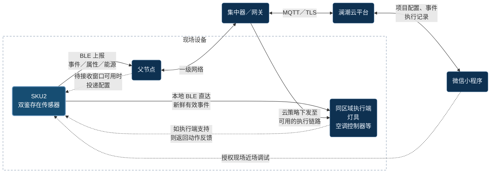
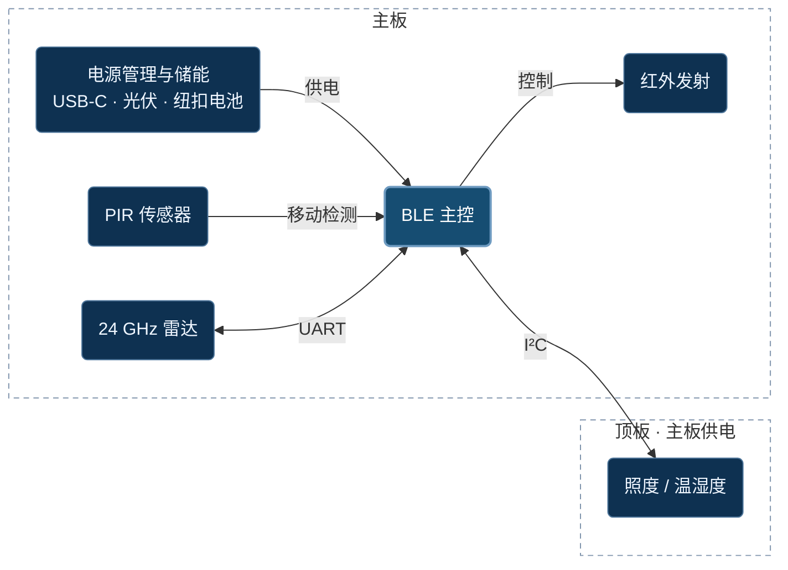

# SKU2-双鉴存在传感器-PRD_V2.1

# SKU-2 主PRD

# 01 文档控制

## 1.1 型号确认

| 产品大类 | SKU编号 | 产品名称 | 主要模组 | 型号 | MAC类别 | MAC示例 |
| --- | --- | --- | --- | --- | --- | --- |
| 多合一传感器 | SKU2 | 双鉴存在传感器 | PIR + 24G 人存雷达 + 光照度 | LC-S-MTS03-PR24-11-001 | 41／C1 | `00 C1 41 XX XX XX` |

## 1.2 术语缩写对照表

| 术语 | 本文含义 |
| --- | --- |
| PIR | 热释电被动红外，用于检测人移动引起的红外变化。 |
| 24G 人存雷达 | 24 GHz 人体存在雷达，配合 PIR 做移动及静止存在判定。 |
| Lux | 勒克斯（lx），表示落在物体表面上的光有多亮。1 lx = 1 lm/m²。走廊暗光约 50～100 lx，阅读办公约 300～500 lx。 |
| lm | 流明，表示光源总共发出多少可见光。比如一个 5 W LED 球泡约为 400～500 lm。 |
| LPN | 低功耗节点，通常是指不用市电作为主电源的终端设备。后续用LPN代指本设备。 |
| 父节点 | 一直通电、替传感器收发消息的设备。传感器睡眠时，它先保存消息，等传感器醒来再交给它。支持哪些机型、能连多少台见 D-02。 |
| CCO | CCO 为一级网络的集中器角色。 |
| SIID、CIID | SIID 为服务标识，CIID 为条目标识。 |
| 代理快照 | 指父节点按现有物模型封装转发的子传感器当前值。 |
| ACK | 接收方的确认回复。比如，父节点回复“收到事件”，只能证明这一段送到了；要知道灯有没有亮，还要看灯具反馈或照度变化。 |
| PDT | 产品开发团队 |
| EVT/DVT/PVT | 分别指工程验证、设计验证、生产验证。 |
| OTA | 线上固件升级。 |
| PXX | 第 XX 百分位数。例如 P95 时延为 95% 样本不超过的时延值。 |
| IR LED | 指红外控制。可以通过IR LED发射特定的红外信号，来达到控制空调的目的。 |
| 叶子终端/节点 | 用树形思想中的干、支、叶来描绘数据链路中各个设备所处的位置。叶子节点一般为LPN设备。 |

## 1.3 变更&评审记录

| 日期 | 版本号 | 变更内容(章节) | 受影响的需求与验收 | 评审团 | 评审意见 |
| --- | --- | --- | --- | --- | --- |
| 2026-11-17 | V2.0 |  |  |  |  |

## 1.4 需求基线

### 1.4.1 硬件基线

核心配置：采用TLSR8258F512ET32 24MHz 32bit FLASH=512KB SRAM=64KB 1.8V~3.6V -40~+85℃ BLE SoC；
传感器：PIR、24GHz雷达、光照传感器、温湿度传感器做人存和环境感知；
供电方案：采用OPV+超级电容、锂电、5V USB做可选供电单元；
硬件接口：USB type-C 6pin接口；
天线类型：板载天线
PCB结构：main board 和 光照+温湿度 sub board分体结构设计
硬件版本：当前PRD待评审状态，PRD评审通过，版本由硬件确认

### 1.4.2 软件基线

SDK开发基线：
BLE协议栈基线：
APP开发基线：

### 1.4.3 结构基线

采用三层结构设计。
1、产品正面(A面)采用PC材质的铭牌做盖板，盖板附有防水胶，针对OPV和光照传感器接口进行去胶处理，针对温湿度传感器做微针点阵打孔处理。
2、产品中框是由ABS+PC材质的塑材做支撑，预留卡扣凹槽。
3、产品背板由ABS+PC材质的塑材做卡扣安装。

# 02 产品概述

## 2.1 背景 & 痛点

现有的环境传感器LC-LS01针对的是环境信息来收集，但负荷端做的能源管控解决方案是需要感知人在空间内的行为，起初我们规划了多合一传感器，集成了PIR、24G人存雷达、光照传感、红外IR LED，但实际应用起啦发现功能之间耦合度高，重点功能存在互斥，所以此次我们细化了应用场景，沿用多合一的表述来拆分为几个SKU。此份PRD中对应：SKU-2 双鉴存在传感器。

## 2.2 产品定位

面向室内空间的**低功耗**的**人体存在**感知与生态联动传感器。

## 2.3 产品定义

双鉴存在传感器是一款采用OPV微能量光伏板＋超级电容做主供电、纽扣电池备用供电的**低功耗**人体存在传感器，集成PIR、24GHz毫米波雷达、光照度检测、BLE通信模块，适用在具有一定有效光照时长的办公室、会议室、教室等室内空间与澜潮智能生态设备协同使用。

双鉴存在传感器同时也可支持USB做常供电的人体存在传感器。

## 2.4 产品特点

- PIR与雷达双鉴识别人体活动及存在状态
- 基于BLE本地通信和远程通讯双架构，支持离线下同组生态设备(智慧灯具)快速联动和在线下的动态配置
- 采用OPV+超级电容/备用电源的双冗余电源架构，满足自身功能同时相应了绿电、低碳的设计理念
- 配备了万向支架+强力背胶设计，支持“随手贴”，安装简单方便且易于后期调整

# 03 拓扑&场景

## 3.1 拓扑

### 3.1.1 数据链路拓扑

### 3.1.2 硬件架构拓扑

## 3.2 场景

| 场景 | 有效光照条件 | 人员活动特征 | 生态交互逻辑 |
| --- | --- | --- | --- |
| 办公室 | 工作时段持续照明 | 久坐、走动 | 有人保持照明，无人延时关闭 |
| 会议室 | 使用时段有照明，空闲时可能关灯 | 久坐、微动 | 有人维持灯光/空调，无人节能 |
| 教室 | 白天自然光或人工照明 | 久坐、走动 | 按占用状态及照度调节照明功率 |
| 医院候诊区 | 通常长时间照明 | 久坐、走动 | 人体存在监测、分区照明联动 |
| 独立办公间 | 工作时段有光，非工作时段可能无光 | 久坐、短暂离开 | 有人维持照明，无人延时节能 |
| 地下停车场 | 部分区域长期低照度（建议USB供电） | 快速移动 | 人/车来灯亮、无人/车低亮； |
| 卫生间 | 使用时有光，空闲时通常无光 | 静止、微动 | 有人保持照明，无人关闭 |

# 04 功能需求

# 05 非功能需求

# 06 测试&验收标准

# 07 风险&待决项

## 7.1 风险项

## 7.2 待决策项

# 08 附录