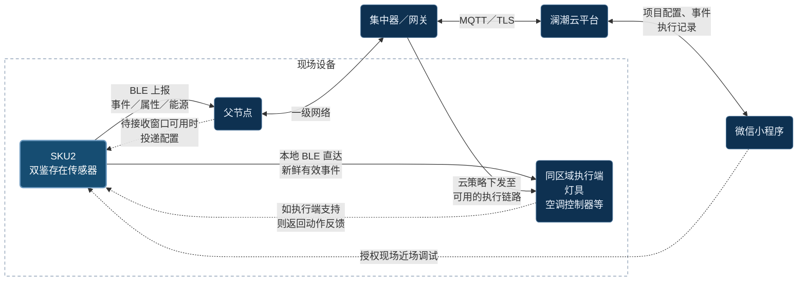
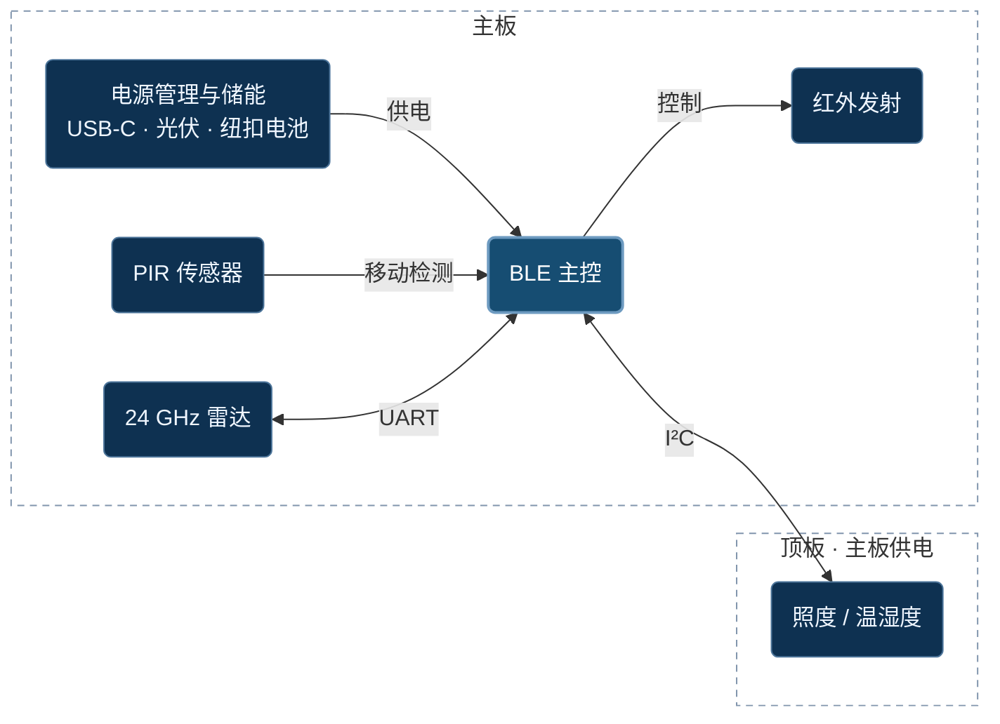

# SKU-2 主PRD

# 01 产品概述

## 1.1 型号确认

| 产品大类   | SKU编号 | 产品名称    | 主要模组                 | 型号                     | MAC类别 | MAC示例               |
| ------ | ----- | ------- | -------------------- | ---------------------- | ----- | ------------------- |
| 多合一传感器 | SKU2  | 双鉴存在传感器 | PIR + 24G 人存雷达 + 光照度 | LC-S-MTS03-PR24-11-001 | 41／C1 | `00 C1 41 XX XX XX` |

## 1.2 术语缩写对照表

| 术语          | 本文含义                                                                    |
| ----------- | ----------------------------------------------------------------------- |
| PIR         | 热释电被动红外，用于检测人移动引起的红外变化。                                                 |
| 24G 人存雷达    | 24 GHz 人体存在雷达，配合 PIR 做移动及静止存在判定。                                        |
| Lux         | 勒克斯（lx），表示落在物体表面上的光有多亮。1 lx = 1 lm/m²。走廊暗光约 50～100 lx，阅读办公约 300～500 lx。 |
| lm          | 流明，表示光源总共发出多少可见光。比如一个 5 W LED 球泡约为 400～500 lm。                          |
| LPN         | 低功耗节点，通常是指不用市电作为主电源的终端设备。后续用LPN代指本设备。                                   |
| 父节点         | 一直通电、替传感器收发消息的设备。传感器睡眠时，它先保存消息，等传感器醒来再交给它。支持哪些机型、能连多少台见 D-02。           |
| CCO         | CCO 为一级网络的集中器角色。                                                        |
| SIID、CIID   | SIID 为服务标识，CIID 为条目标识。                                                  |
| 代理快照        | 指父节点按现有物模型封装转发的子传感器当前值。                                                 |
| ACK         | 接收方的确认回复。比如，父节点回复“收到事件”，只能证明这一段送到了；要知道灯有没有亮，还要看灯具反馈或照度变化。               |
| PDT         | 产品开发团队                                                                  |
| EVT/DVT/PVT | 分别指工程验证、设计验证、生产验证。                                                      |
| OTA         | 线上固件升级。                                                                 |
| PXX         | 第 XX 百分位数。例如 P95 时延为 95% 样本不超过的时延值。                                     |
| IR LED      | 指红外控制。可以通过IR LED发射特定的红外信号，来达到控制空调的目的。                                   |
| 叶子终端/节点     | 用树形思想中的干、支、叶来描绘数据链路中各个设备所处的位置。叶子节点一般为LPN设备。                             |

## 1.3 变更&评审记录

| 日期         | 版本号  | 变更内容\(章节\) | 受影响的需求与验收 | 评审团 | 评审意见 |
| ---------- | ---- | ---------- | --------- | --- | ---- |
| 2026-11-17 | V2.0 |            |           |     |      |

## 1.4 需求基线

需求来自于MRD和Roadmap。

# 02 产品概述

## 2.1 背景 & 痛点

现有的环境传感器LC-LS01针对的是环境信息来收集，但负荷端做的能源管控解决方案是需要感知人在空间内的行为，起初我们规划了多合一传感器，集成了PIR、24G人存雷达、光照传感、红外IR LED，但实际应用起啦发现功能之间耦合度高，重点功能存在互斥，所以此次我们细化了应用场景，沿用多合一的表述来拆分为几个SKU。此份PRD中对应：SKU-2 双鉴存在传感器。

## 2.2 产品定位

面向室内空间的**低功耗**的**人体存在**感知与生态联动传感器。

## 2.3 产品定义

双鉴存在传感器是一款采用OPV微能量光伏板＋超级电容做主供电、纽扣电池备用供电的**低功耗**人体存在传感器，集成PIR、24GHz毫米波雷达、光照度检测、BLE通信模块，适用在具有一定有效光照时长的办公室、会议室、教室等室内空间与澜潮智能生态设备协同使用。

双鉴存在传感器同时也可支持USB做常供电的人体存在传感器。

## 2.4 产品特点

- PIR与雷达双鉴识别人体活动及存在状态
- 基于BLE本地通信和远程通讯双架构，支持离线下同组生态设备\(智慧灯具\)快速联动和在线下的动态配置
- 采用OPV+超级电容/备用电源的双冗余电源架构，满足自身功能同时相应了绿电、低碳的设计理念
- 配备了万向支架+强力背胶设计，支持“随手贴”，安装简单方便且易于后期调整

# 03 拓扑&场景&逻辑

## 3.1 拓扑

### 3.1.1 数据链路拓扑

### 3.1.2 硬件架构拓扑

## 3.2 场景

| 场景    | 有效光照条件             | 人员活动特征  | 生态交互逻辑         |
| ----- | ------------------ | ------- | -------------- |
| 办公室   | 工作时段持续照明           | 久坐、走动   | 有人保持照明，无人延时关闭  |
| 会议室   | 使用时段有照明，空闲时可能关灯    | 久坐、微动   | 有人维持灯光/空调，无人节能 |
| 教室    | 白天自然光或人工照明         | 久坐、走动   | 按占用状态及照度调节照明功率 |
| 医院候诊区 | 通常长时间照明            | 久坐、走动   | 人体存在监测、分区照明联动  |
| 独立办公间 | 工作时段有光，非工作时段可能无光   | 久坐、短暂离开 | 有人维持照明，无人延时节能  |
| 地下停车场 | 部分区域长期低照度（建议USB供电） | 快速移动    | 人/车来灯亮、无人/车低亮； |
| 卫生间   | 使用时有光，空闲时通常无光      | 静止、微动   | 有人保持照明，无人关闭    |

# 04 功能需求

| 需求ID   | 需求描述/        | 链接                                                                                                                           |
| ------ | ------------ | ---------------------------------------------------------------------------------------------------------------------------- |
| FR-101 | 001_LPN能源管理  | C:\Users\lc\Documents\Gentle.Zhang\workspace\sync_ws\workspace_for_GPT\099_PRD\多合一\main-PRD\01_公共元需求\out\001_LPN能源管理_V1.1.md |
| FR-102 | 002_通信与安全    |                                                                                                                              |
| FR-103 | 003_配网与鉴权    |                                                                                                                              |
| FR-104 | 004_事件机制     |                                                                                                                              |
| FR-105 | 005_运维与超管    |                                                                                                                              |
| FR-106 | 006_心跳机制     |                                                                                                                              |
| FR-107 | 007_传感器管理    |                                                                                                                              |
| FR-108 | 008_时间同步与时间戳 |                                                                                                                              |
| FR-109 | 009_多合一硬件基线  |                                                                                                                              |
| FR-110 | 010_多合一结构基线  |                                                                                                                              |

# 05 非功能需求

| 需求ID    | 需求描述/链接 | 优先级 |
| ------- | ------- | --- |
| NFR-101 |         |     |
|         |         |     |

# 06 测试&验收标准

# 07 风险&待决项

## 7.1 风险项

| #   | 风险             | 等级  | 影响                             | 缓解措施                     |
| --- | -------------- | --- | ------------------------------ | ------------------------ |
| R-1 | **雷达模组扫描电流超标** | 高   | 若只能满功率 25 mA 扫描，PIR 门控在微能量下不成立 | M0 一票否决式实测；备选低功耗模组 2–3 家 |

## 7.2 待决策项

| #   | 事项     | 决策方     | 结论 / 待定内容                                                            |
| --- | ------ | ------- | -------------------------------------------------------------------- |
| N-1 | 雷达模组型号 | 硬件 + 算法 | BOM 选型 RKB1161A3。扫描期平均电流 ≤150 µA、T_scan ≤30～60 s、DRDY 为验证目标，待提供实装证据。 |

# 08 附录
