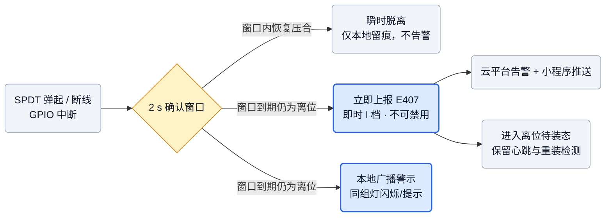

### 4.12 防拆：设备被从支架带走（FR-12xx）

**要点**：这是本机唯一带"物理对抗"性质的需求。软件推断不可靠，必须硬件给信号；而硬件信号又会误报，所以用 **2 s 确认窗口**过滤瞬态，并配合维护模式区分计划内拆卸。**防拆是"检测"，不是"断电"**：SPDT 只进 GPIO，不串接电源或负载，设备离位后仍能继续供电并把告警说完。

#### 4.12.1 硬件方案与配合结构

| 方案             | 原理             | 优点                  | 风险                     | 结论                       |
| -------------- | -------------- | ------------------- | ---------------------- | ------------------------ |
| **SPDT 检测开关**  | 支架铁片压合按柄，离开即弹起 | 判定直接、零功耗、无磁干扰、四款可共用 | 需底壳开孔与公差控制             | **主方案**                  |
| 霍尔 + 支架磁铁      | 设备离开支架 → 磁场消失  | 无接触、无磨损             | 机身自带强磁致饱和；支架再加磁铁则吸附力失控 | **不采用**（原因见下）            |
| 机械顶针 + 铁片      | 铁片兼作动触点        | 不需新增器件品类            | 铁片氧化、怕潮、接触电阻漂移         | 备选（成本极敏感时）               |
| 加速度计（G-sensor） | 检测搬动、跌落、姿态突变   | 可区分"被拿走"与"被碰一下"     | 常开耗电；成本 1.5–2.5 元/台    | **不采用**（成本否决，由 2 s 窗口替代） |
| 离墙检测（电容/光电）    | 检测与安装面距离       | 覆盖"连支架一起拔走"         | 受基材影响大，标定复杂            | 预留                       |

**推荐方案**：检测开关单判据 + **2 s 确认窗口**：弹起后 2 s 内恢复压合判"瞬时脱离"，只留痕不告警；到期仍弹起判"真实离位"。**不配置加速度计**——其防误报职责由机械压缩量、确认窗口、维护模式三层承担（见下文与 FR-1210）。

防拆器件定为 **SPDT 检测开关（Detector Switch）**，装在背板距磁铁中心 12 mm 处，按柄穿出底壳开孔，由万向节支架上的铁片压合。四款 SKU 共用同一封装位置、同一型号与同一开孔，差异只在铁片形态。

**选型判据：不能用普通轻触开关。** 轻触开关行程仅 0.15–0.3 mm，而装配公差累计 ±0.55 mm，会出现"装上了但没压到"的间歇失效——产线抽检抽不出来，现场表现为"有时告警有时不告警"。判据是**行程 ≥ 2 × 公差累计**：

| 公差来源    | 偏差           |
| ------- | ------------ |
| 底壳成型平面度 | ±0.15 mm     |
| 磁铁安装高度  | ±0.20 mm     |
| 铁片厚度    | ±0.05 mm     |
| 支架球头平面度 | ±0.15 mm     |
| **累计**  | **±0.55 mm** |

| 参数   | 要求            | 理由                                     |
| ---- | ------------- | -------------------------------------- |
| 类型   | SPDT 检测开关     | 需 NC/NO 双触点：NC 用于在位/离位检测，NO 可作备用或硬件互锁，**不串主回路** |
| 行程   | ≥1.0 mm       | 覆盖 ±0.55 mm 公差后仍有余量                    |
| 过行程  | ≥0.5 mm       | 公差上限时不压死                               |
| 动作力  | 0.5–1.5 N     | 磁吸力 10–15 N 远大于此；低于 0.3 N 则擦碰即误报       |
| 按柄   | Φ2.0 × 3.5 mm | 穿出底壳后露出 1.5 mm                         |
| 触点额定 | ≥10 mA        | **仅信号回路**，不承载系统、超容充电或发射电流              |
| 寿命   | ≥5 万次         | 5 年仅操作 5 次（换电池）                        |

**两种磁铁形态的兼容**：内嵌式磁铁与壳面齐平，配平铁片；螺纹式磁铁凸出约 3 mm，配**外环上翻 3 mm 的台阶铁片**（中央 Φ18 保持平面吸磁铁）。两种情形下按柄压缩量同为 1.5 mm，设备侧不需要第二套模。

| 形态  | 磁铁相对壳面  | 铁片              | 按柄压缩量  |
| --- | ------- | --------------- | ------ |
| 内嵌式 | 齐平      | 平铁片 Φ30×0.5     | 1.5 mm |
| 螺纹式 | 凸出 3 mm | 台阶铁片（外环上翻 3 mm） | 1.5 mm |

**电气接法（仅检测，不进电源路径）**：COM 接 GND，NC 接检测 GPIO（内部上拉）。支架压合时按柄压下、NC 闭合，GPIO 为低（在位）；离开支架时按柄弹起、NC 断开，GPIO 被上拉为高并触发中断（离位）。**SPDT 不得串接电池、超容或负载**；电源通断只由双档拨动开关负责。选型时须确认"压下"与 NC/NO 的对应关系：若所选型号为"压下断开 NC"，则改用 NO 接 GPIO 并在固件中反转极性，量产前以实机签核为准。

| 状态        | 开关  | NC 触点 | GPIO     | 设备行为                          |
| --------- | --- | ----- | -------- | ----------------------------- |
| 装在支架上     | 压下  | 闭合    | 低        | 正常工作                          |
| 离开支架      | 弹起  | 断开    | 高（中断）    | 确认窗口到期后**立即上报 E407（≤5 s）**，仍由超容/电池供电，不中断运行 |
| 线束断 / 接触不良 | —   | 断开    | 高        | 按离位处理（fail-safe），避免"剪线静默"     |
| 产线 / 仓储   | 弹起  | 断开    | 高        | 若拨动开关在 OFF 则整机断电；否则按离位处理      |

**为什么不再串主回路**：把 SPDT 串进电源，设备一离位就失去主供，只能靠超容抢发几秒——既压缩了上报窗口，也让"离位后继续监测是否被重新装回"不可能；同时电池支路与主回路的通断被防拆开关绑架，换电池、返修都更容易误触发。改为独立检测后，离位信号只进 GPIO，设备可以立即上报、继续运行，并按策略进入待装态。这条是本期方案的硬边界，硬件评审不得改回串接方案。

**离位判据与误报抑制**：开关弹起后先进入 **2 s 确认窗口**，窗口内恢复压合判为"瞬时脱离"（擦拭、临时挪动、装配抖动），只留痕不告警；窗口到期仍弹起才判"真实离位"并进入上报流程。误报由三层防线压住：

| 层级  | 措施                                      | 解决什么        |
| --- | --------------------------------------- | ----------- |
| 机械  | 压缩量 1.5 mm、开关周围 1.0 mm 围骨、支架凸台 15° 斜导   | 公差临界抖动、侧向剪切 |
| 固件  | 2 s 确认窗口 + 200 ms 去抖 + 连续 2 次采样一致       | 瞬时脱离、接触抖动   |
| 运营  | 带时限维护模式（默认 30 min，可配 5–120 min），期间离位仅留痕 | 换电池、移位、返修   |

**不采用加速度计**：器件与贴装合计 1.5–2.5 元/台，而其原本承担的"防误报"职责大半是伪需求——擦拭与碰触不会使设备离开支架，开关本就不动作；"碰一下又放开"由 2 s 窗口过滤；"正常维护"由维护模式解决；"胶失效脱落"本就该报。故本期不配置加速度计，以成本优先。

**为什么不用霍尔**：机身背面已有 Φ12×8 钕磁铁（表磁 3000–4000 Gs），霍尔在距其 8–15 mm 处场强 500–1500 Gs，比开关型霍尔动作点（±30–70 Gs）高一个量级以上，直接饱和；若改在支架侧再加磁铁，会与机身磁铁极性叠加，吸附力失控且阈值随磁铁批次漂移。霍尔仅在结构完全无位置时作备选，且须做磁屏蔽。

#### 4.12.2 触发链与告警

#### 4.12.3 防拆需求

| ID      | 需求描述                                                                                                                                                                            | 优先级 | 验收口径                         |
| ------- | ------------------------------------------------------------------------------------------------------------------------------------------------------------------------------- | --- | ---------------------------- |
| FR-1201 | 背部须为 SPDT 检测开关（选型与公差判据见 4.12.1）：设备与支架分离即弹起，产生硬件中断，不依赖软件轮询推断；**开关只接检测回路（COM 接地、NC 接 GPIO），不得串接电源或负载**。                                                                                     | P0  | 分离后 ≤5 s 产生信号；检测回路与电源回路独立，装配签核     |
| FR-1202 | 单判据 + **2 s 确认窗口**：开关弹起后 2 s 内恢复压合判"瞬时脱离"，只本地留痕不告警；到期仍弹起判"真实离位"。不依赖加速度计。                                                                                                        | P0  | 模拟碰动 50 次误报 0；模拟拿走 20 次全部告警  |
| FR-1203 | 触发后立即上报 E407（即时档、不可禁用、必须 ACK），载荷带原因码分三类：DETACH\_MANUAL（疑似人为，布防时段内且拆卸后快速消失，置信度中）/ DETACH\_ADHESIVE（疑似贴装失效，无人时段发生且离位后仍在原网关信号范围内，置信度低）/ DETACH\_UNKNOWN；平台按"疑似"展示并支持现场确认回填，不承诺精确区分 | P0  | 20 次拆卸，云端均收到且原因码正确           |
| FR-1204 | 触发后同时发本地广播警示（同组灯闪烁或提示），保证断网时现场也有反馈。                                                                                                                                             | P0  | 断云状态下现场可见警示                  |
| FR-1205 | **离位不断电**：确认窗口到期后必须立即完成 E407 上报；上报后进入"离位待装态"（停用与安装位置相关的检测/执行，保留心跳与重装检测），重新压合后自动恢复。若同时处于低电，按 Last Gasp 优先保告警。                                                                         | P0  | 拔下后 20 次均收到告警；待装态可读；重装后 60 s 内恢复 |
| FR-1206 | 支持**带时限维护模式**：小程序开启后默认 30 min（可配 5–120 min）内离位不告警、仅留痕，到期自动恢复布防；维护模式状态在设备与平台双记录                                                                                                  | P1  | 撤防时段拆卸不告警但留痕                 |
| FR-1207 | 防拆状态参与运维展示：在位、离位、疑似、已告警四态，可在诊断快照中读出。                                                                                                                                            | P0  | 四态均可构造并正确显示                  |
| FR-1208 | 电池仓/壳体防非授权开启：若壳体开启能触发同一 SPDT，则等同离位处理；若不在该开关检测范围内，须增设独立检测点，否则本条不适用。工具规格写入施工手册。                                                                                                     | P1  | 徒手无法开启；能触发时产生信号；不适用时书面说明      |
| FR-1209 | 防拆不得因低电、OTA、配置下发而失效；OTA 期间沿用原状态判断。                                                                                                                                              | P0  | 低电与升级期间拆卸仍告警                 |
| FR-1210 | 确认窗口参数化：窗口 1–10 s（默认 2 s）、去抖 200 ms、连续 2 次采样一致；参数随配置下发并可读回。**不设"收尾窗口"**，离位后不主动断电。                                                                                                | P0  | 参数可配可读回；去抖后误报 0              |
| FR-1211 | **不配置加速度计**：成本 1.5–2.5 元/台与其增益不匹配；误报抑制由机械压缩量、2 s 确认窗口、维护模式三层承担（见 4.12.1）。                                                                                                       | P0  | BOM 无加速度计；三层措施逐项验证           |

**与"掉落"的区分**：胶贴失效导致的脱落同样产生离位信号。不配加速度计后只能靠"发生时段"与"离位后信号是否仍存续"做倾向性标注（见 FR-1203 的三类原因码），无法精确区分。因此平台按"疑似"展示并要求现场确认，避免运维把"胶没粘牢"当成"有人偷设备"。安装侧的对策是：禁用基材清单 + 现场拉拔试验 + 卡扣/螺接备选（见 5.5 与 6.2）。
