# 澜潮 SKU1 PIR 人体移动传感器 · 产品需求文档 V2.1

**目录**

1. [文档控制](#01-文档控制)
2. [产品概述](#02-产品概述)
3. [拓扑与场景](#03-拓扑与场景)
4. [功能需求](#04-功能需求)
5. [非功能需求](#05-非功能需求)
6. [测试与验收](#06-测试与验收)
7. [风险与待决项](#07-风险与待决项)
8. [附录](#08-附录)

**优先级定义**：

P0 = 首发必须实现，缺失不可发布；

P1 = 首发应实现，可在首个维护版本补齐；

P2 = 规划项。

## 01 文档控制

### 1.1 型号确认

| 产品大类   | SKU  | 产品名称    | 主要模组 | 型号                   | MAC 类别 | MAC 示例              |
| ------ | ---- | ------- | ---- | -------------------- | ------ | ------------------- |
| 多合一传感器 | SKU1 | 人体移动传感器 | PIR  | LC-S-MTS03-PR-11-001 | 42／C1  | `00 C1 42 XX XX XX` |

### 1.2 术语缩写对照表

| 术语                   | 本文含义                                                 |
| -------------------- | ---------------------------------------------------- |
| PIR                  | 热释电被动红外，检测人移动引起的红外变化。本机唯一的人体检测通道。                    |
| LPN                  | 低功耗节点，本文指本设备（不用市电做主动力）。                              |
| 父节点                  | 常电设备，替休眠的 LPN 收发并暂存消息。                               |
| CCO                  | 集中器角色。L2 CCO 汇现场子网，L1 CCO 汇一级网络并上联网关。                |
| Lux                  | 勒克斯，1 lx = 1 lm/m²。走廊暗光约 50～100 lx，办公阅读约 300～500 lx。 |
| OPV                  | 有机薄膜光伏，室内弱光下发电。                                      |
| 超容                   | 超级电容，本机主储能。                                          |
| SOC                  | 估算的剩余电量百分比。                                          |
| 回差                   | 进入和退出同一状态用不同门槛，避免临界值附近反复切换。                          |
| 唤醒窗口                 | LPN 醒来并保持可通信的一段时间，父节点在此期间投递下行。                       |
| 本地广播                 | 不经树形网络，用 BLE 广播把事件直接发给同组执行端。                         |
| TTL                  | 广播可经几跳转发。本机联动广播 TTL ≤ 4。                             |
| T_leave              | 无人延时：从最后一次 PIR 触发开始计时，到期无新触发即判无人。                    |
| T_minOn              | 灯侧最短点亮时间，默认 10 s，防止刚关又开造成闪灯。                         |
| 灵敏度档                 | PIR 触发阈值档位 1～5，对应感应距离约 2～8 m。                        |
| `evtSeq` / `eventId` | 灯侧联动去重序号 / 上行事件唯一标识（重传、补报、换父沿用原值）。                   |
| ACK                  | 接收方确认。父节点 ACK 只证明这一段送到，不等于云端已入库。                     |
| 离墙                   | 设备与安装面分离。本机由背部轻触开关弹起判定。                              |
| OTA                  | 远程固件升级。                                              |
| 保电                   | 能量不足时按规则收缩功能，只保留最低检测与通信能力。                           |
| PXX                  | 百分位数，P95 = 95% 样本不超过的值。                              |
| EVT / DVT / PVT      | 工程验证 / 设计验证 / 生产验证。                                  |
| 连接参数协商               | Conn Parameter Update，从机主动协商连接间隔、从机延迟、超时             |

### 1.3 变更与评审记录

| 日期         | 版本        | 变更内容                                 | 受影响需求 | 评审意见             |
| ---------- | --------- | ------------------------------------ | ----- | ---------------- |
| 2026-11-19 | v1.0（参考稿） | 单 PIR 型号独立成稿：移动检测、微能量、光照四用途、三通道、安装工艺 | 全文    | 结构与边界确认，缺选点与防拆细化 |
|            |           |                                      |       |                  |
|            |           |                                      |       |                  |
|            |           |                                      |       |                  |

### 1.4 需求基线

#### 1.4.1 硬件基线

- 主控：TLSR8258F512ET32，24 MHz 32 bit，Flash 512 KB / SRAM 64 KB，1.8～3.6 V，-40～+85 ℃，集成 BLE。
- 传感：PIR（触发角 120°，无雷达）。
- 供电：OPV + 20 F 超容为主，CR2450 600 mAh 备用，USB Type-C 5 V 可长期外供。
- 接口：USB Type-C 6 pin（充电 + 直供 + 产测写入）。
- 天线：板载。
- 防拆：支架侧检测器件（方案见 4.12，待硬件签核）。

#### 1.4.2 软件基线

| 项                 | 基线                                         |
| ----------------- | ------------------------------------------ |
| BSP：SDK / BLE 协议栈 | 待 FW 签核（要求支持 LE 加密、连接参数协商、广播扩展）            |
| 应用层               | 驱动层 / LPNMS 能源任务 / 检测与策略任务 / 通信任务 / OTA 任务 |
| 云与端协议             | 沿用 V1.5 网关协议（MQTT over TLS + JSON），新增逐事件接口 |
| 小程序               | 「澜潮智联」，需支持扫码组网、选点勘测、近场调试三套流程               |

#### 1.4.3 结构基线

三层结构：A 面 PC 铭牌盖板（防水胶，OPV 与照度开窗去胶、温湿度微针点阵打孔）；中框 ABS+PC 预留卡扣凹槽；背板 ABS+PC 卡扣安装，预留防拆硬件检测缺口，另内嵌铷磁铁。整机无开孔、无麦克风孔、无可见螺钉。

## 02 产品概述

### 2.1 背景与痛点

| 现有方案        | 致命缺陷                | 现场表现                            |
| ----------- | ------------------- | ------------------------------- |
| 市电 PIR 感应开关 | 要布线、要开孔、要接零火线       | 老旧楼改造单价高，走线破坏装修；一个点位一个开关，无法统一策略 |
| 电池 PIR 传感器  | 1～2 年换一次电池，万级点位无法运维 | 物业每年要排换电池工单，换下来的电池是受控废弃物        |
| 常亮或定时开关     | 不管有没有人，到点就亮         | 走廊、楼梯间、地库常年空亮，节能率接近 0           |
| 纯雷达方案       | 常开耗电、易被金属摆动干扰       | 电池型产品几个月没电；卷帘门、管道导致无人常亮         |

走廊这类空间的共同特征是：**人一直在动，很少有人长时间坐着**。用"移动检测 + 无人延时"就够了，不需要为静止保持付雷达的成本与功耗。

### 2.2 产品定位

面向**移动型动线**的**低功耗人体移动感知与生态联动**传感器：不布线、不换电，靠室内光和备用电池活着；人一走过就触发，把"有人经过"直接交给同组的灯。

### 2.3 产品定义与三种供能形态

集成 PIR、照度检测与 BLE 通信，采用 OPV + 超容主供、CR2450 兜底，同时支持 USB 常供电。整机厚度与外观与 SKU2 同族，区别只在探测窗内没有雷达天线。

| 形态       | 供能方式               | 适用场景                           | 能力差异                  |
| -------- | ------------------ | ------------------------------ | --------------------- |
| A 微能量    | OPV + 20 F 超容，电池兜底 | 走廊、电梯厅、大厅、楼梯间、靠窗动线，常态照度 ≥30 lx | 标准性能，受能量分级约束          |
| B 备用电池   | CR2450 自动切入        | 连续阴天、短时断光兜底                    | 维持基本检测与心跳             |
| C USB 外供 | 5 V 直供 + 给超容补能     | 地库深处、设备间、无窗库房                  | 高性能模式：灵敏度可上调一档、不因低电降级 |

### 2.4 产品特点

- **只做一件事，做到极致省电**：没有雷达，PIR 常开就是全部检测成本，无人态可压到 11 µA 以内。
- **开关就是防拆**：背部轻触开关贴墙压合才通电，被从墙上拿走即弹起断电，同时抢发一次离墙告警。
- **两条联动路径**：本地 BLE 直达（灯 300 ms 内亮）与云端策略下发，断网时本地照常工作。
- **会算电的设备**：LPNMS 预测还能撑多久，撑不住时按既定顺序牺牲功能，而不是随机死机。
- **装得快**：背胶随手贴 + 扫机身码录位置 + 安装期用照度数据判定点位好坏。

### 2.5 范围

**本产品做（In Scope）**

- 单 PIR 移动检测：触发即翻转、即联动，无人延时关灯（10 s～30 min 可配，断电保持）。
- 微能量、备用电池、USB 三种供能自动切换与能源管理。
- 照度四用途：联动判断、安装选点与质检、白天免开灯、灯具故障辅助判断。
- 事件生成、三通道上报、断链缓存补报、逐事件可配置。
- BLE 组网两条路径（自动组网 / 扫码 + 云下发）、入网鉴权、链路加密与防重放。
- 心跳、时间同步与时间戳、OTA 升级、云端超管运维、近场 BLE 维护。
- 生态联动：同组灯具、空调控制器。
- 离墙检测与告警（背部轻触开关，硬件级）。

**本产品不做（Out of Scope）**

- 不做 24G 雷达，不做静止存在检测，不做双鉴融合、进入回滚、多次空判。
- 不做多人计数、距离分档、活动强度分级。
- 不做温湿度采集（该能力归 SKU3）。
- 不做摄像头、麦克风、身份识别。
- 不做中继/路由（`canRelay=false`）；不做 PLC、Sub-G；不做独立网关。
- 不做室外、雨淋、凝露环境；不做粗糙易脱落基材。

### 2.6 成功指标

| 目标      | 口径                           | 目标值                         |
| ------- | ---------------------------- | --------------------------- |
| 部署效率    | 单点从开箱到入网成功                   | 平均 ≤8 min；同区连续作业 >400 点位/人日 |
| 首次组网成功率 | 首次扫码组网成功次数 / 申请次数            | ≥98%                        |
| 移动检出    | 3 m 高、0.5～1.5 m/s 径向穿越 100 次 | 漏检 ≤1 次（>99%）               |
| 空场误触发   | 无人环境（含空调气流、窗帘）72 h           | ≤1 次/24 h，且可被抖动自检识别         |
| 联动时延    | 事件成立 → 同组执行端实动               | 本地 P95 ≤1 s；云端 P95 ≤3 s     |
| 断网可用    | 断云 30 min 内本地联动可用率           | ≥95%                        |
| 在线率     | 有效心跳在线时长占比                   | ≥99%                        |
| 功耗      | 无人态整机平均电流                    | ≤11 µA（常温，200 lx 8 h/日）     |
| 服务期     | 有条件的五年有效服务（允许按计划 USB 补能）     | 检测可用率按 5.7 核算               |

## 03 拓扑与场景

### 3.1 拓扑

#### 3.1.1 数据链路拓扑

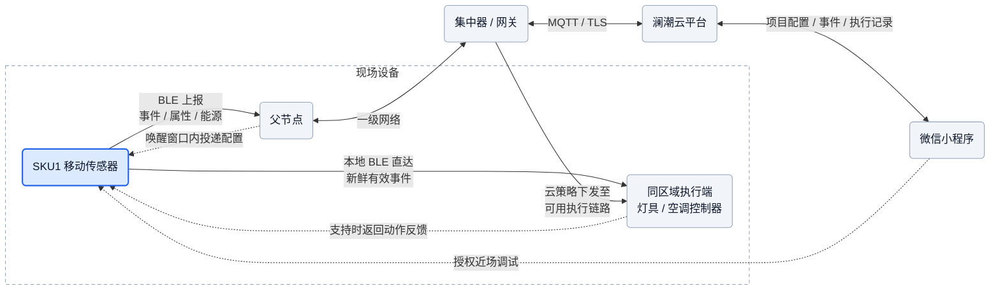

三条路径各司其职，互不替代：

| 路径  | 走向                              | 用途           | 关键约束                     |
| --- | ------------------------------- | ------------ | ------------------------ |
| 本地  | SKU1 →（BLE 广播）→ 同组执行端           | 开灯/关灯/调光，必须快 | 不经父节点，TTL ≤4，端到端 ≤300 ms |
| 云端  | SKU1 → 父节点 → CCO → 网关 → 云 → 小程序 | 上报、配置、审计、统计  | 受唤醒窗口限制，下行 1 个周期内生效      |
| 近场  | 小程序 ↔ SKU1（BLE GATT）            | 安装、选点、调试、读回  | 需鉴权码，会话限时                |

#### 3.1.2 硬件架构拓扑

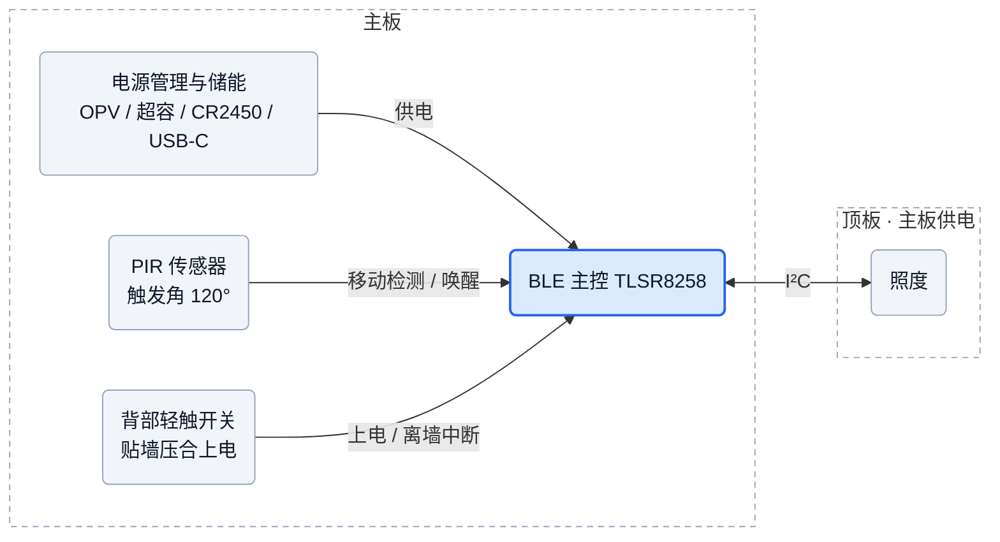

#### 3.1.3 供能与能量路径

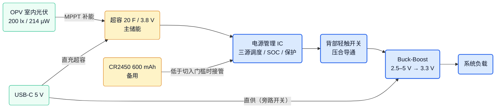

**为什么开关放在贴墙面**：它把"是否装好"和"是否通电"变成同一件事。贴上去就上电，取下来就断电——省掉一个独立按键，同时天然获得离墙信号，不需要额外的霍尔器件。

### 3.2 场景

| 场景          | 有效光照条件      | 人员活动特征    | 生态交互逻辑         | 推荐形态     |
| ----------- | ----------- | --------- | -------------- | -------- |
| 走廊 / 楼梯间    | 白天有自然光，夜间靠灯 | 快速通过，不滞留  | 人来灯亮，无人 30 s 关 | A 微能量    |
| 电梯厅 / 大厅    | 通常长时间照明     | 经停、短暂等待   | 人来灯亮/升亮，无人降档   | A 微能量    |
| 区域出入口 / 门厅  | 白天有光，夜间靠灯   | 单次通过      | 人来即亮，快速关灯      | A 微能量    |
| 卫生间前室       | 使用时有光       | 通过、短暂停留   | 有人保持照明，无人关     | A 微能量    |
| 地下车库通道      | 长期低照度       | 快速移动（人/车） | 人来灯亮，无人低亮      | C USB 外供 |
| 设备机房 / 密闭库房 | 完全无光        | 短时巡检      | 进门亮灯，延时关闭      | C USB 外供 |

### 3.3 用户角色

| 角色          | 核心诉求             | 成功判据               | 需要的权限         |
| ----------- | ---------------- | ------------------ | ------------- |
| 物业公司（付费方）   | 电费下降、投诉不上升、不用管电池 | 照明能耗降 60%+；年度零维护工单 | 只读看板          |
| 工程安装商 / FAE | 装得快、录入不麻烦、选点不返工  | >400 点位/人日；扫码一次成功  | 项目安装权限 + 近场调试 |
| 系统集成 / 运维   | 远程可控、点位可追溯、故障可发现 | 90% 异常可远程判定        | 配置权 + 超管（受控）  |
| 空间使用者       | 走过去灯就亮，不要误关      | 无"走一半灯灭"投诉         | 无             |

### 3.4 安装姿态

| 姿态  | 推荐高度/角度                | 适用场景           | 探测特性                |
| --- | ---------------------- | -------------- | ------------------- |
| 斜装  | 墙面 2.0～2.4 m，下倾 20～45° | 走廊、门框内侧、楼梯口、立柱 | **对人流方向检出率最高，本机首选** |
| 顶装  | 吊顶 2.6～3.2 m，垂直向下      | 大厅、大开间、地库通道    | 对称覆盖，适合横向人流         |
| 侧装  | 墙面/立柱 1.2～2.0 m        | 隔断上沿、货架侧板      | 水平扇形，适合横向动线         |
| 倒装  | 梁下/桥架下                 | 地库、厂房          | 同顶装，注意金属梁反射         |

姿态必须写入配置（`mountMode`）。顶装是"俯视锥"、侧装是"水平扇"，距离-阈值映射完全不同；用同一套参数会让侧装/斜装点位的误报与漏检显著恶化。

## 04 功能需求

### 4.0 需求总览

| 模块        | 编号段     | 解决什么问题                   | 优先级 |
| --------- | ------- | ------------------------ | --- |
| LPN 能源管理  | FR-1xx  | 没市电，必须自己算电、自己省电、自己体面地没电  | P0  |
| 通信与安全     | FR-2xx  | 一条事件要走三条路，还要防偷听、防重放      | P0  |
| BLE 组网与鉴权 | FR-3xx  | 两种入网路径，都要证明"你是你、你在正确的位置" | P0  |
| 事件机制      | FR-4xx  | 什么算事件、发给谁、丢了怎么办          | P0  |
| 心跳机制      | FR-5xx  | 区分"真没人"和"设备失联"           | P0  |
| 时间同步      | FR-6xx  | 每条事件都要说得清"几点发生的"         | P0  |
| OTA 升级    | FR-7xx  | 休眠设备怎么安全地换固件             | P1  |
| 运维（超管）    | FR-8xx  | 在线设备出问题时，平台能远程动手         | P0  |
| 生态设备联动    | FR-9xx  | "有人经过"怎么变成灯和空调的动作        | P0  |
| PIR 移动检测  | FR-10xx | 只有一路 PIR，怎么做到不漏检也不误判     | P0  |
| 选点        | FR-11xx | 装之前怎么知道这个点位行不行           | P0  |
| 离墙检测      | FR-12xx | 设备被从墙上拿走要喊出来             | P0  |

### 4.1 LPN 能源管理（FR-1xx）

**要点**：设备永远要回答三个问题——现在靠谁供电、还能撑多久、撑不住时先牺牲什么。答案由 LPNMS 统一给出，其他模块只能读，不能改。

#### 4.1.1 供能与切换

| ID     | 需求描述                                                        | 优先级 | 验收口径                       |
| ------ | ----------------------------------------------------------- | --- | -------------------------- |
| FR-101 | 支持 OPV + 超容、CR2450、USB 三源接入，按电源管理芯片规则自动切换；一次电池与充电路径隔离，禁止反充。 | P0  | 三源分别单独接入均可开机；电池支路反向电流为 0   |
| FR-102 | USB 5 V 可独立持续供电，并给超容补能。超容 2.5→3.5 V <10 min；补能期间检测不中断、不重启。  | P0  | 记录充电曲线；插拔 100 次无重启         |
| FR-103 | 超容低于切入门槛（候选 2.6 V）时切备用电池，回升后按 0.1 V 回差切回。                   | P0  | 切入/切回各 20 次，无抖动、无掉电复位      |
| FR-104 | 离墙（开关弹起）后切断负载，整机漏电 ≤2.5 µA；停止检测、心跳与常规上报。                    | P0  | 源表长时记录 ≥72 h；6 个月库存压降 <1 V |
| FR-105 | 每次上电识别原因：贴装下压 / 看门狗 / 供电恢复 / 软复位，无法区分时上报"未知"。               | P0  | 四种原因分别注入，`bootCause` 均正确   |
| FR-106 | 临近断电时用预留电量发末次状态（Last Gasp），记录是否送达；预留电量不允许被普通任务占用。           | P0  | 100 次断电试验上报成功率 ≥95%        |
| FR-107 | 分别估算超容可用能量与电池剩余容量，记录供电源与切换历史；无法估算时显示"未知"及最后有效值。             | P0  | SOC 误差 ≤±10%；六态电池状态均可判     |
| FR-108 | 硬件保护（欠压关断、过流、过温）优先于任何软件策略，软件不得绕过。                           | P0  | 拉低电压至保护点，输出按硬件关断，恢复后按回差重启  |

#### 4.1.2 能源分级与调度

超容按可用能量分 5 档，档位直接决定心跳多慢、事件还能不能上云、PIR 灵敏度要不要降。

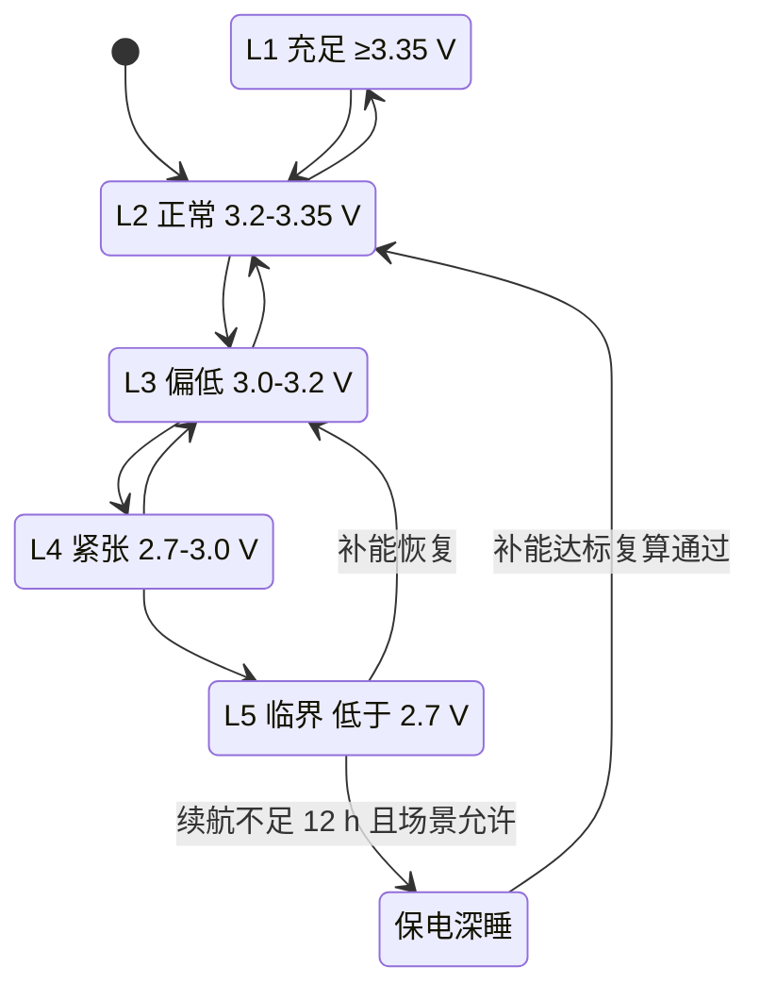

| 等级  | 超容电压（候选）   | 灵敏度    | 心跳 / 聚合        | 上报约束         | 发射功率 |
| --- | ---------- | ------ | -------------- | ------------ | ---- |
| L1  | ≥3.35 V    | 上调 1 档 | 300 s / 15 min | 按配置          | 100% |
| L2  | 3.2～3.35 V | 默认档    | 300 s / 1 h    | 按配置          | 100% |
| L3  | 3.0～3.2 V  | 默认档    | 600 s / 6 h    | P2 由聚合转随心跳   | 75%  |
| L4  | 2.7～3.0 V  | 下调 1 档 | 900 s / 24 h   | 停 P2，仅 P0/P1 | 50%  |
| L5  | <2.7 V     | 下调 2 档 | 1800 s / 24 h  | 仅 P0         | 25%  |

**低电为什么调灵敏度而不是关检测**：PIR 是本机唯一检测源，关掉等于产品失效。调低灵敏度会缩短感应距离，但仍是"能用"；关检测是"不能用"。两害相权，只能牺牲覆盖。

#### 4.1.3 牺牲顺序与禁止项

| 顺序  | 牺牲什么           | 理由             |
| --- | -------------- | -------------- |
| ①   | P2 类事件的聚合上报    | 只影响报表及时性       |
| ②   | 心跳周期（拉长）       | 影响失联发现速度，不影响业务 |
| ③   | 发射功率           | 影响链路余量，可被重传补偿  |
| ④   | PIR 灵敏度（降档）    | 影响覆盖半径，但不丢功能   |
| ⑤   | 停发 P2，仅保 P0/P1 | 保留业务主干         |
| ⑥   | 受控保电（停测）       | 最后手段，须场景允许     |

**禁止项（不得因省电而做）**

- 不得停止 PIR 值守（它是唯一发现通道）。
- 不得因低电、停测、无数据而直接判定"无人"，只能记"未知"。
- 不得关闭安全类与完整性类事件（离墙、PIR 失效、超容欠压、缓存溢出等）。
- 不得静默丢事件而不计数。

#### 4.1.4 保电与恢复

| ID     | 需求描述                                               | 优先级 | 验收口径                 |
| ------ | -------------------------------------------------- | --- | -------------------- |
| FR-109 | 预测完整服务续航 <12 h 且场景允许时才进入保电；人在活动时先只告警，不直接停测。        | P0  | 构造 12 h 边界，核对是否进入及证据 |
| FR-110 | 停测后人员状态上报"未知"，并禁止据此关灯；恢复后按当前有效输入重新判断。              | P0  | 停测期间平台显示未知，灯不因未知而关闭  |
| FR-111 | 补能恢复后复核回差、能量余量、启动预算与 PIR 工作预算，全部达标才恢复完整检测。         | P0  | 短时插拔未达门限时继续保护        |
| FR-112 | 定期检查能源健康，低电或持续亏电时生成 USB 补能工单；记录接入、充电结果、维护时长与拔线后电量。 | P0  | 工单可生成、可关闭、可追溯        |

#### 4.1.5 能量预算（参考值，实测签核）

| 耗能项              | 无人态           | 有人·活跃         |
| ---------------- | ------------- | ------------- |
| PIR 常开           | 2～5 µA        | 2～5 µA        |
| MCU 休眠           | 1～3 µA        | 1～3 µA        |
| 上报折算             | 0.3 µA        | 1.0 µA        |
| 超容漏电             | 2 µA          | 2 µA          |
| 管理 IC + DC-DC 静态 | 2.3 µA        | 2.3 µA        |
| 照度通道             | <0.5 µA       | <0.5 µA       |
| **合计**           | **约 8～11 µA** | **约 9～12 µA** |

**结论**：没有雷达，整机开销几乎只剩"PIR 常开"这一项。因此省电的唯一重点是**减少唤醒与上报次数**，而不是压缩检测能力。

### 4.2 通信与安全（FR-2xx）

**要点**：同一条事件要同时满足"快、不丢、可运营"三个互相矛盾的目标。解法不是把一条路做快，而是拆成三条路。

#### 4.2.1 三通道出口模型

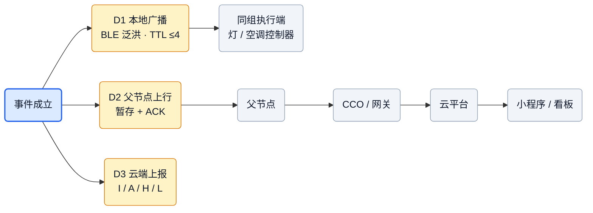

| 通道       | 目的          | 典型时延                                   | 确认语义             | 失败处理                               |
| -------- | ----------- | -------------------------------------- | ---------------- | ---------------------------------- |
| D1 本地广播  | 让灯立刻动，不等网络  | ≤300 ms（4 跳内）                          | 执行端短 ACK = 指令已收到 | 重播 2 次（间隔随机 20～50 ms）；3 次无确认报 E606 |
| D2 父节点上行 | 把事件交进网络，不丢  | 1 个唤醒窗口内                               | 父节点 ACK = 已进暂存队列 | 未 ACK 则本地保留，下次唤醒重传                 |
| D3 云端上报  | 可统计、可追溯、可配置 | I ≤1 s / A 15 min～24 h / H 随心跳 / L 不上报 | 设备侧投递完成          | 按档缓存补报；溢出报 E508                    |

**最容易埋的坑**：父节点 ACK ≠ 云端已入库。父节点到 CCO 是多跳，暂存溢出还会丢。因此每条事件带递增 `evtSeq`/`eventId`，云端做序号连续性校验，发现空号即请求补报。

| ID     | 需求描述                                                             | 优先级 | 验收口径                                |
| ------ | ---------------------------------------------------------------- | --- | ----------------------------------- |
| FR-201 | 三条通道独立调度、独立记录，任一通道故障不得影响另两条。                                     | P0  | 注入父节点离线 / 广播全丢 / 云端断链，其余通道功能与记录不受影响 |
| FR-202 | 本地广播承载：BLE 广播报文携带组 ID、动作码、`evtSeq`、需确认标志与时间戳；执行端按 `evtSeq` 去重。   | P0  | 重播 3 次，执行端只动作 1 次、计时不重置             |
| FR-203 | 上行事件带唯一 `eventId`，重传、补报、换父沿用原值；云端按编号只入库一次。                       | P0  | 500 次重复投递，云端仅 1 条记录                 |
| FR-204 | 网络角色固定：`devClass=HARVEST_LEAF`、`canRelay=false`、`maxHopDepth=3`。 | P0  | 拓扑中永不为父节点                           |
| FR-205 | 单父节点直挂 ≤8 台；8 台同时上报 1 s 内确认，丢包 <1%；唤醒窗口 100～500 ms 可配。           | P0  | 满载与第 9 台被拒的场景分别验证                   |
| FR-206 | 父节点失联后先重连原父节点，失败则挂兼容且有余量的父节点，≤3 min 完成重挂载并更新路由。                  | P0  | 断父节点后计时；换父后事件按原 `eventId` 上报        |

#### 4.2.2 BLE 链路安全

| 层    | 措施                                          | 说明                    |
| ---- | ------------------------------------------- | --------------------- |
| 身份   | 一机一密：出厂注入设备专属密钥/证书，机身码与密钥绑定                 | 扫码照片、相同 MAC 都不能单独通过鉴权 |
| 配对   | 连接链路启用 LE Secure Connections 配对与绑定，密钥存于受保护区 | 未配对设备不得读写配置           |
| 链路保护 | 已配对连接使用协议栈 AES-CCM 加密；应用层再做一层认证加密           | 防中间人、防篡改              |
| 广播保护 | 无连接的本地广播本身不加密，业务载荷由固件先加密并附校验后再发出            | 接收端校验不通过直接丢弃          |
| 防重放  | 受保护的会话序号/计数器 + 绑定代次 + 时间戳窗口；重启、换父、换绑后旧包失效   | 一条指令只生效一次             |
| 密钥管理 | 按设备 / 项目 / 组 / 用途隔离；支持轮换、失效、版本切换            | 普通日志禁止出现密钥与配网凭据       |

| ID     | 需求描述                                                    | 优先级 | 验收口径                    |
| ------ | ------------------------------------------------------- | --- | ----------------------- |
| FR-207 | 设备↔父节点、设备↔执行端、近场维护三条链路均须提供机密性、来源认证与完整性校验；校验失败即拒绝并保持原状态。 | P0  | 逐段抓包：未授权方读不出业务内容；篡改报文被拒 |
| FR-208 | 拒绝明文降级：加密协商失败不得回退到明文传输。                                 | P0  | 强制协商失败，连接被断开而非降级        |
| FR-209 | 接收端校验发送者、授权组、时效凭据后才执行；旧包、重复包不得开关灯、续计时、改配置或新增记录。         | P0  | 重放 100 次历史帧，动作次数为 0     |
| FR-210 | 近场维护会话独立鉴权、独立权限、限时有效（≤30 min），到期自动退出并恢复原策略。             | P0  | 超时后连接被拒；退出后策略回读一致       |
| FR-211 | 调试口与产测接口量产关闭；日志、事件、上报报文均不含密钥与凭据。                        | P0  | 出厂固件扫描 + 日志抽样检查         |

#### 4.2.3 报文与字段约定

| 字段        | 用途            | 约束                               |
| --------- | ------------- | -------------------------------- |
| `eventId` | 上行事件唯一标识      | 重传/补报/换父不变；云端按此去重                |
| `evtSeq`  | 灯侧联动去重序号      | 单调递增，按设备维度校验连续性                  |
| `ts`      | 事件发生时间（设备本地秒） | 与 `bootId` 组合，用于还原 UTC           |
| `bootId`  | 本次开机标识        | 跨重启排序与回填的边界                      |
| `tsConf`  | 时间可信度         | `valid` / `restored` / `unknown` |
| `actId`   | 动作指令 ID       | 同一动作多目标投递时用于核对重复                 |

### 4.3 BLE 组网与鉴权（FR-3xx）

**要点**：两条入网路径，一套鉴权标准。路径决定"谁发起"，鉴权决定"能不能进"。

#### 4.3.1 两条组网路径

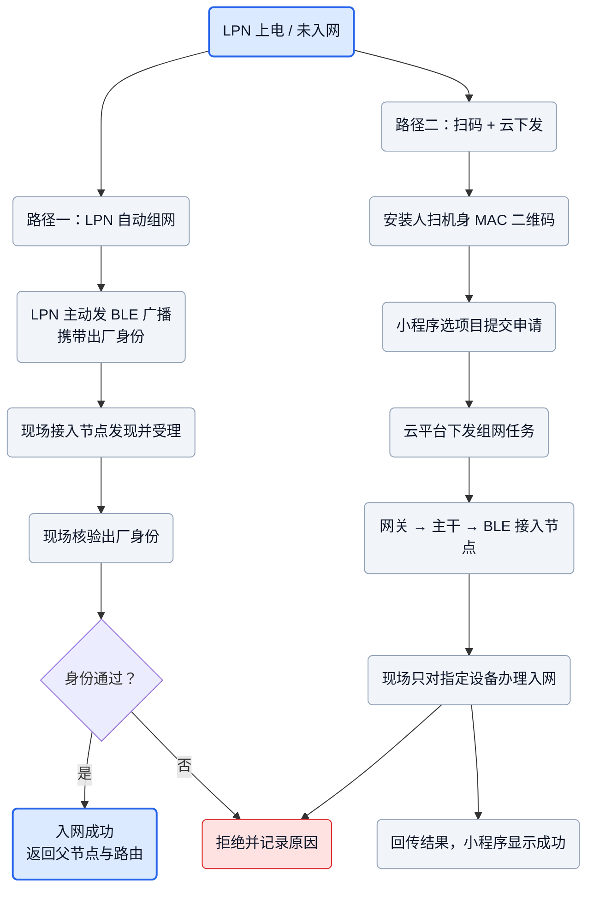

| ID     | 需求描述                                                          | 优先级 | 验收口径                         |
| ------ | ------------------------------------------------------------- | --- | ---------------------------- |
| FR-301 | **路径一（本地自动组网）**：未入网 LPN 主动广播，由具备接入资格的现场节点受理；公网断开但现场链路正常时仍可完成。 | P0  | 断公网，10 台设备均成功入网              |
| FR-302 | **路径二（扫码 + 云下发）**：扫码 → 选项目 → 云端下发组网任务 → 现场针对指定设备入网 → 结果回传。    | P0  | 端到端 ≤60 s；小程序显示"组网成功"以现场结果为准 |
| FR-303 | 两条路径使用同一套入网鉴权与同一条事件通道，入网后行为完全一致。                              | P0  | 两种方式入网的设备，事件与配置行为逐项比对一致      |
| FR-304 | 扫码任务超时未完成时，允许退回本地组网路径（需授权）。                                   | P1  | 超时后切换路径，最终入网成功               |

#### 4.3.2 三重鉴权：人、设备、点位

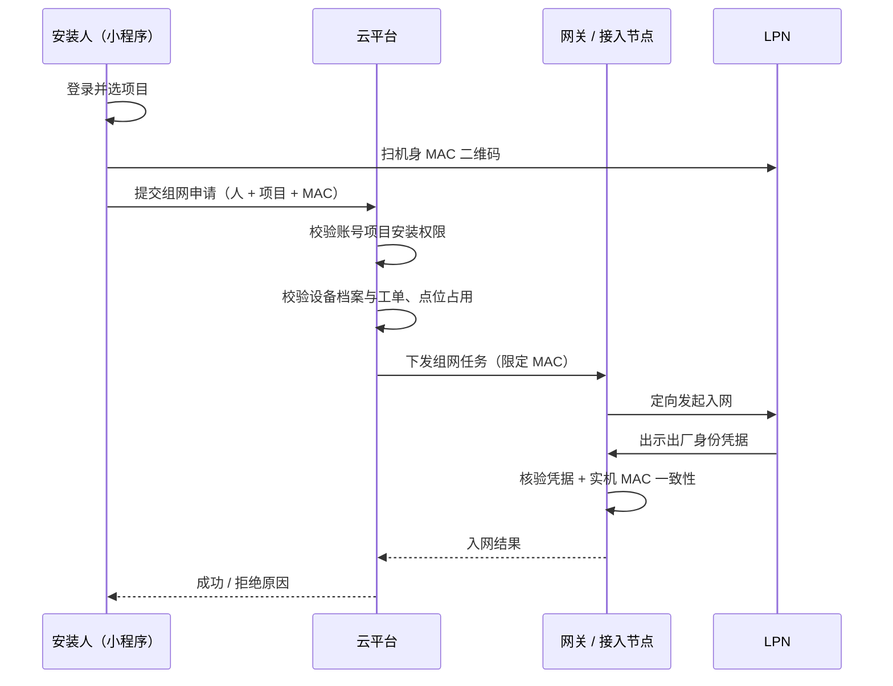

| ID     | 需求描述                                                            | 优先级 | 验收口径                   |
| ------ | --------------------------------------------------------------- | --- | ---------------------- |
| FR-305 | **人**：账号须具备目标项目安装权限，否则申请直接结束并提示原因。                              | P0  | 无权限账号申请 100% 被拒        |
| FR-306 | **设备**：核验出厂身份凭据 + 实机 MAC 与扫码 MAC 一致；照片、复制 MAC、非澜潮设备均拒绝。         | P0  | 扫 A 装 B 场景 100% 拦截     |
| FR-307 | **点位**：云端校验项目归属、点位范围、是否被占用；身份通过但白名单未通过时标"待核"，不得输出联动指令。          | P0  | 待核设备不能开灯；纠正后可重新绑定      |
| FR-308 | 组网状态可查：未配网 / 发现 / 鉴权中 / 入网 / 待绑定 / 在线 / 离线或未知 / 重新入网，并记录最后失败原因。 | P0  | 八种状态均可构造并正确显示          |
| FR-309 | 离线扫码可暂存，联网复核后放行；同笔申请只建一次绑定，重试结果一致。                              | P1  | 断网扫码 10 单，恢复后批量提交无重复绑定 |

#### 4.3.3 失败处理与容量

| 情形         | 处理              | 用户可见             |
| ---------- | --------------- | ---------------- |
| 身份核验失败     | 拒绝入网，记录阶段与脱敏结果  | "设备身份核验失败，请核对铭牌" |
| 白名单未通过     | 允许入网但标"待核"，禁止联动 | "点位待核，暂不参与联动"    |
| 父节点满载（8 台） | 拒绝并建议迁移或增补父节点   | "父节点已满，请调整点位"    |
| 父节点失联      | ≤3 min 重挂兼容父节点  | "已切换上级设备"        |
| 弱光无法冷启动    | 提示先 USB 补能再入网   | "请先补能至 3 V 以上"   |

### 4.4 事件机制（FR-4xx）

**要点**：一条没有明确触发条件的事件等于没有定义。所以每条事件必须写清"什么时候产生、发给谁、要不要确认、丢了怎么办"。

#### 4.4.1 事件生成原则

- **可判定**：触发条件必须是可测的状态或计数，例如"最后一次 PIR 触发后满 T_leave 无新触发"，而不是"人好像走了"。
- **可追溯**：记录源设备、类型、`eventId`、发生时间、测量值与原因；转发时保留原始来源与发生时间。
- **三态**：人员状态只有"有人 / 无人 / 未知"，数据不足时必须记"未知"，不得默认"无人"。
- **单次生效**：状态变化只记一次；持续维持同一状态时更新快照或做周期统计，不重复产生事件。

#### 4.4.2 事件分类

| 编号段  | 类别      | 典型事件                                | 是否可禁用    |
| ---- | ------- | ----------------------------------- | -------- |
| E1xx | 移动检测    | 有人进入、有人离开、抖动异常、停留统计、疑似失效            | 主干不可禁用   |
| E3xx | 能源与电源   | 采能恢复、能量不足、能量临界、临终上报、上电启动、超容欠压       | 底线类不可禁用  |
| E4xx | 自检与安防   | 周期自检、PIR 自检失败、**离墙/脱落**、探测窗遮挡       | 安防类不可禁用  |
| E5xx | 生命周期与运维 | 上线、补报、入网完成、配置生效/拒绝、OTA 状态、时钟偏差、缓存溢出 | 完整性类不可禁用 |
| E6xx | 光照与联动   | 照度阈值穿越、联动反馈、免开灯生效、照明回路疑似故障、联动确认超时   | 多数可禁用    |

#### 4.4.3 上报方式四档

| 档位  | 方式  | 时延                                              | 设备行为               | 适用             |
| --- | --- | ----------------------------------------------- | ------------------ | -------------- |
| I   | 即时  | ≤1 s                                            | 立即组帧发出，按配置重传 0～2 次 | 安全类、故障类、必须实时可见 |
| A   | 聚合  | 15 min / 30 min / 1 h / 2 h / 6 h / 12 h / 24 h | 写环形缓存，到期打包         | 统计类、业务主事件的云端记录 |
| H   | 随心跳 | 跟随心跳周期 300～1800 s                               | 挂在心跳帧中捎带，最省电       | 低频状态类          |
| L   | 仅本地 | 不上报                                             | 只记本地，可由诊断快照读出      | 调试类、高频低价值      |

**聚合不是丢弃，是延迟**：聚合类事件仍完整记录在本地缓存，周期到达打包上报；期间若发生更高优先级事件，打包一并提前发送。

#### 4.4.4 确认、缓存与补报

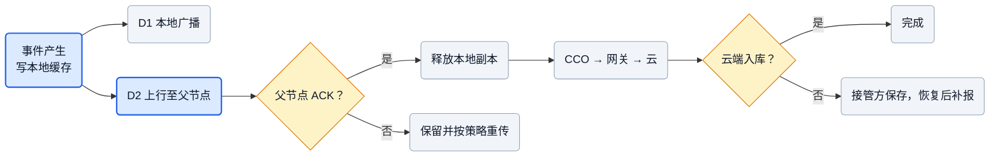

| ID     | 需求描述                                                     | 优先级 | 验收口径                             |
| ------ | -------------------------------------------------------- | --- | -------------------------------- |
| FR-401 | 每条事件独立配置：启用状态、本地是否广播、是否需执行端/父节点确认、云端上报档位、聚合周期、单包条数、重传次数。 | P0  | 逐条可配、可读回；硬约束项拒绝禁用并回具体原因码         |
| FR-402 | 关键事件与配置回执锁定为不可禁用、必须确认、即时上报。                              | P0  | 尝试禁用全部被拒（E505）                   |
| FR-403 | 断链缓存目标 ≥256 条（环形，按时间淘汰）；容量与断链时长在型号层面明确承诺。                | P1  | 断网 24 h 恢复后完整率 100%（日均 ≤300 条场景） |
| FR-404 | 恢复后分批补报：实时关键事件优先，历史按原发生时间与可信度排序，沿用原 `eventId`。           | P0  | 补报排序正确率 100%；旧事件不触发现场动作          |
| FR-405 | 缓存溢出必须计数并上报丢弃条数（E508），供平台核对记录缺口。                         | P1  | 产生/送达/丢弃三者可对账                    |
| FR-406 | 关闭某可选事件后，采样、心跳、快照与其他事件继续运行；平台提示受影响的联动规则。                 | P0  | 关闭 E601 后，E101/E105 与心跳正常        |

#### 4.4.5 关键事件（节选，全量见附录 8.1）

| 编号       | 事件        | 触发条件                         | 本地     | 云端       | 可禁用 |
| -------- | --------- | ---------------------------- | ------ | -------- | --- |
| E101     | 有人进入      | 无人态下 PIR 触发，立即置"有人"          | 广播+灯确认 | A 15 min | 否   |
| E102     | 设备心跳      | 按周期发送，携带状态与供电源               | 不广播    | H        | 是   |
| E105     | 有人离开      | 最后一次 PIR 触发后满 T_leave 无新触发   | 广播+灯确认 | A 15 min | 否   |
| E109     | 滞留超时      | 布防时段内连续存在 ≥T_loiter          | 不广播    | I        | 否   |
| E110     | 状态抖动异常    | 1 min 内翻转 ≥10 次，指向安装位置不当     | 不广播    | A 1 h    | 是   |
| E113     | PIR 疑似失效  | 采集与通信正常但连续 N 天零触发            | 不广播    | I        | 否   |
| E304     | 临终上报      | 触及预留储备门限，发末次状态               | 不广播    | I        | 否   |
| E305     | 上电启动      | 贴装下压或复位，携带 `bootCause`       | 不广播    | I        | 否   |
| E311     | 超容欠压      | 2.7 V 预警 / 2.5 V 保护          | 不广播    | I        | 否   |
| **E407** | **离墙/脱落** | 背部开关弹起（设备离开安装面）              | 广播警示   | I        | 否   |
| E504     | 配置生效      | 参数下发并通过校验，含实际执行值             | 不广播    | A 1 h    | 是   |
| E506     | OTA 状态    | 下载/校验/安装/成功/失败/回滚            | 不广播    | I        | 是   |
| E507     | 时钟偏差      | 校时修正量                        | 不广播    | H        | 是   |
| E508     | 缓存溢出      | 环形队列满并丢弃                     | 不广播    | I        | 否   |
| E605     | 照明回路疑似故障  | 开灯后 T_check 内照度未按预期上升，连续 2 次 | 不广播    | I        | 是   |
| E606     | 联动确认超时    | 本地广播重播 2 次仍无执行端确认            | 不广播    | A 1 h    | 否   |

### 4.5 心跳机制（FR-5xx）

**要点**：心跳只解决一件事——把"真没人"和"设备失联"分开。没有心跳，平台看到"无人"根本不知道是人走了还是设备死了。

| ID     | 需求描述                                                        | 优先级 | 验收口径            |
| ------ | ----------------------------------------------------------- | --- | --------------- |
| FR-501 | 入网后按实际生效周期向父节点发送心跳，长时间无人员活动也照发。                             | P0  | 连续 7 天无人，心跳无中断  |
| FR-502 | 标准档 300～1800 s 可配；低功耗保活档以 2 h 为候选（需单独签核）；低电时按能源策略延长并上报实际周期。 | P0  | 平台显示周期 = 设备实测周期 |
| FR-503 | 心跳帧可捎带 H 档事件与当前供电源、能源等级、配置版本。                               | P0  | 抓包核对载荷字段完整      |
| FR-504 | 心跳与协议保活分离：心跳是业务状态记录，保活是链路可达性交互，二者不得互相替代。                    | P0  | 关闭心跳上报后保活仍正常    |

| 情形                | 判定规则           | 平台展示                |
| ----------------- | -------------- | ------------------- |
| 收到实时有效消息          | 立即刷新"最近有效通信时间" | 在线                  |
| 漏收 1～2 个周期        | 保持在线           | 在线（标注最近通信时间）        |
| 连续 3 个应到周期未收到     | 判离线（留出收发时间余量）  | 离线                  |
| 父节点失联 / 云端拿不到现场判定 | 不猜测            | **状态未知** + 最近有效通信时间 |
| 重新收到实时消息          | 恢复在线           | 在线；补发的旧心跳只进历史       |

| ID     | 需求描述                                 | 优先级 | 验收口径                 |
| ------ | ------------------------------------ | --- | -------------------- |
| FR-505 | 断公网时父节点继续完成现场保活与离线判断，恢复后平台按最新现场结果更新。 | P0  | 断云 30 min，现场判定不停     |
| FR-506 | 在线状态与人员状态分开展示，不得用一个字段表达两件事。          | P0  | 设备在线但人员未知时，两个维度分别正确  |
| FR-507 | 补报的旧心跳不得让设备"假上线"，只有实时有效通信才恢复在线。      | P0  | 先送旧心跳再生效实时心跳，仅后者改变状态 |

### 4.6 时间同步与时间戳（FR-6xx）

**要点**：设备会长时间休眠、会断电、会跨日，本地时钟必然漂。所以不追求"设备时间一直准"，而是保证每条事件都能被还原到真实的 UTC 时刻。

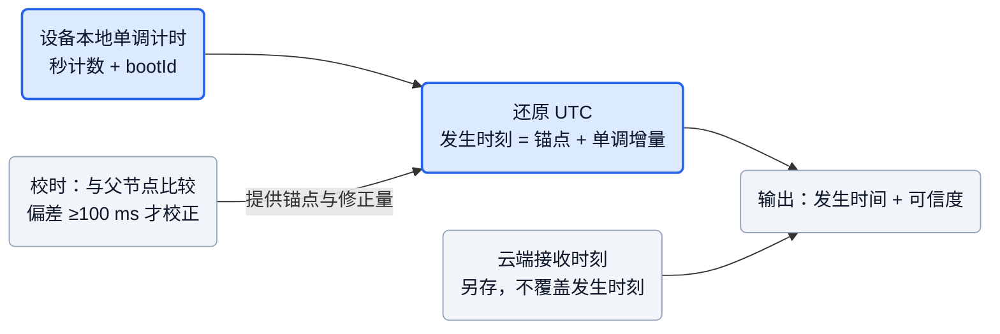

| ID     | 需求描述                                                       | 优先级 | 验收口径                          |
| ------ | ---------------------------------------------------------- | --- | ----------------------------- |
| FR-601 | 设备持续维护本地计时与本次开机标识；事件发生时记录本地时刻，不依赖当前是否已校时。                  | P0  | 断网 24 h 的事件仍带本地时刻             |
| FR-602 | 唤醒后向父节点对时；偏差 <100 ms 保持原值，≥100 ms 才校正，并记录修正量（E507）。        | P0  | 90 ms 不触发、110 ms 触发；校后 <20 ms |
| FR-603 | 事件报文与 BLE 通信报文均携带时间戳字段（`ts` + `bootId` + `tsConf`），供接收端还原。 | P0  | 逐条事件抓包可见三字段                   |
| FR-604 | 发生时间由接入端按对时记录还原为 UTC，云端另记接收时间，两者分别保存。                      | P0  | 补报事件排序正确率 100%                |
| FR-605 | 时间不可信（未校时、跨重启、跨日缺日期、误差超预算）时标记为未知或降级，并暂停依赖绝对时间的规则。          | P0  | 构造五种场景，均可看出"为什么不可信"           |
| FR-606 | 换电池、复位、换父后必须重新校时；恢复后按当前输入重判，过期动作只留历史。                      | P0  | 换电重启后时间与规则状态正确                |

### 4.7 OTA 升级（FR-7xx）

**要点**：休眠设备不能保持长连接下载，OTA 必须"父节点囤货、设备蚂蚁搬家"，并且随时可断、可续、可回滚。

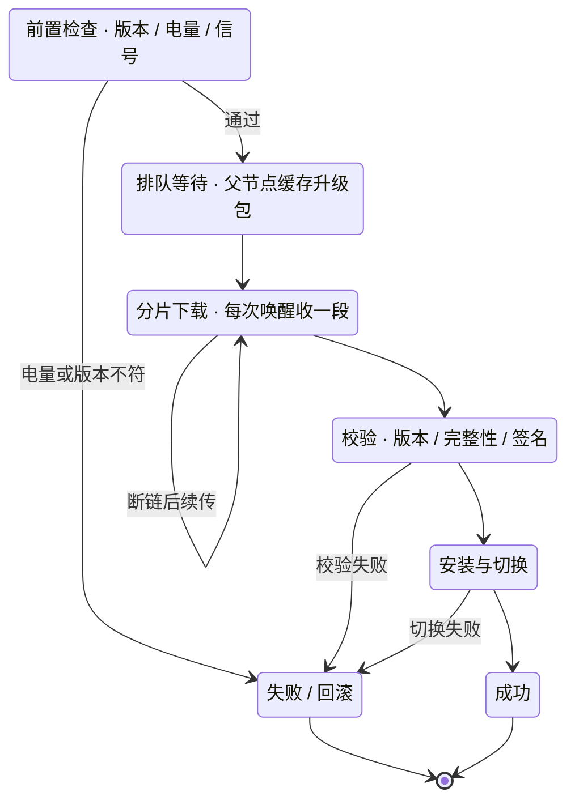

| ID     | 需求描述                                        | 优先级 | 验收口径                   |
| ------ | ------------------------------------------- | --- | ---------------------- |
| FR-701 | 升级前校验版本匹配、能量余额、链路质量；不满足则拒绝并回明确原因码，恢复后可重新申请。 | P0  | 低电设备申请升级，平台读到明确拒绝码     |
| FR-702 | 父节点缓存匹配升级包，设备每次唤醒接收一段，支持断点续传。               | P1  | 传输中断 5 次后仍能完成          |
| FR-703 | 升级不得丢失配置、标定与绑定关系；算法类变更需说明哪些标定可迁移、哪些须重标。     | P0  | 升级前后读回配置与标定逐项比对        |
| FR-704 | 支持按项目/批次灰度升级，逐台显示进度与结果；失败率超门槛自动停止派发新任务。     | P1  | 同批构造低电、版本不符、断链，行为符合预期  |
| FR-705 | 升级过程与结果记录为 E506，失败与回滚强制上报。                  | P0  | 六种状态均可复现并上报            |
| FR-706 | 升级失败必须能回到可工作版本并重新入网，不得变砖。                   | P0  | 传输阶段与切换阶段各断电 50 次，均可恢复 |

### 4.8 运维与云端超管（FR-8xx）

**要点**：设备装在天花板上，人上不去。所以平台必须能在设备在线时"远程动手"，但这类能力等价于 root 权限，必须带闸门。

| 级别    | 能力                 | 典型操作                    | 授权要求        |
| ----- | ------------------ | ----------------------- | ----------- |
| L0 只读 | 看状态、看事件、看诊断快照      | 查人员状态、电量、信号、最近事件        | 项目只读权限      |
| L1 配置 | 改参数、改上报策略、应用模板     | 改 T_leave、灵敏度、上报档位、组 ID | 项目管理员       |
| L2 诊断 | 触发自检、抓运行日志、强制心跳    | 定位"为什么不报事件"             | 运维工程师       |
| L3 超管 | 远程重启、清缓存、强制复位、解除绑定 | 救活"假死"设备                | 双人复核 + 限时会话 |

| ID     | 需求描述                                                     | 优先级 | 验收口径                     |
| ------ | -------------------------------------------------------- | --- | ------------------------ |
| FR-801 | 支持远程强制心跳：立即唤醒并上报一帧完整状态，用于确认设备是否真在线。                      | P0  | 下发后 ≤1 个唤醒窗口收到           |
| FR-802 | 支持远程拉长唤醒窗口（临时，≤30 min），用于批量下发配置或抓日志。                     | P0  | 到期自动恢复原窗口                |
| FR-803 | 支持远程重启与强制复位；重启前后记录原因、时间与操作人。                             | P0  | 100 次远程重启无变砖、配置不丢        |
| FR-804 | 支持远程清理事件缓存（须先导出或确认丢弃条数），清理动作计入 E508 对账。                  | P1  | 清理后平台可见丢弃计数              |
| FR-805 | 支持远程读取诊断快照：PIR 状态、电源、照度、最近 8 条事件、当前策略摘要、离墙状态。            | P0  | 快照字段与本地一致                |
| FR-806 | 支持远程触发一次 PIR 自检，结果回传。                                    | P1  | 触发后 60 s 内出结果            |
| FR-807 | 超管会话限时（≤30 min）、一次一授权、全程审计；不得突破能量底线与安全事件锁。               | P0  | 会话过期后再下发被拒；审计可查操作人/时间/参数 |
| FR-808 | 近场维护（BLE GATT）提供同等能力子集：读状态、改参数、触发自检、导出日志。                | P0  | 现场无网时可用；配置 ≤3 min 完成     |
| FR-809 | 本地改参后进入"待确认"：授权人确认才固化为基线；72 h 未确认告警，7 天自动回退，回退前 24 h 通知。 | P0  | 三态流转正确，回退可复现             |

**为什么超管必须带闸门**：这类能力可以"让一台设备看起来正常工作"，也可以"让一台设备永远不报警"。一旦被滥用，故障会被掩盖而非暴露。所以：能力开放给运维，权限收在审计里。

### 4.9 生态设备联动策略（FR-9xx）

**要点**：本机不控灯，只给结论。结论怎么用，由同组的策略决定；但"人来了要亮"这件事不能等云端。

#### 4.9.1 联动数据源与对象

| 数据源            | 用途                  | 更新频率        |
| -------------- | ------------------- | ----------- |
| 人员状态（有人/无人/未知） | 开灯、关灯、空调启停          | 变化即发        |
| 照度             | 是否需要开灯、白天免开灯、开灯效果校验 | 阈值穿越 + 周期快照 |
| 停留时长           | 长时占用加严、安防滞留告警       | 周期统计        |

| 执行端    | 可执行动作             | 确认方式             |
| ------ | ----------------- | ---------------- |
| 智慧灯具   | 开、关、调光百分比、场景切换、色温 | 短 ACK + 照度变化（可选） |
| 空调控制器  | 开机、关机、温度设定、风速档    | 设备回执（能力而定）       |
| 其他生态设备 | 按其能力集开放           | 以兼容清单为准          |

#### 4.9.2 联动决策流程

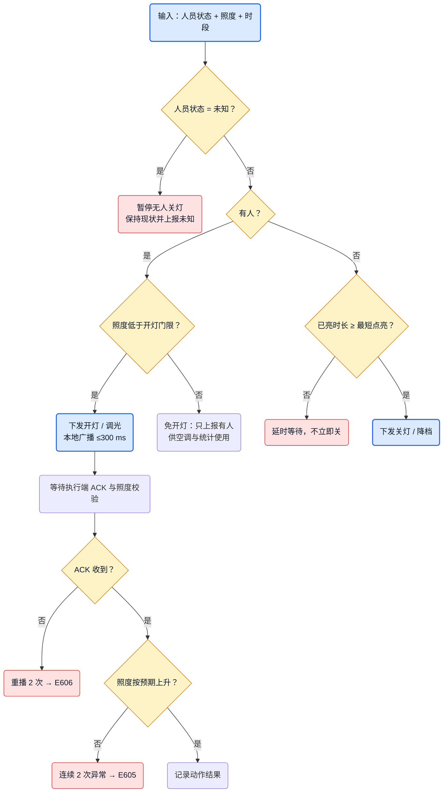

#### 4.9.3 联动需求

| ID     | 需求描述                                                   | 优先级 | 验收口径                    |
| ------ | ------------------------------------------------------ | --- | ----------------------- |
| FR-901 | 本地联动不经父节点、不经云端：有效新鲜事件由 BLE 广播直达同组执行端。                  | P0  | 断云 30 min 内本地联动可用率 ≥95% |
| FR-902 | 支持组 ID 槽位管理，一台设备可参与多个组的多条策略；组内目标数与槽位数以样机满配验证。          | P1  | 满配无丢失                   |
| FR-903 | 策略要素：时段 + 照度门限（含 20% 滞回）+ 人员状态 + 无人延时 + 最短点亮时长 + 目标动作。 | P0  | 六个要素任意组合均可生效、可读回        |
| FR-904 | 撤灯前检查已亮时长，默认至少亮满 10 s，避免"刚亮就灭"的可见闪烁。                   | P0  | 无可见闪灯                   |
| FR-905 | 照度联动只用同组已标定的有效参考点；多点时按签核规则选点或取中位数；无效点退出联动与统计。          | P0  | 摘除参考点后策略按失效规则保持，不误动作    |
| FR-906 | 手动接管优先：识别到人工操作后暂停自动控制并继续感知，结束后按当前有效输入重评。               | P0  | 手动开灯后自动策略不立即关闭          |
| FR-907 | 每条动作记录规则版本、来源、目标、指令 ID、受理与实动证据、失败原因与耗时；多目标分别记录。        | P0  | 一次联动涉及 3 个目标，可分别追溯      |
| FR-908 | 空调联动以"存在 + 停留时长"为主判据，避免短时经过触发启停；启停最小间隔可配。              | P1  | 短时经过不启停；最小间隔生效          |

**走廊场景的联动原则**（与 SKU2 的差别）：本机触发的是"经过"，不是"停留"。所以默认策略应偏向"快开、短延时、可重复触发"，而不是"长时间保持"。把 T_leave 调到 15 min 来掩盖误关灯，会让节能率回落到 30% 以下——那是把产品做成了定时开关。

### 4.10 PIR 移动检测（FR-10xx）

**要点**：只有一路 PIR，没有第二路可以做交叉验证。所以判断必须"快进、慢出"：触发立刻算有人，判无人要等满延时且没有任何新触发。

#### 4.10.1 核心参数

| 参数      | 取值             | 定义与约束                              |
| ------- | -------------- | ---------------------------------- |
| T_leave | 10 s～30 min 可配 | 从最后一次 PIR 触发开始计时，期间无新触发即到期判无人；断电保持 |
| pirSens | 1～5 档          | 触发阈值档位，对应感应距离约 2～8 m；低电自动降档        |
| 触发去抖    | 固定             | 单次噪声不计入，须连续两个有效脉冲才判定为一次移动          |
| T_minOn | 默认 10 s        | 灯侧兜底，避免刚关又开造成闪灯                    |

#### 4.10.2 状态机

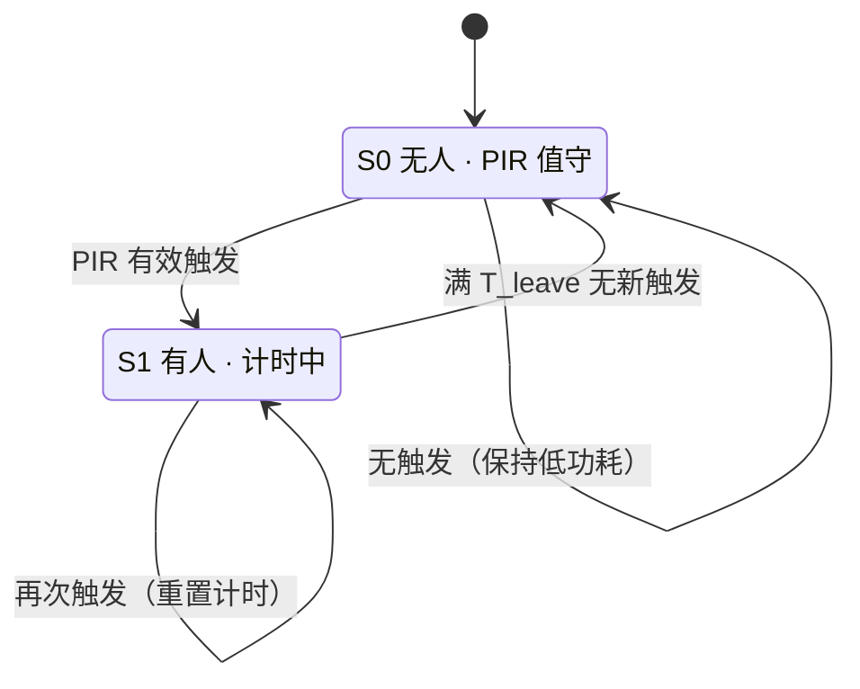

状态只有两个，逻辑只有一条：**有触发就刷新计时器，没触发就等它到期**。

#### 4.10.3 检测需求

| ID      | 需求描述                                                  | 优先级 | 验收口径                                 |
| ------- | ----------------------------------------------------- | --- | ------------------------------------ |
| FR-1001 | PIR 7×24 常开值守，可唤醒深睡主控；无触发时主控保持深睡。                     | P0  | 无人态整机 ≤11 µA；PIR 唤醒成功率按高低温各测         |
| FR-1002 | 移动检出：检测到有效移动即翻转"有人"，并上报 E101、本地联动开灯。                  | P0  | 3 m 高、0.5～1.5 m/s 径向穿越 100 次，漏检 ≤1 次 |
| FR-1003 | 触发去抖：单次噪声不翻转；连续两个有效脉冲才计一次移动，抑制电源与射频干扰导致的误触发。          | P0  | 注入单脉冲干扰 100 次，0 次误开灯                 |
| FR-1004 | 无人延时：每次有效触发重置 T_leave；到期且无新触发才上报 E105 并关灯。            | P0  | 计时误差 ≤±1 s；断电后值不丢                    |
| FR-1005 | 灵敏度 1～5 档可配，断电保持；形态 C 可上调一档，低电自动降档并回读。                | P1  | 五档均生效并读回；低电降档可复现                     |
| FR-1006 | PIR 故障：自检失败或长期零输出时报 E403/E113，标"检测不可用"；不得静默降级为"永远无人"。 | P0  | 贴镜片/开路后按配置天数内上报                      |
| FR-1007 | 抖动自检：1 min 内状态翻转 ≥10 次报 E110，提示检查安装位置或灵敏度。            | P1  | 对出风口/阳光直射安装可稳定触发                     |
| FR-1008 | 停留时长统计：一个完整"有人"周期结束时汇总本次持续时长，随 E105 携带或周期聚合。          | P2  | 时长与实测一致（±1 s）                        |
| FR-1009 | 触发计数与最近触发时刻记录，供诊断读取。                                  | P2  | 累计计数正确，掉电不清零（或按约定清零）                 |
| FR-1010 | 覆盖角对外表述为 **有效触发角 120°**，不承诺 150° 或"全向"。               | P0  | 逐 15° 实测，边界处触发率 ≥90%                 |

#### 4.10.4 两个必须承认的边界

| #   | 边界          | 现场表现                            | 处置                                                   |
| --- | ----------- | ------------------------------- | ---------------------------------------------------- |
| 1   | 静坐即判无人      | 人坐下不动超过 T_leave 会关灯，人再动才重新开灯    | T_leave 按场景配置（走廊 30 s、大厅 60 s）；规格书明示；需静止保持的场景改选 SKU2 |
| 2   | PIR 失效即整机失效 | 镜片被贴、信号链开路时产品彻底失效且不自知（无第二路交叉验证） | 6 h 自检 + 连续 N 天零触发判疑似 + 安装期遮挡可发现 + 后台批量自检            |

> 请在投标与方案文档中主动写明：本产品不承诺"在完全无活动的空间中长期检测人的存在"，且 120° 之外的环带不能作为设计覆盖使用。事前说明的成本远低于事后解释。

### 4.11 选点需求（FR-11xx）

**要点**：这类设备最大的返工来源不是硬件坏，而是**装错位置**——装太高漏检、正对空调误触发、背光导致电池亏电。选点要在"贴上去之前"用设备自己的数据判定。

#### 4.11.1 选点三阶段

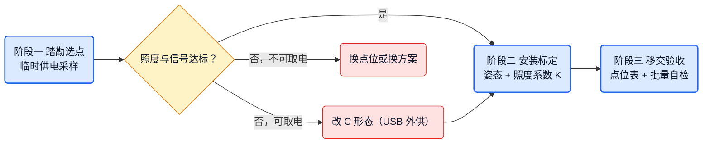

#### 4.11.2 选点数据项

| 数据项            | 采集方式                  | 用途                     | 判定门槛（候选）         |
| -------------- | --------------------- | ---------------------- | ---------------- |
| 照度均值 / 最小 / 最大 | 选点模式连续采样 ≥60 s        | 判断能否自持、能否支撑免开灯         | 日均 ≥30 lx 为候选门槛  |
| 有效光时           | 按 ≥门槛照度的累计小时数         | 估算日补能量                 | 与 4.1.5 平衡照度比对   |
| 预估日补能          | 照度—光伏输出曲线换算，再用超容电压校正  | 判断能否长期自持               | 补能 ≥ 日均消耗        |
| 到父节点信号         | 现场 RSSI / 入网质量        | 判断链路余量                 | 按签核门限            |
| 姿态与倾角          | App 选择 + 现场确认         | 决定距离-阈值映射              | 必填               |
| 动线类型           | 现场判定：快速通过 / 经停 / 可能滞留 | 决定 T_leave 与是否应改选 SKU2 | 必填               |
| 干扰源距离          | 出风口、阳光直射、热源、玻璃        | 判断误触发风险                | 出风口 ≥1.5 m，玻璃不正对 |

#### 4.11.3 选点需求

| ID      | 需求描述                                                               | 优先级 | 验收口径                        |
| ------- | ------------------------------------------------------------------ | --- | --------------------------- |
| FR-1101 | 提供"选点模式"：设备在待装位置连续采样照度、波动与信号，结果在 App 上以**结论**形式给出，而不是只给原始数字。       | P0  | 单点位选点 ≤60 s，输出结论            |
| FR-1102 | 选点结论分三档：**推荐**（可自持）/ **可用但需补能**（建议 USB 或缩短维护周期）/ **不推荐**（换点位或换方案）。 | P0  | 20 个背光/遮挡点位，判定与人工复核一致率 ≥90% |
| FR-1103 | 增加**场景适配判定**：若点位属于"人会长时间静止"（如工位、值班室），直接提示"应改用 SKU2 双鉴"，不推荐本机。      | P0  | 构造 10 个静坐场景点位，全部提示升级型号      |
| FR-1104 | 安装时完成照度标定：用工作面照度计与同一时刻原始值计算系数 K，保存原始值、修正值、K 版本与时间。                 | P0  | 标定后与标准仪器偏差在 ±15% 内          |
| FR-1105 | 标定时校验朝向：明显背光或被遮挡时直接提示，不允许"先装后补"。                                   | P0  | 人为背光安装，提示可复现                |
| FR-1106 | 选点数据与点位表绑定：楼层、房间、SKU、安装方式、高度、朝向、父节点、信号、标定、规则、验收结果。                 | P0  | 点位表可导出，字段完整                 |
| FR-1107 | 入网后 2 h 内批量自检并出返工清单：照度评估、能量基线、PIR 首触发、策略核对。                        | P0  | 异常设备、位置、原因三项齐全              |
| FR-1108 | 安装前读有效超容电压，<3 V 提示 USB 补能并复测。                                      | P0  | App 可见提示与指引                 |

### 4.12 离墙检测：设备被从墙上拿走（FR-12xx）

**要点**：本机没有独立防拆器件，而是**把电源开关做成防拆**。贴墙压合即通电，离墙弹起即断电——断电本身就是一个可靠的"被拿走"信号。难点不在检测，而在**断电前把话说完**。

#### 4.12.1 触发链

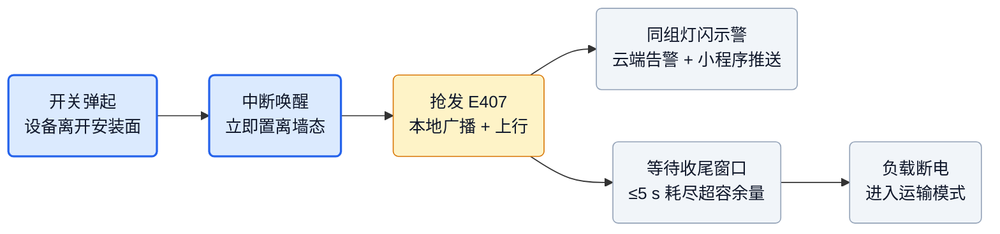

#### 4.12.2 离墙需求

| ID      | 需求描述                                               | 优先级 | 验收口径                 |
| ------- | -------------------------------------------------- | --- | -------------------- |
| FR-1201 | 背部开关须为 SPDT 轻触结构：贴墙压合导通，离墙弹起断开；弹起动作产生硬件中断，不依赖软件轮询。 | P0  | 分离后 ≤50 ms 产生中断；装配签核 |
| FR-1202 | 弹起后进入"收尾窗口"：利用超容余量维持 ≤5 s 供电，完成广播与一次上行后再断电；不得立即掉电。 | P0  | 20 次拔离，平台收到告警 ≥19 次  |
| FR-1203 | 上报 E407（即时档、不可禁用、必须 ACK），载荷带原因码区分"人为拆卸"与"贴装失效"。    | P0  | 20 次拆卸，原因码正确         |
| FR-1204 | 同时发本地广播警示（同组灯闪烁或提示），保证断网时现场也有反馈。                   | P0  | 断云状态下现场可见警示          |
| FR-1205 | 若收尾窗口内未能完成上行，按 Last Gasp 机制记入本地并尝试下一次开机补报。         | P0  | 拔离后重新贴装，历史补报可见       |
| FR-1206 | 支持布防/撤防：布防时段内才告警；撤防期间仅记录。默认全天布防。                   | P1  | 撤防时段拆卸不告警但留痕         |
| FR-1207 | 离墙状态参与运维展示：在位、离墙、已告警、未知四态，可在诊断快照读出。                | P0  | 四态均可构造并正确显示          |
| FR-1208 | 开关机械寿命 ≥5000 次，弹起/压合后接触电阻稳定；振动中不得自行弹起。             | P0  | 5000 次后复测；振动台验证      |
| FR-1209 | 离墙检测不得因低电、OTA、配置下发而失效；OTA 期间沿用原状态判断。               | P0  | 低电与升级期间拔离仍告警         |

**为什么"断电前把话说完"是核心难点**：开关一弹起，主供就断了，设备只剩超容里的余量。如果固件在弹起瞬间就进入关机流程，告警根本发不出去；如果为了发告警而死撑，又可能把超容放到保护点、导致下次贴装无法启动。所以必须给这段时间一个明确上限（≤5 s）与独立的能量预算，并把它写进硬件评审。

## 05 非功能需求

**要点**：功能决定"能不能用"，非功能决定"能不能卖"。本章每一条都要有实验室报告或实测证据，否则不得对外承诺。

### 5.1 安规（Safety）

| 编号      | 项目       | 依据标准                           | 要求                                            | 验收           |
| ------- | -------- | ------------------------------ | --------------------------------------------- | ------------ |
| NFR-101 | 整机安全     | GB 4943.1-2022（等同 IEC 62368-1） | 按 ES1 能量源设计；可触及部件无危险电压；外壳阻燃 ≥V-1（建议 V-0）      | 第三方报告        |
| NFR-102 | 超容储能安全   | 按元器件 + 整机能量评估                  | 20 F 超容储能量按 ES2 评估：端子防直接短路、防反接；维修/报废前须放电至安全电压 | 设计评审 + 短路试验  |
| NFR-103 | USB 输入安全 | GB 4943.1 + 整机                 | 5 V SELV 输入；限流 ≤300 mA；防反灌；劣质适配器不得损坏电路或起火     | 反灌与过流试验      |
| NFR-104 | 一次锂电池安全  | GB 8897.4（等同 IEC 60086-4）      | CR2450 具备防反充隔离、防短路；异常温升不得引燃外壳                 | 电池厂报告 + 整机温升 |
| NFR-105 | 温升       | GB 4943.1                      | 常温满载与 USB 边充边检工况下，可触及表面温升不超限值                 | 热电偶实测        |
| NFR-106 | 机械安全     | 整机                             | 无锐边、无夹手风险；支架承重 ≥3 倍整机重量；吊顶安装件防坠               | 拉力与结构评审      |
| NFR-107 | 开关安全     | SPDT 轻触                        | 额定负载下无粘连；弹起后可靠断开主回路，不出现"半导通"发热                | 寿命与温升联动测试    |
| NFR-108 | 标识与警示    | 整机                             | 铭牌含型号、电气参数、厂名、批次；电池与超容警示语；回收标识                | 铭牌评审         |

### 5.2 EMC（电磁兼容）

本机只有一处射频源（BLE）与一处弱信号（PIR 模拟前端），干扰压力比双鉴版小，但**PIR 前端的抗扰**才是难点——静电与射频干扰可能被误判为"移动"。

| 编号      | 项目          | 依据标准                            | 限值/要求                              |
| ------- | ----------- | ------------------------------- | ---------------------------------- |
| NFR-111 | 辐射骚扰        | GB/T 9254.1（等同 CISPR 32）Class B | 30 MHz～1 GHz、1～6 GHz 满足 Class B 限值 |
| NFR-112 | 传导骚扰        | GB/T 9254.1 Class B             | USB 供电经适配器时，电源端满足 Class B 限值       |
| NFR-113 | 谐波电流        | GB/T 17625.1                    | 若配套适配器功率 >75 W 需评估；本机本身不适用         |
| NFR-114 | BLE 杂散与占用带宽 | 按 SRRC 型号核准要求                   | 2.4 GHz 频段功率、占用带宽、带外发射满足微功率设备要求    |

| 编号      | 项目        | 依据标准          | 试验等级                          | 判定                                |
| ------- | --------- | ------------- | ----------------------------- | --------------------------------- |
| NFR-121 | 静电放电 ESD  | GB/T 17626.2  | 接触 ±4 kV，空气 ±8 kV             | 判据 B：允许暂时降级，可自恢复，不丢配置、**不误报"有人"** |
| NFR-122 | 电快速瞬变 EFT | GB/T 17626.4  | 电源端 ±2 kV，信号端 ±1 kV           | 判据 B；不误报                          |
| NFR-123 | 浪涌 Surge  | GB/T 17626.5  | 线-线 ±1 kV；配适配器时线-地 ±2 kV      | 判据 B；不得永久损坏                       |
| NFR-124 | 射频辐射抗扰 RS | GB/T 17626.3  | 80 MHz～1 GHz，3 V/m；1～6 GHz 加测 | 判据 A：不误触发、不误报离墙                   |
| NFR-125 | 射频传导抗扰 CS | GB/T 17626.6  | 0.15～80 MHz，3 V               | 判据 A                              |
| NFR-126 | 工频磁场      | GB/T 17626.8  | 3 A/m                         | 判据 A                              |
| NFR-127 | 电压暂降与短时中断 | GB/T 17626.11 | 按适配器工况；USB 插拔瞬断不得复位丢配置        | 判据 B                              |
| NFR-128 | 前端抗误触发    | 整机            | ESD/RS/EFT 试验期间，PIR 不得输出有效触发  | 三类试验各 20 次，误开灯 0 次                |

### 5.3 无线与频谱合规

| 编号      | 区域   | 项目         | 要求                                                   |
| ------- | ---- | ---------- | ---------------------------------------------------- |
| NFR-131 | 中国大陆 | SRRC 型号核准  | 2.4 GHz BLE 须取得无线电发射设备型号核准证                          |
| NFR-132 | 中国大陆 | 微功率设备技术要求  | 2.4000～2483.5 GHz 满足微功率短距离设备限值（本机无 24 GHz 通道，无需雷达核准） |
| NFR-133 | 中国香港 | 无线电管理      | 2.4 GHz 一般属免牌照类别；保留测试报告备查                            |
| NFR-134 | 通用   | 频率容限与功率稳定性 | 全温区频率偏移、功率波动在核准限值内                                   |
| NFR-135 | 通用   | 天线         | 板载天线，不可外接；不得用户自行更换（否则核准失效）                           |

> 相比 SKU2，本机**没有 24 GHz 频谱准入风险**——这是选型上实实在在的优势，也是向客户解释"为什么走廊用 SKU1 更稳"的一条硬理由。

### 5.4 合规（中国大陆 / 中国香港）

| 编号      | 区域  | 合规项   | 要求                                                    |
| ------- | --- | ----- | ----------------------------------------------------- |
| NFR-141 | 大陆  | 无线电   | SRRC 型号核准；铭牌标注核准代码                                    |
| NFR-142 | 大陆  | 有害物质  | 满足 GB/T 26572 限量要求，提供 RoHS 报告与符合性声明                   |
| NFR-143 | 大陆  | 电池    | 满足 GB 8897.4；提供 MSDS；不得使用汞、镉超限电池                      |
| NFR-144 | 大陆  | 数据与隐私 | 遵循《个人信息保护法》《数据安全法》《网络安全法》：只采集"有无人移动"与照度，不采集影像、音频、身份信息 |
| NFR-145 | 大陆  | 告知    | 安装在有人活动空间时，提供点位说明、隐私告知卡与物业公示模板                        |
| NFR-146 | 大陆  | 宣传口径  | 不得使用绝对化用语；不得宣称"静止存在检测"；节能率须标注工况与口径                    |
| NFR-147 | 香港  | 无线电   | 按 OFCA 要求确认免牌照条件；保留测试报告备查                             |
| NFR-148 | 香港  | 个人资料  | 遵循《个人资料（私隐）条例》（PDPO）：目的明确、最小必要、保留期不超必要                |
| NFR-149 | 香港  | 电气安全  | 参照 IEC 62368-1 体系；随货适配器符合当地安全要求                       |
| NFR-150 | 香港  | 标识    | 英文/繁体中文双语标识与警示语；电池回收说明                                |

### 5.5 环境与可靠性

| 编号      | 项目       | 要求                           | 说明                           |
| ------- | -------- | ---------------------------- | ---------------------------- |
| NFR-161 | 工作温度     | -10～55 ℃                     | 低温下 PIR 灵敏度下降，需在 -10 ℃ 复测检出率 |
| NFR-162 | 存储温度     | -20～70 ℃                     | 超容低温容量衰减、电池高温自放电需评估          |
| NFR-163 | 工作湿度     | 10%～90% RH（非凝露）              | 凝露会使 PIR 透镜起雾、误触发，本机不承诺凝露环境  |
| NFR-164 | 防护等级     | IP30（设计目标），IP20 为基础验证项       | USB 口与开关凹槽开盖状态不计入            |
| NFR-165 | 胶贴可靠性    | 常温 5 年不脱落；持粘力 ≥3 倍整机重量       | 乳胶漆/瓷砖/金属/木饰面四基材分别验证         |
| NFR-166 | 支架与安装件   | 振动中不松脱；吊顶安装需防坠结构             | 与开关压合行程联动设计                  |
| NFR-167 | 开关寿命     | ≥5000 次压合/弹起；老化后接触电阻 ≤300 mΩ | 镀金触点；振动中不得弹起                 |
| NFR-168 | USB 插拔寿命 | ≥500 次；长期插电 ≥2 年无异常          | 验证超容浮充寿命、发热、接口氧化             |
| NFR-169 | 包装跌落     | 按 ISTA 1A/2A 执行              | 开关与透镜为易损件，需单独评估              |
| NFR-170 | 外观隐私     | 整机无开孔、无镜头形态、无可见工作灯           | 盲测 10 人，≥9 人不认为是摄像设备         |

### 5.6 性能指标

| 编号      | 指标        | 口径                                | 目标值                    |
| ------- | --------- | --------------------------------- | ---------------------- |
| NFR-181 | 移动检出率     | 3 m 高、25 ℃、0.5～1.5 m/s 径向穿越 100 次 | >99%                   |
| NFR-182 | 进入响应时延    | PIR 有效触发 → 完成组帧并发空口               | P95 ≤300 ms            |
| NFR-183 | 本地联动时延    | E101 成立 → 同组执行端实动（4 跳内）           | P95 ≤300 ms；整体 ≤1 s    |
| NFR-184 | 云端路径时延    | 可消费事件 → 执行端下发                     | P95 ≤3 s               |
| NFR-185 | 空场误触发     | 无人 + 空调气流/窗帘 72 h                 | ≤1 次/24 h              |
| NFR-186 | 单脉冲抗扰     | 注入单次噪声脉冲 100 次                    | 误开灯 0 次                |
| NFR-187 | 无人态平均电流   | 无人 72 h，常温，200 lx 8 h/日           | ≤11 µA                 |
| NFR-188 | 有人活跃态平均电流 | 每分钟至少 1 次 PIR 触发                  | ≤12 µA                 |
| NFR-189 | 走廊日均电流    | 累计 3 h 有人                         | ≤9 µA                  |
| NFR-190 | 无光续航（仅超容） | 满电 3.5 V、无人态放电至保护点                | ≥30 天（20 F 实装核算）       |
| NFR-191 | 纯电池续航     | 完全无光、日均 ≤11 µA，50% 放电深度           | ≥2 年                   |
| NFR-192 | USB 补电时长  | 边充边检，2.5→3.5 V                    | <10 min                |
| NFR-193 | 形态切换时延    | 插/拔 USB 到行为切换完成                   | ≤5 s，检测不中断、不重启         |
| NFR-194 | 离墙待机电流    | 开关弹起，超容预充 3.5 V                   | ≤2.5 µA                |
| NFR-195 | 库存自放电     | 弹起状态静置 6 个月                       | 压降 <1 V（折算漏电 <1.29 µA） |
| NFR-196 | 校时精度      | 单跳 2.4 GHz                        | 门限 100 ms；校后 <20 ms    |
| NFR-197 | 唤醒窗口下行成功率 | 父节点在窗口内投递                         | ≥98%                   |
| NFR-198 | 配置回读一致率   | 逐条下发后读回（含实际执行值）                   | 100%                   |
| NFR-199 | 照度精度      | 0～2000 lux，标定后逐档验证                | ±15%                   |
| NFR-200 | 离墙告警时延    | 离开安装面 → 云端可见                      | ≤5 s（含收尾窗口）            |

### 5.7 寿命与可维护性

| 项     | 目标                           | 前提                  |
| ----- | ---------------------------- | ------------------- |
| 整机服务期 | 有条件的五年（检测可用率按场景核算）           | 允许按计划 USB 补能；不等于免维护 |
| 超容    | 5 年内可用能量衰减 ≤20%              | 避免长期满充高温            |
| 备用电池  | 走廊/大厅场景基本不消耗；低光场景 1.5～2 年需更换 | 更换后须校时并恢复配置         |
| 维护方式  | 远程诊断为主，USB 补能为辅，换机为兜底        | 90% 异常可远程判定         |

## 06 测试与验收

### 6.1 验收矩阵

| 域     | 覆盖需求                        | 关键用例                 | 通过标准                                |
| ----- | --------------------------- | -------------------- | ----------------------------------- |
| 组网与鉴权 | FR-301～FR-309               | TC-01～03、TC-35、TC-55 | 两条路径均可入网；无权限/伪造/扫 A 装 B 全拦截         |
| 移动检测  | FR-1001～FR-1010             | TC-10～18             | 移动 >99%；单脉冲 0 误报；1 min 翻转 ≥10 次可判抖动 |
| 光照与选点 | FR-1101～FR-1108             | TC-11～13、TC-51、TC-52 | 照度 ±15%；选点结论与人工复核一致率 ≥90%           |
| 能源    | FR-101～FR-112               | TC-20～23、TC-66～75    | 三态电流达标；切换与保护正确；末次上报 ≥95%            |
| 通信与安全 | FR-201～FR-211               | TC-29、TC-49、TC-55    | 三通道互不阻塞；重放无效；无明文降级                  |
| 事件    | FR-401～FR-406               | TC-44、TC-45、TC-48    | 逐条可配可读回；硬约束拒绝率 100%；补报排序 100%       |
| 心跳与时间 | FR-501～FR-507、FR-601～FR-606 | TC-04、TC-47          | 三周期判离线；90/110 ms 门限正确               |
| OTA   | FR-701～FR-706               | TC-24～26、TC-57       | 断点续传成功；断电 100 次不变砖                  |
| 运维与超管 | FR-801～FR-809               | TC-33、TC-36、TC-44    | 会话限时生效；本地待确认三态正确                    |
| 联动    | FR-901～FR-908               | TC-28、TC-31、TC-51    | 断云可用；手动接管优先；多目标分别可追溯                |
| 离墙检测  | FR-1201～FR-1209             | TC-64、TC-65          | 拔离 ≤5 s 告警；开关 5000 次无失效             |
| 认证    | NFR-101～NFR-170             | TC-38～42、TC-61～65    | 两区域报告齐备，无否决项                        |

### 6.2 关键专项测试

| #   | 专项          | 方法                                 | 判定                     |
| --- | ----------- | ---------------------------------- | ---------------------- |
| 1   | 移动检出与漏检     | 标准路径径向穿越 100 次，间隔 ≥30 s 回到无人       | 漏检 ≤1 次                |
| 2   | 单脉冲抗扰       | 注入单次噪声脉冲（电源/射频）100 次               | 误开灯 0 次                |
| 3   | 无人延时精度      | 逐档设置 10 s/30 s/5 min/30 min，实测翻转时刻 | 误差 ≤±1 s；断电后值不丢        |
| 4   | 静坐关灯复现      | 真人静坐超过 T_leave                     | 按定义判无人（作为已知边界记录，不作为缺陷） |
| 5   | 抖动误判        | 对出风口安装，1 min 内强制翻转                 | ≥10 次触发 E110           |
| 6   | 空场 72 h     | 无人 + 空调/窗帘干扰                       | ≤1 次/24 h              |
| 7   | ESD/RS 不误触发 | 三类抗扰试验各 20 次                       | 误开灯 0 次、误报离墙 0 次       |
| 8   | 离墙抢发        | 20 次拔离，其中 10 次断云                   | 平台收到 ≥19 次；断云时本地警示可见   |
| 9   | 开关寿命        | 5000 次压合/弹起后复测接触电阻                 | ≤300 mΩ；无粘连            |
| 10  | 能量与三态电流     | 无人/活跃/走廊剖面各 72 h                   | 11 / 12 / 9 µA 达标      |
| 11  | 形态切换        | 反复插拔 USB 100 次                     | ≤5 s 切换，检测不中断          |
| 12  | 组网双路径       | 断公网本地组网；扫码云下发；扫 A 装 B              | 四种场景全部符合 4.3           |
| 13  | 三通道互不阻塞     | 父节点离线 / 广播全丢 / 云断链 交叉注入            | 任一故障时其余通道不受影响          |
| 14  | 开灯响应校验      | 断灯具 20 次 / 断通信 20 次 / 正常 20 次      | 检出 ≥90%；误报 ≤10%        |
| 15  | 随机断电        | 断电 500 次（含 OTA 与配置写入中）             | 变砖 0 次；配置与缓存不丢         |
| 16  | 安装效率        | 3 人 × 3 天全流程实测                     | >400 点位/人日             |
| 17  | 现场试点        | ≥200 点位、≥30 天、A/C 形态混合             | 误报工单 ≤1 次/点位/月；离线率 ≤1% |

### 6.3 阶段交付与出口条件

| 阶段      | 周期           | 关键交付物                       | 出口条件                        |
| ------- | ------------ | --------------------------- | --------------------------- |
| M0 需求冻结 | T0 – T+2W    | PRD 会签、事件主表、物模型初稿、选型确认      | 三方会签；开关与透镜结构方案签核            |
| M1 EVT  | T+3 – T+10W  | 功能样机、三态功耗、离墙抢发、运输模式、配置体系原型  | 无人 ≤12 µA；弹起 ≤2.5 µA；配置回读打通 |
| M2 DVT  | T+11 – T+20W | 四姿态回归、指标实测、胶贴老化、选点与标定、白名单联调 | 第 5 章指标达标或书面让步；E605 检出率达标   |
| M3 PVT  | T+21 – T+26W | 小批试产、安装工艺、后台自检、认证送测         | 直通率 ≥95%；安装实测 >400；开关装配签核   |
| M4 MP   | T+27 – T+30W | 量产固件、施工手册、隐私告知卡、FAE 培训包     | 试点 30 天达标；两区域准入证据齐备         |

## 07 风险与待决项

### 7.1 风险登记册

风险值 = 发生概率 × 影响程度（各 1～5 分）；15～25 高、8～14 中、1～7 低。

| 编号   | 风险                      | 类别  | 概率  | 影响  | 等级       | 应对措施                                               | 责任      |
| ---- | ----------------------- | --- | --- | --- | -------- | -------------------------------------------------- | ------- |
| R-01 | **静坐关灯引发投诉**（产品边界的直接代价） | 体验  | 4   | 4   | **16 高** | 选点阶段识别静坐场景并升级 SKU2（FR-1103）；T_leave 按场景配置；规格书与投标明示 | 产品 + 销售 |
| R-02 | 误触发（阳光直射、空调气流、热源）       | 技术  | 4   | 3   | **12 中** | 触发去抖；安装距离要求；抖动自检 E110；灵敏度分场景档                      | FW + 交付 |
| R-03 | 离墙抢发失败（弹起即掉电，告警丢失）      | 技术  | 3   | 4   | **12 中** | 收尾窗口 ≤5 s + 独立能量预算；广播先发不等 ACK；Last Gasp 补报         | 硬件 + FW |
| R-04 | PIR 失效导致静默失效            | 技术  | 3   | 4   | **12 中** | 6 h 自检；连续 N 天零触发判疑似；安装期遮挡可发现                       | FW      |
| R-05 | 胶贴在劣质基材脱落（吊顶掉落）         | 安全  | 3   | 4   | **12 中** | 禁用基材清单；现场拉拔试验；卡扣/螺接备选；脱落上报                         | 结构 + 交付 |
| R-06 | 开关氧化 / 压合行程不足导致"偶发不上电"  | 技术  | 3   | 4   | **12 中** | 镀金触点；产线 100% 压合检测；结构公差签核；App 提示"未上电"               | 硬件 + PE |
| R-07 | 安装过高或角度不当导致漏检           | 体验  | 4   | 3   | **12 中** | 姿态写入配置；选点阶段验证首触发；施工手册图示                            | 交付      |
| R-08 | 灯具侧不支持短 ACK，联动无法确认      | 依赖  | 3   | 4   | **12 中** | M0 前与灯具团队确认；不支持则退化为"广播不确认 + 灯侧自觉重试"                | 协议 + 灯具 |
| R-09 | OTA 变砖或升级丢配置            | 技术  | 2   | 5   | **10 中** | 双分区/回滚镜像；升级前电量校验；断电 500 次专项                        | FW      |
| R-10 | 位置录入拖累安装效率              | 进度  | 4   | 3   | **12 中** | App 位置记忆 + 序号递增列 P0；M3 实测                          | 小程序     |
| R-11 | 照度开窗与 PIR 透镜开窗互相挤占      | 结构  | 3   | 3   | 9 中      | ID/MD 早期介入；开窗面积与串光评估；标定补偿                          | 结构      |
| R-12 | 事件配置项过多，现场配错            | 运营  | 4   | 3   | **12 中** | 六套模板为主；偏离基线单独标记；关闭关键广播需二次确认                        | 云平台     |
| R-13 | 被误认为摄像头引发投诉             | 体验  | 3   | 4   | **12 中** | 无孔化设计；盲测评审；隐私告知卡                                   | ID + 产品 |
| R-14 | 低电降灵敏度被误判为"设备坏了"        | 运营  | 3   | 3   | 9 中      | 平台展示实际灵敏度与降档原因；恢复后自动回升                             | FW + 云  |

### 7.2 待决项（M0 前关闭）

| 编号   | 事项             | 决策方     | 现状 / 待定内容                             |
| ---- | -------------- | ------- | ------------------------------------- |
| D-01 | 背部开关结构与行程      | 结构 + 硬件 | 按压行程、回弹力、贴墙后的可靠导通需样件验证                |
| D-02 | 离墙收尾窗口时长与能量预算  | 硬件 + FW | 候选 ≤5 s；须实测广播+上行耗电与最低带载电压             |
| D-03 | PIR 透镜与照度开窗布局  | ID + MD | 开窗面积、串光、外观一体化方案待打样                    |
| D-04 | 灵敏度档与距离映射      | 算法 + TE | 1～5 档对应 2～8 m 为经验值，须实测标定              |
| D-05 | 触发去抖判据         | FW      | 连续两脉冲窗口取值待定（候选 50～200 ms）             |
| D-06 | 心跳标准档与低功耗档     | 产品 + FW | 标准 300～1800 s；2 h 保活档是否保留待定           |
| D-07 | 能量分级门限         | 硬件 + FW | 五档电压须按 20 F/600 mAh 实装重新实测            |
| D-08 | 选点门槛值（30 lx 等） | 产品 + 交付 | 候选值，需按实测补能曲线与场景复核                     |
| D-09 | 超管权限范围与复核方式    | 产品 + 安全 | 建议双人复核 + 30 min 会话                    |
| D-10 | 密钥体系与轮换周期      | 安全 + 云  | 一机一密方案、轮换周期、失窃吊销流程待定                  |
| D-11 | 认证清单与送测排期      | 认证      | 大陆 SRRC + RoHS；香港 OFCA + 安全           |
| D-12 | T_leave 场景默认值表 | 产品      | 走廊 30 s / 大厅 60 s / 车库 3 min，需现场验证后固化 |

## 08 附录

### 8.1 事件清单

**E1xx 移动检测**

| 编号   | 事件       | 定义                         |
| ---- | -------- | -------------------------- |
| E101 | 有人进入     | 无人态 PIR 有效触发，置"有人"并本地联动开灯  |
| E102 | 设备心跳     | 周期上报存活与人员状态                |
| E103 | 持续移动     | 一个统计窗口内触发次数达阈值（人流密度参考）     |
| E105 | 有人离开     | 最后一次触发后满 T_leave 无新触发      |
| E109 | 滞留超时     | 布防时段内连续存在 ≥T_loiter        |
| E110 | 状态抖动异常   | 1 min 内翻转 ≥10 次，指向安装位置或灵敏度 |
| E111 | 停留时长统计   | 一个完整有人周期结束时汇总持续时长          |
| E112 | 疑似误触发    | 短时内多次触发但无后续，指向阳光/气流/热源     |
| E113 | PIR 疑似失效 | 采集与通信正常但连续 N 天零触发          |

**E3xx 能源与电源**

| 编号   | 事件        | 定义                      |
| ---- | --------- | ----------------------- |
| E301 | 能量采集恢复    | 采能回升至工作窗口并稳定            |
| E302 | 能量不足预警    | SOC 低于预警值（候选 30%，5% 回差） |
| E303 | 能量临界      | SOC 低于临界值，灵敏度开始降档       |
| E304 | 临终上报      | 触及预留储备门限，强制发末次状态        |
| E305 | 上电启动      | 贴装下压或复位，携带 `bootCause`  |
| E306 | 保护性深休眠    | 强制停测，仅留能量监测与唤醒          |
| E307 | 储能异常      | 充电斜率异常或自放电过快            |
| E308 | 采集源异常     | 采能长期低于地板值（遮挡、污损、背光）     |
| E309 | 安装照度不足    | 连续 48 h 日均照度低于门槛        |
| E310 | 采光面被遮挡    | 照度骤降并持续 ≥24 h           |
| E311 | 超容欠压      | 预警 / 保护两档，回升后报解除        |
| E312 | 备用电池低电    | 端电压低于门限                 |
| E313 | 备用电池耗尽/异常 | 耗尽或接触不良导致电压跳变           |
| E314 | 电池切入/退出   | 记录次数与累计供电时长             |
| E315 | 超容健康度下降   | 健康度跌破阈值，用于寿命预警          |

**E4xx 自检与安防**

| 编号   | 事件       | 定义                     |
| ---- | -------- | ---------------------- |
| E401 | 周期自检报告   | 汇总 PIR / 电源 / 存储自检结果   |
| E403 | PIR 自检失败 | 偏置电压超窗、信号链开路或短路        |
| E407 | 离墙 / 脱落  | 背部开关弹起，带原因码区分人为拆卸与贴装失效 |
| E408 | 探测窗遮挡    | PIR 长期零输出且照度/画像异常      |

**E5xx 生命周期与运维**

| 编号   | 事件      | 定义                   |
| ---- | ------- | -------------------- |
| E501 | 设备上线    | 入网成功或断链后重连成功         |
| E502 | 链路恢复补报  | 补报完成，携带丢失与补报条数       |
| E503 | 入网完成    | 首次配网完成，带网关与链路质量      |
| E504 | 配置生效    | 参数生效，含来源、状态与实际执行值    |
| E505 | 配置拒绝    | 非法值或触碰硬约束，回具体原因码     |
| E506 | OTA 状态  | 下载/校验/安装/成功/失败/回滚    |
| E507 | 时钟偏差    | 校时修正量                |
| E508 | 缓存溢出    | 队列满并丢弃，上报丢弃条数        |
| E509 | 白名单校验失败 | 非本项目、越界、被占用或 MAC 不一致 |
| E510 | 供能形态变更  | A/B/C 切换记录           |
| E511 | 位置绑定变更  | 位置或设备替换，含操作人与新旧值     |

**E6xx 光照与联动**

| 编号   | 事件       | 定义                 |
| ---- | -------- | ------------------ |
| E601 | 照度阈值穿越   | 跨过设定阈值（带 20% 回差）   |
| E602 | 本地联动执行反馈 | 本地策略执行结果           |
| E603 | 群组联动触发   | 广播触发记录，含跳数与 TTL    |
| E604 | 免开灯判定生效  | 照度充足跳过开灯，但仍上报有人    |
| E605 | 照明回路疑似故障 | 开灯后照度未按预期上升，连续 2 次 |
| E606 | 联动确认超时   | 广播重播 2 次仍无执行端确认    |

### 8.2 物模型核心属性

| 分组  | 属性                           | 类型           | 读写  | 说明                                            |
| --- | ---------------------------- | ------------ | --- | --------------------------------------------- |
| 检测  | `presenceState`              | enum         | R   | 0 无人 / 1 有人 / 2 未知                            |
| 检测  | `tLeave`                     | uint16       | RW  | 10 s～30 min                                   |
| 检测  | `pirSens`                    | uint8        | RW  | 1～5 档                                         |
| 检测  | `pirTriggerCnt`              | uint32       | R   | 累计触发次数                                        |
| 检测  | `lastTrigTs`                 | uint32       | R   | 最近有效触发时刻                                      |
| 检测  | `stayDuration`               | uint32       | R   | 本次停留时长（s）                                     |
| 能源  | `powerSource`                | enum         | R   | HARVEST / BATTERY / USB_CHARGING / USB_ONLINE |
| 能源  | `energyLevel`                | uint8        | R   | L1～L5                                         |
| 能源  | `soc` / `vcap` / `vbat`      | uint8/uint16 | R   | 荷电 % / 超容 mV / 电池 mV                          |
| 能源  | `capUv`                      | enum         | R   | NORMAL / WARN / UV_PROTECT                    |
| 能源  | `batStatus`                  | enum         | R   | 未接入 / 待机 / 供电 / 低电 / 耗尽 / 异常                  |
| 能源  | `bootCause`                  | enum         | R   | 贴装上电 / 看门狗 / 供电恢复 / 软复位 / 未知                  |
| 光照  | `lux` / `luxAvgDay`          | uint16       | R   | 当前 / 日均照度                                     |
| 光照  | `luxDelta`                   | int16        | R   | 开灯校验的照度变化                                     |
| 光照  | `daylightMode`               | enum         | RW  | OFF / 免开灯 / 降频                                |
| 安装  | `mountMode` / `tiltDeg`      | enum/int8    | RW  | 斜/顶/侧/倒装及倾角                                   |
| 安装  | `locCode` / `whitelistState` | string/enum  | RW  | 四级位置码 / 白名单状态                                 |
| 安防  | `detachState`                | enum         | R   | 在位 / 离墙 / 已告警 / 未知                            |
| 通信  | `parentId` / `rssi`          | string/int8  | R   | 当前父节点与信号                                      |
| 通信  | `wWake`                      | uint16       | RW  | 唤醒窗口 100～500 ms                               |
| 时间  | `clockSkew`                  | int16        | R   | 本次校时修正量                                       |

### 8.3 服务清单

| 服务                   | 优先级 | 入参 / 出参                                       |
| -------------------- | --- | --------------------------------------------- |
| `setDetectParams`    | P0  | 入：`tLeave`、`pirSens`、去抖窗口；出：生效确认与实际执行值        |
| `setReportPolicy`    | P0  | 入：事件 ID 列表 + 三通道参数或模板 ID；出：逐条生效确认（含配置值与实际执行值） |
| `setLinkageRule`     | P0  | 入：组 ID、时段、照度门限、存在条件、延时、目标任务与动作；出：规则版本与生效结果    |
| `bindLocation`       | P0  | 入：机身码、四级位置、姿态、倾角；出：白名单校验结果                    |
| `startSiteSurvey`    | P0  | 入：采样时长；出：照度均值/极值/波动、信号、补能估算、选点结论              |
| `startCalibration`   | P0  | 入：通道、时长；出：标定系数 K、结果码                          |
| `enterMaintenance`   | P0  | 入：时长（≤30 min）、鉴权码；出：长窗口开启确认                   |
| `readDiagSnapshot`   | P0  | 入：无；出：PIR 状态/电源/照度/最近 8 条事件/策略摘要/离墙状态         |
| `armSecurity`        | P1  | 入：布防状态、时段、滞留阈值、离墙开关；出：生效确认                    |
| `forceHeartbeat`     | P0  | 入：无；出：一帧完整状态                                  |
| `rebootDevice`       | P0  | 入：原因码；出：重启确认与重启后自检结果                          |
| `clearCache`         | P1  | 入：确认令牌；出：清理条数（计入 E508 对账）                     |
| `checkLightResponse` | P1  | 入：`T_check`、期望增量；出：实测 `luxDelta` 与判定          |

### 8.4 参数默认值

| 参数               | 默认       | 可选范围               | 备注               |
| ---------------- | -------- | ------------------ | ---------------- |
| `tLeave`         | 30 s（走廊） | 10 s～30 min        | 大厅 60 s、车库 3 min |
| `pirSens`        | 3 档      | 1～5 档              | 低电自动降档           |
| 触发去抖窗口           | 100 ms   | 50～200 ms          | 连续两脉冲才计数         |
| `wWake`          | 300 ms   | 100～500 ms         | USB 形态可取上限       |
| 心跳周期             | 300 s    | 300～1800 s（2 h 候选） | 低电延长             |
| 照度开灯门限           | 100 lx   | 10～1000 lx         | 20% 回差           |
| 免开灯门限            | 200 lx   | 150～300 lx         | 场景可调             |
| 开灯校验窗口 `T_check` | 10 s     | 5～30 s             | —                |
| 最短点亮时长           | 10 s     | 5～60 s             | 灯侧须支持            |
| 布防滞留阈值           | 600 s    | 60～3600 s          | 安防场景             |
| 离墙收尾窗口           | 5 s      | 2～8 s              | 独立能量预算           |

### 8.5 来源与合规声明

| 来源                               | 用途                                |
| -------------------------------- | --------------------------------- |
| 澜潮_微能量单PIR人体移动传感器_PRD_v1.0（HTML） | 单 PIR 检测模型、T_leave、43 条事件、安装工艺    |
| SKU2-双鉴存在传感器-PRD_V3.0            | 章节结构、能源/通信/组网/事件/心跳/OTA/选点/防拆框架   |
| 公共元需求 001/002/003/004/006        | 能源、通信安全、组网鉴权、事件、心跳的通用条款           |
| SKU1 主稿 V2.1-01 与 BOM            | 型号、MAC 号段、20 F/600 mAh 实装基线、开关与工装 |

**说明**：本文数值分三类——**实装基线**（如 20 F/600 mAh）、**实测目标**（如 ≤11 µA）、**候选值**（标注"候选/待实测"）。候选值不得用于对外承诺。

**合规声明**：本方案为产品设计参考，涉及无线电准入、电气安全、电池运输与个人信息处理的具体实施，请结合公司合规与法务要求，并由具备资质的实验室与认证机构确认后执行。
