# 澜潮 SKU3 温照度传感器 · 产品需求文档 V1.1

**状态**：评审稿　**日期**：2026-11-23　**型号**：LC-S-MTS04-TL-11-001　**适用区域**：中国大陆、中国香港

> 一句话：不判断有没有人，只负责回答"这里有多亮、多热、多潮"。灯要调光、空调要启停，都先问它。

| 主储能 | 备用一次电池 | 室内光伏标称输出 |
| --- | --- | --- |
| 超级电容 20 F / 3.8 V | CR2450，3 V / 600 mAh | 200 lx 时约 214 µW |

**怎么读这份文档**

- 想知道它到底测什么、测不准时会怎样：先看 1.5 与 2.5。
- 想知道怎么做到"光照 10 秒级响应、温度分钟级响应"：读 4.10，这是本产品的技术核心。
- 想知道功能怎么实现、怎么验收：读第 4 章，12 个模块对应 12 组需求编号。
- 想知道样机是否达标：读第 5、6 章。

**目录**

1. [文档控制](#01-文档控制)
2. [产品概述](#02-产品概述)
3. [拓扑与场景](#03-拓扑与场景)
4. [功能需求](#04-功能需求)
5. [非功能需求](#05-非功能需求)
6. [测试与验收](#06-测试与验收)
7. [风险与待决项](#07-风险与待决项)
8. [附录](#08-附录)

**优先级定义**：P0 = 首发必须实现，缺失不可发布；P1 = 首发应实现，可在首个维护版本补齐；P2 = 规划项。

## 01 文档控制

### 1.1 型号确认

| 产品大类 | SKU | 产品名称 | 主要模组 | 型号 | MAC 类别 | MAC 示例 |
| --- | --- | --- | --- | --- | --- | --- |
| 多合一传感器 | SKU3 | 温照度传感器 | 光照度 + 温湿度 | LC-S-MTS04-TL-11-001 | 50／C1 | `00 C1 50 XX XX XX` |

### 1.2 术语缩写对照表

| 术语 | 本文含义 |
| --- | --- |
| ALS | 数字环境光传感器（Ambient Light Sensor），带阈值中断输出。 |
| Lux | 勒克斯，1 lx = 1 lm/m²。走廊暗光约 50～100 lx，办公阅读约 300～500 lx。 |
| RH | 相对湿度（%RH）。 |
| LPN | 低功耗节点，本文指本设备（不用市电做主动力）。 |
| 父节点 | 常电设备，替休眠的 LPN 收发并暂存消息。 |
| CCO | 集中器角色。L2 CCO 汇现场子网，L1 CCO 汇一级网络并上联网关。 |
| OPV | 有机薄膜光伏，室内弱光下发电。 |
| 超容 | 超级电容，本机主储能。 |
| SOC | 估算的剩余电量百分比。 |
| 阈值中断 | ALS 自带比较器，照度跨过设定阈值时拉 INT 引脚唤醒主控，主控平时深睡。 |
| 采样周期 | 设备多久读一次传感器。光照 1～60 s，温度 30～1800 s，湿度 30～1800 s。 |
| 判定阈值 / 滞回 | 变化多少才算"变了"；滞回防止阈值附近来回抖动。 |
| τ_therm | 外壳热时间常数，决定温度读数跟上环境变化的速度，硬件决定、软件不可配。 |
| K 系数 | 安装点照度与工作面照度的换算系数，由现场标定得到。 |
| 主用途 | 点位声明以"照度"还是"温湿度"为主要用途，决定选点判据与告警口径。 |
| 本地广播 | 不经树形网络，用 BLE 广播把事件直接发给同组执行端。 |
| `eventId` | 上行事件唯一标识，重传、补报、换父沿用原值。 |
| 离墙 | 设备与安装面分离，由背部轻触开关弹起判定。 |
| 保电 | 能量不足时按规则收缩功能，只保留最低采样与通信能力。 |
| PXX | 百分位数，P95 = 95% 样本不超过的值。 |
| EVT / DVT / PVT | 工程验证 / 设计验证 / 生产验证。 |

### 1.3 变更与评审记录

| 日期 | 版本 | 变更内容 | 受影响需求 | 评审意见 |
| --- | --- | --- | --- | --- |
| 2026-11-19 | v1.0（参考稿） | 温照度型号独立成稿：光照快响应、温湿度分钟级、三通道、安装工艺 | 全文 | 结构与响应模型确认，缺选点与"无人体判断"边界的落地 |
| 2026-11-21 | V1.0 | 按 SKU2 V3.0 同构重排为八章；补齐选点（4.11，含主用途冲突处理）、防拆（4.12）、云端超管（4.8）；明确"不得单独驱动开灯"的联动边界 | 全文；新增 FR-11xx、FR-12xx、FR-908 | 待评审 |
| **2026-11-23** | **V1.1（本稿）** | 按产品线最终编码调整：本机型号序号由 SKU4 改为 SKU3，型号 LC-S-MTS04-TL-11-001 不变；同步更新全文 SKU 编号、同系列对比表、拓扑节点、附录来源；修正"红外能力归属"引用（应归 SKU4） | 1.1、1.3、1.5、3.x、8.x | 待评审 |

### 1.4 需求基线

#### 1.4.1 硬件基线

- 主控：TLSR8258F512ET32，24 MHz 32 bit，Flash 512 KB / SRAM 64 KB，1.8～3.6 V，-40～+85 ℃，集成 BLE。
- 传感：ALS（0.01～83000 lux，±10%，带阈值中断）+ 数字温湿度一体（温度 ±0.3 ℃、湿度 ±2 %RH，I²C）。**本机无 PIR、无雷达、无红外发射。**
- 供电：OPV + 20 F 超容为主，CR2450 600 mAh 备用，USB Type-C 5 V 可长期外供。
- 开关：背部 SPDT 轻触开关，贴墙下压导通上电、离墙弹起断电（兼作防拆信号）。
- 结构：主板 + 光照/温湿度小板分体；A 面留透气膜窗（温湿度）与采光窗（照度）。

#### 1.4.2 软件基线

| 项 | 基线 |
| --- | --- |
| SDK / BLE 协议栈 | 待 FW 签核（要求支持 LE 加密、连接参数协商、GPIO 中断唤醒） |
| 应用层 | 驱动层 / 采样调度 / LPNMS 能源任务 / 事件与策略任务 / 通信任务 / OTA 任务 |
| 云与端协议 | 沿用 V1.5 网关协议（MQTT over TLS + JSON），新增逐事件接口 |
| 小程序 | 「澜潮智联」，需支持扫码组网、选点勘测、温湿度比对标定、近场调试 |

#### 1.4.3 结构基线

三层结构：A 面 PC 铭牌盖板（**透气膜窗** + 采光窗，两窗分区，避免灯下直射串光）；中框 ABS+PC 预留卡扣；背板 ABS+PC 卡扣安装，背部中央布置轻触开关。

> **与 SKU1/SKU2 的外观差异**：本机做不到"绝对无孔"——温湿度必须与空气交换，否则湿度读数会滞后、漂移、凝露失准。所以对外承诺是"无镜头、无麦克风、无摄像"，而不是"无孔"。

### 1.5 与同系列的关系（先讲边界）

本机是家族里唯一"不感知人"的型号。这个差异决定了它在系统里的角色：**它是数据源，不是判断者。**

| 维度 | SKU1 移动传感器 | SKU2 双鉴存在传感器 | SKU3 温照度传感器（本机） |
| --- | --- | --- | --- |
| 测什么 | 人有没有移动 | 人在不在（含静止） | 多亮、多热、多潮 |
| 有没有人体判断 | 有 | 有 | **没有** |
| 能不能单独驱动开灯 | 能 | 能 | **不能**（见 4.9.4） |
| 关键指标 | 检出率、误触发 | 静止保持、回滚 | 响应速度、读数代表性 |
| 典型用途 | 走廊、楼梯、出入口 | 办公、会议、需要静止保持 | 调光基准、暖通输入、照度质检 |

**三条必须写进方案与投标的边界**：

1. **不得单独用本机开灯**。"暗"不等于"有人"，只按照度开灯会在空场长期点灯。开灯必须由同组人体传感器（SKU1/SKU2）仲裁，或限定在"常亮时段 + 定时"场景。
2. **读数只代表安装点**。照度是安装点的照度，不是工作面照度；温湿度是外壳附近的温湿度，不是人体感受。必须通过标定系数与安装规范把"点位值"换算成"可用值"。
3. **温湿度有滞后**。外壳热时间常数 ≤3 min 是硬件承诺；超过这个物理极限去要求"秒级温度响应"是不成立的。

## 02 产品概述

### 2.1 背景与痛点

| 现有方案 | 致命缺陷 | 现场表现 |
| --- | --- | --- |
| 灯具自带光感 | 装在灯罩里，测的是灯自己的光 | 白天不开灯、晚上该亮不亮；调光基准失真 |
| 市电温湿度传感器 | 要布线、要取电，点位受限于电源 | 大空间只能布几个点，读数代表性差；改造成本高 |
| 电池温湿度计 | 只上报不联动，1～2 年换电池 | 数据进了另一个 APP，和照明空调两套系统 |
| 恒照度控制靠人工设定 | 没有实时照度反馈 | 靠窗一排白天过亮、内区偏暗，节能与舒适两头不讨好 |

照明要"恒照度调光"、暖通要"按区域温度调节"，缺的不是执行器，而是**装得密、测得准、传得回**的环境数据点。

### 2.2 产品定位

面向室内空间的**低功耗环境数据节点**：向照明与暖通系统提供照度、温度、湿度三个读数，支撑恒照度调光、白天免开灯、区域温控与除湿联动。它不做人体判断。

### 2.3 产品定义与三种供能形态

集成 ALS、数字温湿度与 BLE 通信，采用 OPV + 超容主供、CR2450 兜底，同时支持 USB 常供电。

| 形态 | 供能方式 | 适用场景 | 能力差异 |
| --- | --- | --- | --- |
| A 微能量 | OPV + 20 F 超容，电池兜底 | 靠窗、有日常照明的办公与公共区域 | 标准响应档，受能量分级约束 |
| B 备用电池 | CR2450 自动切入 | 连续阴天、短时断光兜底 | 维持基本采样与心跳 |
| C USB 外供 | 5 V 直供 + 给超容补能 | 无窗库房、机房、地库 | 快响应档可长期开启，不因低电降级 |

### 2.4 产品特点

- **光照 10 秒级响应，但不是靠"勤采样"**：ALS 自带阈值中断，主控平时深睡，光一变就把它叫醒——响应快和功耗低这两件事同时成立。
- **三个读数、三套节奏**：光照按秒级判定，温度按分钟级，湿度按十分钟级，互不拖累。
- **会自我质检**：长期照度不足、采光面被遮挡、传感窗积尘、读数超量程都会主动报，而不是安静地输出坏数据。
- **装得快**：背胶随手贴 + 扫机身码录位置 + 安装期用设备自己的读数做选点判定与标定。

### 2.5 范围

**本产品做（In Scope）**

- 照度采集：0.01～83000 lux，阈值中断门控，明暗变化 ≤10 s 判定（快响应档 ≤3 s）。
- 温湿度采集：温度 ±0.3 ℃、湿度 ±2 %RH，分钟级响应，越限告警。
- 读数有效性判定：超量程、缺测、未标定、过期分别标记，坏数据不进联动。
- 事件生成、三通道上报、断链缓存补报、逐事件可配置。
- BLE 组网两条路径、入网鉴权、链路加密与防重放。
- 心跳、时间同步与时间戳、OTA 升级、云端超管运维、近场 BLE 维护。
- 环境联动：恒照度调光、白天免开灯、区域温控、除湿/新风；**开灯须与人体传感器联合仲裁**。
- 离墙检测与告警（背部轻触开关）。

**本产品不做（Out of Scope）**

- 不做人体检测（PIR/雷达），不判断有人无人，**不单独驱动开灯**。
- 不做红外发射控制空调（该能力归 SKU4）。
- 不做 CO₂、PM2.5、VOC 等空气质量指标（转预留版本）。
- 不做摄像头、麦克风、身份识别。
- 不做中继/路由（`canRelay=false`）；不做 PLC、Sub-G；不做独立网关。
- 不做室外、雨淋、凝露环境；不做直接日照曝晒点位。

### 2.6 成功指标

| 目标 | 口径 | 目标值 |
| --- | --- | --- |
| 部署效率 | 单点从开箱到入网成功 | 平均 ≤8 min；同区连续作业 >400 点位/人日 |
| 首次组网成功率 | 首次扫码组网成功次数 / 申请次数 | ≥98% |
| 照度精度 | 0～2000 lux，标定后与标准仪器比对 | ±15%（传感器本身 ±10%） |
| 照度响应 | 0→500 lux 阶跃，变化到事件发出 | 标准档 ≤10 s；快响应档 ≤3 s |
| 温度响应 | 20→30 ℃ 阶跃，变化到事件发出 | ≤5 min（含外壳热时间常数） |
| 湿度响应 | 30→60 %RH 阶跃，变化到事件发出 | ≤10 min |
| 读数有效性 | 无效/过期读数被正确标记的比例 | 100%（不得把坏数据当有效值联动） |
| 联动时延 | 事件成立 → 执行端实动 | 本地 P95 ≤1 s；云端 P95 ≤3 s |
| 在线率 | 有效心跳在线时长占比 | ≥99% |
| 功耗 | 标准档整机平均电流 | ≤11 µA |
| 服务期 | 有条件的五年有效服务（允许按计划 USB 补能） | 可用率按 5.7 核算 |

## 03 拓扑与场景

### 3.1 拓扑

#### 3.1.1 数据链路拓扑

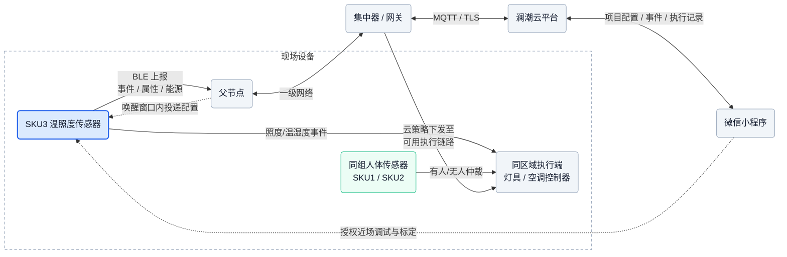

**与 SKU1/SKU2 最大的拓扑差异**：本机没有"人"这个结论，所以它的本地广播只能携带"环境条件"，是否执行开灯由同组人体传感器或云策略做**与运算**。这条依赖必须画进拓扑，否则现场会误以为装一个温照度就能自动开灯。

| 路径 | 走向 | 用途 | 关键约束 |
| --- | --- | --- | --- |
| 本地 | SKU3 →（BLE 广播）→ 同组执行端 | 调光基准、温控目标下发 | TTL ≤4；开灯动作需人体条件 |
| 云端 | SKU3 → 父节点 → CCO → 网关 → 云 → 小程序 | 上报、配置、审计、曲线 | 受唤醒窗口限制 |
| 近场 | 小程序 ↔ SKU3（BLE GATT） | 安装、选点、温湿度比对、标定 | 需鉴权码，会话限时 |

#### 3.1.2 硬件架构拓扑

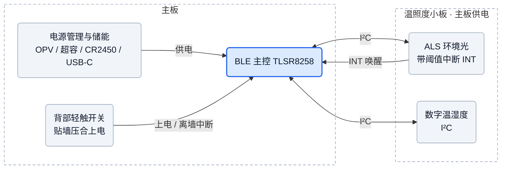

#### 3.1.3 供能与能量路径

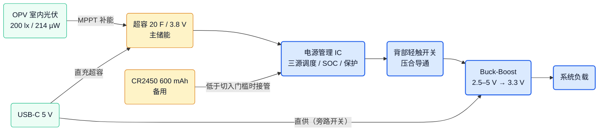

**为什么采光窗和 OPV 抢位置**：OPV 需要见光才能发电，照度传感器也需要见光才测得准——两者的开窗方向一致，这是好事；但温湿度需要透气膜窗、且不能被阳光直射加热。三个窗口在 A 面上的分区，是本机结构设计的主要难点（见风险 R-09）。

### 3.2 场景

| 场景 | 光照条件 | 环境特征 | 数据用途 | 推荐形态 |
| --- | --- | --- | --- | --- |
| 靠窗办公区 | 日光变化剧烈 | 温度梯度大 | 恒照度调光、白天免开灯、区域温控 | A 微能量 |
| 开放办公内区 | 稳定人工照明 | 人员密度影响温度 | 调光基准、温度反馈 | A 微能量 |
| 会议室 | 使用时开灯、空闲关灯 | 人多时温湿度快速上升 | 会议前预冷、CO₂ 替代推断、调光 | A 微能量 |
| 教室 | 白天自然光 + 人工光 | 人多、湿度高 | 照度均衡、除湿联动 | A 微能量 |
| 地下车库 | 长期低照度 | 温度稳定、湿度高 | 照明分区分档、除湿 | C USB 外供 |
| 设备机房 / 库房 | 完全无光 | 温度敏感 | 超温告警、除湿 | C USB 外供 |
| 医院病房 / 候诊 | 长时间照明 | 湿度要求严 | 照度舒适度、湿度控制 | A 微能量 |

### 3.3 用户角色

| 角色 | 核心诉求 | 成功判据 | 需要的权限 |
| --- | --- | --- | --- |
| 物业公司（付费方） | 电费下降、环境投诉减少 | 照明能耗降、温度投诉降 | 只读看板 |
| 工程安装商 / FAE | 装得快、标定不返工 | >400 点位/人日；标定一次通过 | 项目安装权限 + 近场标定 |
| 系统集成 / 运维 | 数据可信、异常可发现 | 坏数据可识别；漂移可告警 | 配置权 + 超管（受控） |
| 空间使用者 | 不冷不热、不刺眼 | 无"忽明忽暗""闷热"投诉 | 无 |

### 3.4 安装姿态与朝向

| 姿态 | 推荐位置 | 适用 | 注意 |
| --- | --- | --- | --- |
| 顶装 | 吊顶 2.6～3.2 m，感光面朝下 | 大开间、走廊、车库（以照度为主用途） | 距灯具 ≥1.5 m，避免灯下直射 |
| 壁挂（呼吸高度） | 墙面 1.2～1.5 m，避开门窗与出风口 | 办公、病房、教室（以温湿度为主用途） | 感光面易被遮挡，照度仅作参考 |
| 侧装 | 立柱/隔断 1.4～2.0 m | 隔断工位、靠窗区域 | 避免阳光直射感光面 |
| 倒装 | 梁下/桥架下 | 车库、厂房 | 同顶装，注意金属反射 |

姿态与**主用途**必须同时写入配置（`mountMode` + `primaryUse`）。同一套阈值用在"顶装测照度"和"壁挂测温湿度"上，得到的结论会完全不同。

## 04 功能需求

### 4.0 需求总览

| 模块 | 编号段 | 解决什么问题 | 优先级 |
| --- | --- | --- | --- |
| LPN 能源管理 | FR-1xx | 没市电，必须自己算电、自己省电 | P0 |
| 通信与安全 | FR-2xx | 一条事件要走三条路，还要防偷听、防重放 | P0 |
| BLE 组网与鉴权 | FR-3xx | 两种入网路径，都要证明"你是你、你在正确的位置" | P0 |
| 事件机制 | FR-4xx | 什么算事件、发给谁、丢了怎么办 | P0 |
| 心跳机制 | FR-5xx | 区分"没变化"和"设备失联" | P0 |
| 时间同步 | FR-6xx | 每条读数都要说得清"几点测的" | P0 |
| OTA 升级 | FR-7xx | 休眠设备怎么安全地换固件 | P1 |
| 运维（超管） | FR-8xx | 在线设备出问题时，平台能远程动手 | P0 |
| 环境联动 | FR-9xx | 读数怎么变成调光、温控、除湿动作（含"不得单独开灯"） | P0 |
| 环境采样与响应 | FR-10xx | 10 s 光照响应、分钟级温湿度响应怎么做到 | P0 |
| 选点 | FR-11xx | 装之前怎么知道这个点位读数有没有代表性 | P0 |
| 离墙检测 | FR-12xx | 设备被从墙上拿走要喊出来 | P0 |

### 4.1 LPN 能源管理（FR-1xx）

**要点**：本机没有"人"这个变量，功耗模型比人体传感器更平稳——真正决定续航的是**采样周期**。所以能源策略的核心是"用多慢的采样换多久的续航"，而不是"人走了就睡"。

#### 4.1.1 供能与切换

| ID | 需求描述 | 优先级 | 验收口径 |
| --- | --- | --- | --- |
| FR-101 | 支持 OPV + 超容、CR2450、USB 三源接入，按电源管理芯片规则自动切换；一次电池与充电路径隔离，禁止反充。 | P0 | 三源分别单独接入均可开机；电池支路反向电流为 0 |
| FR-102 | USB 5 V 可独立持续供电，并给超容补能。超容 2.5→3.5 V <10 min；补能期间采样不中断、不重启。 | P0 | 记录充电曲线；插拔 100 次无重启 |
| FR-103 | 超容低于切入门槛（候选 2.6 V）时切备用电池，回升后按 0.1 V 回差切回。 | P0 | 切入/切回各 20 次，无抖动、无掉电复位 |
| FR-104 | 离墙（开关弹起）后切断负载，整机漏电 ≤2.5 µA；停止采样、心跳与常规上报。 | P0 | 源表长时记录 ≥72 h；6 个月库存压降 <1 V |
| FR-105 | 每次上电识别原因：贴装下压 / 看门狗 / 供电恢复 / 软复位，无法区分时上报"未知"。 | P0 | 四种原因分别注入，`bootCause` 均正确 |
| FR-106 | 临近断电时用预留电量发末次状态（Last Gasp），记录是否送达；预留电量不允许被普通任务占用。 | P0 | 100 次断电试验上报成功率 ≥95% |
| FR-107 | 分别估算超容可用能量与电池剩余容量，记录供电源与切换历史；无法估算时显示"未知"及最后有效值。 | P0 | SOC 误差 ≤±10%；六态电池状态均可判 |
| FR-108 | 硬件保护（欠压关断、过流、过温）优先于任何软件策略，软件不得绕过。 | P0 | 拉低电压至保护点，输出按硬件关断，恢复后按回差重启 |

#### 4.1.2 能源分级与调度

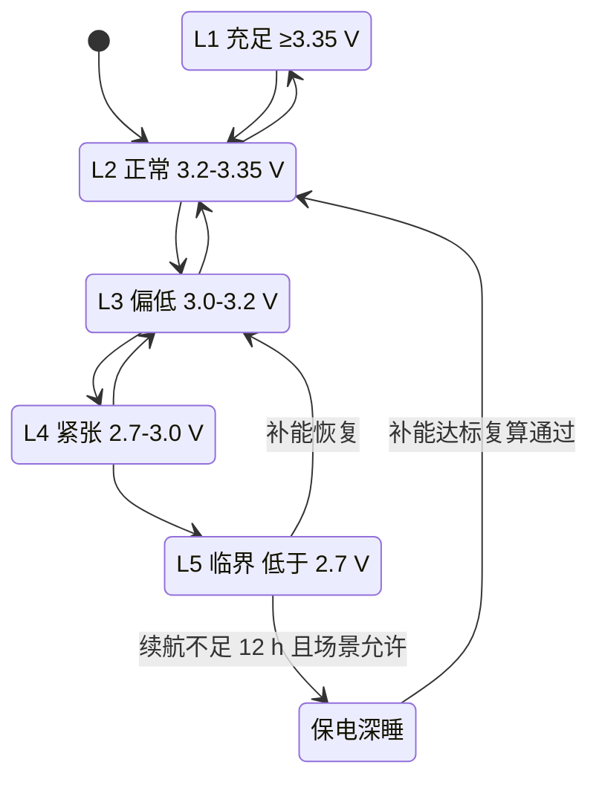

| 等级 | 超容电压（候选） | 照度采样 | 温湿度采样 | 上报约束 | 发射功率 |
| --- | --- | --- | --- | --- | --- |
| L1 | ≥3.35 V | 1～2 s（可用快响应档） | 30 s / 60 s | 按配置 | 100% |
| L2 | 3.2～3.35 V | 5 s（默认） | 60 s / 300 s | 按配置 | 100% |
| L3 | 3.0～3.2 V | 10 s | 300 s / 600 s | P2 由聚合转随心跳 | 75% |
| L4 | 2.7～3.0 V | 30 s | 600 s / 900 s | 停 P2，仅 P0/P1 | 50% |
| L5 | <2.7 V | 60 s | 1800 s | 仅 P0 | 25% |

**低电为什么先拉长采样周期，而不是降低精度**：环境数据一旦"降精度"，就无法用于恒照度控制（读数跳变会让灯忽明忽暗）；而拉长周期只是让响应变慢，读数本身仍然可信。宁可"慢一点但准"，不要"快但错"。

#### 4.1.3 牺牲顺序与禁止项

| 顺序 | 牺牲什么 | 理由 |
| --- | --- | --- |
| ① | P2 类事件的聚合上报 | 只影响报表及时性 |
| ② | 上报周期（拉长） | 影响曲线密度，不影响控制 |
| ③ | 采样周期（拉长） | 影响响应速度，读数仍准 |
| ④ | 发射功率 | 影响链路余量，可被重传补偿 |
| ⑤ | 停发 P2，仅保 P0/P1 | 保留业务主干 |
| ⑥ | 受控保电（停采） | 最后手段，须场景允许 |

**禁止项（不得因省电而做）**

- 不得停止"超量程/无效读数"的判定——输出坏数据比不输出更糟。
- 不得因低电、停采、无数据而把读数标成"正常"，只能标"未知/过期"。
- 不得关闭安全类与完整性类事件（离墙、超容欠压、缓存溢出等）。
- 不得静默丢事件而不计数。

#### 4.1.4 保电与恢复

| ID | 需求描述 | 优先级 | 验收口径 |
| --- | --- | --- | --- |
| FR-109 | 预测完整服务续航 <12 h 且场景允许时才进入保电；先降采样周期、再停非关键事件，最后才停采。 | P0 | 构造 12 h 边界，核对降级顺序 |
| FR-110 | 停采后读数标记"过期/未知"，并通知依赖该点位的调光与温控策略进入保持状态。 | P0 | 平台显示过期，执行端不因过期值动作 |
| FR-111 | 补能恢复后复核回差、能量余量与采样预算，全部达标才恢复原采样档。 | P0 | 短时插拔未达门限时继续保护 |
| FR-112 | 定期检查能源健康，低电或持续亏电时生成 USB 补能工单；记录接入、充电结果与拔线后电量。 | P0 | 工单可生成、可关闭、可追溯 |

#### 4.1.5 能量预算（参考值，实测签核）

| 耗能项 | 标准档 | 快响应档 |
| --- | --- | --- |
| ALS 睡眠监控（阈值中断） | <1 µA | <1 µA |
| 温湿度采样（折算） | 1～2 µA | 2～3 µA |
| MCU 休眠 | 1～3 µA | 1～3 µA |
| 上报折算 | 0.5 µA | 1.2 µA |
| 超容漏电 | 2 µA | 2 µA |
| 管理 IC + DC-DC 静态 | 2.3 µA | 2.3 µA |
| **合计** | **约 8～11 µA** | **约 10～20 µA** |

**结论**：本机没有 PIR 常开那种"固定开销"，功耗几乎完全由采样与上报节奏决定。这也意味着**"响应速度"是可以按点位单独卖的**——靠窗需要快，内区可以慢。

### 4.2 通信与安全（FR-2xx）

**要点**：同一条事件要同时满足"快、不丢、可运营"三个互相矛盾的目标。解法不是把一条路做快，而是拆成三条路。

#### 4.2.1 三通道出口模型

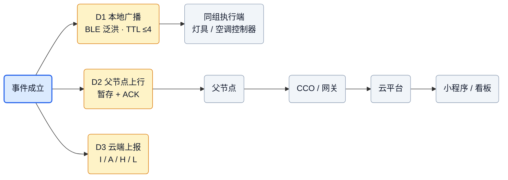

| 通道 | 目的 | 典型时延 | 确认语义 | 失败处理 |
| --- | --- | --- | --- | --- |
| D1 本地广播 | 让调光/温控立刻动作 | ≤300 ms（4 跳内） | 执行端短 ACK = 指令已收到 | 重播 2 次；3 次无确认报 E606 |
| D2 父节点上行 | 把事件交进网络，不丢 | 1 个唤醒窗口内 | 父节点 ACK = 已进暂存队列 | 未 ACK 则本地保留，下次唤醒重传 |
| D3 云端上报 | 可统计、可追溯、可出曲线 | I ≤1 s / A 15 min～24 h / H 随心跳 / L 不上报 | 设备侧投递完成 | 按档缓存补报；溢出报 E508 |

| ID | 需求描述 | 优先级 | 验收口径 |
| --- | --- | --- | --- |
| FR-201 | 三条通道独立调度、独立记录，任一通道故障不得影响另两条。 | P0 | 注入父节点离线 / 广播全丢 / 云端断链，其余通道不受影响 |
| FR-202 | 本地广播承载：BLE 广播报文携带组 ID、动作码、`evtSeq`、需确认标志、读数与时间戳；执行端按 `evtSeq` 去重。 | P0 | 重播 3 次，执行端只动作 1 次 |
| FR-203 | 上行事件带唯一 `eventId`，重传、补报、换父沿用原值；云端按编号只入库一次。 | P0 | 500 次重复投递，云端仅 1 条记录 |
| FR-204 | 网络角色固定：`devClass=HARVEST_LEAF`、`canRelay=false`、`maxHopDepth=3`。 | P0 | 拓扑中永不为父节点 |
| FR-205 | 单父节点直挂 ≤8 台；8 台同时上报 1 s 内确认，丢包 <1%；唤醒窗口 100～500 ms 可配。 | P0 | 满载与第 9 台被拒的场景分别验证 |
| FR-206 | 父节点失联后先重连原父节点，失败则挂兼容且有余量的父节点，≤3 min 完成重挂载。 | P0 | 断父节点后计时；换父后按原 `eventId` 上报 |

#### 4.2.2 BLE 链路安全

| 层 | 措施 | 说明 |
| --- | --- | --- |
| 身份 | 一机一密：出厂注入设备专属密钥/证书，机身码与密钥绑定 | 扫码照片、相同 MAC 都不能单独通过鉴权 |
| 配对 | 连接链路启用 LE Secure Connections 配对与绑定 | 未配对设备不得读写配置 |
| 链路保护 | 已配对连接使用协议栈 AES-CCM 加密；应用层再做一层认证加密 | 防中间人、防篡改 |
| 广播保护 | 业务载荷由固件先加密并附校验后再广播 | 接收端校验不通过直接丢弃 |
| 防重放 | 会话序号 + 绑定代次 + 时间戳窗口；重启、换父、换绑后旧包失效 | 一条指令只生效一次 |
| 密钥管理 | 按设备 / 项目 / 组 / 用途隔离；支持轮换与失效 | 普通日志禁止出现密钥 |

| ID | 需求描述 | 优先级 | 验收口径 |
| --- | --- | --- | --- |
| FR-207 | 设备↔父节点、设备↔执行端、近场维护三条链路均须提供机密性、来源认证与完整性校验；校验失败即拒绝并保持原状态。 | P0 | 逐段抓包：未授权方读不出业务内容；篡改报文被拒 |
| FR-208 | 拒绝明文降级：加密协商失败不得回退到明文传输。 | P0 | 强制协商失败，连接被断开而非降级 |
| FR-209 | 接收端校验发送者、授权组、时效凭据后才执行；旧包、重复包不得调节亮度、改温控设定或新增记录。 | P0 | 重放 100 次历史帧，动作次数为 0 |
| FR-210 | 近场维护会话独立鉴权、独立权限、限时有效（≤30 min），到期自动退出并恢复原策略。 | P0 | 超时后连接被拒；退出后策略回读一致 |
| FR-211 | 调试口与产测接口量产关闭；日志、事件、上报报文均不含密钥与凭据。 | P0 | 出厂固件扫描 + 日志抽样检查 |

### 4.3 BLE 组网与鉴权（FR-3xx）

**要点**：两条入网路径，一套鉴权标准。路径决定"谁发起"，鉴权决定"能不能进"。

#### 4.3.1 两条组网路径

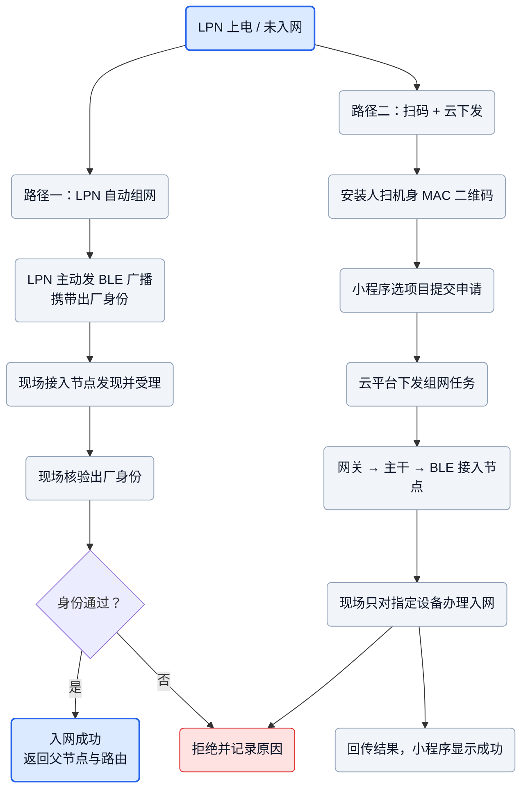

| ID | 需求描述 | 优先级 | 验收口径 |
| --- | --- | --- | --- |
| FR-301 | **路径一（本地自动组网）**：未入网 LPN 主动广播，由具备接入资格的现场节点受理；公网断开但现场链路正常时仍可完成。 | P0 | 断公网，10 台设备均成功入网 |
| FR-302 | **路径二（扫码 + 云下发）**：扫码 → 选项目 → 云端下发组网任务 → 现场针对指定设备入网 → 结果回传。 | P0 | 端到端 ≤60 s |
| FR-303 | 两条路径使用同一套入网鉴权与同一条事件通道，入网后行为完全一致。 | P0 | 两种方式入网的设备行为逐项一致 |
| FR-304 | 扫码任务超时未完成时，允许退回本地组网路径（需授权）。 | P1 | 超时后切换路径，最终入网成功 |

#### 4.3.2 三重鉴权：人、设备、点位

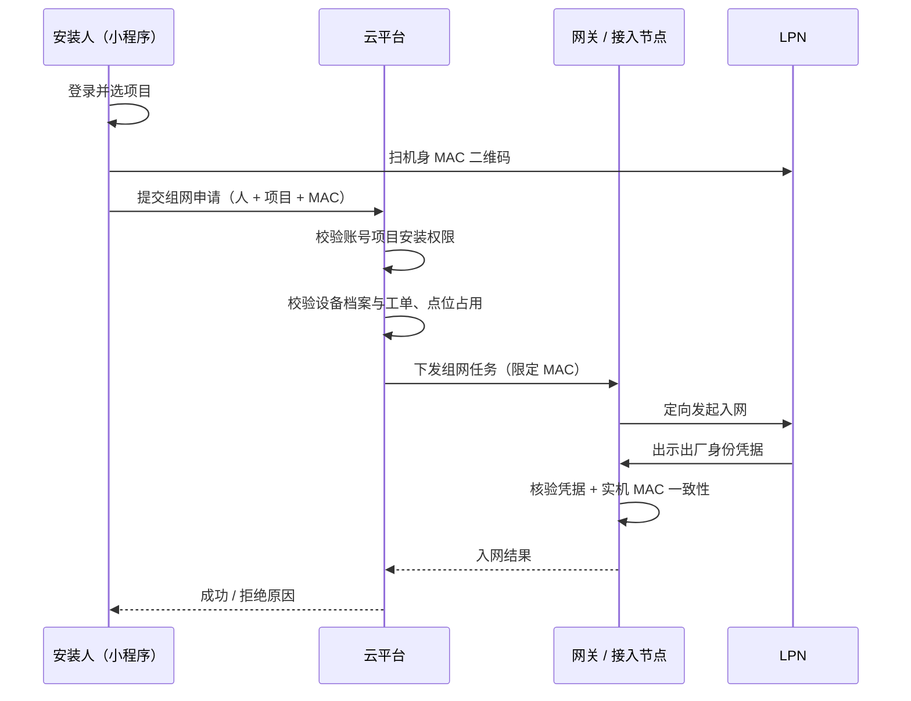

| ID | 需求描述 | 优先级 | 验收口径 |
| --- | --- | --- | --- |
| FR-305 | **人**：账号须具备目标项目安装权限，否则申请直接结束并提示原因。 | P0 | 无权限账号申请 100% 被拒 |
| FR-306 | **设备**：核验出厂身份凭据 + 实机 MAC 与扫码 MAC 一致；照片、复制 MAC、非澜潮设备均拒绝。 | P0 | 扫 A 装 B 场景 100% 拦截 |
| FR-307 | **点位**：云端校验项目归属、点位范围、是否被占用；身份通过但白名单未通过时标"待核"，不得输出联动指令。 | P0 | 待核设备不能调光；纠正后可重新绑定 |
| FR-308 | 组网状态可查：未配网 / 发现 / 鉴权中 / 入网 / 待绑定 / 在线 / 离线或未知 / 重新入网，并记录最后失败原因。 | P0 | 八种状态均可构造并正确显示 |
| FR-309 | 离线扫码可暂存，联网复核后放行；同笔申请只建一次绑定。 | P1 | 断网扫码 10 单，恢复后无重复绑定 |

#### 4.3.3 失败处理与容量

| 情形 | 处理 | 用户可见 |
| --- | --- | --- |
| 身份核验失败 | 拒绝入网，记录阶段与脱敏结果 | "设备身份核验失败，请核对铭牌" |
| 白名单未通过 | 允许入网但标"待核"，禁止联动 | "点位待核，暂不参与联动" |
| 父节点满载（8 台） | 拒绝并建议迁移或增补父节点 | "父节点已满，请调整点位" |
| 父节点失联 | ≤3 min 重挂兼容父节点 | "已切换上级设备" |
| 弱光无法冷启动 | 提示先 USB 补能再入网 | "请先补能至 3 V 以上" |

### 4.4 事件机制（FR-4xx）

**要点**：环境类事件的难点不是"发不出去"，而是"发得太勤"。光照每秒都在变，如果每次变化都上报，一天能发几万条。所以本机的事件必须建立在**阈值 + 滞回 + 上报档位**三层过滤之上。

#### 4.4.1 事件生成原则

- **可判定**：触发条件必须是可测的数值跨越，例如"变化量超过 luxDelta 且超过滞回"，而不是"光线好像变了"。
- **不重复**：同一方向的变化只报一次，直到反向穿越或超过滞回带。
- **带上下文**：事件必须携带读数本身、采样时刻、有效性标记；只报"变了"不报"变成多少"等于没报。
- **坏数据不触发业务**：无效、超量程、过期读数只能产生"读数无效"类事件，不得进入联动判定。

#### 4.4.2 事件分类

| 编号段 | 类别 | 典型事件 | 是否可禁用 |
| --- | --- | --- | --- |
| E1xx | 环境感知 | 照度变化、温度变化、湿度变化、高低温、高低湿、遮挡、凝露、读数无效 | 告警类不可禁用 |
| E3xx | 能源与电源 | 采能恢复、能量不足、能量临界、临终上报、上电启动、超容欠压 | 底线类不可禁用 |
| E4xx | 自检与安防 | 周期自检、照度/温湿度通道故障、**离墙/脱落**、传感窗污染 | 安防类不可禁用 |
| E5xx | 生命周期与运维 | 上线、补报、入网完成、配置生效/拒绝、OTA 状态、时钟偏差、缓存溢出 | 完整性类不可禁用 |
| E6xx | 联动与执行 | 照度联动执行、免开灯生效、照明回路疑似故障、联动确认超时、温控联动执行 | 多数可禁用 |

#### 4.4.3 上报方式四档

| 档位 | 方式 | 时延 | 设备行为 | 适用 |
| --- | --- | --- | --- | --- |
| I | 即时 | ≤1 s | 立即组帧发出，按配置重传 0～2 次 | 越限告警、故障、离墙 |
| A | 聚合 | 15 min / 30 min / 1 h / 2 h / 6 h / 12 h / 24 h | 写环形缓存，到期打包 | 照度/温湿度变化曲线 |
| H | 随心跳 | 跟随心跳周期 300～1800 s | 挂在心跳帧中捎带，最省电 | 低频状态、当前读数 |
| L | 仅本地 | 不上报 | 只记本地，可由诊断快照读出 | 调试、高频明细 |

**曲线类数据为什么默认走 A 档**：恒照度控制靠的是本地广播（D1），云端曲线只用于复盘与报表。把变化事件配成 I 档，会让"光照每变一次就发一帧"，一天几百帧的代价换来的只是更细的曲线，不划算。

#### 4.4.4 确认、缓存与补报

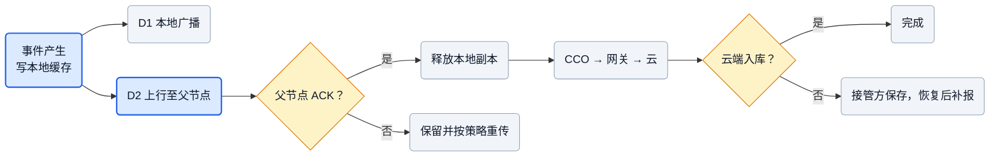

| ID | 需求描述 | 优先级 | 验收口径 |
| --- | --- | --- | --- |
| FR-401 | 每条事件独立配置：启用状态、本地是否广播、是否需执行端/父节点确认、云端上报档位、聚合周期、单包条数、重传次数。 | P0 | 逐条可配、可读回；硬约束项拒绝禁用 |
| FR-402 | 越限告警、通道故障、离墙、配置回执锁定为不可禁用、必须确认、即时上报。 | P0 | 尝试禁用全部被拒（E505） |
| FR-403 | 断链缓存目标 ≥256 条（环形，按时间淘汰）；曲线类事件超出容量时按时间降采样而非直接丢弃。 | P1 | 断网 24 h 恢复后曲线可还原趋势 |
| FR-404 | 恢复后分批补报：告警优先，曲线按原发生时间排序，沿用原 `eventId`。 | P0 | 补报排序正确率 100%；旧事件不触发现场动作 |
| FR-405 | 缓存溢出必须计数并上报丢弃条数（E508），供平台核对记录缺口。 | P1 | 产生/送达/丢弃三者可对账 |
| FR-406 | 关闭某可选事件后，采样、心跳、快照与其他事件继续运行；平台提示受影响的联动规则。 | P0 | 关闭 E601 后，E101/E103 与心跳正常 |

#### 4.4.5 关键事件（节选，全量见附录 8.1）

| 编号 | 事件 | 触发条件 | 本地 | 云端 | 可禁用 |
| --- | --- | --- | --- | --- | --- |
| E101 | 照度变化 | 照度跨越阈值且超过滞回（默认变化 20%） | 广播（调光基准） | A 15 min | 否 |
| E102 | 设备心跳 | 按周期发送，携带三读数与供电源 | 不广播 | H | 是 |
| E103 | 温度变化 | 温度变化 ≥tempDelta（默认 1.0 ℃）并超滞回 | 广播（温控目标） | A 30 min | 是 |
| E104 | 湿度变化 | 湿度变化 ≥humiDelta（默认 5 %RH）并超滞回 | 不广播 | A 1 h | 是 |
| E105 | 高温告警 | 温度 ≥tempThrHi 持续 3 个采样周期 | 广播警示 | I | 否 |
| E106 | 低温告警 | 温度 ≤tempThrLo 持续 3 个采样周期 | 广播警示 | I | 否 |
| E107 | 高湿告警 | 湿度 ≥humiThrHi 持续 3 个采样周期 | 不广播 | I | 否 |
| E108 | 低湿告警 | 湿度 ≤humiThrLo 持续 3 个采样周期 | 不广播 | I | 否 |
| E109 | 采光面遮挡 | 照度长期低于该点位平常水平（24 h） | 不广播 | A 6 h | 是 |
| E110 | 凝露风险 | 温度快速下降且湿度接近饱和 | 不广播 | I | 是 |
| E111 | 读数无效 | 超量程、缺测、未标定、过期 | 不广播 | I | 否 |
| **E404** | **离墙/脱落** | 背部开关弹起（设备离开安装面） | 广播警示 | I | 否 |
| E504 | 配置生效 | 参数下发并通过校验，含实际执行值 | 不广播 | A 1 h | 是 |
| E506 | OTA 状态 | 下载/校验/安装/成功/失败/回滚 | 不广播 | I | 是 |
| E508 | 缓存溢出 | 环形队列满并丢弃 | 不广播 | I | 否 |
| E605 | 照明回路疑似故障 | 开灯后 T_check 内照度未按预期上升，连续 2 次 | 不广播 | I | 是 |
| E606 | 联动确认超时 | 本地广播重播 2 次仍无执行端确认 | 不广播 | A 1 h | 否 |

### 4.5 心跳机制（FR-5xx）

**要点**：本机没有"有人/无人"状态，心跳要解决的是另一件事——**读数还在不在更新**。平台看到一条 3 小时前的照度，必须能判断是"环境没变"还是"设备死了"。

| ID | 需求描述 | 优先级 | 验收口径 |
| --- | --- | --- | --- |
| FR-501 | 入网后按实际生效周期发送心跳，携带当前三读数、有效性与采样时刻。 | P0 | 连续 7 天无变化事件，心跳仍按时送达 |
| FR-502 | 标准档 300～1800 s 可配；低电时按能源策略延长并上报实际周期。 | P0 | 平台显示周期 = 设备实测周期 |
| FR-503 | 心跳帧可捎带 H 档事件与配置版本、采样周期实际值。 | P0 | 抓包核对载荷字段完整 |
| FR-504 | 心跳与协议保活分离：心跳是业务状态记录，保活是链路可达性交互。 | P0 | 关闭心跳上报后保活仍正常 |

| 情形 | 判定规则 | 平台展示 |
| --- | --- | --- |
| 收到实时有效消息 | 立即刷新"最近有效通信时间" | 在线 |
| 漏收 1～2 个周期 | 保持在线 | 在线（标注最近通信时间） |
| 连续 3 个应到周期未收到 | 判离线 | 离线 |
| 父节点失联 / 云端拿不到现场判定 | 不猜测 | **状态未知** + 最近有效通信时间 |
| 重新收到实时消息 | 恢复在线 | 在线；补发的旧心跳只进历史 |

| ID | 需求描述 | 优先级 | 验收口径 |
| --- | --- | --- | --- |
| FR-505 | 断公网时父节点继续完成现场保活与离线判断，恢复后平台按最新现场结果更新。 | P0 | 断云 30 min，现场判定不停 |
| FR-506 | 设备在线状态与"读数新鲜度"分开展示：在线但读数过期时，不得显示为有效值。 | P0 | 停采场景下两个维度分别正确 |
| FR-507 | 补报的旧心跳不得让设备"假上线"，只有实时有效通信才恢复在线。 | P0 | 先送旧心跳再生效实时心跳，仅后者改变状态 |

### 4.6 时间同步与时间戳（FR-6xx）

**要点**：环境数据是时序数据，**没有时间戳的读数等于废数据**——同一间屋子上午 9 点和下午 3 点的照度，能差一个数量级。

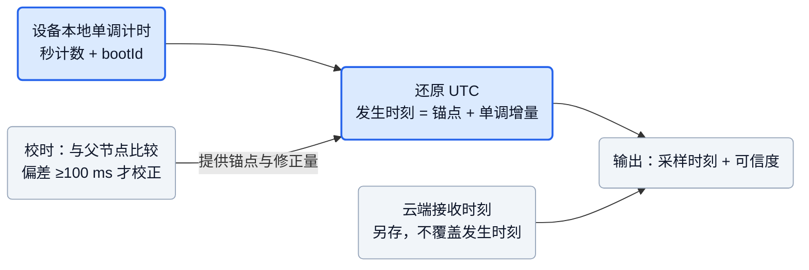

| ID | 需求描述 | 优先级 | 验收口径 |
| --- | --- | --- | --- |
| FR-601 | 设备持续维护本地计时与本次开机标识；每次采样记录采样时刻，不依赖当前是否已校时。 | P0 | 断网 24 h 的读数仍带本地时刻 |
| FR-602 | 唤醒后向父节点对时；偏差 <100 ms 保持原值，≥100 ms 才校正，并记录修正量（E507）。 | P0 | 90 ms 不触发、110 ms 触发；校后 <20 ms |
| FR-603 | 事件报文与 BLE 通信报文均携带时间戳字段（`ts` + `bootId` + `tsConf`），供接收端还原。 | P0 | 逐条事件抓包可见三字段 |
| FR-604 | 发生时间由接入端按对时记录还原为 UTC，云端另记接收时间，两者分别保存。 | P0 | 补报数据排序正确率 100% |
| FR-605 | 时间不可信时标记为未知或降级，并暂停依赖绝对时间的策略（如按时段的调光曲线）。 | P0 | 构造五种场景，均可看出"为什么不可信" |
| FR-606 | 换电池、复位、换父后必须重新校时；恢复后按当前输入重判。 | P0 | 换电重启后时间与策略状态正确 |

### 4.7 OTA 升级（FR-7xx）

**要点**：休眠设备不能保持长连接下载，OTA 必须"父节点囤货、设备蚂蚁搬家"，并且随时可断、可续、可回滚。

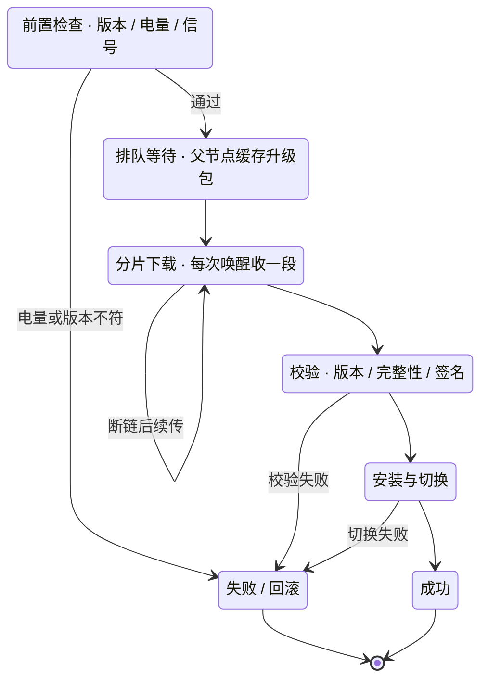

| ID | 需求描述 | 优先级 | 验收口径 |
| --- | --- | --- | --- |
| FR-701 | 升级前校验版本匹配、能量余额、链路质量；不满足则拒绝并回明确原因码。 | P0 | 低电设备申请升级，平台读到明确拒绝码 |
| FR-702 | 父节点缓存匹配升级包，设备每次唤醒接收一段，支持断点续传。 | P1 | 传输中断 5 次后仍能完成 |
| FR-703 | 升级不得丢失配置、标定系数 K 与绑定关系；标定数据须按版本保存并可迁移。 | P0 | 升级前后读回 K 值与配置逐项比对 |
| FR-704 | 支持按项目/批次灰度升级，逐台显示进度与结果；失败率超门槛自动停止派发。 | P1 | 同批构造低电、版本不符、断链，行为符合预期 |
| FR-705 | 升级过程与结果记录为 E506，失败与回滚强制上报。 | P0 | 六种状态均可复现并上报 |
| FR-706 | 升级失败必须能回到可工作版本并重新入网，不得变砖。 | P0 | 传输阶段与切换阶段各断电 50 次，均可恢复 |

### 4.8 运维与云端超管（FR-8xx）

**要点**：环境数据出问题时最难判断的是"设备坏了"还是"环境真的变了"。所以超管能力的重点不是重启，而是**取证**。

| 级别 | 能力 | 典型操作 | 授权要求 |
| --- | --- | --- | --- |
| L0 只读 | 看读数、看曲线、看诊断快照 | 查三读数、有效性、信号、最近事件 | 项目只读权限 |
| L1 配置 | 改阈值、采样周期、上报策略 | 改 tempDelta、luxDelta、上报档位 | 项目管理员 |
| L2 诊断 | 触发采样、读原始值、抓日志 | 判断"读数漂移"还是"环境变化" | 运维工程师 |
| L3 超管 | 远程重启、清缓存、重新标定下发、解除绑定 | 救活"假死"设备、修正错标 | 双人复核 + 限时会话 |

| ID | 需求描述 | 优先级 | 验收口径 |
| --- | --- | --- | --- |
| FR-801 | 支持远程强制心跳：立即上报一帧三读数与有效性，用于确认设备是否真在线。 | P0 | 下发后 ≤1 个唤醒窗口收到 |
| FR-802 | 支持远程立即采样：强制读一次 ALS 与温湿度，不改变原采样周期。 | P0 | 下发后 5 s 内返回新值 |
| FR-803 | 支持远程拉长唤醒窗口（临时，≤30 min），用于批量下发配置或抓日志。 | P0 | 到期自动恢复原窗口 |
| FR-804 | 支持远程重启与强制复位；记录原因、时间与操作人。 | P0 | 100 次远程重启无变砖、配置不丢 |
| FR-805 | 支持远程清理事件缓存（须先导出或确认丢弃条数），清理计入 E508 对账。 | P1 | 清理后平台可见丢弃计数 |
| FR-806 | 支持远程读取诊断快照：ALS 原始值与修正值、温湿度原始值、K 版本、采样周期实际值、有效性标记、最近 8 条事件。 | P0 | 快照字段与本地一致 |
| FR-807 | 支持远程下发重新标定（K 值与温湿度比对偏移），下发后必须读回并记录版本。 | P1 | 标定前后偏差可查；错标可回滚 |
| FR-808 | 超管会话限时（≤30 min）、一次一授权、全程审计；不得突破能量底线与安全事件锁。 | P0 | 会话过期后再下发被拒；审计可查 |
| FR-809 | 近场维护（BLE GATT）提供同等能力子集：读状态、改参数、触发采样、标定、导出日志。 | P0 | 现场无网时可用；标定 ≤5 min 完成 |
| FR-810 | 本地改参后进入"待确认"：授权人确认才固化为基线；72 h 未确认告警，7 天自动回退。 | P0 | 三态流转正确，回退可复现 |

**为什么"取证"比"重启"重要**：一个读数偏低的点位，可能是传感窗积尘、可能被海报挡住、也可能是标定系数错了。三者处置方式完全不同：清洁、改点位、重标。所以诊断快照必须同时给出**原始值、修正值、K 版本、采样时刻**四样东西，缺一样就只能靠人跑现场。

### 4.9 环境联动策略（FR-9xx）

**要点**：本机的联动有一个铁律——**它能说"暗"，但不能说"有人"**。所以它发出的永远是"条件"，不是"命令"。

#### 4.9.1 数据源与联动对象

| 数据源 | 用途 | 更新方式 |
| --- | --- | --- |
| 照度（有效性、数值） | 恒照度调光、白天免开灯、开灯效果校验 | 阈值穿越即发 |
| 温度 | 区域温控、预冷预热、超温告警 | 变化阈值 / 越限即发 |
| 湿度 | 除湿、新风、凝露预警 | 变化阈值 / 越限即发 |
| 读数有效性 | 阻断坏数据参与联动 | 状态变化即发 |

| 执行端 | 可执行动作 | 确认方式 |
| --- | --- | --- |
| 智慧灯具 | 调光百分比、色温、场景切换、**开/关（需人体条件位）** | 短 ACK + 照度变化校验 |
| 空调控制器 | 温度设定、风速档、模式、启停 | 设备回执 |
| 新风/除湿 | 启停、档位 | 设备回执 |

#### 4.9.2 三种联动模式

| 模式 | 触发条件 | 输出 | 是否需要人体条件 |
| --- | --- | --- | --- |
| ① 恒照度调光 | 灯已亮，实测照度低于目标值 | 上调亮度 / 色温补偿 | 否（灯已亮说明有人或有策略） |
| ② 白天免开灯 | 照度高于免开灯阈值 | **不输出开灯**，只上报照度 | 否（这是"禁止"动作，安全） |
| ③ 开灯 | 照度低于开灯阈值 | 广播"暗"条件位 | **是**，必须与人体传感器做 AND |
| ④ 温控 / 除湿 | 温度或湿度越限 | 设定值调整 / 启停 | 否（按区域策略） |

#### 4.9.3 决策流程

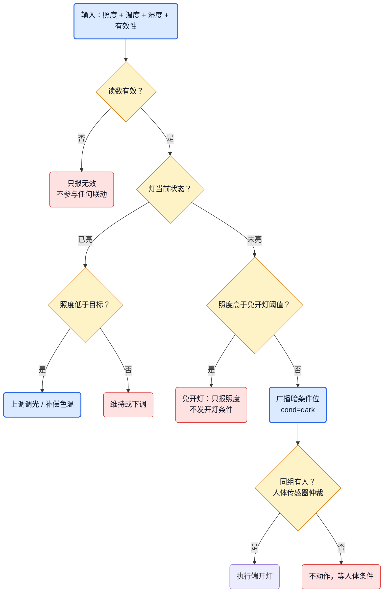

#### 4.9.4 联动需求

| ID | 需求描述 | 优先级 | 验收口径 |
| --- | --- | --- | --- |
| FR-901 | 本地广播携带**条件位**（暗/亮、过热/过冷、过湿/过干）与读数，不直接下发开关灯命令。 | P0 | 抓包可见条件位与读数；无直接开关命令 |
| FR-902 | **禁止单独开灯**：本机不得发出"开灯"动作；开灯必须由同组人体传感器的"有人"条件与本机"暗"条件做 AND。 | P0 | 空场且暗的场景持续 24 h，灯不亮 |
| FR-903 | 恒照度调光：以已标定的有效照度点为基准，按目标值与实测值差值输出调光步长（步长、回差、最小间隔可配）。 | P0 | 目标值与实测偏差收敛在 ±15% 内；无可见抖动 |
| FR-904 | 白天免开灯：照度高于阈值时不输出开灯条件，但仍照常上报照度事件（供统计与空调使用）。 | P0 | 白天有人经过，灯不亮，事件仍上报 |
| FR-905 | 温度联动：按区域设定值输出温控目标；启停设最小间隔（默认 10 min），避免短周期反复启停。 | P0 | 最小间隔生效；超限不抖动 |
| FR-906 | 湿度联动：超过高湿阈值输出除湿请求；接近饱和且温度快速下降时输出凝露预警。 | P1 | 构造凝露场景可触发 |
| FR-907 | 多来源冲突：同组多个温照度点位时，按签核规则取值（主点位优先 / 中位数 / 加权），并把取值规则与参与点位写入动作记录。 | P0 | 摘除主点位后按规则降级，不误动作 |
| FR-908 | 读数过期或无效时，联动进入"保持上一有效状态"或"退出自动控制"（按策略），不得用坏值驱动。 | P0 | 人为遮挡后调光不随坏值跳变 |
| FR-909 | 每条动作记录规则版本、输入读数与时刻、目标、指令 ID、受理与实动证据、失败原因。 | P0 | 一次调光可完整追溯 |
| FR-910 | 手动接管优先：识别到人工调光/调温后暂停自动控制，结束后按当前读数重评。 | P0 | 手动调暗后不立即被自动拉回 |

**这条边界怎么写进对外材料**：不要宣传"温照度传感器实现人来灯亮"，而应写"为照明系统提供照度基准，与人体传感器配合实现按需照明"。前者是功能越界，后者才是本机的真实角色。

### 4.10 环境采样与响应（FR-10xx）

**要点**：本产品最具技术含量的地方，是**用一颗会自己"看守"的光传感器，把响应做到 10 秒级，同时把功耗压在微安级**。这不是靠"多采样"，而是靠"少唤醒"。

#### 4.10.1 核心时间参数

| 参数 | 符号 | 取值 | 定义与约束 |
| --- | --- | --- | --- |
| 光照采样周期 | `luxSamplePeriod` | 1 / 2 / 5 / 10 / 30 / 60 s | 默认 5 s；满足 10 s 响应的前提 |
| 光照变化阈值 | `luxDelta` | 5～50%（或绝对 lux） | 默认 20%；多大变化才算"变了" |
| 光照滞回 | `luxHyst` | 5～20% | 防止阈值附近抖动 |
| 温度采样周期 | `tempSamplePeriod` | 30 / 60 / 300 / 600 / 1800 s | 默认 60 s |
| 温度变化阈值 | `tempDelta` | 0.5 / 1.0 / 2.0 ℃ | 默认 1.0 ℃ |
| 湿度采样周期 | `humiSamplePeriod` | 30 / 60 / 300 / 600 / 1800 s | 默认 300 s |
| 湿度变化阈值 | `humiDelta` | 3 / 5 / 10 %RH | 默认 5 %RH |
| 外壳热时间常数 | `τ_therm` | ≤3 min（硬件承诺） | 温度分钟级响应的物理前提，软件不可配 |

#### 4.10.2 光照 10 秒响应的时序

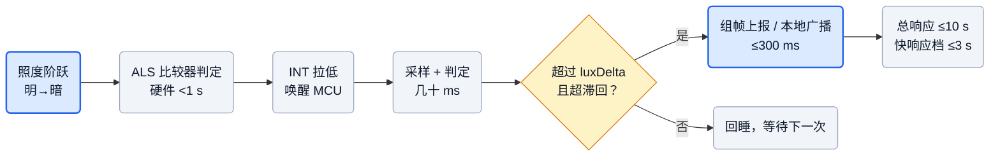

**为什么不能用 MCU 轮询**：若主控每 5 s 醒来采一次照度，一天 17280 次唤醒；每次即使 50 ms @5 mA，日均也要约 120 µA，直接把微能量预算击穿。改用带阈值中断的 ALS 后，ALS 自己连续监控（睡眠 <1 µA），只有光变化跨过阈值才拉中断叫醒主控——同样 10 s 的响应，能量代价从 120 µA 降到 2 µA 以下。

#### 4.10.3 "响应速度"是三个旋钮，不是一个

| 维度 | 含义 | 配置项 | 对响应的影响 | 对能耗的影响 |
| --- | --- | --- | --- | --- |
| ① 采样周期 | 多久"看一次" | 三个采样周期 | 决定发现变化的下限 | 周期越短，唤醒与采样越贵 |
| ② 阈值 + 滞回 | 多大变化才"算变化" | 三个 delta + 滞回 | 阈值越小越灵敏，也越易抖 | 阈值越小，上报越多 |
| ③ 上报方式 | 变化后"多快说出来" | I / A / H / L | I 最快，A/H 延迟 | I 最贵 |

因此"响应速度 = f(采样周期, 阈值, 上报方式)"，三者组合出从"快响应"到"极限省电"的连续谱系。现场按点位需求选档，而不是全楼一刀切。

#### 4.10.4 三档模板

| 档位 | 光照采样 | 光照阈值 | 温度采样 | 上报 | 光照响应 | 适用 |
| --- | --- | --- | --- | --- | --- | --- |
| 快响应 | 1～2 s | 5% | 30 s | I | ≤3 s | 靠窗日光调光、遮阳联动 |
| 标准 | 5 s | 20% | 60 s | A 15 min | ≤10 s | 常规办公、走廊、教室 |
| 省电 | 30～60 s | 50% | 300 s | A 6 h | 分钟级 | 车库、库房、仅做趋势统计 |

#### 4.10.5 采样需求

| ID | 需求描述 | 优先级 | 验收口径 |
| --- | --- | --- | --- |
| FR-1001 | 照度采集用带阈值中断的 ALS：睡眠期间持续监控，跨阈值才唤醒主控；不得用 MCU 轮询替代。 | P0 | 无人干预 24 h，唤醒次数与理论值相符（≤30 次/h） |
| FR-1002 | 光照响应：0→500 lux 阶跃，从变化到事件发出 ≤10 s（标准档）、≤3 s（快响应档）。 | P0 | 各 50 次取 P95 |
| FR-1003 | 光照阈值与滞回可配，跨阈值只触发一次；反向穿越需超过滞回带才再次触发。 | P0 | 阈值附近来回 20 次，只产生 1～2 条事件 |
| FR-1004 | 温度采集周期与阈值可配；温度响应 20→30 ℃ 阶跃 ≤5 min（含 τ_therm）。 | P0 | 阶跃试验 20 次取 P95 |
| FR-1005 | 湿度采集周期与阈值可配；湿度响应 30→60 %RH 阶跃 ≤10 min。 | P0 | 阶跃试验 20 次取 P95 |
| FR-1006 | 三路采样解耦：光照快采样不拖累温湿度慢采样；温湿度采样期间光照中断仍独立工作。 | P0 | 温度 60 s 周期下，光照阶跃仍 ≤10 s 响应 |
| FR-1007 | 读数有效性判定：区分正常、超量程、缺测、未标定、过期；无效值不进入联动与统计分母。 | P0 | 五类状态均可构造并正确标记 |
| FR-1008 | 照度数据上报当前/最小/最大/日均；温湿度上报当前/均值，并附采样时刻。 | P0 | 字段正确，曲线可还原 |
| FR-1009 | 长时间无变化时按周期发"快照"（H 档），避免平台无法区分"没变化"与"没数据"。 | P0 | 静置 24 h 仍有周期快照 |
| FR-1010 | 温湿度读数与标准仪器比对偏移可配（现场单点校准），偏移量随诊断快照可读。 | P1 | 校准后偏差收敛在 ±0.5 ℃ / ±3 %RH |

#### 4.10.6 三个读数各自的可信边界

| 读数 | 可信范围 | 不可信场景 | 处置 |
| --- | --- | --- | --- |
| 照度 | 0.01～83000 lux，±10% | 感光面被遮挡、正对灯下、阳光直射 | 标定 K + 选点规避 + E109 告警 |
| 温度 | -10～55 ℃，±0.3 ℃ | 灯具热辐射、出风口直吹、阳光直射外壳 | 选点距离要求 + τ_therm 说明 |
| 湿度 | 0～100 %RH，±2 %RH | 凝露、结霜、透气膜堵塞 | 凝露预警 + 清洁维护提示 |

### 4.11 选点需求（FR-11xx）

**要点**：环境传感器最容易被忽略、也最致命的问题是——**读数本身没错，但位置没有代表性**。装在天花板角落的照度、装在空调出风口的温度，数据都"真实"，但都不能用。

#### 4.11.1 一个必须解决的矛盾：照度 vs 温湿度

| 用途 | 理想位置 | 冲突 |
| --- | --- | --- |
| 照度 | 顶装、朝下、离灯 ≥1.5 m、能看到窗光 | 顶装位置测的温度是"吊顶温度"，比人员区高 2～4 ℃ |
| 温湿度 | 壁挂 1.2～1.5 m（呼吸高度）、避开门窗与出风口 | 壁挂位置照度易被家具、隔断遮挡，不代表工作面 |

**处理方式**：点位必须声明 `primaryUse`（照度为主 / 温湿度为主），选点判据与告警口径随之切换；次要用途降级为"参考值"，不参与关键控制。

| 主用途 | 安装位置 | 必测项 | 降级项 |
| --- | --- | --- | --- |
| 照度为主 | 顶装或高处侧装，朝下 | 照度代表性、灯下直射、窗光 | 温度仅作趋势参考，不用于温控 |
| 温湿度为主 | 壁挂 1.2～1.5 m | 呼吸高度、出风口气流、热源 | 照度仅作趋势参考，不用于调光 |

#### 4.11.2 选点流程

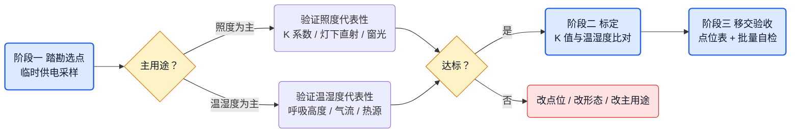

#### 4.11.3 选点需求

| ID | 需求描述 | 优先级 | 验收口径 |
| --- | --- | --- | --- |
| FR-1101 | 点位必须声明主用途（照度为主 / 温湿度为主），并写入配置；未声明时默认"照度为主"并提示补充。 | P0 | 未声明点位在 App 上被标黄，提交时二次确认 |
| FR-1102 | 提供"选点模式"：连续采样照度、温度、湿度与波动，输出**结论**而非原始数字。 | P0 | 单点位选点 ≤90 s，输出结论 |
| FR-1103 | 照度代表性判定：与工作面照度计同时比对，计算 K 系数；K 偏离 1 超过 ±30% 时提示调整朝向或位置。 | P0 | 20 个点位比对，判定与人工复核一致率 ≥90% |
| FR-1104 | 灯下直射识别：开灯瞬间照度跳变超过该点位平常幅度 3 倍时，判定"过近灯具"，建议移位 ≥1.5 m。 | P0 | 灯下 0.5 m 安装可稳定识别 |
| FR-1105 | 温湿度代表性判定：与标准温湿度计比对，温度偏差 >1.5 ℃ 或湿度偏差 >8 %RH 时提示"气流/热源干扰"。 | P0 | 出风口正下方安装可稳定识别 |
| FR-1106 | 热响应验证：记录一次开灯/空调启停后的温度阶跃曲线，估算实际 τ_therm，超出 ≤3 min 目标时提示结构问题。 | P1 | 阶跃曲线可导出，τ 值可读 |
| FR-1107 | 选点结论分三档：**推荐**（该用途可作控制基准）/ **可用但仅参考**（可上报不可控）/ **不推荐**（换点位）。 | P0 | 三档均可构造，文案不产生歧义 |
| FR-1108 | 标定数据与点位绑定：K 值、温湿度偏移、标定时间、标定人、仪器编号，随点位表导出。 | P0 | 任一点位可查完整标定链 |
| FR-1109 | 入网后 2 h 内批量自检：读数有效性、连续性、与邻点偏差、能量基线；异常生成返工清单。 | P0 | 异常点位、原因、建议三项齐全 |

### 4.12 离墙检测：设备被从墙上拿走（FR-12xx）

**要点**：与 SKU1 同一套机制——**把电源开关做成防拆**。区别在于本机的读数不涉及隐私，但"被拿走"意味着一个区域的调光与温控失去基准，所以告警同样要即时。

#### 4.12.1 触发链

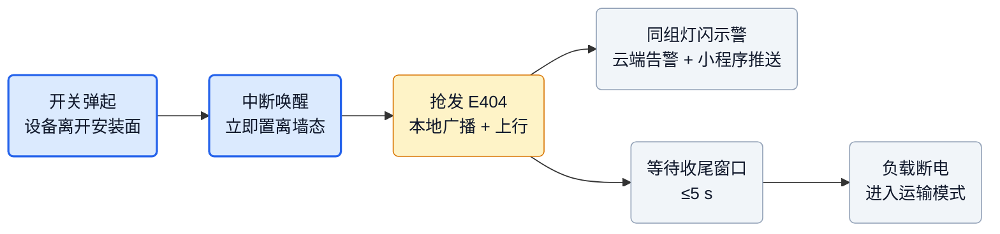

#### 4.12.2 离墙需求

| ID | 需求描述 | 优先级 | 验收口径 |
| --- | --- | --- | --- |
| FR-1201 | 背部开关须为 SPDT 轻触结构：贴墙压合导通，离墙弹起断开；弹起产生硬件中断，不依赖软件轮询。 | P0 | 分离后 ≤50 ms 产生中断；装配签核 |
| FR-1202 | 弹起后进入"收尾窗口"：利用超容余量维持 ≤5 s 供电，完成广播与一次上行后再断电。 | P0 | 20 次拔离，平台收到告警 ≥19 次 |
| FR-1203 | 上报 E404（即时档、不可禁用、必须 ACK），载荷带原因码区分"人为拆卸"与"贴装失效"。 | P0 | 20 次拆卸，原因码正确 |
| FR-1204 | 同时发本地广播警示（同组灯闪烁），保证断网时现场也有反馈。 | P0 | 断云状态下现场可见警示 |
| FR-1205 | 离墙期间该点位的读数在平台标记为"不可用"，依赖它的调光与温控策略进入保持或退出。 | P0 | 拔离后 30 s 内平台可见不可用 |
| FR-1206 | 支持布防/撤防：布防时段内才告警；撤防期间仅记录。默认全天布防。 | P1 | 撤防时段拆卸不告警但留痕 |
| FR-1207 | 离墙状态参与运维展示：在位、离墙、已告警、未知四态，可在诊断快照读出。 | P0 | 四态均可构造并正确显示 |
| FR-1208 | 开关寿命 ≥5000 次，弹起/压合后接触电阻稳定；振动中不得自行弹起。 | P0 | 5000 次后复测；振动台验证 |
| FR-1209 | 离墙检测不得因低电、OTA、配置下发而失效。 | P0 | 低电与升级期间拔离仍告警 |

## 05 非功能需求

**要点**：功能决定"能不能用"，非功能决定"读数能不能信"。本机的非功能重点不在射频，而在**光学与湿度的长期稳定性**。

### 5.1 安规（Safety）

| 编号 | 项目 | 依据标准 | 要求 | 验收 |
| --- | --- | --- | --- | --- |
| NFR-101 | 整机安全 | GB 4943.1-2022（等同 IEC 62368-1） | 按 ES1 能量源设计；可触及部件无危险电压；外壳阻燃 ≥V-1（建议 V-0） | 第三方报告 |
| NFR-102 | 超容储能安全 | 按元器件 + 整机能量评估 | 20 F 超容按 ES2 评估：端子防短路、防反接；维修/报废前须放电 | 设计评审 + 短路试验 |
| NFR-103 | USB 输入安全 | GB 4943.1 + 整机 | 5 V SELV；限流 ≤300 mA；防反灌 | 反灌与过流试验 |
| NFR-104 | 一次锂电池安全 | GB 8897.4（等同 IEC 60086-4） | CR2450 防反充隔离、防短路；异常温升不得引燃外壳 | 电池厂报告 + 整机温升 |
| NFR-105 | 温升 | GB 4943.1 | 常温与 USB 边充边采工况下，可触及表面温升不超限值 | 热电偶实测 |
| NFR-106 | 机械安全 | 整机 | 无锐边；支架承重 ≥3 倍整机重量；吊顶安装件防坠 | 拉力与结构评审 |
| NFR-107 | 透气膜安全 | 整机 | 膜材不得脱落、不得被儿童轻易撕下；开窗不得形成可探入的孔洞 | 拉力与探针试验 |
| NFR-108 | 标识与警示 | 整机 | 铭牌含型号、电气参数、厂名、批次；电池与超容警示；回收标识 | 铭牌评审 |

### 5.2 EMC（电磁兼容）

本机射频压力与 SKU1 相当（仅 BLE），但多了一个新问题：**ALS 是光学器件，会被"光"干扰，而不是被"电"干扰**。所以除了常规 EMC，还必须做抗光干扰验证。

| 编号 | 项目 | 依据标准 | 限值/要求 |
| --- | --- | --- | --- |
| NFR-111 | 辐射骚扰 | GB/T 9254.1（等同 CISPR 32）Class B | 30 MHz～1 GHz、1～6 GHz 满足 Class B 限值 |
| NFR-112 | 传导骚扰 | GB/T 9254.1 Class B | USB 供电经适配器时，电源端满足 Class B 限值 |
| NFR-113 | BLE 杂散与占用带宽 | 按 SRRC 型号核准要求 | 2.4 GHz 功率、占用带宽、带外发射满足微功率设备要求 |

| 编号 | 项目 | 依据标准 | 试验等级 | 判定 |
| --- | --- | --- | --- | --- |
| NFR-121 | 静电放电 ESD | GB/T 17626.2 | 接触 ±4 kV，空气 ±8 kV | 判据 B：可自恢复、不丢配置、**读数不跳变** |
| NFR-122 | 电快速瞬变 EFT | GB/T 17626.4 | 电源端 ±2 kV，信号端 ±1 kV | 判据 B；不产生虚假事件 |
| NFR-123 | 浪涌 Surge | GB/T 17626.5 | 线-线 ±1 kV；配适配器时线-地 ±2 kV | 判据 B；不得永久损坏 |
| NFR-124 | 射频辐射抗扰 RS | GB/T 17626.3 | 80 MHz～1 GHz，3 V/m；1～6 GHz 加测 | 判据 A：读数不异常、不误报离墙 |
| NFR-125 | 射频传导抗扰 CS | GB/T 17626.6 | 0.15～80 MHz，3 V | 判据 A |
| NFR-126 | 工频磁场 | GB/T 17626.8 | 3 A/m | 判据 A |
| NFR-127 | 电压暂降与短时中断 | GB/T 17626.11 | USB 插拔瞬断不得复位丢配置 | 判据 B |
| NFR-128 | 抗光源频闪 | 整机 | 100 Hz / 120 Hz 调光频闪下，照度读数波动 | ≤±10%，不触发误事件 |
| NFR-129 | 抗红外/光学干扰 | 整机 | 邻近红外遥控、手机闪光灯直射 | 不产生持续虚假照度阶跃 |

### 5.3 无线与频谱合规

| 编号 | 区域 | 项目 | 要求 |
| --- | --- | --- | --- |
| NFR-131 | 中国大陆 | SRRC 型号核准 | 2.4 GHz BLE 须取得型号核准证 |
| NFR-132 | 中国大陆 | 微功率设备技术要求 | 2.4000～2483.5 GHz 满足微功率短距离设备限值（本机无雷达通道） |
| NFR-133 | 中国香港 | 无线电管理 | 2.4 GHz 一般属免牌照类别；保留测试报告备查 |
| NFR-134 | 通用 | 频率容限与功率稳定性 | 全温区频率偏移、功率波动在核准限值内 |
| NFR-135 | 通用 | 天线 | 板载天线，不可外接；不得用户自行更换 |

### 5.4 合规（中国大陆 / 中国香港）

| 编号 | 区域 | 合规项 | 要求 |
| --- | --- | --- | --- |
| NFR-141 | 大陆 | 无线电 | SRRC 型号核准；铭牌标注核准代码 |
| NFR-142 | 大陆 | 有害物质 | 满足 GB/T 26572 限量要求，提供 RoHS 报告与符合性声明 |
| NFR-143 | 大陆 | 电池 | 满足 GB 8897.4；提供 MSDS |
| NFR-144 | 大陆 | 数据与隐私 | 遵循《个人信息保护法》《数据安全法》：只采集环境物理量，不采集影像、音频、身份信息；环境数据按项目维度管理 |
| NFR-145 | 大陆 | 告知 | 安装在有人活动空间时，提供点位说明与隐私告知卡（说明"不采集影像与声音"） |
| NFR-146 | 大陆 | 宣传口径 | 不得使用绝对化用语；**不得宣称"人体感应"或"人来灯亮"**；精度与响应须标注工况 |
| NFR-147 | 香港 | 无线电 | 按 OFCA 要求确认免牌照条件；保留报告备查 |
| NFR-148 | 香港 | 个人资料 | 遵循 PDPO：目的明确、最小必要、保留期不超必要 |
| NFR-149 | 香港 | 电气安全 | 参照 IEC 62368-1 体系；随货适配器符合当地要求 |
| NFR-150 | 香港 | 标识 | 英文/繁体中文双语标识与警示语；电池回收说明 |

### 5.5 环境与可靠性

| 编号 | 项目 | 要求 | 说明 |
| --- | --- | --- | --- |
| NFR-161 | 工作温度 | -10～55 ℃ | 温度读数在此范围内保证 ±0.3 ℃；超窗标记无效 |
| NFR-162 | 存储温度 | -20～70 ℃ | 超容低温容量衰减、电池高温自放电需评估 |
| NFR-163 | 工作湿度 | 10%～95% RH（非凝露） | 凝露会使湿度读数饱和、透气膜结露，需凝露预警 |
| NFR-164 | 防护等级 | IP30（设计目标），透气膜窗满足 IP30 粉尘阻挡 | USB 口与开关凹槽开盖状态不计入 |
| NFR-165 | 透气膜寿命 | 5 年内透气率衰减 ≤20%，不堵塞 | 高粉尘环境（机房、库房）需清洁维护提示 |
| NFR-166 | 胶贴可靠性 | 常温 5 年不脱落；持粘力 ≥3 倍整机重量 | 四基材分别验证 |
| NFR-167 | 支架与安装件 | 振动中不松脱；吊顶安装需防坠结构 | 与开关压合行程联动 |
| NFR-168 | 开关寿命 | ≥5000 次压合/弹起；老化后接触电阻 ≤300 mΩ | 镀金触点；振动中不得弹起 |
| NFR-169 | USB 插拔寿命 | ≥500 次；长期插电 ≥2 年无异常 | 验证超容浮充寿命与接口氧化 |
| NFR-170 | 包装跌落 | 按 ISTA 1A/2A 执行 | 透气膜与采光窗为易损件 |
| NFR-171 | 外观隐私 | 无镜头形态、无麦克风孔、无可见工作灯 | 盲测 10 人，≥9 人不认为是摄像设备 |

### 5.6 性能指标

| 编号 | 指标 | 口径 | 目标值 |
| --- | --- | --- | --- |
| NFR-181 | 照度精度 | 0～2000 lux，标定后与标准照度计比对 | ±15%（传感器 ±10%＋系统误差） |
| NFR-182 | 照度量程 | 可测范围 | 0.01～83000 lux；超量程标记无效 |
| NFR-183 | 照度响应（标准档） | 0→500 lux 阶跃到事件发出 | P95 ≤10 s |
| NFR-184 | 照度响应（快响应档） | 同上，采样 1～2 s | P95 ≤3 s |
| NFR-185 | 温度精度 | 15～35 ℃ 区间与标准温度计比对 | ±0.5 ℃（系统级） |
| NFR-186 | 湿度精度 | 20～80 %RH 区间比对 | ±3 %RH（系统级） |
| NFR-187 | 温度响应 | 20→30 ℃ 阶跃到事件发出 | P95 ≤5 min |
| NFR-188 | 湿度响应 | 30→60 %RH 阶跃到事件发出 | P95 ≤10 min |
| NFR-189 | 外壳热时间常数 | 阶跃响应达 63% 的时间 | ≤3 min |
| NFR-190 | 读数稳定性 | 恒温恒湿静置 24 h 的峰峰值 | 温度 ≤0.3 ℃，湿度 ≤2 %RH |
| NFR-191 | 标准档平均电流 | 默认采样与上报策略 | ≤11 µA |
| NFR-192 | 快响应档平均电流 | 光照 2 s 采样 + I 档上报 | ≤20 µA |
| NFR-193 | 无光续航（仅超容） | 满电 3.5 V 放电至保护点 | ≥30 天（标准档） |
| NFR-194 | 纯电池续航 | 完全无光、日均 ≤13 µA，50% 放电深度 | ≥2 年 |
| NFR-195 | USB 补电时长 | 边充边采，2.5→3.5 V | <10 min |
| NFR-196 | 形态切换时延 | 插/拔 USB 到行为切换完成 | ≤5 s，采样不中断 |
| NFR-197 | 校时精度 | 单跳 2.4 GHz | 门限 100 ms；校后 <20 ms |
| NFR-198 | 配置回读一致率 | 逐条下发后读回 | 100% |
| NFR-199 | 离墙告警时延 | 离开安装面 → 云端可见 | ≤5 s |
| NFR-200 | 曲线还原度 | 断链 24 h 补报后与本地缓存比对 | 100%（按降采样规则） |

### 5.7 寿命与可维护性

| 项 | 目标 | 前提 |
| --- | --- | --- |
| 整机服务期 | 有条件的五年 | 允许按计划 USB 补能；不等于免维护 |
| 透气膜 | 5 年内透气率衰减 ≤20% | 高粉尘环境需按提示清洁 |
| 超容 | 5 年内可用能量衰减 ≤20% | 避免长期满充高温 |
| 备用电池 | 有光场景基本不消耗；低光场景 1.5～2 年更换 | 更换后须校时并恢复配置 |
| 标定有效期 | 建议 24 个月复标一次 | 平台按时间提醒；换机/移位须重标 |
| 维护方式 | 远程诊断为主，清洁与补能为辅 | 90% 异常可远程判定 |

## 06 测试与验收

### 6.1 验收矩阵

| 域 | 覆盖需求 | 关键用例 | 通过标准 |
| --- | --- | --- | --- |
| 组网与鉴权 | FR-301～FR-309 | TC-01～03、TC-35、TC-55 | 两条路径均可入网；伪造与扫 A 装 B 全拦截 |
| 照度 | FR-1001～FR-1004 | TC-11～13 | 精度 ±15%；标准档 ≤10 s；频闪下波动 ≤±10% |
| 温湿度 | FR-1004～FR-1010 | TC-20、TC-52 | 温度 ±0.5 ℃、湿度 ±3 %RH；响应达标 |
| 读数有效性 | FR-1007 | TC-13、TC-46 | 五类状态全部可判，坏值不进联动 |
| 能源 | FR-101～FR-112 | TC-20～23、TC-66～75 | 三态电流达标；切换与保护正确 |
| 通信与安全 | FR-201～FR-211 | TC-29、TC-49、TC-55 | 三通道互不阻塞；重放无效；无明文降级 |
| 事件 | FR-401～FR-406 | TC-44、TC-45、TC-48 | 逐条可配可读回；硬约束拒绝率 100% |
| 心跳与时间 | FR-501～FR-507、FR-601～FR-606 | TC-04、TC-47 | 三周期判离线；读数新鲜度正确 |
| OTA | FR-701～FR-706 | TC-24～26、TC-57 | 断点续传成功；标定不丢；断电不变砖 |
| 运维与超管 | FR-801～FR-810 | TC-33、TC-36、TC-44 | 会话限时；重新标定可回滚 |
| 联动 | FR-901～FR-910 | TC-28、TC-31、TC-51 | 空场不亮灯（AND 生效）；调光收敛不抖 |
| 选点 | FR-1101～FR-1109 | TC-51、TC-52 | 主用途判定正确；灯下/出风口可识别 |
| 离墙 | FR-1201～FR-1209 | TC-64、TC-65 | 拔离 ≤5 s 告警；读数标记不可用 |
| 认证 | NFR-101～NFR-171 | TC-38～42、TC-61～65 | 两区域报告齐备，无否决项 |

### 6.2 关键专项测试

| # | 专项 | 方法 | 判定 |
| --- | --- | --- | --- |
| 1 | 照度 10 s 响应 | 遮挡/撤遮制造 0→500 lux 阶跃 50 次 | P95 ≤10 s；快响应档 ≤3 s |
| 2 | 频闪抗扰 | 100 Hz / 120 Hz 调光频闪环境静置 1 h | 波动 ≤±10%；无虚假事件 |
| 3 | 温度阶跃 | 20→30 ℃ 环境阶跃，记录响应曲线 | 事件 ≤5 min；τ ≤3 min |
| 4 | 湿度阶跃 | 30→60 %RH 阶跃 | 事件 ≤10 min；无过冲失真 |
| 5 | 读数有效性 | 制造超量程、缺测、未标定、过期 | 五类状态全部正确标记 |
| 6 | 灯下直射 | 距灯 0.5 m / 1.5 m 分别安装 | 0.5 m 可识别并提示；1.5 m 正常 |
| 7 | 出风口干扰 | 出风口正下 / 偏移 1.5 m | 正下提示干扰；偏移后通过 |
| 8 | 空场不亮灯 | 暗环境 + 无人 24 h，同组有人体传感器 | 灯不亮（AND 生效） |
| 9 | 恒照度收敛 | 目标 300 lux，外部光缓慢变化 | 偏差收敛 ±15%，无可见抖动 |
| 10 | 多点位取值 | 3 个点位读数差异 20%，摘除主点位 | 按规则降级，不跳变 |
| 11 | 断链补报 | 断网 24 h，恢复后比对曲线 | 还原度 100%（按降采样） |
| 12 | OTA 保标定 | 升级前后读回 K 值与温湿度偏移 | 完全一致；算法变更时迁移正确 |
| 13 | 离墙抢发 | 20 次拔离，其中 10 次断云 | 平台收到 ≥19 次；本地警示可见 |
| 14 | 透气膜堵塞 | 模拟粉尘堵塞 50% | 湿度偏差可被自检/告警识别 |
| 15 | 随机断电 | 断电 500 次（含 OTA 与配置写入） | 变砖 0 次；配置与标定不丢 |
| 16 | 安装效率 | 3 人 × 3 天全流程实测 | >400 点位/人日 |
| 17 | 现场试点 | ≥200 点位、≥30 天、A/C 形态混合 | 读数投诉 ≤1 次/点位/月；离线 ≤1% |

### 6.3 阶段交付与出口条件

| 阶段 | 周期 | 关键交付物 | 出口条件 |
| --- | --- | --- | --- |
| M0 需求冻结 | T0 – T+2W | PRD 会签、事件主表、物模型初稿、ALS 选型结论 | 三方会签；ALS 阈值中断方案验证通过 |
| M1 EVT | T+3 – T+10W | 功能样机、三档功耗、响应时序、透气膜结构、配置原型 | 标准档 ≤11 µA；照度 ≤10 s；配置回读打通 |
| M2 DVT | T+11 – T+20W | 精度标定、温湿度阶跃、四姿态回归、选点与标定流程 | 第 5 章指标达标或书面让步 |
| M3 PVT | T+21 – T+26W | 小批试产、标定工装、后台自检、认证送测 | 直通率 ≥95%；标定一次通过率 ≥95% |
| M4 MP | T+27 – T+30W | 量产固件、施工与标定手册、隐私告知卡、FAE 培训包 | 试点 30 天达标；两区域准入证据齐备 |

## 07 风险与待决项

### 7.1 风险登记册

风险值 = 发生概率 × 影响程度（各 1～5 分）；15～25 高、8～14 中、1～7 低。

| 编号 | 风险 | 类别 | 概率 | 影响 | 等级 | 应对措施 | 责任 |
| --- | --- | --- | --- | --- | --- | --- | --- |
| R-01 | **读数无代表性**（装错位置，数据真实但不可用） | 体验 | 4 | 4 | **16 高** | 强制定主用途（FR-1101）；选点三档结论；灯下/出风口识别 | 产品 + 交付 |
| R-02 | **被误用于"人来灯亮"**（越界使用导致空场长期点灯） | 运营 | 4 | 4 | **16 高** | 只发条件位不发开关命令（FR-901/902）；对外口径禁止"人体感应"；模板中强制 AND | 产品 + 销售 |
| R-03 | 温湿度受灯具热辐射/出风口干扰 | 技术 | 4 | 3 | **12 中** | 安装距离要求；选点判定；温湿度偏移校准 | 交付 + 算法 |
| R-04 | 透气膜堵塞/老化导致湿度漂移 | 技术 | 3 | 4 | **12 中** | 膜材寿命指标；湿度偏差自检；清洁维护提示 | 结构 + FW |
| R-05 | ALS 阈值中断不可用或误触发（选型风险） | 技术 | 3 | 5 | **15 高** | M0 锁定型号并实测；备选 2 家；退化为定时采样需重算功耗 | 硬件 |
| R-06 | 灯下直射导致调光震荡（明→调暗→更暗） | 技术 | 3 | 3 | 9 中 | 步长上限、最小间隔、滞回；直射点位选点阶段排除 | 算法 |
| R-07 | 离墙抢发失败（弹起即掉电） | 技术 | 3 | 4 | **12 中** | 收尾窗口 ≤5 s + 独立能量预算；广播先发不等 ACK | 硬件 + FW |
| R-08 | 多点位取值规则不清导致控制冲突 | 数据 | 3 | 3 | 9 中 | 明确主点位与中位数规则；动作记录写入参与点位 | 云平台 |
| R-09 | 三窗争位（OPV / 采光窗 / 透气膜）结构受限 | 结构 | 3 | 4 | **12 中** | ID/MD 早期介入；分面布局；打样阶段光学与透气双验证 | 结构 |
| R-10 | 凝露导致读数饱和与误告警 | 技术 | 3 | 3 | 9 中 | 凝露预警算法；膜材防结露处理；告警分级 | FW |
| R-11 | 事件过多刷屏（照度每秒变化） | 运营 | 3 | 3 | 9 中 | 默认 A 档 + 20% 阈值 + 滞回；快响应档仅用于必要点位 | 产品 + 云 |
| R-12 | OTA 丢失标定系数 | 技术 | 2 | 5 | **10 中** | 标定分区独立保存；升级前后读回比对；断电专项 | FW |
| R-13 | 被误认为摄像头引发投诉 | 体验 | 2 | 4 | 8 中 | 无镜头形态；盲测；隐私告知卡说明"无影像无声音" | ID + 产品 |

### 7.2 待决项（M0 前关闭）

| 编号 | 事项 | 决策方 | 现状 / 待定内容 |
| --- | --- | --- | --- |
| D-01 | ALS 型号与阈值中断能力 | 硬件 + FW | 候选 OPT3001 / LTR-329 类；须实测睡眠电流 <1 µA、阈值精度、频闪抗扰 |
| D-02 | 温湿度传感器型号 | 硬件 | 候选 SHT40 / SHT45；核对精度、封装、膜窗装配方式 |
| D-03 | 三窗布局方案 | ID + MD | OPV、采光窗、透气膜在 A 面的分区与面积，待打样验证 |
| D-04 | 外壳热时间常数 | 结构 + 硬件 | ≤3 min 为目标，须用实装结构测阶跃曲线 |
| D-05 | K 系数标定工装 | PE + 交付 | 工作面照度计与安装点同时读数的工装方案 |
| D-06 | 温湿度偏移校准方式 | FW + 交付 | 单点偏移 vs 两点校准；现场可操作性待评估 |
| D-07 | 能量分级门限 | 硬件 + FW | 五档电压须按 20 F/600 mAh 实装实测 |
| D-08 | 主用途默认值与提示策略 | 产品 | 默认"照度为主"还是强制选择，待现场访谈 |
| D-09 | 多点位取值规则 | 产品 + 云 | 主点位 / 中位数 / 加权，需在试点项目中验证 |
| D-10 | 标定有效期与复标提醒 | 产品 + 云 | 候选 24 个月，按场景可调 |
| D-11 | 认证清单与送测排期 | 认证 | 大陆 SRRC + RoHS；香港 OFCA + 安全 |
| D-12 | 密钥体系与轮换周期 | 安全 + 云 | 一机一密方案、轮换周期、吊销流程 |

## 08 附录

### 8.1 事件清单

**E1xx 环境感知**

| 编号 | 事件 | 定义 |
| --- | --- | --- |
| E101 | 照度变化 | 照度跨越阈值且超过滞回，携带当前值、方向、有效性 |
| E102 | 设备心跳 | 周期上报三读数、有效性与供电源 |
| E103 | 温度变化 | 温度变化 ≥tempDelta 并超滞回 |
| E104 | 湿度变化 | 湿度变化 ≥humiDelta 并超滞回 |
| E105 | 高温告警 | 温度 ≥tempThrHi 持续 3 个采样周期 |
| E106 | 低温告警 | 温度 ≤tempThrLo 持续 3 个采样周期 |
| E107 | 高湿告警 | 湿度 ≥humiThrHi 持续 3 个采样周期 |
| E108 | 低湿告警 | 湿度 ≤humiThrLo 持续 3 个采样周期 |
| E109 | 采光面遮挡 | 照度长期低于该点位平常水平 ≥24 h |
| E110 | 凝露风险 | 温度快速下降且湿度接近饱和 |
| E111 | 读数无效 | 超量程、缺测、未标定、过期，附原因码 |
| E112 | 读数漂移 | 与同组邻点长期偏差超阈值，指向积尘/老化 |

**E3xx 能源与电源**

| 编号 | 事件 | 定义 |
| --- | --- | --- |
| E301 | 能量采集恢复 | 采能回升至工作窗口并稳定 |
| E302 | 能量不足预警 | SOC 低于预警值（候选 30%，5% 回差） |
| E303 | 能量临界 | SOC 低于临界值，采样开始降档 |
| E304 | 临终上报 | 触及预留储备门限，强制发末次状态 |
| E305 | 上电启动 | 贴装下压或复位，携带 `bootCause` |
| E306 | 保护性深休眠 | 强制停采，仅留能量监测与唤醒 |
| E307 | 储能异常 | 充电斜率异常或自放电过快 |
| E308 | 采集源异常 | 采能长期低于地板值（遮挡、污损、背光） |
| E309 | 安装照度不足 | 连续 48 h 日均照度低于门槛 |
| E310 | 采光面被遮挡 | 照度骤降并持续 ≥24 h |
| E311 | 超容欠压 | 预警 / 保护两档，回升后报解除 |
| E312 | 备用电池低电 | 端电压低于门限 |
| E313 | 备用电池耗尽/异常 | 耗尽或接触不良导致电压跳变 |
| E314 | 电池切入/退出 | 记录次数与累计供电时长 |
| E315 | 超容健康度下降 | 健康度跌破阈值，用于寿命预警 |

**E4xx 自检与安防**

| 编号 | 事件 | 定义 |
| --- | --- | --- |
| E401 | 周期自检报告 | 汇总 ALS / 温湿度 / 电源 / 存储自检结果 |
| E402 | 照度通道故障 | ALS 无响应、I²C 异常、连续超量程 |
| E403 | 温湿度通道故障 | 传感器无响应、校验错、读数恒定为极限值 |
| E404 | 离墙 / 脱落 | 背部开关弹起，带原因码区分人为拆卸与贴装失效 |
| E408 | 传感窗污染 | 照度长期偏低且湿度响应变慢，指向积尘/膜堵 |

**E5xx 生命周期与运维**

| 编号 | 事件 | 定义 |
| --- | --- | --- |
| E501 | 设备上线 | 入网成功或断链后重连成功 |
| E502 | 链路恢复补报 | 补报完成，携带丢失与补报条数 |
| E503 | 入网完成 | 首次配网完成，带网关与链路质量 |
| E504 | 配置生效 | 参数生效，含来源、状态与实际执行值 |
| E505 | 配置拒绝 | 非法值或触碰硬约束，回具体原因码 |
| E506 | OTA 状态 | 下载/校验/安装/成功/失败/回滚 |
| E507 | 时钟偏差 | 校时修正量 |
| E508 | 缓存溢出 | 队列满并丢弃，上报丢弃条数 |
| E509 | 白名单校验失败 | 非本项目、越界、被占用或 MAC 不一致 |
| E510 | 供能形态变更 | A/B/C 切换记录 |
| E511 | 标定变更 | K 值或温湿度偏移变更，含操作人、时间、新旧值 |

**E6xx 联动与执行**

| 编号 | 事件 | 定义 |
| --- | --- | --- |
| E601 | 照度阈值穿越 | 联动用条件位变化（暗/亮），带滞回 |
| E602 | 调光执行反馈 | 本地调光指令的执行结果 |
| E604 | 免开灯判定生效 | 照度充足未输出开灯条件，但照度照常上报 |
| E605 | 照明回路疑似故障 | 开灯后照度未按预期上升，连续 2 次 |
| E606 | 联动确认超时 | 广播重播 2 次仍无执行端确认 |
| E607 | 温控联动执行 | 温控目标下发与执行结果 |

### 8.2 物模型核心属性

| 分组 | 属性 | 类型 | 读写 | 说明 |
| --- | --- | --- | --- | --- |
| 照度 | `lux` | uint32 | R | 当前照度（lux） |
| 照度 | `luxMin` / `luxMax` / `luxAvgDay` | uint32 | R | 最小 / 最大 / 日均 |
| 照度 | `luxValid` | enum | R | VALID / OVER_RANGE / MISSING / UNCALIBRATED / STALE |
| 照度 | `luxDelta` / `luxHyst` | uint8 | RW | 变化阈值（%）/ 滞回（%） |
| 照度 | `luxSamplePeriod` | uint8 | RW | 1/2/5/10/30/60 s |
| 照度 | `luxK` | float | RW | 标定系数 K 与版本 |
| 温度 | `temp` | int16 | R | 当前温度（0.1 ℃ 分辨率） |
| 温度 | `tempDelta` / `tempSamplePeriod` | uint8/uint16 | RW | 阈值 / 周期 |
| 温度 | `tempThrHi` / `tempThrLo` | int16 | RW | 高低温告警阈值 |
| 温度 | `tempOffset` | int16 | RW | 与标准仪器比对的偏移 |
| 湿度 | `humi` | uint16 | R | 当前湿度（0.1 %RH） |
| 湿度 | `humiDelta` / `humiSamplePeriod` | uint8/uint16 | RW | 阈值 / 周期 |
| 湿度 | `humiThrHi` / `humiThrLo` | uint16 | RW | 高低湿告警阈值 |
| 湿度 | `humiOffset` | int16 | RW | 比对偏移 |
| 环境 | `dewRisk` | enum | R | 无风险 / 关注 / 高风险 |
| 能源 | `powerSource` | enum | R | HARVEST / BATTERY / USB_CHARGING / USB_ONLINE |
| 能源 | `energyLevel` | uint8 | R | L1～L5 |
| 能源 | `soc` / `vcap` / `vbat` | uint8/uint16 | R | 荷电 % / 超容 mV / 电池 mV |
| 能源 | `capUv` | enum | R | NORMAL / WARN / UV_PROTECT |
| 能源 | `batStatus` | enum | R | 未接入 / 待机 / 供电 / 低电 / 耗尽 / 异常 |
| 能源 | `bootCause` | enum | R | 贴装上电 / 看门狗 / 供电恢复 / 软复位 / 未知 |
| 安装 | `mountMode` / `tiltDeg` | enum/int8 | RW | 顶/壁/侧/倒装及倾角 |
| 安装 | `primaryUse` | enum | RW | LUX / THERMAL（主用途） |
| 安装 | `locCode` / `whitelistState` | string/enum | RW | 四级位置码 / 白名单状态 |
| 安防 | `detachState` | enum | R | 在位 / 离墙 / 已告警 / 未知 |
| 通信 | `parentId` / `rssi` | string/int8 | R | 当前父节点与信号 |
| 通信 | `wWake` | uint16 | RW | 唤醒窗口 100～500 ms |
| 时间 | `clockSkew` | int16 | R | 本次校时修正量 |

### 8.3 服务清单

| 服务 | 优先级 | 入参 / 出参 |
| --- | --- | --- |
| `setSamplePolicy` | P0 | 入：三路采样周期、阈值、滞回、档位模板；出：生效确认与实际执行值 |
| `setThresholds` | P0 | 入：`tempThrHi/Lo`、`humiThrHi/Lo`、`luxDelta`；出：生效确认 |
| `setReportPolicy` | P0 | 入：事件 ID 列表 + 三通道参数或模板 ID；出：逐条生效确认 |
| `setLinkageRule` | P0 | 入：组 ID、时段、目标值、步长、回差、最小间隔、是否需人体条件；出：规则版本 |
| `bindLocation` | P0 | 入：机身码、四级位置、姿态、主用途；出：白名单校验结果 |
| `startSiteSurvey` | P0 | 入：主用途、采样时长；出：照度/温湿度统计、K 值、代表性结论 |
| `startCalibration` | P0 | 入：通道（照度/温度/湿度）、标准仪器读数；出：K 值或偏移、结果码 |
| `readRawValues` | P1 | 入：无；出：ALS 原始值与修正值、温湿度原始值、采样时刻 |
| `enterMaintenance` | P0 | 入：时长（≤30 min）、鉴权码；出：长窗口开启确认 |
| `readDiagSnapshot` | P0 | 入：无；出：三读数/有效性/K 版本/周期实际值/最近 8 条事件/离墙状态 |
| `forceSample` | P0 | 入：通道；出：新读数与时刻 |
| `forceHeartbeat` | P0 | 入：无；出：一帧完整状态 |
| `rebootDevice` | P0 | 入：原因码；出：重启确认与重启后自检结果 |
| `clearCache` | P1 | 入：确认令牌；出：清理条数（计入 E508 对账） |

### 8.4 参数默认值

| 参数 | 默认 | 可选范围 | 备注 |
| --- | --- | --- | --- |
| `luxSamplePeriod` | 5 s | 1/2/5/10/30/60 s | 快响应档 1～2 s |
| `luxDelta` | 20% | 5～50% | 绝对 lux 亦可 |
| `luxHyst` | 10% | 5～20% | 防抖 |
| `tempSamplePeriod` | 60 s | 30/60/300/600/1800 s | — |
| `tempDelta` | 1.0 ℃ | 0.5/1.0/2.0 ℃ | — |
| `humiSamplePeriod` | 300 s | 30/60/300/600/1800 s | — |
| `humiDelta` | 5 %RH | 3/5/10 %RH | — |
| 高温阈值 | 30 ℃ | 5～45 ℃ | 按场景 |
| 低温阈值 | 16 ℃ | 5～25 ℃ | 按场景 |
| 高湿阈值 | 70 %RH | 40～90 %RH | 按场景 |
| 低湿阈值 | 30 %RH | 10～50 %RH | 按场景 |
| 调光目标值 | 300 lx | 50～1000 lx | 按工作面需求 |
| 调光步长 | 10% | 5～30% | 防震荡 |
| 调光最小间隔 | 5 s | 2～60 s | 防抖 |
| 温控最小间隔 | 10 min | 5～30 min | 防频繁启停 |
| `wWake` | 300 ms | 100～500 ms | USB 形态可取上限 |
| 心跳周期 | 300 s | 300～1800 s | 低电延长 |
| 离墙收尾窗口 | 5 s | 2～8 s | 独立能量预算 |
| 标定有效期 | 24 个月 | 12～36 个月 | 到期提醒复标 |

### 8.5 来源与合规声明

| 来源 | 用途 |
| --- | --- |
| 澜潮_微能量光照度温湿度传感器_产品需求文档_PRD_v1.0（HTML） | 响应速度三维模型、ALS 阈值中断设计、44 条事件、安装工艺 |
| SKU2-双鉴存在传感器-PRD_V3.0 | 章节结构、能源/通信/组网/事件/心跳/OTA/选点/防拆框架 |
| 公共元需求 001/002/003/004/006 | 能源、通信安全、组网鉴权、事件、心跳的通用条款 |
| SKU3 主稿 V2.1-01 与 BOM | 型号、MAC 号段、20 F/600 mAh 实装基线、温照度小板物料 |

**说明**：本文数值分三类——**实装基线**（如 20 F/600 mAh）、**实测目标**（如 ≤11 µA）、**候选值**（标注"候选/待实测"）。候选值不得用于对外承诺。

**合规声明**：本方案为产品设计参考，涉及无线电准入、电气安全、电池运输与个人信息处理的具体实施，请结合公司合规与法务要求，并由具备资质的实验室与认证机构确认后执行。
