# 澜潮 SKU4 温感红外空调控制器 · 产品需求文档 V1.3

**状态**：评审稿　**日期**：2026-11-23　**型号**：LC-A-ACC03-IRTC-11-001　**适用区域**：中国大陆、中国香港

> 一句话：一间房里最懂"亮不亮、热不热"的那个点，还带一只红外发射管——它照着原装遥控器的样子，替你去按空调。

| 主储能 | 备用一次电池 | 室内光伏标称输出 |
| --- | --- | --- |
| 超级电容 20 F / 3.8 V | CR2450，3 V / 600 mAh | 200 lx 时约 214 µW |

**怎么读这份文档**

- 先读 1.5：红外是**单向**的，没有回执。所有关于"空调现在是什么状态"的说法，都以这一条为前提。
- 想知道它怎么在微安级设备上打红外：读 4.1.6 与 4.11。
- 想知道"按下没反应"怎么排查：读 4.11.5 与 4.12。
- 想知道样机是否达标：读第 5、6 章。

**目录**

1. [文档控制](#01-文档控制)
2. [产品概述](#02-产品概述)
3. [拓扑与场景](#03-拓扑与场景)
4. [功能需求](#04-功能需求)
5. [非功能需求](#05-非功能需求)
6. [测试与验收](#06-测试与验收)
7. [风险与待决项](#07-风险与待决项)
8. [附录](#08-附录)

**优先级定义**：P0 = 首发必须实现，缺失不可发布；P1 = 首发应实现，可在首个维护版本补齐；P2 = 规划项。

## 01 文档控制

### 1.1 型号确认

| 产品大类 | SKU | 产品名称 | 主要模组 | 型号 | MAC 类别 | MAC 示例 |
| --- | --- | --- | --- | --- | --- | --- |
| 多合一传感器 | SKU4 | 温感红外空调控制器 | 光照度 + 温湿度 + IR LED | LC-A-ACC03-IRTC-11-001 | 60／C2 | `00 C2 60 XX XX XX` |

### 1.2 术语缩写对照表

| 术语 | 本文含义 |
| --- | --- |
| IR LED | 红外发射管，按空调遥控码型调制发射，载波 38 kHz。 |
| 码型 / 码库 | 某一品牌型号空调的遥控指令集合；码库是按机型索引的码型集合。 |
| 完整状态帧 | 一次性下发"开关 + 模式 + 温度 + 风速 + 扫风"等全部字段的一帧，而非只发单键。 |
| 推定状态 | 设备根据最后发出的指令推算出的空调状态，**不是实测值**。 |
| 置信度 | 推定状态的可信程度：已确认 / 推定 / 可疑 / 未知。 |
| 试码 | 用一条已知适配的测试指令发射，观察空调是否动作，以确认机型与对准。 |
| 快捷收件 | 在长心跳间隙插入的窄接收窗，用于满足 30～60 s 云控响应。 |
| 信标 | 父节点按约定时刻发出的短广播，用于对齐 LPN 的窄接收窗。 |
| ALS | 数字环境光传感器，带阈值中断。 |
| LPN | 低功耗节点，本文指本设备。 |
| 父节点 | 常电设备，替休眠的 LPN 收发并暂存消息。 |
| Lux | 勒克斯，1 lx = 1 lm/m²。 |
| 超容 | 超级电容，本机主储能，也是红外发射的唯一合法电源。 |
| 脉冲电流 | 红外发射瞬间的峰值电流，通常为百毫安级，与传感器工作电流不在一个量级。 |
| 最小启停间隔 | 两次压缩机启停之间的最短时间，默认 ≥3 min，用于保护压缩机。 |
| 离墙 | 设备与安装面分离，由背部轻触开关弹起判定。 |
| 幂等 | 同一指令重复到达只产生一次实际动作。 |
| `eventId` / `cmdId` | 上行事件唯一标识 / 下行控制指令唯一标识，均用于去重。 |
| PXX | 百分位数，P95 = 95% 样本不超过的值。 |
| EVT / DVT / PVT | 工程验证 / 设计验证 / 生产验证。 |

### 1.3 变更与评审记录

| 日期 | 版本 | 变更内容 | 受影响需求 | 评审意见 |
| --- | --- | --- | --- | --- |
| 2026-11-17 | V2.1-01 | SKU4 从主 PRD 拆分，补齐两地安规/EMC/认证；确认 30–60 s 云控响应 | 全文 | 结构与指标确认，缺红外状态推定与能量约束细化 |
| 2026-11-21 | V1.0 | 按 SKU2 V3.0 同构重排为八章；新增红外专项模块（4.11）、快捷收件（4.5.2）、选点与对准（4.12）；补齐码库、推定状态、压缩机保护 | 全文；新增 FR-11xx、FR-12xx、FR-13xx | 待评审 |
| 2026-11-21 | V1.1 | 关闭三项待决：① 码库来源定为 GitHub 开源码库 + 现场采集补充；② 曾按"外置发射头纳入 BOM"记录（**该结论在 V1.2 撤销**）；③ 光生物安全走第三方检测 | FR-1140～FR-1152、FR-1209～FR-1215、NFR-105、NFR-151 | 待评审 |
| 2026-11-21 | V1.2 | 按产品定义修订：① **本机仅用板载 IR LED**，外置发射头方案不采用，删除 FR-1209～1215，改为板载发射的安装约束（FR-1216～1219）；② **收码枪属 FAE 现场工装，不属本产品范围**，删除工具类需求 FR-1145～1148、FR-1152，4.11.1.2 收窄为"码型包接收侧"；③ 同步修正 2.5、4.12、7.2、风险应对 | 2.5、4.11.1.2、4.12.3、7.2.1、R-01 | 待评审 |
| **2026-11-23** | **V1.3（本稿）** | 按产品线最终编码调整：本机型号序号由 SKU3 改为 SKU4，型号 LC-A-ACC03-IRTC-11-001 不变；同步更新全文 SKU 编号、同系列对比表、拓扑节点、附录来源；文件名版本号对齐实际版本（原文件名标 V1.0，内容实为 V1.2） | 1.1、1.3、1.5、3.x、4.12、8.x | 待评审 |

### 1.4 需求基线

#### 1.4.1 硬件基线

- 主控：TLSR8258F512ET32，24 MHz 32 bit，Flash 512 KB / SRAM 64 KB，1.8～3.6 V，-40～+85 ℃，集成 BLE。
- 传感：ALS（0.01～83000 lux，带阈值中断）+ 数字温湿度一体。
- 执行：IR LED 驱动（载波 38 kHz，峰值电流与串数待硬件签核）+ 波形缓存（16 槽位）。
- 供电：OPV + 20 F 超容为主，CR2450 600 mAh 备用，USB Type-C 5 V 可长期外供。
- 开关：背部 SPDT 轻触开关，贴墙下压导通上电、离墙弹起断电（兼作防拆信号）。
- 结构：主板 + 温照度小板分体；IR LED 需面向空调接收窗，结构与安装件必须支持朝向调整。

#### 1.4.2 软件基线

| 项 | 基线 |
| --- | --- |
| SDK / BLE 协议栈 | 待 FW 签核（要求支持 LE 加密、连接参数协商、精确时隙唤醒） |
| 应用层 | 驱动层 / 采样调度 / LPNMS 能源任务 / 红外码库与发射任务 / 事件与策略任务 / 通信任务 / OTA 任务 |
| 云与端协议 | 沿用 V1.5 网关协议（MQTT over TLS + JSON），新增逐事件与码库接口 |
| 小程序 | 「澜潮智联」，需支持扫码组网、选点与试码、推定状态校正、近场调试 |

#### 1.4.3 结构基线

三层结构：A 面 PC 铭牌盖板（采光窗 + 透气膜窗）；中框 ABS+PC 预留卡扣；背板卡扣安装、背部中央布置轻触开关。**IR LED 开窗朝前下方，配合可调角支架**，不得被铭牌或装饰环遮挡。

### 1.5 与同系列的关系（先讲这条铁律）

本机是家族里**唯一带执行器**的型号。它和 SKU3 的差别不是"多一个功能"，而是**从"提供数据"变成了"代替人按遥控器"**。

| 维度 | SKU1 移动 | SKU2 双鉴 | SKU3 温照度 | SKU4 温感红外（本机） |
| --- | --- | --- | --- | --- |
| 测什么 | 人移动 | 人在不在 | 亮/热/潮 | 亮/热/潮 |
| 执行什么 | 无（只发事件） | 无 | 无 | **红外控空调** |
| 有无回执 | 有（灯 ACK） | 有（灯 ACK） | 有（执行端 ACK） | **没有**（空调不回话） |
| 状态可知性 | 明确 | 明确 | 明确 | **推定，可能漂移** |
| 峰值电流 | µA 级 | µA 级 | µA 级 | **百 mA 级（发射瞬间）** |
| 主要风险 | 静坐关灯 | 误判静止 | 读数无代表性 | **打了没反应 / 关了还在转** |

> **铁律**：本机对空调是**单向红外**。它只能"发"，不能"听"。所以：
> 1. 平台显示的空调状态永远是**推定状态**，必须标注来源与时间，不得显示成"实测"。
> 2. "发射成功"只代表**红外帧已发出**，不代表空调收到、更不代表空调执行。
> 3. 任何验收都必须以"人在现场看空调有没有动"为最终判据。

## 02 产品概述

### 2.1 背景与痛点

| 现有方案 | 致命缺陷 | 现场表现 |
| --- | --- | --- |
| 空调自带遥控器 | 只能人按，无法远程、无法定时 | 下班忘关，整夜运行；客人离房空调不停 |
| 智能红外宝（Wi-Fi 插座型） | 要占一个插座、要常电 | 客房/办公室插座位置往往正对空调死角；断网即失效 |
| 中央空调集控 | 需厂家协议对接、造价高 | 老旧多联机、分体机无法接入；改造周期长 |
| 只做温湿度传感 | 看得到热，管不了空调 | 报表很漂亮，电费没变化 |

真正的缺口不是"缺一个遥控器"，而是**"知道热，却没人去按"**。本机把环境感知和执行合到一个点位上，让"室温 28 ℃ → 自动制冷 26 ℃"这件事不需要人参与。

### 2.2 产品定位

面向**空调房与客房**的低功耗环境感知与**单向红外控制**节点：采集照度与温湿度，按策略或云端指令向适配空调发射红外码，实现远程开关、模式与温度设定。

### 2.3 产品定义与三种供能形态

| 形态 | 供能方式 | 适用场景 | 能力差异 |
| --- | --- | --- | --- |
| A 微能量 | OPV + 20 F 超容，电池兜底 | 有日常照明的空调房、客房 | 标准档：云控响应 ≤60 s；红外由超容供电 |
| B 备用电池 | CR2450 自动切入 | 连续阴天、短时断光兜底 | **仅维持感知与上报，红外发射受限**（见 4.1.6） |
| C USB 外供 | 5 V 直供 + 给超容补能 | 无窗客房、机房、长住房间 | 高性能档：云控响应 ≤30 s；红外不受能量约束 |

**形态 B 的限制必须讲清**：纽扣电池内阻大，直接驱动红外会让电压瞬间跌落导致复位。所以电池形态下只允许"感知 + 上报 + 极短帧（如关机）"，不允许常规调温。

### 2.4 产品特点

- **一只管子替一只遥控器**：内置码库 + 云端下发，覆盖主流品牌机型；不匹配时可现场试码确认。
- **发射不吃电池**：红外脉冲只从超容取电，发射前校验余量，绝不把电池榨到复位。
- **知道自己可能不准**：单向红外没有回执，所以它维护"推定状态 + 置信度"，并用温度趋势做交叉验证，发现不一致就主动标可疑。
- **30 秒级云控**：长心跳间隙插入窄接收窗，靠父节点信标对齐，把响应从"等下一个心跳"拉到 30～60 s。
- **装得上才控得动**：选点阶段就用试码验证"这只管子能不能打到空调"，打不到就换位置，不留给运维。

### 2.5 范围

**本产品做（In Scope）**

- 照度、温度、湿度采集与有效性判定（同 SKU3 能力）。
- 红外发射：开关、模式、目标温度、风速、扫风等适配字段；完整状态帧优先。
- 码库：预置 + 云端下发 + 版本管理 + 现场试码；16 个波形槽位。
- 推定状态维护与置信度标注；温度趋势交叉验证。
- 温控闭环：阈值 + 回差 + 最小启停间隔 + 每小时启停上限。
- 30～60 s 云控响应（快捷收件）。
- 事件三通道、断链缓存补报、心跳、校时、OTA（含码库更新）、云端超管、近场维护。
- 离墙检测与告警（背部轻触开关）。

**本产品不做（Out of Scope）**

- 不做红外接收（不回读原遥控器信号，不解析空调状态回传）。
- **不做外置红外发射头**：本机只有板载 IR LED 经机身开窗发射，不提供外接线缆发射头；打不到的点位靠调角、借反射或换点位解决（见 4.12.3）。
- 不做摄像头、麦克风、身份识别。
- 不做人体检测（PIR/雷达）——需要"有人才开空调"时，由同组 SKU1/SKU2 提供条件。
- 不做多联机/中央空调的协议对接（走厂家网关的另一条产品线）。
- 不做中继/路由（`canRelay=false`）；不做 PLC、Sub-G；不做独立网关。
- 不做室外机控制、不做电辅热等高危指令（安全红线，见 4.11.7）。

### 2.6 成功指标

| 目标 | 口径 | 目标值 |
| --- | --- | --- |
| 云控响应 | 云端受理有效指令 → 完成第一帧有效红外发射 | 设计目标 ≤30 s，上限 ≤60 s（A/C 形态） |
| 红外发射成功率 | 视距 3 m、偏角 ≤30° 条件下，空调实际动作次数 / 发射次数 | ≥99% |
| 码库覆盖 | 项目在册空调机型的匹配率 | ≥95%（按项目机型清单核算） |
| 推定状态准确率 | 无人工干预（无人用原遥控器）一周后，推定状态与实际一致的比例 | ≥95% |
| 温度控制精度 | 稳态下室温与目标值偏差 | ±1.5 ℃（含空调自身能力） |
| 照度精度 | 0～2000 lux 标定后比对 | ±15% |
| 温度精度 | 15～35 ℃ 区间比对 | ±0.5 ℃（系统级） |
| 湿度精度 | 20～80 %RH 区间比对 | ±3 %RH |
| 联动时延 | 事件成立 → 执行端实动 | 本地 P95 ≤1 s |
| 功耗 | A 形态标准档整机平均电流（含快捷收件） | ≤12 µA |
| 在线率 | 有效心跳在线时长占比 | ≥99% |

## 03 拓扑与场景

### 3.1 拓扑

#### 3.1.1 数据链路拓扑

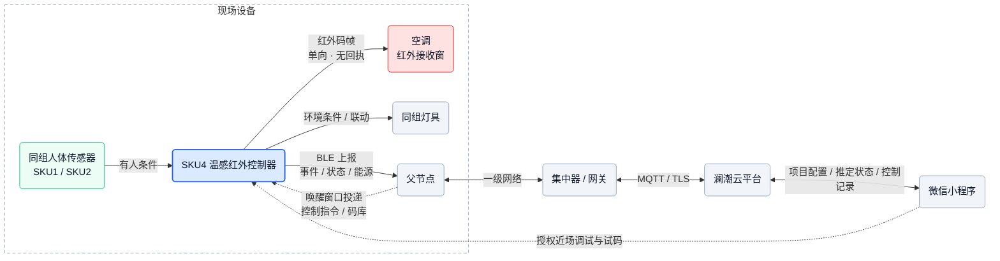

**拓扑上必须画出来的三件事**：

1. **红外那条线是单向的**，箭头只有一边。它不参与任何"确认"，平台上的"空调已开"是推定的。
2. **人体条件是可选输入**。没有 SKU1/SKU2 时，本机只能按"时段 + 温度"控制，不管有没有人。
3. **码库与指令走同一条下行链路**，但优先级不同：控制指令优先于码库更新（见 4.7.3）。

#### 3.1.2 硬件架构拓扑

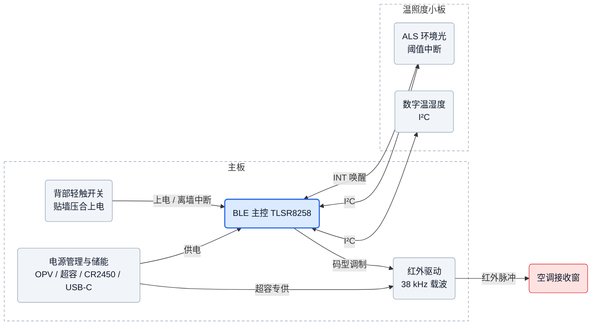

**注意 IRD 的供电路径**：它单独从超容取电，不经电池支路。这是硬件级约束，不是软件策略——软件只能决定"发不发"，不能决定"从哪取电"。

#### 3.1.3 供能与能量路径

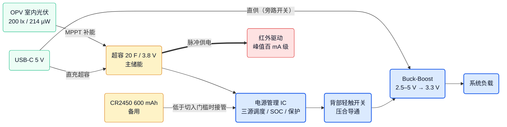

**为什么这条粗箭头是整份文档的关键**：红外发射是脉冲大电流，纽扣电池的内阻（几十欧）会把它变成一次电压崩塌。超容的低内阻正好能吃下这个脉冲。所以"能不能打红外"本质上不是软件功能，而是**超容里还有没有电**。

### 3.2 场景

| 场景 | 环境特征 | 控制需求 | 推荐形态 | 关键约束 |
| --- | --- | --- | --- | --- |
| 酒店客房 | 有人入住才开，离房要关 | 插卡/无人关空调、入住前预冷 | A 微能量 | 需与门磁/PIR 条件组合 |
| 办公室独立间 | 工作时间使用 | 下班自动关、超温自动开 | A 微能量 | 避免频繁启停 |
| 会议室 | 短时高负荷 | 会前预冷、会后关 | A 微能量 | 人多升温快，需快速响应 |
| 教室 | 白天使用、假期停用 | 定时开关、温度上限 | A 微能量 | 假期长时间无人，注意电池 |
| 机房 / 弱电间 | 常年运行、无窗 | 超温告警 + 强制制冷 | C USB 外供 | 不允许因低电停止控制 |
| 商铺 / 门店 | 营业时段使用 | 开门前开、打烊后关 | A 微能量 | 与营业时间表对齐 |

### 3.3 用户角色

| 角色 | 核心诉求 | 成功判据 | 需要的权限 |
| --- | --- | --- | --- |
| 物业 / 酒店工程 | 远程开关、无人自动关、电费下降 | 空调能耗降 20%+；误开关投诉少 | 只读看板 + 批量控制 |
| 工程安装商 / FAE | 一次对准、码库能匹配 | 单点试码 ≤3 次通过；>300 点位/人日 | 项目安装权限 + 近场试码 |
| 系统集成 / 运维 | 知道空调到底开没开 | 推定状态可核对、可疑可告警 | 配置权 + 超管（受控） |
| 住客 / 使用者 | 按了有反应、别乱改温度 | 无"关不掉""自己开"投诉 | 仅本地点控（若配面板） |

### 3.4 安装姿态与红外朝向

| 姿态 | 推荐位置 | 适用 | IR 朝向 |
| --- | --- | --- | --- |
| 壁挂（空调侧上方） | 距空调接收窗 2～4 m，偏角 ≤30° | 分体挂机客房、办公室 | 正对接收窗，略下倾 |
| 顶装（近空调） | 吊顶靠近室内机，2.6～3.2 m | 柜机、天花机 | 下倾 30～45°，避开灯槽 |
| 侧装 | 墙面/立柱，与接收窗等高 | 立柜式空调 | 水平正对 |
| 反射式 | 朝向浅色墙面/天花板 | 无法直视接收窗的位置 | 依赖反射，需实测验证 |

姿态、朝向与距离必须写入配置（`mountMode` + `irAim`）。**这是本机与 SKU3 最大的安装差异**：SKU3 只要"读数有代表性"，本机还多一条"红外能打到"。

## 04 功能需求

### 4.0 需求总览

本机比同系列多一个模块——它是唯一带执行器的型号，所以功能需求是 13 组而不是 12 组。

| 模块 | 编号段 | 解决什么问题 | 优先级 |
| --- | --- | --- | --- |
| LPN 能源管理 | FR-1xx | 含红外脉冲供电，别把自己打没电 | P0 |
| 通信与安全 | FR-2xx | 三条通道 + 链路加密 + 指令防重放 | P0 |
| BLE 组网与鉴权 | FR-3xx | 两种入网路径与三重鉴权 | P0 |
| 事件机制 | FR-4xx | 什么算事件、发给谁、丢了怎么办 | P0 |
| 心跳与快捷收件 | FR-5xx | 区分失联，并且 30 s 内能收到指令 | P0 |
| 时间同步 | FR-6xx | 指令、码库、状态都带可信时间 | P0 |
| OTA 与码库更新 | FR-7xx | 固件和码库都要能安全升级 | P1 |
| 运维与超管 | FR-8xx | 远程取证、试码、修正推定状态 | P0 |
| 联动策略 | FR-9xx | 温度怎么变成空调动作，且不折腾压缩机 | P0 |
| 环境采样 | FR-10xx | 照度/温湿度采得准、判得清 | P0 |
| **红外控制** | **FR-11xx** | **码库、发射、幂等、推定状态** | P0 |
| 选点与对准 | FR-12xx | 装之前先确认"打得到" | P0 |
| 离墙检测 | FR-13xx | 被拿走要喊出来 | P0 |

### 4.1 LPN 能源管理（FR-1xx）

**要点**：本机的能源模型比同系列多一项——**红外发射的脉冲能耗**。传感器是"滴水"，红外是"开闸放水"，两者不能用同一套预算口径。

#### 4.1.1 供能与切换

| ID | 需求描述 | 优先级 | 验收口径 |
| --- | --- | --- | --- |
| FR-101 | 支持 OPV + 超容、CR2450、USB 三源接入，按电源管理芯片规则自动切换；一次电池与充电路径隔离，禁止反充。 | P0 | 三源分别单独接入均可开机；电池支路反向电流为 0 |
| FR-102 | USB 5 V 可独立持续供电，并给超容补能。超容 2.5→3.5 V <10 min；补能期间采样与收件不中断。 | P0 | 记录充电曲线；插拔 100 次无重启 |
| FR-103 | 超容低于切入门槛（候选 2.6 V）时切备用电池，回升后按 0.1 V 回差切回。 | P0 | 切入/切回各 20 次，无抖动、无掉电复位 |
| FR-104 | 离墙（开关弹起）后切断负载，整机漏电 ≤2.5 µA；停止采样、收件、心跳与上报。 | P0 | 源表长时记录 ≥72 h；6 个月库存压降 <1 V |
| FR-105 | 每次上电识别原因：贴装下压 / 看门狗 / 供电恢复 / 软复位 / **发射跌落复位**，无法区分时上报"未知"。 | P0 | 五种原因分别注入，`bootCause` 均正确 |
| FR-106 | 临近断电时用预留电量发末次状态（Last Gasp），记录是否送达。 | P0 | 100 次断电试验上报成功率 ≥95% |
| FR-107 | 分别估算超容可用能量与电池剩余容量，记录供电源与切换历史；无法估算时显示"未知"。 | P0 | SOC 误差 ≤±10%；六态电池状态均可判 |
| FR-108 | 硬件保护（欠压关断、过流、过温）优先于任何软件策略；**发射期间的过流保护不得被软件屏蔽**。 | P0 | 拉低电压至保护点，输出按硬件关断；短路 IR 不烧板 |

#### 4.1.2 能源分级与调度

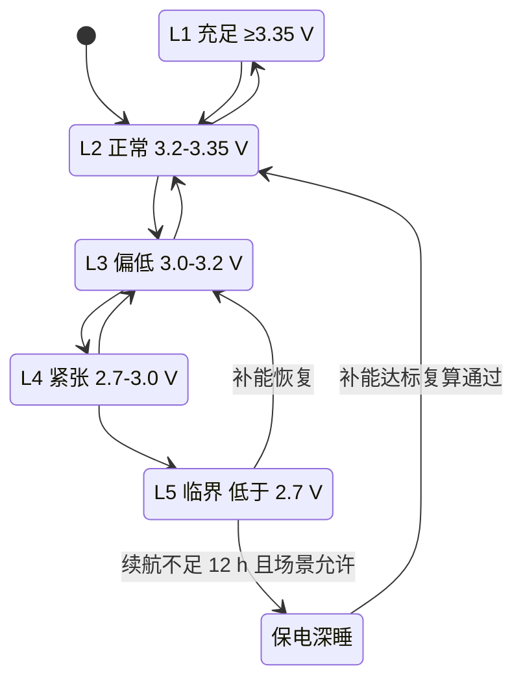

| 等级 | 超容电压（候选） | 采样 | 快捷收件 | 红外发射 | 发射功率 |
| --- | --- | --- | --- | --- | --- |
| L1 | ≥3.35 V | 快响应档可用 | 30 s 档 | 允许，单次 ≤3 帧 | 100% |
| L2 | 3.2～3.35 V | 标准档 | 60 s 档 | 允许，单次 ≤2 帧 | 100% |
| L3 | 3.0～3.2 V | 标准档降一档 | 60 s 档 | 允许，单次 1 帧 | 75% |
| L4 | 2.7～3.0 V | 省电档 | 120 s 档 | **仅关键指令**（关/开） | 50% |
| L5 | <2.7 V（电池已切入） | 省电档 | 停用 | **禁止** | 25% |

**为什么 L5 直接禁止发射**：电池内阻大，发射瞬间的电压跌落会把主控拉复位。与其"发一半重启"，不如明确拒绝并回原因码，让云端知道"这台设备现在不能控"。

#### 4.1.3 牺牲顺序与禁止项

| 顺序 | 牺牲什么 | 理由 |
| --- | --- | --- |
| ① | P2 类事件的聚合上报 | 只影响报表 |
| ② | 快捷收件频率（30 s → 60 s → 120 s） | 响应变慢，但仍可控 |
| ③ | 环境采样周期 | 影响曲线密度，读数仍准 |
| ④ | 单次发射帧数与重试次数 | 降低成功率，但保留功能 |
| ⑤ | 停发 P2，仅保 P0/P1 | 保留业务主干 |
| ⑥ | 禁止红外，仅上报"不可控" | 功能降级但状态透明 |
| ⑦ | 受控保电（停采停收） | 最后手段 |

**禁止项**

- 不得用电池支路直接驱动 IR LED（硬件级禁令）。
- 不得在超容电压低于发射门槛时"试着发一下"。
- 不得因低电把"空调状态"改成"已关"——只能标"未知/不可控"。
- 不得关闭安全类与完整性类事件（离墙、超容欠压、发射结果、缓存溢出）。

#### 4.1.4 保电与恢复

| ID | 需求描述 | 优先级 | 验收口径 |
| --- | --- | --- | --- |
| FR-109 | 预测完整服务续航 <12 h 且场景允许时才进入保电；先降收件频率、再停非关键事件，最后停采。 | P0 | 构造 12 h 边界，核对降级顺序 |
| FR-110 | 停采停收后，平台显示"设备受限"，空调状态标"未知"，禁止据此判定空调已关。 | P0 | 平台显示受限与未知 |
| FR-111 | 补能恢复后复核回差、发射余量（含单帧峰值）与收件预算，达标才恢复发射。 | P0 | 短时插拔未达门限时仍禁止发射 |
| FR-112 | 定期检查能源健康，低电或持续亏电时生成 USB 补能工单。 | P0 | 工单可生成、可关闭、可追溯 |

#### 4.1.5 能量预算（参考值，实测签核）

| 耗能项 | 标准档 | 说明 |
| --- | --- | --- |
| ALS 睡眠监控 | <1 µA | 阈值中断模式 |
| 温湿度采样（折算） | 1～2 µA | 60 s / 300 s |
| MCU 休眠 | 1～3 µA | — |
| 快捷收件（60 s 档窄窗） | 1.5～3 µA | 见 4.5.3 的占空估算 |
| 环境上报折算 | 0.5 µA | A 档聚合 |
| 超容漏电 | 2 µA | 器件固有 |
| 管理 IC + DC-DC | 2.3 µA | — |
| **合计（不含红外）** | **约 9～12 µA** | 目标 ≤12 µA |
| 红外发射（按 10 帧/日折算） | 约 1.5 µA | 单帧约 3.7 µAh，见 4.1.6 |

#### 4.1.6 红外发射的能量约束

**单帧能耗估算**（200 ms 帧长、载波占空 1/3、峰值 200 mA，待实测校正）：

| 项目 | 估算值 | 说明 |
| --- | --- | --- |
| 帧内平均电流 | ≈67 mA | 峰值 × 占空 |
| 单帧电荷 | ≈13.4 mAs ≈ 3.7 µAh | 平均电流 × 帧长 |
| 单帧能量 | ≈44 mJ | 3.3 V 折算 |
| 超容电压跌落 | ≈0.7 mV | ΔV = Q/C，20 F |
| 满电超容可发帧数 | ≈3000 帧 | 150 J ÷ 44 mJ，理论值 |
| 日补能可支撑帧数 | ≈200 帧/日 | 按日均补能约 10 J 估算；**全部补能只够 200 帧**，故预算须留余量 |

**三条由此推出的硬约束**：

1. **发射必须由超容供电**。CR2450 内阻约 20 Ω，200 mA 峰值会产生约 4 V 压降，主控必然复位——这不是"可能"，是"一定"。
2. **发射前必须校验余量**：超容电压 ≥ 门槛（候选 3.0 V）且预测发射后不低于保护点，否则拒绝并回原因码。
3. **日发射次数要管**：满电超容能发几千帧，但**补能一天只够几百帧**。所以策略必须合并指令、限制调温频次（见 4.9.3），否则设备会在两天内被"控"到没电。

| ID | 需求描述 | 优先级 | 验收口径 |
| --- | --- | --- | --- |
| FR-113 | IR LED 供电路径与电池支路物理隔离，仅由超容供电；硬件上不得存在电池直驱路径。 | P0 | 原理图评审 + 电池支路串电流探头实测发射瞬间无脉冲 |
| FR-114 | 发射前校验：超容电压、预测跌落余量、当前能量档；不满足则拒绝并回具体原因码（不静默丢弃）。 | P0 | 低电设备下发指令，平台读到明确拒绝码 |
| FR-115 | 单次指令的发射帧数上限可配（默认 2 帧，含码型规定的重复帧），超出即拒绝。 | P0 | 配置 3 帧时实际发 3 帧；超限被拒 |
| FR-116 | 日发射帧数预算可配（默认 60 帧/日，占日补能约 26%），超预算后仅放行"关空调"类关键指令。 | P1 | 构造超预算场景，关键指令仍可发 |
| FR-117 | 发射期间监测超容电压跌落，若低于保护点立即中止后续帧并记 E202（原因=能量跌落）。 | P0 | 注入低电压，发射中止且不复位 |
| FR-118 | 发射导致的异常复位必须可识别（`bootCause=发射跌落复位`）并上报，不得与看门狗复位混淆。 | P0 | 强制跌落 20 次，复位原因全部正确 |

### 4.2 通信与安全（FR-2xx）

**要点**：本机的下行链路比其他 SKU 更"重"——它要传控制指令和码库，不只是配置。所以除了加密，还要防**重放**与**过期指令**。

#### 4.2.1 三通道出口模型

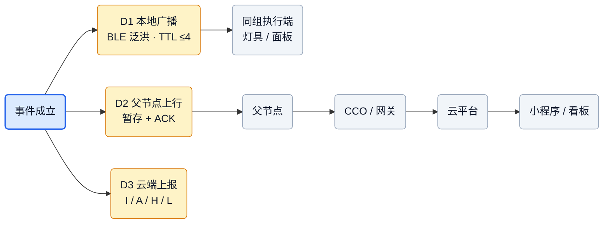

| 通道 | 目的 | 典型时延 | 确认语义 | 失败处理 |
| --- | --- | --- | --- | --- |
| D1 本地广播 | 让灯/面板立刻动作 | ≤300 ms | 执行端短 ACK | 重播 2 次；3 次无确认报 E606 |
| D2 父节点上行 | 把事件交进网络 | 1 个唤醒窗口内 | 父节点 ACK | 未 ACK 则本地保留重传 |
| D3 云端上报 | 可统计、可追溯 | I ≤1 s / A 15 min～24 h / H 随心跳 / L 不上报 | 设备侧投递完成 | 按档缓存补报 |

> 红外不在三条通道里——它是**设备自己的执行动作**，不经过任何网络。这一条必须在培训里讲清，否则现场会把"广播没 ACK"和"空调没动"混为一谈。

| ID | 需求描述 | 优先级 | 验收口径 |
| --- | --- | --- | --- |
| FR-201 | 三条通道独立调度、独立记录，任一通道故障不得影响另两条与红外执行。 | P0 | 三组故障交叉注入，红外仍可本地触发 |
| FR-202 | 下行控制指令携带 `cmdId`、目标码型、参数、有效期；设备按 `cmdId` 幂等处理。 | P0 | 同 `cmdId` 重复投递 20 次，只发一次红外 |
| FR-203 | 过期指令（超过有效期）必须拒绝执行并回原因码，不得"补发"。 | P0 | 构造过期 5 min 的指令，不产生发射 |
| FR-204 | 网络角色固定：`devClass=HARVEST_LEAF`、`canRelay=false`、`maxHopDepth=3`。 | P0 | 拓扑中永不为父节点 |
| FR-205 | 单父节点直挂 ≤8 台；8 台同时上报 1 s 内确认，丢包 <1%。 | P0 | 满载与第 9 台被拒分别验证 |
| FR-206 | 父节点失联后 ≤3 min 重挂载并更新路由；重挂后未过期指令重新验权后投递。 | P0 | 断父节点后计时；换父后指令仍可达 |

#### 4.2.2 BLE 链路安全

| 层 | 措施 | 说明 |
| --- | --- | --- |
| 身份 | 一机一密；机身码与密钥绑定 | 扫码照片、复制 MAC 不能通过鉴权 |
| 配对 | LE Secure Connections 配对与绑定 | 未配对设备不得下发控制指令 |
| 链路保护 | 协议栈 AES-CCM + 应用层认证加密 | 防中间人、防篡改 |
| 指令防护 | `cmdId` + 会话序号 + 有效期 + 权限校验 | 防重放、防越权控制他人房间 |
| 密钥管理 | 按设备/项目/组隔离，支持轮换与失效 | 日志禁止出现密钥 |

| ID | 需求描述 | 优先级 | 验收口径 |
| --- | --- | --- | --- |
| FR-207 | 设备↔父节点、设备↔执行端、近场维护三条链路均须提供机密性、来源认证与完整性校验。 | P0 | 逐段抓包验证；篡改报文被拒 |
| FR-208 | 拒绝明文降级。 | P0 | 强制协商失败，连接断开而非降级 |
| FR-209 | **控制指令必须验权到"空间"级**：A 房间的控制权不得用于 B 房间，即使同项目。 | P0 | 跨房间下发 100% 被拒 |
| FR-210 | 近场维护会话独立鉴权、限时（≤30 min），到期自动退出。 | P0 | 超时后连接被拒 |
| FR-211 | 红外码库下发须校验版本与完整性（签名/哈希），损坏的码库不得覆盖现有可用版本。 | P0 | 注入损坏码库，原码库仍可用 |

### 4.3 BLE 组网与鉴权（FR-3xx）

**要点**：两条入网路径，一套鉴权标准。对本机而言，绑定关系还多一层含义——**它决定了这台设备"有资格控哪个房间的空调"**。

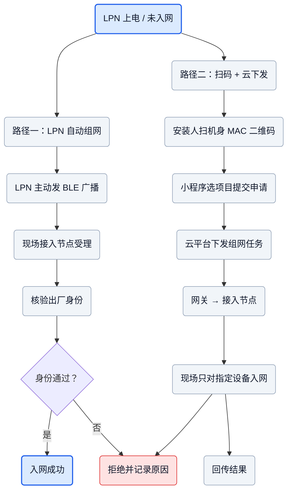

| ID | 需求描述 | 优先级 | 验收口径 |
| --- | --- | --- | --- |
| FR-301 | **路径一（本地自动组网）**：未入网 LPN 主动广播，由现场节点受理；断公网仍可完成。 | P0 | 断公网 10 台均成功入网 |
| FR-302 | **路径二（扫码 + 云下发）**：扫码 → 选项目 → 云下发 → 指定设备入网 → 结果回传。 | P0 | 端到端 ≤60 s |
| FR-303 | 两条路径使用同一套鉴权与同一条事件通道，入网后行为一致。 | P0 | 两种方式入网行为逐项一致 |
| FR-304 | **绑定即授权**：绑定后设备获得该空间的空调控制权；解绑即失效，未过期指令一并作废。 | P0 | 解绑后再下发被拒 |
| FR-305 | **人**：账号须具备目标项目安装权限。 | P0 | 无权限申请 100% 被拒 |
| FR-306 | **设备**：核验出厂凭据 + 实机 MAC 与扫码 MAC 一致。 | P0 | 扫 A 装 B 100% 拦截 |
| FR-307 | **点位**：校验项目归属、范围、占用；白名单未通过标"待核"，禁止下发控制指令。 | P0 | 待核设备不能控空调 |
| FR-308 | 组网状态可查：未配网/发现/鉴权中/入网/待绑定/在线/离线或未知/重新入网。 | P0 | 八种状态均可构造 |
| FR-309 | 离线扫码可暂存，联网复核后放行；同笔申请只建一次绑定。 | P1 | 断网 10 单恢复后无重复 |

### 4.4 事件机制（FR-4xx）

**要点**：本机的事件要能回答一个别人不用回答的问题——**"这次到底发了没有、发成功了没有"**。所以红外执行必须有自己的事件，而不是混在"配置生效"里。

#### 4.4.1 事件生成原则

- **可判定**：触发条件是数值跨越或明确的执行结果，不是"大概发了"。
- **执行留证**：每次红外发射都要有终态（成功/失败/被拒），一指令一条。
- **不重复**：同一指令的重复帧不产生多条事件；同一 `cmdId` 只记一次终态。
- **坏数据不触发业务**：读数无效时不进入温控判定，也不产生控制指令。

#### 4.4.2 事件分类

| 编号段 | 类别 | 典型事件 | 是否可禁用 |
| --- | --- | --- | --- |
| E1xx | 环境感知 | 照度/温度/湿度变化、越限、遮挡、读数无效 | 告警类不可禁用 |
| E2xx | 红外执行与状态 | 指令受理、发射结果、推定状态变更、推定可疑、码库不匹配 | 执行类不可禁用 |
| E3xx | 能源与电源 | 能量不足、临界、临终上报、超容欠压、发射被拒 | 底线类不可禁用 |
| E4xx | 自检与安防 | 周期自检、通道故障、红外驱动故障、**离墙/脱落** | 安防类不可禁用 |
| E5xx | 生命周期与运维 | 上线、补报、配置生效/拒绝、OTA/码库状态、时钟偏差、缓存溢出 | 完整性类不可禁用 |
| E6xx | 联动与执行 | 照度联动、温控联动执行、联动确认超时 | 多数可禁用 |

#### 4.4.3 上报方式四档

| 档位 | 方式 | 时延 | 适用 |
| --- | --- | --- | --- |
| I | 即时 | ≤1 s | 发射结果、越限告警、离墙、故障 |
| A | 聚合 | 15 min～24 h | 环境曲线、状态变更历史 |
| H | 随心跳 | 300～1800 s | 当前读数、推定状态快照 |
| L | 仅本地 | 不上报 | 调试、高频明细 |

#### 4.4.4 确认、缓存与补报

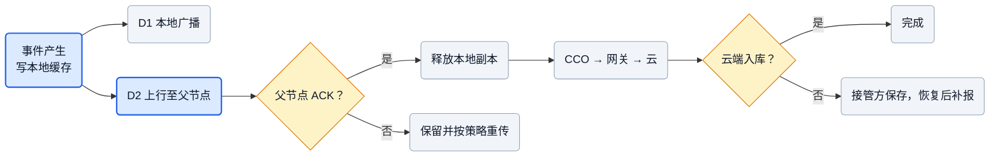

| ID | 需求描述 | 优先级 | 验收口径 |
| --- | --- | --- | --- |
| FR-401 | 每条事件独立配置：启用、是否本地广播、是否需确认、云端档位、聚合周期、包条数、重传次数。 | P0 | 逐条可配可读回；硬约束项拒绝禁用 |
| FR-402 | 发射结果、越限告警、通道故障、离墙锁定为不可禁用、必须确认、即时上报。 | P0 | 尝试禁用全部被拒（E505） |
| FR-403 | 断链缓存 ≥256 条；**发射结果优先保留**，环境曲线可降采样。 | P1 | 断网 24 h 后发射结果零丢失 |
| FR-404 | 恢复后分批补报：发射结果与告警优先，曲线按原时刻排序。 | P0 | 补报排序正确率 100% |
| FR-405 | 缓存溢出计数并上报丢弃条数（E508）。 | P1 | 三者可对账 |
| FR-406 | 关闭某可选事件后，采样、心跳、快照与红外执行继续运行。 | P0 | 关闭 E601 后，红外与心跳正常 |

#### 4.4.5 关键事件（节选，全量见附录 8.1）

| 编号 | 事件 | 触发条件 | 本地 | 云端 | 可禁用 |
| --- | --- | --- | --- | --- | --- |
| E101 | 照度变化 | 照度跨越阈值且超滞回 | 广播 | A 15 min | 否 |
| E102 | 设备心跳 | 周期上报三读数 + 推定状态快照 | 不广播 | H | 是 |
| E103 | 温度变化 | 温度变化 ≥tempDelta 并超滞回 | 不广播 | A 30 min | 是 |
| E104 | 湿度变化 | 湿度变化 ≥humiDelta 并超滞回 | 不广播 | A 1 h | 是 |
| E105 | 高温告警 | 温度 ≥tempThrHi 持续 3 个采样周期 | 不广播 | I | 否 |
| E201 | 指令受理 | 收到并通过校验的控制指令 | 不广播 | I | 否 |
| **E202** | **发射结果** | 一次指令的终态：成功/失败/被拒/中止 | 不广播 | I | 否 |
| E203 | 推定状态变更 | 推定状态字段发生变化 | 不广播 | H | 是 |
| E204 | 推定状态可疑 | 温度趋势与指令方向不符（见 4.11.5） | 不广播 | I | 否 |
| E205 | 码库不匹配 | 目标机型无可用码型或试码失败 | 不广播 | I | 否 |
| E206 | 发射无响应 | 连续 N 次发射后温度无变化（疑似未对准/空调故障） | 不广播 | I | 否 |
| E303 | 发射被拒 | 能量、权限、码型或有效期不满足 | 不广播 | I | 否 |
| E404 | 红外驱动故障 | LED 开路/短路、驱动无输出 | 不广播 | I | 否 |
| **E407** | **离墙/脱落** | 背部开关弹起 | 广播警示 | I | 否 |
| E504 | 配置生效 | 参数生效，含实际执行值 | 不广播 | A 1 h | 是 |
| E506 | OTA/码库状态 | 下载/校验/安装/成功/失败/回滚 | 不广播 | I | 是 |
| E508 | 缓存溢出 | 队列满并丢弃 | 不广播 | I | 否 |

### 4.5 心跳与快捷收件（FR-5xx）

**要点**：本节是本机与同系列最大的架构差异。SKU1/SKU2 可以"两小时一次心跳"，因为它们只上报；本机要**接受控制**，而人按下"开空调"之后等 2 小时是不可接受的。

#### 4.5.1 心跳

| ID | 需求描述 | 优先级 | 验收口径 |
| --- | --- | --- | --- |
| FR-501 | 入网后按实际周期发送心跳，携带三读数、推定状态摘要、能量档与码库版本。 | P0 | 连续 7 天，心跳无中断 |
| FR-502 | 标准档 300～1800 s 可配；低电时延长并上报实际周期。 | P0 | 平台显示周期 = 设备实测周期 |
| FR-503 | 心跳与协议保活分离。 | P0 | 关闭心跳上报后保活仍正常 |
| FR-504 | 连续 3 个应到周期未收到实时消息判离线；父节点失联时平台显示"未知"并展示最近通信时间。 | P0 | 三周期判离线；恢复后自动上线 |

#### 4.5.2 为什么需要"快捷收件"

如果只靠心跳窗口收指令，最坏要等一整个心跳周期（300 s 以上）。而产品承诺是 30～60 s。解决办法不是"把心跳调快"（那会让日均功耗翻几倍），而是**在心跳之间插入极窄的接收窗，并让父节点在约定时刻发信标对齐**。

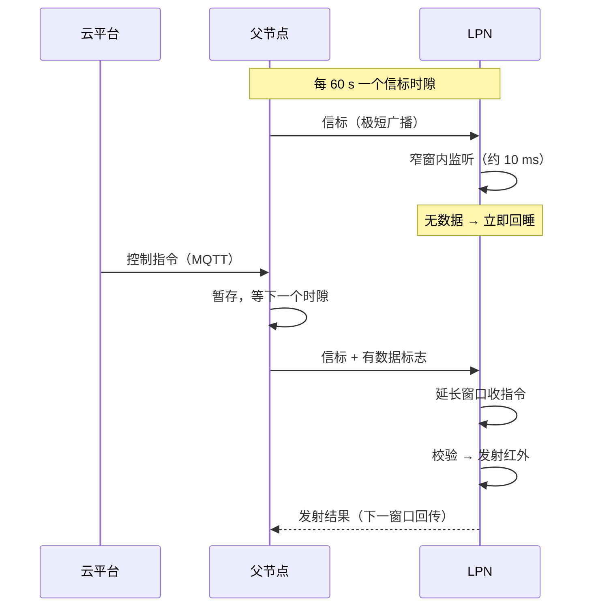

| ID | 需求描述 | 优先级 | 验收口径 |
| --- | --- | --- | --- |
| FR-505 | 支持快捷收件：在心跳之间按配置周期开启窄接收窗（30/60/120 s 三档），默认 60 s。 | P0 | 三档均可配置并回读 |
| FR-506 | 窄窗由父节点信标对齐，单次开窗时长 ≤20 ms；无数据立即回睡，不得"等满" | P0 | 实测开窗时长与占空符合设计值 |
| FR-507 | 有数据时窗口可延长至完成收包（上限可配），收完立即回睡。 | P0 | 收包后电流 5 s 内回落 |
| FR-508 | 云控响应：云端受理 → 完成第一帧有效发射，A/C 形态 ≤30 s（目标）/≤60 s（上限）。 | P0 | 覆盖"刚错过时隙"与批量竞争场景 |
| FR-509 | 快捷收件与心跳、上报共用射频但独立调度，不得互相阻塞。 | P0 | 并发注入，三者均正常 |
| FR-510 | 低电时按 4.1.2 逐档降低收件频率，并**上报实际收件周期**，让云端知道指令最坏要等多久。 | P0 | 平台显示实际周期 |

**这个设计的代价必须说清**：60 s 档按每次 10 ms、接收电流 5 mA 估算，占空约 0.017%，日均约 2 µA；若改成"每 30 s 开 200 ms 窗"的传统做法，日均会到 33 µA，直接超预算三倍。**窄窗 + 信标对齐不是优化，是这个产品能不能成立的前提。**

### 4.6 时间同步与时间戳（FR-6xx）

**要点**：本机的时间除了给事件排序，还决定**指令是否过期**和**定时策略是否该执行**。时间不可信时，宁可不动。

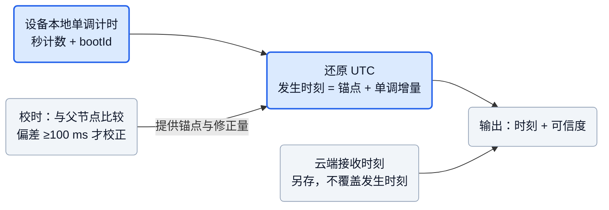

| ID | 需求描述 | 优先级 | 验收口径 |
| --- | --- | --- | --- |
| FR-601 | 持续维护本地计时与开机标识；每次采样、每次发射记录本地时刻。 | P0 | 断网 24 h 的记录仍带时刻 |
| FR-602 | 唤醒后对时；偏差 <100 ms 保持原值，≥100 ms 才校正并记 E507。 | P0 | 90/110 ms 门限正确；校后 <20 ms |
| FR-603 | 事件与 BLE 报文携带 `ts` + `bootId` + `tsConf`。 | P0 | 抓包可见三字段 |
| FR-604 | 发生时间由接入端还原为 UTC，云端另记接收时间。 | P0 | 补报排序正确率 100% |
| FR-605 | 时间不可信时：① 拒绝带有效期的指令；② 暂停定时策略；③ 事件标降级。 | P0 | 三种行为均可复现 |
| FR-606 | 换电池、复位、换父后必须重新校时。 | P0 | 换电重启后时间与策略状态正确 |

### 4.7 OTA 与码库更新（FR-7xx）

**要点**：本机要升级两种东西——**固件**和**码库**。它们走同一条下行链路，但风险不同：固件升坏了设备变砖，码库升坏了空调失控。

#### 4.7.1 双通道升级

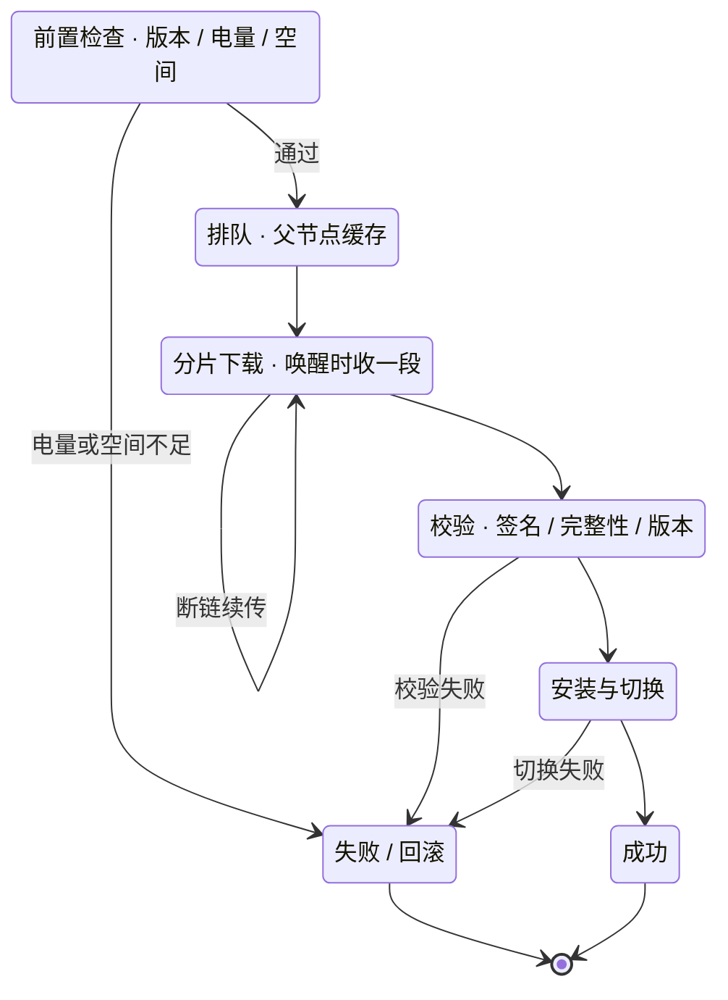

| ID | 需求描述 | 优先级 | 验收口径 |
| --- | --- | --- | --- |
| FR-701 | 升级前校验版本、能量、Flash 剩余空间与码库兼容性；不满足则拒绝并回原因码。 | P0 | 低电设备申请升级，平台读到明确拒绝码 |
| FR-702 | 父节点缓存升级包，设备每次唤醒收一段，支持断点续传。 | P1 | 中断 5 次后仍能完成 |
| FR-703 | **码库分区独立于固件分区**：码库更新不得擦除固件，固件升级不得清空码库（除非版本声明不兼容并显式提示）。 | P0 | 分别升级 20 次，另一侧数据完好 |
| FR-704 | 码库更新采用双分区或"新版本校验通过才切换"策略，损坏码库不得覆盖现有可用版本。 | P0 | 注入损坏包 10 次，原码库仍可用 |
| FR-705 | 升级与码库下发状态记 E506，失败与回滚强制上报。 | P0 | 六种状态均可复现 |
| FR-706 | 升级失败必须回到可工作版本并重新入网，不得变砖；回滚后码库仍可用。 | P0 | 传输与切换阶段各断电 50 次，均可恢复 |
| FR-707 | **控制指令优先于码库下发**：码库传输期间收到控制指令，暂停传输先执行指令。 | P0 | 并发注入，指令时延不劣化 |

### 4.8 运维与超管（FR-8xx）

**要点**：本机的运维核心不是"重启"，而是**把"按了没反应"这件事拆开**——是没收到指令、没发出去、还是发出去了空调没收到。

| 级别 | 能力 | 典型操作 | 授权要求 |
| --- | --- | --- | --- |
| L0 只读 | 看读数、推定状态、发射记录 | 查最近 8 次发射结果与原因码 | 项目只读 |
| L1 配置 | 改阈值、策略、收件频率 | 改目标温度、回差、启停间隔 | 项目管理员 |
| L2 诊断 | **现场试码**、读码库版本、强制发射测试帧 | 确认是否对准、码型是否匹配 | 运维/FAE |
| L3 超管 | 重启、清缓存、重发完整状态帧、修正推定状态、换绑 | 救活假死设备、纠正漂移 | 双人复核 + 限时会话 |

| ID | 需求描述 | 优先级 | 验收口径 |
| --- | --- | --- | --- |
| FR-801 | 支持远程强制心跳：立即上报三读数、推定状态、能量档与码库版本。 | P0 | ≤1 个收件周期收到 |
| FR-802 | 支持远程试码：下发指定码型的测试帧（通常为"开关"），返回发射结果，由现场观察空调是否动作。 | P0 | 试码 ≤3 s 内发出；结果可回读 |
| FR-803 | 支持远程读取发射日志：最近 8 次指令的 `cmdId`、码型、参数、结果、原因码、时刻。 | P0 | 字段完整，可导出 |
| FR-804 | 支持**推定状态校正**：授权人从小程序选择空调实际状态（开/关/模式/温度），设备按该状态重发完整帧对齐并刷新置信度。 | P0 | 校正后置信度变为"已确认"，记录操作人 |
| FR-805 | 支持远程重启与强制复位；记录原因、时间、操作人。 | P0 | 100 次远程重启无变砖 |
| FR-806 | 支持远程清理事件缓存（含丢弃计数），清理计入 E508 对账。 | P1 | 清理后可对账 |
| FR-807 | 超管会话限时（≤30 min）、一次一授权、全程审计；不得突破能量底线与安全红线。 | P0 | 会话过期被拒；审计可查 |
| FR-808 | 近场维护（BLE GATT）提供同等能力子集：试码、读码库、改参数、导出日志。 | P0 | 现场无网可用；试码 ≤5 min |
| FR-809 | 本地改参后进入"待确认"，72 h 告警、7 天回退，回退前 24 h 通知。 | P0 | 三态流转正确 |

### 4.9 联动策略（FR-9xx）

**要点**：这是本机唯一能"闭环"的地方——温度高了就开空调，温度到了就停。但闭环不等于随便开关，**压缩机经不起折腾**。

#### 4.9.1 输入与输出

| 输入 | 用途 | 备注 |
| --- | --- | --- |
| 温度（含有效性） | 温控主判据 | 无效时不下发 |
| 湿度 | 除湿联动 | 与温度联合判断 |
| 照度 | 白天/夜间模式、辅助判断 | 不作为空调主判据 |
| 人体状态（可选，来自 SKU1/SKU2） | "有人才开"条件 | 无此输入时按时段控制 |
| 时段 | 定时开关、夜间限温 | 依赖可信时间 |

| 输出 | 说明 |
| --- | --- |
| 红外完整状态帧 | 开关 + 模式 + 温度 + 风速 + 扫风 |
| 推定状态更新 | 每次发射后立即更新并标"推定" |

#### 4.9.2 决策流程

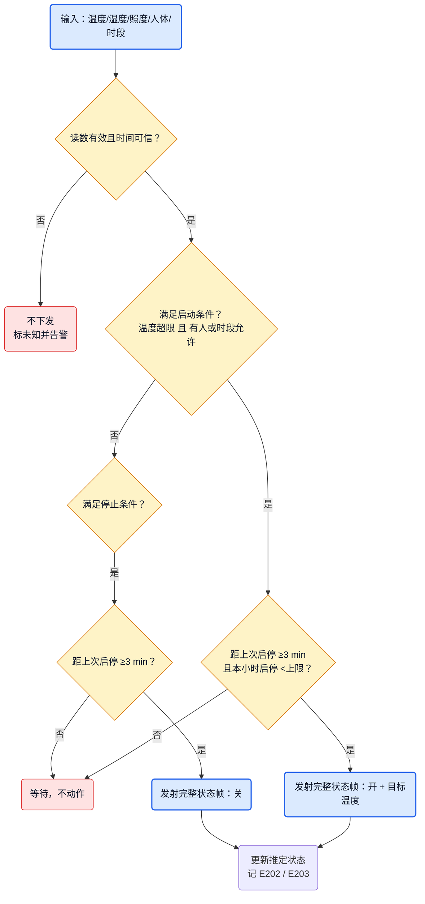

#### 4.9.3 联动需求

| ID | 需求描述 | 优先级 | 验收口径 |
| --- | --- | --- | --- |
| FR-901 | 温控规则要素：目标温度、回差（默认 1 ℃）、启动阈值、停止阈值、时段、是否需人体条件。 | P0 | 六要素任意组合可生效并读回 |
| FR-902 | **压缩机保护**：两次启停之间最小间隔 ≥3 min（可配 3～10 min）；同一小时内启停次数 ≤6 次。 | P0 | 构造频繁越限，实际启停次数符合限制 |
| FR-903 | 每次控制下发**完整状态帧**（含目标温度与模式），不下发"仅调温"的增量键，避免状态累积漂移。 | P0 | 抓包可见完整字段；连续调温 20 次后推定状态仍自洽 |
| FR-904 | 规则触发的指令与云端手动指令冲突时：手动优先，并在抑制窗口内（默认 30 min）不再自动反向调整。 | P0 | 手动设定后 30 min 内不被自动改回 |
| FR-905 | 人体条件联动：无"有人"信号时，仅在时段允许的前提下运行；人离开超过 T_vacant（默认 30 min）后关空调。 | P1 | 构造成人离开，按延时关闭 |
| FR-906 | 夜间/无人时段温度上下限保护：低于下限不制冷、高于上限才允许制热。 | P1 | 构造越界场景，动作符合限制 |
| FR-907 | 每次动作记录规则版本、输入读数与时刻、目标码型、`cmdId`、发射结果与原因。 | P0 | 一次控制可完整追溯 |
| FR-908 | 读数无效或时间不可信时，暂停自动温控并保持当前空调状态（不主动关），并上报原因。 | P0 | 人为遮挡传感器，空调不被误关 |
| FR-909 | 多台设备控同一空间时，只允许一台为"主控"，其余为只读，避免互相打架。 | P0 | 双主控配置被拒并提示 |
| FR-910 | **同房间多台空调**：指令必须携带目标码型与目标标识，避免一台设备把两台空调同时切换。 | P0 | 双空调房间验证，仅目标空调响应 |

### 4.10 环境采样（FR-10xx）

**要点**：与 SKU3 同一套机制，但口径不同——本机的环境数据是**控制输入**，不是报表数据。所以"有效性"比"精度"更关键。

#### 4.10.1 核心参数

| 参数 | 取值 | 说明 |
| --- | --- | --- |
| `luxSamplePeriod` | 5 / 10 / 30 / 60 s | 默认 10 s；本机不需要 1 s 级快响应 |
| `tempSamplePeriod` | 30 / 60 / 300 s | 默认 60 s；温控要求比报表更密 |
| `humiSamplePeriod` | 60 / 300 / 600 s | 默认 300 s |
| `tempDelta` / `humiDelta` | 0.5 / 1.0 / 2.0 ℃；3 / 5 / 10 %RH | 变化上报阈值 |
| `τ_therm` | ≤3 min | 外壳热时间常数，硬件决定 |

| ID | 需求描述 | 优先级 | 验收口径 |
| --- | --- | --- | --- |
| FR-1001 | 照度用带阈值中断的 ALS，睡眠期间持续监控，跨阈值才唤醒主控。 | P0 | 24 h 唤醒次数符合设计值 |
| FR-1002 | 温度采集周期与阈值可配；20→30 ℃ 阶跃到事件发出 ≤5 min。 | P0 | 阶跃 20 次取 P95 |
| FR-1003 | 湿度采集周期与阈值可配；30→60 %RH 阶跃 ≤10 min。 | P0 | 同上 |
| FR-1004 | 三路采样解耦，光照快采样不拖累温湿度，反之亦然。 | P0 | 并发注入均正常 |
| FR-1005 | 读数有效性：区分正常/超量程/缺测/未标定/过期；**无效值不得作为温控输入**。 | P0 | 五类状态可构造；无效时不发射 |
| FR-1006 | 温湿度偏移校准可配（现场单点），偏移量随诊断快照可读。 | P1 | 校准后偏差收敛 ±0.5 ℃ / ±3 %RH |
| FR-1007 | 长时间无变化时按周期发快照（H 档），避免平台分不清"没变化"与"没数据"。 | P0 | 静置 24 h 仍有快照 |
| FR-1008 | 照度仅用于模式判断（白天/夜间）与辅助联动，不单独触发空调开关。 | P0 | 单独改照度不产生空调指令 |

### 4.11 红外控制（FR-11xx）

**要点**：这是本机全部复杂度的来源。它要同时解决四件事——**发什么（码库）、怎么发（发射与幂等）、发完算不算成功（结果与证据）、以及"现在空调到底什么状态"（推定）**。

#### 4.11.1 码库与机型适配

| 来源 / 层级 | 内容 | 约束 |
| --- | --- | --- |
| **开源码库** | GitHub 社区维护的红外码集，导入后统一归一化 | 仅接受宽松许可证；须登记仓库与版本；去重后入库 |
| **现场补充** | 现场采集后统一入库、以码型包形式下发 | 采集工装与审批在外部完成，本机只接收合格码型包 |
| 预置码库 | 出厂内置：开源精选 + 已采集码型的稳定子集 | 受 Flash 512 KB 限制，容量上限见 D-03 |
| 项目码库 | 云端按项目机型清单下发 | 版本化；增量更新；与固件内置包共用版号 |
| 试码 | 同一机型尝试多个候选码型，由现场确认 | 单点 ≤3 次应通过 |
| 自学习（P2） | 设备直接学习原遥控器波形，存 16 个波形槽 | 兜底手段，不替代码库 |

> 本节新增需求采用**追加编号**（FR-1140 起），不去改动既有编号，避免打乱已发出的测试用例与接口文档。

| ID | 需求描述 | 优先级 | 验收口径 |
| --- | --- | --- | --- |
| FR-1101 | 码库按"品牌 + 机型 + 码型 ID + 版本"组织，设备可按机型检索可用码型。 | P0 | 检索命中率按项目清单 ≥95% |
| FR-1102 | 支持候选码型列表与试码流程：依次发射候选帧，由现场确认后锁定该码型。 | P0 | 单点试码 ≤3 次通过率 ≥90% |
| FR-1103 | 码型锁定后写入配置并绑定该点位；换机/换点位须重新确认。 | P0 | 换绑后旧码型不沿用 |
| FR-1104 | 码库容量不足时，优先保留本项目已用码型，其余按使用频次淘汰。 | P1 | 构造空间不足，已用码型不丢 |
| FR-1105 | 无匹配码型时明确降级：只上报环境，不显示"可控"，并报 E205。 | P0 | 平台显示"不可控"而非"控制失败" |
| FR-1106 | 学习模式（P2）：录制原遥控器波形并存槽，回放验证通过后可用。 | P2 | 学习成功率按机型记录 |

##### 4.11.1.1 码库来源与准入

码库是本机唯一可能踩到**知识产权**的资产。两个来源的性质完全不同，管理方式也必须不同：

| 来源 | 性质 | 主要风险 | 管理重点 |
| --- | --- | --- | --- |
| GitHub 开源码库 | 社区共享，质量参差 | **许可证传染性**、字段不规范、重复与错误码型 | 许可证白名单 + 归一化 + 抽检 |
| 现场采集后入库 | 自建资产，最贴近真实机型 | 采集质量、脏数据入库 | 由工具链保证；本机只接收校验通过的码型包 |

**许可证只认宽松型**。这是一条法务红线，不是偏好：

| 许可证 | 能否直接编入闭源固件 | 处置 |
| --- | --- | --- |
| MIT / BSD-2 / BSD-3 / Apache-2.0 / CC0 / Unlicense | 可以 | 保留版权声明与来源记录 |
| LGPL | 有条件 | 需法务逐案评估；本机 Flash 紧张，不建议动态链接方案 |
| GPL-2.0 / GPL-3.0 / AGPL | **不可以** | 从码集中剔除；或仅作参考、由我方重新采集验证后入库 |

> 实务提醒：很多 GitHub 红外码库是"数据仓库"而非"软件仓库"，作者常直接标 MIT 或 CC0；但也有仓库把码表放在 GPL 项目里。**导入前必须逐个仓库看 LICENSE 文件，不能只看 README 的措辞**。

| ID | 需求描述 | 优先级 | 验收口径 |
| --- | --- | --- | --- |
| FR-1140 | 开源码库导入执行许可证白名单：仅接受 MIT/BSD/Apache-2.0/CC0/Unlicense；GPL 类一律剔除。 | P0 | 逐仓库出具许可证判定记录，无例外 |
| FR-1141 | 每个码库来源须登记：仓库地址、commit/版本、许可证、导入日期、审阅人、原始文件哈希。 | P0 | 任一条码型可反查到来源与版本 |
| FR-1142 | 导入后统一归一化：载波频率、占空比、帧结构、位长、引导码/结束码、重复次数，字段规范一致。 | P0 | 归一化后 100% 通过格式校验 |
| FR-1143 | 去重与冲突处理：同一"品牌+机型+功能"多来源冲突时，标记冲突并按实机验证结果取一。 | P0 | 冲突清单可见，未验证的冲突码不入预置库 |
| FR-1144 | 开源码库实机抽检：抽检比例 ≥10%，用样机验证发射有效；不合格批次整批退回。 | P0 | 抽检记录与结论可查 |

##### 4.11.1.2 码型包接收侧

现场遇到"执行失败"，本质是码库里没有这台空调的正确码型。补码途径有两条：开源码库导入（4.11.1.1），以及现场采集后统一入库。

> **范围说明**：现场采集所用的收码工具、后台归一化与入库审批，属 FAE 现场工装与码库平台的职责，**不在本 PRD 范围**（另见 FAE 工具与码库准入规范）。本机只负责"接收码型包 → 校验 → 写入 → 标记来源 → 必要时回滚"。

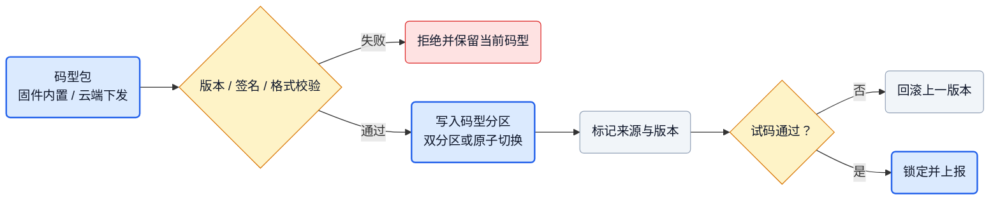

| ID | 需求描述 | 优先级 | 验收口径 |
| --- | --- | --- | --- |
| FR-1149 | 码型来源标记：`OPEN_SOURCE` / `FIELD_CAPTURE` / `VENDOR`，随码型 ID 存储并可反查。 | P0 | 任一码型可显示来源类型与凭据 |
| FR-1150 | 码型包双轨分发：固件内置包（随版本）与云端码库包（增量），共用同一版号与格式。 | P0 | 两轨下发的同版码型行为一致 |
| FR-1151 | 码型包回滚：新包导致失效时可回退上一版本，回退后已锁定码型仍可用。 | P0 | 注入坏包，回滚后控制恢复 |
| FR-1153 | 码型包与固件版本兼容性校验：不兼容的包拒绝写入并回原因码，不得"半写入"。 | P0 | 构造不兼容包，原码型完好 |
| FR-1154 | 码型分区容量不足时拒绝新包并上报，不得覆盖已锁定的在用码型。 | P0 | 构造满载，已锁定码型不丢 |

> 采集工装与审批虽不在本机范围内，但有一条会回流到产品：**新码型必须能通过云端增量包下发到已装机设备**，否则每补一次码就要等一个固件版本。这就是 FR-1150 存在的理由。

#### 4.11.2 发射与幂等

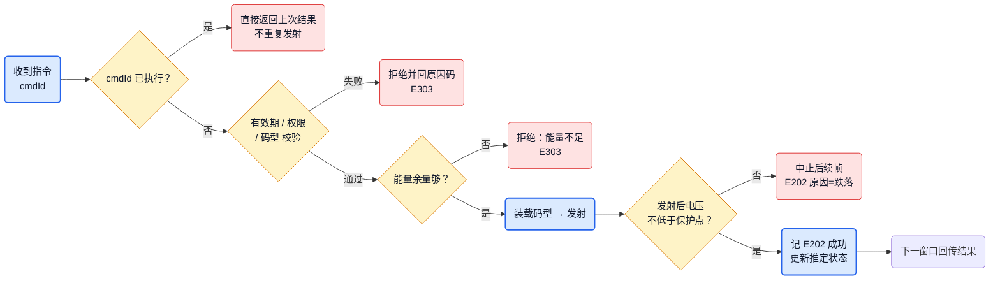

| ID | 需求描述 | 优先级 | 验收口径 |
| --- | --- | --- | --- |
| FR-1107 | 幂等：以 `cmdId` + 目标 + 码型版本 + 有效期去重；重复到达只执行一次，返回同一结果。 | P0 | 重复投递 20 次，仅 1 次发射 |
| FR-1108 | 重复点击抑制：同一用户同一动作在 3 s 内重复提交，只执行一次。 | P0 | 连点 5 次，动作 1 次 |
| FR-1109 | 发射失败重试：同一 `cmdId` 最多重试 2 次，间隔 ≥1 s；仍失败记终态。 | P0 | 构造遮挡，重试次数与终态正确 |
| FR-1110 | 码型规定的重复帧（部分空调要求连发 2～3 次）由固件按码型参数执行，不计入业务重试次数。 | P0 | 抓包帧数与码型定义一致 |
| FR-1111 | 发射电流、载波频率（38 kHz）、占空比在码型允许误差内；不同品牌差异由码型参数表驱动，不硬编码。 | P0 | 示波器抽测 5 个品牌码型 |
| FR-1112 | 发射结果必须在下一收件窗口回传（E202），不得等下一次心跳。 | P0 | 云端可见时延 ≤1 个收件周期 |

#### 4.11.3 为什么坚持"完整状态帧"

部分码库支持"只发温度+"这种增量键。看似省电，实则是**漂移的加速器**：一旦有一条指令没送到，后续所有增量都建立在错误基线上。

| 方式 | 单帧长度 | 能耗 | 漂移风险 | 结论 |
| --- | --- | --- | --- | --- |
| 增量键（只发温度+） | 短 | 低 | 高：一次丢失，后续全错 | 不采用 |
| 完整状态帧 | 长（约 2～3 倍） | 中 | 低：每次都是全量对齐 | **采用** |

| ID | 需求描述 | 优先级 | 验收口径 |
| --- | --- | --- | --- |
| FR-1113 | 所有控制指令一律下发完整状态帧，包含开关、模式、目标温度、风速、扫风等支持字段。 | P0 | 20 次连续操作的帧内容自洽 |
| FR-1114 | 码型不支持某字段时（如无扫风），按码型能力表裁剪并在结果中注明"字段未支持"。 | P0 | 结果字段与码型能力一致 |

#### 4.11.4 单向红外的推定状态

**这是本机最容易出事、也最需要讲清的地方**。空调不会回话，所以"空调现在开没开"永远是推断出来的。

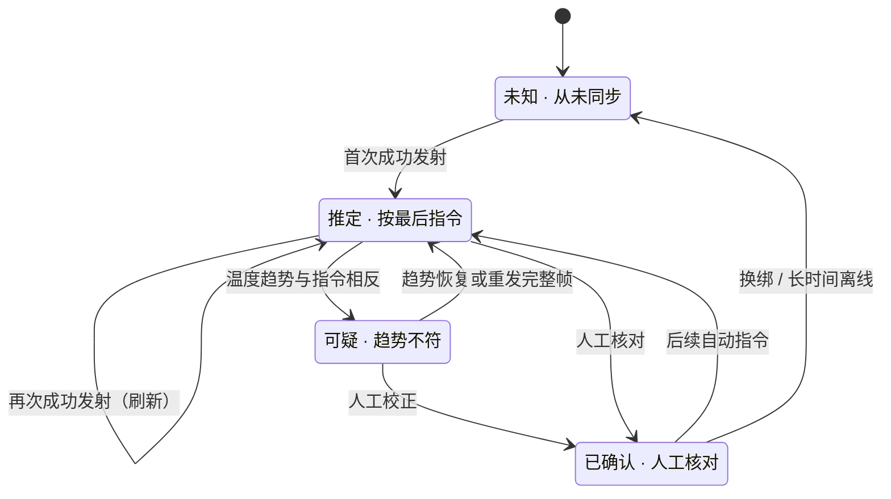

| 置信度 | 含义 | 平台展示 | 能否用于自动控制 |
| --- | --- | --- | --- |
| 已确认 | 人工核对过实际状态 | "已确认（操作人/时间）" | 可以 |
| 推定 | 按最后成功发射推算 | "推定（最后指令时间）" | 可以，但需标注 |
| 可疑 | 温度趋势与推定不符 | "可疑（建议核对）" | **不用于自动反向调整** |
| 未知 | 从未同步或长期离线 | "未知" | 不可以 |

| ID | 需求描述 | 优先级 | 验收口径 |
| --- | --- | --- | --- |
| FR-1115 | 维护推定状态：开关、模式、目标温度、风速、扫风、最后同步时间、置信度、来源。 | P0 | 字段完整，随心跳上报摘要 |
| FR-1116 | **不得把推定状态显示为实测状态**：所有界面必须标注"推定/已确认/可疑/未知"。 | P0 | 界面走查，无"已开启"等无来源表述 |
| FR-1117 | 状态来源分三类：云端指令、本地规则、人工校正；每次变更记录来源与 `cmdId`。 | P0 | 任一状态可回溯到具体来源 |
| FR-1118 | 重启、掉电、换绑后推定状态置"未知"，不得沿用旧值。 | P0 | 断电重启后显示未知 |

#### 4.11.5 漂移检测与自愈

漂移的三大来源：**人用原装遥控器、空调自身保护停机、断电**。本机不能"看见"，但可以"推断"。

| 手段 | 做法 | 能发现什么 |
| --- | --- | --- |
| 完整状态帧 | 每次全量对齐 | 防止增量累积误差 |
| 温度趋势交叉验证 | 下发制冷后 15 min 内温度未下降 ≥0.5 ℃ → 标"可疑" | 指令未生效、被遥控器改回、空调故障 |
| 定期全量对齐 | 每日一次或每次开机后重发当前推定状态 | 静默漂移 |
| 人工校正 | 小程序选择实际状态 → 重发完整帧 | 一切无法自动判断的情况 |

| ID | 需求描述 | 优先级 | 验收口径 |
| --- | --- | --- | --- |
| FR-1119 | 温度趋势验证：制冷/制热指令后 T_verify（默认 15 min）内温度未朝预期方向变化 ≥0.5 ℃，标"可疑"并报 E204。 | P0 | 构造遮挡/断电空调，可稳定触发 |
| FR-1120 | 连续 N 次（默认 3 次）发射后温度均无响应，报 E206（疑似未对准或空调故障）。 | P0 | 遮挡 IR 或关空调电源，可稳定触发 |
| FR-1121 | 每日首次唤醒或每 24 h 重发一次当前推定状态，作为静默对齐。 | P1 | 对齐记录可查 |
| FR-1122 | 人工校正后必须重发完整帧，并把置信度置"已确认"；校正记录含操作人与时刻。 | P0 | 校正后状态与空调实际一致 |
| FR-1123 | 检测到"外部操作"的间接证据（温度突变且无本机指令记录）时，标"可疑"，不擅自改状态。 | P1 | 用手动遥控器操作后可触发可疑 |

#### 4.11.6 温控闭环与压缩机保护

| 参数 | 默认 | 范围 | 说明 |
| --- | --- | --- | --- |
| 目标温度 | 26 ℃ | 16～30 ℃ | 制冷/制热分别设定 |
| 回差 | 1 ℃ | 0.5～2 ℃ | 防抖 |
| 最小启停间隔 | 3 min | 3～10 min | 压缩机保护，硬约束 |
| 每小时启停上限 | 6 次 | 3～10 次 | 防频繁启停 |
| T_verify | 15 min | 5～30 min | 趋势验证窗口 |
| T_vacant | 30 min | 10～120 min | 无人关空调延时 |

| ID | 需求描述 | 优先级 | 验收口径 |
| --- | --- | --- | --- |
| FR-1124 | 最小启停间隔与每小时上限为**硬约束**，任何配置（含云端批量下发）不得突破。 | P0 | 尝试下发 1 min 间隔被拒 |
| FR-1125 | 制冷与制热的目标温度、回差分别配置，切换模式时重新校验限制。 | P0 | 模式切换后参数正确 |
| FR-1126 | 达到目标温度后停止压缩机（发"关"或"送风"），不得长期低频运行。 | P1 | 稳态后不再持续制冷 |

#### 4.11.7 安全红线（不得实现）

| 红线 | 原因 |
| --- | --- |
| 不得控制电辅热、变频模块参数等厂家专用高危指令 | 误操作可能损坏设备或引发安全风险 |
| 不得在无人值守时下发"强力/极速"类高负荷模式并长时间保持 | 能耗与设备寿命风险 |
| 不得绕过最小启停间隔"抢开" | 压缩机损坏风险 |
| 不得向未绑定空间发射 | 越权控制，等同入侵 |
| 不得在码库未确认的机型上"盲发" | 可能误触发其他设备（见 4.9 的串扰） |

| ID | 需求描述 | 优先级 | 验收口径 |
| --- | --- | --- | --- |
| FR-1127 | 码库只允许包含"开关/模式/温度/风速/扫风/睡眠"等白名单字段；高危指令不得入库。 | P0 | 码库审查，无高危字段 |
| FR-1128 | 未完成试码确认的机型，只能发射"开关"测试帧，不得发射温控帧。 | P0 | 未确认机型下发调温被拒 |

#### 4.11.8 发射性能要求

| ID | 需求描述 | 优先级 | 验收口径 |
| --- | --- | --- | --- |
| FR-1129 | 视距 3 m、偏角 ≤30°、常温条件下，单次发射成功率 ≥99%。 | P0 | 每机型 100 次，失败 ≤1 |
| FR-1130 | 发射距离：正视 5 m 内可用；反射路径 3 m 内可用（视基材）。 | P1 | 逐距离实测并记录 |
| FR-1131 | 发射角：水平 ±30°、垂直 ±20° 内有效；超出范围应提示"未对准"。 | P0 | 逐角度实测 |
| FR-1132 | 连续发射后的 LED 温升与驱动温升不超器件限值；不得因过热降功率而导致后期失败。 | P0 | 连续 100 帧后测温 |

### 4.12 选点与红外对准（FR-12xx）

**要点**：其他 SKU 选点只关心"读数有没有代表性"，本机还要多问一句——**"这只管子打得到空调吗"**。打不到，前面所有功能都归零。

#### 4.12.1 选点四问

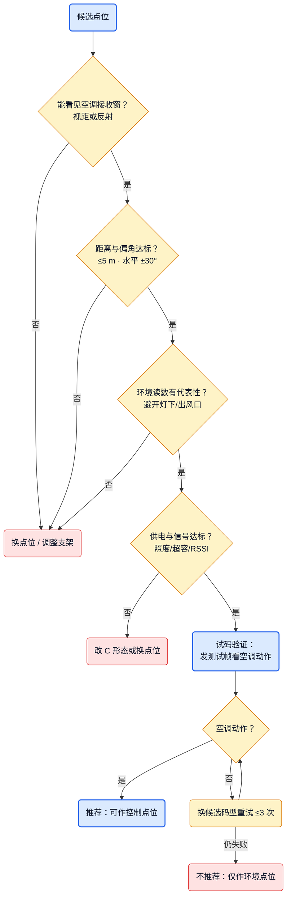

#### 4.12.2 选点需求

| ID | 需求描述 | 优先级 | 验收口径 |
| --- | --- | --- | --- |
| FR-1201 | 选点必须确认"空调接收窗可见性"：视距或反射路径，记录距离、水平偏角、垂直偏角、遮挡物。 | P0 | 点位表含四项；缺失不允许提交 |
| FR-1202 | **试码是选点的必经步骤**：未通过试码的点位标"仅环境"，不得配置温控策略。 | P0 | 未试码点位无法启用温控规则 |
| FR-1203 | 试码流程：App 触发测试帧 → 现场观察空调 → 确认成功/失败 → 自动记录机型、码型、距离、角度。 | P0 | 单点试码 ≤3 次通过率 ≥90% |
| FR-1204 | 环境代表性判定（同 SKU3）：照度避开灯下直射，温湿度避出风口与热源；不达标提示换位。 | P0 | 灯下/出风口点位可识别 |
| FR-1205 | 供电与信号判定：日均照度 ≥30 lx 或可 USB 取电；RSSI 达签核门限。 | P0 | 背光点位提示改形态 |
| FR-1206 | 结论三档：**推荐**（可控 + 可感知）/ **仅环境**（可感知不可控）/ **不推荐**（换点位）。 | P0 | 三档可构造，文案无歧义 |
| FR-1207 | 同房间多台空调时，记录"目标空调标识"，避免误控邻机。 | P0 | 双空调房间可区分 |
| FR-1208 | 点位表导出含：楼层/房间/SKU/姿态/朝向/距离/角度/码型/试码结果/标定/规则/验收结论。 | P0 | 导出字段完整 |

#### 4.12.3 打不到怎么办（本机只有板载发射）

**本机不提供外置发射头**，只有板载 IR LED 经机身开窗发射。所以"打不到"只能靠**调角、借反射、换点位**三招解决，不能靠加配件。

| 情形 | 处置 | 代价 |
| --- | --- | --- |
| 点位在空调侧上方但角度过大 | 可调角支架，俯仰 0～45° 内调整 | 低，首选 |
| 有遮挡，但可借反射 | 朝浅色墙面/天花板反射，现场实测确认 | 中，需验证 |
| 完全无直达/反射路径 | 换点位；或该点位只做环境，控制交给另一台 | 高，需重新布点 |
| 装修/灯槽挡住机身开窗 | 换点位（本机无法外接发射头绕过） | 高 |

> 原"外置发射头"相关需求（FR-1209～1215）已随方案取消删除；下列需求为板载发射的安装与判定约束。

| ID | 需求描述 | 优先级 | 验收口径 |
| --- | --- | --- | --- |
| FR-1216 | 支架俯仰 0～45° 可调并锁定；振动与清洁后不得自行偏移。 | P0 | 调整后锁定；振动台验证 |
| FR-1217 | 发射窗透红外衰减 ≤10%，且不得被铭牌、装饰环、灯槽遮挡；安装检查表须含此项。 | P0 | 透射率实测；检查表含该项 |
| FR-1218 | 打不到时由 App 按"调角 → 反射 → 换点位 → 仅环境"顺序引导，并记录最终选择。 | P1 | 四步引导可复现，选择可查 |
| FR-1219 | 未对准判定：连续 3 次发射且 T_verify 内温度无响应 → 报 E206，并给出"检查朝向/遮挡"的具体指引。 | P0 | 遮挡发射窗可稳定触发 |

> **必须在方案阶段就说明**：本机不是"装上就能控"。红外是光学链路，受遮挡、角度、反射率影响，且**没有外接发射头可以兜底**。把"控不到"当成故障去报修，是这类产品最常见的售后浪费。

### 4.13 离墙检测（FR-13xx）

**要点**：与 SKU1/SKU3 同族的机制——**开关即防拆**。本机被拿走意味着一个房间的空调失去控制，告警必须即时。

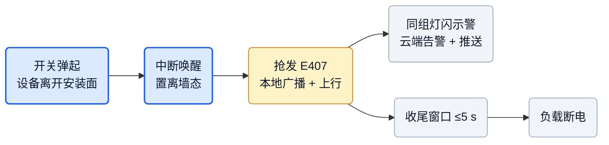

| ID | 需求描述 | 优先级 | 验收口径 |
| --- | --- | --- | --- |
| FR-1301 | 背部 SPDT 轻触开关：贴墙压合导通，离墙弹起断开；弹起产生硬件中断。 | P0 | 分离后 ≤50 ms 产生中断 |
| FR-1302 | 弹起后进入收尾窗口（≤5 s），完成广播与一次上行后再断电。 | P0 | 20 次拔离，平台收到 ≥19 次 |
| FR-1303 | 上报 E407（即时、不可禁用、必须 ACK），原因码区分人为拆卸与贴装失效。 | P0 | 20 次拆卸原因码正确 |
| FR-1304 | 离墙后平台把该设备的空调状态标"不可控"，禁止继续下发控制指令。 | P0 | 拔离后下发被拒 |
| FR-1305 | 支持布防/撤防，默认全天布防。 | P1 | 撤防仅留痕 |
| FR-1306 | 开关寿命 ≥5000 次；振动中不得弹起。 | P0 | 5000 次后复测；振动台验证 |
| FR-1307 | 离墙检测不得因低电、OTA、发射而失效。 | P0 | 低电与升级期间拔离仍告警 |

## 05 非功能需求

**要点**：本机比同系列多两类非功能风险——**光生物安全**（发射管对着人）与**脉冲负载可靠性**（每次发射都是一次小型冲击）。

### 5.1 安规（Safety）

| 编号 | 项目 | 依据标准 | 要求 | 验收 |
| --- | --- | --- | --- | --- |
| NFR-101 | 整机安全 | GB 4943.1-2022（等同 IEC 62368-1） | 按 ES1 能量源设计；可触及部件无危险电压；外壳阻燃 ≥V-1（建议 V-0） | 第三方报告 |
| NFR-102 | 超容储能安全 | 按元器件 + 整机能量评估 | 20 F 超容按 ES2 评估：端子防短路、防反接；维修前须放电 | 设计评审 + 短路试验 |
| NFR-103 | USB 输入安全 | GB 4943.1 | 5 V SELV；限流 ≤300 mA；防反灌 | 反灌与过流试验 |
| NFR-104 | 一次锂电池安全 | GB 8897.4（等同 IEC 60086-4） | 防反充隔离、防短路；**须验证发射瞬间脉冲不倒灌电池** | 电池厂报告 + 脉冲试验 |
| NFR-105 | **红外光生物安全** | IEC 62471 / GB/T 20145 | 整机按 **豁免类（Class 1）** 评估：正常使用与近距离（≥20 cm）直视均不超限值 | **第三方检测机构出具报告**（不接受自测结论） |
| NFR-106 | 温升 | GB 4943.1 | 连续发射 100 帧后，外壳与 LED 周边温升不超限值 | 热电偶 + 热像仪 |
| NFR-107 | 机械安全 | 整机 | 无锐边；支架承重 ≥3 倍整机重量；吊顶件防坠 | 拉力与结构评审 |
| NFR-108 | 标识与警示 | 整机 | 铭牌含型号、电气参数、厂名、批次；**红外发射窗附近标注"请勿长时间直视"** | 铭牌评审 |

> **送测样机状态（第三方检测必读）**：光生物安全的结论与"最坏工况"强相关，送测必须用**能产生最大辐照的组合**——最高占空比码型、最长帧、双发射头同时工作（若支持）、满电超容供电。用"典型码型"送测得到的 Class 1 结论，不能代表现场最坏情况。
>
> 送测需一并提交：码型参数表（载波/占空/峰值电流）、发射头数量与布局、结构与开窗图、最坏工况说明。缺任一项，报告结论的适用范围会被限缩。

### 5.2 EMC（电磁兼容）

本机的 EMC 有两处与同系列不同：**发射瞬间的脉冲电流**（传导骚扰源）与**38 kHz 调制的边带**（辐射骚扰源）。

| 编号 | 项目 | 依据标准 | 限值/要求 |
| --- | --- | --- | --- |
| NFR-111 | 辐射骚扰 | GB/T 9254.1（等同 CISPR 32）Class B | 30 MHz～1 GHz、1～6 GHz；**须在"连续发射"工况下测** |
| NFR-112 | 传导骚扰 | GB/T 9254.1 Class B | USB 供电时电源端；含发射脉冲工况 |
| NFR-113 | BLE 杂散与占用带宽 | 按 SRRC 型号核准要求 | 2.4 GHz 功率、占用带宽、带外发射合规 |
| NFR-114 | 发射脉冲谐波 | GB/T 9254.1 | 38 kHz 调制的低次谐波与开关瞬态不超标 |

| 编号 | 项目 | 依据标准 | 试验等级 | 判定 |
| --- | --- | --- | --- | --- |
| NFR-121 | 静电放电 ESD | GB/T 17626.2 | 接触 ±4 kV，空气 ±8 kV | 判据 B：可自恢复、不丢配置、**不误发射** |
| NFR-122 | 电快速瞬变 EFT | GB/T 17626.4 | 电源端 ±2 kV，信号端 ±1 kV | 判据 B；不误发射 |
| NFR-123 | 浪涌 Surge | GB/T 17626.5 | 线-线 ±1 kV；配适配器线-地 ±2 kV | 判据 B；不得损坏驱动 |
| NFR-124 | 射频辐射抗扰 RS | GB/T 17626.3 | 80 MHz～1 GHz，3 V/m | 判据 A：不误发射、读数不跳变 |
| NFR-125 | 射频传导抗扰 CS | GB/T 17626.6 | 0.15～80 MHz，3 V | 判据 A |
| NFR-126 | 工频磁场 | GB/T 17626.8 | 3 A/m | 判据 A |
| NFR-127 | 电压暂降与短时中断 | GB/T 17626.11 | USB 插拔瞬断 | 判据 B；复位后可自恢复并重新入网 |
| NFR-128 | 发射瞬态抗扰 | 整机 | 发射瞬间电压跌落时不得复位；相邻设备不得被误触发 | 20 次低电压发射，0 次误复位 |

### 5.3 无线与频谱合规

| 编号 | 区域 | 项目 | 要求 |
| --- | --- | --- | --- |
| NFR-131 | 中国大陆 | SRRC 型号核准 | 2.4 GHz BLE 须取得型号核准证 |
| NFR-132 | 中国大陆 | 微功率设备技术要求 | 2.4000～2483.5 GHz 满足限值（本机无雷达通道） |
| NFR-133 | 中国香港 | 无线电管理 | 2.4 GHz 一般属免牌照；保留报告备查 |
| NFR-134 | 通用 | 红外发射 | 红外为光辐射，不属无线电管理范畴；但须满足光生物安全（NFR-105） |
| NFR-135 | 通用 | 天线 | 板载天线，不可外接 |

### 5.4 合规（中国大陆 / 中国香港）

| 编号 | 区域 | 合规项 | 要求 |
| --- | --- | --- | --- |
| NFR-141 | 大陆 | 无线电 | SRRC 型号核准；铭牌标注核准代码 |
| NFR-142 | 大陆 | 有害物质 | GB/T 26572 限量；RoHS 报告与符合性声明 |
| NFR-143 | 大陆 | 电池 | GB 8897.4；MSDS |
| NFR-144 | 大陆 | 数据与隐私 | 只采集环境物理量与设备状态，不采集影像/音频/身份信息；控制记录按项目权限管理 |
| NFR-145 | 大陆 | 告知 | 点位说明 + 隐私告知卡（说明"无摄像头、无麦克风，红外仅用于空调控制"） |
| NFR-146 | 大陆 | 宣传口径 | 不得宣称"已获知空调真实状态"；不得使用绝对化用语；响应与成功率须标工况 |
| NFR-147 | 香港 | 无线电 | 按 OFCA 要求确认免牌照；保留报告 |
| NFR-148 | 香港 | 个人资料 | 遵循 PDPO：目的明确、最小必要、保留期不超必要 |
| NFR-149 | 香港 | 电气安全 | 参照 IEC 62368-1；随货适配器符合当地要求 |
| NFR-150 | 香港 | 标识 | 英文/繁体中文双语；电池回收说明；红外警示语 |
| NFR-151 | 通用 | **开源码库许可证** | 仅接受 MIT/BSD/Apache-2.0/CC0/Unlicense；GPL 类不得编入闭源固件；保留版权声明与来源清单，随固件归档 |
| NFR-152 | 通用 | 第三方码型授权 | 采购或受赠码库须有书面授权范围（可否商用、可否再分发、可否修改），无授权不导入 |

### 5.5 环境与可靠性

| 编号 | 项目 | 要求 | 说明 |
| --- | --- | --- | --- |
| NFR-161 | 工作温度 | -10～55 ℃ | 低温下超容内阻上升，发射余量下降，需专项验证 |
| NFR-162 | 存储温度 | -20～70 ℃ | 超容与电池均需评估 |
| NFR-163 | 工作湿度 | 10%～95 %RH（非凝露） | 凝露影响透镜与驱动 |
| NFR-164 | 防护等级 | IP30（设计目标） | USB 口与开关凹槽开盖不计入 |
| NFR-165 | 透气膜寿命 | 5 年透气率衰减 ≤20% | 高粉尘环境需清洁提示 |
| NFR-166 | 红外窗洁净 | 5 年内透红外衰减 ≤10% | 积尘会显著缩短发射距离，需清洁提示 |
| NFR-167 | 胶贴可靠性 | 常温 5 年不脱落；持粘力 ≥3 倍重量 | 四基材分别验证 |
| NFR-168 | 支架与朝向 | 支持 ±30° 俯仰调整并锁定；振动中不偏移 | **偏移会直接导致失控** |
| NFR-169 | 开关寿命 | ≥5000 次压合/弹起 | 镀金触点 |
| NFR-170 | USB 插拔寿命 | ≥500 次；长期插电 ≥2 年 | 验证浮充与接口氧化 |
| NFR-171 | 外观隐私 | 无镜头形态、无麦克风孔、无可见工作灯 | 盲测 10 人，≥9 人不认为是摄像设备 |

### 5.6 性能指标

| 编号 | 指标 | 口径 | 目标值 |
| --- | --- | --- | --- |
| NFR-181 | 云控响应（A 形态） | 云端受理 → 第一帧有效发射 | ≤30 s（目标）；≤60 s（上限） |
| NFR-182 | 云控响应（C 形态） | 同上，USB 外供 | ≤15 s |
| NFR-183 | 指令收件成功率 | 有效期内指令被设备收到的比例 | ≥99% |
| NFR-184 | 红外发射成功率 | 视距 3 m、偏角 ≤30° | ≥99% |
| NFR-185 | 发射距离 | 正视 / 反射 | 正视 5 m；反射 3 m（视基材） |
| NFR-186 | 发射角 | 水平 / 垂直 | ±30° / ±20° 内有效 |
| NFR-187 | 码库匹配率 | 按项目在册机型核算 | ≥95% |
| NFR-188 | 推定状态准确率 | 一周无人工干预后与实际一致比例 | ≥95% |
| NFR-189 | 温控精度 | 稳态室温与目标偏差 | ±1.5 ℃ |
| NFR-190 | 照度精度 | 0～2000 lux 标定后比对 | ±15% |
| NFR-191 | 温度精度 | 15～35 ℃ 区间 | ±0.5 ℃（系统级） |
| NFR-192 | 湿度精度 | 20～80 %RH | ±3 %RH |
| NFR-193 | 温度响应 | 20→30 ℃ 阶跃 | ≤5 min |
| NFR-194 | 标准档平均电流 | 含快捷收件（60 s 档） | ≤12 µA |
| NFR-195 | 含发射日均电流 | 10 帧/日折算 | ≤14 µA |
| NFR-196 | 无光续航（仅超容） | 满电至保护点，标准档 | ≥25 天 |
| NFR-197 | 纯电池续航 | 完全无光、日均 ≤14 µA，50% DOD | ≥2 年（含有限发射） |
| NFR-198 | USB 补电时长 | 边充边采，2.5→3.5 V | <10 min |
| NFR-199 | 发射中止保护 | 低电压时中止后续帧且不复位 | 20 次注入，0 复位 |
| NFR-200 | 离墙告警时延 | 离开安装面 → 云端可见 | ≤5 s |
| NFR-201 | 校时精度 | 单跳 2.4 GHz | 门限 100 ms；校后 <20 ms |
| NFR-202 | 配置回读一致率 | 逐条下发后读回 | 100% |

### 5.7 寿命与可维护性

| 项 | 目标 | 前提 |
| --- | --- | --- |
| 整机服务期 | 有条件的五年 | 允许按计划 USB 补能；不等于免维护 |
| IR LED | 5 年光衰 ≤20%（按日均 60 帧上限） | 高频使用点位需核对结温 |
| 超容 | 5 年可用能量衰减 ≤20% | 避免长期满充高温 |
| 备用电池 | 有光场景基本不消耗；低光 1.5～2 年更换 | 更换后须校时与恢复码型 |
| 码库 | 随固件/云端迭代，支持增量更新 | 容量不足时按项目裁剪 |
| 维护方式 | 远程诊断 + 现场试码 + 清洁 | 90% 异常可远程判定 |

## 06 测试与验收

### 6.1 验收矩阵

| 域 | 覆盖需求 | 关键用例 | 通过标准 |
| --- | --- | --- | --- |
| 组网与鉴权 | FR-301～FR-309 | TC-01～03、TC-35 | 两路径可入网；绑定即授权；解绑即失效 |
| 快捷收件 | FR-505～FR-510 | TC-50 | 30/60/120 s 三档；云控 ≤30/60 s |
| 红外发射 | FR-1107～FR-1114、FR-1129～FR-1132 | TC-17～19、TC-50 | 幂等；完整帧；成功率 ≥99% |
| 码库与试码 | FR-1101～FR-1106、FR-1202 | TC-52 | 匹配率 ≥95%；试码 ≤3 次通过 ≥90% |
| 推定状态 | FR-1115～FR-1123 | TC-30、TC-50 | 四态正确；漂移可识别；不冒充实测 |
| 温控与保护 | FR-901～FR-910、FR-1124～FR-1126 | TC-28、TC-31 | 启停间隔 ≥3 min；每小时 ≤6 次 |
| 能量与发射约束 | FR-113～FR-118 | TC-18、TC-23、TC-38 | 电池禁发；低电中止不复位 |
| 环境采样 | FR-1001～FR-1008 | TC-11～13、TC-20 | 精度与响应达标；无效值不触发 |
| 事件 | FR-401～FR-406 | TC-44、TC-45 | 逐条可配可读回；发射结果零丢失 |
| 心跳与时间 | FR-501～FR-504、FR-601～FR-606 | TC-04、TC-47 | 三周期判离线；时间不可信时拒绝过期指令 |
| OTA 与码库 | FR-701～FR-707 | TC-24～26、TC-57 | 双分区；损坏包不覆盖；指令优先 |
| 运维 | FR-801～FR-809 | TC-33、TC-36 | 试码可远程触发；校正刷新置信度 |
| 选点与对准 | FR-1201～FR-1208 | TC-52、TC-54 | 打不到的点位无法启用温控 |
| 离墙 | FR-1301～FR-1307 | TC-64、TC-65 | ≤5 s 告警；离墙后禁止下发 |
| 安全与认证 | NFR-101～NFR-171 | TC-38～42、TC-61～65 | 两区域报告齐备；光生物安全 Class 1 |

### 6.2 关键专项测试

| # | 专项 | 方法 | 判定 |
| --- | --- | --- | --- |
| 1 | 云控响应 | 云端受理后计时至空调动作（含外部红外工装记录） | P95 ≤30 s；上限 ≤60 s |
| 2 | 刚错过时隙 | 在时隙刚结束时下发指令 | 仍在上限内完成 |
| 3 | 幂等 | 同 `cmdId` 重复 20 次；同动作 3 s 内连点 5 次 | 各只动作 1 次 |
| 4 | 完整帧对齐 | 连续调温 20 次后核对推定与实际 | 无累积漂移 |
| 5 | 发射成功率 | 3 m / 5 m，±0°/±15°/±30° 各 100 次 | 3 m·±30° 内 ≥99% |
| 6 | 反射路径 | 浅色墙面/深色墙面各 50 次 | 记录衰减；深色墙面允许不达标但须提示 |
| 7 | 低电中止 | 拉低超容至发射门槛附近，下发指令 | 中止后续帧、不复位、回原因码 |
| 8 | 电池禁发 | 电池供电形态下发调温 | 拒绝并回"能量不足-电池形态" |
| 9 | 压缩机保护 | 强制频繁越限 1 h | 启停间隔 ≥3 min，次数 ≤6 |
| 10 | 状态漂移识别 | 用原装遥控器改状态后观察 | 15 min 内标"可疑"并报 E204 |
| 11 | 未对准识别 | 遮挡 IR 窗，连续 3 次发射 | 报 E206 |
| 12 | 双空调串扰 | 同房间两台同品牌空调 | 指令只作用于目标机 |
| 13 | 试码与锁定 | 5 个品牌各 3 台 | ≤3 次通过率 ≥90%；锁定后换绑失效 |
| 14 | 码库损坏 | 注入损坏包 10 次 | 原码库仍可用；不切换 |
| 15 | 光生物安全 | 20 cm 直视与连续发射 | 满足 Class 1 豁免 |
| 16 | 中断与补报 | 断网 24 h，含 20 次发射 | 发射结果零丢失；曲线按降采样还原 |
| 17 | 随机断电 | 断电 500 次（含发射中、OTA 中） | 变砖 0；码库与标定不丢 |
| 18 | 现场试点 | ≥100 点位、≥30 天，多品牌空调混合 | 控制失败工单 ≤2 次/点位/月 |

### 6.3 阶段交付与出口条件

| 阶段 | 周期 | 关键交付物 | 出口条件 |
| --- | --- | --- | --- |
| M0 需求冻结 | T0 – T+2W | PRD 会签、事件主表、码库规格、发射能量方案 | 三方会签；电池禁发路径原理图签核；光生物安全预评估 |
| M1 EVT | T+3 – T+10W | 功能样机、发射波形、低电中止、快捷收件、码库原型 | 发射成功率 ≥95%；中止不复位；云控 ≤60 s |
| M2 DVT | T+11 – T+20W | 码库匹配测试、对准角度、推定状态回归、温控保护 | 第 5 章指标达标或书面让步 |
| M3 PVT | T+21 – T+26W | 小批试产、试码工装、施工手册、认证送测 | 直通率 ≥95%；试码一次通过 ≥90% |
| M4 MP | T+27 – T+30W | 量产固件、码库版本冻结、培训包 | 试点 30 天达标；两区域准入证据齐备 |

## 07 风险与待决项

### 7.1 风险登记册

风险值 = 发生概率 × 影响程度（各 1～5 分）；15～25 高、8～14 中、1～7 低。

| 编号 | 风险 | 类别 | 概率 | 影响 | 等级 | 应对措施 | 责任 |
| --- | --- | --- | --- | --- | --- | --- | --- |
| R-01 | **红外打不到空调**（角度/遮挡/反射不足） | 技术 | 4 | 5 | **20 高** | 试码列为选点必经步骤（FR-1202）；可调角支架（FR-1216）；反射路径实测；本机无外置头可兜底，打不到只能换点位 | 结构 + 交付 |
| R-02 | **单向无回执导致状态漂移**（"关了还在转"） | 体验 | 4 | 4 | **16 高** | 完整状态帧；温度趋势验证；四态展示不冒充实测；人工校正 | 产品 + FW |
| R-03 | 发射瞬间电压跌落导致复位 | 技术 | 3 | 5 | **15 高** | 超容专供；发射前校验；跌落下限中止；复位原因可识别 | 硬件 + FW |
| R-04 | 码库覆盖不足（长尾品牌/老旧机型） | 依赖 | 4 | 3 | **12 中** | 码库按项目清单前置核对；试码兜底；自学习（P2） | 产品 + 云 |
| R-05 | 30–60 s 响应与功耗冲突 | 技术 | 3 | 4 | **12 中** | 窄窗 + 信标对齐；三档可配；上报实际周期 | FW + 网关 |
| R-06 | 压缩机频繁启停导致损坏 | 技术 | 3 | 5 | **15 高** | 最小间隔 3 min 硬约束；每小时上限；不得被配置突破 | FW + 产品 |
| R-07 | 同房间多台空调互相误控 | 技术 | 3 | 3 | 9 中 | 目标标识 + 完整帧；双机专项测试 | FW |
| R-08 | 电池形态无法控被当成故障 | 运营 | 4 | 2 | 8 中 | 平台显示"不可控-能量不足"；说明书明示 | 产品 + 云 |
| R-09 | 码库/固件升级占用 Flash 或带宽 | 技术 | 3 | 3 | 9 中 | 双分区；增量更新；指令优先于码库 | FW |
| R-10 | 积尘导致发射距离衰减 | 环境 | 3 | 3 | 9 中 | 红外窗清洁提示；透红外衰减指标 | 结构 + 交付 |
| R-11 | 离墙抢发失败 | 技术 | 3 | 4 | **12 中** | 收尾窗口 ≤5 s + 独立预算 | 硬件 + FW |
| R-12 | 支架角度被碰偏 | 体验 | 4 | 3 | **12 中** | 锁定结构；定期自检可发现（E206）；安装规范 | 结构 |
| R-13 | 光生物安全不达标 | 合规 | 2 | 4 | 8 中 | 限峰值电流；Class 1 预评估；铭牌警示 | 硬件 |
| R-14 | 被误认为摄像头 | 体验 | 2 | 4 | 8 中 | 无镜头形态；盲测；隐私告知卡 | ID + 产品 |

### 7.2 待决项

#### 7.2.1 已关闭（V1.1）

| 编号 | 事项 | 结论 | 落地位置 | 关闭人 / 日期 |
| --- | --- | --- | --- | --- |
| D-04 | 码库来源与授权 | **GitHub 开源码库为主，现场采集后统一入库补充**。开源部分执行许可证白名单（仅 MIT/BSD/Apache-2.0/CC0/Unlicense），GPL 类剔除。**收码工具属 FAE 现场工装，不在本产品范围**，本机只接收校验通过的码型包 | 4.11.1.1、4.11.1.2；FR-1140～1144、FR-1149～1151、FR-1153～1154 | 产品 + 法务；2026-11-21 |
| D-08 | 外置发射头是否纳入 BOM | **不纳入**。本机仅用板载 IR LED 经机身开窗发射，不提供外接线缆发射头；打不到的点位靠调角、借反射、换点位解决（本结论修正 V1.1 记录） | 2.5、4.12.3；FR-1216～1219 | 产品 + 结构；2026-11-21 |
| D-09 | 光生物安全评估方式 | **第三方检测**（IEC 62471 / GB/T 20145），不接受自测结论；送测须用最坏工况样机 | 5.1 NFR-105 及送测工况说明 | 认证；2026-11-21 |

> D-04 的关闭带一个**遗留约束**：开源码库的许可证判定必须"逐仓库看 LICENSE 文件"，不能凭 README 措辞。这条已写入 NFR-151，并由法务在每次导入时留判定记录。后续若引入**第三方商业码库**，视同新增来源，需重新过 D-04 流程（见 NFR-152）。

#### 7.2.2 仍待决（M0 前关闭）

| 编号 | 事项 | 决策方 | 现状 / 待定内容 |
| --- | --- | --- | --- |
| D-01 | IR LED 串数与峰值电流 | 硬件 | 决定发射距离与超容跌落；需与光生物安全送测工况联合定 |
| D-02 | 快捷收件实现路径 | FW + 网关 | 候选：父节点信标 + 窄窗 / 短周期取件 / 广播唤醒；须实测功耗与响应后定 |
| D-03 | 码库容量与裁剪策略 | FW + 云 | Flash 512 KB 下预置容量上限；开源精选 + 采集码型如何分配空间 |
| D-05 | 推定状态字段集 | 产品 + 云 | 是否包含扫风、睡眠、定时等；影响完整帧长度 |
| D-06 | 温度趋势验证阈值 | 算法 + TE | 0.5 ℃ / 15 min 为候选，需按房间热惯性标定 |
| D-07 | 最小启停间隔与每小时上限 | 产品 + FW | 3 min / 6 次为候选，需按空调厂家建议核对 |
| D-10 | 电池形态允许的"极短帧"范围 | 产品 + FW | 是否允许"关机"单帧；需实测电池脉冲能力 |
| D-11 | 认证清单与排期 | 认证 | 大陆 SRRC + RoHS；香港 OFCA + 安全 + **第三方光生物** |
| D-12 | 密钥与码库权限边界 | 安全 + 云 | 码库属核心资产，需明确下发与存储加密、采集数据归属 |

## 08 附录

### 8.1 事件清单

**E1xx 环境感知**

| 编号 | 事件 | 定义 |
| --- | --- | --- |
| E101 | 照度变化 | 跨越阈值且超滞回，携带当前值与有效性 |
| E102 | 设备心跳 | 三读数 + 推定状态摘要 + 能量档 + 码库版本 |
| E103 | 温度变化 | 变化 ≥tempDelta 并超滞回 |
| E104 | 湿度变化 | 变化 ≥humiDelta 并超滞回 |
| E105 | 高温告警 | 温度 ≥tempThrHi 持续 3 个采样周期 |
| E106 | 低温告警 | 温度 ≤tempThrLo 持续 3 个采样周期 |
| E107 | 高湿告警 | 湿度 ≥humiThrHi 持续 3 个采样周期 |
| E108 | 低湿告警 | 湿度 ≤humiThrLo 持续 3 个采样周期 |
| E109 | 采光面遮挡 | 照度长期低于该点位平常水平 ≥24 h |
| E110 | 读数无效 | 超量程、缺测、未标定、过期，附原因码 |

**E2xx 红外执行与状态**

| 编号 | 事件 | 定义 |
| --- | --- | --- |
| E201 | 指令受理 | 收到并通过校验的控制指令（含 `cmdId`、来源、参数） |
| E202 | 发射结果 | 一次指令的终态：成功 / 失败 / 被拒 / 中止，附原因码与耗时 |
| E203 | 推定状态变更 | 开关/模式/温度/风速等字段变化，附来源 |
| E204 | 推定状态可疑 | 温度趋势与指令方向不符，建议人工核对 |
| E205 | 码库不匹配 | 目标机型无可用码型或试码失败 |
| E206 | 发射无响应 | 连续 N 次发射后温度无变化，疑似未对准或空调故障 |

**E3xx 能源与电源**

| 编号 | 事件 | 定义 |
| --- | --- | --- |
| E301 | 能量采集恢复 | 采能回升至工作窗口并稳定 |
| E302 | 能量不足预警 | SOC 低于预警值 |
| E303 | 发射被拒 | 能量/权限/码型/有效期不满足，附原因码 |
| E304 | 临终上报 | 触及预留储备门限，强制发末次状态 |
| E305 | 上电启动 | 携带 `bootCause`（含发射跌落复位） |
| E306 | 保护性深休眠 | 强制停采停收，仅留能量监测 |
| E307 | 储能异常 | 充电斜率异常或自放电过快 |
| E308 | 采集源异常 | 采能长期低于地板值 |
| E309 | 安装照度不足 | 连续 48 h 日均照度低于门槛 |
| E310 | 采光面被遮挡 | 照度骤降并持续 ≥24 h |
| E311 | 超容欠压 | 预警 / 保护两档，回升后报解除 |
| E312 | 备用电池低电 | 端电压低于门限 |
| E313 | 备用电池耗尽/异常 | 耗尽或接触不良导致电压跳变 |
| E314 | 电池切入/退出 | 记录次数与累计供电时长 |
| E315 | 超容健康度下降 | 健康度跌破阈值 |

**E4xx 自检与安防**

| 编号 | 事件 | 定义 |
| --- | --- | --- |
| E401 | 周期自检报告 | 汇总传感、红外、电源、存储自检结果 |
| E402 | 照度通道故障 | ALS 无响应或持续超量程 |
| E403 | 温湿度通道故障 | 传感器无响应、校验错、读数恒为极限值 |
| E404 | 红外驱动故障 | LED 开路/短路、驱动无输出、载波异常 |
| E407 | 离墙 / 脱落 | 背部开关弹起，原因码区分拆卸与贴装失效 |
| E408 | 传感窗污染 | 照度偏低且湿度响应变慢，或透红外衰减 |

**E5xx 生命周期与运维**

| 编号 | 事件 | 定义 |
| --- | --- | --- |
| E501 | 设备上线 | 入网或重连成功 |
| E502 | 链路恢复补报 | 补报完成，携带丢失与补报条数 |
| E503 | 入网完成 | 首次配网完成 |
| E504 | 配置生效 | 参数生效，含来源与实际执行值 |
| E505 | 配置拒绝 | 非法值或触碰硬约束 |
| E506 | OTA/码库状态 | 下载/校验/安装/成功/失败/回滚 |
| E507 | 时钟偏差 | 校时修正量 |
| E508 | 缓存溢出 | 队列满并丢弃，上报条数 |
| E509 | 白名单校验失败 | 非本项目、越界、被占用或 MAC 不一致 |
| E510 | 供能形态变更 | A/B/C 切换记录 |
| E511 | 码型变更 | 试码确认或换绑导致的码型变化，含操作人 |

**E6xx 联动与执行**

| 编号 | 事件 | 定义 |
| --- | --- | --- |
| E601 | 照度阈值穿越 | 白天/夜间模式切换条件 |
| E602 | 温控联动执行 | 规则触发的温控指令与结果 |
| E604 | 免开灯判定生效 | 照度充足不输出开灯条件 |
| E606 | 联动确认超时 | 广播重播 2 次仍无执行端确认 |
| E607 | 手动接管 | 识别到人工操作并暂停自动控制 |
| E608 | 温控规则跳过 | 因启停间隔/次数上限/读数无效未执行，附原因 |

### 8.2 物模型核心属性

| 分组 | 属性 | 类型 | 读写 | 说明 |
| --- | --- | --- | --- | --- |
| 照度 | `lux` / `luxAvgDay` | uint32 | R | 当前 / 日均 |
| 照度 | `luxValid` | enum | R | VALID / OVER_RANGE / MISSING / UNCALIBRATED / STALE |
| 照度 | `luxK` | float | RW | 标定系数与版本 |
| 温湿度 | `temp` / `humi` | int16/uint16 | R | 0.1 ℃ / 0.1 %RH |
| 温湿度 | `tempThrHi/Lo`、`humiThrHi/Lo` | int16/uint16 | RW | 告警阈值 |
| 温湿度 | `tempDelta` / `humiDelta` | uint8 | RW | 变化阈值 |
| 温湿度 | `tempOffset` / `humiOffset` | int16 | RW | 比对偏移 |
| 空调 | `acPower` | enum | R | ON / OFF / UNKNOWN |
| 空调 | `acMode` | enum | R | COOL / HEAT / FAN / DRY / AUTO / UNKNOWN |
| 空调 | `acTargetTemp` | uint8 | R | 16～30 ℃ |
| 空调 | `acFan` / `acSwing` | enum | R | 风速 / 扫风 |
| 空调 | `acConfidence` | enum | R | CONFIRMED / ESTIMATED / SUSPECT / UNKNOWN |
| 空调 | `acLastSyncTs` | uint32 | R | 最后同步时刻 |
| 空调 | `acStateSrc` | enum | R | CLOUD / LOCAL_RULE / MANUAL_FIX |
| 码库 | `irCodeId` / `irCodeVer` | string | R | 当前锁定码型与版本 |
| 码库 | `irTrialState` | enum | R | UNTRIED / TRIED_OK / TRIED_FAIL |
| 码库 | `irAim` | string | RW | 朝向、距离、角度记录 |
| 执行 | `lastCmdId` / `lastCmdResult` | string/enum | R | 最近一次指令与结果 |
| 执行 | `txCntDay` | uint16 | R | 当日发射帧数（预算用） |
| 能源 | `powerSource` / `energyLevel` / `soc` / `vcap` / `vbat` | enum/uint8 | R | 供电、档位、电量 |
| 能源 | `capUv` / `batStatus` / `bootCause` | enum | R | 欠压、电池六态、上电原因 |
| 安装 | `mountMode` / `primaryUse` | enum | RW | 姿态 / 主用途 |
| 安防 | `detachState` | enum | R | 在位 / 离墙 / 已告警 / 未知 |
| 通信 | `parentId` / `rssi` / `wWake` | string/int8/uint16 | R/R/RW | 父节点、信号、唤醒窗口 |
| 时间 | `clockSkew` | int16 | R | 校时修正量 |

### 8.3 服务清单

| 服务 | 优先级 | 入参 / 出参 |
| --- | --- | --- |
| `sendIrCommand` | P0 | 入：`cmdId`、目标、完整状态字段、码型、有效期；出：受理结果与预计发射窗口 |
| `irTest` | P0 | 入：码型 ID、测试帧类型、重复次数；出：发射结果与耗时 |
| `setIrCode` | P0 | 入：品牌、机型、码型 ID、版本；出：锁定结果与试码状态 |
| `setAirconState` | P0 | 入：实际状态字段（人工校正）；出：重发结果与置信度 |
| `setThermalRule` | P0 | 入：目标温度、回差、启停间隔、时段、人体条件；出：规则版本与生效结果 |
| `setQuickRecv` | P0 | 入：收件档位（30/60/120 s）、窗口时长；出：实际周期与占空 |
| `setReportPolicy` | P0 | 入：事件 ID 列表 + 三通道参数；出：逐条生效确认 |
| `bindLocation` | P0 | 入：机身码、位置、姿态、朝向、目标空调；出：白名单校验结果 |
| `startSiteSurvey` | P0 | 入：主用途、采样时长；出：照度/温湿度统计、可达性结论 |
| `readDiagSnapshot` | P0 | 入：无；出：三读数/有效性/推定状态/最近 8 次发射/能量/离墙 |
| `forceHeartbeat` | P0 | 入：无；出：一帧完整状态 |
| `rebootDevice` | P0 | 入：原因码；出：重启确认与自检结果 |
| `clearCache` | P1 | 入：确认令牌；出：清理条数（计入 E508） |

### 8.4 参数默认值

| 参数 | 默认 | 可选范围 | 备注 |
| --- | --- | --- | --- |
| 快捷收件档 | 60 s | 30 / 60 / 120 s | 低电自动降档 |
| 收件窗口时长 | 10 ms | 5～20 ms | 由信标对齐 |
| 心跳周期 | 300 s | 300～1800 s | 低电延长 |
| 目标温度（制冷） | 26 ℃ | 16～30 ℃ | 按场景 |
| 目标温度（制热） | 20 ℃ | 16～30 ℃ | 按场景 |
| 回差 | 1 ℃ | 0.5～2 ℃ | 防抖 |
| 最小启停间隔 | 3 min | 3～10 min | **硬约束** |
| 每小时启停上限 | 6 次 | 3～10 次 | **硬约束** |
| T_verify | 15 min | 5～30 min | 趋势验证 |
| T_vacant | 30 min | 10～120 min | 无人关空调 |
| 单次发射帧数 | 2 | 1～3 | 含码型重复帧 |
| 日发射预算 | 60 帧 | 30～120 | 占日补能约 26%；超限仅放行关机 |
| 发射电压门槛 | 3.0 V | 2.9～3.2 V | 低于即拒发 |
| 重复点击抑制 | 3 s | 1～10 s | — |
| 码型重试 | 2 次 | 0～2 次 | 间隔 ≥1 s |
| `tempSamplePeriod` | 60 s | 30/60/300 s | — |
| `luxSamplePeriod` | 10 s | 5/10/30/60 s | — |
| 离墙收尾窗口 | 5 s | 2～8 s | 独立预算 |
| 支架俯仰调节 | 0～45° | 0～45° | 板载发射对准，可锁定 |
| 开源码库抽检比例 | 10% | 5～20% | 每批次入库前 |
| 码库包回滚保留版本 | 2 版 | 1～3 版 | 便于坏包回退 |

### 8.5 来源与合规声明

| 来源 | 用途 |
| --- | --- |
| SKU4 主稿 V2.1-01 | 型号与 MAC、30–60 s 云控口径、红外幂等、码库、试码、E-12 发射结果 |
| SKU2-双鉴存在传感器-PRD_V3.0 | 章节结构、能源/通信/组网/事件/心跳/OTA/选点/防拆框架 |
| 澜潮_微能量光照度温湿度传感器_PRD_v1.0 | 环境采样与响应模型（本机沿用并下调响应档） |
| 公共元需求 001/002/003/004/006 | 能源、通信安全、组网鉴权、事件、心跳的通用条款 |
| GitHub 开源红外码库 | 码型主来源；须经许可证审查（NFR-151）、归一化与实机抽检后入库 |

**说明**：本文数值分三类——**实装基线**（如 20 F/600 mAh）、**实测目标**（如 ≤12 µA）、**估算/候选值**（如单帧能耗、日发射预算）。估算值必须实测校正后才可用于对外承诺。

**合规声明**：本方案为产品设计参考，涉及无线电准入、光生物安全、电气安全、电池运输、码库授权与个人信息处理的具体实施，请结合公司合规与法务要求，并由具备资质的实验室与认证机构确认后执行。
