# 多合一 · SKU1 红外移动传感器·PRD

**目录**

1. 文档控制
2. 产品概述
3. 拓扑与场景
4. 功能需求
5. 非功能需求
6. 测试与验收
7. 风险与待决项
8. 附录

**优先级定义**： P0 = 首发必须实现，缺失不可发布； P1 = 首发应实现，可在首个维护版本补齐； P2 = 规划项。

## 01 文档控制

### 1.1 型号确认

| 产品大类   | SKU  | 产品名称    | 主要模组 | 型号                   | MAC 类别 | MAC 示例              |
| ------ | ---- | ------- | ---- | -------------------- | ------ | ------------------- |
| 多合一传感器 | SKU1 | 红外移动传感器 | PIR  | LC-S-MTS03-PR-11-001 | 42／C1  | `00 C1 42 XX XX XX` |

### 1.2 术语缩写对照表

| 术语                       | 本文含义                                                 |
| ------------------------ | ---------------------------------------------------- |
| PIR                      | 热释电被动红外，检测人移动引起的红外变化。                                |
| 24G 雷达                   | 24 GHz 人体存在雷达，配合 PIR 判断人是否还在。**本机不配置**。              |
| LPN                      | 低功耗节点，本文指本设备（不用市电做主动力）。                              |
| 父节点                      | 常电设备，替休眠的 LPN 收发并暂存消息。                               |
| CCO                      | 集中器角色。L2 CCO 汇现场子网，L1 CCO 汇一级网络并上联网关。                |
| Lux                      | 勒克斯，1 lx = 1 lm/m²。走廊暗光约 50～100 lx，办公阅读约 300～500 lx。 |
| OPV                      | 有机薄膜光伏，室内弱光下发电。                                      |
| 超容                       | 超级电容，本机主储能，支持大电流脉冲。                                  |
| 回差                       | 进入和退出同一状态用不同门槛，避免临界值附近反复切换。                          |
| 唤醒窗口                     | LPN 醒来并保持可通信的一段时间，父节点在此期间投递下行。                       |
| 本地广播                     | 不经树形网络，用 BLE 广播把事件直接发给同组执行端。                         |
| TTL                      | 广播可经几跳转发。本机联动广播 TTL ≤ 4。                             |
| `evtSeq` / `eventId`     | 灯侧联动去重序号 / 上行事件唯一标识（重传、补报、换父沿用原值）。                   |
| ACK                      | 接收方确认。父节点 ACK 只证明这一段送到，不等于云端已入库。                     |
| 收件回执 / 动作结果              | 回执=消息收到；动作结果=设备实际执行了吗（例如灯是否真的亮）。                     |
| T_scan                   | 雷达单次扫描时长。**本机无雷达，该参数不适用**。                           |
| T_radar_delay            | 延迟确认时间。**本机无雷达，该参数不适用**。                             |
| W_verify                 | 校验窗口。**本机无雷达，该参数不适用**。                               |
| N_leave / T_leave        | 连续判无目标的次数 / 无人确认延时。本机无雷达，N\_leave 不适用。              |
| OTA                      | 远程固件升级。                                              |
| 保电                       | 能量不足时按规则收缩功能，只保留最低检测与通信能力。                           |
| 超管（Root 级）               | 云平台对在线 LPN 的受控强制操作能力，见 4.8。                          |
| 选点                       | 安装前/安装中用设备自身数据判定该点位是否适合装配，见 4.11。                    |
| PXX                      | 百分位数，P95 = 95% 样本不超过的值。                              |
| DRDY                     | Data Ready，数据就绪信号。**本机无雷达，不适用**。                      |
| 连接参数协商                   | Conn Parameter Update，从机主动协商连接间隔、从机延迟、超时             |
| 广播扩展                     | Extended Advertising（BLE5.0+，长广播数据、多广播集）             |
| SOC                      | State of Charge，荷电状态（剩余电量）SOC = 当前剩余容量 ÷ 额定总容量 ×100% |
| devClass = HARVEST\_LEAF | 设备类型：光伏采集型叶子 LPN 节点                                  |
| canRelay = false         | 中继能力开关：**不允许转发任何其他节点报文**                             |
| maxHopDepth = 3          | 最大跳数深度 = 3                                           |
| 移动检测                     | 仅对"位置发生变化"的热源响应；人静止不动时不产生触发。                         |
| 灵敏度档                     | PIR 触发阈值档位 1～5，对应感应距离约 2～8 m；低电自动降档。                 |
| 触发去抖                     | 单次噪声不翻转，须连续两个有效脉冲才计一次移动。                             |
| 静坐边界                     | 本机的固有边界：人静坐超过 T\_leave 即判无人。该场景应改用 SKU2。              |
| 照度条件位                    | 由同组带照度的设备（SKU2/SKU3/SKU4）产生、经父节点/云端下发的"暗/亮"条件；**本机自身不测光**。 |
| 补能估算                     | 用 OPV 的 MPP 电流与超容电压推算日均可用能量，替代照度测量。                 |
| 菲涅尔透镜                    | 成型 PIR 探测角与距离的光学件；整机 120° 指标由透镜决定，元件本身为 138°/125°。 |
| 远红外                      | 波长 5～14 µm 的热辐射；玻璃、亚克力会阻断，PIR 无法穿透。                  |

### 1.3 变更与评审记录

| 日期         | 版本   | 变更内容                                                                                                       | 受影响需求                | 评审意见 |
| ---------- | ---- | ---------------------------------------------------------------------------------------------------------- | -------------------- | ---- |
| 2026-11-19 | V1.0 | 建立 SKU1 骨架                                                                                                 | 全文                   | 通过   |
| 2026-11-23 | V2.1 | 按 SKU2 V3.0 同构重排为八章，补齐选点与防拆                                                                               | 全文                   | 通过   |
| 2026-11-23 | V2.3 | 防拆判据统一为「单判据 + 2 s 确认窗口」，明确不配置加速度计                                                                          | 4.12                 | 通过   |
| **2026-11-24** | **V3.0（本稿）** | ① 按已冻结的 SKU2 V4.3 重做公共章节移植：4.2/4.3/4.5/4.6/4.7/4.12 及 5.1/5.4/5.7 逐字沿用，不再另写措辞；② **按产品定义与外观确认本机无照度通道**，删除免开灯、照度选点、照度阈值穿越、照明回路校验等依赖测光的需求，改为消费同组照度条件位；③ 新增 E601 照度条件位缺失事件与4.9.4 降级策略，明确无照度源时的行为；④ 修正 V2.3 结构基线误写「温湿度微针点阵打孔」；⑤ 统一修正防拆末两条的编号断档笔误（改为 FR-1210/1211）；⑥ BLE 杂散指标改用与 SKU2 一致的 NFR-115，PIR 前端抗误触发改用 NFR-129（旧稿对应编号与 SKU2 同号不同义） | 全文；重点 2.5、4.1.2、4.4.2、4.9、4.11、5.2、5.6、8.x | 待评审 |
| 2026-11-25 | V3.0 修订 | 防拆改为纯检测回路：SPDT 只接 GPIO（COM 接地、NC 接 GPIO），不串电池/超容/负载；3.1.2 拓扑改为 DET→MCU；4.12 删除"收尾窗口/断电/Last Gasp"叙事，改为"离位不断电 + 立即上报 + 离位待装态"；E407 触发条件改为"SPDT 离位 + 2 s 确认窗口"；专项测试改为"防拆单判据 + 时间窗" | 1.4.1、1.4.3、3.1.2、4.12、6.2、7.2、8.1 | 待评审 |
| 2026-11-25 | V3.0 修订 2 | 3.4 安装姿态按硬件规格书重写：补 PIR 元件视野 138°/125°、透镜决定 120°、四种姿态的覆盖估算与约束、7 条 PIR 安装红线；补 SKU2 雷达安装差异（EDQ155 1.2 m/6 m/94°×114°、RD-03L 8 m/±60°）；同步修正 1.4.3、4.10.5、4.11.2、5.5、6.2、7.1；4.0 总览新增"公共/私有"列 | 1.2、1.3、1.4.3、3.4、4.0、4.10.5、4.11.2、5.5、6.2、7.1 | 待评审 |

### 1.4 需求基线

#### 1.4.1 硬件基线

- 主控：TLSR8258F512ET32，24 MHz 32 bit，Flash 512 KB / SRAM 64 KB，1.8～3.6 V，-40～+85 ℃，集成 BLE。
- 传感：PIR（触发角 120°，无雷达、**无照度、无温湿度**）。
- 供电：OPV + 20 F 超容为主，CR2450 600 mAh 备用，USB Type-C 5 V 可长期外供。
- 接口：USB Type-C 6 pin（充电 + 直供）。
- 天线：板载。
- 开关：背部双档拨动开关（ON / OFF 运输）。
- 结构：A 面为 PC 材质的铭牌（OPV 开窗 + PIR 透镜开窗）；中框 ABS+PC；底壳 ABS+PC，另有合金螺孔搭配带螺纹的铷磁铁。
- 防拆：支架侧 SPDT 检测开关（仅接检测 GPIO，不串电源回路；方案见 4.12，开孔位置待结构签核）。

#### 1.4.2 软件基线

| 项                 | 基线                                         |
| ----------------- | ------------------------------------------ |
| BSP：SDK / BLE 协议栈 | 待 FW 签核（要求支持 BLE 链路层加密、连接参数协商、广播扩展）        |
| 应用层               | 应用层运行在BSP之上，需具备功能模块解耦，功能模块可复用。             |
| 云与端协议             | 沿用 V1.5 网关协议（MQTT over TLS + JSON），新增逐事件接口 |
| 小程序               | 「澜潮智联」，需支持扫码组网、选点勘测、近场调试三套流程               |

#### 1.4.3 结构基线

三层结构：A 面 PC 铭牌盖板（防水胶，OPV 开窗与 PIR 透镜开窗两处去胶）；中框 ABS+PC 预留卡扣凹槽；背板 ABS+PC 卡扣安装，预留拨动开关开孔、合金螺纹槽（配螺纹铷磁铁）与防拆检测开关（仅信号）缺口。

**与 SKU3/SKU4 的差异**：本机没有温湿度通道，A 面不需要透气膜窗，可保持完整覆膜；PIR 透镜必须裸露，不能贴膜或喷漆，也不得加玻璃/亚克力罩；透镜焦距须与结构窗口匹配。

## 02 产品概述

### 2.1 背景与痛点

| 现有方案        | 致命缺陷                | 现场表现                            |
| ----------- | ------------------- | ------------------------------- |
| 市电 PIR 感应开关 | 要布线、要开孔、要接零火线       | 老旧楼改造单价高，走线破坏装修；一个点位一个开关，无法统一策略 |
| 电池 PIR 传感器  | 1～2 年换一次电池，万级点位无法运维 | 物业每年要排换电池工单，换下来的电池是受控废弃物        |
| 常亮或定时开关     | 不管有没有人，到点就亮         | 走廊、楼梯间、地库常年空亮，节能率接近 0           |
| 纯雷达方案       | 常开耗电、易被金属摆动干扰       | 电池型产品几个月没电；卷帘门、管道导致无人常亮         |

走廊这类空间的共同特征是：**人一直在动，很少有人长时间坐着**。用"移动检测 + 无人延时"就够了，不需要为静止保持付雷达的成本与功耗，也不需要为测光多开一个光学窗。

### 2.2 产品定位

面向**移动型动线**的**低功耗人体移动感知与生态联动**传感器：不布线、不换电，靠室内光和备用电池活着；人一走过就触发，把"有人经过"直接交给同组的灯。

本机在系统里的角色是**触发者**，不是**测光者**：它回答"刚刚有人经过"，不回答"现在多亮"。后者由同组的 SKU2/SKU3/SKU4 提供。

### 2.3 产品定义与三种供能形态

集成 PIR 与 BLE 通信，采用 OPV + 超容主供、CR2450 兜底，同时支持 USB 常供电。整机外观与 SKU2 同族，区别是探测窗下没有雷达模组、面板上也没有照度开窗。

| 形态       | 供能方式                  | 适用场景                     | 能力差异                         |
| -------- | --------------------- | ------------------------ | ---------------------------- |
| A 微能量    | OPV + 20 F 超容，电池兜底    | 走廊、电梯厅、大厅、楼梯间、靠窗动线       | 标准性能：灵敏度默认档，受能量分级约束          |
| B 备用电池   | CR2450 自动切入（超容低于切入门槛） | 连续阴天、短时断光的兜底             | 维持基本检测与心跳，灵敏度自动降档            |
| C USB 外供 | 5 V 直供 + 给超容补能        | 地库深处、设备间、无窗库房            | 高性能模式：灵敏度可上调一档，不因低电降级        |

### 2.4 产品特点

- **只做一件事，做到极致省电**：没有雷达、没有测光，PIR 常开就是全部检测成本，无人态可压到 11 µA 以内。
- **触发即结论**：不做二次校验，PIR 有效触发就是"有人"，把开灯延迟压到最短。
- **两条联动路径**：本地 BLE 直达（灯 300 ms 内亮）与云端策略下发，断网时本地照常工作。
- **会算电的设备**：LPNMS 预测还能撑多久，撑不住时按既定顺序牺牲灵敏度而不是停检测。
- **装得快**：螺纹磁铁 + 背胶 + 可调支架随手贴；扫机身 QR 码录入位置；选点阶段用 OPV 补能数据判定点位好坏。

### 2.5 范围

**本产品做（In Scope）**

- 单 PIR 移动检测：有效触发即翻转"有人"，无人延时到期判"无人"（10 s～30 min 可配，断电保持）。
- 微能量、备用电池、USB 三种供能自动切换与能源管理。
- 事件生成、三通道上报、断链缓存补报、逐事件可配置。
- BLE 组网两条路径（LPN 自动组网 / 扫码 + 云下发）、入网鉴权、链路加密与防重放。
- 心跳、时间同步与时间戳、OTA 升级、云端超管运维、近场 BLE 维护。
- 生态联动：同组灯具、空调控制器；**消费同组设备广播的照度条件位**。
- 防拆检测与告警（硬件支持）。

**本产品不做（Out of Scope）**

- **不做照度采集**：面板无照度开窗，硬件无 ALS。**不做本机测光型免开灯**，只支持"委派式免开灯"（同组设备判定为亮，本机跳过开灯）；恒照度调光与灯具回路校验均由同组 SKU2/SKU3/SKU4 承担（见 4.9.4）。
- 不做 24G 雷达，不做静止存在检测，不做双鉴融合、进入回滚、多次空判。
- 不做温湿度采集（该能力归 SKU3/SKU4）。
- 不做红外发射控制空调（该能力归 SKU4）。
- 不做多人计数、距离分档、活动强度分级。
- 不做中继/路由（`canRelay=false`）；不做 PLC、不做 Sub-G；不做独立网关。
- 不做室外、雨淋、凝露环境；不做粗糙易脱落基材。

### 2.6 成功指标

| 目标      | 口径                              | 目标值                           |
| ------- | ------------------------------- | ----------------------------- |
| 部署效率    | 单点从开箱到入网成功                      | 平均 ≤8 min；同区连续作业 60-100 点位/人日 |
| 首次组网成功率 | 首次扫码组网成功次数 / 申请次数               | ≥98%                          |
| 移动检出    | 3 m 高、25 ℃、0.5～1.5 m/s 径向穿越 100 次 | >99%                          |
| 空场误触发   | 无人 + 空调气流/窗帘/阳光干扰 72 h          | 净误报 ≤1 次/24 h                 |
| 联动时延    | 事件判定成立 → 同组执行端实动                | 本地路径 P95 ≤1 s；云端路径 P95 ≤3 s   |
| 断网可用    | 断云 30 min 内本地联动可用率              | ≥95%                          |
| 在线率     | LPN 有效心跳在线时长占比                  | ≥99%                          |
| 功耗      | 无人态整机平均电流                       | ≤11 µA（常温，200 lx 8 h/日）（带核签）  |
| 服务期     | 有条件的五年有效服务（允许按计划 USB 补能）        | 检测服务可用率按 5.7 核算               |

## 03 拓扑与场景

### 3.1 拓扑

#### 3.1.1 数据链路拓扑

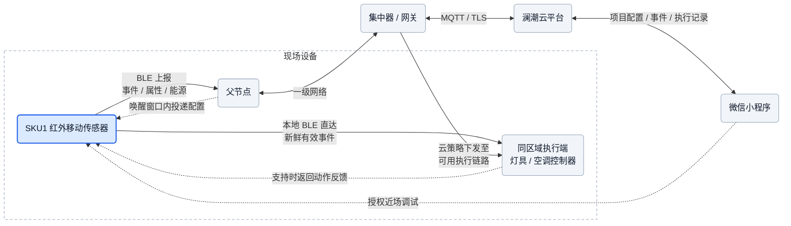

三条路径各司其职，互不替代：

| 路径  | 走向                              | 用途           | 关键约束                     |
| --- | ------------------------------- | ------------ | ------------------------ |
| 本地  | SKU1 红外移动传感器 →（BLE 广播）→ 同组执行端           | 开灯/关灯/调光，必须快 | 不经父节点，TTL ≤4，端到端 ≤300 ms |
| 云端  | SKU1 红外移动传感器 → 父节点 → CCO → 网关 → 云 → 小程序 | 上报、配置、审计、统计  | 受唤醒窗口限制，下行 1 个周期内生效      |
| 近场  | 小程序 ↔ SKU1 红外移动传感器（BLE GATT）            | 安装、选点、调试、读回  | 需鉴权码，会话限时                |

#### 3.1.2 硬件架构拓扑

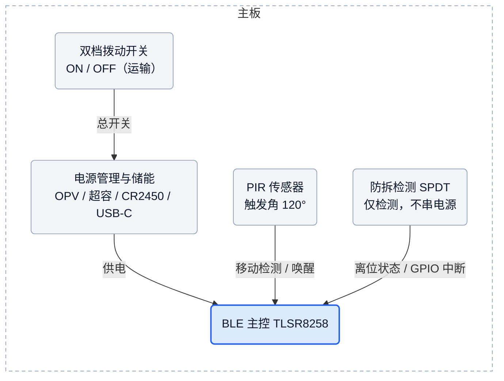

**与 SKU2 的差别**：本机没有 24G 雷达，也没有照度/温湿度小板，主板上只有 PIR 一路传感输入；因此不存在 UART 雷达链路与 I²C 环境通道。

**防拆只做检测，不做断电**：SPDT 只进 MCU 的 GPIO 中断，不串接电池、超容或负载；电源通断只由双档拨动开关负责。设备被取下时仍由超容/电池供电，因此可以立即上报并继续监测是否被重新装回。

#### 3.1.3 供能与能量路径

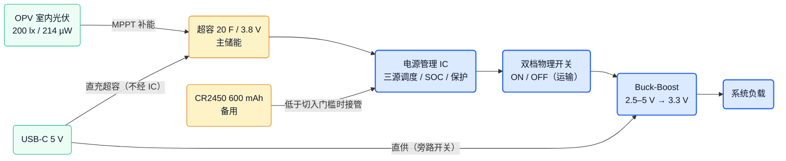

**为什么 USB 要旁路开关**：

1、产线可在"已拨 OFF（运输模式）"的状态下插 USB 完成身份写入、校验和测试，最后拔线包装，避免"写入后再拨 OFF"的漏拨风险。（type-C 6 pin能否支持数据传输带核签）

2、即使超容出现概率性损坏，此节点也可用作USB供电在别的地方使用。

### 3.2 场景

| 场景          | 有效光照条件      | 人员活动特征    | 生态交互逻辑         | 推荐形态     |
| ----------- | ----------- | --------- | -------------- | -------- |
| 走廊 / 楼梯间    | 白天有自然光，夜间靠灯 | 快速通过，不滞留  | 人来灯亮，无人 30 s 关 | A 微能量    |
| 电梯厅 / 大厅    | 通常长时间照明     | 经停、短暂等待   | 人来灯亮/升亮，无人降档   | A 微能量    |
| 区域出入口 / 门厅  | 白天有光，夜间靠灯   | 单次通过      | 人来即亮，快速关灯      | A 微能量    |
| 卫生间前室       | 使用时有光       | 通过、短暂停留   | 有人保持照明，无人关     | A 微能量    |
| 地下车库通道      | 长期低照度       | 快速移动（人/车） | 人来灯亮，无人低亮      | C USB 外供 |
| 设备机房 / 密闭库房 | 完全无光        | 短时巡检      | 进门亮灯，延时关闭      | C USB 外供 |

**不适用场景（必须换型）**：工位、值班室、会议室、阅览室等"人会长时间坐着"的空间。本机在这些点位必然出现"人还在、灯已灭"，应改用 SKU2 双鉴存在传感器。

### 3.3 用户角色

| 角色          | 核心诉求             | 成功判据               | 需要的权限         |
| ----------- | ---------------- | ------------------ | ------------- |
| 物业公司（付费方）   | 电费下降、投诉不上升、不用管电池 | 照明能耗降 60%+；年度零维护工单 | 只读看板          |
| 工程安装商 / FAE | 装得快、录入不麻烦、选点不返工  | 60-100 点位/人日；扫码一次成功 | 项目安装权限 + 近场调试 |
| 系统集成 / 运维   | 远程可控、点位可追溯、故障可发现 | 90% 异常可远程判定        | 配置权 + 超管（受控）  |
| 空间使用者       | 走过去灯就亮，不要误关      | 无"走一半灯灭"投诉         | 无（或仅本地手动）     |

### 3.4 安装姿态

**要点**：PIR 只对"移动的热源"响应，安装姿态决定三件事——能不能覆盖动线、会不会被阳光/气流误触发、静坐时会不会漏。**探测角由菲涅尔透镜决定，不是由 PIR 元件决定**：以候选 PIR 元件 D210AX 为例，元件自身视野为 X 向 138°、Y 向 125°，整机标称"有效触发角 120°"是透镜成型后的指标，两者不能混写。

| 姿态       | 推荐高度/角度                | 适用场景           | 覆盖特性（按 120° 透镜、灵敏度 3 档估算） | 关键约束                     |
| -------- | ---------------------- | -------------- | --------------------------- | ------------------------ |
| 斜装（首选）   | 墙面 2.0～2.4 m，下倾 20～45° | 走廊、门框内侧、楼梯口、立柱 | 地面覆盖约 2～5 m，对人流方向检出率最高     | 避免正对窗户、玻璃隔断、空调出风口        |
| 顶装       | 吊顶 2.6～3.2 m，垂直向下      | 大厅、大开间、地库通道    | 地面覆盖半径约 4～5 m，受灵敏度档限制      | 正下方不得有灯具/热源；以首触发验证为准     |
| 侧装       | 墙面/立柱 1.2～2.0 m        | 隔断上沿、货架侧板      | 水平扇形，半径约 3～6 m             | 人流尽量径向穿越，避免长期切线          |
| 倒装       | 梁下/桥架下                 | 地库、厂房          | 同顶装                         | 注意金属梁对 BLE 的影响，不是雷达反射    |

> 覆盖范围是按 120° 透镜与默认灵敏度估算的**设计值**，不是承诺值；每个点位必须做 PIR 首触发验证（3 次正常步行穿越至少触发 2 次），未通过按 4.11 返工。

**PIR 安装红线（来自器件规格书，违反即漏检或误触发）**

| 红线                     | 规格书依据                          | 现场表现            | 处置                          |
| ---------------------- | ------------------------------ | --------------- | --------------------------- |
| 不得隔玻璃/亚克力              | 远红外被玻璃、丙烯基吸收（PIR 规格书 BS312）     | 人在隔断后走动，灯不亮     | 换点位；必须透红外时开孔装透镜，不得加玻璃罩      |
| 不得让阳光/车灯/白炽灯直射探测窗      | 远红外直射会被当成热源（BS312）             | 白天靠窗点位频繁误开灯     | 调整朝向或加遮光檐；选点阶段排除            |
| 不得正对空调/暖风/加湿器气流        | 冷热风、水蒸气使视场温度剧烈变化（BS312）        | 出风口附近无人都亮       | 距离 ≥1.5 m 或调角；选点阶段排除         |
| 探测窗不得贴膜、喷漆、加玻璃/亚克力罩   | 5～14 µm 远红外无法穿透（D210AX/BS312 滤光片参数） | 灵敏度骤降、时好时坏      | 透镜必须裸露；结构基线见 1.4.3          |
| 菲涅尔透镜焦距必须匹配            | 焦距未调好会降低灵敏度（BS312）             | 同批设备探测距离不一致     | 产线用标准靶校验；现场做首触发验证           |
| 避开小动物活动区与正对热源          | 小动物、暖气、烤箱会被当成人体（BS312）        | 无人也触发           | 选点排除；灵敏度降档                  |
| 探测窗保持清洁                | 污渍影响透过率（PIR 规格书 BS312/D210AX）    | 久装后灵敏度下降        | 维护手册列入清洁项；只用无尘布 + 无水乙醇      |

**与 SKU2（PIR + 24G）的安装差异**：本机没有雷达，只按上表装 PIR 即可；若点位要求"人坐着也保持"，应换 SKU2，其雷达安装另有一套约束（以下为硬件知识库中的候选模组参数，最终以 SKU2 PRD 与实测为准）：

- **EDQ155**：24.125 GHz；侧装挂高 1.2 m、探测角 120°、感应范围 6 m（max）；3 dB 波束 94°（XZ）/114°（YZ）（探测角与 3 dB 波束不是同一口径）。厂商标称距离是在挂高 1.2 m、人员身高 170 cm、体重 65～75 kg、坐姿保持不动的条件下测得，场景变化会缩短范围。
- **RD-03L**：运动人体最远 8 m，覆盖 ±60°，近距 0.2 m 无盲区，支持挂壁安装。
- **雷达红线**：天线正对检测区且四周无遮挡；安装必须牢固，本体晃动会直接影响检测；背面有运动/振动时需加金属屏蔽罩或金属背板；天线周边禁放金属件、远离高频器件；多台 24 GHz 雷达不得波束正对。

**为什么不能把两套安装要求合并成一张表**：PIR 怕光、怕气流、怕玻璃；雷达怕金属、怕背面运动、怕多台互扰。用同一张表会让 FAE 在两种机型之间套错参数，现场表现就是"同样高度，PIR 漏检、雷达误报"。

> **参数来源**：PIR 取自 D210AX、BS312 规格书；雷达取自 EDQ155、RD-03L 规格书。具体选型以 BOM 签核为准，表中"覆盖范围"为设计估算值，必须用现场首触发验证收口。

## 04 功能需求

### 4.0 需求总览

| 模块           | 编号段     | 解决什么问题                                | 优先级 | 公共/私有             |
| ------------ | ------- | ------------------------------------- | --- | ----------------- |
| LPN 能源管理     | FR-1xx  | 没市电，必须自己算电、自己省电、自己按计划动态调整             | P0  | 公共机制 + 私有参数       |
| 通信与安全        | FR-2xx  | 一条事件要走三条路，还要防偷听、防重放                   | P0  | 公共                |
| BLE 组网与鉴权    | FR-3xx  | 两种入网路径，都要证明"你是你、你在正确的位置"              | P0  | 公共                |
| 事件机制         | FR-4xx  | 什么算事件、发给谁、丢了怎么办                       | P0  | 公共机制 + 私有事件族      |
| 心跳机制         | FR-5xx  | 区分"真没人"和"设备失联"                        | P0  | 公共                |
| 时间同步         | FR-6xx  | 每条事件都要说得清"几点发生的"；解决时间漂移问题             | P0  | 公共                |
| OTA 升级       | FR-7xx  | 设备怎么安全地换固件；休眠设备如何 OTA                 | P0  | 公共                |
| 运维（超管）       | FR-8xx  | 平台能远程控制 LPN，运维是重点应用场景之一               | P0  | 公共 + 私有快照项        |
| 生态设备联动       | FR-9xx  | "有人经过"怎么变成灯和空调的动作，以及没有照度时怎么降级         | P0  | 私有（框架参考公共）        |
| PIR 移动检测     | FR-10xx | 只有一路 PIR，怎么做到不漏检、不误判、不误关灯             | P0  | 私有                |
| 选点           | FR-11xx | 装之前怎么知道这个点位行不行，以及该不该换 SKU2            | P0  | 私有（方法公共、判据私有）     |
| 防拆           | FR-12xx | 设备被从支架上拿走，LPN 自己要能知道                   | P0  | 公共（四款一致，修正版） |

> **公共** = 与同系列其他 SKU 逐字或同构一致，改动须四款同步；**私有** = 本机独有，可独立演进；**公共机制 + 私有参数** = 机制与字段公共，阈值/档位/预算按本机标定。

### 4.1 LPN 能源管理（FR-1xx）

**要点**：设备永远要回答三个问题——现在靠谁供电、还能撑多久、撑不住时先牺牲什么。答案由 LPNMS（低功耗能源管理系统）统一给出，其他模块只能读，不能改。

#### 4.1.1 供能与切换

| ID     | 需求描述                                                            | 优先级 | 验收口径                       |
| ------ | --------------------------------------------------------------- | --- | -------------------------- |
| FR-101 | 支持 OPV + 超容、CR2450、USB 三源接入，按电源管理芯片规则自动切换；CR2450电池与充电路径隔离，禁止反充。 | P0  | 三源分别单独接入均可开机；电池支路反向电流为 0   |
| FR-102 | USB 5 V 可独立持续供电，并给超容补能。超容 2.5→3.5 V <10 min；补能期间检测不中断、不重启。      | P0  | 记录充电曲线；插拔 100 次无重启         |
| FR-103 | 超容低于切入门槛（候选 2.6 V）时切备用电池，回升后按 0.1 V（视实际效果论定） 回差切回，避免反复切换。       | P0  | 切入/切回各 20 次，无抖动、无掉电复位      |
| FR-104 | OFF 档隔离负载，整机漏电 ≤2.5 µA；运输期停检测、停心跳、拒绝 PIR 唤醒。                    | P0  | 源表长时记录 ≥72 h；6 个月库存压降 <1 V |
| FR-105 | 每次上电识别原因：开关拨通 / 看门狗 / 供电恢复 / 软复位，无法区分时上报"未知"。                   | P0  | 四种原因分别注入，`bootCause` 均正确   |
| FR-106 | 临近断电时用预留电量发末次状态（Last Gasp），记录是否送达；预留电量不允许被普通任务占用。               | P0  | 100 次断电试验上报成功率 ≥95%        |
| FR-107 | 分别估算超容可用能量与电池剩余容量，记录供电源与切换历史；无法估算时显示"未知"及最后有效值。                 | P0  | SOC 误差 ≤±10%；六态电池状态均可判     |
| FR-108 | 硬件保护（欠压关断、过流、过温）优先于任何软件策略，软件不得绕过。                               | P0  | 拉低电压至保护点，输出按硬件关断，恢复后按回差重启  |

#### 4.1.2 能源分级与调度

超容按可用能量分 5 档，档位直接决定 PIR 灵敏度、心跳多慢、事件还能不能上云。

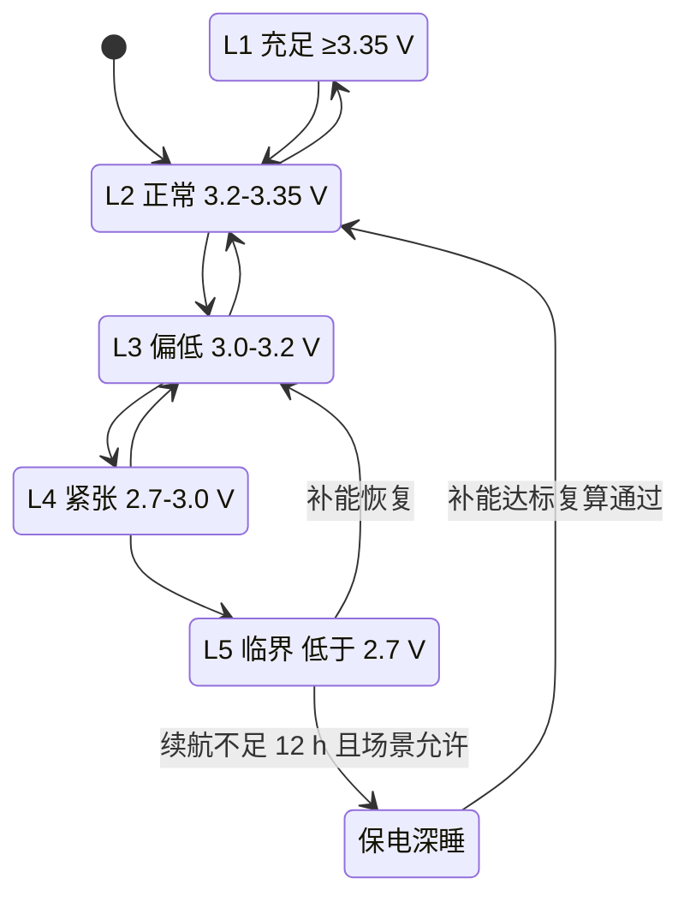

| 等级  | 超容电压（候选）   | PIR 灵敏度 | 心跳 / 聚合         | 上报约束         | 发射功率 |
| --- | ---------- | ------- | -------------- | ------------ | ---- |
| L1  | ≥3.35 V    | 上调 1 档  | 300 s / 15 min | 按配置          | 100% |
| L2  | 3.2–3.35 V | 默认档     | 300 s / 1 h    | 按配置          | 100% |
| L3  | 3.0–3.2 V  | 默认档     | 600 s / 6 h    | P2 由聚合转随心跳   | 75%  |
| L4  | 2.7–3.0 V  | 下调 1 档  | 900 s / 24 h   | 停 P2，仅 P0/P1 | 50%  |
| L5  | <2.7 V     | 下调 2 档  | 1800 s / 24 h  | 仅 P0         | 25%  |

**低电必须同步做的两件事**：把 `T_leave` 延长（L4 +50%、L5 +100%），否则会出现"电量越低越容易误关灯"的反常体验；把"实际执行值"随回执上报，否则运维会以为"配了 30 s 为什么 3 min 才关"。

#### 4.1.3 牺牲顺序与禁止项

能量不够时不是"随便关点东西"，而是按固定顺序退让：

| 顺序  | 牺牲什么           | 理由                  |
| --- | -------------- | ------------------- |
| ①   | P2 类事件的聚合上报    | 只影响报表及时性            |
| ②   | 心跳周期（拉长）       | 影响失联发现速度，不影响业务      |
| ③   | 发射功率           | 影响链路余量，可被重传补偿       |
| ④   | PIR 灵敏度（降档）    | 缩短覆盖半径，但不丢功能        |
| ⑤   | 停发 P2，仅保 P0/P1 | 保留业务主干              |
| ⑥   | 受控保电（停测）       | 最后手段，须场景允许          |

**禁止项（不得因省电而做）**

- 不得停止 PIR 值守（PIR 是唯一 24h 的发现通道）。
- 不得因低电、停测、无数据而直接判定"无人"，只能记"未知"。
- 不得关闭安全类与完整性类事件（防拆、PIR 失效、超容欠压、缓存溢出等）。
- 不得静默丢事件而不计数。

#### 4.1.4 保电与恢复

| ID     | 需求描述                                               | 优先级 | 验收口径                 |
| ------ | -------------------------------------------------- | --- | -------------------- |
| FR-109 | 预测完整服务续航 <12 h 且场景允许时才进入保电；人在空间内时先只告警，不直接停测。       | P0  | 构造 12 h 边界，核对是否进入及证据 |
| FR-110 | 停测后人员状态上报"未知"，并禁止据此关灯；恢复后按当前有效输入重新判断。              | P0  | 停测期间平台显示未知，灯不因未知而关闭 |
| FR-111 | 补能恢复后复核回差、能量余量、启动预算与 PIR 工作预算，全部达标才恢复完整检测。        | P0  | 短时插拔未达门限时继续保护        |
| FR-112 | 定期检查能源健康，低电或持续亏电时生成 USB 补能工单；记录接入、充电结果、维护时长与拔线后电量。 | P0  | 工单可生成、可关闭、可追溯        |

#### 4.1.5 能量预算（参考值，实测签核）

| 耗能项              | 无人态           | 有人·活跃         |
| ---------------- | ------------- | ------------- |
| PIR 常开           | 2～5 µA        | 2～5 µA        |
| MCU 休眠           | 1～3 µA        | 1～3 µA        |
| 上报折算             | 0.3 µA        | 1.0 µA        |
| 超容漏电             | 2 µA          | 2 µA          |
| 管理 IC + DC-DC 静态 | 2.3 µA        | 2.3 µA        |
| **合计**           | **约 8～11 µA** | **约 9～12 µA** |

**结论**：没有雷达、没有测光，整机开销几乎只剩"PIR 常开"这一项。因此省电的唯一重点是**减少唤醒与上报次数**，而不是压缩检测能力。

### 4.2 通信与安全（FR-2xx）

**要点**：同一条事件要同时满足"快、不丢、可运营"三个互相矛盾的目标。解法不是把一条路做快，而是拆成三条路。

#### 4.2.1 三通道出口模型

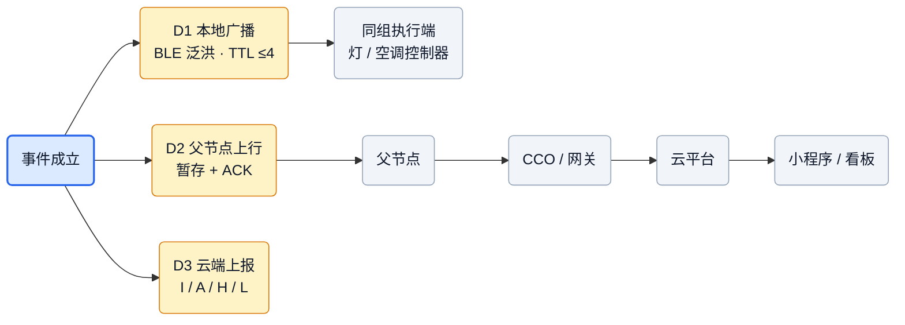

| 通道       | 目的          | 典型时延                                   | 确认语义             | 失败处理                               |
| -------- | ----------- | -------------------------------------- | ---------------- | ---------------------------------- |
| D1 本地广播  | 让灯立刻动，不等网络  | ≤300 ms（4 跳内）                          | 执行端短 ACK = 指令已收到 | 重播 2 次（间隔随机 20～50 ms）；3 次无确认报 E606 |
| D2 父节点上行 | 把事件交进网络，不丢  | 1 个唤醒窗口内                               | 父节点 ACK = 已进暂存队列 | 未 ACK 则本地保留，下次唤醒重传                 |
| D3 云端上报  | 可统计、可追溯、可配置 | I ≤1 s / A 15 min～24 h / H 随心跳 / L 不上报 | 设备侧投递完成          | 按档缓存补报；溢出报 E508                    |

**注意**：父节点 ACK ≠ 云端已入库。父节点到 CCO 是多跳，暂存溢出还会丢。因此每条事件带递增 `evtSeq`/`eventId`，云端做序号连续性校验，发现空号即请求补报——这条是必做项，不是优化项。

| ID     | 需求描述                                                                            | 优先级 | 验收口径                                |
| ------ | ------------------------------------------------------------------------------- | --- | ----------------------------------- |
| FR-201 | 三条通道独立调度、独立记录，任一通道故障不得影响另两条。                                                    | P0  | 注入父节点离线 / 广播全丢 / 云端断链，其余通道功能与记录不受影响 |
| FR-202 | 本地广播承载：BLE 广播报文携带组 ID、动作码、`evtSeq`、需确认标志与时间戳；执行端按 `evtSeq` 去重。                  | P0  | 重播 3 次，执行端只动作 1 次、计时不重置             |
| FR-203 | 上行事件带唯一 `eventId`，重传、补报、换父沿用原值；云端按编号只入库一次。                                      | P0  | 500 次重复投递，云端仅 1 条记录                 |
| FR-204 | 网络角色固定：`devClass=HARVEST_LEAF`、`canRelay=false`、`maxHopDepth=3`；父节点不得把本机编为转发节点。 | P0  | LPN/HARVEST\_LEAF在拓扑中永不为父节点         |
| FR-205 | 单父节点直挂 ≤8 台；8 台同时上报 1 s 内确认，丢包 <1%；唤醒窗口 100～500 ms 可配。                          | P0  | 满载与第 9 台被拒的场景分别验证                   |
| FR-206 | 父节点失联后先重连原父节点，失败则挂兼容且有余量的父节点，≤3 min 完成重挂载并更新路由。                                 | P0  | 断父节点后计时；换父后事件按原 `eventId` 上报        |

#### 4.2.2 BLE 链路安全

本机的链路全部是 BLE，安全必须按 BLE 的实际能力分层设计，不能假设"有加密就安全"。

| 层    | 措施                                           | 说明                    |
| ---- | -------------------------------------------- | --------------------- |
| 身份   | 一机一密：出厂注入设备专属密钥/证书，机身码与密钥绑定                  | 扫码照片、相同 MAC 都不能单独通过鉴权 |
| 配对   | 连接链路启用 BLE Secure Connections 配对与绑定，密钥存于受保护区 | 未配对设备不得读写配置           |
| 链路保护 | 已配对连接使用协议栈 AES-CCM 加密；应用层再做一层认证加密            | 防中间人、防篡改              |
| 广播保护 | 无连接的本地广播本身不加密，业务payload载荷由固件先加密并附校验后再发出      | 接收端校验不通过直接丢弃          |
| 防重放  | 受保护的会话序号/计数器 + 绑定代次 + 时间戳窗口；重启、换父、换绑后旧包失效    | 一条指令只生效一次             |
| 密钥管理 | 按设备 / 项目 / 组 / 用途隔离；支持轮换、失效、版本切换             | 普通日志禁止出现密钥与配网凭据       |

| ID     | 需求描述                                                    | 优先级 |
| ------ | ------------------------------------------------------- | --- |
| FR-207 | 设备↔父节点、设备↔执行端、近场维护三条链路均须提供机密性、来源认证与完整性校验；校验失败即拒绝并保持原状态。 | P0  |
| FR-208 | 拒绝明文降级：加密协商失败不得回退到明文传输。                                 | P0  |
| FR-209 | 接收端校验发送者、授权组、时效凭据后才执行；旧包、重复包不得开关灯、续计时、改配置或新增记录。         | P0  |
| FR-210 | 近场维护会话独立鉴权、独立权限、限时有效（≤30 min），到期自动退出并恢复原策略。             | P0  |
| FR-211 | 调试口与产测接口量产关闭；日志、事件、上报报文均不含密钥与凭据。                        | P0  |

#### 4.2.3 报文与字段约定

| 字段        | 用途            | 约束                                                 |
| --------- | ------------- | -------------------------------------------------- |
| `eventId` | 上行事件唯一标识      | 重传/补报/换父不变；云端按此去重                                  |
| `evtSeq`  | 灯侧联动去重序号      | 单调递增，按设备维度校验连续性                                    |
| `ts`      | 事件发生时间（设备本地秒） | 与 `bootId` 组合，用于还原 UTC                             |
| `bootId`  | 本次开机标识        | 跨重启排序与回填的边界                                        |
| `tsConf`  | 时间可信度         | `valid` 有效已同步/ `restored`曾经同步但基准已失效 / `unknown`未同步 |
| `actId`   | 动作指令 ID       | 同一动作多目标投递时用于核对重复                                   |

**注意：**

1、bootId:事件只在同一个 BootID 内部做时序排序、断链补报回填；一旦设备重启、`bootId` 变了，旧批次事件`eventId`、和新批次事件不能混排、不能跨 `bootId` 回填。

**2、排序边界**：网关 / 云端做事件时序排序时，**只在相同 **<!-- -->**`bootId`**<!-- -->** 里面按 **<!-- -->**`evtSeq`**<!-- -->** 排先后**；不同 BootID 的事件，不能单纯靠 evtSeq 对比先后。

3、**回填边界**：断网缓存、环形缓存里存的历史事件，**只允许在当前 BootID 有效期间向上回填补报**；设备一旦重启，BootID 更新，上一轮 BootID 里没发完的旧事件直接丢弃。

### 4.3 BLE 组网与鉴权（FR-3xx）

**要点**：两条入网路径，一套鉴权标准。路径决定"谁发起"，鉴权决定"能不能进"。

#### 4.3.1 两条组网路径

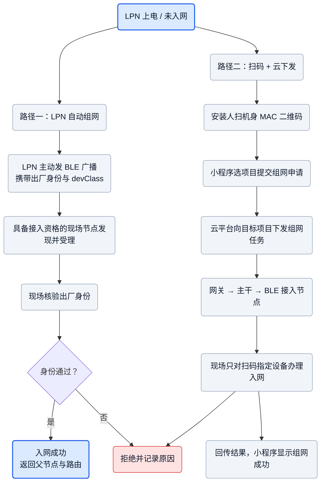

| ID     | 需求描述                                                          | 优先级 | 验收口径                         |
| ------ | ------------------------------------------------------------- | --- | ---------------------------- |
| FR-301 | **路径一（本地自动组网）**：未入网 LPN 主动广播，由具备接入资格的现场节点受理；公网断开但现场链路正常时仍可完成。 | P0  | 断公网，10 台设备均成功入网              |
| FR-302 | **路径二（扫码 + 云下发）**：扫码 → 选项目 → 云端下发组网任务 → 现场针对指定设备入网 → 结果回传。    | P0  | 端到端 ≤60 s；小程序显示"组网成功"以现场结果为准 |
| FR-303 | 两条路径使用同一套入网鉴权与同一条事件通道，入网后行为完全一致。                              | P0  | 两种方式入网的设备，事件与配置行为逐项比对一致      |
| FR-304 | 本地组网与扫码组网可互相补位：扫码任务超时未完成时，允许退回本地组网路径（需授权）。                    | P1  | 超时后切换路径，最终入网成功               |

#### 4.3.2 三重鉴权：人、设备、点位

扫码组网的实际风险不是"连不上"，而是"连上了不该连的"。所以必须三样都对上。

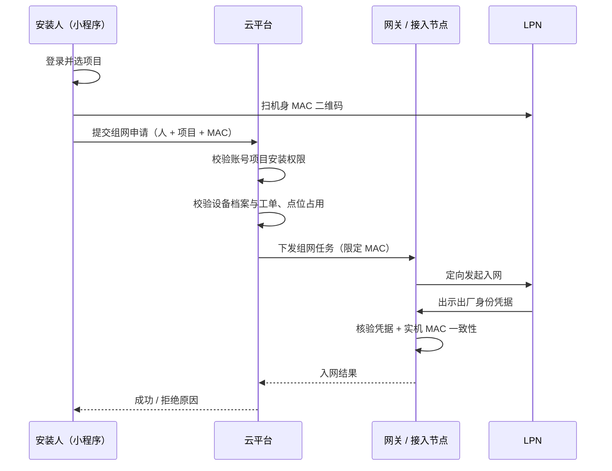

| ID     | 需求描述                                                            | 优先级 | 验收口径                   |
| ------ | --------------------------------------------------------------- | --- | ---------------------- |
| FR-305 | **人**：账号须具备目标项目安装权限，否则申请直接结束并提示原因。                              | P0  | 无权限账号申请 100% 被拒        |
| FR-306 | **设备**：核验出厂身份凭据 + 实机 MAC 与扫码 MAC 一致；照片、复制 MAC、非澜潮设备均拒绝。         | P0  | 扫 A 装 B 场景 100% 拦截     |
| FR-307 | **点位**：云端校验项目归属、点位范围、是否被占用；身份通过但白名单未通过时标"待核"，不得输出联动指令。          | P0  | 待核设备不能开灯；纠正后可重新绑定      |
| FR-308 | 组网状态可查：未配网 / 发现 / 鉴权中 / 入网 / 待绑定 / 在线 / 离线或未知 / 重新入网，并记录最后失败原因。 | P0  | 八种状态均可构造并正确显示          |
| FR-309 | 离线扫码可暂存，联网复核后放行；同笔申请只建一次绑定，重试结果一致。                              | P1  | 断网扫码 10 单，恢复后批量提交无重复绑定 |

#### 4.3.3 失败处理与容量

| 情形         | 处理              | 用户可见             |
| ---------- | --------------- | ---------------- |
| 身份核验失败     | 拒绝入网，记录阶段与脱敏结果  | "设备身份核验失败，请核对铭牌" |
| 白名单未通过     | 允许入网但标"待核"，禁止联动 | "点位待核，暂不参与联动"    |
| 父节点满载（8 台） | 拒绝并建议迁移或增补父节点   | "父节点已满，请调整点位"    |
| 父节点失联      | ≤3 min 重挂兼容父节点  | "已切换上级设备"        |
| 弱光无法冷启动    | 提示先 USB 补能再入网   | "请先补能至 3 V 以上"   |

### 4.4 事件机制（FR-4xx）

**要点**：一条没有明确触发条件的事件等于没有定义。所以每条事件必须写清"什么时候产生、发给谁、要不要确认、丢了怎么办"。

#### 4.4.1 事件生成原则

- **可判定**：触发条件必须是可测的状态或计数，例如"连续 N\_leave 次有效空判 + 等满 T\_leave"，而不是"人好像走了"。
- **可追溯**：记录源设备、类型、`eventId`、发生时间、测量值与原因；转发时保留原始来源与发生时间。
- **三态**：人员状态只有"有人 / 无人 / 未知"，数据不足时必须记"未知"，不得默认"无人"。
- **单次生效**：状态变化只记一次；持续维持同一状态时更新快照或做周期统计，不重复产生事件。

#### 4.4.2 事件分类

| 编号段  | 类别       | 典型事件                                     | 是否可禁用    |
| ---- | -------- | ---------------------------------------- | -------- |
| E1xx | 移动检测     | 有人进入、持续移动、抖动异常、停留统计、有人离开、滞留超时、PIR 疑似失效 | 主干不可禁用   |
| E2xx | PIR 通道与降级 | 触发确认、单脉冲剔除、热源饱和、通道降级、PIR 故障、检测不可用、通道恢复 | 故障类不可禁用  |
| E3xx | 能源与电源    | 采能恢复、能量不足、能量临界、临终上报、上电启动、超容欠压、电池低电      | 底线类不可禁用  |
| E4xx | 自检与安防    | 周期自检、PIR 自检失败、**防拆/脱落**、探测窗遮挡           | 安防类不可禁用  |
| E5xx | 生命周期与运维  | 上线、链路恢复补报、入网完成、配置生效/拒绝、OTA 状态、时钟偏差、缓存溢出  | 完整性类不可禁用 |
| E6xx | 联动与条件    | 照度条件位缺失/失效、联动执行反馈、群组联动触发、免开灯委派生效、联动确认超时 | 多数可禁用    |

**释义：**

**1、照度条件位缺失**：同组没有任何一台带照度的设备（SKU2/SKU3/SKU4）广播有效条件位，或条件位超过有效期。本机不能自己测光，此时必须按 4.9.4 的降级规则处理，并留下记录。

**2、免开灯委派生效**：收到同组"亮"条件位后，本机跳过开灯动作，但仍上报"有人"供空调与统计使用。注意：这是**委派判断**，不是本机测光。

**3、单脉冲剔除**：PIR 出现单个脉冲但未通过去抖（未达到连续两个有效脉冲）时被剔除，不产生"有人"。

**4、热源饱和**：PIR 连续高频触发且无间隙，通常指向阳光直射、暖气出风口、烤箱等强热源，需现场核查。

**5、通道降级**：PIR 仍工作但灵敏度被强制降档（低电或强干扰），检测距离缩短，需在平台标注。

**6、事件码命名空间**：本表按 SKU 定义语义，平台以 `devType + eventCode` 唯一识别；同一码段在不同 SKU 下对应"同类角色"（E1=主感知、E2=辅助通道、E3=能源、E4=自检安防、E5=生命周期、E6=联动）。跨 SKU 统计时不得只看码值。

#### 4.4.3 上报方式四档

| 档位  | 方式  | 时延                                              | 设备行为               | 适用             |
| --- | --- | ----------------------------------------------- | ------------------ | -------------- |
| I   | 即时  | ≤1 s                                            | 立即组帧发出，按配置重传 0～2 次 | 安全类、故障类、必须实时可见 |
| A   | 聚合  | 15 min / 30 min / 1 h / 2 h / 6 h / 12 h / 24 h | 写环形缓存，到期打包         | 统计类、业务主事件的云端记录 |
| H   | 随心跳 | 跟随心跳周期 300～1800 s                               | 挂在心跳帧中捎带，最省电       | 低频状态类          |
| L   | 仅本地 | 不上报                                             | 只记本地，可由诊断快照读出      | 调试类、高频低价值      |

**注意：**

**聚合不是丢弃，是延迟**：聚合类事件仍完整记录在本地缓存，周期到达打包上报；期间若发生更高优先级事件，打包一并提前发送。

#### 4.4.4 确认、缓存与补报

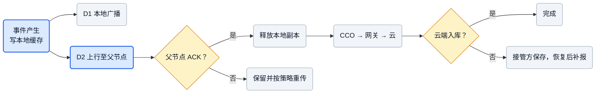

| ID     | 需求描述                                                     | 优先级 | 验收口径                             |
| ------ | -------------------------------------------------------- | --- | -------------------------------- |
| FR-401 | 每条事件独立配置：启用状态、本地是否广播、是否需执行端/父节点确认、云端上报档位、聚合周期、单包条数、重传次数。 | P0  | 逐条可配、可读回；硬约束项拒绝禁用并回具体原因码         |
| FR-402 | 关键事件与配置回执锁定为不可禁用、必须确认、即时上报。                              | P0  | 尝试禁用全部被拒（E505）                   |
| FR-403 | 断链缓存目标 ≥256 条（环形，按时间淘汰）；容量与断链时长在型号层面明确承诺。                | P1  | 断网 24 h 恢复后完整率 100%（日均 ≤300 条场景） |
| FR-404 | 恢复后分批补报：实时关键事件优先，历史按原发生时间与可信度排序，沿用原 `eventId`。           | P0  | 补报排序正确率 100%；旧事件不触发现场动作          |
| FR-405 | 缓存溢出必须计数并上报丢弃条数（E508），供平台核对记录缺口。                         | P1  | 产生/送达/丢弃三者可对账                    |
| FR-406 | 关闭某可选事件后，采样、心跳、快照与其他事件继续运行；平台提示受影响的联动规则。                 | P0  | 关闭 E601 后，E101/E105 与心跳正常        |

#### 4.4.5 关键事件（节选，全量见附录 8.1）

| 编号       | 事件        | 触发条件                          | 本地      | 云端       | 可禁用 |
| -------- | --------- | ----------------------------- | ------- | -------- | --- |
| E101     | 有人进入      | 无人态下 PIR 有效触发（去抖通过）           | 广播+灯确认  | A 15 min | 否   |
| E102     | 设备心跳      | 按周期发送，携带存在状态与供电源              | 不广播     | H        | 是   |
| E105     | 有人离开      | 满 T\_leave 且无新触发              | 广播+灯确认  | A 15 min | 否   |
| E109     | 滞留超时      | 布防时段内连续存在 ≥T\_loiter（默认 600 s） | 不广播     | I        | 否   |
| E110     | 状态抖动异常    | 1 min 内翻转 ≥10 次                | 不广播     | I        | 否   |
| E113     | PIR 疑似失效  | 采集正常 + 通信正常 + 连续多日零触发          | 不广播     | I        | 否   |
| E204     | 通道降级      | 低电或强干扰导致灵敏度强制降档               | 不广播     | I        | 否   |
| E205     | PIR 故障    | PIR 自检失败，检测不可用                | 不广播     | I        | 否   |
| E304     | 临终上报      | 触及预留储备门限，发末次状态                | 不广播     | I        | 否   |
| E305     | 上电启动      | 冷启动，携带 `bootCause`           | 不广播     | I        | 否   |
| E311     | 超容欠压      | 2.7 V 预警 / 2.5 V 保护           | 不广播     | I        | 否   |
| **E407** | **防拆/脱落** | 设备离开支架或壳体分离                   | 广播警示    | I        | 否   |
| E504     | 配置生效      | 参数下发并通过校验，含来源与实际执行值           | 不广播     | A 1 h    | 是   |
| E506     | OTA 状态    | 下载/校验/安装/成功/失败/回滚             | 不广播     | I        | 是   |
| E508     | 缓存溢出      | 环形队列满并丢弃                      | 不广播     | I        | 否   |
| E601     | 照度条件位缺失   | 同组无有效照度源，或条件位超期               | 不广播     | A 1 h    | 是   |
| E606     | 联动确认超时    | 本地广播重播 2 次仍无执行端确认             | 不广播     | A 1 h    | 否   |

### 4.5 心跳机制（FR-5xx）

**要点**：心跳只解决一件事——把"真没人"和"设备失联"分开。没有心跳，平台看到"无人"根本不知道是人走了还是设备死了。

#### 4.5.1 心跳收发与周期

| ID     | 需求描述                                                        | 优先级 | 验收口径            |
| ------ | ----------------------------------------------------------- | --- | --------------- |
| FR-501 | 入网后按实际生效周期向父节点发送心跳，长时间无人员活动也照发。                             | P0  | 连续 7 天无人，心跳无中断  |
| FR-502 | 标准档 300～1800 s 可配；低功耗保活档以 2 h 为候选（需单独签核）；低电时按能源策略延长并上报实际周期。 | P0  | 平台显示周期 = 设备实测周期 |
| FR-503 | 心跳帧可捎带允许随心跳上报的事件（H 档）与当前供电源、能源等级、配置版本。                      | P0  | 抓包核对载荷字段完整      |
| FR-504 | 心跳与协议保活分离：心跳是业务状态记录，保活是链路可达性交互，二者不得互相替代。                    | P0  | 关闭心跳上报后保活仍正常    |

#### 4.5.2 在线判定与恢复

| 情形                | 判定规则           | 平台展示                |
| ----------------- | -------------- | ------------------- |
| 收到实时有效消息          | 立即刷新"最近有效通信时间" | 在线                  |
| 漏收 1～2 个周期        | 保持在线           | 在线（标注最近通信时间）        |
| 连续 3 个应到周期未收到     | 判离线（留出收发时间余量）  | 离线                  |
| 父节点失联 / 云端拿不到现场判定 | 不猜测            | **状态未知** + 最近有效通信时间 |
| 重新收到实时消息          | 恢复在线           | 在线；补发的旧心跳只进历史       |

| ID     | 需求描述                                 | 优先级 | 验收口径                 |
| ------ | ------------------------------------ | --- | -------------------- |
| FR-505 | 断公网时父节点继续完成现场保活与离线判断，恢复后平台按最新现场结果更新。 | P0  | 断云 30 min，现场判定不停     |
| FR-506 | 在线状态与人员存在状态分开展示，不得用一个字段表达两件事。        | P0  | 设备在线但人员未知时，两个维度分别正确  |
| FR-507 | 补报的旧心跳不得让设备"假上线"，只有实时有效通信才恢复在线。      | P0  | 先送旧心跳再生效实时心跳，仅后者改变状态 |

### 4.6 时间同步与时间戳（FR-6xx）

**要点**：设备会长时间休眠、会断电、会跨日，本地时钟必然漂。所以不追求"设备时间一直准"，而是保证每条事件都能被还原到真实的 UTC 时刻。

#### 4.6.1 三时间戳模型

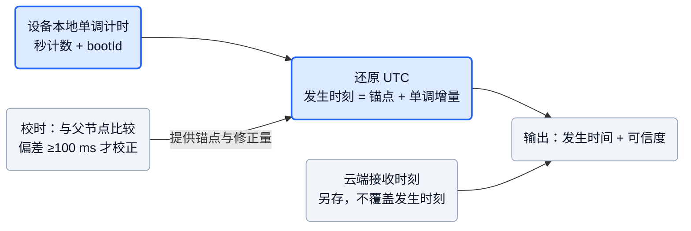

| ID     | 需求描述                                                       | 优先级 | 验收口径                          |
| ------ | ---------------------------------------------------------- | --- | ----------------------------- |
| FR-601 | 设备持续维护本地计时与本次开机标识；事件发生时记录本地时刻，不依赖当前是否已校时。                  | P0  | 断网 24 h 的事件仍带本地时刻             |
| FR-602 | 唤醒后向父节点对时；偏差 <100 ms 保持原值，≥100 ms 才校正，并记录修正量（E507）。        | P0  | 90 ms 不触发、110 ms 触发；校后 <20 ms |
| FR-603 | 事件报文与 BLE 通信报文均携带时间戳字段（`ts` + `bootId` + `tsConf`），供接收端还原。 | P0  | 逐条事件抓包可见三字段                   |
| FR-604 | 发生时间由接入端按对时记录还原为 UTC，云端另记接收时间，两者分别保存。                      | P0  | 补报事件排序正确率 100%                |
| FR-605 | 时间不可信（未校时、跨重启、跨日缺日期、误差超预算）时标记为未知或降级，并暂停依赖绝对时间的规则。          | P0  | 构造五种场景，均可看出"为什么不可信"           |
| FR-606 | 换电池、复位、换父后必须重新校时；恢复后按当前输入重判，过期动作只留历史。                      | P0  | 换电重启后时间与规则状态正确                |

### 4.7 OTA 升级（FR-7xx）

**要点**：休眠设备不能保持长连接下载，OTA 必须"父节点囤货、设备蚂蚁搬家"，并且随时可断、可续、可回滚。

#### 4.7.1 升级流程与状态

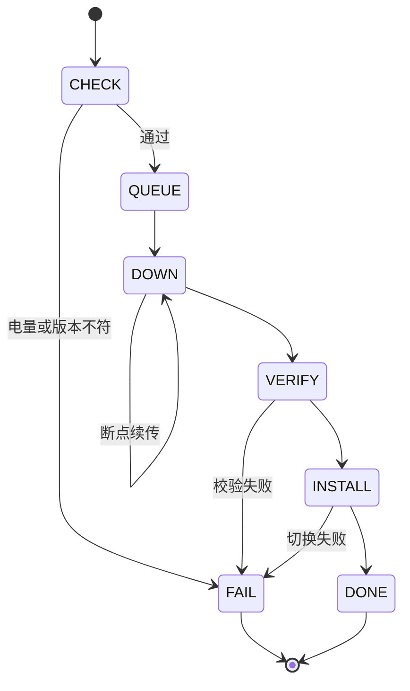

| ID     | 需求描述                                          | 优先级 | 验收口径                   |
| ------ | --------------------------------------------- | --- | ---------------------- |
| FR-701 | 升级前校验版本匹配、能量余额、链路质量；不满足则拒绝并回明确原因码，恢复后可重新申请。   | P0  | 低电设备申请升级，平台读到明确拒绝码     |
| FR-702 | 父节点缓存匹配升级包，设备每次唤醒接收一段，支持断点续传。                 | P1  | 传输中断 5 次后仍能完成          |
| FR-703 | 升级不得丢失配置、标定与绑定关系；算法类变更需说明哪些标定可迁移、哪些须重标。       | P0  | 升级前后读回配置与标定逐项比对        |
| FR-704 | 支持按项目/批次灰度升级，逐台显示进度与结果；失败率超门槛自动停止派发新任务。       | P1  | 同批构造低电、版本不符、断链，行为符合预期  |
| FR-705 | 升级过程与结果记录为 E506（下载/校验/安装/成功/失败/回滚），失败与回滚强制上报。 | P0  | 六种状态均可复现并上报            |
| FR-706 | 升级失败必须能回到可工作版本并重新入网，不得变砖。                     | P0  | 传输阶段与切换阶段各断电 50 次，均可恢复 |

### 4.8 运维与云端超管（FR-8xx）

**要点**：后期规划中设备支持装在天花板上，人上不去。所以平台必须能在设备在线时"远程动手"，但这类能力等价于 root 权限，必须带闸门。

#### 4.8.1 运维能力分级

| 级别    | 能力                        | 典型操作                        | 授权要求        |
| ----- | ------------------------- | --------------------------- | ----------- |
| L0 只读 | 看状态、看事件、看诊断快照             | 查存在状态、电量、信号、最近事件            | 项目只读权限      |
| L1 配置 | 改参数、改上报策略、应用模板            | 改 T\_radar\_delay、上报档位、组 ID | 项目管理员       |
| L2 诊断 | 触发自检、抓运行日志、强制心跳、强制扫描      | 定位"为什么不报事件"                 | 运维工程师       |
| L3 超管 | 远程重启、清缓存、强制复位、进入升级模式、解除绑定 | 救活"假死"设备                    | 双人复核 + 限时会话 |

#### 4.8.2 超管操作清单

| ID     | 需求描述                                                     | 优先级 | 验收口径                     |
| ------ | -------------------------------------------------------- | --- | ------------------------ |
| FR-801 | 支持远程强制心跳：立即唤醒并上报一帧完整状态，用于确认设备是否真在线。                      | P0  | 下发后 ≤1 个唤醒窗口收到           |
| FR-802 | 支持远程拉长唤醒窗口（临时，≤30 min），用于批量下发配置或抓日志。                     | P0  | 到期自动恢复原窗口                |
| FR-803 | 支持远程重启与强制复位；重启前后记录原因、时间与操作人。                             | P0  | 100 次远程重启无变砖、配置不丢        |
| FR-804 | 支持远程清理事件缓存（须先导出或确认丢弃条数），清理动作计入 E508 对账。                  | P1  | 清理后平台可见丢弃计数              |
| FR-805 | 支持远程读取诊断快照：通道状态、电源、PIR 触发计数与最近触发时刻、照度条件位状态、最近 8 条事件、当前策略摘要。 | P0  | 快照字段与本地一致                |
| FR-806 | 支持远程触发一次 PIR 自检，结果回传。                                            | P1  | 触发后 60 s 内出结果            |
| FR-807 | 超管会话限时（≤30 min）、一次一授权、全程审计；不得突破能量底线与安全事件锁。               | P0  | 会话过期后再下发被拒；审计可查操作人/时间/参数 |
| FR-808 | 近场维护（BLE GATT）提供同等能力子集：读状态、改参数、触发自检、导出日志。                | P0  | 现场无网时可用；配置 ≤3 min 完成     |
| FR-809 | 本地改参后进入"待确认"：授权人确认才固化为基线；72 h 未确认告警，7 天自动回退，回退前 24 h 通知。 | P0  | 三态流转正确，回退可复现             |

**超管必须带闸门**：这类能力可以"让一台设备看起来正常工作"，也可以"让一台设备永远不报警"。一旦被滥用，故障会被掩盖而非暴露更有其他的风险。所以：能力开放给运维，权限收在审计里。

### 4.9 生态设备联动策略（FR-9xx）

**要点**：本机不控灯，只给结论；而且本机**不测光**，所以"现在够不够亮"这个条件必须由同组设备提供。这带来一条额外的工程要求：**照度条件可以缺失，但联动不能因此瘫痪**。

#### 4.9.1 联动数据源与对象

| 数据源               | 来源             | 用途                  | 更新频率        |
| ----------------- | -------------- | ------------------- | ----------- |
| 人员状态（有人/无人/未知）    | 本机             | 开灯、关灯、空调启停          | 变化即发        |
| 停留时长              | 本机             | 长时占用加严、安防滞留告警       | 周期统计        |
| 照度条件位（暗/亮）        | 父节点下行 / 云端（源设备 SKU2/SKU3/SKU4） | 是否需要开灯、白天免开灯 | 随唤醒窗口投递 + 有效期 |
| 照度数值（可选）          | 父节点下行 / 云端 | 统计与调试               | 随条件位捎带 |

| 执行端    | 可执行动作             | 确认方式             |
| ------ | ----------------- | ---------------- |
| 智慧灯具   | 开、关、调光百分比、场景切换、色温 | 短 ACK（本机无照度，不能做照度校验） |
| 空调控制器  | 开机、关机、温度设定、风速档、模式 | 设备回执（能力而定）       |
| 其他生态设备 | 按其能力集开放           | 以兼容清单为准          |

#### 4.9.2 联动决策流程

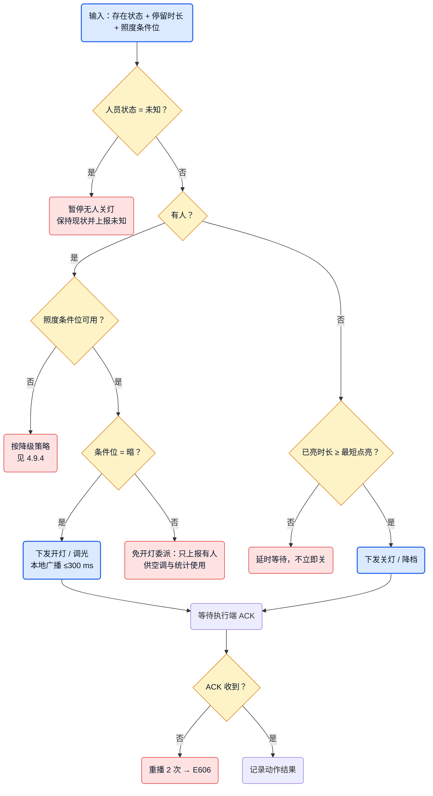

#### 4.9.3 联动需求

| ID     | 需求描述                                                   | 优先级 | 验收口径                    |
| ------ | ------------------------------------------------------ | --- | ----------------------- |
| FR-901 | 本地联动不经父节点、不经云端：有效新鲜事件由 BLE 广播直达同组执行端。                  | P0  | 断云 30 min 内本地联动可用率 ≥95% |
| FR-902 | 支持组 ID 槽位管理，一台设备可参与多个组的多条策略；组内目标数与槽位数以样机满配验证。          | P1  | 满配无丢失                   |
| FR-903 | 策略要素：时段 + 照度条件位（可选，含有效期）+ 存在状态 + 无人延时 + 最短点亮时长 + 目标动作。 | P0  | 六个要素任意组合均可生效、可读回        |
| FR-904 | 撤销临时开灯前检查已亮时长，默认至少亮满 10 s，避免"刚亮就灭"的可见闪烁。               | P0  | 回滚场景无可见闪灯               |
| FR-905 | 照度条件位只采信同组已标定的有效源；多点时按签核规则取"任一为暗"或"多数为暗"；超期条件位不参与判断。  | P0  | 摘除照度源后按 4.9.4 降级，不误动作   |
| FR-910 | **条件位获取路径**：只能经父节点下行或云端策略获取，随唤醒窗口投递并带时间戳；**不得依赖直接监听其他 LPN 的本地广播**（休眠节点无法持续接收）。 | P0  | 抓包确认无"监听他人广播"路径；断云时按 4.9.4 降级 |
| FR-906 | 手动接管优先：识别到人工操作后暂停自动控制并继续感知，结束后按当前有效输入重评。               | P0  | 手动开灯后自动策略不立即关闭          |
| FR-907 | 每条动作记录规则版本、来源、目标、指令 ID、受理与实动证据、失败原因与耗时；多目标分别记录。        | P0  | 一次联动涉及 3 个目标，可分别追溯      |
| FR-908 | 空调联动以"存在 + 停留时长"为主判据，避免短时经过触发启停；启停最小间隔可配。              | P1  | 短时经过不启停；最小间隔生效          |
| FR-909 | 本机**不得因照度条件位缺失而不开灯**：缺失时按"暗"处理并标注降级；仅在策略显式配置为"仅上报"时才不动作。 | P0  | 摘除全部照度源后，走廊仍能正常开灯       |

#### 4.9.4 没有照度时的降级规则

本机没有 ALS，这是硬件事实，不是配置问题。降级必须写成确定行为，而不是"看情况"：

| 情形                        | 默认行为            | 平台标注       | 可配置项        |
| ------------------------- | --------------- | ---------- | ----------- |
| 同组无任何照度源                 | 按"暗"处理，有人即开灯    | "无照度源 · 已降级" | 可改为"仅上报不动作" |
| 条件位超期（超过有效期）              | 同上，并上报 E601     | "条件位超期"     | 有效期 5～60 min |
| 条件位冲突（一台报暗、一台报亮）          | 按"暗"处理（宁亮不暗）    | "条件位冲突"     | 取值规则可配      |
| 有照度源且条件位为亮                | 免开灯委派，不开灯但上报有人   | "免开灯（委派）"  | —           |

**为什么默认"宁亮不暗"**：走廊与楼梯间是安全通道，黑着的风险远高于多亮几分钟的电费。这条默认值可以改，但改之前必须由项目方书面确认。

### 4.10 PIR 移动检测（FR-10xx）

**要点**：只有一路 PIR，没有第二路可以做交叉验证。所以判断必须"快进、慢出"：触发立刻算有人，判无人要等满延时且没有任何新触发。

#### 4.10.1 核心参数

| 参数            | 取值             | 定义与硬约束                                 |
| ------------- | -------------- | -------------------------------------- |
| T\_leave      | 10 s～30 min 可配 | 从最后一次有效触发开始计时，期间无新触发即到期判无人；断电保持         |
| pirSens       | 1～5 档          | 触发阈值档位，对应感应距离约 2～8 m；低电自动降档并回读         |
| 去抖窗口          | 固定 200 ms      | 单次噪声不计入；连续两个有效脉冲才判定为一次移动               |
| 触发锁定          | 固定 2 s         | 一次触发后 2 s 内不重复计数，避免同一人产生大量事件           |
| T\_minOn      | 默认 10 s        | 灯侧兜底，避免刚关又开造成闪灯                        |

#### 4.10.2 状态机

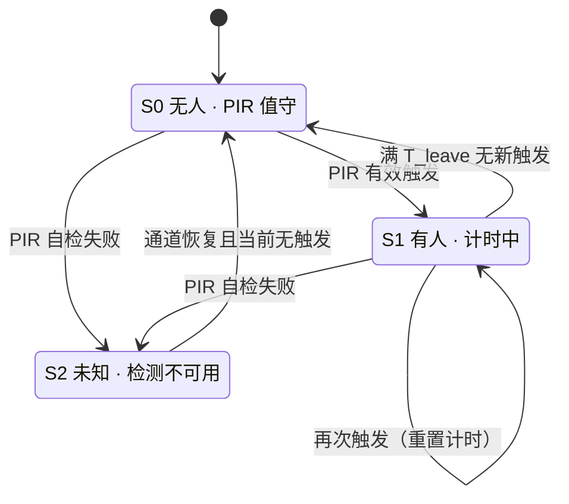

#### 4.10.3 三段式逻辑

| 阶段        | 触发与通道      | 判决                            | 设计意图              |
| --------- | ---------- | ----------------------------- | ----------------- |
| 无人 → 有人   | 仅 PIR 可触发  | 去抖通过即翻转"有人"，上报 E101（≤300 ms） | 开灯速度由 PIR 保证，不做二次校验 |
| 有人 → 有人   | PIR 再次触发   | 重置 T\_leave 计时，不重复产生 E101     | 一次在位只记一次进入，避免事件风暴 |
| 有人 → 无人   | 计时到期       | 满 T\_leave 且无新触发才翻转，上报 E105    | 关灯不可逆，必须最保守        |

#### 4.10.4 检测需求

| ID      | 需求描述                                                      | 优先级 | 验收口径                                 |
| ------- | --------------------------------------------------------- | --- | ------------------------------------ |
| FR-1001 | PIR 7×24 常开值守，可唤醒深睡主控；无触发时主控保持深睡。                         | P0  | 无人态整机 ≤11 µA；PIR 唤醒成功率按高低温各测         |
| FR-1002 | 移动检出：3 m 高、0.5～1.5 m/s 径向穿越即上报"有人进入"。                     | P0  | 穿越 100 次，漏检 ≤1 次                     |
| FR-1003 | 触发去抖：单次噪声不翻转；连续两个有效脉冲才计一次移动，抑制电源与射频干扰导致的误触发。              | P0  | 注入单脉冲干扰 100 次，0 次误开灯                 |
| FR-1004 | 无人延时：每次有效触发重置 T\_leave；到期且无新触发才上报 E105 并关灯。                | P0  | 计时误差 ≤±1 s；断电后值不丢                    |
| FR-1005 | 灵敏度 1～5 档可配，断电保持；形态 C 可上调一档，低电自动降档并回读。                    | P1  | 五档均生效并读回；低电降档可复现                     |
| FR-1006 | PIR 故障：自检失败或长期零输出时报 E205/E113，标"检测不可用"；不得静默降级为"永远无人"。    | P0  | 贴镜片/开路后 60 s 内上报                     |
| FR-1007 | 抖动自检：1 min 内状态翻转 ≥10 次报 E110，提示检查出风口/阳光直射/灵敏度。           | P1  | 对出风口安装可稳定触发                          |
| FR-1008 | 停留时长统计：一个完整"有人"周期结束时汇总本次持续时长，随 E111 上报或周期聚合。              | P2  | 时长与实测一致（±1 s）                        |
| FR-1009 | 触发计数与最近触发时刻记录，供诊断读取。                                      | P2  | 累计计数正确，掉电不清零（或按约定清零）                 |
| FR-1010 | 覆盖角对外表述：**有效触发角 120°**，不写"探测角 150°"或"全向"。                  | P0  | 逐 15° 实测，边界处触发率 ≥90%                 |
| FR-1011 | 热源饱和识别：连续 60 s 内触发 ≥20 次且无 2 s 以上间隔，报 E203 并建议核查安装位置。     | P1  | 正对暖气/阳光可稳定触发                         |

#### 4.10.5 四个必须承认的边界

写进规格书与投标文档，事前说明的成本远低于事后解释：

1. **静坐即判无人**：人坐下不动超过 T\_leave 会关灯，人再动才重新开灯。走廊 30 s、大厅 60 s 是合理值；工位、会议室必须改用 SKU2。
2. **PIR 失效即整机失效**：镜片被贴、信号链开路时没有第二路交叉验证。靠 6 h 自检 + 连续多日零触发判疑似 + 安装期遮挡检查 + 后台批量自检收敛。
3. **120° 之外的环带不能作为设计覆盖**：外环只能作为容错余量，布点按 120° 计算。
4. **隔玻璃/亚克力即失效**：PIR 靠 5～14 µm 远红外工作，玻璃、丙烯基会把它挡住。人在玻璃隔断后走动，本机看不到；这不是灵敏度问题，加档也救不回来，只能换点位或开孔装透镜。

### 4.11 选点需求（FR-11xx）

**要点**：这类设备最大的返工来源不是硬件坏，而是**装错位置**——装太高漏检、正对出风口误触发、背光导致电池亏电。本机没有照度计，所以选点用的是**OPV 补能数据**，不是 lux。

#### 4.11.1 选点三阶段

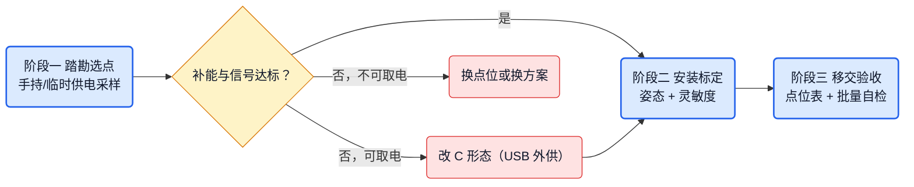

#### 4.11.2 选点数据项

| 数据项            | 采集方式                       | 用途                  | 判定门槛（候选）              |
| -------------- | -------------------------- | ------------------- | --------------------- |
| 预估日补能          | OPV 的 MPP 电流 × 有效光时，再用超容电压校正 | 判断能否长期自持            | 补能 ≥ 日均消耗（含 30% 余量）   |
| 有效光时           | 按 MPP 电流 ≥ 门槛的累计小时数        | 估算日补能量              | 与 4.1.5 平衡            |
| 到父节点信号         | 现场 RSSI / 入网质量              | 判断链路余量              | 按签核门限                 |
| 姿态与倾角          | App 选择 + 现场确认              | 决定距离-灵敏度映射          | 必填                    |
| 动线类型           | 现场判定：快速通过 / 经停 / 可能滞留      | 决定 T\_leave 与是否应改选 SKU2 | 必填                    |
| PIR 首触发验证      | 安装后模拟一次正常步行穿越              | 确认覆盖与安装高度           | 3 次内触发 ≥2 次           |
| 干扰源距离          | 现场核查（出风口、阳光/车灯/白炽灯直射、热源、玻璃/亚克力、小动物活动区） | 判断误报与漏检风险        | 出风口 ≥1.5 m；不得隔玻璃/亚克力；避开直射与小动物 |

#### 4.11.3 选点需求

| ID      | 需求描述                                                               | 优先级 | 验收口径                        |
| ------- | ------------------------------------------------------------------ | --- | --------------------------- |
| FR-1101 | 提供"选点模式"：设备在待装位置连续采样补能、波动与信号，结果在 App 上以结论形式给出，而不是只给原始数字。           | P0  | 单点位选点 ≤60 s，输出结论            |
| FR-1102 | 选点结论分三档：**推荐**（可自持）/ **可用但需补能**（建议 USB 或缩短维护周期）/ **不推荐**（换点位或换方案）。 | P0  | 20 个背光/遮挡点位，判定与人工复核一致率 ≥90% |
| FR-1103 | **场景适配判定**：点位若属于"人会长时间静止"（工位、值班室、会议室），直接提示"应改用 SKU2 双鉴"，不推荐本机。   | P0  | 构造 10 个静坐场景点位，全部提示换型           |
| FR-1104 | 安装时完成灵敏度标定：按安装高度与动线选定档位，保存档位、姿态、验证结果与时间。                          | P0  | 标定后 3 m 穿越检出 ≥99%            |
| FR-1105 | 标定时校验朝向：明显遮挡 PIR 透镜或正对热源时直接提示，不允许"先装后补"。                           | P0  | 人为遮挡安装，提示可复现                |
| FR-1106 | 选点数据与点位表绑定：楼层、房间、SKU、安装方式、高度、朝向、父节点、信号、补能估算、档位、规则、验收结果。          | P0  | 点位表可导出，字段完整                 |
| FR-1107 | 入网后 2 h 内批量自检并出返工清单：补能评估、能量基线、PIR 首触发、策略核对。                       | P0  | 异常设备、位置、原因三项齐全              |
| FR-1108 | 安装前读有效超容电压，<3 V 提示 USB 补能并复测，避免"装上就低电"。                            | P0  | App 可见提示与指引                 |

### 4.12 防拆：设备被从支架带走（FR-12xx）

**要点**：这是本机唯一带"物理对抗"性质的需求。软件推断不可靠，必须硬件给信号；而硬件信号又会误报，所以用 **2 s 确认窗口**过滤瞬态，并配合维护模式区分计划内拆卸。**防拆是"检测"，不是"断电"**：SPDT 只进 GPIO，不串接电源或负载，设备离位后仍能继续供电并把告警说完。

#### 4.12.1 硬件方案与配合结构

| 方案             | 原理             | 优点                  | 风险                     | 结论                       |
| -------------- | -------------- | ------------------- | ---------------------- | ------------------------ |
| **SPDT 检测开关**  | 支架铁片压合按柄，离开即弹起 | 判定直接、零功耗、无磁干扰、四款可共用 | 需底壳开孔与公差控制             | **主方案**                  |
| 霍尔 + 支架磁铁      | 设备离开支架 → 磁场消失  | 无接触、无磨损             | 机身自带强磁致饱和；支架再加磁铁则吸附力失控 | **不采用**（原因见下）            |
| 机械顶针 + 铁片      | 铁片兼作动触点        | 不需新增器件品类            | 铁片氧化、怕潮、接触电阻漂移         | 备选（成本极敏感时）               |
| 加速度计（G-sensor） | 检测搬动、跌落、姿态突变   | 可区分"被拿走"与"被碰一下"     | 常开耗电；成本 1.5–2.5 元/台    | **不采用**（成本否决，由 2 s 窗口替代） |
| 离墙检测（电容/光电）    | 检测与安装面距离       | 覆盖"连支架一起拔走"         | 受基材影响大，标定复杂            | 预留                       |

**推荐方案**：检测开关单判据 + **2 s 确认窗口**：弹起后 2 s 内恢复压合判"瞬时脱离"，只留痕不告警；到期仍弹起判"真实离位"。**不配置加速度计**——其防误报职责由机械压缩量、确认窗口、维护模式三层承担（见下文与 FR-1210）。

防拆器件定为 **SPDT 检测开关（Detector Switch）**，装在背板距磁铁中心 12 mm 处，按柄穿出底壳开孔，由万向节支架上的铁片压合。四款 SKU 共用同一封装位置、同一型号与同一开孔，差异只在铁片形态。

**选型判据：不能用普通轻触开关。** 轻触开关行程仅 0.15–0.3 mm，而装配公差累计 ±0.55 mm，会出现"装上了但没压到"的间歇失效——产线抽检抽不出来，现场表现为"有时告警有时不告警"。判据是**行程 ≥ 2 × 公差累计**：

| 公差来源    | 偏差           |
| ------- | ------------ |
| 底壳成型平面度 | ±0.15 mm     |
| 磁铁安装高度  | ±0.20 mm     |
| 铁片厚度    | ±0.05 mm     |
| 支架球头平面度 | ±0.15 mm     |
| **累计**  | **±0.55 mm** |

| 参数   | 要求            | 理由                                     |
| ---- | ------------- | -------------------------------------- |
| 类型   | SPDT 检测开关     | 需 NC/NO 双触点：NC 用于在位/离位检测，NO 可作备用或硬件互锁，**不串主回路** |
| 行程   | ≥1.0 mm       | 覆盖 ±0.55 mm 公差后仍有余量                    |
| 过行程  | ≥0.5 mm       | 公差上限时不压死                               |
| 动作力  | 0.5–1.5 N     | 磁吸力 10–15 N 远大于此；低于 0.3 N 则擦碰即误报       |
| 按柄   | Φ2.0 × 3.5 mm | 穿出底壳后露出 1.5 mm                         |
| 触点额定 | ≥10 mA        | **仅信号回路**，不承载系统、超容充电或发射电流              |
| 寿命   | ≥5 万次         | 5 年仅操作 5 次（换电池）                        |

**两种磁铁形态的兼容**：内嵌式磁铁与壳面齐平，配平铁片；螺纹式磁铁凸出约 3 mm，配**外环上翻 3 mm 的台阶铁片**（中央 Φ18 保持平面吸磁铁）。两种情形下按柄压缩量同为 1.5 mm，设备侧不需要第二套模。

| 形态  | 磁铁相对壳面  | 铁片              | 按柄压缩量  |
| --- | ------- | --------------- | ------ |
| 内嵌式 | 齐平      | 平铁片 Φ30×0.5     | 1.5 mm |
| 螺纹式 | 凸出 3 mm | 台阶铁片（外环上翻 3 mm） | 1.5 mm |

**电气接法（仅检测，不进电源路径）**：COM 接 GND，NC 接检测 GPIO（内部上拉）。支架压合时按柄压下、NC 闭合，GPIO 为低（在位）；离开支架时按柄弹起、NC 断开，GPIO 被上拉为高并触发中断（离位）。**SPDT 不得串接电池、超容或负载**；电源通断只由双档拨动开关负责。选型时须确认"压下"与 NC/NO 的对应关系：若所选型号为"压下断开 NC"，则改用 NO 接 GPIO 并在固件中反转极性，量产前以实机签核为准。

| 状态        | 开关  | NC 触点 | GPIO     | 设备行为                          |
| --------- | --- | ----- | -------- | ----------------------------- |
| 装在支架上     | 压下  | 闭合    | 低        | 正常工作                          |
| 离开支架      | 弹起  | 断开    | 高（中断）    | 确认窗口到期后**立即上报 E407（≤5 s）**，仍由超容/电池供电，不中断运行 |
| 线束断 / 接触不良 | —   | 断开    | 高        | 按离位处理（fail-safe），避免"剪线静默"     |
| 产线 / 仓储   | 弹起  | 断开    | 高        | 若拨动开关在 OFF 则整机断电；否则按离位处理      |

**为什么不再串主回路**：把 SPDT 串进电源，设备一离位就失去主供，只能靠超容抢发几秒——既压缩了上报窗口，也让"离位后继续监测是否被重新装回"不可能；同时电池支路与主回路的通断被防拆开关绑架，换电池、返修都更容易误触发。改为独立检测后，离位信号只进 GPIO，设备可以立即上报、继续运行，并按策略进入待装态。这条是本期方案的硬边界，硬件评审不得改回串接方案。

**离位判据与误报抑制**：开关弹起后先进入 **2 s 确认窗口**，窗口内恢复压合判为"瞬时脱离"（擦拭、临时挪动、装配抖动），只留痕不告警；窗口到期仍弹起才判"真实离位"并进入上报流程。误报由三层防线压住：

| 层级  | 措施                                      | 解决什么        |
| --- | --------------------------------------- | ----------- |
| 机械  | 压缩量 1.5 mm、开关周围 1.0 mm 围骨、支架凸台 15° 斜导   | 公差临界抖动、侧向剪切 |
| 固件  | 2 s 确认窗口 + 200 ms 去抖 + 连续 2 次采样一致       | 瞬时脱离、接触抖动   |
| 运营  | 带时限维护模式（默认 30 min，可配 5–120 min），期间离位仅留痕 | 换电池、移位、返修   |

**不采用加速度计**：器件与贴装合计 1.5–2.5 元/台，而其原本承担的"防误报"职责大半是伪需求——擦拭与碰触不会使设备离开支架，开关本就不动作；"碰一下又放开"由 2 s 窗口过滤；"正常维护"由维护模式解决；"胶失效脱落"本就该报。故本期不配置加速度计，以成本优先。

**为什么不用霍尔**：机身背面已有 Φ12×8 钕磁铁（表磁 3000–4000 Gs），霍尔在距其 8–15 mm 处场强 500–1500 Gs，比开关型霍尔动作点（±30–70 Gs）高一个量级以上，直接饱和；若改在支架侧再加磁铁，会与机身磁铁极性叠加，吸附力失控且阈值随磁铁批次漂移。霍尔仅在结构完全无位置时作备选，且须做磁屏蔽。

#### 4.12.2 触发链与告警

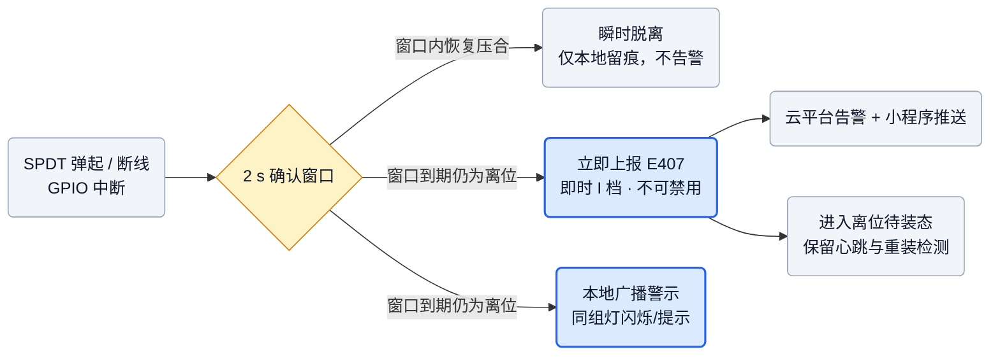

#### 4.12.3 防拆需求

| ID      | 需求描述                                                                                                                                                                            | 优先级 | 验收口径                         |
| ------- | ------------------------------------------------------------------------------------------------------------------------------------------------------------------------------- | --- | ---------------------------- |
| FR-1201 | 背部须为 SPDT 检测开关（选型与公差判据见 4.12.1）：设备与支架分离即弹起，产生硬件中断，不依赖软件轮询推断；**开关只接检测回路（COM 接地、NC 接 GPIO），不得串接电源或负载**。                                                                                     | P0  | 分离后 ≤5 s 产生信号；检测回路与电源回路独立，装配签核     |
| FR-1202 | 单判据 + **2 s 确认窗口**：开关弹起后 2 s 内恢复压合判"瞬时脱离"，只本地留痕不告警；到期仍弹起判"真实离位"。不依赖加速度计。                                                                                                        | P0  | 模拟碰动 50 次误报 0；模拟拿走 20 次全部告警  |
| FR-1203 | 触发后立即上报 E407（即时档、不可禁用、必须 ACK），载荷带原因码分三类：DETACH\_MANUAL（疑似人为，布防时段内且拆卸后快速消失，置信度中）/ DETACH\_ADHESIVE（疑似贴装失效，无人时段发生且离位后仍在原网关信号范围内，置信度低）/ DETACH\_UNKNOWN；平台按"疑似"展示并支持现场确认回填，不承诺精确区分 | P0  | 20 次拆卸，云端均收到且原因码正确           |
| FR-1204 | 触发后同时发本地广播警示（同组灯闪烁或提示），保证断网时现场也有反馈。                                                                                                                                             | P0  | 断云状态下现场可见警示                  |
| FR-1205 | **离位不断电**：确认窗口到期后必须立即完成 E407 上报；上报后进入"离位待装态"（停用与安装位置相关的检测/执行，保留心跳与重装检测），重新压合后自动恢复。若同时处于低电，按 Last Gasp 优先保告警。                                                                         | P0  | 拔下后 20 次均收到告警；待装态可读；重装后 60 s 内恢复 |
| FR-1206 | 支持**带时限维护模式**：小程序开启后默认 30 min（可配 5–120 min）内离位不告警、仅留痕，到期自动恢复布防；维护模式状态在设备与平台双记录                                                                                                  | P1  | 撤防时段拆卸不告警但留痕                 |
| FR-1207 | 防拆状态参与运维展示：在位、离位、疑似、已告警四态，可在诊断快照中读出。                                                                                                                                            | P0  | 四态均可构造并正确显示                  |
| FR-1208 | 电池仓/壳体防非授权开启：若壳体开启能触发同一 SPDT，则等同离位处理；若不在该开关检测范围内，须增设独立检测点，否则本条不适用。工具规格写入施工手册。                                                                                                     | P1  | 徒手无法开启；能触发时产生信号；不适用时书面说明      |
| FR-1209 | 防拆不得因低电、OTA、配置下发而失效；OTA 期间沿用原状态判断。                                                                                                                                              | P0  | 低电与升级期间拆卸仍告警                 |
| FR-1210 | 确认窗口参数化：窗口 1–10 s（默认 2 s）、去抖 200 ms、连续 2 次采样一致；参数随配置下发并可读回。**不设"收尾窗口"**，离位后不主动断电。                                                                                                | P0  | 参数可配可读回；去抖后误报 0              |
| FR-1211 | **不配置加速度计**：成本 1.5–2.5 元/台与其增益不匹配；误报抑制由机械压缩量、2 s 确认窗口、维护模式三层承担（见 4.12.1）。                                                                                                       | P0  | BOM 无加速度计；三层措施逐项验证           |

**与"掉落"的区分**：胶贴失效导致的脱落同样产生离位信号。不配加速度计后只能靠"发生时段"与"离位后信号是否仍存续"做倾向性标注（见 FR-1203 的三类原因码），无法精确区分。因此平台按"疑似"展示并要求现场确认，避免运维把"胶没粘牢"当成"有人偷设备"。安装侧的对策是：禁用基材清单 + 现场拉拔试验 + 卡扣/螺接备选（见 5.5 与 6.2）。

## 05 非功能需求

**要点**：功能决定"能不能用"，非功能决定"能不能卖"。

### 5.1 安规（Safety）

| 编号      | 项目       | 依据标准                           | 要求                                            | 验收           |
| ------- | -------- | ------------------------------ | --------------------------------------------- | ------------ |
| NFR-101 | 整机安全     | GB 4943.1-2022（等同 IEC 62368-1） | 按 ES1 能量源设计；可触及部件无危险电压；外壳阻燃等级不低于 V-1（建议 V-0）  | 第三方报告        |
| NFR-102 | 超容储能安全   | 按元器件 + 整机能量评估                  | 20 F 超容储能量按 ES2 评估：端子防直接短路、防反接；维修/报废前须放电至安全电压 | 设计评审 + 短路试验  |
| NFR-103 | USB 输入安全 | GB 4943.1 + 整机                 | 5 V SELV 输入；限流 ≤300 mA；防反灌；劣质适配器接入不得损坏电路或起火   | 反灌与过流试验      |
| NFR-104 | 一次锂电池安全  | GB 8897.4（等同 IEC 60086-4）      | CR2450 具备防反充隔离、防短路；异常温升不得引燃外壳                 | 电池厂报告 + 整机温升 |
| NFR-105 | 温升       | GB 4943.1                      | 常温满载与 USB 边充边检工况下，可触及表面温升不超过限值                | 热电偶实测        |
| NFR-106 | 机械安全     | 整机                             | 无锐边、无夹手风险；支架承重 ≥3 倍整机重量；吊顶安装件防坠               | 拉力与结构评审      |
| NFR-107 | 标识与警示    | 整机                             | 铭牌含型号、电气参数、厂名、生产批次；电池与超容警示语；回收标识              | 铭牌评审         |

### 5.2 EMC（电磁兼容）

本机没有开关电源、没有雷达，只有 BLE 射频与 PIR 微弱模拟前端；但 USB 供电会把外部噪声引进来，PIR 又对电源纹波和射频场极其敏感。EMC 必须按"发射"和"抗扰"两侧分别验收。

#### 5.2.1 EMI（发射）

| 编号      | 项目          | 依据标准                            | 限值/要求                                        |
| ------- | ----------- | ------------------------------- | -------------------------------------------- |
| NFR-111 | 辐射骚扰        | GB/T 9254.1（等同 CISPR 32）Class B | 30 MHz～1 GHz、1～6 GHz 满足 Class B 限值            |
| NFR-112 | 传导骚扰        | GB/T 9254.1 Class B             | USB 供电经适配器时，电源端满足 Class B 限值                   |
| NFR-113 | 谐波电流        | GB/T 17625.1                    | 若配套适配器功率 \>75 W 需评估；本机本身不适用                   |
| NFR-115 | BLE 邻道与占用带宽 | 按 SRRC 型号核准要求                   | 2.4 GHz 频段功率、占用带宽、带外发射满足微功率设备要求              |

#### 5.2.2 EMS（抗扰）

| 编号      | 项目           | 依据标准          | 试验等级                               | 判定                            |
| ------- | ------------ | ------------- | ---------------------------------- | ----------------------------- |
| NFR-121 | 静电放电 ESD     | GB/T 17626.2  | 接触放电 ±4 kV，空气放电 ±8 kV              | 性能判据 B：允许暂时功能降级，可自恢复，不丢配置、不误报 |
| NFR-122 | 电快速瞬变脉冲群 EFT | GB/T 17626.4  | 电源端 ±2 kV，信号/控制端 ±1 kV             | 判据 B                          |
| NFR-123 | 浪涌 Surge     | GB/T 17626.5  | 线-线 ±1 kV；配适配器时线-地 ±2 kV           | 判据 B；不得永久损坏                   |
| NFR-124 | 射频辐射抗扰 RS    | GB/T 17626.3  | 80 MHz～1 GHz，3 V/m；1～6 GHz 按产品定位加测 | 判据 A：检测功能不误翻转、不误报防拆           |
| NFR-125 | 射频传导抗扰 CS    | GB/T 17626.6  | 0.15～80 MHz，3 V                    | 判据 A                          |
| NFR-126 | 工频磁场         | GB/T 17626.8  | 3 A/m                              | 判据 A                          |
| NFR-127 | 电压暂降与短时中断    | GB/T 17626.11 | 按适配器工况；本机需验证 USB 插拔瞬断不影响状态         | 判据 B；不得复位丢配置                  |
| NFR-129 | PIR 前端抗误触发   | 整机            | ESD / RS / EFT 试验期间，PIR 不得输出有效触发          | 三类试验各 20 次，误开灯 0 次             |

**本机不适用项**：本机无 24 GHz 雷达通道，雷达杂散与雷达抗自身干扰相关试验项均不适用，不得列入认证清单。

**特别提示**：ESD 与 RS 试验时必须同时观察**PIR 输出与防拆信号**——如果静电或射频干扰让 PIR 误触发，现场表现就是"没人也开灯"；让检测开关的采样误触发，就是"没动却报警"。两者都比漏报更伤现场信任。因此 NFR-121/124 的判定标准中加入"PIR 不误翻转、防拆不误触发"。

### 5.3 无线与频谱合规

| 编号      | 区域   | 项目         | 要求                                                       |
| ------- | ---- | ---------- | -------------------------------------------------------- |
| NFR-131 | 中国大陆 | SRRC 型号核准  | 2.4 GHz BLE 须取得无线电发射设备型号核准证                              |
| NFR-132 | 中国大陆 | 微功率设备技术要求  | 2.4000～2483.5 GHz 满足微功率短距离设备限值                            |
| NFR-133 | 中国香港 | 无线电管理      | 2.4 GHz 一般属免牌照类别；保留测试报告备查                                 |
| NFR-134 | 通用   | 频率容限与功率稳定性 | 全温区频率偏移、功率波动在核准限值内                                       |
| NFR-135 | 通用   | 天线         | 板载天线，不可外接；不得用户自行更换（否则核准失效）                               |

**本机没有 24 GHz 雷达，因此不存在 SKU2 的频谱准入风险**——这是选型上的实际优势，也是"走廊为什么用 SKU1"的一条硬理由。

### 5.4 合规（中国大陆 / 中国香港）

#### 5.4.1 中国大陆

| 编号      | 合规项   | 要求                                                                     |
| ------- | ----- | ---------------------------------------------------------------------- |
| NFR-141 | 无线电   | SRRC 型号核准（见 5.3）；铭牌标注核准代码                                              |
| NFR-142 | 有害物质  | 满足 GB/T 26572 限量要求，提供 RoHS 报告与符合性声明                                    |
| NFR-143 | 电池    | 满足 GB 8897.4；提供 MSDS；不得使用汞、镉超限电池                                       |
| NFR-144 | 数据与隐私 | 遵循《个人信息保护法》《数据安全法》《网络安全法》：只采集空间级存在与照度，不采集影像、音频、身份信息；采集目的、范围、保留期须在告知中明示 |
| NFR-145 | 告知与同意 | 安装在有人活动的空间时，须提供可见的告知方式（点位说明、隐私告知卡、物业公示模板）                              |
| NFR-146 | 宣传口径  | 不得使用绝对化用语（最/第一/顶级）；不得宣称医疗、健康功效；节能率须标注工况与口径                             |

#### 5.4.2 中国香港

| 编号      | 合规项  | 要求                                                 |
| ------- | ---- | -------------------------------------------------- |
| NFR-147 | 无线电  | 按 OFCA 要求确认免牌照条件或申请相应许可；保留测试报告备查                   |
| NFR-148 | 个人资料 | 遵循《个人资料（私隐）条例》（PDPO）：收集目的明确、最小必要、保留期不超必要；提供查阅与更正渠道 |
| NFR-149 | 电气安全 | 参照 IEC 62368-1 体系；USB 适配器如随货，须符合当地安全要求             |
| NFR-150 | 标识   | 英文/繁体中文双语标识与警示语；回收与电池处置说明                          |

#### 5.4.3 两区域差异处理

| 差异点  | 大陆        | 香港          | 处理方式            |
| ---- | --------- | ----------- | --------------- |
| 无线准入 | SRRC 强制   | OFCA 免牌照/许可 | 分别送测，共用技术文件     |
| 语言   | 简体中文      | 繁体中文 + 英文   | 铭牌与手册分版印刷       |
| 隐私法规 | PIPL 为主   | PDPO 为主     | 告知模板分版，最小采集口径统一 |
| 包装   | 需 RoHS 标识 | 需回收说明       | 包装版型分区域，机身共用    |

### 5.5 环境与可靠性

| 编号      | 项目       | 要求                      | 说明                                    |
| ------- | -------- | ----------------------- | ------------------------------------- |
| NFR-161 | 工作温度     | -10～55 ℃                | 低温会使 PIR 灵敏度下降，须在 -10 ℃ 验证 3 m 检出仍达标 |
| NFR-162 | 存储温度     | -20～70 ℃                | 超容低温容量衰减、电池高温自放电需评估                   |
| NFR-163 | 工作湿度     | 10%～90% RH（非凝露）         | 凝露环境需三防处理，本机不承诺                       |
| NFR-164 | 防护等级     | IP30（设计目标），IP20 为基础验证项  | USB 口与开关凹槽开盖状态不计入                     |
| NFR-165 | 胶贴可靠性    | 常温 5 年不脱落；持粘力 ≥3 倍整机重量  | 乳胶漆/瓷砖/金属/木饰面四基材分别验证                  |
| NFR-166 | 支架与安装件   | 振动中不松脱；吊顶安装需防坠结构        | 与防拆方案联动设计                             |
| NFR-167 | 开关寿命     | ≥5000 次，老化后接触电阻 ≤300 mΩ | 镀金触点；振动中不得自行跳变                        |
| NFR-168 | USB 插拔寿命 | ≥500 次；长期插电 ≥2 年无异常     | 验证超容浮充寿命、发热、接口氧化                      |
| NFR-169 | 包装跌落     | 按 ISTA 1A/2A 执行         | 超容与支架为易损件，需单独评估                       |
| NFR-170 | 外观隐私     | 整机无可见开孔（PIR 透镜为封闭光学窗）、无镜头形态、无可见工作灯 | 盲测 10 人，≥9 人不认为是摄像设备                  |

### 5.6 性能指标

| 编号      | 指标        | 口径                                | 目标值                    |
| ------- | --------- | --------------------------------- | ---------------------- |
| NFR-181 | 移动检出率     | 3 m 高、25 ℃、0.5～1.5 m/s 径向穿越 100 次 | \>99%                  |
| NFR-182 | 进入响应时延    | PIR 有效触发 → 完成组帧并发空口               | P95 ≤300 ms            |
| NFR-183 | 本地联动时延    | E101 成立 → 同组执行端实动（4 跳内）           | P95 ≤300 ms；整体 ≤1 s    |
| NFR-184 | 云端路径时延    | 可消费事件 → 执行端下发                     | P95 ≤3 s               |
| NFR-185 | 静坐边界      | 静坐超过 T\_leave 判无人                 | 规格书与选点提示必须明示，不得承诺静止保持  |
| NFR-186 | 空场净误报     | 无人 + 空调气流/窗帘/阳光 72 h             | 净误报 ≤1 次/24 h          |
| NFR-187 | PIR 静态电流  | 无人态 PIR 支路                        | ≤5 µA                  |
| NFR-188 | 触发一致性     | 同一点位同一天 100 次穿越                    | 触发次数偏差 ≤2%            |
| NFR-189 | 无光续航（仅超容） | 满电 3.5 V、无人态放电至保护点                | ≥30 天（20 F 实装核算）       |
| NFR-190 | 纯电池续航     | 完全无光、日均 ≤11 µA，50% 放电深度           | ≥2 年                   |
| NFR-191 | USB 补电时长  | 边充边检，2.5→3.5 V                    | <10 min                |
| NFR-192 | 形态切换时延    | 插/拔 USB 到行为切换完成                   | ≤5 s，检测不中断、不重启         |
| NFR-193 | 运输模式待机    | 开关 OFF，超容预充 3.5 V                 | ≤2.5 µA                |
| NFR-194 | 库存自放电     | OFF 状态静置 6 个月                     | 压降 <1 V（折算漏电 <1.29 µA） |
| NFR-195 | 校时精度      | 单跳 2.4 GHz                        | 门限 100 ms；校后 <20 ms    |
| NFR-196 | 唤醒窗口下行成功率 | 父节点在窗口内投递                         | ≥98%                   |
| NFR-197 | 配置回读一致率   | 逐条下发后读回（含实际执行值）                   | 100%                   |
| NFR-199 | 防拆告警时延    | 离开支架 → 上报                         | ≤5 s                   |

### 5.7 寿命与可维护性

| 项     | 目标                           | 前提                  |
| ----- | ---------------------------- | ------------------- |
| 整机服务期 | 有条件的五年（检测可用率按场景核算）           | 允许按计划 USB 补能；不等于免维护 |
| 超容    | 5 年内可用能量衰减 ≤20%              | 避免长期满充高温            |
| 备用电池  | 办公/走廊场景基本不消耗；低光场景 1.5～2 年需更换 | 更换后须校时并恢复配置（FR-606） |
| 维护方式  | 远程诊断为主，USB 补能为辅，换机为兜底        | 90% 异常可远程判定         |

## 06 测试与验收

### 6.1 验收矩阵

| 域     | 覆盖需求                        | 关键用例                 | 通过标准                                |
| ----- | --------------------------- | -------------------- | ----------------------------------- |
| 组网与鉴权 | FR-301～FR-309               | TC-01～03、TC-35、TC-55 | 两条路径均可入网；无权限/伪造/扫 A 装 B 全拦截；待核设备不联动 |
| 移动检测  | FR-1001～FR-1011             | TC-10～18、TC-73       | 移动 >99%；空场净误报达标；静坐边界明示             |
| 选点    | FR-1101～FR-1108             | TC-11～13、TC-51、TC-52 | 补能估算误差 ≤20%；选点结论与人工复核一致率 ≥90%       |
| 能源    | FR-101～FR-112               | TC-20～23、TC-66～75    | 三态电流达标；切换与保护正确；末次上报 ≥95%            |
| 通信与安全 | FR-201～FR-211               | TC-29、TC-49、TC-55    | 三通道互不阻塞；重放无效；无明文降级                  |
| 事件    | FR-401～FR-406               | TC-44、TC-45、TC-48    | 逐条可配可读回；硬约束拒绝率 100%；补报排序 100%       |
| 心跳与时间 | FR-501～FR-507、FR-601～FR-606 | TC-04、TC-47          | 三周期判离线；90/110 ms 门限正确；补报可还原         |
| OTA   | FR-701～FR-706               | TC-24～26、TC-57       | 断点续传成功；断电 100 次不变砖                  |
| 运维与超管 | FR-801～FR-809               | TC-33、TC-36、TC-44    | 会话限时生效；本地待确认三态正确                    |
| 联动    | FR-901～FR-910               | TC-28、TC-31、TC-51    | 断云可用；无照度源时按降级规则动作；手动接管优先            |
| 防拆    | FR-1201～FR-1211             | TC-64、TC-65          | 拆卸 ≤5 s 告警；碰动 50 次误报 0              |
| 认证    | NFR-101～NFR-170             | TC-38～42、TC-61～65    | 两区域报告齐备，无否决项                        |

### 6.2 关键专项测试

| \#  | 专项             | 方法                                    | 判定                          |
| --- | -------------- | ------------------------------------- | --------------------------- |
| 1   | 触发去抖           | 注入单脉冲干扰 100 次，再注入连续双脉冲 100 次          | 单脉冲误开灯 0 次；双脉冲 100/100 触发  |
| 2   | 无人延时计时         | 每次 58 s 注入触发，持续 30 min                | 计时器始终被重置，不误判离开              |
| 3   | 静坐边界           | 静坐 5/10/15 min 三组，记录关灯时刻               | 与 T\_leave 一致，误差 ≤±1 s       |
| 4   | 事件复现           | 逐条构造触发条件                              | 全部可稳定复现，无误触发                |
| 5   | 硬约束不可突破        | 尝试禁用锁定事件、把 P0 改聚合                     | 全部拒绝并回原因码                   |
| 6   | 能量强制改写         | 配聚合 15 min 后拉低到 L4                    | 实际执行值正确改写并回执                |
| 7   | 三通道互不阻塞        | 父节点离线 / 广播全丢 / 云断链 交叉注入               | 任一故障时其余通道功能与记录不受影响          |
| 8   | 组网双路径          | 断公网本地组网；扫码云下发；扫 A 装 B；非澜潮设备           | 四种场景全部符合 4.3                |
| 9   | 防拆单判据 + 时间窗          | 模拟碰动 50 次、拿走 20 次、胶贴脱落 20 次           | 误报 0；告警 20/20；原因码可区分        |
| 10  | 照度条件降级         | 摘除全部照度源、条件位超期、条件位冲突                   | 按 4.9.4 默认行为动作，平台标注正确      |
| 11  | 形态切换           | 运行中反复插拔 USB 100 次                    | ≤5 s 切换，检测不中断，无重启          |
| 12  | 三重一致性          | 篡改镭雕码 / 错写内部存储 / MAC 不一致              | 均在对应环节拦截，不一致不得出厂            |
| 13  | 随机断电           | 断电 500 次（含 OTA 与配置写入中）                | 变砖 0 次；配置与缓存不丢             |
| 14  | 满载与换父          | 8 台满载 + 第 9 台；父节点断电                   | 无碰撞；第 9 台被拒或迁移；≤3 min 重挂   |
| 15  | 安装效率           | 3 人 × 3 天全流程实测                         | ≥60 点位/人日；异常点位与返工率可查        |
| 16  | 外观隐私           | 实物盲测                                  | 10 人中 ≥9 人不认为是摄像设备          |
| 17  | 现场试点           | ≥200 点位、≥30 天、A/B/C 形态混合             | 误报工单 ≤1 次/点位/月；离线率 ≤1%     |
| 18  | PIR 光学窗验证      | 贴膜、加玻璃、喷漆三种处理，各测 3 m 穿越 20 次         | 三种处理均出现明显漏检；正常状态仍 ≥99%      |

### 6.3 阶段交付与出口条件

| 阶段      | 周期           | 关键交付物                             | 出口条件                                  |
| ------- | ------------ | --------------------------------- | ------------------------------------- |
| M0 需求冻结 | T0 – T+2W    | PRD 会签、事件主表、物模型初稿、PIR 选型结论        | 三方会签；PIR 型号与透镜签核；照度条件位来源书面确认         |
| M1 EVT  | T+3 – T+10W  | 功能样机、三态功耗、去抖链路、双档开关与运输模式、防拆硬件方案 | 无人 ≤12 µA；OFF ≤2.5 µA；配置回读打通          |
| M2 DVT  | T+16 – T+20W | 四姿态回归、指标实测、胶贴老化、选点与标定、白名单与配置联调  | 第 5 章指标达标或书面让步；照度降级路径验证通过             |
| M3 PVT  | T+21 – T+26W | 小批试产、安装工艺（含选点与 App 录入）、后台自检、认证送测  | 直通率 ≥95%；安装实测 ≥60 点位/人日；防拆装配签核      |
| M4 MP   | T+27 – T+30W | 量产固件、施工手册、隐私告知卡、FAE 培训包         | 试点 30 天达标；大陆与香港准入证据齐备                 |

## 07 风险与待决项

### 7.1 风险登记册

风险值 = 发生概率 × 影响程度（各 1～5 分）；15～25 高、8～14 中、1～7 低。

| 编号   | 风险                                     | 类别  | 概率  | 影响  | 等级       | 应对措施                                          | 责任       |
| ---- | -------------------------------------- | --- | --- | --- | -------- | --------------------------------------------- | -------- |
| R-01 | **静坐关灯引发投诉**（产品边界的直接代价）                | 体验  | 4   | 4   | **16 高** | 选点阶段识别静坐场景并升级 SKU2（FR-1103）；T\_leave 按场景配置；规格书与投标明示 | 产品 + 销售  |
| R-02 | PIR 误触发（阳光/车灯直射、暖气、空调气流、小动物）与隔玻璃漏检      | 技术  | 4   | 3   | **12 中** | 去抖 + 触发锁定 + 热源饱和识别；选点干扰源距离；透镜裸露；灵敏度分档        | 硬件 + FW  |
| R-03 | PIR 失效导致静默失效（无第二路交叉验证）                 | 技术  | 3   | 4   | **12 中** | 6 h 自检；连续多日零触发判疑似；安装期遮挡检查；后台批量自检             | FW       |
| R-04 | **无照度通道导致免开灯缺失**，项目方误以为可做恒照度           | 需求  | 4   | 3   | **12 中** | 2.5 与 4.9.4 写死降级行为；投标话术明确"不测光"；需要免开灯的项目配 SKU3 | 产品       |
| R-05 | 照度条件位来源不稳定，联动时好时坏                      | 依赖  | 3   | 4   | **12 中** | 条件位有效期 + E601 + 宁亮不暗默认；同组至少配一台带照度设备            | 云 + 交付   |
| R-06 | 防拆误报（静电、射频、打扫碰撞）                       | 技术  | 4   | 3   | **12 中** | 2 s 确认窗口；ESD/RS 试验纳入判定；维护模式                     | 硬件 + FW  |
| R-07 | 胶贴在劣质基材脱落（吊顶掉落）                        | 安全  | 3   | 4   | **12 中** | 禁用基材清单；现场拉拔试验；卡扣/螺接备选；脱落上报                    | 结构 + 交付  |
| R-08 | 组网失败率高（父节点容量/信号不足）                     | 技术  | 3   | 4   | **12 中** | 选点阶段即测信号；8 台限容；扫码任务超时可退回本地组网                 | 网关 + 交付  |
| R-09 | OTA 变砖或升级丢配置                           | 技术  | 2   | 5   | **10 中** | 双分区/回滚镜像；升级前电量校验；断电 500 次专项                  | FW       |
| R-10 | 被误认为摄像头引发投诉                            | 体验  | 3   | 4   | **12 中** | 无孔化设计；盲测评审；隐私告知卡与公示模板                         | ID + 产品  |
| R-11 | 位置录入拖累安装效率（60-100 点位不达标）                  | 进度  | 4   | 3   | **12 中** | App 位置记忆 + 序号递增列 P0；M2 完成、M3 实测；否则下调指标        | 小程序 + 产品 |
| R-12 | 灯具侧不支持短 ACK，联动无法确认                     | 依赖  | 3   | 4   | **12 中** | M0 前与灯具团队确认协议；不支持则退化为"广播不确认 + 灯侧自觉重试"         | 协议 + 灯具  |
| R-13 | 事件配置项过多，现场配错                           | 运营  | 4   | 3   | **12 中** | 模板为主；偏离基线单独标记；关闭关键本地广播需二次确认                   | 云平台      |
| R-14 | 补能估算与实际偏差（季节性光照变化）                     | 数据  | 3   | 3   | 9 中      | 选点数据 + 上线 48 h 复检 + E309 持续监控；结论标注"基于当前光照"     | 产品 + 云   |
| R-15 | 香港认证/隐私要求差异导致上市延后                      | 合规  | 2   | 3   | 6 低      | 与大陆并行送测；告知模板提前分版                              | 认证       |

### 7.2 待决项（M0 前关闭）

| 编号   | 事项                  | 决策方      | 现状 / 待定内容                                              |
| ---- | ------------------- | -------- | ------------------------------------------------------ |
| D-01 | **背面检测开关开孔与结构签核**（四款共用） | 结构 + 硬件  | **待确认**：统一背面件已确定拨动开关 + 螺纹槽 + 磁铁，但检测开关按柄开孔位置未在实物上确认；同时需签核**检测回路独立性**（COM 接地、NC 接 GPIO，不串电池/超容/负载）；见 8.5 与横向审核报告 |
| D-02 | PIR 型号与透镜            | 硬件       | 候选待定；要求 3 m 检出 >99%、静态 ≤5 µA、-10 ℃ 可用                  |
| D-03 | 灵敏度档与距离映射           | 硬件 + 算法  | 1～5 档对应 2～8 m 为候选值，须逐档实测                                |
| D-04 | 时间同步精度与缓存容量         | FW + 云   | 100 ms 门限沿用；缓存容量最低 16 条，建议 ≥256 条                      |
| D-05 | 心跳标准档与低功耗档          | 产品 + FW  | 标准 300～1800 s；2 h 保活档是否保留待定                            |
| D-06 | 超管权限范围与复核方式         | 产品 + 安全  | 建议双人复核 + 30 min 会话                                     |
| D-07 | 能量分级门限              | 硬件 + FW  | 五档电压须按 20 F/600 mAh 实装重新实测                             |
| D-08 | 选点补能门槛与有效期          | 产品 + 交付  | 候选"补能 ≥ 日均消耗 ×1.3"；条件位有效期默认 30 min                     |
| D-09 | 照度条件位的归属与优先级        | 产品 + 云   | 同组同时存在 SKU2/SKU3/SKU4 时的取源规则待签核                         |
| D-10 | 联动策略优先级与手动接管时长      | 产品 + 云   | 候选 4 h 暂停自动控制，待签核                                      |
| D-11 | 密钥体系与轮换周期           | 安全 + 云   | 一机一密方案、轮换周期、失窃吊销流程待定                                   |
| D-12 | 认证清单与送测排期           | 认证       | 大陆 SRRC + RoHS；香港 OFCA + 安全；是否需额外 EMC 报告待确认              |

## 08 附录

### 8.1 事件清单（全量分类）

**E1xx 移动检测**

| 编号   | 事件       | 定义                                  |
| ---- | -------- | ----------------------------------- |
| E101 | 有人进入     | 无人态 PIR 有效触发（去抖通过），置"有人"并本地联动开灯     |
| E102 | 设备心跳     | 周期上报存活与存在状态                         |
| E103 | 持续移动     | 有人态下再次有效触发，重置 T\_leave，不重复产生 E101   |
| E105 | 有人离开     | 满 T\_leave 且无新触发                    |
| E109 | 滞留超时     | 布防时段内连续存在 ≥T\_loiter                |
| E110 | 状态抖动异常   | 1 min 内翻转 ≥10 次，指向安装位置或灵敏度           |
| E111 | 停留时长统计   | 一个完整有人周期结束时汇总时长                     |
| E113 | PIR 疑似失效 | 采集与通信正常但连续多日零触发                     |

**E2xx PIR 通道与降级**

| 编号   | 事件       | 定义                        |
| ---- | -------- | ------------------------- |
| E201 | 触发确认     | 去抖通过，判定为一次有效移动            |
| E202 | 单脉冲剔除    | 单脉冲未通过去抖，不产生"有人"          |
| E203 | 热源饱和     | 连续高频触发且无间隙，疑似强热源或直射阳光     |
| E204 | 通道降级     | 低电或强干扰导致灵敏度强制降档           |
| E205 | PIR 故障   | 自检失败，检测不可用                |
| E206 | 检测不可用    | 连续零输出且无法自证正常，屏蔽该点位联动      |
| E207 | 通道恢复     | 自检通过并稳定 M 个周期             |

**E3xx 能源与电源**

| 编号   | 事件        | 定义                      |
| ---- | --------- | ----------------------- |
| E301 | 能量采集恢复    | 采能回升至工作窗口并稳定            |
| E302 | 能量不足预警    | SOC 低于预警值（候选 30%，5% 回差） |
| E303 | 能量临界      | SOC 低于临界值，检测开始退化        |
| E304 | 临终上报      | 触及预留储备门限，强制发末次状态        |
| E305 | 上电启动      | 冷启动，携带 `bootCause` 与身份  |
| E306 | 保护性深休眠    | 强制停测，仅留能量监测与唤醒          |
| E307 | 储能异常      | 充电斜率异常或自放电过快            |
| E308 | 采集源异常     | 采能长期低于地板值（遮挡、污损、背光）     |
| E309 | 安装补能不足    | 连续 48 h 日均补能低于门槛        |
| E310 | 采光面被遮挡    | OPV 输出骤降并持续 ≥24 h       |
| E311 | 超容欠压      | 预警 / 保护两档，回升后报解除        |
| E312 | 备用电池低电    | 端电压低于门限                 |
| E313 | 备用电池耗尽/异常 | 耗尽或接触不良导致电压跳变           |
| E314 | 电池切入/退出   | 记录次数与累计供电时长             |
| E315 | 超容健康度下降   | 健康度跌破阈值，用于寿命预警          |

**E4xx 自检与安防**

| 编号   | 事件      | 定义                     |
| ---- | ------- | ---------------------- |
| E401 | 周期自检报告  | 汇总 PIR / 电源 / 存储自检结果    |
| E403 | PIR 自检失败 | 偏置电压超窗、信号链开路或短路        |
| E407 | 防拆 / 脱落 | SPDT 离位 + 2 s 确认窗口成立，带原因码 |
| E408 | 探测窗遮挡   | PIR 长期零输出且现场有人员活动的间接证据 |

**E5xx 生命周期与运维**

| 编号   | 事件      | 定义                 |
| ---- | ------- | ------------------ |
| E501 | 设备上线    | 入网成功或断链后重连成功       |
| E502 | 链路恢复补报  | 补报完成，携带丢失与补报条数     |
| E503 | 入网完成    | 首次配网完成，带网关与链路质量    |
| E504 | 配置生效    | 参数生效，含来源、状态与实际执行值  |
| E505 | 配置拒绝    | 非法值或触碰硬约束，回具体原因码   |
| E506 | OTA 状态  | 下载/校验/安装/成功/失败/回滚  |
| E507 | 时钟偏差    | 校时修正量              |
| E508 | 缓存溢出    | 队列满并丢弃，上报丢弃条数      |
| E509 | 白名单校验失败 | 非本项目、越界、被占用或 MAC 不一致 |
| E510 | 供能形态变更  | A/B/C 切换记录         |
| E511 | 位置绑定变更  | 位置或设备替换，含操作人与新旧值   |

**E6xx 联动与条件**

| 编号   | 事件       | 定义                             |
| ---- | -------- | ------------------------------ |
| E601 | 照度条件位缺失  | 同组无有效照度源，或条件位超过有效期             |
| E602 | 本地联动执行反馈 | 本地策略引擎执行结果                     |
| E603 | 群组联动触发   | 广播触发记录，含跳数与 TTL                |
| E604 | 免开灯委派生效  | 收到"亮"条件位，跳过开灯但仍上报有人            |
| E606 | 联动确认超时   | 广播重播 2 次仍无执行端确认                |

### 8.2 物模型核心属性

| 分组  | 属性                           | 类型         | 读写  | 说明                                 |
| --- | ---------------------------- | ---------- | --- | ---------------------------------- |
| 存在  | `presenceState`              | enum       | R   | 0 无人 / 1 有人 / 3 未知                |
| 存在  | `motionState`                | enum       | R   | 静止 / 移动检出（仅移动，不代表静止保持）             |
| 存在  | `tLeave`                     | uint16     | RW  | 10 s～30 min                        |
| 存在  | `pirSens`                    | uint8      | RW  | 1～5                                |
| 存在  | `triggerCnt`                 | uint32     | R   | 累计有效触发次数                           |
| 存在  | `lastTriggerTs`              | uint32     | R   | 最近一次有效触发时刻                         |
| 能源  | `powerSource`                | enum       | R   | HARVEST / BATTERY / USB\_CHARGING / USB\_ONLINE |
| 能源  | `energyLevel`                | uint8      | R   | L1～L5                              |
| 能源  | `soc` / `vcap` / `vbat`      | uint8/uint16 | R   | 荷电 % / 超容 mV / 电池 mV              |
| 能源  | `capUv`                      | enum       | R   | NORMAL / WARN / UV\_PROTECT         |
| 能源  | `batStatus`                  | enum       | R   | 未接入 / 待机 / 供电 / 低电 / 耗尽 / 异常      |
| 能源  | `bootCause`                  | enum       | R   | 开关 / 看门狗 / 供电恢复 / 软复位 / 未知        |
| 能源  | `harvestUw`                  | uint16     | R   | OPV 当前输出估算（µW），用于补能判断             |
| 联动  | `luxCond`                    | enum       | R   | 来自同组的条件位：暗 / 亮 / 缺失 / 超期           |
| 联动  | `luxCondSrc`                 | string     | R   | 条件位来源设备 ID                         |
| 安装  | `mountMode` / `tiltDeg`      | enum/int8  | RW  | 顶/斜/侧/倒装及倾角                        |
| 安装  | `locCode` / `whitelistState` | string/enum | RW  | 四级位置码 / 白名单状态                      |
| 安防  | `tamperState`                | enum       | R   | 在位 / 离位 / 疑似 / 已告警                 |
| 安防  | `deployState`                | enum       | R   | NORMAL / DETACHED\_PENDING / MAINTENANCE |
| 通信  | `parentId` / `rssi`          | string/int8 | R   | 当前父节点与信号                           |
| 通信  | `wWake`                      | uint16     | RW  | 唤醒窗口 100～500 ms                   |
| 时间  | `clockSkew`                  | int16      | R   | 本次校时修正量                            |

### 8.3 服务清单

| 服务                   | 优先级 | 入参 / 出参                                                    |
| -------------------- | --- | ---------------------------------------------------------- |
| `setDetectionParams` | P0  | 入：`tLeave`、`pirSens`、去抖窗口；出：生效确认与实际执行值                    |
| `setReportPolicy`    | P0  | 入：事件 ID 列表 + 三通道参数或模板 ID；出：逐条生效确认（含配置值与实际执行值）            |
| `setLinkageRule`     | P0  | 入：组 ID、时段、照度条件（可选）、存在条件、延时、目标任务与动作；出：规则版本与生效结果           |
| `bindLocation`       | P0  | 入：机身码、四级位置、姿态、倾角；出：白名单校验结果                               |
| `startSiteSurvey`    | P0  | 入：采样时长；出：补能估算、信号、选点结论                                   |
| `enterMaintenance`   | P0  | 入：时长（≤30 min）、鉴权码；出：长窗口开启确认                                |
| `readDiagSnapshot`   | P0  | 入：无；出：通道/电源/最近 8 条事件/触发计数/策略摘要/防拆状态与待装态                      |
| `armSecurity`        | P1  | 入：布防状态、时段、滞留阈值、防拆开关；出：生效确认                               |
| `forceHeartbeat`     | P0  | 入：无；出：一帧完整状态                                             |
| `rebootDevice`       | P0  | 入：原因码；出：重启确认与重启后自检结果                                     |
| `clearCache`         | P1  | 入：确认令牌；出：清理条数（计入 E508 对账）                              |
| `checkPirResponse`   | P1  | 入：无；出：一次 PIR 自检结果与最近触发记录                                 |

### 8.4 参数默认值

| 参数               | 默认              | 可选范围                   | 备注                  |
| ---------------- | --------------- | ---------------------- | ------------------- |
| `tLeave`         | 按场景 30 s～5 min   | 10 s～30 min            | 走廊建议 30 s，大厅 60 s |
| `pirSens`        | 3               | 1～5                    | L4 降 1 档、L5 降 2 档   |
| 去抖窗口             | 200 ms          | 固定                     | —                   |
| 触发锁定             | 2 s             | 1～5 s                  | —                   |
| `wWake`          | 300 ms          | 100～500 ms             | USB 形态可取上限          |
| 心跳周期             | 300 s           | 300～1800 s（2 h 候选）     | 低电延长                |
| 最短点亮时长           | 10 s            | 5～60 s                 | 灯具侧须支持              |
| 布防滞留阈值           | 600 s           | 60～3600 s              | 安防场景                |
| 防拆确认窗口           | 2 s             | 1～10 s                 | 双条件同时成立             |
| 照度条件位有效期         | 30 min          | 5～60 min               | 超期按缺失处理             |

### 8.5 整合来源与合规声明

| 来源                              | 用途                          |
| ------------------------------- | --------------------------- |
| SKU2-双鉴存在传感器-PRD\_V4.3          | 公共章节逐字移植基线；mermaid 作图方式与术语 |
| SKU1-PIR人体移动传感器-PRD\_V2.3       | 本机私有检测、选点、防拆内容的前序版本        |
| 公共元需求 001/002/003/004/006       | 能源、通信安全、组网鉴权、事件、心跳的通用条款     |
| 主 PRD V2.5 / 功能需求 V2.7          | 20 F/600 mAh 实装基线、选点标定、运维权限 |
| 物模型定义总表 V4.68                   | 属性、事件、服务命名                  |

**说明**：本文为整合稿，所有数值分为三类——**实装基线**（如 20 F/600 mAh）、**实测目标**（如 ≤11 µA）、**候选值**（标注"候选/待实测"）。候选值不得用于对外承诺或投标话术。

**合规声明**：本方案为产品设计参考，涉及无线电准入、电气安全、电池运输与个人信息处理的具体实施，请结合公司合规与法务要求，并由具备资质的实验室与认证机构确认后执行。
