# 多合一 · SKU3 温照度传感器·PRD

**目录**

1. 文档控制
2. 产品概述
3. 拓扑与场景
4. 功能需求
5. 非功能需求
6. 测试与验收
7. 风险与待决项
8. 附录

**优先级定义**： P0 = 首发必须实现，缺失不可发布； P1 = 首发应实现，可在首个维护版本补齐； P2 = 规划项。

## 01 文档控制

### 1.1 型号确认

| 产品大类   | SKU  | 产品名称    | 主要模组       | 型号                     | MAC 类别 | MAC 示例              |
| ------ | ---- | ------- | ---------- | ---------------------- | ------ | ------------------- |
| 多合一传感器 | SKU3 | 温照度传感器 | 光照度 + 温湿度 | LC-S-MTS04-TL-11-001 | 50／C1  | `00 C1 50 XX XX XX` |

### 1.2 术语缩写对照表

| 术语                       | 本文含义                                                 |
| ------------------------ | ---------------------------------------------------- |
| PIR                      | 热释电被动红外，检测人移动引起的红外变化。**本机不配置**。                      |
| 24G 雷达                   | 24 GHz 人体存在雷达，配合 PIR 判断人是否还在。**本机不配置**。              |
| LPN                      | 低功耗节点，本文指本设备（不用市电做主动力）。                              |
| 父节点                      | 常电设备，替休眠的 LPN 收发并暂存消息。                               |
| CCO                      | 集中器角色。L2 CCO 汇现场子网，L1 CCO 汇一级网络并上联网关。                |
| Lux                      | 勒克斯，1 lx = 1 lm/m²。走廊暗光约 50～100 lx，办公阅读约 300～500 lx。 |
| OPV                      | 有机薄膜光伏，室内弱光下发电。                                      |
| 超容                       | 超级电容，本机主储能，支持大电流脉冲。                                  |
| 回差                       | 进入和退出同一状态用不同门槛，避免临界值附近反复切换。                          |
| 唤醒窗口                     | LPN 醒来并保持可通信的一段时间，父节点在此期间投递下行。                       |
| 本地广播                     | 不经树形网络，用 BLE 广播把事件直接发给同组执行端。                         |
| TTL                      | 广播可经几跳转发。本机联动广播 TTL ≤ 4。                             |
| `evtSeq` / `eventId`     | 灯侧联动去重序号 / 上行事件唯一标识（重传、补报、换父沿用原值）。                   |
| ACK                      | 接收方确认。父节点 ACK 只证明这一段送到，不等于云端已入库。                     |
| 收件回执 / 动作结果              | 回执=消息收到；动作结果=设备实际执行了吗（例如灯是否真的亮）。                     |
| T_scan                   | 雷达单次扫描时长。**本机无雷达，不适用**。                              |
| T_radar_delay            | 延迟确认时间。**本机无雷达，不适用**。                               |
| W_verify                 | 校验窗口。**本机无雷达，不适用**。                                 |
| N_leave / T_leave        | 连续判无目标的次数 / 无人确认延时。**本机无人体判断，不适用**。                  |
| OTA                      | 远程固件升级。                                              |
| 保电                       | 能量不足时按规则收缩功能，只保留最低采样与通信能力。                           |
| 超管（Root 级）               | 云平台对在线 LPN 的受控强制操作能力，见 4.8。                          |
| 选点                       | 安装前/安装中用设备自身数据判定该点位是否适合装配，见 4.11。                    |
| PXX                      | 百分位数，P95 = 95% 样本不超过的值。                              |
| DRDY                     | Data Ready，数据就绪信号。**本机无雷达，不适用**。                      |
| 连接参数协商                   | Conn Parameter Update，从机主动协商连接间隔、从机延迟、超时             |
| 广播扩展                     | Extended Advertising（BLE5.0+，长广播数据、多广播集）             |
| SOC                      | State of Charge，荷电状态（剩余电量）SOC = 当前剩余容量 ÷ 额定总容量 ×100% |
| devClass = HARVEST\_LEAF | 设备类型：光伏采集型叶子 LPN 节点                                  |
| canRelay = false         | 中继能力开关：**不允许转发任何其他节点报文**                             |
| maxHopDepth = 3          | 最大跳数深度 = 3                                           |
| ALS                      | 数字环境光传感器（Ambient Light Sensor），带阈值中断输出。              |
| RH                       | 相对湿度（%RH）。                                          |
| 阈值中断                     | ALS 自带比较器，照度跨过设定阈值时拉 INT 引脚唤醒主控，主控平时深睡。             |
| τ\_therm                 | 外壳热时间常数，决定温度读数跟上环境变化的速度；硬件决定、软件不可配。                 |
| K 系数                     | 安装点照度与工作面照度的换算系数，由现场标定得到。                           |
| 主用途                      | 点位声明以"照度"还是"温湿度"为主要用途，决定选点判据与告警口径。                   |
| 条件位                      | 本机广播的"暗/亮、过热/过冷、过湿/过干"判断结果，**不是开关灯命令**。             |
| 读数有效性                    | 正常 / 超量程 / 缺测 / 未标定 / 过期；无效值不进入联动与统计。              |

### 1.3 变更与评审记录

| 日期         | 版本   | 变更内容                                                                                                       | 受影响需求                | 评审意见 |
| ---------- | ---- | ---------------------------------------------------------------------------------------------------------- | -------------------- | ---- |
| 2026-11-19 | v1.0（参考稿） | 温照度型号独立成稿：光照快响应、温湿度分钟级、三通道、安装工艺                                                          | 全文                   | 结构与响应模型确认 |
| 2026-11-21 | V1.0 | 按 SKU2 V3.0 同构重排为八章；补齐选点、防拆、云端超管；明确"不得单独驱动开灯"                                                              | 全文                   | 通过   |
| 2026-11-23 | V1.3 | 型号序号定为 SKU3；防拆判据统一为「单判据 + 2 s 确认窗口」                                                                        | 1.1、4.12             | 通过   |
| **2026-11-24** | **V2.0（本稿）** | ① 按已冻结的 SKU2 V4.3 重做公共章节移植：4.2/4.3/4.5/4.6/4.7/4.12 及 5.4 逐字沿用，不再另写措辞；② 事件体系统一为 E1 主感知 / E2 通道与有效性 / E3 能源 / E4 自检安防 / E5 生命周期 / E6 联动；③ 4.10 采样模型保留并补齐三档模板与可信边界；④ 4.11 强化主用途冲突与 K 值标定；⑤ 新增 E205 读数过期与 E208 凝露预警，并在 4.9 增补条件位有效期；⑥ 统一修正防拆末两条的编号断档笔误（改为 FR-1210/1211）；⑦ BLE 杂散指标改用与 SKU2 一致的 NFR-115（旧稿对应项） | 全文；重点 4.4.2、4.9、4.10、4.11、5.2、5.6、8.x | 待评审 |
| 2026-11-25 | V2.0 修订 | 防拆改为纯检测回路：SPDT 只接 GPIO（COM 接地、NC 接 GPIO），不串电池/超容/负载；3.1.2 拓扑改为 DET→MCU；4.12 删除"收尾窗口/断电/Last Gasp"叙事，改为"离位不断电 + 立即上报 + 离位待装态"；E407 触发条件改为"SPDT 离位 + 2 s 确认窗口"；专项测试改为"防拆单判据 + 时间窗" | 1.4.1、1.4.3、3.1.2、4.12、6.2、7.2、8.1 | 待评审 |
| 2026-11-25 | V2.0 修订 2 | 4.0 需求总览新增"公共/私有"列（公共/私有/公共机制+私有参数三档）；3.4 补充与 PIR/雷达安装要求的边界说明 | 3.4、4.0 | 待评审 |

### 1.4 需求基线

#### 1.4.1 硬件基线

- 主控：TLSR8258F512ET32，24 MHz 32 bit，Flash 512 KB / SRAM 64 KB，1.8～3.6 V，-40～+85 ℃，集成 BLE。
- 传感：ALS（0.01～83000 lux，±10%，带阈值中断）+ 数字温湿度一体（温度 ±0.3 ℃、湿度 ±2 %RH，I²C）。**本机无 PIR、无雷达、无红外发射。**
- 供电：OPV + 20 F 超容为主，CR2450 600 mAh 备用，USB Type-C 5 V 可长期外供。
- 接口：USB Type-C 6 pin（充电 + 直供）。
- 天线：板载。
- 开关：背部双档拨动开关（ON / OFF 运输）。
- 结构：三层结构；A 面 PC 铭牌需同时容纳 OPV 开窗、照度采光窗、温湿度透气膜窗三处功能窗。
- 防拆：支架侧 SPDT 检测开关（仅接检测 GPIO，不串电源回路；方案见 4.12，开孔位置待结构签核）。

#### 1.4.2 软件基线

| 项                 | 基线                                         |
| ----------------- | ------------------------------------------ |
| BSP：SDK / BLE 协议栈 | 待 FW 签核（要求支持 BLE 链路层加密、连接参数协商、广播扩展）        |
| 应用层               | 应用层运行在BSP之上，需具备功能模块解耦，功能模块可复用。             |
| 云与端协议             | 沿用 V1.5 网关协议（MQTT over TLS + JSON），新增逐事件接口 |
| 小程序               | 「澜潮智联」，需支持扫码组网、选点勘测、近场调试三套流程               |

#### 1.4.3 结构基线

三层结构：A 面 PC 铭牌盖板（防水胶，OPV 开窗、照度采光窗、温湿度透气膜窗三处去胶）；中框 ABS+PC 预留卡扣凹槽；背板 ABS+PC 卡扣安装，预留拨动开关开孔、合金螺纹槽（配螺纹铷磁铁）与防拆检测开关（仅信号）缺口。

**三窗是本节最大的结构约束**：OPV 要面积、照度要避开灯下直射、温湿度要与空气交换但又不能形成可探入的孔洞。三个窗的位置必须在 ID/MD 阶段一次排定，不能后期挪位——挪位会同时影响补能、照度代表性与湿度响应。

## 02 产品概述

### 2.1 背景与痛点

| 现有方案         | 致命缺陷                | 现场表现                             |
| ------------ | ------------------- | -------------------------------- |
| 照度独立探头 + 温控面板 | 两套系统、两套布线、两套标定      | 调光按 A 点、温控按 B 点，同一房间两个结论；改造要开两次孔  |
| 定时/固定阈值调光    | 不知道外面多亮，也不知道灯到底亮没亮  | 阴天照常全开，晴天靠窗全开；节能率低且投诉多           |
| 电池温湿度计       | 1～2 年换电池，只做展示不做控制  | 数据进了看板，没进控制回路；换电池成为长期负担          |
| 市电型环境传感器     | 要布线与取电，改造单价高        | 万级点位无法规模化；老旧楼吊顶无电源               |

本机把"多亮、多热、多潮"三件事放进同一台微能量设备，目的不是多做几个读数，而是让照明与暖通**用同一个点位、同一套标定、同一条链路**做判断。

### 2.2 产品定位

面向室内空间的**低功耗环境感知节点**：不接市电、不布线，靠室内光和备用电池活着；持续提供照度、温度、湿度与读数有效性，作为照明调光、白天免开灯、暖通控制与凝露预警的**基准输入**。

### 2.3 产品定义与三种供能形态

集成 ALS、温湿度传感器与 BLE 通信，采用 OPV + 超容主供、CR2450 兜底，同时支持 USB 常供电。

| 形态       | 供能方式                  | 适用场景                     | 能力差异                       |
| -------- | --------------------- | ------------------------ | -------------------------- |
| A 微能量    | OPV + 20 F 超容，电池兜底    | 办公、走廊、教室、候诊区等有有效受光时长的点位  | 标准档：照度 5 s 采样，响应 ≤10 s    |
| B 备用电池   | CR2450 自动切入（超容低于切入门槛） | 连续阴天、短时断光的兜底             | 降档采样，响应变慢，读数精度不变           |
| C USB 外供 | 5 V 直供 + 给超容补能        | 地库、无窗库房、机房等长期低照度点位       | 高性能档：照度 1～2 s 采样，响应 ≤3 s  |

### 2.4 产品特点

- **照度 10 秒级，靠"少唤醒"而不是"多采样"**：ALS 自带阈值中断，跨阈值才叫醒主控，主控平时深睡。
- **三个读数，三种节奏**：照度快、温度慢、湿度更慢，三路采样解耦，互不拖累。
- **会自己说"这个数不可信"**：超量程、缺测、未标定、过期、凝露，都有明确的无效标记，不让坏值进控制回路。
- **只发条件，不发命令**：广播"暗/亮、过热/过冷、过湿/过干"，开不开灯由同组人体传感器做 AND。
- **装得快、标得准**：扫机身 QR 码录位置；选点阶段用 K 系数与温湿度比对判定代表性。

### 2.5 范围

**本产品做（In Scope）**

- 照度采集（带阈值中断）、温度采集、湿度采集，以及三路读数的有效性判定。
- 微能量、备用电池、USB 三种供能自动切换与能源管理。
- 事件生成、三通道上报、断链缓存补报、逐事件可配置。
- BLE 组网两条路径（LPN 自动组网 / 扫码 + 云下发）、入网鉴权、链路加密与防重放。
- 心跳、时间同步与时间戳、OTA 升级、云端超管运维、近场 BLE 维护。
- 环境联动：恒照度调光、白天免开灯、温控/除湿、凝露预警；**只发条件位，不直接开关灯**。
- 选点与标定：主用途声明、K 系数标定、温湿度偏移校准、代表性判定。
- 防拆检测与告警（硬件支持）。

**本产品不做（Out of Scope）**

- **不做人体检测**：无 PIR、无雷达，不输出"有人/无人"。需要人来灯亮的场景，由 SKU1/SKU2 提供条件。
- **不得单独驱动开灯**：只发"暗"条件位，不做开关灯决策（见 4.9）。
- 不做红外发射控制空调（该能力归 SKU4）。
- 不做影像、音频、身份识别；不做空气质量（CO₂/PM2.5/VOC）。
- 不做多人计数、距离分档、活动强度分级。
- 不做中继/路由（`canRelay=false`）；不做 PLC、不做 Sub-G；不做独立网关。
- 不做室外、雨淋、凝露环境；不做粗糙易脱落基材。

### 2.6 成功指标

| 目标          | 口径                          | 目标值                    |
| ----------- | --------------------------- | ---------------------- |
| 部署效率        | 单点从开箱到入网成功                  | 平均 ≤8 min；同区连续作业 60-100 点位/人日 |
| 首次组网成功率     | 首次扫码组网成功次数 / 申请次数           | ≥98%                   |
| 照度响应（标准档）   | 0→500 lux 阶跃到事件发出           | P95 ≤10 s              |
| 照度响应（快响应档）  | 同上，采样 1～2 s                 | P95 ≤3 s               |
| 照度精度        | 0～2000 lux，标定后与标准照度计比对       | ±15%                   |
| 温度/湿度响应     | 20→30 ℃ / 30→60 %RH 阶跃到事件发出 | ≤5 min / ≤10 min       |
| 读数有效率       | 有效读数时长 / 应上报时长              | ≥99%（剔除维护与停测）          |
| 联动准确率       | 条件位与实际环境一致的比例               | ≥98%                   |
| 功耗          | 标准档无人干预平均电流                 | ≤11 µA（常温，200 lx 8 h/日） |
| 服务期         | 有条件的五年有效服务（允许按计划 USB 补能）    | 读数可用率按 5.7 核算          |

## 03 拓扑与场景

### 3.1 拓扑

#### 3.1.1 数据链路拓扑

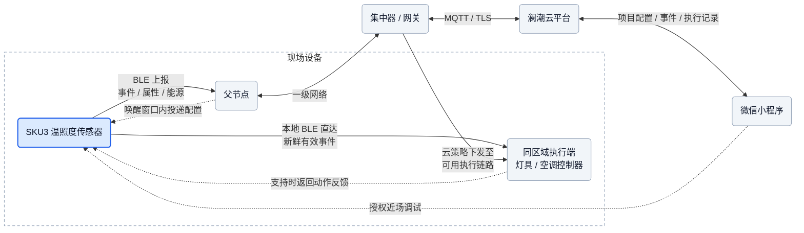

三条路径各司其职，互不替代：

| 路径  | 走向                              | 用途           | 关键约束                     |
| --- | ------------------------------- | ------------ | ------------------------ |
| 本地  | SKU3 温照度传感器 →（BLE 广播）→ 同组执行端           | 开灯/关灯/调光，必须快 | 不经父节点，TTL ≤4，端到端 ≤300 ms |
| 云端  | SKU3 温照度传感器 → 父节点 → CCO → 网关 → 云 → 小程序 | 上报、配置、审计、统计  | 受唤醒窗口限制，下行 1 个周期内生效      |
| 近场  | 小程序 ↔ SKU3 温照度传感器（BLE GATT）            | 安装、选点、调试、读回  | 需鉴权码，会话限时                |

#### 3.1.2 硬件架构拓扑

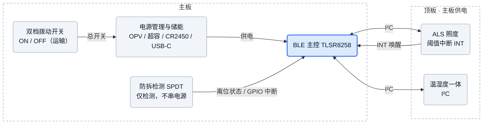

**与 SKU2 的拓扑差异**：本机没有"人"这个结论，也不存在雷达 UART 链路；本地广播只能携带"环境条件位"，是否执行开灯由同组人体传感器或云策略做**与运算**。这条依赖必须画进拓扑，否则现场会误以为装一个温照度就能自动开灯。

**防拆只做检测，不做断电**：SPDT 只进 MCU 的 GPIO 中断，不串接电池、超容或负载；电源通断只由双档拨动开关负责。设备被取下时仍由超容/电池供电，因此可以立即上报并继续监测是否被重新装回。

#### 3.1.3 供能与能量路径

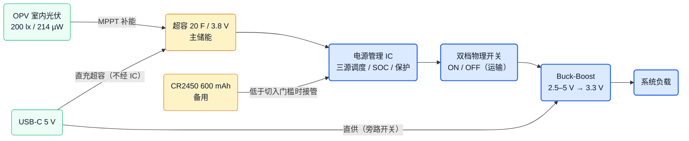

**为什么 USB 要旁路开关**：

1、产线可在"已拨 OFF（运输模式）"的状态下插 USB 完成身份写入、校验和测试，最后拔线包装，避免"写入后再拨 OFF"的漏拨风险。（type-C 6 pin能否支持数据传输带核签）

2、即使超容出现概率性损坏，此节点也可用作USB供电在别的地方使用。

### 3.2 场景

| 场景        | 有效光照条件      | 环境特征            | 生态交互逻辑            | 推荐形态     |
| --------- | ----------- | --------------- | ----------------- | -------- |
| 开放办公区     | 工作时段持续照明    | 人员密度变化、靠窗侧自然光波动 | 恒照度调光、分区温控        | A 微能量    |
| 教室        | 白天自然光或人工照明  | 靠窗与内侧差异大        | 按窗侧照度调光、按区域温控     | A 微能量    |
| 会议室       | 使用时段有照明     | 人多、设备发热         | 调光基准、温度联动         | A 微能量    |
| 医院候诊区     | 通常长时间照明     | 恒温恒湿要求高         | 照度与温湿度双基准         | A 微能量    |
| 走廊 / 电梯厅  | 白天有自然光，夜间靠灯 | 照度变化快           | 只提供照度条件，开灯由 SKU1/SKU2 仲裁 | A 微能量    |
| 地下车库      | 长期低照度       | 温湿度稳定、凝露风险      | 分区调光、凝露预警         | C USB 外供 |
| 设备机房 / 库房 | 完全无光        | 温度与湿度敏感         | 超温超湿告警、除湿联动       | C USB 外供 |

### 3.3 用户角色

| 角色          | 核心诉求             | 成功判据               | 需要的权限         |
| ----------- | ---------------- | ------------------ | ------------- |
| 物业公司（付费方）   | 电费下降、温控舒适、不用管电池  | 照明能耗降 40%+；温度投诉下降  | 只读看板          |
| 工程安装商 / FAE | 装得快、标定不返工、点位可复用  | 60-100 点位/人日；标定一次通过   | 项目安装权限 + 近场调试 |
| 系统集成 / 运维   | 读数可信、异常可判定、可远程校准 | 90% 异常可远程判定        | 配置权 + 超管（受控）  |
| 空间使用者       | 亮度稳定、温度舒适、不忽明忽暗  | 无"灯来回跳"投诉          | 无             |

### 3.4 安装姿态与朝向

| 姿态     | 推荐高度/角度             | 适用主用途   | 关键约束                     |
| ------ | ------------------- | ------- | ------------------------ |
| 顶装     | 吊顶 2.6～3.2 m，垂直向下   | 照度为主    | 离灯具 ≥1.5 m，避免灯下直射；温度仅作趋势参考 |
| 高处侧装   | 墙面 2.2～2.6 m，水平或略下倾 | 照度为主    | 避开窗光直射与隔断遮挡；记录朝向          |
| 壁挂（呼吸高度） | 墙面 1.2～1.5 m       | 温湿度为主   | 避开门窗、出风口、热源；照度仅作趋势参考      |
| 倒装     | 梁下/桥架下              | 照度为主    | 同顶装，注意金属梁对 BLE 的影响        |

姿态与主用途必须写入配置（`mountMode` + `primaryUse`）。同一套阈值不能同时服务"顶装照度"与"壁挂温湿度"：顶装测的是吊顶温度（比人员区高 2～4 ℃），壁挂测的照度常被家具遮挡。**主用途决定哪一路是控制基准，另一路降级为参考值。**

**与 PIR/雷达机型的边界**：本机不感知人，也不适用 PIR 的"避阳光/避气流/不得隔玻璃"和雷达的"避金属/背面屏蔽"约束；同一房间若需要人体触发，按 SKU1/SKU2 的 3.4 另设点位，本机只负责环境基准。

## 04 功能需求

### 4.0 需求总览

| 模块           | 编号段     | 解决什么问题                                | 优先级 | 公共/私有             |
| ------------ | ------- | ------------------------------------- | --- | ----------------- |
| LPN 能源管理     | FR-1xx  | 没市电，必须自己算电、自己省电、自己按计划动态调整             | P0  | 公共机制 + 私有参数       |
| 通信与安全        | FR-2xx  | 一条事件要走三条路，还要防偷听、防重放                   | P0  | 公共                |
| BLE 组网与鉴权    | FR-3xx  | 两种入网路径，都要证明"你是你、你在正确的位置"              | P0  | 公共                |
| 事件机制         | FR-4xx  | 什么算事件、发给谁、丢了怎么办                       | P0  | 公共机制 + 私有事件族      |
| 心跳机制         | FR-5xx  | 区分"真没变化"和"设备失联"                       | P0  | 公共                |
| 时间同步         | FR-6xx  | 每条事件都要说得清"几点发生的"；解决时间漂移问题             | P0  | 公共                |
| OTA 升级       | FR-7xx  | 设备怎么安全地换固件；休眠设备如何 OTA                 | P0  | 公共                |
| 运维（超管）       | FR-8xx  | 平台能远程控制 LPN，运维是重点应用场景之一               | P0  | 公共 + 私有快照项        |
| 环境联动        | FR-9xx  | 环境条件怎么变成调光/温控动作，且不越界开灯                | P0  | 私有（条件位语义本机定义）     |
| 环境采样与响应      | FR-10xx | 三路读数怎么做到"该快就快、该省就省、不可信要说出来"           | P0  | 私有                |
| 选点与标定        | FR-11xx | 装之前怎么知道读数有没有代表性，装完怎么把点位值换算成可用值        | P0  | 私有（方法公共、判据私有）     |
| 防拆           | FR-12xx | 设备被从支架上拿走，LPN 自己要能知道                   | P0  | 公共（四款一致，修正版） |

> **公共** = 与同系列其他 SKU 逐字或同构一致，改动须四款同步；**私有** = 本机独有，可独立演进；**公共机制 + 私有参数** = 机制与字段公共，阈值/档位/预算按本机标定。

### 4.1 LPN 能源管理（FR-1xx）

**要点**：设备永远要回答三个问题——现在靠谁供电、还能撑多久、撑不住时先牺牲什么。答案由 LPNMS（低功耗能源管理系统）统一给出，其他模块只能读，不能改。

#### 4.1.1 供能与切换

| ID     | 需求描述                                                            | 优先级 | 验收口径                       |
| ------ | --------------------------------------------------------------- | --- | -------------------------- |
| FR-101 | 支持 OPV + 超容、CR2450、USB 三源接入，按电源管理芯片规则自动切换；CR2450电池与充电路径隔离，禁止反充。 | P0  | 三源分别单独接入均可开机；电池支路反向电流为 0   |
| FR-102 | USB 5 V 可独立持续供电，并给超容补能。超容 2.5→3.5 V <10 min；补能期间采样不中断、不重启。      | P0  | 记录充电曲线；插拔 100 次无重启         |
| FR-103 | 超容低于切入门槛（候选 2.6 V）时切备用电池，回升后按 0.1 V（视实际效果论定） 回差切回，避免反复切换。       | P0  | 切入/切回各 20 次，无抖动、无掉电复位      |
| FR-104 | OFF 档隔离负载，整机漏电 ≤2.5 µA；运输期停采样、停心跳、拒绝采样中断唤醒。                    | P0  | 源表长时记录 ≥72 h；6 个月库存压降 <1 V |
| FR-105 | 每次上电识别原因：开关拨通 / 看门狗 / 供电恢复 / 软复位，无法区分时上报"未知"。                   | P0  | 四种原因分别注入，`bootCause` 均正确   |
| FR-106 | 临近断电时用预留电量发末次读数与状态（Last Gasp），记录是否送达；预留电量不允许被普通任务占用。               | P0  | 100 次断电试验上报成功率 ≥95%        |
| FR-107 | 分别估算超容可用能量与电池剩余容量，记录供电源与切换历史；无法估算时显示"未知"及最后有效值。                 | P0  | SOC 误差 ≤±10%；六态电池状态均可判     |
| FR-108 | 硬件保护（欠压关断、过流、过温）优先于任何软件策略，软件不得绕过。                               | P0  | 拉低电压至保护点，输出按硬件关断，恢复后按回差重启  |

#### 4.1.2 能源分级与调度

超容按可用能量分 5 档，档位直接决定采样周期、心跳多慢、事件还能不能上云。

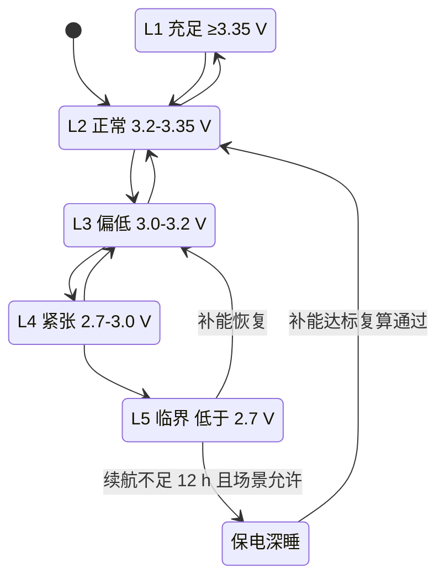

| 等级  | 超容电压（候选）   | 照度 / 温湿度采样 | 心跳 / 聚合         | 上报约束         | 发射功率 |
| --- | ---------- | ---------- | -------------- | ------------ | ---- |
| L1  | ≥3.35 V    | 1 s / 30 s | 300 s / 15 min | 按配置          | 100% |
| L2  | 3.2–3.35 V | 5 s / 60 s | 300 s / 1 h    | 按配置          | 100% |
| L3  | 3.0–3.2 V  | 10 s / 300 s | 600 s / 6 h    | P2 由聚合转随心跳   | 75%  |
| L4  | 2.7–3.0 V  | 30 s / 600 s | 900 s / 24 h   | 停 P2，仅 P0/P1 | 50%  |
| L5  | <2.7 V     | 60 s / 1800 s | 1800 s / 24 h  | 仅 P0         | 25%  |

**低电必须同步做的两件事**：把读数有效性标为"降级采样"（而不是假装还是 5 s 精度），并把"实际执行值"随回执上报，否则运维会以为"配了 5 s 为什么曲线这么稀"。

#### 4.1.3 牺牲顺序与禁止项

能量不够时不是"随便关点东西"，而是按固定顺序退让：

| 顺序  | 牺牲什么            | 理由                  |
| --- | --------------- | ------------------- |
| ①   | P2 类事件的聚合上报     | 只影响报表及时性            |
| ②   | 心跳周期（拉长）        | 影响失联发现速度，不影响业务      |
| ③   | 发射功率            | 影响链路余量，可被重传补偿       |
| ④   | 照度/温湿度采样周期（拉长）  | 影响响应速度，不丢读数         |
| ⑤   | 停发 P2，仅保 P0/P1  | 保留业务主干              |
| ⑥   | 受控保电（停采）        | 最后手段，须场景允许          |

**禁止项（不得因省电而做）**

- 不得停止读数有效性判定（无效值必须仍能被识别，否则坏值会进控制回路）。
- 不得因低电、停采、无数据而把读数当作"正常值"上报，只能标"过期/无效"。
- 不得关闭安全类与完整性类事件（防拆、传感器故障、超容欠压、缓存溢出、凝露）。
- 不得静默丢事件而不计数。

#### 4.1.4 保电与恢复

| ID     | 需求描述                                               | 优先级 | 验收口径                 |
| ------ | -------------------------------------------------- | --- | -------------------- |
| FR-109 | 预测完整服务续航 <12 h 且场景允许时才进入保电；空间在使用时先只告警，不直接停采。       | P0  | 构造 12 h 边界，核对是否进入及证据 |
| FR-110 | 停采后三路读数标"过期/未知"，并禁止用旧值驱动联动；恢复后按当前有效读数重新判断。        | P0  | 停采期间平台显示过期，调光不随旧值动作  |
| FR-111 | 补能恢复后复核回差、能量余量、启动预算与采样预算，全部达标才恢复完整采样。             | P0  | 短时插拔未达门限时继续保护        |
| FR-112 | 定期检查能源健康，低电或持续亏电时生成 USB 补能工单；记录接入、充电结果、维护时长与拔线后电量。 | P0  | 工单可生成、可关闭、可追溯        |

#### 4.1.5 能量预算（参考值，实测签核）

| 耗能项              | 标准档           | 快响应档          |
| ---------------- | ------------- | ------------- |
| ALS 阈值中断（睡眠监控）   | <1 µA         | <1 µA         |
| 温湿度采样折算          | 2～4 µA        | 3～5 µA        |
| MCU 休眠           | 1～3 µA        | 2～4 µA        |
| 上报折算             | 0.3 µA        | 1.0 µA        |
| 超容漏电             | 2 µA          | 2 µA          |
| 管理 IC + DC-DC 静态 | 2.3 µA        | 2.3 µA        |
| **合计**           | **约 8～12 µA** | **约 11～17 µA** |

**结论**：本机的电主要花在"保持照度可发现"上，而不是"读温度"。所以省电的第一优先级是**用 ALS 的硬件阈值中断代替 MCU 轮询**——轮询方案会直接把微能量预算击穿（见 4.10.2）。

### 4.2 通信与安全（FR-2xx）

**要点**：同一条事件要同时满足"快、不丢、可运营"三个互相矛盾的目标。解法不是把一条路做快，而是拆成三条路。

#### 4.2.1 三通道出口模型

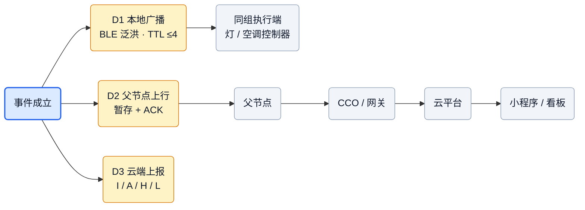

| 通道       | 目的          | 典型时延                                   | 确认语义             | 失败处理                               |
| -------- | ----------- | -------------------------------------- | ---------------- | ---------------------------------- |
| D1 本地广播  | 让灯立刻动，不等网络  | ≤300 ms（4 跳内）                          | 执行端短 ACK = 指令已收到 | 重播 2 次（间隔随机 20～50 ms）；3 次无确认报 E606 |
| D2 父节点上行 | 把事件交进网络，不丢  | 1 个唤醒窗口内                               | 父节点 ACK = 已进暂存队列 | 未 ACK 则本地保留，下次唤醒重传                 |
| D3 云端上报  | 可统计、可追溯、可配置 | I ≤1 s / A 15 min～24 h / H 随心跳 / L 不上报 | 设备侧投递完成          | 按档缓存补报；溢出报 E508                    |

**注意**：父节点 ACK ≠ 云端已入库。父节点到 CCO 是多跳，暂存溢出还会丢。因此每条事件带递增 `evtSeq`/`eventId`，云端做序号连续性校验，发现空号即请求补报——这条是必做项，不是优化项。

| ID     | 需求描述                                                                            | 优先级 | 验收口径                                |
| ------ | ------------------------------------------------------------------------------- | --- | ----------------------------------- |
| FR-201 | 三条通道独立调度、独立记录，任一通道故障不得影响另两条。                                                    | P0  | 注入父节点离线 / 广播全丢 / 云端断链，其余通道功能与记录不受影响 |
| FR-202 | 本地广播承载：BLE 广播报文携带组 ID、动作码、`evtSeq`、需确认标志与时间戳；执行端按 `evtSeq` 去重。                  | P0  | 重播 3 次，执行端只动作 1 次、计时不重置             |
| FR-203 | 上行事件带唯一 `eventId`，重传、补报、换父沿用原值；云端按编号只入库一次。                                      | P0  | 500 次重复投递，云端仅 1 条记录                 |
| FR-204 | 网络角色固定：`devClass=HARVEST_LEAF`、`canRelay=false`、`maxHopDepth=3`；父节点不得把本机编为转发节点。 | P0  | LPN/HARVEST\_LEAF在拓扑中永不为父节点         |
| FR-205 | 单父节点直挂 ≤8 台；8 台同时上报 1 s 内确认，丢包 <1%；唤醒窗口 100～500 ms 可配。                          | P0  | 满载与第 9 台被拒的场景分别验证                   |
| FR-206 | 父节点失联后先重连原父节点，失败则挂兼容且有余量的父节点，≤3 min 完成重挂载并更新路由。                                 | P0  | 断父节点后计时；换父后事件按原 `eventId` 上报        |

#### 4.2.2 BLE 链路安全

本机的链路全部是 BLE，安全必须按 BLE 的实际能力分层设计，不能假设"有加密就安全"。

| 层    | 措施                                           | 说明                    |
| ---- | -------------------------------------------- | --------------------- |
| 身份   | 一机一密：出厂注入设备专属密钥/证书，机身码与密钥绑定                  | 扫码照片、相同 MAC 都不能单独通过鉴权 |
| 配对   | 连接链路启用 BLE Secure Connections 配对与绑定，密钥存于受保护区 | 未配对设备不得读写配置           |
| 链路保护 | 已配对连接使用协议栈 AES-CCM 加密；应用层再做一层认证加密            | 防中间人、防篡改              |
| 广播保护 | 无连接的本地广播本身不加密，业务payload载荷由固件先加密并附校验后再发出      | 接收端校验不通过直接丢弃          |
| 防重放  | 受保护的会话序号/计数器 + 绑定代次 + 时间戳窗口；重启、换父、换绑后旧包失效    | 一条指令只生效一次             |
| 密钥管理 | 按设备 / 项目 / 组 / 用途隔离；支持轮换、失效、版本切换             | 普通日志禁止出现密钥与配网凭据       |

| ID     | 需求描述                                                    | 优先级 |
| ------ | ------------------------------------------------------- | --- |
| FR-207 | 设备↔父节点、设备↔执行端、近场维护三条链路均须提供机密性、来源认证与完整性校验；校验失败即拒绝并保持原状态。 | P0  |
| FR-208 | 拒绝明文降级：加密协商失败不得回退到明文传输。                                 | P0  |
| FR-209 | 接收端校验发送者、授权组、时效凭据后才执行；旧包、重复包不得开关灯、续计时、改配置或新增记录。         | P0  |
| FR-210 | 近场维护会话独立鉴权、独立权限、限时有效（≤30 min），到期自动退出并恢复原策略。             | P0  |
| FR-211 | 调试口与产测接口量产关闭；日志、事件、上报报文均不含密钥与凭据。                        | P0  |

#### 4.2.3 报文与字段约定

| 字段        | 用途            | 约束                                                 |
| --------- | ------------- | -------------------------------------------------- |
| `eventId` | 上行事件唯一标识      | 重传/补报/换父不变；云端按此去重                                  |
| `evtSeq`  | 灯侧联动去重序号      | 单调递增，按设备维度校验连续性                                    |
| `ts`      | 事件发生时间（设备本地秒） | 与 `bootId` 组合，用于还原 UTC                             |
| `bootId`  | 本次开机标识        | 跨重启排序与回填的边界                                        |
| `tsConf`  | 时间可信度         | `valid` 有效已同步/ `restored`曾经同步但基准已失效 / `unknown`未同步 |
| `actId`   | 动作指令 ID       | 同一动作多目标投递时用于核对重复                                   |

**注意：**

1、bootId:事件只在同一个 BootID 内部做时序排序、断链补报回填；一旦设备重启、`bootId` 变了，旧批次事件`eventId`、和新批次事件不能混排、不能跨 `bootId` 回填。

**2、排序边界**：网关 / 云端做事件时序排序时，**只在相同 **<!-- -->**`bootId`**<!-- -->** 里面按 **<!-- -->**`evtSeq`**<!-- -->** 排先后**；不同 BootID 的事件，不能单纯靠 evtSeq 对比先后。

3、**回填边界**：断网缓存、环形缓存里存的历史事件，**只允许在当前 BootID 有效期间向上回填补报**；设备一旦重启，BootID 更新，上一轮 BootID 里没发完的旧事件直接丢弃。

### 4.3 BLE 组网与鉴权（FR-3xx）

**要点**：两条入网路径，一套鉴权标准。路径决定"谁发起"，鉴权决定"能不能进"。

#### 4.3.1 两条组网路径

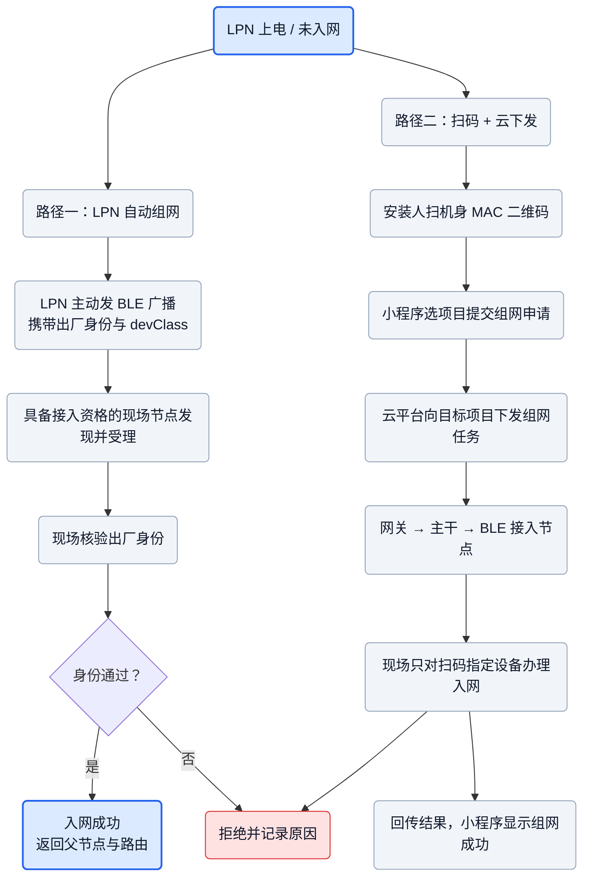

| ID     | 需求描述                                                          | 优先级 | 验收口径                         |
| ------ | ------------------------------------------------------------- | --- | ---------------------------- |
| FR-301 | **路径一（本地自动组网）**：未入网 LPN 主动广播，由具备接入资格的现场节点受理；公网断开但现场链路正常时仍可完成。 | P0  | 断公网，10 台设备均成功入网              |
| FR-302 | **路径二（扫码 + 云下发）**：扫码 → 选项目 → 云端下发组网任务 → 现场针对指定设备入网 → 结果回传。    | P0  | 端到端 ≤60 s；小程序显示"组网成功"以现场结果为准 |
| FR-303 | 两条路径使用同一套入网鉴权与同一条事件通道，入网后行为完全一致。                              | P0  | 两种方式入网的设备，事件与配置行为逐项比对一致      |
| FR-304 | 本地组网与扫码组网可互相补位：扫码任务超时未完成时，允许退回本地组网路径（需授权）。                    | P1  | 超时后切换路径，最终入网成功               |

#### 4.3.2 三重鉴权：人、设备、点位

扫码组网的实际风险不是"连不上"，而是"连上了不该连的"。所以必须三样都对上。

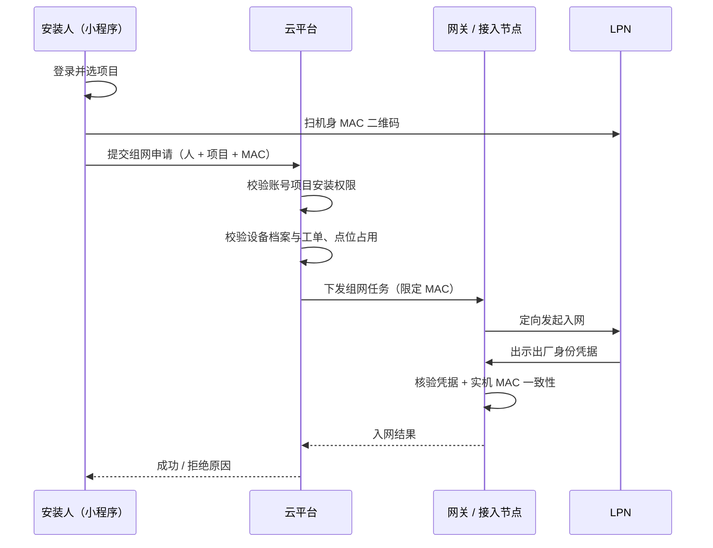

| ID     | 需求描述                                                            | 优先级 | 验收口径                   |
| ------ | --------------------------------------------------------------- | --- | ---------------------- |
| FR-305 | **人**：账号须具备目标项目安装权限，否则申请直接结束并提示原因。                              | P0  | 无权限账号申请 100% 被拒        |
| FR-306 | **设备**：核验出厂身份凭据 + 实机 MAC 与扫码 MAC 一致；照片、复制 MAC、非澜潮设备均拒绝。         | P0  | 扫 A 装 B 场景 100% 拦截     |
| FR-307 | **点位**：云端校验项目归属、点位范围、是否被占用；身份通过但白名单未通过时标"待核"，不得输出联动指令。          | P0  | 待核设备不能开灯；纠正后可重新绑定      |
| FR-308 | 组网状态可查：未配网 / 发现 / 鉴权中 / 入网 / 待绑定 / 在线 / 离线或未知 / 重新入网，并记录最后失败原因。 | P0  | 八种状态均可构造并正确显示          |
| FR-309 | 离线扫码可暂存，联网复核后放行；同笔申请只建一次绑定，重试结果一致。                              | P1  | 断网扫码 10 单，恢复后批量提交无重复绑定 |

#### 4.3.3 失败处理与容量

| 情形         | 处理              | 用户可见             |
| ---------- | --------------- | ---------------- |
| 身份核验失败     | 拒绝入网，记录阶段与脱敏结果  | "设备身份核验失败，请核对铭牌" |
| 白名单未通过     | 允许入网但标"待核"，禁止联动 | "点位待核，暂不参与联动"    |
| 父节点满载（8 台） | 拒绝并建议迁移或增补父节点   | "父节点已满，请调整点位"    |
| 父节点失联      | ≤3 min 重挂兼容父节点  | "已切换上级设备"        |
| 弱光无法冷启动    | 提示先 USB 补能再入网   | "请先补能至 3 V 以上"   |

### 4.4 事件机制（FR-4xx）

**要点**：一条没有明确触发条件的事件等于没有定义。所以每条事件必须写清"什么时候产生、发给谁、要不要确认、丢了怎么办"。

#### 4.4.1 事件生成原则

- **可判定**：触发条件必须是可测的状态或计数，例如"连续 N\_leave 次有效空判 + 等满 T\_leave"，而不是"人好像走了"。
- **可追溯**：记录源设备、类型、`eventId`、发生时间、测量值与原因；转发时保留原始来源与发生时间。
- **三态**：人员状态只有"有人 / 无人 / 未知"，数据不足时必须记"未知"，不得默认"无人"。
- **单次生效**：状态变化只记一次；持续维持同一状态时更新快照或做周期统计，不重复产生事件。

#### 4.4.2 事件分类

| 编号段  | 类别      | 典型事件                                          | 是否可禁用    |
| ---- | ------- | --------------------------------------------- | -------- |
| E1xx | 环境感知    | 照度变化、温度变化、湿度变化、高低温、高低湿、有效性变化、读数抖动、日统计 | 主干不可禁用   |
| E2xx | 通道与有效性  | 照度通道故障、温湿度通道故障、超量程、未标定、读数过期、通道降级、通道恢复、凝露预警 | 故障类不可禁用  |
| E3xx | 能源与电源   | 采能恢复、能量不足、能量临界、临终上报、上电启动、超容欠压、电池低电            | 底线类不可禁用  |
| E4xx | 自检与安防   | 周期自检、ALS 自检失败、温湿度自检失败、**防拆/脱落**、探测窗遮挡        | 安防类不可禁用  |
| E5xx | 生命周期与运维 | 上线、链路恢复补报、入网完成、配置生效/拒绝、OTA 状态、时钟偏差、缓存溢出        | 完整性类不可禁用 |
| E6xx | 环境联动    | 照度阈值穿越、联动执行反馈、群组联动触发、免开灯生效、照明回路疑似故障、联动确认超时   | 多数可禁用    |

**释义：**

**1、读数有效性变化**：读数从"正常"转为"超量程 / 缺测 / 未标定 / 过期 / 降级"或反向恢复。有效性是联动的前置条件，必须单独成事件，不能只在数值里体现。

**2、读数抖动**：短时间内反复跨越同一阈值（1 min ≥3 次），指向光源频闪、气流扰动或阈值过窄。

**3、读数过期**：超过 `staleTimeout`（默认 3 个采样周期）没有新读数，通常意味着传感器卡死或采样任务被饿死。

**4、照明回路疑似故障**：本机下发或转发开灯条件后，T_check 内照度未按预期上升，连续 2 次判定。注意：本机只做**观测**，故障归因仍需灯具侧确认。

**5、事件码命名空间**：本表按 SKU 定义语义，平台以 `devType + eventCode` 唯一识别；同一码段在不同 SKU 下对应"同类角色"（E1=主感知、E2=辅助通道、E3=能源、E4=自检安防、E5=生命周期、E6=联动）。跨 SKU 统计时不得只看码值。

#### 4.4.3 上报方式四档

| 档位  | 方式  | 时延                                              | 设备行为               | 适用             |
| --- | --- | ----------------------------------------------- | ------------------ | -------------- |
| I   | 即时  | ≤1 s                                            | 立即组帧发出，按配置重传 0～2 次 | 安全类、故障类、必须实时可见 |
| A   | 聚合  | 15 min / 30 min / 1 h / 2 h / 6 h / 12 h / 24 h | 写环形缓存，到期打包         | 统计类、业务主事件的云端记录 |
| H   | 随心跳 | 跟随心跳周期 300～1800 s                               | 挂在心跳帧中捎带，最省电       | 低频状态类          |
| L   | 仅本地 | 不上报                                             | 只记本地，可由诊断快照读出      | 调试类、高频低价值      |

**注意：**

**聚合不是丢弃，是延迟**：聚合类事件仍完整记录在本地缓存，周期到达打包上报；期间若发生更高优先级事件，打包一并提前发送。

#### 4.4.4 确认、缓存与补报

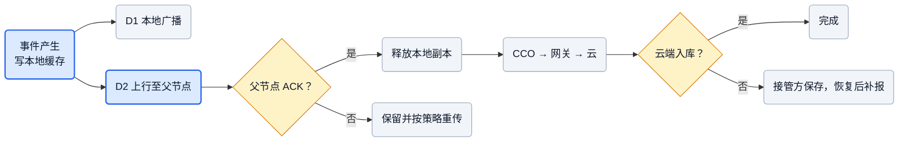

| ID     | 需求描述                                                     | 优先级 | 验收口径                             |
| ------ | -------------------------------------------------------- | --- | -------------------------------- |
| FR-401 | 每条事件独立配置：启用状态、本地是否广播、是否需执行端/父节点确认、云端上报档位、聚合周期、单包条数、重传次数。 | P0  | 逐条可配、可读回；硬约束项拒绝禁用并回具体原因码         |
| FR-402 | 关键事件与配置回执锁定为不可禁用、必须确认、即时上报。                              | P0  | 尝试禁用全部被拒（E505）                   |
| FR-403 | 断链缓存目标 ≥256 条（环形，按时间淘汰）；容量与断链时长在型号层面明确承诺。                | P1  | 断网 24 h 恢复后完整率 100%（日均 ≤300 条场景） |
| FR-404 | 恢复后分批补报：实时关键事件优先，历史按原发生时间与可信度排序，沿用原 `eventId`。           | P0  | 补报排序正确率 100%；旧事件不触发现场动作          |
| FR-405 | 缓存溢出必须计数并上报丢弃条数（E508），供平台核对记录缺口。                         | P1  | 产生/送达/丢弃三者可对账                    |
| FR-406 | 关闭某可选事件后，采样、心跳、快照与其他事件继续运行；平台提示受影响的联动规则。                 | P0  | 关闭 E601 后，E101/E105 与心跳正常        |

#### 4.4.5 关键事件（节选，全量见附录 8.1）

| 编号       | 事件        | 触发条件                          | 本地    | 云端       | 可禁用 |
| -------- | --------- | ----------------------------- | ----- | -------- | --- |
| E101     | 照度变化      | 跨过阈值且超过滞回                     | 广播条件位 | I        | 否   |
| E102     | 设备心跳      | 按周期发送，携带三读数与供电源               | 不广播   | H        | 是   |
| E103     | 温度变化      | 变化 ≥tempDelta 且超滞回            | 不广播   | A 15 min | 是   |
| E104     | 湿度变化      | 变化 ≥humiDelta 且超滞回            | 不广播   | A 15 min | 是   |
| E109     | 读数有效性变化   | 正常 ↔ 无效/降级                    | 广播条件位 | I        | 否   |
| E201     | 照度通道故障    | ALS 无响应或自检失败                  | 不广播   | I        | 否   |
| E202     | 温湿度通道故障   | I²C 无响应或 CRC 连续错误             | 不广播   | I        | 否   |
| E205     | 读数过期      | 超过 3 个采样周期无新读数                | 不广播   | I        | 否   |
| E208     | 凝露预警      | 湿度接近饱和且温度快速下降                 | 不广播   | I        | 是   |
| E304     | 临终上报      | 触及预留储备门限，发末次读数                | 不广播   | I        | 否   |
| E305     | 上电启动      | 冷启动，携带 `bootCause`           | 不广播   | I        | 否   |
| E311     | 超容欠压      | 2.7 V 预警 / 2.5 V 保护           | 不广播   | I        | 否   |
| **E407** | **防拆/脱落** | 设备离开支架或壳体分离                   | 广播警示  | I        | 否   |
| E504     | 配置生效      | 参数下发并通过校验，含来源与实际执行值           | 不广播   | A 1 h    | 是   |
| E506     | OTA 状态    | 下载/校验/安装/成功/失败/回滚             | 不广播   | I        | 是   |
| E508     | 缓存溢出      | 环形队列满并丢弃                      | 不广播   | I        | 否   |
| E601     | 照度阈值穿越    | 跨过设定阈值（带 20% 回差）              | 广播条件位 | I        | 是   |
| E605     | 照明回路疑似故障  | 开灯后 T_check 内照度未按预期上升，连续 2 次 | 不广播   | I        | 是   |

### 4.5 心跳机制（FR-5xx）

**要点**：心跳只解决一件事——把"真没人"和"设备失联"分开。没有心跳，平台看到"无人"根本不知道是人走了还是设备死了。

#### 4.5.1 心跳收发与周期

| ID     | 需求描述                                                        | 优先级 | 验收口径            |
| ------ | ----------------------------------------------------------- | --- | --------------- |
| FR-501 | 入网后按实际生效周期向父节点发送心跳，长时间无人员活动也照发。                             | P0  | 连续 7 天无人，心跳无中断  |
| FR-502 | 标准档 300～1800 s 可配；低功耗保活档以 2 h 为候选（需单独签核）；低电时按能源策略延长并上报实际周期。 | P0  | 平台显示周期 = 设备实测周期 |
| FR-503 | 心跳帧可捎带允许随心跳上报的事件（H 档）与当前供电源、能源等级、配置版本。                      | P0  | 抓包核对载荷字段完整      |
| FR-504 | 心跳与协议保活分离：心跳是业务状态记录，保活是链路可达性交互，二者不得互相替代。                    | P0  | 关闭心跳上报后保活仍正常    |

#### 4.5.2 在线判定与恢复

| 情形                | 判定规则           | 平台展示                |
| ----------------- | -------------- | ------------------- |
| 收到实时有效消息          | 立即刷新"最近有效通信时间" | 在线                  |
| 漏收 1～2 个周期        | 保持在线           | 在线（标注最近通信时间）        |
| 连续 3 个应到周期未收到     | 判离线（留出收发时间余量）  | 离线                  |
| 父节点失联 / 云端拿不到现场判定 | 不猜测            | **状态未知** + 最近有效通信时间 |
| 重新收到实时消息          | 恢复在线           | 在线；补发的旧心跳只进历史       |

| ID     | 需求描述                                 | 优先级 | 验收口径                 |
| ------ | ------------------------------------ | --- | -------------------- |
| FR-505 | 断公网时父节点继续完成现场保活与离线判断，恢复后平台按最新现场结果更新。 | P0  | 断云 30 min，现场判定不停     |
| FR-506 | 在线状态与人员存在状态分开展示，不得用一个字段表达两件事。        | P0  | 设备在线但人员未知时，两个维度分别正确  |
| FR-507 | 补报的旧心跳不得让设备"假上线"，只有实时有效通信才恢复在线。      | P0  | 先送旧心跳再生效实时心跳，仅后者改变状态 |

### 4.6 时间同步与时间戳（FR-6xx）

**要点**：设备会长时间休眠、会断电、会跨日，本地时钟必然漂。所以不追求"设备时间一直准"，而是保证每条事件都能被还原到真实的 UTC 时刻。

#### 4.6.1 三时间戳模型

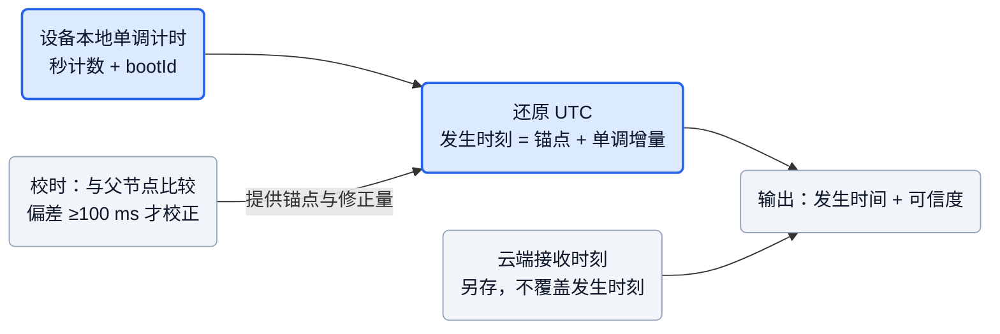

| ID     | 需求描述                                                       | 优先级 | 验收口径                          |
| ------ | ---------------------------------------------------------- | --- | ----------------------------- |
| FR-601 | 设备持续维护本地计时与本次开机标识；事件发生时记录本地时刻，不依赖当前是否已校时。                  | P0  | 断网 24 h 的事件仍带本地时刻             |
| FR-602 | 唤醒后向父节点对时；偏差 <100 ms 保持原值，≥100 ms 才校正，并记录修正量（E507）。        | P0  | 90 ms 不触发、110 ms 触发；校后 <20 ms |
| FR-603 | 事件报文与 BLE 通信报文均携带时间戳字段（`ts` + `bootId` + `tsConf`），供接收端还原。 | P0  | 逐条事件抓包可见三字段                   |
| FR-604 | 发生时间由接入端按对时记录还原为 UTC，云端另记接收时间，两者分别保存。                      | P0  | 补报事件排序正确率 100%                |
| FR-605 | 时间不可信（未校时、跨重启、跨日缺日期、误差超预算）时标记为未知或降级，并暂停依赖绝对时间的规则。          | P0  | 构造五种场景，均可看出"为什么不可信"           |
| FR-606 | 换电池、复位、换父后必须重新校时；恢复后按当前输入重判，过期动作只留历史。                      | P0  | 换电重启后时间与规则状态正确                |

### 4.7 OTA 升级（FR-7xx）

**要点**：休眠设备不能保持长连接下载，OTA 必须"父节点囤货、设备蚂蚁搬家"，并且随时可断、可续、可回滚。

#### 4.7.1 升级流程与状态

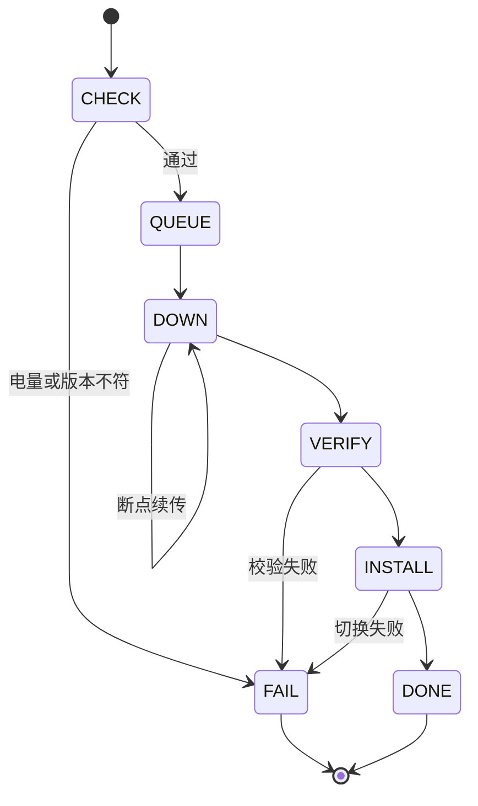

| ID     | 需求描述                                          | 优先级 | 验收口径                   |
| ------ | --------------------------------------------- | --- | ---------------------- |
| FR-701 | 升级前校验版本匹配、能量余额、链路质量；不满足则拒绝并回明确原因码，恢复后可重新申请。   | P0  | 低电设备申请升级，平台读到明确拒绝码     |
| FR-702 | 父节点缓存匹配升级包，设备每次唤醒接收一段，支持断点续传。                 | P1  | 传输中断 5 次后仍能完成          |
| FR-703 | 升级不得丢失配置、标定与绑定关系；算法类变更需说明哪些标定可迁移、哪些须重标。       | P0  | 升级前后读回配置与标定逐项比对        |
| FR-704 | 支持按项目/批次灰度升级，逐台显示进度与结果；失败率超门槛自动停止派发新任务。       | P1  | 同批构造低电、版本不符、断链，行为符合预期  |
| FR-705 | 升级过程与结果记录为 E506（下载/校验/安装/成功/失败/回滚），失败与回滚强制上报。 | P0  | 六种状态均可复现并上报            |
| FR-706 | 升级失败必须能回到可工作版本并重新入网，不得变砖。                     | P0  | 传输阶段与切换阶段各断电 50 次，均可恢复 |

### 4.8 运维与云端超管（FR-8xx）

**要点**：后期规划中设备支持装在天花板上，人上不去。所以平台必须能在设备在线时"远程动手"，但这类能力等价于 root 权限，必须带闸门。

#### 4.8.1 运维能力分级

| 级别    | 能力                        | 典型操作                        | 授权要求        |
| ----- | ------------------------- | --------------------------- | ----------- |
| L0 只读 | 看状态、看事件、看诊断快照             | 查存在状态、电量、信号、最近事件            | 项目只读权限      |
| L1 配置 | 改参数、改上报策略、应用模板            | 改 T\_radar\_delay、上报档位、组 ID | 项目管理员       |
| L2 诊断 | 触发自检、抓运行日志、强制心跳、强制扫描      | 定位"为什么不报事件"                 | 运维工程师       |
| L3 超管 | 远程重启、清缓存、强制复位、进入升级模式、解除绑定 | 救活"假死"设备                    | 双人复核 + 限时会话 |

#### 4.8.2 超管操作清单

| ID     | 需求描述                                                     | 优先级 | 验收口径                     |
| ------ | -------------------------------------------------------- | --- | ------------------------ |
| FR-801 | 支持远程强制心跳：立即唤醒并上报一帧完整状态，用于确认设备是否真在线。                      | P0  | 下发后 ≤1 个唤醒窗口收到           |
| FR-802 | 支持远程拉长唤醒窗口（临时，≤30 min），用于批量下发配置或抓日志。                     | P0  | 到期自动恢复原窗口                |
| FR-803 | 支持远程重启与强制复位；重启前后记录原因、时间与操作人。                             | P0  | 100 次远程重启无变砖、配置不丢        |
| FR-804 | 支持远程清理事件缓存（须先导出或确认丢弃条数），清理动作计入 E508 对账。                  | P1  | 清理后平台可见丢弃计数              |
| FR-805 | 支持远程读取诊断快照：通道状态、电源、三读数与有效性、K 值与偏移版本、最近 8 条事件、当前策略摘要。 | P0  | 快照字段与本地一致                |
| FR-806 | 支持远程触发一次环境采样自检（三路各一次），结果回传。                                   | P1  | 触发后 60 s 内出结果            |
| FR-807 | 超管会话限时（≤30 min）、一次一授权、全程审计；不得突破能量底线与安全事件锁。               | P0  | 会话过期后再下发被拒；审计可查操作人/时间/参数 |
| FR-808 | 近场维护（BLE GATT）提供同等能力子集：读状态、改参数、触发自检、导出日志。                | P0  | 现场无网时可用；配置 ≤3 min 完成     |
| FR-809 | 本地改参后进入"待确认"：授权人确认才固化为基线；72 h 未确认告警，7 天自动回退，回退前 24 h 通知。 | P0  | 三态流转正确，回退可复现             |

**超管必须带闸门**：这类能力可以"让一台设备看起来正常工作"，也可以"让一台设备永远不报警"。一旦被滥用，故障会被掩盖而非暴露更有其他的风险。所以：能力开放给运维，权限收在审计里。

### 4.9 环境联动策略（FR-9xx）

**要点**：本机的联动有一个铁律——**它能说"暗"，但不能说"有人"**。所以它发出的永远是"条件"，不是"命令"。

#### 4.9.1 数据源与联动对象

| 数据源        | 用途                       | 更新方式          |
| ---------- | ------------------------ | ------------- |
| 照度（数值与有效性） | 恒照度调光、白天免开灯、开灯效果校验       | 阈值穿越即发        |
| 温度         | 区域温控、预冷预热、超温告警           | 变化阈值 / 越限即发   |
| 湿度         | 除湿、新风、凝露预警               | 变化阈值 / 越限即发   |
| 读数有效性      | 阻断坏数据参与联动                | 状态变化即发        |
| 人员条件（可选）   | 开灯的 AND 条件；本机不产生，只消费同组人体传感器 | 由同组设备广播       |

| 执行端    | 可执行动作                          | 确认方式             |
| ------ | ------------------------------ | ---------------- |
| 智慧灯具   | 调光百分比、色温、场景切换、**开/关（需人体条件位）** | 短 ACK + 照度变化校验   |
| 空调控制器  | 温度设定、风速档、模式、启停                 | 设备回执             |
| 新风/除湿  | 启停、档位                          | 设备回执             |

#### 4.9.2 四种联动模式

| 模式       | 触发条件           | 输出                | 是否需要人体条件     |
| -------- | -------------- | ----------------- | ------------ |
| ① 恒照度调光  | 灯已亮，实测照度低于目标值  | 上调亮度 / 色温补偿      | 否（灯已亮说明有人或有策略） |
| ② 白天免开灯   | 照度高于免开灯阈值      | **不输出开灯**，只上报照度   | 否（这是"禁止"动作，安全） |
| ③ 开灯条件   | 照度低于开灯阈值       | 广播"暗"条件位          | **是**，必须与人体条件 AND |
| ④ 温控 / 除湿 | 温度或湿度越限        | 设定值调整 / 启停        | 否（按区域策略）     |

#### 4.9.3 决策流程

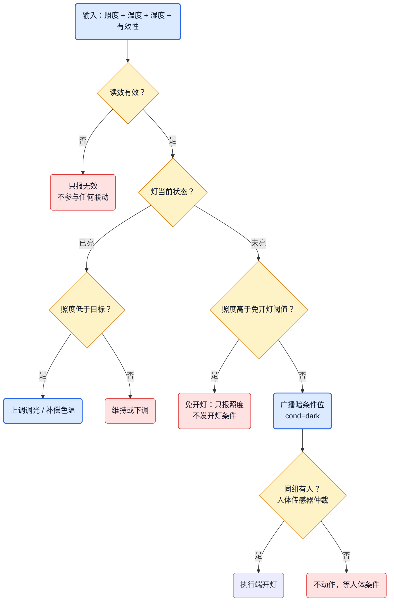

#### 4.9.4 联动需求

| ID     | 需求描述                                                   | 优先级 | 验收口径                       |
| ------ | ------------------------------------------------------ | --- | -------------------------- |
| FR-901 | 本地联动不经父节点、不经云端：有效新鲜事件由 BLE 广播直达同组执行端。                  | P0  | 断云 30 min 内本地联动可用率 ≥95%    |
| FR-902 | 支持组 ID 槽位管理，一台设备可参与多个组的多条策略；组内目标数与槽位数以样机满配验证。          | P1  | 满配无丢失                      |
| FR-903 | 本地广播携带**条件位**（暗/亮、过热/过冷、过湿/过干）与读数，不直接下发开关灯命令。          | P0  | 抓包可见条件位与读数；无直接开关命令         |
| FR-904 | **禁止单独开灯**：本机不得发出"开灯"动作；开灯必须由同组人体传感器的"有人"条件与本机"暗"条件做 AND（AND 可在人体传感器侧或执行端完成，本机不参与最终开关决策）。 | P0  | 空场且暗的场景持续 24 h，灯不亮        |
| FR-905 | 恒照度调光：以已标定的有效照度点为基准，按目标值与实测值差值输出调光步长（步长、回差、最小间隔可配）。    | P0  | 目标值与实测偏差收敛在 ±15% 内；无可见抖动  |
| FR-906 | 白天免开灯：照度高于阈值时不输出开灯条件，但仍照常上报照度事件（供统计与空调使用）。             | P0  | 白天有人经过，灯不亮，事件仍上报           |
| FR-907 | 温度联动：按区域设定值输出温控目标；启停设最小间隔（默认 10 min），避免短周期反复启停。        | P0  | 最小间隔生效；超限不抖动               |
| FR-908 | 湿度联动：超过高湿阈值输出除湿请求；接近饱和且温度快速下降时输出凝露预警（E208）。            | P1  | 构造凝露场景可触发                  |
| FR-909 | 多来源冲突：同组多个温照度点位时，按签核规则取值（主点位优先 / 中位数 / 加权），并把取值规则与参与点位写入动作记录。 | P0  | 摘除主点位后按规则降级，不误动作           |
| FR-910 | 手动接管优先：识别到人工调光/调温后暂停自动控制，结束后按当前读数重评；每条动作记录规则版本、输入读数与时刻、目标、指令 ID、受理与实动证据。 | P0  | 手动调暗后不立即被自动拉回；动作可完整追溯      |
| FR-911 | 条件位"变化即发 + 周期重发"：除阈值穿越即时广播外，按 `condRepeatPeriod`（默认 15 min）重发当前条件位，保证常电执行端与经父节点取值的休眠节点都能拿到最新值。 | P0  | 静置 1 h，执行端每 15 min 内必收到一次 |

**条件位有效期**：条件位必须带时间戳与有效期（默认 30 min）。超期条件位视为"缺失"，由消费方按自身降级规则处理——否则一台设备离线前发的"暗"会让灯亮一整夜。

**消费方不是休眠 LPN**：条件位的直接消费者是常电执行端（灯具、网关）与云端策略；SKU1/SKU4 这类休眠节点经父节点下行获取缓存值，**不直接收听本机广播**。因此本机广播必须"变化即发 + 周期重发"双管齐下，周期重发默认 15 min，保证执行端在下一次唤醒/轮询时能拿到最新值。

### 4.10 环境采样与响应（FR-10xx）

**要点**：本产品最具技术含量的地方，是**用一颗会自己"看守"的光传感器，把响应做到 10 秒级，同时把功耗压在微安级**。这不是靠"多采样"，而是靠"少唤醒"。

#### 4.10.1 核心时间参数

| 参数          | 符号                   | 取值                    | 定义与约束                    |
| ----------- | -------------------- | --------------------- | ------------------------ |
| 光照采样周期      | `luxSamplePeriod`    | 1 / 2 / 5 / 10 / 30 / 60 s | 默认 5 s；满足 10 s 响应的前提    |
| 光照变化阈值      | `luxDelta`           | 5～50%（或绝对 lux）        | 默认 20%；多大变化才算"变了"       |
| 光照滞回        | `luxHyst`            | 5～20%                 | 防止阈值附近抖动                 |
| 温度采样周期      | `tempSamplePeriod`   | 30 / 60 / 300 / 600 / 1800 s | 默认 60 s                 |
| 温度变化阈值      | `tempDelta`          | 0.5 / 1.0 / 2.0 ℃     | 默认 1.0 ℃                 |
| 湿度采样周期      | `humiSamplePeriod`   | 30 / 60 / 300 / 600 / 1800 s | 默认 300 s                |
| 湿度变化阈值      | `humiDelta`          | 3 / 5 / 10 %RH        | 默认 5 %RH                 |
| 外壳热时间常数     | `τ_therm`            | ≤3 min（硬件承诺）          | 温度分钟级响应的物理前提，软件不可配       |
| 读数过期时长      | `staleTimeout`       | 3 个采样周期                | 超期标"过期"，不进入联动            |

#### 4.10.2 光照 10 秒响应的时序

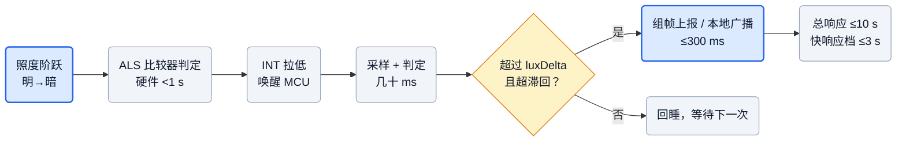

**为什么不能用 MCU 轮询**：若主控每 5 s 醒来采一次照度，一天 17280 次唤醒；每次即使 50 ms @5 mA，日均也要约 120 µA，直接把微能量预算击穿。改用带阈值中断的 ALS 后，ALS 自己连续监控（睡眠 <1 µA），只有光变化跨过阈值才拉中断叫醒主控——同样 10 s 的响应，能量代价从 120 µA 降到 2 µA 以下。

#### 4.10.3 "响应速度"是三个旋钮，不是一个

| 维度     | 含义           | 配置项          | 对响应的影响    | 对能耗的影响       |
| ------ | ------------ | ------------ | --------- | ------------ |
| ① 采样周期 | 多久"看一次"      | 三个采样周期       | 决定发现变化的下限 | 周期越短，唤醒与采样越贵 |
| ② 阈值 + 滞回 | 多大变化才"算变化"   | 三个 delta + 滞回 | 阈值越小越灵敏，也越易抖 | 阈值越小，上报越多    |
| ③ 上报方式 | 变化后"多快说出来"   | I / A / H / L | I 最快，A/H 延迟 | I 最贵         |

因此"响应速度 = f(采样周期, 阈值, 上报方式)"，三者组合出从"快响应"到"极限省电"的连续谱系。现场按点位需求选档，而不是全楼一刀切。

#### 4.10.4 三档模板

| 档位  | 光照采样   | 光照阈值 | 温度采样 | 上报      | 光照响应  | 适用             |
| --- | ------ | ---- | ---- | ------- | ----- | -------------- |
| 快响应 | 1～2 s | 5%   | 30 s | I       | ≤3 s  | 靠窗日光调光、遮阳联动    |
| 标准  | 5 s    | 20%  | 60 s | A 15 min | ≤10 s | 常规办公、走廊、教室     |
| 省电  | 30～60 s | 50%  | 300 s | A 6 h   | 分钟级   | 车库、库房、仅做趋势统计   |

#### 4.10.5 采样需求

| ID      | 需求描述                                                      | 优先级 | 验收口径                                 |
| ------- | --------------------------------------------------------- | --- | ------------------------------------ |
| FR-1001 | 照度采集用带阈值中断的 ALS：睡眠期间持续监控，跨阈值才唤醒主控；不得用 MCU 轮询替代。           | P0  | 稳态下唤醒次数 ≤30 次/h，与理论值相符        |
| FR-1002 | 光照响应：0→500 lux 阶跃，从变化到事件发出 ≤10 s（标准档）、≤3 s（快响应档）。       | P0  | 各 50 次取 P95                          |
| FR-1003 | 光照阈值与滞回可配，跨阈值只触发一次；反向穿越需超过滞回带才再次触发。                       | P0  | 阈值附近来回 20 次，只产生 1～2 条事件              |
| FR-1004 | 温度采集周期与阈值可配；温度响应 20→30 ℃ 阶跃 ≤5 min（含 τ\_therm）。          | P0  | 阶跃试验 20 次取 P95                       |
| FR-1005 | 湿度采集周期与阈值可配；湿度响应 30→60 %RH 阶跃 ≤10 min。                  | P0  | 阶跃试验 20 次取 P95                       |
| FR-1006 | 三路采样解耦：光照快采样不拖累温湿度慢采样；温湿度采样期间光照中断仍独立工作。                   | P0  | 温度 60 s 周期下，光照阶跃仍 ≤10 s 响应           |
| FR-1007 | 读数有效性判定：区分正常、超量程、缺测、未标定、过期；无效值不进入联动与统计分母。                | P0  | 五类状态均可构造并正确标记                        |
| FR-1008 | 照度数据上报当前/最小/最大/日均；温湿度上报当前/均值，并附采样时刻。                     | P0  | 字段正确，曲线可还原                          |
| FR-1009 | 长时间无变化时按周期发"快照"（H 档），避免平台无法区分"没变化"与"没数据"。               | P0  | 静置 24 h 仍有周期快照                       |
| FR-1010 | 温湿度读数与标准仪器比对偏移可配（现场单点校准），偏移量随诊断快照可读。                     | P1  | 校准后偏差收敛在 ±0.5 ℃ / ±3 %RH             |
| FR-1011 | 凝露预警：湿度 ≥dewHumi 且 30 min 内温度下降 ≥dewDelta 时上报 E208，并在读数上标注"凝露风险"。 | P1  | 构造结露环境可稳定触发                          |

#### 4.10.6 三个读数各自的可信边界

| 读数  | 可信范围            | 不可信场景              | 处置                    |
| --- | --------------- | ------------------ | --------------------- |
| 照度  | 0.01～83000 lux，±10% | 感光面被遮挡、正对灯下、阳光直射   | K 标定 + 选点规避 + E205/E408 告警 |
| 温度  | -10～55 ℃，±0.3 ℃   | 灯具热辐射、出风口直吹、阳光直射外壳 | 选点距离要求 + τ\_therm 说明   |
| 湿度  | 0～100 %RH，±2 %RH | 凝露、结霜、透气膜堵塞        | 凝露预警 + 清洁维护提示         |

### 4.11 选点与标定（FR-11xx）

**要点**：环境传感器最容易被忽略、也最致命的问题是——**读数本身没错，但位置没有代表性**。装在天花板角落的照度、装在空调出风口的温度，数据都"真实"，但都不能用。

#### 4.11.1 一个必须解决的矛盾：照度 vs 温湿度

| 用途  | 理想位置                     | 冲突                       |
| --- | ------------------------ | ------------------------ |
| 照度  | 顶装、朝下、离灯 ≥1.5 m、能看到窗光   | 顶装位置测的温度是"吊顶温度"，比人员区高 2～4 ℃ |
| 温湿度 | 壁挂 1.2～1.5 m（呼吸高度）、避开门窗与出风口 | 壁挂位置照度易被家具、隔断遮挡，不代表工作面   |

**处理方式**：点位必须声明 `primaryUse`（照度为主 / 温湿度为主），选点判据与告警口径随之切换；次要用途降级为"参考值"，不参与关键控制。

| 主用途   | 安装位置         | 必测项                  | 降级项                |
| ----- | ------------ | -------------------- | ------------------ |
| 照度为主  | 顶装或高处侧装，朝下   | 照度代表性、灯下直射、窗光        | 温度仅作趋势参考，不用于温控     |
| 温湿度为主 | 壁挂 1.2～1.5 m | 呼吸高度、出风口气流、热源        | 照度仅作趋势参考，不用于调光     |

#### 4.11.2 选点流程

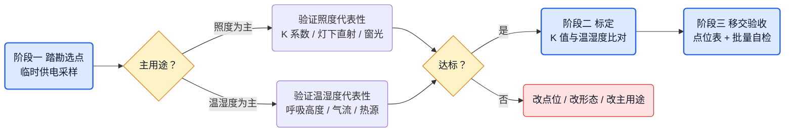

#### 4.11.3 选点需求

| ID      | 需求描述                                                                 | 优先级 | 验收口径                            |
| ------- | -------------------------------------------------------------------- | --- | ------------------------------- |
| FR-1101 | 点位必须声明主用途（照度为主 / 温湿度为主），并写入配置；未声明时默认"照度为主"并提示补充。                      | P0  | 未声明点位在 App 上被标黄，提交时二次确认          |
| FR-1102 | 提供"选点模式"：连续采样照度、温度、湿度与波动，输出**结论**而非原始数字。                             | P0  | 单点位选点 ≤90 s，输出结论                |
| FR-1103 | 照度代表性判定：与工作面照度计同时比对，计算 K 系数；K 偏离 1 超过 ±30% 时提示调整朝向或位置。                | P0  | 20 个点位比对，判定与人工复核一致率 ≥90%         |
| FR-1104 | 灯下直射识别：开灯瞬间照度跳变超过该点位平常幅度 3 倍时，判定"过近灯具"，建议移位 ≥1.5 m。                   | P0  | 灯下 0.5 m 安装可稳定识别                 |
| FR-1105 | 温湿度代表性判定：与标准温湿度计比对，温度偏差 >1.5 ℃ 或湿度偏差 >8 %RH 时提示"气流/热源干扰"。            | P0  | 出风口正下方安装可稳定识别                   |
| FR-1106 | 热响应验证：记录一次开灯/空调启停后的温度阶跃曲线，估算实际 τ\_therm，超出 ≤3 min 目标时提示结构问题。        | P1  | 阶跃曲线可导出，τ 值可读                   |
| FR-1107 | 选点结论分三档：**推荐**（该用途可作控制基准）/ **可用但仅参考**（可上报不可控）/ **不推荐**（换点位）。           | P0  | 三档均可构造，文案不产生歧义                  |
| FR-1108 | 标定数据与点位绑定：K 值、温湿度偏移、标定时间、标定人、仪器编号，随点位表导出。                            | P0  | 任一点位可查完整标定链                     |
| FR-1109 | 入网后 2 h 内批量自检：读数有效性、连续性、与邻点偏差、能量基线；异常生成返工清单。                          | P0  | 异常点位、原因、建议三项齐全                  |

### 4.12 防拆：设备被从支架带走（FR-12xx）

**要点**：这是本机唯一带"物理对抗"性质的需求。软件推断不可靠，必须硬件给信号；而硬件信号又会误报，所以用 **2 s 确认窗口**过滤瞬态，并配合维护模式区分计划内拆卸。**防拆是"检测"，不是"断电"**：SPDT 只进 GPIO，不串接电源或负载，设备离位后仍能继续供电并把告警说完。

#### 4.12.1 硬件方案与配合结构

| 方案             | 原理             | 优点                  | 风险                     | 结论                       |
| -------------- | -------------- | ------------------- | ---------------------- | ------------------------ |
| **SPDT 检测开关**  | 支架铁片压合按柄，离开即弹起 | 判定直接、零功耗、无磁干扰、四款可共用 | 需底壳开孔与公差控制             | **主方案**                  |
| 霍尔 + 支架磁铁      | 设备离开支架 → 磁场消失  | 无接触、无磨损             | 机身自带强磁致饱和；支架再加磁铁则吸附力失控 | **不采用**（原因见下）            |
| 机械顶针 + 铁片      | 铁片兼作动触点        | 不需新增器件品类            | 铁片氧化、怕潮、接触电阻漂移         | 备选（成本极敏感时）               |
| 加速度计（G-sensor） | 检测搬动、跌落、姿态突变   | 可区分"被拿走"与"被碰一下"     | 常开耗电；成本 1.5–2.5 元/台    | **不采用**（成本否决，由 2 s 窗口替代） |
| 离墙检测（电容/光电）    | 检测与安装面距离       | 覆盖"连支架一起拔走"         | 受基材影响大，标定复杂            | 预留                       |

**推荐方案**：检测开关单判据 + **2 s 确认窗口**：弹起后 2 s 内恢复压合判"瞬时脱离"，只留痕不告警；到期仍弹起判"真实离位"。**不配置加速度计**——其防误报职责由机械压缩量、确认窗口、维护模式三层承担（见下文与 FR-1210）。

防拆器件定为 **SPDT 检测开关（Detector Switch）**，装在背板距磁铁中心 12 mm 处，按柄穿出底壳开孔，由万向节支架上的铁片压合。四款 SKU 共用同一封装位置、同一型号与同一开孔，差异只在铁片形态。

**选型判据：不能用普通轻触开关。** 轻触开关行程仅 0.15–0.3 mm，而装配公差累计 ±0.55 mm，会出现"装上了但没压到"的间歇失效——产线抽检抽不出来，现场表现为"有时告警有时不告警"。判据是**行程 ≥ 2 × 公差累计**：

| 公差来源    | 偏差           |
| ------- | ------------ |
| 底壳成型平面度 | ±0.15 mm     |
| 磁铁安装高度  | ±0.20 mm     |
| 铁片厚度    | ±0.05 mm     |
| 支架球头平面度 | ±0.15 mm     |
| **累计**  | **±0.55 mm** |

| 参数   | 要求            | 理由                                     |
| ---- | ------------- | -------------------------------------- |
| 类型   | SPDT 检测开关     | 需 NC/NO 双触点：NC 用于在位/离位检测，NO 可作备用或硬件互锁，**不串主回路** |
| 行程   | ≥1.0 mm       | 覆盖 ±0.55 mm 公差后仍有余量                    |
| 过行程  | ≥0.5 mm       | 公差上限时不压死                               |
| 动作力  | 0.5–1.5 N     | 磁吸力 10–15 N 远大于此；低于 0.3 N 则擦碰即误报       |
| 按柄   | Φ2.0 × 3.5 mm | 穿出底壳后露出 1.5 mm                         |
| 触点额定 | ≥10 mA        | **仅信号回路**，不承载系统、超容充电或发射电流              |
| 寿命   | ≥5 万次         | 5 年仅操作 5 次（换电池）                        |

**两种磁铁形态的兼容**：内嵌式磁铁与壳面齐平，配平铁片；螺纹式磁铁凸出约 3 mm，配**外环上翻 3 mm 的台阶铁片**（中央 Φ18 保持平面吸磁铁）。两种情形下按柄压缩量同为 1.5 mm，设备侧不需要第二套模。

| 形态  | 磁铁相对壳面  | 铁片              | 按柄压缩量  |
| --- | ------- | --------------- | ------ |
| 内嵌式 | 齐平      | 平铁片 Φ30×0.5     | 1.5 mm |
| 螺纹式 | 凸出 3 mm | 台阶铁片（外环上翻 3 mm） | 1.5 mm |

**电气接法（仅检测，不进电源路径）**：COM 接 GND，NC 接检测 GPIO（内部上拉）。支架压合时按柄压下、NC 闭合，GPIO 为低（在位）；离开支架时按柄弹起、NC 断开，GPIO 被上拉为高并触发中断（离位）。**SPDT 不得串接电池、超容或负载**；电源通断只由双档拨动开关负责。选型时须确认"压下"与 NC/NO 的对应关系：若所选型号为"压下断开 NC"，则改用 NO 接 GPIO 并在固件中反转极性，量产前以实机签核为准。

| 状态        | 开关  | NC 触点 | GPIO     | 设备行为                          |
| --------- | --- | ----- | -------- | ----------------------------- |
| 装在支架上     | 压下  | 闭合    | 低        | 正常工作                          |
| 离开支架      | 弹起  | 断开    | 高（中断）    | 确认窗口到期后**立即上报 E407（≤5 s）**，仍由超容/电池供电，不中断运行 |
| 线束断 / 接触不良 | —   | 断开    | 高        | 按离位处理（fail-safe），避免"剪线静默"     |
| 产线 / 仓储   | 弹起  | 断开    | 高        | 若拨动开关在 OFF 则整机断电；否则按离位处理      |

**为什么不再串主回路**：把 SPDT 串进电源，设备一离位就失去主供，只能靠超容抢发几秒——既压缩了上报窗口，也让"离位后继续监测是否被重新装回"不可能；同时电池支路与主回路的通断被防拆开关绑架，换电池、返修都更容易误触发。改为独立检测后，离位信号只进 GPIO，设备可以立即上报、继续运行，并按策略进入待装态。这条是本期方案的硬边界，硬件评审不得改回串接方案。

**离位判据与误报抑制**：开关弹起后先进入 **2 s 确认窗口**，窗口内恢复压合判为"瞬时脱离"（擦拭、临时挪动、装配抖动），只留痕不告警；窗口到期仍弹起才判"真实离位"并进入上报流程。误报由三层防线压住：

| 层级  | 措施                                      | 解决什么        |
| --- | --------------------------------------- | ----------- |
| 机械  | 压缩量 1.5 mm、开关周围 1.0 mm 围骨、支架凸台 15° 斜导   | 公差临界抖动、侧向剪切 |
| 固件  | 2 s 确认窗口 + 200 ms 去抖 + 连续 2 次采样一致       | 瞬时脱离、接触抖动   |
| 运营  | 带时限维护模式（默认 30 min，可配 5–120 min），期间离位仅留痕 | 换电池、移位、返修   |

**不采用加速度计**：器件与贴装合计 1.5–2.5 元/台，而其原本承担的"防误报"职责大半是伪需求——擦拭与碰触不会使设备离开支架，开关本就不动作；"碰一下又放开"由 2 s 窗口过滤；"正常维护"由维护模式解决；"胶失效脱落"本就该报。故本期不配置加速度计，以成本优先。

**为什么不用霍尔**：机身背面已有 Φ12×8 钕磁铁（表磁 3000–4000 Gs），霍尔在距其 8–15 mm 处场强 500–1500 Gs，比开关型霍尔动作点（±30–70 Gs）高一个量级以上，直接饱和；若改在支架侧再加磁铁，会与机身磁铁极性叠加，吸附力失控且阈值随磁铁批次漂移。霍尔仅在结构完全无位置时作备选，且须做磁屏蔽。

#### 4.12.2 触发链与告警

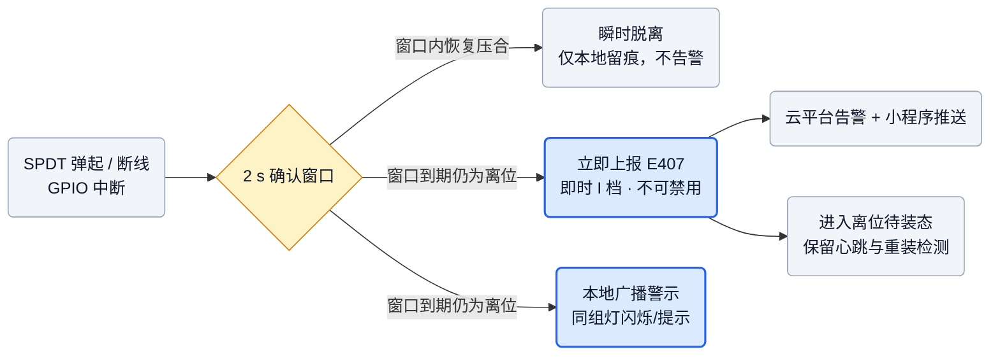

#### 4.12.3 防拆需求

| ID      | 需求描述                                                                                                                                                                            | 优先级 | 验收口径                         |
| ------- | ------------------------------------------------------------------------------------------------------------------------------------------------------------------------------- | --- | ---------------------------- |
| FR-1201 | 背部须为 SPDT 检测开关（选型与公差判据见 4.12.1）：设备与支架分离即弹起，产生硬件中断，不依赖软件轮询推断；**开关只接检测回路（COM 接地、NC 接 GPIO），不得串接电源或负载**。                                                                                     | P0  | 分离后 ≤5 s 产生信号；检测回路与电源回路独立，装配签核     |
| FR-1202 | 单判据 + **2 s 确认窗口**：开关弹起后 2 s 内恢复压合判"瞬时脱离"，只本地留痕不告警；到期仍弹起判"真实离位"。不依赖加速度计。                                                                                                        | P0  | 模拟碰动 50 次误报 0；模拟拿走 20 次全部告警  |
| FR-1203 | 触发后立即上报 E407（即时档、不可禁用、必须 ACK），载荷带原因码分三类：DETACH\_MANUAL（疑似人为，布防时段内且拆卸后快速消失，置信度中）/ DETACH\_ADHESIVE（疑似贴装失效，无人时段发生且离位后仍在原网关信号范围内，置信度低）/ DETACH\_UNKNOWN；平台按"疑似"展示并支持现场确认回填，不承诺精确区分 | P0  | 20 次拆卸，云端均收到且原因码正确           |
| FR-1204 | 触发后同时发本地广播警示（同组灯闪烁或提示），保证断网时现场也有反馈。                                                                                                                                             | P0  | 断云状态下现场可见警示                  |
| FR-1205 | **离位不断电**：确认窗口到期后必须立即完成 E407 上报；上报后进入"离位待装态"（停用与安装位置相关的检测/执行，保留心跳与重装检测），重新压合后自动恢复。若同时处于低电，按 Last Gasp 优先保告警。                                                                         | P0  | 拔下后 20 次均收到告警；待装态可读；重装后 60 s 内恢复 |
| FR-1206 | 支持**带时限维护模式**：小程序开启后默认 30 min（可配 5–120 min）内离位不告警、仅留痕，到期自动恢复布防；维护模式状态在设备与平台双记录                                                                                                  | P1  | 撤防时段拆卸不告警但留痕                 |
| FR-1207 | 防拆状态参与运维展示：在位、离位、疑似、已告警四态，可在诊断快照中读出。                                                                                                                                            | P0  | 四态均可构造并正确显示                  |
| FR-1208 | 电池仓/壳体防非授权开启：若壳体开启能触发同一 SPDT，则等同离位处理；若不在该开关检测范围内，须增设独立检测点，否则本条不适用。工具规格写入施工手册。                                                                                                     | P1  | 徒手无法开启；能触发时产生信号；不适用时书面说明      |
| FR-1209 | 防拆不得因低电、OTA、配置下发而失效；OTA 期间沿用原状态判断。                                                                                                                                              | P0  | 低电与升级期间拆卸仍告警                 |
| FR-1210 | 确认窗口参数化：窗口 1–10 s（默认 2 s）、去抖 200 ms、连续 2 次采样一致；参数随配置下发并可读回。**不设"收尾窗口"**，离位后不主动断电。                                                                                                | P0  | 参数可配可读回；去抖后误报 0              |
| FR-1211 | **不配置加速度计**：成本 1.5–2.5 元/台与其增益不匹配；误报抑制由机械压缩量、2 s 确认窗口、维护模式三层承担（见 4.12.1）。                                                                                                       | P0  | BOM 无加速度计；三层措施逐项验证           |

**与"掉落"的区分**：胶贴失效导致的脱落同样产生离位信号。不配加速度计后只能靠"发生时段"与"离位后信号是否仍存续"做倾向性标注（见 FR-1203 的三类原因码），无法精确区分。因此平台按"疑似"展示并要求现场确认，避免运维把"胶没粘牢"当成"有人偷设备"。安装侧的对策是：禁用基材清单 + 现场拉拔试验 + 卡扣/螺接备选（见 5.5 与 6.2）。

## 05 非功能需求

**要点**：功能决定"能不能用"，非功能决定"读数能不能信"。本机的非功能重点不在射频，而在**光学与湿度的长期稳定性**。

### 5.1 安规（Safety）

| 编号      | 项目       | 依据标准                           | 要求                                            | 验收           |
| ------- | -------- | ------------------------------ | --------------------------------------------- | ------------ |
| NFR-101 | 整机安全     | GB 4943.1-2022（等同 IEC 62368-1） | 按 ES1 能量源设计；可触及部件无危险电压；外壳阻燃等级不低于 V-1（建议 V-0）  | 第三方报告        |
| NFR-102 | 超容储能安全   | 按元器件 + 整机能量评估                  | 20 F 超容储能量按 ES2 评估：端子防直接短路、防反接；维修/报废前须放电至安全电压 | 设计评审 + 短路试验  |
| NFR-103 | USB 输入安全 | GB 4943.1 + 整机                 | 5 V SELV 输入；限流 ≤300 mA；防反灌；劣质适配器接入不得损坏电路或起火   | 反灌与过流试验      |
| NFR-104 | 一次锂电池安全  | GB 8897.4（等同 IEC 60086-4）      | CR2450 具备防反充隔离、防短路；异常温升不得引燃外壳                 | 电池厂报告 + 整机温升 |
| NFR-105 | 温升       | GB 4943.1                      | 常温满载与 USB 边充边采工况下，可触及表面温升不超过限值                | 热电偶实测        |
| NFR-106 | 机械安全     | 整机                             | 无锐边、无夹手风险；支架承重 ≥3 倍整机重量；吊顶安装件防坠               | 拉力与结构评审      |
| NFR-107 | 标识与警示    | 整机                             | 铭牌含型号、电气参数、厂名、生产批次；电池与超容警示语；回收标识              | 铭牌评审         |
| NFR-108 | 透气膜安全    | 整机                             | 膜材不得脱落、不得被轻易撕下；开窗不得形成可探入的孔洞；膜材阻燃等级不低于 V-1     | 拉力 + 探针 + 阻燃试验 |

### 5.2 EMC（电磁兼容）

本机射频压力与 SKU1 相当（仅 BLE），但多了一个新问题：**ALS 是光学器件，会被"光"干扰，而不是被"电"干扰**。所以除了常规 EMC，还必须做抗光干扰验证。

#### 5.2.1 EMI（发射）

| 编号      | 项目          | 依据标准                            | 限值/要求                             |
| ------- | ----------- | ------------------------------- | --------------------------------- |
| NFR-111 | 辐射骚扰        | GB/T 9254.1（等同 CISPR 32）Class B | 30 MHz～1 GHz、1～6 GHz 满足 Class B 限值 |
| NFR-112 | 传导骚扰        | GB/T 9254.1 Class B             | USB 供电经适配器时，电源端满足 Class B 限值        |
| NFR-113 | 谐波电流        | GB/T 17625.1                    | 若配套适配器功率 \>75 W 需评估；本机本身不适用        |
| NFR-115 | BLE 邻道与占用带宽 | 按 SRRC 型号核准要求                   | 2.4 GHz 频段功率、占用带宽、带外发射满足微功率设备要求    |

#### 5.2.2 EMS（抗扰）

| 编号      | 项目           | 依据标准          | 试验等级                               | 判定                            |
| ------- | ------------ | ------------- | ---------------------------------- | ----------------------------- |
| NFR-121 | 静电放电 ESD     | GB/T 17626.2  | 接触放电 ±4 kV，空气放电 ±8 kV              | 判据 B：可自恢复、不丢配置、**读数不跳变**       |
| NFR-122 | 电快速瞬变脉冲群 EFT | GB/T 17626.4  | 电源端 ±2 kV，信号/控制端 ±1 kV             | 判据 B；不产生虚假事件                 |
| NFR-123 | 浪涌 Surge     | GB/T 17626.5  | 线-线 ±1 kV；配适配器时线-地 ±2 kV           | 判据 B；不得永久损坏                   |
| NFR-124 | 射频辐射抗扰 RS    | GB/T 17626.3  | 80 MHz～1 GHz，3 V/m；1～6 GHz 按产品定位加测 | 判据 A：读数不异常、不误报防拆              |
| NFR-125 | 射频传导抗扰 CS    | GB/T 17626.6  | 0.15～80 MHz，3 V                    | 判据 A                          |
| NFR-126 | 工频磁场         | GB/T 17626.8  | 3 A/m                              | 判据 A                          |
| NFR-127 | 电压暂降与短时中断    | GB/T 17626.11 | 按适配器工况；USB 插拔瞬断不得复位丢配置              | 判据 B                          |
| NFR-128 | 抗光源频闪        | 整机            | 100 Hz / 120 Hz 调光频闪下静置 1 h        | 照度读数波动 ≤±10%，不触发误事件           |
| NFR-129 | 抗光学干扰        | 整机            | 邻近红外遥控、手机闪光灯直射                     | 不产生持续虚假照度阶跃                   |

**本机不适用项**：本机无 24 GHz 雷达通道，雷达杂散与雷达抗自身干扰相关试验项均不适用。

**特别提示**：ESD 与 RS 试验时必须同时观察**照度与温湿度读数**——如果静电或射频让 ALS 误触发，现场表现就是"灯自己忽明忽暗"；让温湿度跳变，就是"空调频繁启停"。因此 NFR-121/124 的判定标准中加入"读数不跳变、不触发虚假条件位"。

### 5.3 无线与频谱合规

| 编号      | 区域   | 项目         | 要求                                        |
| ------- | ---- | ---------- | ----------------------------------------- |
| NFR-131 | 中国大陆 | SRRC 型号核准  | 2.4 GHz BLE 须取得无线电发射设备型号核准证               |
| NFR-132 | 中国大陆 | 微功率设备技术要求  | 2.4000～2483.5 GHz 满足微功率短距离设备限值；本机无雷达通道     |
| NFR-133 | 中国香港 | 无线电管理      | 2.4 GHz 一般属免牌照类别；保留测试报告备查                  |
| NFR-134 | 通用   | 频率容限与功率稳定性 | 全温区频率偏移、功率波动在核准限值内                        |
| NFR-135 | 通用   | 天线         | 板载天线，不可外接；不得用户自行更换（否则核准失效）                |

**本机无 24 GHz 通道，不涉及 SKU2 的频谱准入风险。**

### 5.4 合规（中国大陆 / 中国香港）

#### 5.4.1 中国大陆

| 编号      | 合规项   | 要求                                                                     |
| ------- | ----- | ---------------------------------------------------------------------- |
| NFR-141 | 无线电   | SRRC 型号核准（见 5.3）；铭牌标注核准代码                                              |
| NFR-142 | 有害物质  | 满足 GB/T 26572 限量要求，提供 RoHS 报告与符合性声明                                    |
| NFR-143 | 电池    | 满足 GB 8897.4；提供 MSDS；不得使用汞、镉超限电池                                       |
| NFR-144 | 数据与隐私 | 遵循《个人信息保护法》《数据安全法》《网络安全法》：只采集空间级存在与照度，不采集影像、音频、身份信息；采集目的、范围、保留期须在告知中明示 |
| NFR-145 | 告知与同意 | 安装在有人活动的空间时，须提供可见的告知方式（点位说明、隐私告知卡、物业公示模板）                              |
| NFR-146 | 宣传口径  | 不得使用绝对化用语（最/第一/顶级）；不得宣称医疗、健康功效；节能率须标注工况与口径                             |

#### 5.4.2 中国香港

| 编号      | 合规项  | 要求                                                 |
| ------- | ---- | -------------------------------------------------- |
| NFR-147 | 无线电  | 按 OFCA 要求确认免牌照条件或申请相应许可；保留测试报告备查                   |
| NFR-148 | 个人资料 | 遵循《个人资料（私隐）条例》（PDPO）：收集目的明确、最小必要、保留期不超必要；提供查阅与更正渠道 |
| NFR-149 | 电气安全 | 参照 IEC 62368-1 体系；USB 适配器如随货，须符合当地安全要求             |
| NFR-150 | 标识   | 英文/繁体中文双语标识与警示语；回收与电池处置说明                          |

#### 5.4.3 两区域差异处理

| 差异点  | 大陆        | 香港          | 处理方式            |
| ---- | --------- | ----------- | --------------- |
| 无线准入 | SRRC 强制   | OFCA 免牌照/许可 | 分别送测，共用技术文件     |
| 语言   | 简体中文      | 繁体中文 + 英文   | 铭牌与手册分版印刷       |
| 隐私法规 | PIPL 为主   | PDPO 为主     | 告知模板分版，最小采集口径统一 |
| 包装   | 需 RoHS 标识 | 需回收说明       | 包装版型分区域，机身共用    |

### 5.5 环境与可靠性

| 编号      | 项目       | 要求                      | 说明                                    |
| ------- | -------- | ----------------------- | ------------------------------------- |
| NFR-161 | 工作温度     | -10～55 ℃                | 温度读数在此范围内保证 ±0.3 ℃；超窗标记无效            |
| NFR-162 | 存储温度     | -20～70 ℃                | 超容低温容量衰减、电池高温自放电需评估                   |
| NFR-163 | 工作湿度     | 10%～95% RH（非凝露）         | 凝露会使湿度读数饱和、透气膜结露，需凝露预警                |
| NFR-164 | 防护等级     | IP30（设计目标），透气膜窗满足 IP30 粉尘阻挡 | USB 口与开关凹槽开盖状态不计入                     |
| NFR-165 | 胶贴可靠性    | 常温 5 年不脱落；持粘力 ≥3 倍整机重量  | 乳胶漆/瓷砖/金属/木饰面四基材分别验证                  |
| NFR-166 | 透气膜寿命    | 5 年内透气率衰减 ≤20%，不堵塞      | 高粉尘环境（机房、库房）需清洁维护提示                   |
| NFR-167 | 支架与安装件   | 振动中不松脱；吊顶安装需防坠结构        | 与防拆方案联动设计                             |
| NFR-168 | 开关寿命     | ≥5000 次，老化后接触电阻 ≤300 mΩ | 镀金触点；振动中不得自行跳变                        |
| NFR-169 | USB 插拔寿命 | ≥500 次；长期插电 ≥2 年无异常     | 验证超容浮充寿命、发热、接口氧化                      |
| NFR-170 | 包装跌落     | 按 ISTA 1A/2A 执行         | 透气膜与采光窗为易损件                           |
| NFR-171 | 外观隐私     | 无镜头形态、无麦克风孔、无可见工作灯      | 盲测 10 人，≥9 人不认为是摄像设备                  |

### 5.6 性能指标

| 编号      | 指标         | 口径                       | 目标值                    |
| ------- | ---------- | ------------------------ | ---------------------- |
| NFR-181 | 照度精度       | 0～2000 lux，标定后与标准照度计比对   | ±15%（传感器 ±10%＋系统误差）    |
| NFR-182 | 照度量程       | 可测范围                     | 0.01～83000 lux；超量程标记无效 |
| NFR-183 | 照度响应（标准档）  | 0→500 lux 阶跃到事件发出        | P95 ≤10 s              |
| NFR-184 | 照度响应（快响应档） | 同上，采样 1～2 s              | P95 ≤3 s               |
| NFR-185 | 温度精度       | 15～35 ℃ 区间与标准温度计比对       | ±0.5 ℃（系统级）           |
| NFR-186 | 湿度精度       | 20～80 %RH 区间比对           | ±3 %RH（系统级）           |
| NFR-187 | 温度响应       | 20→30 ℃ 阶跃到事件发出          | P95 ≤5 min             |
| NFR-188 | 湿度响应       | 30→60 %RH 阶跃到事件发出        | P95 ≤10 min            |
| NFR-189 | 外壳热时间常数    | 阶跃响应达 63% 的时间            | ≤3 min                 |
| NFR-190 | 读数稳定性      | 恒温恒湿静置 24 h 的峰峰值         | 温度 ≤0.3 ℃，湿度 ≤2 %RH    |
| NFR-191 | 标准档平均电流    | 默认采样与上报策略                | ≤11 µA                 |
| NFR-192 | 快响应档平均电流   | 光照 2 s 采样 + I 档上报         | ≤20 µA                 |
| NFR-193 | 无光续航（仅超容）  | 满电 3.5 V 放电至保护点          | ≥30 天（标准档）            |
| NFR-194 | 纯电池续航      | 完全无光、日均 ≤13 µA，50% 放电深度  | ≥2 年                   |
| NFR-195 | USB 补电时长   | 边充边采，2.5→3.5 V           | <10 min                |
| NFR-196 | 形态切换时延     | 插/拔 USB 到行为切换完成           | ≤5 s，采样不中断            |
| NFR-197 | 校时精度       | 单跳 2.4 GHz              | 门限 100 ms；校后 <20 ms    |
| NFR-198 | 配置回读一致率    | 逐条下发后读回                  | 100%                   |
| NFR-199 | 防拆告警时延     | 离开支架 → 上报                | ≤5 s                   |
| NFR-200 | 曲线还原度      | 断链 24 h 补报后与本地缓存比对       | 100%（按降采样规则）          |

### 5.7 寿命与可维护性

| 项       | 目标                          | 前提                  |
| ------- | --------------------------- | ------------------- |
| 整机服务期   | 有条件的五年（读数可用率按场景核算）          | 允许按计划 USB 补能；不等于免维护 |
| 超容      | 5 年内可用能量衰减 ≤20%             | 避免长期满充高温            |
| 透气膜     | 5 年内透气率衰减 ≤20%              | 高粉尘环境需按提示清洁         |
| 备用电池    | 有光场景基本不消耗；低光场景 1.5～2 年需更换   | 更换后须校时并恢复配置（FR-606） |
| 标定有效期   | 建议 24 个月复标一次                | 平台按时间提醒；换机/移位须重标    |
| 维护方式    | 远程诊断为主，清洁与补能为辅，换机为兜底        | 90% 异常可远程判定         |

## 06 测试与验收

### 6.1 验收矩阵

| 域     | 覆盖需求                        | 关键用例                 | 通过标准                          |
| ----- | --------------------------- | -------------------- | ----------------------------- |
| 组网与鉴权 | FR-301～FR-309               | TC-01～03、TC-35、TC-55 | 两条路径均可入网；伪造/扫 A 装 B 全拦截      |
| 环境采样  | FR-1001～FR-1011             | TC-10～18、TC-51       | 照度 ≤10 s；温湿度响应达标；五类有效性正确      |
| 选点与标定 | FR-1101～FR-1109             | TC-11～13、TC-51、TC-52 | K 值偏差 ±15%；选点结论与人工复核一致率 ≥90%  |
| 能源    | FR-101～FR-112               | TC-20～23、TC-66～75    | 三态电流达标；切换与保护正确；末次上报 ≥95%      |
| 通信与安全 | FR-201～FR-211               | TC-29、TC-49、TC-55    | 三通道互不阻塞；重放无效；无明文降级            |
| 事件    | FR-401～FR-406               | TC-44、TC-45、TC-48    | 逐条可配可读回；硬约束拒绝率 100%；补报排序 100% |
| 心跳与时间 | FR-501～FR-507、FR-601～FR-606 | TC-04、TC-47          | 三周期判离线；90/110 ms 门限正确；补报可还原   |
| OTA   | FR-701～FR-706               | TC-24～26、TC-57       | 断点续传成功；断电 100 次不变砖；标定不丢        |
| 运维与超管 | FR-801～FR-809               | TC-33、TC-36、TC-44    | 会话限时生效；本地待确认三态正确              |
| 联动    | FR-901～FR-911               | TC-28、TC-31、TC-51    | 断云可用；空场不亮灯；手动接管优先             |
| 防拆    | FR-1201～FR-1211             | TC-64、TC-65          | 拆卸 ≤5 s 告警；碰动 50 次误报 0        |
| 认证    | NFR-101～NFR-171             | TC-38～42、TC-61～65    | 两区域报告齐备，无否决项                  |

### 6.2 关键专项测试

| \#  | 专项        | 方法                        | 判定                       |
| --- | --------- | ------------------------- | ------------------------ |
| 1   | 照度 10 s 响应 | 遮挡/撤遮制造 0→500 lux 阶跃 50 次 | P95 ≤10 s；快响应档 ≤3 s     |
| 2   | 频闪抗扰      | 100 Hz / 120 Hz 调光频闪环境静置 1 h | 波动 ≤±10%；无虚假事件          |
| 3   | 温度阶跃      | 20→30 ℃ 环境阶跃，记录响应曲线     | 事件 ≤5 min；τ ≤3 min      |
| 4   | 湿度阶跃      | 30→60 %RH 阶跃              | 事件 ≤10 min；无过冲失真        |
| 5   | 读数有效性     | 制造超量程、缺测、未标定、过期           | 五类状态全部正确标记               |
| 6   | 灯下直射      | 距灯 0.5 m / 1.5 m 分别安装     | 0.5 m 可识别并提示；1.5 m 正常    |
| 7   | 出风口干扰     | 出风口正下 / 偏移 1.5 m          | 正下提示干扰；偏移后通过             |
| 8   | 空场不亮灯     | 暗环境 + 无人 24 h，同组有人体传感器     | 灯不亮（AND 生效）              |
| 9   | 恒照度收敛     | 目标 300 lux，外部光缓慢变化        | 偏差收敛 ±15%，无可见抖动          |
| 10  | 多点位取值     | 3 个点位读数差异 20%，摘除主点位       | 按规则降级，不跳变                |
| 11  | 断链补报      | 断网 24 h，恢复后比对曲线           | 还原度 100%（按降采样）           |
| 12  | OTA 保标定   | 升级前后读回 K 值与温湿度偏移         | 完全一致；算法变更时迁移正确           |
| 13  | 防拆上报      | 20 次拔离，其中 10 次断云          | 平台收到 20/20；本地警示可见；不离电    |
| 14  | 透气膜堵塞     | 模拟粉尘堵塞 50%               | 湿度偏差可被自检/告警识别            |
| 15  | 随机断电      | 断电 500 次（含 OTA 与配置写入）     | 变砖 0 次；配置与标定不丢           |
| 16  | 安装效率      | 3 人 × 3 天全流程实测            | ≥60 点位/人日               |
| 17  | 现场试点      | ≥200 点位、≥30 天、形态 A / C 混合   | 读数投诉 ≤1 次/点位/月；离线 ≤1%    |

### 6.3 阶段交付与出口条件

| 阶段      | 周期           | 关键交付物                             | 出口条件                            |
| ------- | ------------ | --------------------------------- | ------------------------------- |
| M0 需求冻结 | T0 – T+2W    | PRD 会签、事件主表、物模型初稿、ALS 与温湿度选型结论   | 三方会签；ALS 阈值中断方案验证通过；三窗布局签核      |
| M1 EVT  | T+3 – T+10W  | 功能样机、三档功耗、响应时序、透气膜结构、配置原型        | 标准档 ≤11 µA；照度 ≤10 s；配置回读打通    |
| M2 DVT  | T+11 – T+20W | 精度标定、温湿度阶跃、四姿态回归、选点与标定流程          | 第 5 章指标达标或书面让步；K 值一致率达标        |
| M3 PVT  | T+21 – T+26W | 小批试产、标定工装、后台自检、认证送测               | 直通率 ≥95%；标定一次通过率 ≥95%；安装实测 ≥60 点位/人日 |
| M4 MP   | T+27 – T+30W | 量产固件、施工与标定手册、隐私告知卡、FAE 培训包        | 试点 30 天达标；两区域准入证据齐备             |

## 07 风险与待决项

### 7.1 风险登记册

风险值 = 发生概率 × 影响程度（各 1～5 分）；15～25 高、8～14 中、1～7 低。

| 编号   | 风险                                  | 类别  | 概率  | 影响  | 等级       | 应对措施                                          | 责任       |
| ---- | ----------------------------------- | --- | --- | --- | -------- | --------------------------------------------- | -------- |
| R-01 | **读数无代表性**（装错位置，数据真实但不可用）           | 体验  | 4   | 4   | **16 高** | 强制定主用途（FR-1101）；选点三档结论；灯下/出风口识别              | 产品 + 交付  |
| R-02 | **被误用于"人来灯亮"**（越界使用导致空场长期点灯）        | 运营  | 4   | 4   | **16 高** | 只发条件位不发开关命令（FR-903/904）；对外口径禁止"人体感应"；模板强制 AND | 产品 + 销售  |
| R-03 | ALS 阈值中断不可用或误触发（选型风险）               | 技术  | 3   | 5   | **15 高** | M0 锁定型号并实测；备选 2 家；退化为定时采样需重算功耗               | 硬件       |
| R-04 | 温湿度受灯具热辐射/出风口干扰                     | 技术  | 4   | 3   | **12 中** | 安装距离要求；选点判定；温湿度偏移校准                           | 交付 + 算法  |
| R-05 | 透气膜堵塞/老化导致湿度漂移                      | 技术  | 3   | 4   | **12 中** | 膜材寿命指标；湿度偏差自检；清洁维护提示                          | 结构 + FW  |
| R-06 | 三窗争位（OPV / 采光窗 / 透气膜）结构受限          | 结构  | 3   | 4   | **12 中** | ID/MD 早期介入；分面布局；打样阶段光学与透气双验证                  | 结构       |
| R-07 | 灯下直射导致调光震荡（明→调暗→更暗）                | 技术  | 3   | 3   | 9 中      | 步长上限、最小间隔、滞回；直射点位选点阶段排除                       | 算法       |
| R-08 | 防拆误报（静电、射频、打扫碰撞）                    | 技术  | 4   | 3   | **12 中** | 2 s 确认窗口；ESD/RS 试验纳入判定；维护模式                     | 硬件 + FW  |
| R-09 | 多点位取值规则不清导致控制冲突                     | 数据  | 3   | 3   | 9 中      | 明确主点位与中位数规则；动作记录写入参与点位                        | 云平台      |
| R-10 | 凝露导致读数饱和与误告警                        | 技术  | 3   | 3   | 9 中      | 凝露预警算法；膜材防结露处理；告警分级                           | FW       |
| R-11 | 事件过多刷屏（照度每秒变化）                      | 运营  | 3   | 3   | 9 中      | 默认 A 档 + 20% 阈值 + 滞回；快响应档仅用于必要点位               | 产品 + 云   |
| R-12 | OTA 丢失标定系数                          | 技术  | 2   | 5   | **10 中** | 标定分区独立保存；升级前后读回比对；断电专项                        | FW       |
| R-13 | 被误认为摄像头引发投诉                         | 体验  | 2   | 4   | 8 中      | 无镜头形态；盲测；隐私告知卡说明"无影像无声音"                      | ID + 产品  |
| R-14 | 香港认证/隐私要求差异导致上市延后                   | 合规  | 2   | 3   | 6 低      | 与大陆并行送测；告知模板提前分版                              | 认证       |

### 7.2 待决项（M0 前关闭）

| 编号   | 事项                  | 决策方      | 现状 / 待定内容                                              |
| ---- | ------------------- | -------- | ------------------------------------------------------ |
| D-01 | **背面检测开关开孔与结构签核**（四款共用） | 结构 + 硬件  | **待确认**：统一背面件已确定拨动开关 + 螺纹槽 + 磁铁，但检测开关按柄开孔位置未在实物上确认；同时需签核**检测回路独立性**（COM 接地、NC 接 GPIO，不串电池/超容/负载） |
| D-02 | ALS 型号与阈值中断能力       | 硬件 + FW  | 候选 OPT3001 / LTR-329 类；须实测睡眠电流 <1 µA、阈值精度、频闪抗扰        |
| D-03 | 温湿度传感器型号            | 硬件       | 候选 SHT40 / SHT45；核对精度、封装、膜窗装配方式                        |
| D-04 | 三窗布局方案              | ID + MD  | OPV、采光窗、透气膜在 A 面的分区与面积，待打样验证                           |
| D-05 | 外壳热时间常数             | 结构 + 硬件  | ≤3 min 为目标，须用实装结构测阶跃曲线                                 |
| D-06 | K 系数标定工装            | PE + 交付  | 工作面照度计与安装点同时读数的工装方案                                   |
| D-07 | 主用途默认值与提示策略         | 产品       | 默认"照度为主"还是强制选择，待现场访谈                                  |
| D-08 | 多点位取值规则             | 产品 + 云   | 主点位 / 中位数 / 加权，需在试点项目中验证                              |
| D-09 | 能量分级门限              | 硬件 + FW  | 五档电压须按 20 F/600 mAh 实装实测                              |
| D-10 | 标定有效期与复标提醒          | 产品 + 云   | 候选 24 个月，按场景可调                                        |
| D-11 | 密钥体系与轮换周期           | 安全 + 云   | 一机一密方案、轮换周期、吊销流程待定                                    |
| D-12 | 认证清单与送测排期           | 认证       | 大陆 SRRC + RoHS；香港 OFCA + 安全                            |

## 08 附录

### 8.1 事件清单（全量分类）

**E1xx 环境感知**

| 编号   | 事件      | 定义                    |
| ---- | ------- | --------------------- |
| E101 | 照度变化    | 照度跨越阈值且超过滞回，携带当前值、方向、有效性 |
| E102 | 设备心跳    | 周期上报三读数、有效性与供电源       |
| E103 | 温度变化    | 温度变化 ≥tempDelta 并超滞回  |
| E104 | 湿度变化    | 湿度变化 ≥humiDelta 并超滞回  |
| E105 | 高温告警    | 温度 ≥tempThrHi 持续 3 个采样周期 |
| E106 | 低温告警    | 温度 ≤tempThrLo 持续 3 个采样周期 |
| E107 | 高湿告警    | 湿度 ≥humiThrHi 持续 3 个采样周期 |
| E108 | 低湿告警    | 湿度 ≤humiThrLo 持续 3 个采样周期 |
| E109 | 读数有效性变化 | 正常 ↔ 超量程/缺测/未标定/过期/降级 |
| E110 | 读数抖动异常  | 1 min 内跨阈值 ≥3 次        |
| E111 | 日统计     | 日均/最小/最大照度与温湿度极值      |
| E113 | 传感器疑似失效 | 读数长期无变化且与邻点偏差持续超限     |

**E2xx 通道与有效性**

| 编号   | 事件       | 定义                        |
| ---- | -------- | ------------------------- |
| E201 | 照度通道故障   | ALS 无响应、自检失败或 INT 常低       |
| E202 | 温湿度通道故障  | I²C 无响应、CRC 连续错误或读数固定不变   |
| E203 | 读数超量程    | 照度 >83000 lux 或温湿度超出量程     |
| E204 | 未标定      | K 值缺失或版本过期，照度不可用于控制      |
| E205 | 读数过期     | 超过 staleTimeout 无新读数       |
| E206 | 通道降级     | 低电或干扰导致采样周期被迫拉长           |
| E207 | 通道恢复     | 降级通道自检通过并稳定 M 个周期         |
| E208 | 凝露预警     | 湿度接近饱和且温度快速下降             |

**E3xx 能源与电源**

| 编号   | 事件        | 定义                      |
| ---- | --------- | ----------------------- |
| E301 | 能量采集恢复    | 采能回升至工作窗口并稳定            |
| E302 | 能量不足预警    | SOC 低于预警值（候选 30%，5% 回差） |
| E303 | 能量临界      | SOC 低于临界值，采样开始退化        |
| E304 | 临终上报      | 触及预留储备门限，强制发末次读数        |
| E305 | 上电启动      | 冷启动，携带 `bootCause` 与身份  |
| E306 | 保护性深休眠    | 强制停采，仅留能量监测与唤醒          |
| E307 | 储能异常      | 充电斜率异常或自放电过快            |
| E308 | 采集源异常     | 采能长期低于地板值（遮挡、污损、背光）     |
| E309 | 安装补能不足    | 连续 48 h 日均补能低于门槛        |
| E310 | 采光面被遮挡    | 照度骤降并持续 ≥24 h           |
| E311 | 超容欠压      | 预警 / 保护两档，回升后报解除        |
| E312 | 备用电池低电    | 端电压低于门限                 |
| E313 | 备用电池耗尽/异常 | 耗尽或接触不良导致电压跳变           |
| E314 | 电池切入/退出   | 记录次数与累计供电时长             |
| E315 | 超容健康度下降   | 健康度跌破阈值，用于寿命预警          |

**E4xx 自检与安防**

| 编号   | 事件        | 定义                     |
| ---- | --------- | ---------------------- |
| E401 | 周期自检报告    | 汇总 ALS / 温湿度 / 电源 / 存储自检结果 |
| E404 | ALS 自检失败  | 无响应、量程异常或 INT 失效        |
| E405 | 温湿度自检失败   | I²C 异常、CRC 连续错误或读数不动    |
| E407 | 防拆 / 脱落   | SPDT 离位 + 2 s 确认窗口成立，带原因码      |
| E408 | 采光窗遮挡     | 照度长期低于地板值且与邻点显著偏离      |

**E5xx 生命周期与运维**

| 编号   | 事件      | 定义                 |
| ---- | ------- | ------------------ |
| E501 | 设备上线    | 入网成功或断链后重连成功       |
| E502 | 链路恢复补报  | 补报完成，携带丢失与补报条数     |
| E503 | 入网完成    | 首次配网完成，带网关与链路质量    |
| E504 | 配置生效    | 参数生效，含来源、状态与实际执行值  |
| E505 | 配置拒绝    | 非法值或触碰硬约束，回具体原因码   |
| E506 | OTA 状态  | 下载/校验/安装/成功/失败/回滚  |
| E507 | 时钟偏差    | 校时修正量              |
| E508 | 缓存溢出    | 队列满并丢弃，上报丢弃条数      |
| E509 | 白名单校验失败 | 非本项目、越界、被占用或 MAC 不一致 |
| E510 | 供能形态变更  | A/B/C 切换记录         |
| E511 | 位置绑定变更  | 位置或设备替换，含操作人与新旧值   |

**E6xx 环境联动**

| 编号   | 事件       | 定义                 |
| ---- | -------- | ------------------ |
| E601 | 照度阈值穿越   | 跨过设定阈值（带 20% 回差）   |
| E602 | 本地联动执行反馈 | 本地策略引擎执行结果         |
| E603 | 群组联动触发   | 广播触发记录，含跳数与 TTL    |
| E604 | 免开灯判定生效  | 照度充足跳过开灯，但仍上报照度    |
| E605 | 照明回路疑似故障 | 开灯后照度未按预期上升，连续 2 次 |
| E606 | 联动确认超时   | 广播重播 2 次仍无执行端确认    |

### 8.2 物模型核心属性

| 分组  | 属性                           | 类型           | 读写  | 说明                                              |
| --- | ---------------------------- | ------------ | --- | ----------------------------------------------- |
| 照度  | `lux`                        | uint32       | R   | 当前照度（lux）                                       |
| 照度  | `luxMin` / `luxMax` / `luxAvgDay` | uint32       | R   | 最小 / 最大 / 日均                                    |
| 照度  | `luxValid`                   | enum         | R   | VALID / OVER\_RANGE / MISSING / UNCALIBRATED / STALE |
| 照度  | `luxDelta` / `luxHyst`       | uint8        | RW  | 变化阈值（%）/ 滞回（%）                                  |
| 照度  | `luxSamplePeriod`            | uint8        | RW  | 1/2/5/10/30/60 s                                |
| 照度  | `luxK`                       | float        | RW  | 标定系数 K 与版本                                      |
| 温度  | `temp`                       | int16        | R   | 当前温度（0.1 ℃ 分辨率）                                |
| 温度  | `tempDelta` / `tempSamplePeriod` | uint8/uint16 | RW  | 阈值 / 周期                                         |
| 温度  | `tempThrHi` / `tempThrLo`    | int16        | RW  | 高低温告警阈值                                         |
| 温度  | `tempOffset`                 | int16        | RW  | 与标准仪器比对的偏移                                      |
| 湿度  | `humi`                       | uint16       | R   | 当前湿度（0.1 %RH）                                   |
| 湿度  | `humiDelta` / `humiSamplePeriod` | uint8/uint16 | RW  | 阈值 / 周期                                         |
| 湿度  | `humiThrHi` / `humiThrLo`    | uint16       | RW  | 高低湿告警阈值                                         |
| 湿度  | `humiOffset`                 | int16        | RW  | 比对偏移                                            |
| 环境  | `dewRisk`                    | enum         | R   | 无风险 / 关注 / 高风险                                  |
| 环境  | `validState`                 | enum         | R   | 正常 / 超量程 / 缺测 / 未标定 / 过期 / 降级                   |
| 能源  | `powerSource`                | enum         | R   | HARVEST / BATTERY / USB\_CHARGING / USB\_ONLINE |
| 能源  | `energyLevel`                | uint8        | R   | L1～L5                                           |
| 能源  | `soc` / `vcap` / `vbat`      | uint8/uint16 | R   | 荷电 % / 超容 mV / 电池 mV                            |
| 能源  | `capUv`                      | enum         | R   | NORMAL / WARN / UV\_PROTECT                     |
| 能源  | `batStatus`                  | enum         | R   | 未接入 / 待机 / 供电 / 低电 / 耗尽 / 异常                    |
| 能源  | `bootCause`                  | enum         | R   | 开关 / 看门狗 / 供电恢复 / 软复位 / 未知                      |
| 安装  | `mountMode` / `tiltDeg`      | enum/int8    | RW  | 顶/壁/侧/倒装及倾角                                     |
| 安装  | `primaryUse`                 | enum         | RW  | LUX / THERMAL（主用途）                              |
| 安装  | `locCode` / `whitelistState` | string/enum  | RW  | 四级位置码 / 白名单状态                                   |
| 安防  | `tamperState`                | enum         | R   | 在位 / 离位 / 疑似 / 已告警                              |
| 安防  | `deployState`                | enum         | R   | NORMAL / DETACHED\_PENDING / MAINTENANCE             |
| 通信  | `parentId` / `rssi`          | string/int8  | R   | 当前父节点与信号                                        |
| 通信  | `wWake`                      | uint16       | RW  | 唤醒窗口 100～500 ms                                 |
| 时间  | `clockSkew`                  | int16        | R   | 本次校时修正量                                         |

### 8.3 服务清单

| 服务                   | 优先级 | 入参 / 出参                                                      |
| -------------------- | --- | ------------------------------------------------------------ |
| `setSamplePolicy`    | P0  | 入：三路采样周期、阈值、滞回、档位模板；出：生效确认与实际执行值                              |
| `setThresholds`      | P0  | 入：`tempThrHi/Lo`、`humiThrHi/Lo`、`luxDelta`；出：生效确认           |
| `setReportPolicy`    | P0  | 入：事件 ID 列表 + 三通道参数或模板 ID；出：逐条生效确认（含配置值与实际执行值）                |
| `setLinkageRule`     | P0  | 入：组 ID、时段、目标值、步长、回差、最小间隔、是否需人体条件；出：规则版本与生效结果                  |
| `bindLocation`       | P0  | 入：机身码、四级位置、姿态、主用途；出：白名单校验结果                                  |
| `startSiteSurvey`    | P0  | 入：主用途、采样时长；出：照度/温湿度统计、K 值、代表性结论                            |
| `startCalibration`   | P0  | 入：通道（照度/温度/湿度）、标准仪器读数；出：K 值或偏移、结果码                          |
| `readRawValues`      | P1  | 入：无；出：ALS 原始值与修正值、温湿度原始值、采样时刻                               |
| `enterMaintenance`   | P0  | 入：时长（≤30 min）、鉴权码；出：长窗口开启确认                                  |
| `readDiagSnapshot`   | P0  | 入：无；出：三读数/有效性/K 版本/周期实际值/最近 8 条事件/防拆状态与待装态                       |
| `forceSample`        | P0  | 入：通道；出：新读数与时刻                                                |
| `forceHeartbeat`     | P0  | 入：无；出：一帧完整状态                                                 |
| `rebootDevice`       | P0  | 入：原因码；出：重启确认与重启后自检结果                                         |
| `clearCache`         | P1  | 入：确认令牌；出：清理条数（计入 E508 对账）                                    |

### 8.4 参数默认值

| 参数               | 默认        | 可选范围                   | 备注                |
| ---------------- | --------- | ---------------------- | ----------------- |
| `luxSamplePeriod` | 5 s       | 1/2/5/10/30/60 s       | 快响应档 1～2 s       |
| `luxDelta`       | 20%       | 5～50%                 | 绝对 lux 亦可        |
| `luxHyst`        | 10%       | 5～20%                 | 防抖                |
| `tempSamplePeriod` | 60 s      | 30/60/300/600/1800 s   | —                 |
| `tempDelta`      | 1.0 ℃     | 0.5/1.0/2.0 ℃          | —                 |
| `humiSamplePeriod` | 300 s     | 30/60/300/600/1800 s   | —                 |
| `humiDelta`      | 5 %RH     | 3/5/10 %RH             | —                 |
| 高温阈值             | 30 ℃      | 5～45 ℃                 | 按场景               |
| 低温阈值             | 16 ℃      | 5～25 ℃                 | 按场景               |
| 高湿阈值             | 70 %RH    | 40～90 %RH              | 按场景               |
| 低湿阈值             | 30 %RH    | 10～50 %RH              | 按场景               |
| 调光目标值            | 300 lx    | 50～1000 lx            | 按工作面需求            |
| 调光步长             | 10%       | 5～30%                 | 防震荡               |
| 调光最小间隔           | 5 s       | 2～60 s                | 防抖                |
| 温控最小间隔           | 10 min    | 5～30 min              | 防频繁启停             |
| `staleTimeout`   | 3 个采样周期   | 2～10 个周期              | 超期标"过期"           |
| `wWake`          | 300 ms    | 100～500 ms            | USB 形态可取上限        |
| 心跳周期             | 300 s     | 300～1800 s（2 h 候选）     | 低电延长              |
| 防拆确认窗口           | 2 s       | 1～10 s                | 双条件同时成立           |
| 标定有效期            | 24 个月     | 12～36 个月             | 到期提醒复标            |
| 条件位有效期           | 30 min    | 5～60 min              | 超期按缺失处理           |
| `condRepeatPeriod` | 15 min    | 5～60 min              | 周期重发，不替代变化即发    |

### 8.5 整合来源与合规声明

| 来源                                                  | 用途                          |
| --------------------------------------------------- | --------------------------- |
| SKU2-双鉴存在传感器-PRD\_V4.3                               | 公共章节逐字移植基线；mermaid 作图方式与术语    |
| SKU3-温照度传感器-PRD\_V1.3                                | 本机响应模型、三档模板、可信边界与标定流程的前序版本   |
| 澜潮\_微能量光照度温湿度传感器\_产品需求文档\_PRD\_v1.0（HTML）           | 响应速度三维模型、ALS 阈值中断设计、安装工艺      |
| 公共元需求 001/002/003/004/006                            | 能源、通信安全、组网鉴权、事件、心跳的通用条款      |
| 物模型定义总表 V4.68                                       | 属性、事件、服务命名                  |

**说明**：本文为整合稿，所有数值分为三类——**实装基线**（如 20 F/600 mAh）、**实测目标**（如 ≤11 µA）、**候选值**（标注"候选/待实测"）。候选值不得用于对外承诺或投标话术。

**合规声明**：本方案为产品设计参考，涉及无线电准入、电气安全、电池运输与个人信息处理的具体实施，请结合公司合规与法务要求，并由具备资质的实验室与认证机构确认后执行。
