# 多合一 · SKU4 温感红外空调控制器·PRD

**目录**

1. 文档控制
2. 产品概述
3. 拓扑与场景
4. 功能需求
5. 非功能需求
6. 测试与验收
7. 风险与待决项
8. 附录

**优先级定义**： P0 = 首发必须实现，缺失不可发布； P1 = 首发应实现，可在首个维护版本补齐； P2 = 规划项。

## 01 文档控制

### 1.1 型号确认

| 产品大类   | SKU  | 产品名称       | 主要模组              | 型号                     | MAC 类别 | MAC 示例              |
| ------ | ---- | ---------- | ----------------- | ---------------------- | ------ | ------------------- |
| 多合一传感器 | SKU4 | 温感红外空调控制器 | 光照度 + 温湿度 + IR LED | LC-A-ACC03-IRTC-11-001 | 60／C2  | `00 C2 60 XX XX XX` |

### 1.2 术语缩写对照表

| 术语                       | 本文含义                                                 |
| ------------------------ | ---------------------------------------------------- |
| PIR                      | 热释电被动红外，检测人移动引起的红外变化。**本机不配置**。                      |
| 24G 雷达                   | 24 GHz 人体存在雷达。**本机不配置**。                             |
| LPN                      | 低功耗节点，本文指本设备（不用市电做主动力）。                              |
| 父节点                      | 常电设备，替休眠的 LPN 收发并暂存消息。                               |
| CCO                      | 集中器角色。L2 CCO 汇现场子网，L1 CCO 汇一级网络并上联网关。                |
| Lux                      | 勒克斯，1 lx = 1 lm/m²。走廊暗光约 50～100 lx，办公阅读约 300～500 lx。 |
| OPV                      | 有机薄膜光伏，室内弱光下发电。                                      |
| 超容                       | 超级电容，本机主储能；**也是红外发射的唯一合法电源**。                        |
| 回差                       | 进入和退出同一状态用不同门槛，避免临界值附近反复切换。                          |
| 唤醒窗口                     | LPN 醒来并保持可通信的一段时间，父节点在此期间投递下行。                       |
| 本地广播                     | 不经树形网络，用 BLE 广播把事件直接发给同组执行端。                         |
| TTL                      | 广播可经几跳转发。本机联动广播 TTL ≤ 4。                             |
| `evtSeq` / `eventId`     | 灯侧联动去重序号 / 上行事件唯一标识（重传、补报、换父沿用原值）。                   |
| ACK                      | 接收方确认。父节点 ACK 只证明这一段送到，不等于云端已入库。                     |
| 收件回执 / 动作结果              | 回执=消息收到；动作结果=设备实际执行了吗（例如空调是否真的启动）。                    |
| T_scan / T_radar_delay / W_verify | 雷达相关参数。**本机无雷达，不适用**。                            |
| N_leave / T_leave        | 人体判离参数。**本机无人体判断**；空调联动用 `T_vacant`（无人延时）。          |
| OTA                      | 远程固件升级。                                              |
| 保电                       | 能量不足时按规则收缩功能，只保留最低采样与通信能力。                           |
| 超管（Root 级）               | 云平台对在线 LPN 的受控强制操作能力，见 4.8。                          |
| 选点                       | 安装前/安装中用设备自身数据判定该点位是否适合装配，见 4.11。                    |
| PXX                      | 百分位数，P95 = 95% 样本不超过的值。                              |
| DRDY                     | Data Ready，数据就绪信号。**本机无雷达，不适用**。                      |
| 连接参数协商                   | Conn Parameter Update，从机主动协商连接间隔、从机延迟、超时             |
| 广播扩展                     | Extended Advertising（BLE5.0+，长广播数据、多广播集）             |
| SOC                      | State of Charge，荷电状态（剩余电量）SOC = 当前剩余容量 ÷ 额定总容量 ×100% |
| devClass = HARVEST\_LEAF | 设备类型：光伏采集型叶子 LPN 节点                                  |
| canRelay = false         | 中继能力开关：**不允许转发任何其他节点报文**                             |
| maxHopDepth = 3          | 最大跳数深度 = 3                                           |
| ALS                      | 数字环境光传感器（Ambient Light Sensor），带阈值中断输出。              |
| RH                       | 相对湿度（%RH）。                                          |
| τ\_therm                 | 外壳热时间常数，决定温度读数跟上环境变化的速度；硬件决定、软件不可配。                 |
| K 系数                     | 安装点照度与工作面照度的换算系数，由现场标定得到。                           |
| 主用途                      | 点位声明以"照度""温湿度"还是"红外控制"为主要用途。                        |
| IR LED                   | 红外发射管，按空调遥控码型调制发射，载波 38 kHz。                        |
| 码型 / 码库                  | 某一品牌型号空调的遥控指令集合；码库是按机型索引的码型集合。                      |
| 完整状态帧                    | 一次性下发"开关 + 模式 + 温度 + 风速 + 扫风"等全部字段的一帧，而非只发单键。       |
| 推定状态                     | 设备根据最后发出的指令推算出的空调状态，**不是实测值**。                       |
| 置信度                      | 推定状态的可信程度：已确认 / 推定 / 可疑 / 未知。                        |
| 试码                       | 用一条已知适配的测试指令发射，观察空调是否动作，以确认机型与对准。                   |
| 快捷收件                     | 在长心跳间隙插入的窄接收窗，用于满足 30～60 s 云控响应。                    |
| 信标                       | 父节点按约定时刻发出的短广播，用于对齐 LPN 的窄接收窗。                      |
| 最小启停间隔                   | 两次压缩机启停之间的最短时间，默认 ≥3 min，用于保护压缩机。                    |
| 脉冲电流                     | 红外发射瞬间的峰值电流，通常为百毫安级，与传感器工作电流不在一个量级。                 |
| 码型包                      | 可整体下发、校验、回滚的码型集合，分固件内置包与云端增量包。                      |

### 1.3 变更与评审记录

| 日期         | 版本   | 变更内容                                                                                                       | 受影响需求                | 评审意见 |
| ---------- | ---- | ---------------------------------------------------------------------------------------------------------- | -------------------- | ---- |
| 2026-11-17 | V2.1-01 | SKU4 从主 PRD 拆分，补齐两地安规/EMC/认证；确认 30–60 s 云控响应                                                              | 全文                   | 通过   |
| 2026-11-21 | V1.0 | 按 SKU2 V3.0 同构重排为八章；新增红外专项模块、快捷收件、选点与对准                                                                  | 全文                   | 通过   |
| 2026-11-23 | V1.5 | 型号序号定为 SKU4；防拆判据统一为「单判据 + 2 s 确认窗口」；码库来源与光生物安全结论落地                                                       | 1.1、4.13、5.1          | 通过   |
| **2026-11-24** | **V2.0（本稿）** | ① 按已冻结的 SKU2 V4.3 重做公共章节移植：4.2/4.3/4.5/4.6/4.7/4.12 及 5.4 逐字沿用；② 事件体系新增 **E7xx 红外执行域**，并同步更新 4.4.2、8.1、8.2、8.3；③ 红外模块独立为 4.13（FR-13xx），不再挤占 4.11/4.12 的公共编号（旧 FR-11xx→FR-13xx；选点旧 FR-12xx→FR-11xx；防拆旧 FR-13xx→FR-12xx）；④ 快捷收件作为 4.5.3 私有扩展（FR-520～528），不改动公共心跳编号；⑤ 明确"人体条件是可选输入"，缺失时按时段 + 温度控制；⑥ 补齐码库许可证白名单与码型包接收侧；⑦ 统一修正防拆末两条的编号断档笔误（改为 FR-1210/1211）；⑧ NFR 编号按 SKU2 语义重排：BLE→NFR-115（旧 113）、红外谐波→NFR-116（旧 114）、脉冲抗扰→NFR-129（旧 128） | 全文；重点 4.4.2、4.5.3、4.9、4.13、5.1、5.2、8.x | 待评审 |
| 2026-11-25 | V2.0 修订 | 防拆改为纯检测回路：SPDT 只接 GPIO（COM 接地、NC 接 GPIO），不串电池/超容/负载；3.1.2 拓扑改为 DET→MCU；4.12 删除"收尾窗口/断电/Last Gasp"叙事，改为"离位不断电 + 立即上报 + 离位待装态"；E407 触发条件改为"SPDT 离位 + 2 s 确认窗口"；专项测试改为"防拆单判据 + 时间窗" | 1.4.1、1.4.3、3.1.2、4.12、6.2、7.2、8.1 | 待评审 |
| 2026-11-25 | V2.0 修订 2 | 4.0 需求总览新增"公共/私有"列（公共/私有/公共机制+私有参数三档）；3.4 补充与 PIR/雷达安装要求的边界说明 | 3.4、4.0 | 待评审 |

### 1.4 需求基线

#### 1.4.1 硬件基线

- 主控：TLSR8258F512ET32，24 MHz 32 bit，Flash 512 KB / SRAM 64 KB，1.8～3.6 V，-40～+85 ℃，集成 BLE。
- 传感：ALS（0.01～83000 lux，±10%，带阈值中断）+ 数字温湿度一体（温度 ±0.3 ℃、湿度 ±2 %RH，I²C）。
- 执行：IR LED 驱动（载波 38 kHz，峰值电流与串数待硬件签核）+ 波形缓存（16 槽位）。
- 供电：OPV + 20 F 超容为主，CR2450 600 mAh 备用，USB Type-C 5 V 可长期外供。
- 接口：USB Type-C 6 pin（充电 + 直供）。
- 天线：板载。
- 开关：背部双档拨动开关（ON / OFF 运输）。
- 结构：三层结构；A 面 PC 铭牌需容纳 OPV 开窗、照度采光窗、温湿度透气膜窗与 **IR 发射窗**四处功能窗。
- 防拆：支架侧 SPDT 检测开关（仅接检测 GPIO，不串电源回路；方案见 4.12，开孔位置待结构签核）。

#### 1.4.2 软件基线

| 项                 | 基线                                         |
| ----------------- | ------------------------------------------ |
| BSP：SDK / BLE 协议栈 | 待 FW 签核（要求支持 BLE 链路层加密、连接参数协商、广播扩展）        |
| 应用层               | 应用层运行在BSP之上，需具备功能模块解耦，功能模块可复用。             |
| 云与端协议             | 沿用 V1.5 网关协议（MQTT over TLS + JSON），新增逐事件接口 |
| 小程序               | 「澜潮智联」，需支持扫码组网、选点勘测、近场调试三套流程               |

#### 1.4.3 结构基线

三层结构：A 面 PC 铭牌盖板（防水胶，OPV 开窗、照度采光窗、温湿度透气膜窗、IR 发射窗四处去胶）；中框 ABS+PC 预留卡扣凹槽；背板 ABS+PC 卡扣安装，预留拨动开关开孔、合金螺纹槽（配螺纹铷磁铁）与防拆检测开关（仅信号）缺口。

**IR 发射窗是本机独有的结构约束**：发射窗必须正对空调接收方向，且透红外衰减 ≤10%；铭牌、装饰环、灯槽都不得遮挡。支架俯仰需 0～45° 可调并锁定，否则选点阶段"看得见"装完"打不到"。

## 02 产品概述

### 2.1 背景与痛点

| 现有方案          | 致命缺陷                     | 现场表现                          |
| ------------- | ------------------------ | ----------------------------- |
| 传统空调面板/遥控器    | 靠人按，人走不关；会议室常年 18 ℃     | 无人房间整夜制冷；不同人反复调温，压缩机频繁启停      |
| 市电型红外控制器      | 要布线、要取电，改造单价高            | 万级点位无法规模化；老旧吊顶无电源             |
| 电池型红外控制器      | 红外脉冲吃电，电池几个月就没；只能"发"不能"听" | 换电池成本高于设备；按下没反应也无法判断是没电还是没对准   |
| 只做温湿度的环境传感器   | 有数据、没执行                  | 看板很漂亮，空调照旧常开                     |

本机把"环境感知 + 红外执行"放进同一台微能量设备：它既知道房间多亮、多热、多潮，也能代替人去按空调。代价是必须同时解决**脉冲供电**与**单向无回执**两个硬问题。

### 2.2 产品定位

面向室内空间的**低功耗环境感知与红外空调控制节点**：不接市电、不布线，靠室内光和备用电池活着；按区域策略或云端指令发射完整状态帧，控制空调启停、模式、温度与风速。

本机是家族里**唯一带执行器**的型号：从"提供数据"变成"代替人按遥控器"。

### 2.3 产品定义与三种供能形态

集成 ALS、温湿度传感器、IR LED 与 BLE 通信，采用 OPV + 超容主供、CR2450 兜底，同时支持 USB 常供电。

| 形态       | 供能方式                  | 适用场景                     | 能力差异                          |
| -------- | --------------------- | ------------------------ | ----------------------------- |
| A 微能量    | OPV + 20 F 超容，电池兜底    | 办公、会议室、教室、候诊区等有有效受光时长的点位 | 标准档：照度 5 s 采样；红外按能量分级 0～60 帧/日  |
| B 备用电池   | CR2450 自动切入（超容低于切入门限） | 连续阴天、短时断光的兜底             | **红外停发**（电池内阻撑不住脉冲），仅保留感知与心跳  |
| C USB 外供 | 5 V 直供 + 给超容补能        | 地库、无窗库房、机房等长期低照度点位       | 高性能档：照度 1～2 s 采样；红外不受日预算约束     |

**B 形态必须写死"红外停发"**：CR2450 内阻约 20 Ω，200 mA 峰值会产生约 4 V 压降，直接把主控拉到复位。这不是"可能不稳定"，是物理上不可行。详见 4.13.2。

### 2.4 产品特点

- **一台设备同时管"看"和"按"**：照度、温度、湿度是控制输入，红外是执行出口。
- **红外只由超容供**：电池支路物理隔离，避免脉冲把系统拉复位。
- **完整状态帧而不是增量键**：一次丢包不会让后续所有指令建立在错误基线上。
- **状态永远是推定**：界面必须标"推定/已确认/可疑/未知"，不冒充实测。
- **会算电的设备**：日预算、帧预算、低电降级都写死在固件里，不靠"省着点用"。
- **只发条件、不越权**：没有同组人体传感器时，只按时段 + 温度控制，不假装知道有没有人。

### 2.5 范围

**本产品做（In Scope）**

- 照度、温度、湿度采集与有效性判定（同 SKU3 能力）。
- 红外发射控制空调：开关、模式、目标温度、风速、扫风（按码型能力裁剪）。
- 码库管理：固件内置包 + 云端增量包、试码、码型锁定、回滚。
- 推定状态维护、漂移检测、人工校正。
- 快捷收件：心跳间隙的窄接收窗，满足云控 30～60 s 响应。
- 温控闭环与压缩机保护（最小启停间隔、每小时上限为硬约束）。
- 微能量、备用电池、USB 三种供能自动切换与能源管理。
- 事件生成、三通道上报、断链缓存补报、逐事件可配置。
- BLE 组网两条路径、入网鉴权、链路加密与防重放。
- 心跳、时间同步、OTA 升级、云端超管运维、近场 BLE 维护。
- 选点与红外对准：视距/反射路径、试码、角度与距离记录。
- 防拆检测与告警（硬件支持）。

**本产品不做（Out of Scope）**

- **不做人体检测**：无 PIR、无雷达。需要"有人才开空调"时，由同组 SKU1/SKU2 提供条件（见 4.9）。
- **不提供外置红外发射头**：只有板载 IR LED，打不到只能调角、借反射、换点位。
- 不做收码枪/采集工装：属 FAE 工具，不在本机范围；本机只接收合格码型包。
- 不做空调状态实测：红外单向，所有状态均为推定。
- 不做电辅热、变频模块参数等厂家专用高危指令。
- 不做空气质量（CO₂/PM2.5/VOC）、不做影像、音频、身份识别。
- 不做中继/路由（`canRelay=false`）；不做 PLC、不做 Sub-G；不做独立网关。
- 不做室外、雨淋、凝露环境；不做粗糙易脱落基材。

### 2.6 成功指标

| 目标        | 口径                                 | 目标值                    |
| --------- | ---------------------------------- | ---------------------- |
| 部署效率      | 单点从开箱到入网 + 试码通过                    | 平均 ≤10 min；同区 40-60 点位/人日 |
| 首次组网成功率   | 首次扫码组网成功次数 / 申请次数                  | ≥98%                   |
| 试码通过率     | 单点 ≤3 次试码内锁定正确码型                   | ≥90%                   |
| 单次发射成功率   | 视距 3 m、偏角 ≤30°、常温                  | ≥99%                   |
| 云控响应      | 云端受理 → 完成第一帧有效发射（形态 A 微能量 / 形态 C USB 外供） | 目标 ≤30 s；上限 ≤60 s     |
| 状态推定准确率   | 推定状态与现场实际一致（人工核对样本）                | ≥95%（标注置信度后）           |
| 温度控制精度    | 稳态下室温与目标值偏差                        | ±1 ℃（回差内）             |
| 误启停投诉     | 短时经过导致的空调启停                        | 0 次/点位/月（有人体条件时）       |
| 功耗        | 典型使用（10 帧/日）平均电流                   | ≤13 µA（常温，200 lx 8 h/日） |
| 服务期       | 有条件的五年有效服务（允许按计划 USB 补能）           | 可用率按 5.7 核算           |

## 03 拓扑与场景

### 3.1 拓扑

#### 3.1.1 数据链路拓扑

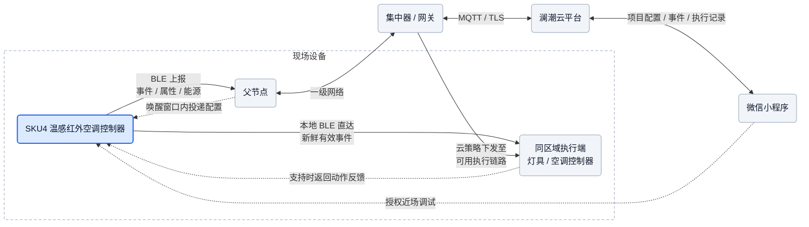

三条路径各司其职，互不替代：

| 路径  | 走向                              | 用途           | 关键约束                     |
| --- | ------------------------------- | ------------ | ------------------------ |
| 本地  | SKU4 温感红外空调控制器 →（BLE 广播）→ 同组执行端           | 开灯/关灯/调光，必须快 | 不经父节点，TTL ≤4，端到端 ≤300 ms |
| 云端  | SKU4 温感红外空调控制器 → 父节点 → CCO → 网关 → 云 → 小程序 | 上报、配置、审计、统计  | 受唤醒窗口限制，下行 1 个周期内生效      |
| 近场  | 小程序 ↔ SKU4 温感红外空调控制器（BLE GATT）            | 安装、选点、调试、读回  | 需鉴权码，会话限时                |

#### 3.1.2 硬件架构拓扑

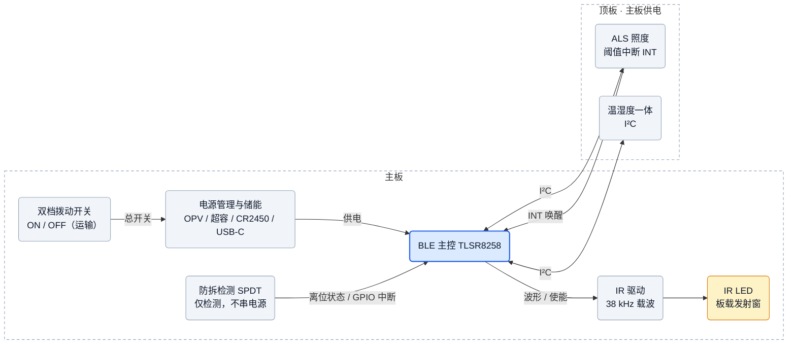

**与 SKU3 的差别**：多了一条"MCU → IR 驱动 → IR LED"的执行链，且这条链的峰值电流比其余全部负载高两个数量级。因此 4.13 的第一条需求不是"怎么发码"，而是"电从哪来"。

**防拆只做检测，不做断电**：SPDT 只进 MCU 的 GPIO 中断，不串接电池、超容或负载；电源通断只由双档拨动开关负责。设备被取下时仍由超容/电池供电，因此可以立即上报并继续监测是否被重新装回。

#### 3.1.3 供能与能量路径

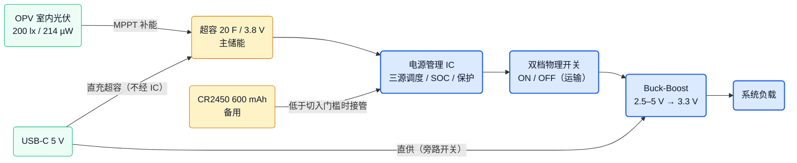

**为什么 USB 要旁路开关**：

1、产线可在"已拨 OFF（运输模式）"的状态下插 USB 完成身份写入、校验和测试，最后拔线包装，避免"写入后再拨 OFF"的漏拨风险。（type-C 6 pin能否支持数据传输带核签）

2、即使超容出现概率性损坏，此节点也可用作USB供电在别的地方使用。

**本机的额外约束（红外发射）**：

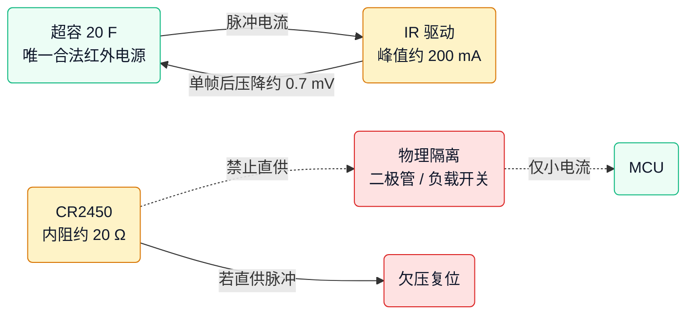

**为什么必须物理隔离**：CR2450 的脉冲负载能力只有几毫安级。20 Ω 内阻 × 200 mA ≈ 4 V 压降，已经超过电池本身的电动势——结果不是"电压低一点"，而是主控直接掉电复位。软件限流救不了，必须在电路上把电池支路与 IR 驱动隔开。

### 3.2 场景

| 场景        | 有效光照条件      | 环境特征          | 生态交互逻辑              | 推荐形态     |
| --------- | ----------- | ------------- | ------------------- | -------- |
| 开放办公区     | 工作时段持续照明    | 人员密度变化、靠窗侧自然光 | 有人开空调、无人延时关；恒照度协同  | A 微能量    |
| 独立办公室     | 工作时段有光      | 单人、时长不固定      | 有人开、无人关；温度闭环        | A 微能量    |
| 会议室       | 使用时段有照明     | 人多、设备发热、短时高负荷 | 会议前预冷/预热；散会延时关      | A 微能量    |
| 教室        | 白天自然光或人工照明  | 上下课集中、人多      | 按时段 + 温度；避免课间频繁启停   | A 微能量    |
| 医院候诊区     | 通常长时间照明     | 恒温要求高         | 温度闭环为主；夜间降载         | A 微能量    |
| 酒店客房      | 插卡取电，人在才亮   | 入住/退房切换       | 插卡开空调、退房延时关（需门锁/取电条件） | A 微能量    |
| 地下车库 / 机房 | 长期低照度       | 无人值守、温度敏感     | 超温启停；仅环境点位，不做人体联动   | C USB 外供 |

### 3.3 用户角色

| 角色          | 核心诉求              | 成功判据                | 需要的权限         |
| ----------- | ----------------- | ------------------- | ------------- |
| 物业公司（付费方）   | 电费下降、温度投诉下降、不用管电池 | 空调能耗降 20%+；无"空调不听话"投诉 | 只读看板          |
| 工程安装商 / FAE | 试码快、点位可复用、不用二次上门  | 单点试码 ≤3 次；一次装对       | 项目安装权限 + 近场调试 |
| 系统集成 / 运维   | 状态可查、异常可判定、可远程校正  | 90% 异常可远程判定          | 配置权 + 超管（受控）  |
| 空间使用者       | 按了有反应、温度舒适、不忽冷忽热  | 无"按了没反应"投诉           | 无（或仅本地手动）     |

### 3.4 安装姿态与红外朝向

| 姿态     | 推荐高度/角度             | 适用主用途   | 关键约束                        |
| ------ | ------------------- | ------- | --------------------------- |
| 高位侧装   | 墙面 2.2～2.6 m，朝向空调接收窗 | 红外控制    | 视距 ≤5 m、水平 ±30°、垂直 ±20°；避遮挡 |
| 顶装     | 吊顶 2.6～3.2 m，垂直向下   | 环境为主    | 需确认能"看见"空调接收窗，否则只做环境点位      |
| 壁挂     | 墙面 1.2～1.5 m       | 温湿度为主   | 避开门窗、出风口、热源；红外角度需现场试码       |
| 支架可调   | 俯仰 0～45°           | 通用      | 调整后锁定；振动与清洁后不得偏移            |

姿态、朝向与距离必须写入配置（`mountMode` + `irAim`）。**这是本机与 SKU3 最大的安装差异**：SKU3 只要"读数有代表性"，本机还多一条"红外能打到"。

**与 PIR/雷达机型的边界**：本机不感知人，PIR 的"避阳光/避气流/不得隔玻璃"与雷达的"避金属/背面屏蔽"均不适用于本机；人体条件由同组 SKU1/SKU2 提供，其点位按各自 3.4 安装。

## 04 功能需求

### 4.0 需求总览

| 模块           | 编号段          | 解决什么问题                                | 优先级 | 公共/私有             |
| ------------ | ------------ | ------------------------------------- | --- | ----------------- |
| LPN 能源管理     | FR-1xx       | 没市电，必须自己算电、自己省电、自己按计划动态调整             | P0  | 公共机制 + 私有帧预算     |
| 通信与安全        | FR-2xx       | 一条事件要走三条路，还要防偷听、防重放                   | P0  | 公共                |
| BLE 组网与鉴权    | FR-3xx       | 两种入网路径，都要证明"你是你、你在正确的位置"              | P0  | 公共                |
| 事件机制         | FR-4xx       | 什么算事件、发给谁、丢了怎么办                       | P0  | 公共机制 + 私有 E7xx    |
| 心跳机制         | FR-5xx       | 区分"真没变化"和"设备失联"；并支撑 30～60 s 云控响应      | P0  | 公共 + 私有 4.5.3     |
| 时间同步         | FR-6xx       | 每条事件都要说得清"几点发生的"；解决时间漂移问题             | P0  | 公共                |
| OTA 升级       | FR-7xx       | 设备怎么安全地换固件；休眠设备如何 OTA                 | P0  | 公共                |
| 运维（超管）       | FR-8xx       | 平台能远程控制 LPN，运维是重点应用场景之一               | P0  | 公共 + 私有快照项        |
| 生态设备联动       | FR-9xx       | 环境与人体条件怎么变成空调动作，且不越权                 | P0  | 私有（含跨 SKU 条件依赖）    |
| 环境采样与响应      | FR-10xx      | 三路读数怎么做到"该快就快、该省就省、不可信要说出来"           | P0  | 私有                |
| 选点与红外对准      | FR-11xx      | 装之前怎么知道"读数有代表性"且"红外打得到"              | P0  | 私有（含 IR 光学判据）     |
| 防拆           | FR-12xx      | 设备被从支架上拿走，LPN 自己要能知道                   | P0  | 公共（四款一致，修正版） |
| 红外控制         | FR-13xx      | 发什么、怎么发、发完算不算成功、现在空调到底是什么状态           | P0  | 私有（本机唯一执行域）       |

> **公共** = 与同系列其他 SKU 逐字或同构一致，改动须四款同步；**私有** = 本机独有，可独立演进；**公共机制 + 私有参数** = 机制与字段公共，阈值/档位/预算按本机标定。

### 4.1 LPN 能源管理（FR-1xx）

**要点**：设备永远要回答三个问题——现在靠谁供电、还能撑多久、撑不住时先牺牲什么。答案由 LPNMS（低功耗能源管理系统）统一给出，其他模块只能读，不能改。

#### 4.1.1 供能与切换

| ID     | 需求描述                                                            | 优先级 | 验收口径                       |
| ------ | --------------------------------------------------------------- | --- | -------------------------- |
| FR-101 | 支持 OPV + 超容、CR2450、USB 三源接入，按电源管理芯片规则自动切换；CR2450电池与充电路径隔离，禁止反充。 | P0  | 三源分别单独接入均可开机；电池支路反向电流为 0   |
| FR-102 | USB 5 V 可独立持续供电，并给超容补能。超容 2.5→3.5 V <10 min；补能期间采样不中断、不重启。      | P0  | 记录充电曲线；插拔 100 次无重启         |
| FR-103 | 超容低于切入门槛（候选 2.6 V）时切备用电池，回升后按 0.1 V（视实际效果论定） 回差切回，避免反复切换。       | P0  | 切入/切回各 20 次，无抖动、无掉电复位      |
| FR-104 | OFF 档隔离负载，整机漏电 ≤2.5 µA；运输期停采样、停心跳、拒绝采样中断唤醒。                    | P0  | 源表长时记录 ≥72 h；6 个月库存压降 <1 V |
| FR-105 | 每次上电识别原因：开关拨通 / 看门狗 / 供电恢复 / 软复位，无法区分时上报"未知"。                   | P0  | 四种原因分别注入，`bootCause` 均正确   |
| FR-106 | 临近断电时用预留电量发末次读数与状态（Last Gasp），记录是否送达；预留电量不允许被普通任务占用。               | P0  | 100 次断电试验上报成功率 ≥95%        |
| FR-107 | 分别估算超容可用能量与电池剩余容量，记录供电源与切换历史；无法估算时显示"未知"及最后有效值。                 | P0  | SOC 误差 ≤±10%；六态电池状态均可判     |
| FR-108 | 硬件保护（欠压关断、过流、过温）优先于任何软件策略，软件不得绕过。                               | P0  | 拉低电压至保护点，输出按硬件关断，恢复后按回差重启  |

#### 4.1.2 能源分级与调度

超容按可用能量分 5 档，档位直接决定采样周期、红外帧预算、心跳多慢、事件还能不能上云。

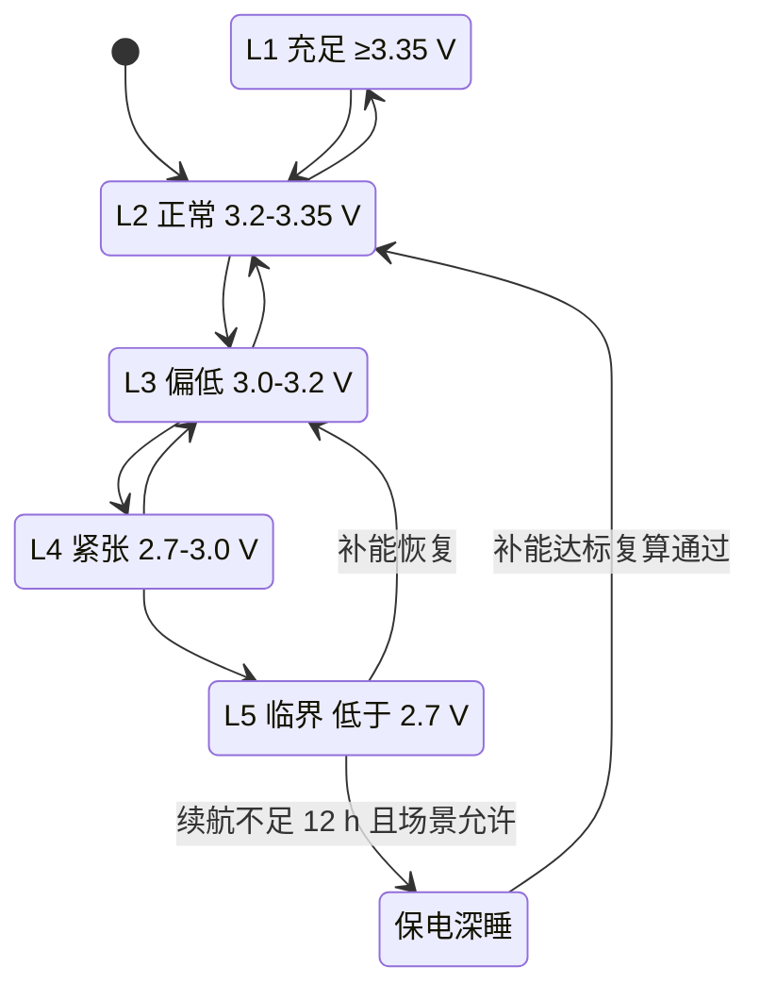

| 等级  | 超容电压（候选）   | 照度 / 温湿度采样 | 红外帧预算（日） | 心跳 / 聚合         | 上报约束         | 发射功率 |
| --- | ---------- | ---------- | -------- | -------------- | ------------ | ---- |
| L1  | ≥3.35 V    | 1 s / 30 s | 60 帧     | 300 s / 15 min | 按配置          | 100% |
| L2  | 3.2–3.35 V | 5 s / 60 s | 40 帧     | 300 s / 1 h    | 按配置          | 100% |
| L3  | 3.0–3.2 V  | 10 s / 300 s | 20 帧     | 600 s / 6 h    | P2 由聚合转随心跳   | 75%  |
| L4  | 2.7–3.0 V  | 30 s / 600 s | 6 帧      | 900 s / 24 h   | 停 P2，仅 P0/P1 | 50%  |
| L5  | <2.7 V     | 60 s / 1800 s | 0 帧      | 1800 s / 24 h  | 仅 P0         | 25%  |

**低电必须同步做的三件事**：把红外帧预算下调并**告知云端**（否则云端会以为"指令失败"）；把读数有效性标为"降级采样"；把"实际执行值"随回执上报。

#### 4.1.3 牺牲顺序与禁止项

能量不够时不是"随便关点东西"，而是按固定顺序退让：

| 顺序  | 牺牲什么            | 理由                  |
| --- | --------------- | ------------------- |
| ①   | P2 类事件的聚合上报     | 只影响报表及时性            |
| ②   | 心跳周期（拉长）        | 影响失联发现速度，不影响业务      |
| ③   | 红外帧预算（下调）       | 减少非关键调温，保留开关机       |
| ④   | 快捷收件周期（拉长）      | 云控响应变慢，但不丢指令        |
| ⑤   | 照度/温湿度采样周期（拉长）  | 影响响应速度，不丢读数         |
| ⑥   | 停发 P2，仅保 P0/P1  | 保留业务主干              |
| ⑦   | 受控保电（停采、停发红外）   | 最后手段，须场景允许          |

**禁止项（不得因省电而做）**

- 不得停止红外安全约束（最小启停间隔、每小时上限）。
- 不得因低电而把推定状态改成"已关闭"或"已开启"，只能标"未知"。
- 不得停止读数有效性判定与安全类事件（防拆、传感器故障、超容欠压、缓存溢出）。
- 不得静默丢事件或静默拒绝指令而不回原因码。

#### 4.1.4 保电与恢复

| ID     | 需求描述                                               | 优先级 | 验收口径                 |
| ------ | -------------------------------------------------- | --- | -------------------- |
| FR-109 | 预测完整服务续航 <12 h 且场景允许时才进入保电；空间在使用时先只告警，不直接停采。       | P0  | 构造 12 h 边界，核对是否进入及证据 |
| FR-110 | 停采后三路读数标"过期/未知"，推定状态标"未知"，禁止用旧值驱动联动；恢复后按当前有效读数重判。 | P0  | 停采期间平台显示过期/未知，空调不随旧值动作 |
| FR-111 | 补能恢复后复核回差、能量余量、启动预算、采样预算与红外帧预算，全部达标才恢复完整能力。      | P0  | 短时插拔未达门限时继续保护        |
| FR-112 | 定期检查能源健康，低电或持续亏电时生成 USB 补能工单；记录接入、充电结果、维护时长与拔线后电量。 | P0  | 工单可生成、可关闭、可追溯        |

#### 4.1.5 能量预算（参考值，实测签核）

| 耗能项              | 典型（10 帧/日）     | 高峰（60 帧/日）     |
| ---------------- | -------------- | -------------- |
| ALS 阈值中断（睡眠监控）   | <1 µA          | <1 µA          |
| 温湿度采样折算          | 2～4 µA         | 2～4 µA         |
| MCU 休眠           | 1～3 µA         | 1～3 µA         |
| 红外发射折算           | 约 1.5 µA       | 约 9 µA         |
| 快捷收件（60 s 窄窗）    | 约 2 µA         | 约 2 µA         |
| 上报折算             | 0.3 µA         | 1.0 µA         |
| 超容漏电             | 2 µA           | 2 µA           |
| 管理 IC + DC-DC 静态 | 2.3 µA         | 2.3 µA         |
| **合计**           | **约 9～13 µA** | **约 17～21 µA** |

**结论**：本机的电主要花在"保持可被云端叫醒"（快捷收件）与"红外发射"两处，而不是读数。所以省电的第一优先级是**用信标对齐的窄窗替代长开窗**，第二优先级是**减少非关键调温帧**。高峰日靠超容缓冲，不承诺长期维持 60 帧/日。

### 4.2 通信与安全（FR-2xx）

**要点**：同一条事件要同时满足"快、不丢、可运营"三个互相矛盾的目标。解法不是把一条路做快，而是拆成三条路。

#### 4.2.1 三通道出口模型

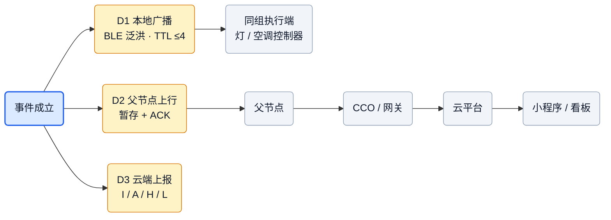

| 通道       | 目的          | 典型时延                                   | 确认语义             | 失败处理                               |
| -------- | ----------- | -------------------------------------- | ---------------- | ---------------------------------- |
| D1 本地广播  | 让灯立刻动，不等网络  | ≤300 ms（4 跳内）                          | 执行端短 ACK = 指令已收到 | 重播 2 次（间隔随机 20～50 ms）；3 次无确认报 E606 |
| D2 父节点上行 | 把事件交进网络，不丢  | 1 个唤醒窗口内                               | 父节点 ACK = 已进暂存队列 | 未 ACK 则本地保留，下次唤醒重传                 |
| D3 云端上报  | 可统计、可追溯、可配置 | I ≤1 s / A 15 min～24 h / H 随心跳 / L 不上报 | 设备侧投递完成          | 按档缓存补报；溢出报 E508                    |

**注意**：父节点 ACK ≠ 云端已入库。父节点到 CCO 是多跳，暂存溢出还会丢。因此每条事件带递增 `evtSeq`/`eventId`，云端做序号连续性校验，发现空号即请求补报——这条是必做项，不是优化项。

| ID     | 需求描述                                                                            | 优先级 | 验收口径                                |
| ------ | ------------------------------------------------------------------------------- | --- | ----------------------------------- |
| FR-201 | 三条通道独立调度、独立记录，任一通道故障不得影响另两条。                                                    | P0  | 注入父节点离线 / 广播全丢 / 云端断链，其余通道功能与记录不受影响 |
| FR-202 | 本地广播承载：BLE 广播报文携带组 ID、动作码、`evtSeq`、需确认标志与时间戳；执行端按 `evtSeq` 去重。                  | P0  | 重播 3 次，执行端只动作 1 次、计时不重置             |
| FR-203 | 上行事件带唯一 `eventId`，重传、补报、换父沿用原值；云端按编号只入库一次。                                      | P0  | 500 次重复投递，云端仅 1 条记录                 |
| FR-204 | 网络角色固定：`devClass=HARVEST_LEAF`、`canRelay=false`、`maxHopDepth=3`；父节点不得把本机编为转发节点。 | P0  | LPN/HARVEST\_LEAF在拓扑中永不为父节点         |
| FR-205 | 单父节点直挂 ≤8 台；8 台同时上报 1 s 内确认，丢包 <1%；唤醒窗口 100～500 ms 可配。                          | P0  | 满载与第 9 台被拒的场景分别验证                   |
| FR-206 | 父节点失联后先重连原父节点，失败则挂兼容且有余量的父节点，≤3 min 完成重挂载并更新路由。                                 | P0  | 断父节点后计时；换父后事件按原 `eventId` 上报        |

#### 4.2.2 BLE 链路安全

本机的链路全部是 BLE，安全必须按 BLE 的实际能力分层设计，不能假设"有加密就安全"。

| 层    | 措施                                           | 说明                    |
| ---- | -------------------------------------------- | --------------------- |
| 身份   | 一机一密：出厂注入设备专属密钥/证书，机身码与密钥绑定                  | 扫码照片、相同 MAC 都不能单独通过鉴权 |
| 配对   | 连接链路启用 BLE Secure Connections 配对与绑定，密钥存于受保护区 | 未配对设备不得读写配置           |
| 链路保护 | 已配对连接使用协议栈 AES-CCM 加密；应用层再做一层认证加密            | 防中间人、防篡改              |
| 广播保护 | 无连接的本地广播本身不加密，业务payload载荷由固件先加密并附校验后再发出      | 接收端校验不通过直接丢弃          |
| 防重放  | 受保护的会话序号/计数器 + 绑定代次 + 时间戳窗口；重启、换父、换绑后旧包失效    | 一条指令只生效一次             |
| 密钥管理 | 按设备 / 项目 / 组 / 用途隔离；支持轮换、失效、版本切换             | 普通日志禁止出现密钥与配网凭据       |

| ID     | 需求描述                                                    | 优先级 |
| ------ | ------------------------------------------------------- | --- |
| FR-207 | 设备↔父节点、设备↔执行端、近场维护三条链路均须提供机密性、来源认证与完整性校验；校验失败即拒绝并保持原状态。 | P0  |
| FR-208 | 拒绝明文降级：加密协商失败不得回退到明文传输。                                 | P0  |
| FR-209 | 接收端校验发送者、授权组、时效凭据后才执行；旧包、重复包不得开关灯、续计时、改配置或新增记录。         | P0  |
| FR-210 | 近场维护会话独立鉴权、独立权限、限时有效（≤30 min），到期自动退出并恢复原策略。             | P0  |
| FR-211 | 调试口与产测接口量产关闭；日志、事件、上报报文均不含密钥与凭据。                        | P0  |

#### 4.2.3 报文与字段约定

| 字段        | 用途            | 约束                                                 |
| --------- | ------------- | -------------------------------------------------- |
| `eventId` | 上行事件唯一标识      | 重传/补报/换父不变；云端按此去重                                  |
| `evtSeq`  | 灯侧联动去重序号      | 单调递增，按设备维度校验连续性                                    |
| `ts`      | 事件发生时间（设备本地秒） | 与 `bootId` 组合，用于还原 UTC                             |
| `bootId`  | 本次开机标识        | 跨重启排序与回填的边界                                        |
| `tsConf`  | 时间可信度         | `valid` 有效已同步/ `restored`曾经同步但基准已失效 / `unknown`未同步 |
| `actId`   | 动作指令 ID       | 同一动作多目标投递时用于核对重复                                   |

**注意：**

1、bootId:事件只在同一个 BootID 内部做时序排序、断链补报回填；一旦设备重启、`bootId` 变了，旧批次事件`eventId`、和新批次事件不能混排、不能跨 `bootId` 回填。

**2、排序边界**：网关 / 云端做事件时序排序时，**只在相同 **<!-- -->**`bootId`**<!-- -->** 里面按 **<!-- -->**`evtSeq`**<!-- -->** 排先后**；不同 BootID 的事件，不能单纯靠 evtSeq 对比先后。

3、**回填边界**：断网缓存、环形缓存里存的历史事件，**只允许在当前 BootID 有效期间向上回填补报**；设备一旦重启，BootID 更新，上一轮 BootID 里没发完的旧事件直接丢弃。

### 4.3 BLE 组网与鉴权（FR-3xx）

**要点**：两条入网路径，一套鉴权标准。路径决定"谁发起"，鉴权决定"能不能进"。

#### 4.3.1 两条组网路径

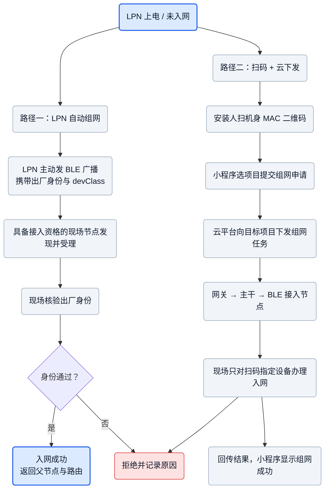

| ID     | 需求描述                                                          | 优先级 | 验收口径                         |
| ------ | ------------------------------------------------------------- | --- | ---------------------------- |
| FR-301 | **路径一（本地自动组网）**：未入网 LPN 主动广播，由具备接入资格的现场节点受理；公网断开但现场链路正常时仍可完成。 | P0  | 断公网，10 台设备均成功入网              |
| FR-302 | **路径二（扫码 + 云下发）**：扫码 → 选项目 → 云端下发组网任务 → 现场针对指定设备入网 → 结果回传。    | P0  | 端到端 ≤60 s；小程序显示"组网成功"以现场结果为准 |
| FR-303 | 两条路径使用同一套入网鉴权与同一条事件通道，入网后行为完全一致。                              | P0  | 两种方式入网的设备，事件与配置行为逐项比对一致      |
| FR-304 | 本地组网与扫码组网可互相补位：扫码任务超时未完成时，允许退回本地组网路径（需授权）。                    | P1  | 超时后切换路径，最终入网成功               |

#### 4.3.2 三重鉴权：人、设备、点位

扫码组网的实际风险不是"连不上"，而是"连上了不该连的"。所以必须三样都对上。

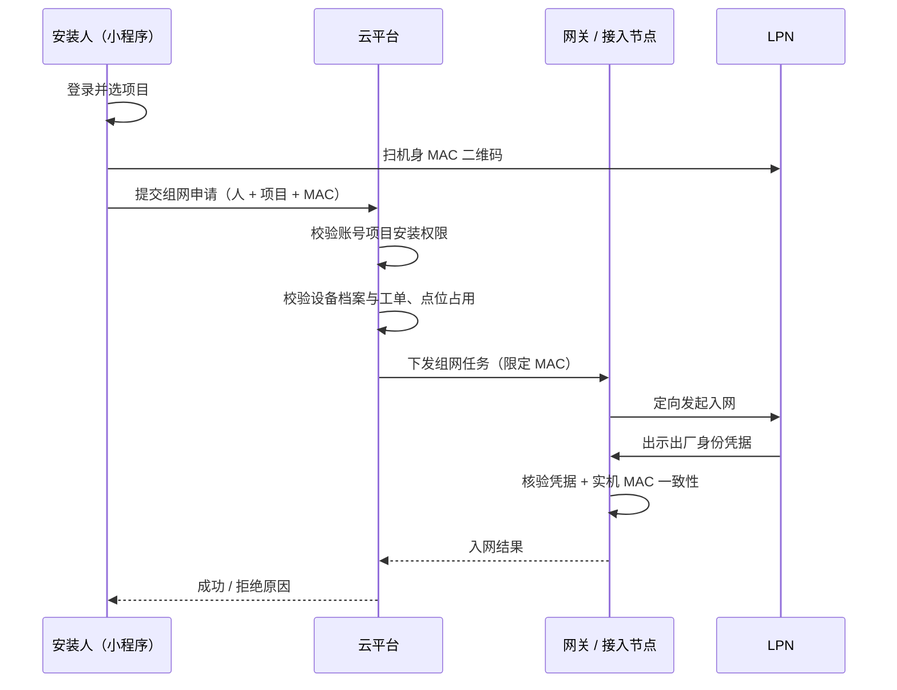

| ID     | 需求描述                                                            | 优先级 | 验收口径                   |
| ------ | --------------------------------------------------------------- | --- | ---------------------- |
| FR-305 | **人**：账号须具备目标项目安装权限，否则申请直接结束并提示原因。                              | P0  | 无权限账号申请 100% 被拒        |
| FR-306 | **设备**：核验出厂身份凭据 + 实机 MAC 与扫码 MAC 一致；照片、复制 MAC、非澜潮设备均拒绝。         | P0  | 扫 A 装 B 场景 100% 拦截     |
| FR-307 | **点位**：云端校验项目归属、点位范围、是否被占用；身份通过但白名单未通过时标"待核"，不得输出联动指令。          | P0  | 待核设备不能开灯；纠正后可重新绑定      |
| FR-308 | 组网状态可查：未配网 / 发现 / 鉴权中 / 入网 / 待绑定 / 在线 / 离线或未知 / 重新入网，并记录最后失败原因。 | P0  | 八种状态均可构造并正确显示          |
| FR-309 | 离线扫码可暂存，联网复核后放行；同笔申请只建一次绑定，重试结果一致。                              | P1  | 断网扫码 10 单，恢复后批量提交无重复绑定 |

#### 4.3.3 失败处理与容量

| 情形         | 处理              | 用户可见             |
| ---------- | --------------- | ---------------- |
| 身份核验失败     | 拒绝入网，记录阶段与脱敏结果  | "设备身份核验失败，请核对铭牌" |
| 白名单未通过     | 允许入网但标"待核"，禁止联动 | "点位待核，暂不参与联动"    |
| 父节点满载（8 台） | 拒绝并建议迁移或增补父节点   | "父节点已满，请调整点位"    |
| 父节点失联      | ≤3 min 重挂兼容父节点  | "已切换上级设备"        |
| 弱光无法冷启动    | 提示先 USB 补能再入网   | "请先补能至 3 V 以上"   |

### 4.4 事件机制（FR-4xx）

**要点**：一条没有明确触发条件的事件等于没有定义。所以每条事件必须写清"什么时候产生、发给谁、要不要确认、丢了怎么办"。

#### 4.4.1 事件生成原则

- **可判定**：触发条件必须是可测的状态或计数，例如"连续 N\_leave 次有效空判 + 等满 T\_leave"，而不是"人好像走了"。
- **可追溯**：记录源设备、类型、`eventId`、发生时间、测量值与原因；转发时保留原始来源与发生时间。
- **三态**：人员状态只有"有人 / 无人 / 未知"，数据不足时必须记"未知"，不得默认"无人"。
- **单次生效**：状态变化只记一次；持续维持同一状态时更新快照或做周期统计，不重复产生事件。

#### 4.4.2 事件分类

| 编号段  | 类别      | 典型事件                                          | 是否可禁用    |
| ---- | ------- | --------------------------------------------- | -------- |
| E1xx | 环境感知    | 照度变化、温度变化、湿度变化、高低温、高低湿、有效性变化、读数抖动、日统计 | 主干不可禁用   |
| E2xx | 通道与有效性  | 照度通道故障、温湿度通道故障、超量程、未标定、读数过期、通道降级、通道恢复、凝露预警 | 故障类不可禁用  |
| E3xx | 能源与电源   | 采能恢复、能量不足、能量临界、临终上报、上电启动、超容欠压、电池低电            | 底线类不可禁用  |
| E4xx | 自检与安防   | 周期自检、ALS 自检失败、温湿度自检失败、**防拆/脱落**、探测窗遮挡、**发射窗遮挡** | 安防类不可禁用  |
| E5xx | 生命周期与运维 | 上线、链路恢复补报、入网完成、配置生效/拒绝、OTA 状态、时钟偏差、缓存溢出、码库包更新 | 完整性类不可禁用 |
| E6xx | 环境联动    | 照度阈值穿越、联动执行反馈、群组联动触发、免开灯生效、照明回路疑似故障、联动确认超时   | 多数可禁用    |
| E7xx | 红外执行    | 指令受理、发射完成、发射失败、码型未匹配、推定状态变更、状态可疑、未对准、压缩机保护拒绝、人工校正 | 执行类不可禁用  |

**释义：**

**1、推定状态变更**：一次成功发射后，按"完整状态帧"推算出的空调状态发生变化。注意：这是**推定**，不是实测。

**2、状态可疑**：温度趋势与指令方向相反（例如下发制冷后 15 min 温度未下降 ≥0.5 ℃），通常指向指令未生效、被原装遥控器改回、或空调故障。

**3、未对准**：连续 N 次发射后温度均无响应，且码型已在试码阶段确认，指向发射窗被遮挡、角度偏移或距离超限。

**4、压缩机保护拒绝**：请求的启停动作违反最小启停间隔或每小时上限，设备拒绝执行并回原因码。这是**保护动作**，不是故障。

**5、码库包更新**：固件内置包或云端增量包写入成功/失败/回滚。必须上报版本与来源，否则现场无法判断"为什么这台空调的码变了"。

**6、事件码命名空间**：本表按 SKU 定义语义，平台以 `devType + eventCode` 唯一识别；同一码段在不同 SKU 下对应"同类角色"（E1=主感知、E2=辅助通道、E3=能源、E4=自检安防、E5=生命周期、E6=联动、E7=执行）。跨 SKU 统计时不得只看码值。

#### 4.4.3 上报方式四档

| 档位  | 方式  | 时延                                              | 设备行为               | 适用             |
| --- | --- | ----------------------------------------------- | ------------------ | -------------- |
| I   | 即时  | ≤1 s                                            | 立即组帧发出，按配置重传 0～2 次 | 安全类、故障类、必须实时可见 |
| A   | 聚合  | 15 min / 30 min / 1 h / 2 h / 6 h / 12 h / 24 h | 写环形缓存，到期打包         | 统计类、业务主事件的云端记录 |
| H   | 随心跳 | 跟随心跳周期 300～1800 s                               | 挂在心跳帧中捎带，最省电       | 低频状态类          |
| L   | 仅本地 | 不上报                                             | 只记本地，可由诊断快照读出      | 调试类、高频低价值      |

**注意：**

**聚合不是丢弃，是延迟**：聚合类事件仍完整记录在本地缓存，周期到达打包上报；期间若发生更高优先级事件，打包一并提前发送。

#### 4.4.4 确认、缓存与补报

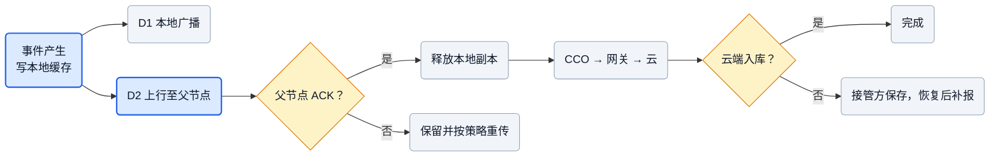

| ID     | 需求描述                                                     | 优先级 | 验收口径                             |
| ------ | -------------------------------------------------------- | --- | -------------------------------- |
| FR-401 | 每条事件独立配置：启用状态、本地是否广播、是否需执行端/父节点确认、云端上报档位、聚合周期、单包条数、重传次数。 | P0  | 逐条可配、可读回；硬约束项拒绝禁用并回具体原因码         |
| FR-402 | 关键事件与配置回执锁定为不可禁用、必须确认、即时上报。                              | P0  | 尝试禁用全部被拒（E505）                   |
| FR-403 | 断链缓存目标 ≥256 条（环形，按时间淘汰）；容量与断链时长在型号层面明确承诺。                | P1  | 断网 24 h 恢复后完整率 100%（日均 ≤300 条场景） |
| FR-404 | 恢复后分批补报：实时关键事件优先，历史按原发生时间与可信度排序，沿用原 `eventId`。           | P0  | 补报排序正确率 100%；旧事件不触发现场动作          |
| FR-405 | 缓存溢出必须计数并上报丢弃条数（E508），供平台核对记录缺口。                         | P1  | 产生/送达/丢弃三者可对账                    |
| FR-406 | 关闭某可选事件后，采样、心跳、快照与其他事件继续运行；平台提示受影响的联动规则。                 | P0  | 关闭 E601 后，E101/E105 与心跳正常        |

#### 4.4.5 关键事件（节选，全量见附录 8.1）

| 编号       | 事件         | 触发条件                     | 本地    | 云端       | 可禁用 |
| -------- | ---------- | ------------------------ | ----- | -------- | --- |
| E101     | 照度变化       | 跨过阈值且超过滞回                | 广播条件位 | I        | 否   |
| E102     | 设备心跳       | 按周期发送，携带三读数、推定摘要与供电源     | 不广播   | H        | 是   |
| E103     | 温度变化       | 变化 ≥tempDelta 且超滞回       | 不广播   | A 15 min | 是   |
| E109     | 读数有效性变化    | 正常 ↔ 无效/降级               | 广播条件位 | I        | 否   |
| E202     | 温湿度通道故障    | I²C 无响应或 CRC 连续错误        | 不广播   | I        | 否   |
| E205     | 读数过期       | 超过 3 个采样周期无新读数           | 不广播   | I        | 否   |
| E304     | 临终上报       | 触及预留储备门限，发末次读数与推定状态      | 不广播   | I        | 否   |
| E311     | 超容欠压       | 2.7 V 预警 / 2.5 V 保护      | 不广播   | I        | 否   |
| **E407** | **防拆/脱落**  | 设备离开支架或壳体分离              | 广播警示  | I        | 否   |
| E504     | 配置生效       | 参数下发并通过校验，含来源与实际执行值      | 不广播   | A 1 h    | 是   |
| E506     | OTA 状态     | 下载/校验/安装/成功/失败/回滚        | 不广播   | I        | 是   |
| E601     | 照度阈值穿越     | 跨过设定阈值（带 20% 回差）         | 广播条件位 | I        | 是   |
| E701     | 红外指令受理     | 收到云端/本地指令并通过校验           | 不广播   | H        | 否   |
| E702     | 红外发射完成     | 一帧完整状态帧发完，含 `cmdId` 与码型  | 不广播   | H        | 否   |
| E703     | 红外发射失败     | 能量不足、码型缺失、驱动异常           | 不广播   | I        | 否   |
| E704     | 码型未匹配      | 机型无可用码型，标"不可控"           | 不广播   | I        | 否   |
| E705     | 推定状态变更     | 成功发射后推定状态变化              | 不广播   | A 1 h    | 是   |
| E706     | 推定状态可疑     | 温度趋势与指令方向相反              | 不广播   | I        | 否   |
| E707     | 未对准        | 连续 N 次发射且温度无响应           | 不广播   | I        | 否   |
| E708     | 码库包更新      | 内置包/增量包写入、失败、回滚          | 不广播   | I        | 否   |
| E709     | 压缩机保护拒绝    | 违反最小启停间隔或每小时上限           | 不广播   | A 1 h    | 否   |
| E710     | 人工校正       | 小程序校正实际状态并重发完整帧          | 不广播   | I        | 否   |

### 4.5 心跳机制（FR-5xx）

**要点**：心跳只解决一件事——把"真没人"和"设备失联"分开。没有心跳，平台看到"无人"根本不知道是人走了还是设备死了。

#### 4.5.1 心跳收发与周期

| ID     | 需求描述                                                        | 优先级 | 验收口径            |
| ------ | ----------------------------------------------------------- | --- | --------------- |
| FR-501 | 入网后按实际生效周期向父节点发送心跳，长时间无人员活动也照发。                             | P0  | 连续 7 天无人，心跳无中断  |
| FR-502 | 标准档 300～1800 s 可配；低功耗保活档以 2 h 为候选（需单独签核）；低电时按能源策略延长并上报实际周期。 | P0  | 平台显示周期 = 设备实测周期 |
| FR-503 | 心跳帧可捎带允许随心跳上报的事件（H 档）与当前供电源、能源等级、配置版本。                      | P0  | 抓包核对载荷字段完整      |
| FR-504 | 心跳与协议保活分离：心跳是业务状态记录，保活是链路可达性交互，二者不得互相替代。                    | P0  | 关闭心跳上报后保活仍正常    |

#### 4.5.2 在线判定与恢复

| 情形                | 判定规则           | 平台展示                |
| ----------------- | -------------- | ------------------- |
| 收到实时有效消息          | 立即刷新"最近有效通信时间" | 在线                  |
| 漏收 1～2 个周期        | 保持在线           | 在线（标注最近通信时间）        |
| 连续 3 个应到周期未收到     | 判离线（留出收发时间余量）  | 离线                  |
| 父节点失联 / 云端拿不到现场判定 | 不猜测            | **状态未知** + 最近有效通信时间 |
| 重新收到实时消息          | 恢复在线           | 在线；补发的旧心跳只进历史       |

| ID     | 需求描述                                 | 优先级 | 验收口径                 |
| ------ | ------------------------------------ | --- | -------------------- |
| FR-505 | 断公网时父节点继续完成现场保活与离线判断，恢复后平台按最新现场结果更新。 | P0  | 断云 30 min，现场判定不停     |
| FR-506 | 在线状态与人员存在状态分开展示，不得用一个字段表达两件事。        | P0  | 设备在线但人员未知时，两个维度分别正确  |
| FR-507 | 补报的旧心跳不得让设备"假上线"，只有实时有效通信才恢复在线。      | P0  | 先送旧心跳再生效实时心跳，仅后者改变状态 |

#### 4.5.3 快捷收件（本机私有扩展）

**要点**：SKU1/SKU2/SKU3 可以"两小时一次心跳"，因为它们只上报；本机要**接受控制**，而人按下"开空调"之后等 2 小时是不可接受的。解决办法不是"把心跳调快"，而是**在心跳之间插入极窄的接收窗，并让父节点在约定时刻发信标对齐**。

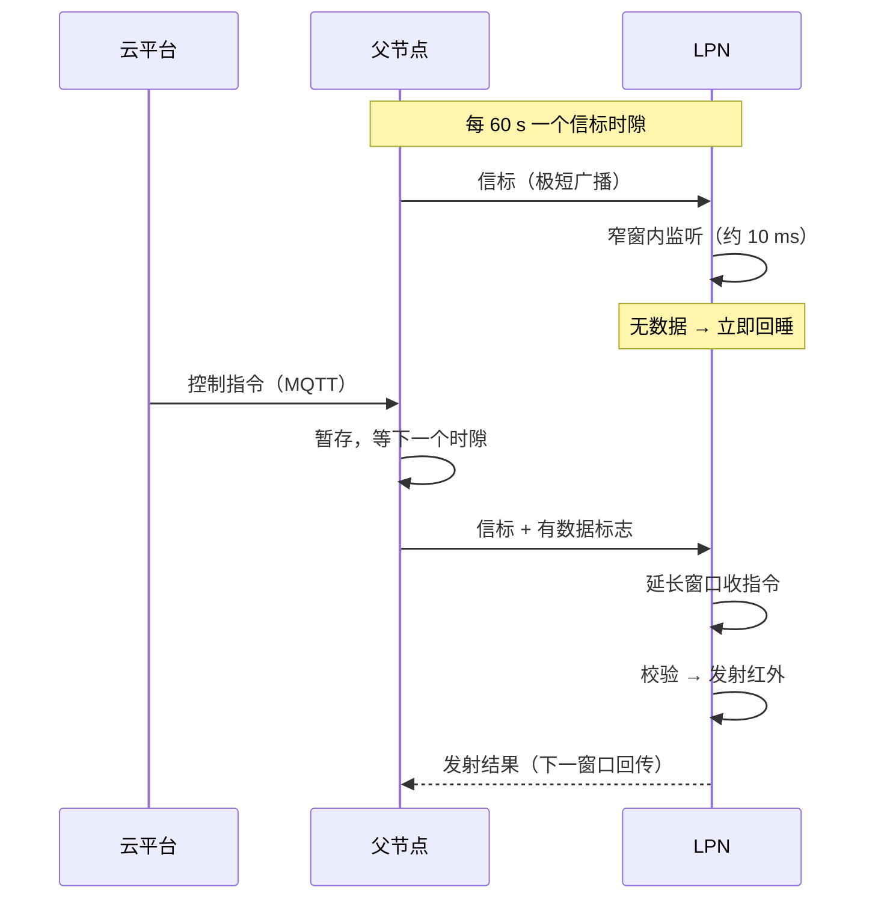

| ID     | 需求描述                                                       | 优先级 | 验收口径             |
| ------ | ---------------------------------------------------------- | --- | ---------------- |
| FR-520 | 支持快捷收件：在心跳之间按配置周期开启窄接收窗（30/60/120 s 三档），默认 60 s。        | P0  | 三档均可配置并回读        |
| FR-521 | 窄窗由父节点信标对齐，单次开窗时长 ≤20 ms；无数据立即回睡，不得"等满"。                  | P0  | 实测开窗时长与占空符合设计值   |
| FR-522 | 有数据时窗口可延长至完成收包（上限可配），收完立即回睡。                              | P0  | 收包后电流 5 s 内回落     |
| FR-523 | 云控响应：云端受理 → 完成第一帧有效发射，**形态 A（微能量）/ 形态 C（USB 外供）** ≤30 s（目标）/≤60 s（上限）；形态 B 不支持红外，不适用。 | P0  | 覆盖"刚错过时隙"与批量竞争场景 |
| FR-524 | 快捷收件与心跳、上报共用射频但独立调度，不得互相阻塞。                               | P0  | 并发注入，三者均正常       |
| FR-525 | 低电时按 4.1.2 逐档降低收件频率，并**上报实际收件周期**，让云端知道指令最坏要等多久。           | P0  | 平台显示实际周期         |
| FR-526 | 快捷收件只在**形态 A（微能量）/ 形态 C（USB 外供）**启用；形态 B（纯电池）下停止收件，仅按心跳窗口收指令，并上报该降级状态。 | P0  | 切 B 形态后行为与标注正确   |
| FR-527 | 收件窗口内收到非本机指令时不得执行，但可记录"误投递"计数供组 ID 配置排查。                  | P1  | 误投递计数可读          |
| FR-528 | 连续 N 次（默认 3）收件窗口未收到父节点信标时，上报链路异常并退化为按心跳窗口收件。               | P1  | 断信标后行为正确         |

**这个设计的代价必须说清**：60 s 档按每次 10 ms、接收电流 5 mA 估算，占空约 0.017%，日均约 0.8～2 µA；若改成"每 30 s 开 200 ms 窗"的传统做法，日均会到 33 µA，直接超预算三倍。**窄窗 + 信标对齐不是优化，是这个产品能不能成立的前提。**

### 4.6 时间同步与时间戳（FR-6xx）

**要点**：设备会长时间休眠、会断电、会跨日，本地时钟必然漂。所以不追求"设备时间一直准"，而是保证每条事件都能被还原到真实的 UTC 时刻。

#### 4.6.1 三时间戳模型

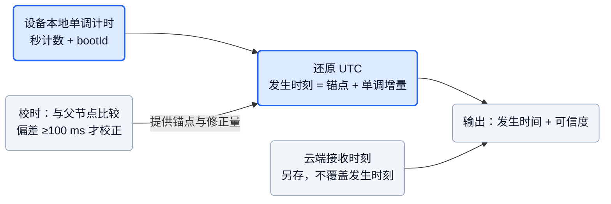

| ID     | 需求描述                                                       | 优先级 | 验收口径                          |
| ------ | ---------------------------------------------------------- | --- | ----------------------------- |
| FR-601 | 设备持续维护本地计时与本次开机标识；事件发生时记录本地时刻，不依赖当前是否已校时。                  | P0  | 断网 24 h 的事件仍带本地时刻             |
| FR-602 | 唤醒后向父节点对时；偏差 <100 ms 保持原值，≥100 ms 才校正，并记录修正量（E507）。        | P0  | 90 ms 不触发、110 ms 触发；校后 <20 ms |
| FR-603 | 事件报文与 BLE 通信报文均携带时间戳字段（`ts` + `bootId` + `tsConf`），供接收端还原。 | P0  | 逐条事件抓包可见三字段                   |
| FR-604 | 发生时间由接入端按对时记录还原为 UTC，云端另记接收时间，两者分别保存。                      | P0  | 补报事件排序正确率 100%                |
| FR-605 | 时间不可信（未校时、跨重启、跨日缺日期、误差超预算）时标记为未知或降级，并暂停依赖绝对时间的规则。          | P0  | 构造五种场景，均可看出"为什么不可信"           |
| FR-606 | 换电池、复位、换父后必须重新校时；恢复后按当前输入重判，过期动作只留历史。                      | P0  | 换电重启后时间与规则状态正确                |

### 4.7 OTA 升级（FR-7xx）

**要点**：休眠设备不能保持长连接下载，OTA 必须"父节点囤货、设备蚂蚁搬家"，并且随时可断、可续、可回滚。

#### 4.7.1 升级流程与状态

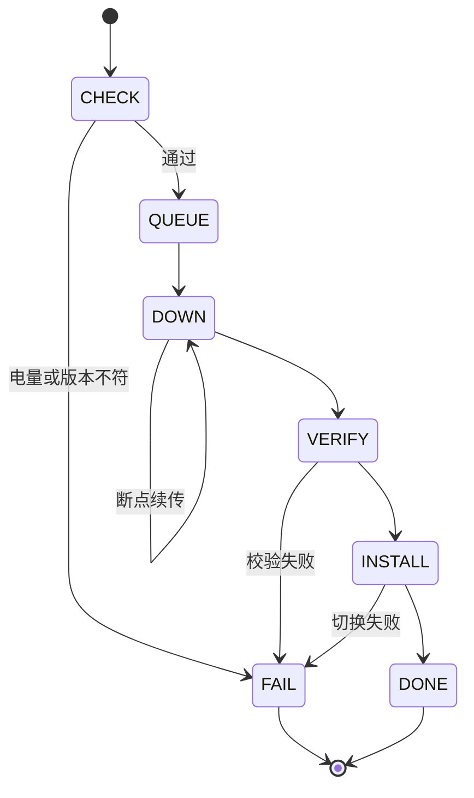

| ID     | 需求描述                                          | 优先级 | 验收口径                   |
| ------ | --------------------------------------------- | --- | ---------------------- |
| FR-701 | 升级前校验版本匹配、能量余额、链路质量；不满足则拒绝并回明确原因码，恢复后可重新申请。   | P0  | 低电设备申请升级，平台读到明确拒绝码     |
| FR-702 | 父节点缓存匹配升级包，设备每次唤醒接收一段，支持断点续传。                 | P1  | 传输中断 5 次后仍能完成          |
| FR-703 | 升级不得丢失配置、标定与绑定关系；算法类变更需说明哪些标定可迁移、哪些须重标。       | P0  | 升级前后读回配置与标定逐项比对        |
| FR-704 | 支持按项目/批次灰度升级，逐台显示进度与结果；失败率超门槛自动停止派发新任务。       | P1  | 同批构造低电、版本不符、断链，行为符合预期  |
| FR-705 | 升级过程与结果记录为 E506（下载/校验/安装/成功/失败/回滚），失败与回滚强制上报。 | P0  | 六种状态均可复现并上报            |
| FR-706 | 升级失败必须能回到可工作版本并重新入网，不得变砖。                     | P0  | 传输阶段与切换阶段各断电 50 次，均可恢复 |

### 4.8 运维与云端超管（FR-8xx）

**要点**：后期规划中设备支持装在天花板上，人上不去。所以平台必须能在设备在线时"远程动手"，但这类能力等价于 root 权限，必须带闸门。

#### 4.8.1 运维能力分级

| 级别    | 能力                        | 典型操作                        | 授权要求        |
| ----- | ------------------------- | --------------------------- | ----------- |
| L0 只读 | 看状态、看事件、看诊断快照             | 查存在状态、电量、信号、最近事件            | 项目只读权限      |
| L1 配置 | 改参数、改上报策略、应用模板            | 改 T\_radar\_delay、上报档位、组 ID | 项目管理员       |
| L2 诊断 | 触发自检、抓运行日志、强制心跳、强制扫描      | 定位"为什么不报事件"                 | 运维工程师       |
| L3 超管 | 远程重启、清缓存、强制复位、进入升级模式、解除绑定 | 救活"假死"设备                    | 双人复核 + 限时会话 |

#### 4.8.2 超管操作清单

| ID     | 需求描述                                                     | 优先级 | 验收口径                     |
| ------ | -------------------------------------------------------- | --- | ------------------------ |
| FR-801 | 支持远程强制心跳：立即唤醒并上报一帧完整状态，用于确认设备是否真在线。                      | P0  | 下发后 ≤1 个唤醒窗口收到           |
| FR-802 | 支持远程拉长唤醒窗口（临时，≤30 min），用于批量下发配置或抓日志。                     | P0  | 到期自动恢复原窗口                |
| FR-803 | 支持远程重启与强制复位；重启前后记录原因、时间与操作人。                             | P0  | 100 次远程重启无变砖、配置不丢        |
| FR-804 | 支持远程清理事件缓存（须先导出或确认丢弃条数），清理动作计入 E508 对账。                  | P1  | 清理后平台可见丢弃计数              |
| FR-805 | 支持远程读取诊断快照：通道状态、电源、三读数与有效性、推定状态与置信度、码型 ID 与版本、最近 8 条事件、当前策略摘要。 | P0  | 快照字段与本地一致                |
| FR-806 | 支持远程触发一次环境采样自检与一次试码发射（试码需现场确认），结果回传。                              | P1  | 触发后 60 s 内出结果            |
| FR-807 | 超管会话限时（≤30 min）、一次一授权、全程审计；不得突破能量底线与安全事件锁。               | P0  | 会话过期后再下发被拒；审计可查操作人/时间/参数 |
| FR-808 | 近场维护（BLE GATT）提供同等能力子集：读状态、改参数、触发自检、导出日志。                | P0  | 现场无网时可用；配置 ≤3 min 完成     |
| FR-809 | 本地改参后进入"待确认"：授权人确认才固化为基线；72 h 未确认告警，7 天自动回退，回退前 24 h 通知。 | P0  | 三态流转正确，回退可复现             |

**超管必须带闸门**：这类能力可以"让一台设备看起来正常工作"，也可以"让一台设备永远不报警"。一旦被滥用，故障会被掩盖而非暴露更有其他的风险。所以：能力开放给运维，权限收在审计里。

### 4.9 生态设备联动策略（FR-9xx）

**要点**：本机既能感知也能执行，但"有没有人"不是它说了算。人体条件是**可选输入**：有，就做"有人开、无人关"；没有，就退回"时段 + 温度"，并且必须让平台看得出当前是哪一种模式。

#### 4.9.1 联动数据源与对象

| 数据源                | 来源             | 用途                    | 更新频率      |
| ------------------ | -------------- | --------------------- | --------- |
| 照度（数值与有效性）         | 本机             | 白天免开灯协同、照明条件位、开灯效果校验  | 阈值穿越即发    |
| 温度                 | 本机             | 温控闭环、预冷预热、超温告警        | 变化阈值 / 越限 |
| 湿度                 | 本机             | 除湿、凝露预警               | 变化阈值 / 越限 |
| 人员状态（有人/无人/未知，可选）  | 父节点下行 / 云端（源设备 SKU1/SKU2） | "有人才开""无人延时关" | 随收件窗口投递 + 有效期 |
| 推定空调状态             | 本机             | 防重复下发、漂移检测、平台展示       | 每次发射后     |

| 执行端    | 可执行动作                       | 确认方式            |
| ------ | --------------------------- | --------------- |
| 空调（红外） | 开、关、模式、目标温度、风速、扫风（按码型裁剪）    | **无回执**，只能靠温度趋势间接验证 |
| 智慧灯具   | 开、关、调光（本机只发条件位，不直接控灯）       | 短 ACK + 照度变化（可选） |

#### 4.9.2 联动决策流程

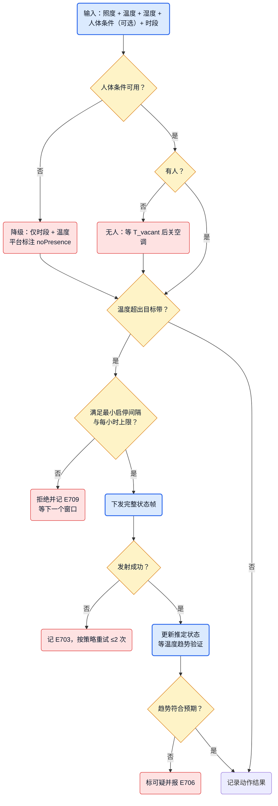

#### 4.9.3 联动需求

| ID     | 需求描述                                                      | 优先级 | 验收口径                       |
| ------ | --------------------------------------------------------- | --- | -------------------------- |
| FR-901 | 本地联动不经父节点、不经云端：有效新鲜事件由 BLE 广播直达同组执行端。                     | P0  | 断云 30 min 内本地联动可用率 ≥95%    |
| FR-902 | 支持组 ID 槽位管理，一台设备可参与多个组的多条策略；组内目标数与槽位数以样机满配验证。             | P1  | 满配无丢失                      |
| FR-903 | 策略要素：时段 + 温度目标与回差 + 人体条件（可选）+ 无人延时 `T_vacant` + 最小启停间隔 + 目标动作。 | P0  | 六个要素任意组合均可生效、可读回           |
| FR-904 | 无人关空调前检查已运行时长与最小间隔，避免"刚开就关"；默认至少运行 10 min。                | P0  | 短时经过不启停                    |
| FR-905 | **人体条件缺失时必须降级为"时段 + 温度"**，并在平台标注 `noPresence`；不得用"无人"兜底，也不得假装有人。 | P0  | 摘除人体传感器后模式标注正确，控制不中断       |
| FR-906 | 手动接管优先：识别到人工用原装遥控器操作后暂停自动控制并继续感知，结束后按当前有效输入重评。            | P0  | 手动调温后自动策略不立即拉回             |
| FR-907 | 每条动作记录规则版本、来源、目标、指令 ID、受理与实动证据、失败原因与耗时；多目标分别记录。           | P0  | 一次联动涉及 3 个目标，可分别追溯         |
| FR-908 | 与同组温照度设备协同：照度条件位用于照明联动，温度/湿度用于暖通；同组多点位时按签核规则取值。            | P1  | 同组 3 个点位取值一致，不打架           |
| FR-909 | **人体条件获取路径**：只能经父节点下行或云端策略获取，随收件/唤醒窗口投递并带时间戳；**不得依赖直接监听 SKU1/SKU2 的本地广播**。断云或超期时按 FR-905 降级并标注。 | P0  | 抓包确认无"监听他人广播"路径；断云后降级正确 |

**本机不做"没人就一定关"**：人体条件来自同组设备，可能是"未知"（设备离线、低电停测）。把"未知"当"无人"去关空调，会造成会议室在开会时空调被关。所以降级规则只有一条：**未知 → 保持现状 + 标注**。

### 4.10 环境采样与响应（FR-10xx）

**要点**：本机的环境数据是**控制输入**，不是报表数据。所以"有效性"比"精度"更关键：一个坏值足以让空调误启停。

#### 4.10.1 核心时间参数

| 参数          | 符号                   | 取值                    | 定义与约束              |
| ----------- | -------------------- | --------------------- | ------------------ |
| 光照采样周期      | `luxSamplePeriod`    | 1 / 2 / 5 / 10 / 30 / 60 s | 默认 5 s            |
| 温度采样周期      | `tempSamplePeriod`   | 30 / 60 / 300 / 600 / 1800 s | 默认 60 s；温控闭环依赖它   |
| 温度变化阈值      | `tempDelta`          | 0.5 / 1.0 / 2.0 ℃     | 默认 1.0 ℃；小于回差会被噪声淹没 |
| 湿度采样周期      | `humiSamplePeriod`   | 30 / 60 / 300 / 600 / 1800 s | 默认 300 s          |
| 湿度变化阈值      | `humiDelta`          | 3 / 5 / 10 %RH        | 默认 5 %RH           |
| 外壳热时间常数     | `τ_therm`            | ≤3 min（硬件承诺）          | 温控闭环的物理延迟，软件不可配    |
| 读数过期时长      | `staleTimeout`       | 3 个采样周期                | 超期标"过期"，不进入联动      |

#### 4.10.2 采样与判定

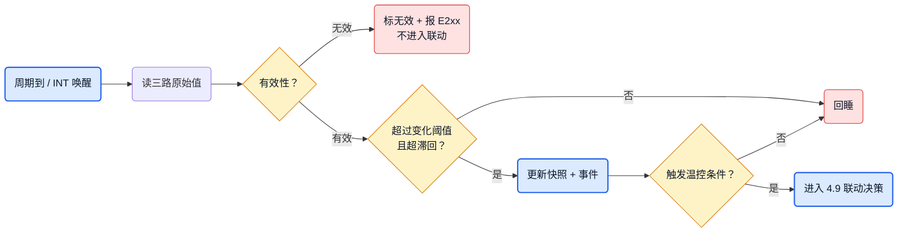

#### 4.10.3 采样需求

| ID      | 需求描述                                                      | 优先级 | 验收口径                            |
| ------- | --------------------------------------------------------- | --- | ------------------------------- |
| FR-1001 | 照度采集用带阈值中断的 ALS：睡眠期间持续监控，跨阈值才唤醒主控；不得用 MCU 轮询替代。           | P0  | 稳态下唤醒次数 ≤30 次/h，与理论值相符   |
| FR-1002 | 光照响应：0→500 lux 阶跃，从变化到事件发出 ≤10 s（标准档）、≤3 s（快响应档）。       | P0  | 各 50 次取 P95                     |
| FR-1003 | 光照阈值与滞回可配，跨阈值只触发一次；反向穿越需超过滞回带才再次触发。                       | P0  | 阈值附近来回 20 次，只产生 1～2 条事件         |
| FR-1004 | 温度采集周期与阈值可配；温度响应 20→30 ℃ 阶跃 ≤5 min（含 τ\_therm）。          | P0  | 阶跃试验 20 次取 P95                  |
| FR-1005 | 湿度采集周期与阈值可配；湿度响应 30→60 %RH 阶跃 ≤10 min。                  | P0  | 阶跃试验 20 次取 P95                  |
| FR-1006 | 三路采样解耦：光照快采样不拖累温湿度慢采样；温湿度采样期间光照中断仍独立工作。                   | P0  | 温度 60 s 周期下，光照阶跃仍 ≤10 s 响应      |
| FR-1007 | 读数有效性判定：区分正常、超量程、缺测、未标定、过期；无效值不进入联动、温控与统计分母。              | P0  | 五类状态均可构造并正确标记                   |
| FR-1008 | 温度用于温控时必须带采样时刻与 τ\_therm 说明；不得用"当前温度"暗示即时性。               | P0  | 界面与报文均可看出采样时刻                   |
| FR-1009 | 长时间无变化时按周期发"快照"（H 档），避免平台无法区分"没变化"与"没数据"。               | P0  | 静置 24 h 仍有周期快照                  |
| FR-1010 | 温湿度读数与标准仪器比对偏移可配（现场单点校准），偏移量随诊断快照可读。                     | P1  | 校准后偏差收敛在 ±0.5 ℃ / ±3 %RH        |
| FR-1011 | 凝露预警：湿度 ≥dewHumi 且 30 min 内温度下降 ≥dewDelta 时上报 E208，并在读数上标注"凝露风险"。 | P1  | 构造结露环境可稳定触发                     |

#### 4.10.4 三个读数各自的可信边界

| 读数  | 可信范围            | 不可信场景              | 处置                    |
| --- | --------------- | ------------------ | --------------------- |
| 照度  | 0.01～83000 lux，±10% | 感光面被遮挡、正对灯下、阳光直射   | K 标定 + 选点规避 + E205/E408 告警 |
| 温度  | -10～55 ℃，±0.3 ℃   | 灯具热辐射、出风口直吹、阳光直射外壳 | 选点距离要求 + τ\_therm 说明   |
| 湿度  | 0～100 %RH，±2 %RH | 凝露、结霜、透气膜堵塞        | 凝露预警 + 清洁维护提示         |

### 4.11 选点与红外对准（FR-11xx）

**要点**：其他 SKU 选点只关心"读数有没有代表性"，本机还要多问一句——**"这只管子打得到空调吗"**。打不到，前面所有功能都归零。

#### 4.11.1 选点四问

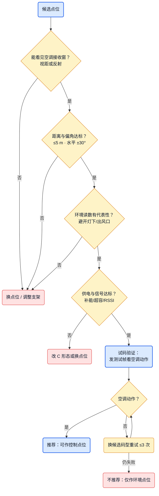

#### 4.11.2 选点需求

| ID      | 需求描述                                                                | 优先级 | 验收口径                          |
| ------- | ------------------------------------------------------------------- | --- | ----------------------------- |
| FR-1101 | 选点必须确认"空调接收窗可见性"：视距或反射路径，记录距离、水平偏角、垂直偏角、遮挡物。                       | P0  | 点位表含四项；缺失不允许提交                |
| FR-1102 | **试码是选点的必经步骤**：未通过试码的点位标"仅环境"，不得配置温控策略。                             | P0  | 未试码点位无法启用温控规则                 |
| FR-1103 | 试码流程：App 触发测试帧 → 现场观察空调 → 确认成功/失败 → 自动记录机型、码型、距离、角度。              | P0  | 单点试码 ≤3 次通过率 ≥90%             |
| FR-1104 | 环境代表性判定（同 SKU3）：照度避开灯下直射，温湿度避出风口与热源；不达标提示换位。                        | P0  | 灯下/出风口点位可识别                   |
| FR-1105 | 供电与信号判定：日均补能达标或可 USB 取电；RSSI 达签核门限。                                 | P0  | 背光点位提示改形态                     |
| FR-1106 | 结论三档：**推荐**（可控 + 可感知）/ **仅环境**（可感知不可控）/ **不推荐**（换点位）。              | P0  | 三档可构造，文案无歧义                   |
| FR-1107 | 同房间多台空调时，记录"目标空调标识"，避免误控邻机。                                         | P0  | 双空调房间可区分                      |
| FR-1108 | 点位表导出含：楼层/房间/SKU/姿态/朝向/距离/角度/码型/试码结果/标定/规则/验收结论。                   | P0  | 导出字段完整                        |
| FR-1109 | 未对准判定：连续 3 次发射且 T\_verify 内温度无响应 → 报 E707，并给出"检查朝向/遮挡"的具体指引。        | P0  | 遮挡发射窗可稳定触发                    |

#### 4.11.3 打不到怎么办（本机只有板载发射）

**本机不提供外置发射头**，只有板载 IR LED 经机身开窗发射。所以"打不到"只能靠**调角、借反射、换点位**三招解决，不能靠加配件。

| 情形               | 处置                        | 代价          |
| ---------------- | ------------------------- | ----------- |
| 点位在空调侧上方但角度过大    | 可调角支架，俯仰 0～45° 内调整        | 低，首选        |
| 有遮挡，但可借反射        | 朝浅色墙面/天花板反射，现场实测确认        | 中，需验证       |
| 完全无直达/反射路径       | 换点位；或该点位只做环境，控制交给另一台      | 高，需重新布点     |
| 装修/灯槽挡住机身开窗      | 换点位（本机无法外接发射头绕过）          | 高           |

| ID      | 需求描述                                            | 优先级 | 验收口径          |
| ------- | ----------------------------------------------- | --- | ------------- |
| FR-1110 | 支架俯仰 0～45° 可调并锁定；振动与清洁后不得自行偏移。                  | P0  | 调整后锁定；振动台验证   |
| FR-1111 | 发射窗透红外衰减 ≤10%，且不得被铭牌、装饰环、灯槽遮挡；安装检查表须含此项。       | P0  | 透射率实测；检查表含该项  |
| FR-1112 | 打不到时由 App 按"调角 → 反射 → 换点位 → 仅环境"顺序引导，并记录最终选择。   | P1  | 四步引导可复现，选择可查  |

> **必须在方案阶段就说明**：本机不是"装上就能控"。红外是光学链路，受遮挡、角度、反射率影响，且**没有外接发射头可以兜底**。把"控不到"当成故障去报修，是这类产品最常见的售后浪费。

### 4.12 防拆：设备被从支架带走（FR-12xx）

**要点**：这是本机唯一带"物理对抗"性质的需求。软件推断不可靠，必须硬件给信号；而硬件信号又会误报，所以用 **2 s 确认窗口**过滤瞬态，并配合维护模式区分计划内拆卸。**防拆是"检测"，不是"断电"**：SPDT 只进 GPIO，不串接电源或负载，设备离位后仍能继续供电并把告警说完。

#### 4.12.1 硬件方案与配合结构

| 方案             | 原理             | 优点                  | 风险                     | 结论                       |
| -------------- | -------------- | ------------------- | ---------------------- | ------------------------ |
| **SPDT 检测开关**  | 支架铁片压合按柄，离开即弹起 | 判定直接、零功耗、无磁干扰、四款可共用 | 需底壳开孔与公差控制             | **主方案**                  |
| 霍尔 + 支架磁铁      | 设备离开支架 → 磁场消失  | 无接触、无磨损             | 机身自带强磁致饱和；支架再加磁铁则吸附力失控 | **不采用**（原因见下）            |
| 机械顶针 + 铁片      | 铁片兼作动触点        | 不需新增器件品类            | 铁片氧化、怕潮、接触电阻漂移         | 备选（成本极敏感时）               |
| 加速度计（G-sensor） | 检测搬动、跌落、姿态突变   | 可区分"被拿走"与"被碰一下"     | 常开耗电；成本 1.5–2.5 元/台    | **不采用**（成本否决，由 2 s 窗口替代） |
| 离墙检测（电容/光电）    | 检测与安装面距离       | 覆盖"连支架一起拔走"         | 受基材影响大，标定复杂            | 预留                       |

**推荐方案**：检测开关单判据 + **2 s 确认窗口**：弹起后 2 s 内恢复压合判"瞬时脱离"，只留痕不告警；到期仍弹起判"真实离位"。**不配置加速度计**——其防误报职责由机械压缩量、确认窗口、维护模式三层承担（见下文与 FR-1210）。

防拆器件定为 **SPDT 检测开关（Detector Switch）**，装在背板距磁铁中心 12 mm 处，按柄穿出底壳开孔，由万向节支架上的铁片压合。四款 SKU 共用同一封装位置、同一型号与同一开孔，差异只在铁片形态。

**选型判据：不能用普通轻触开关。** 轻触开关行程仅 0.15–0.3 mm，而装配公差累计 ±0.55 mm，会出现"装上了但没压到"的间歇失效——产线抽检抽不出来，现场表现为"有时告警有时不告警"。判据是**行程 ≥ 2 × 公差累计**：

| 公差来源    | 偏差           |
| ------- | ------------ |
| 底壳成型平面度 | ±0.15 mm     |
| 磁铁安装高度  | ±0.20 mm     |
| 铁片厚度    | ±0.05 mm     |
| 支架球头平面度 | ±0.15 mm     |
| **累计**  | **±0.55 mm** |

| 参数   | 要求            | 理由                                     |
| ---- | ------------- | -------------------------------------- |
| 类型   | SPDT 检测开关     | 需 NC/NO 双触点：NC 用于在位/离位检测，NO 可作备用或硬件互锁，**不串主回路** |
| 行程   | ≥1.0 mm       | 覆盖 ±0.55 mm 公差后仍有余量                    |
| 过行程  | ≥0.5 mm       | 公差上限时不压死                               |
| 动作力  | 0.5–1.5 N     | 磁吸力 10–15 N 远大于此；低于 0.3 N 则擦碰即误报       |
| 按柄   | Φ2.0 × 3.5 mm | 穿出底壳后露出 1.5 mm                         |
| 触点额定 | ≥10 mA        | **仅信号回路**，不承载系统、超容充电或发射电流              |
| 寿命   | ≥5 万次         | 5 年仅操作 5 次（换电池）                        |

**两种磁铁形态的兼容**：内嵌式磁铁与壳面齐平，配平铁片；螺纹式磁铁凸出约 3 mm，配**外环上翻 3 mm 的台阶铁片**（中央 Φ18 保持平面吸磁铁）。两种情形下按柄压缩量同为 1.5 mm，设备侧不需要第二套模。

| 形态  | 磁铁相对壳面  | 铁片              | 按柄压缩量  |
| --- | ------- | --------------- | ------ |
| 内嵌式 | 齐平      | 平铁片 Φ30×0.5     | 1.5 mm |
| 螺纹式 | 凸出 3 mm | 台阶铁片（外环上翻 3 mm） | 1.5 mm |

**电气接法（仅检测，不进电源路径）**：COM 接 GND，NC 接检测 GPIO（内部上拉）。支架压合时按柄压下、NC 闭合，GPIO 为低（在位）；离开支架时按柄弹起、NC 断开，GPIO 被上拉为高并触发中断（离位）。**SPDT 不得串接电池、超容或负载**；电源通断只由双档拨动开关负责。选型时须确认"压下"与 NC/NO 的对应关系：若所选型号为"压下断开 NC"，则改用 NO 接 GPIO 并在固件中反转极性，量产前以实机签核为准。

| 状态        | 开关  | NC 触点 | GPIO     | 设备行为                          |
| --------- | --- | ----- | -------- | ----------------------------- |
| 装在支架上     | 压下  | 闭合    | 低        | 正常工作                          |
| 离开支架      | 弹起  | 断开    | 高（中断）    | 确认窗口到期后**立即上报 E407（≤5 s）**，仍由超容/电池供电，不中断运行 |
| 线束断 / 接触不良 | —   | 断开    | 高        | 按离位处理（fail-safe），避免"剪线静默"     |
| 产线 / 仓储   | 弹起  | 断开    | 高        | 若拨动开关在 OFF 则整机断电；否则按离位处理      |

**为什么不再串主回路**：把 SPDT 串进电源，设备一离位就失去主供，只能靠超容抢发几秒——既压缩了上报窗口，也让"离位后继续监测是否被重新装回"不可能；同时电池支路与主回路的通断被防拆开关绑架，换电池、返修都更容易误触发。改为独立检测后，离位信号只进 GPIO，设备可以立即上报、继续运行，并按策略进入待装态。这条是本期方案的硬边界，硬件评审不得改回串接方案。

**离位判据与误报抑制**：开关弹起后先进入 **2 s 确认窗口**，窗口内恢复压合判为"瞬时脱离"（擦拭、临时挪动、装配抖动），只留痕不告警；窗口到期仍弹起才判"真实离位"并进入上报流程。误报由三层防线压住：

| 层级  | 措施                                      | 解决什么        |
| --- | --------------------------------------- | ----------- |
| 机械  | 压缩量 1.5 mm、开关周围 1.0 mm 围骨、支架凸台 15° 斜导   | 公差临界抖动、侧向剪切 |
| 固件  | 2 s 确认窗口 + 200 ms 去抖 + 连续 2 次采样一致       | 瞬时脱离、接触抖动   |
| 运营  | 带时限维护模式（默认 30 min，可配 5–120 min），期间离位仅留痕 | 换电池、移位、返修   |

**不采用加速度计**：器件与贴装合计 1.5–2.5 元/台，而其原本承担的"防误报"职责大半是伪需求——擦拭与碰触不会使设备离开支架，开关本就不动作；"碰一下又放开"由 2 s 窗口过滤；"正常维护"由维护模式解决；"胶失效脱落"本就该报。故本期不配置加速度计，以成本优先。

**为什么不用霍尔**：机身背面已有 Φ12×8 钕磁铁（表磁 3000–4000 Gs），霍尔在距其 8–15 mm 处场强 500–1500 Gs，比开关型霍尔动作点（±30–70 Gs）高一个量级以上，直接饱和；若改在支架侧再加磁铁，会与机身磁铁极性叠加，吸附力失控且阈值随磁铁批次漂移。霍尔仅在结构完全无位置时作备选，且须做磁屏蔽。

#### 4.12.2 触发链与告警

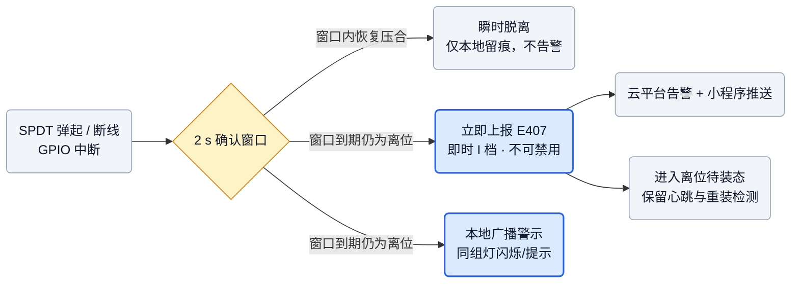

#### 4.12.3 防拆需求

| ID      | 需求描述                                                                                                                                                                            | 优先级 | 验收口径                         |
| ------- | ------------------------------------------------------------------------------------------------------------------------------------------------------------------------------- | --- | ---------------------------- |
| FR-1201 | 背部须为 SPDT 检测开关（选型与公差判据见 4.12.1）：设备与支架分离即弹起，产生硬件中断，不依赖软件轮询推断；**开关只接检测回路（COM 接地、NC 接 GPIO），不得串接电源或负载**。                                                                                     | P0  | 分离后 ≤5 s 产生信号；检测回路与电源回路独立，装配签核     |
| FR-1202 | 单判据 + **2 s 确认窗口**：开关弹起后 2 s 内恢复压合判"瞬时脱离"，只本地留痕不告警；到期仍弹起判"真实离位"。不依赖加速度计。                                                                                                        | P0  | 模拟碰动 50 次误报 0；模拟拿走 20 次全部告警  |
| FR-1203 | 触发后立即上报 E407（即时档、不可禁用、必须 ACK），载荷带原因码分三类：DETACH\_MANUAL（疑似人为，布防时段内且拆卸后快速消失，置信度中）/ DETACH\_ADHESIVE（疑似贴装失效，无人时段发生且离位后仍在原网关信号范围内，置信度低）/ DETACH\_UNKNOWN；平台按"疑似"展示并支持现场确认回填，不承诺精确区分 | P0  | 20 次拆卸，云端均收到且原因码正确           |
| FR-1204 | 触发后同时发本地广播警示（同组灯闪烁或提示），保证断网时现场也有反馈。                                                                                                                                             | P0  | 断云状态下现场可见警示                  |
| FR-1205 | **离位不断电**：确认窗口到期后必须立即完成 E407 上报；上报后进入"离位待装态"（停用与安装位置相关的检测/执行，保留心跳与重装检测），重新压合后自动恢复。若同时处于低电，按 Last Gasp 优先保告警。                                                                         | P0  | 拔下后 20 次均收到告警；待装态可读；重装后 60 s 内恢复 |
| FR-1206 | 支持**带时限维护模式**：小程序开启后默认 30 min（可配 5–120 min）内离位不告警、仅留痕，到期自动恢复布防；维护模式状态在设备与平台双记录                                                                                                  | P1  | 撤防时段拆卸不告警但留痕                 |
| FR-1207 | 防拆状态参与运维展示：在位、离位、疑似、已告警四态，可在诊断快照中读出。                                                                                                                                            | P0  | 四态均可构造并正确显示                  |
| FR-1208 | 电池仓/壳体防非授权开启：若壳体开启能触发同一 SPDT，则等同离位处理；若不在该开关检测范围内，须增设独立检测点，否则本条不适用。工具规格写入施工手册。                                                                                                     | P1  | 徒手无法开启；能触发时产生信号；不适用时书面说明      |
| FR-1209 | 防拆不得因低电、OTA、配置下发而失效；OTA 期间沿用原状态判断。                                                                                                                                              | P0  | 低电与升级期间拆卸仍告警                 |
| FR-1210 | 确认窗口参数化：窗口 1–10 s（默认 2 s）、去抖 200 ms、连续 2 次采样一致；参数随配置下发并可读回。**不设"收尾窗口"**，离位后不主动断电。                                                                                                | P0  | 参数可配可读回；去抖后误报 0              |
| FR-1211 | **不配置加速度计**：成本 1.5–2.5 元/台与其增益不匹配；误报抑制由机械压缩量、2 s 确认窗口、维护模式三层承担（见 4.12.1）。                                                                                                       | P0  | BOM 无加速度计；三层措施逐项验证           |

**与"掉落"的区分**：胶贴失效导致的脱落同样产生离位信号。不配加速度计后只能靠"发生时段"与"离位后信号是否仍存续"做倾向性标注（见 FR-1203 的三类原因码），无法精确区分。因此平台按"疑似"展示并要求现场确认，避免运维把"胶没粘牢"当成"有人偷设备"。安装侧的对策是：禁用基材清单 + 现场拉拔试验 + 卡扣/螺接备选（见 5.5 与 6.2）。

### 4.13 红外控制（FR-13xx）

**要点**：这是本机全部复杂度的来源。它要同时解决四件事——**发什么（码库）、怎么发（发射与幂等）、发完算不算成功（结果与证据）、以及"现在空调到底什么状态"（推定）**。

#### 4.13.1 码库与机型适配

| 来源 / 层级   | 内容                        | 约束                                  |
| --------- | ------------------------- | ----------------------------------- |
| **开源码库**  | GitHub 社区维护的红外码集，导入后统一归一化 | 仅接受宽松许可证；须登记仓库与版本；去重后入库             |
| **现场补充**  | 现场采集后统一入库、以码型包形式下发        | 采集工装与审批在外部完成，本机只接收合格码型包             |
| 预置码库      | 出厂内置：开源精选 + 已采集码型的稳定子集    | 受 Flash 512 KB 限制，容量上限见 D-03          |
| 项目码库      | 云端按项目机型清单下发               | 版本化；增量更新；与固件内置包共用版号                 |
| 试码        | 同一机型尝试多个候选码型，由现场确认        | 单点 ≤3 次应通过                          |
| 自学习（P2）   | 设备直接学习原遥控器波形，存 16 个波形槽    | 兜底手段，不替代码库                          |

| ID      | 需求描述                                                     | 优先级 | 验收口径                  |
| ------- | -------------------------------------------------------- | --- | --------------------- |
| FR-1301 | 码库按"品牌 + 机型 + 码型 ID + 版本"组织，设备可按机型检索可用码型。               | P0  | 检索命中率按项目清单 ≥95%       |
| FR-1302 | 支持候选码型列表与试码流程：依次发射候选帧，由现场确认后锁定该码型。                      | P0  | 单点试码 ≤3 次通过率 ≥90%     |
| FR-1303 | 码型锁定后写入配置并绑定该点位；换机/换点位须重新确认。                             | P0  | 换绑后旧码型不沿用             |
| FR-1304 | 码库容量不足时，优先保留本项目已用码型，其余按使用频次淘汰。                           | P1  | 构造空间不足，已用码型不丢         |
| FR-1305 | 无匹配码型时明确降级：只上报环境，不显示"可控"，并报 E704。                       | P0  | 平台显示"不可控"而非"控制失败"     |
| FR-1306 | 学习模式（P2）：录制原遥控器波形并存槽，回放验证通过后可用。                         | P2  | 学习成功率按机型记录            |

##### 4.13.1.1 码库来源与准入

码库是本机唯一可能踩到**知识产权**的资产。两个来源的性质完全不同，管理方式也必须不同：

| 来源        | 性质           | 主要风险                          | 管理重点                |
| --------- | ------------ | ----------------------------- | ------------------- |
| GitHub 开源码库 | 社区共享，质量参差    | **许可证传染性**、字段不规范、重复与错误码型      | 许可证白名单 + 归一化 + 抽检   |
| 现场采集后入库   | 自建资产，最贴近真实机型 | 采集质量、脏数据入库                    | 由工具链保证；本机只接收校验通过的码型包 |

**许可证只认宽松型**。这是一条法务红线，不是偏好：

| 许可证                                                     | 能否直接编入闭源固件 | 处置                       |
| ------------------------------------------------------- | ---------- | ------------------------ |
| MIT / BSD-2 / BSD-3 / Apache-2.0 / CC0 / Unlicense       | 可以         | 保留版权声明与来源记录              |
| LGPL                                                    | 有条件        | 需法务逐案评估；本机 Flash 紧张，不建议动态链接方案 |
| GPL-2.0 / GPL-3.0 / AGPL                                 | **不可以**    | 从码集中剔除；或仅作参考、由我方重新采集验证后入库 |

> 实务提醒：很多 GitHub 红外码库是"数据仓库"而非"软件仓库"，作者常直接标 MIT 或 CC0；但也有仓库把码表放在 GPL 项目里。**导入前必须逐个仓库看 LICENSE 文件，不能只看 README 的措辞**。

| ID      | 需求描述                                                                          | 优先级 | 验收口径                  |
| ------- | ----------------------------------------------------------------------------- | --- | --------------------- |
| FR-1307 | 开源码库导入执行许可证白名单：仅接受 MIT/BSD/Apache-2.0/CC0/Unlicense；GPL 类一律剔除。                | P0  | 逐仓库出具许可证判定记录，无例外      |
| FR-1308 | 每个码库来源须登记：仓库地址、commit/版本、许可证、导入日期、审阅人、原始文件哈希。                                 | P0  | 任一条码型可反查到来源与版本        |
| FR-1309 | 导入后统一归一化：载波频率、占空比、帧结构、位长、引导码/结束码、重复次数，字段规范一致。                                 | P0  | 归一化后 100% 通过格式校验      |
| FR-1310 | 去重与冲突处理：同一"品牌+机型+功能"多来源冲突时，标记冲突并按实机验证结果取一。                                   | P0  | 冲突清单可见，未验证的冲突码不入预置库   |
| FR-1311 | 开源码库实机抽检：抽检比例 ≥10%，用样机验证发射有效；不合格批次整批退回。                                       | P0  | 抽检记录与结论可查             |
| FR-1312 | 码型来源标记：`OPEN_SOURCE` / `FIELD_CAPTURE` / `VENDOR`，随码型 ID 存储并可反查。                | P0  | 任一码型可显示来源类型与凭据        |

##### 4.13.1.2 码型包接收侧

现场遇到"执行失败"，本质是码库里没有这台空调的正确码型。补码途径有两条：开源码库导入（4.13.1.1），以及现场采集后统一入库。

> **范围说明**：现场采集所用的收码工具、后台归一化与入库审批，属 FAE 现场工装与码库平台的职责，**不在本 PRD 范围**。本机只负责"接收码型包 → 校验 → 写入 → 标记来源 → 必要时回滚"。

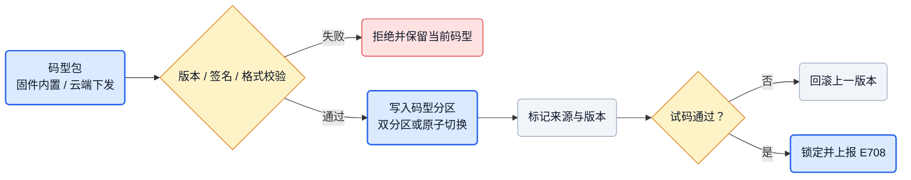

| ID      | 需求描述                                              | 优先级 | 验收口径              |
| ------- | ------------------------------------------------- | --- | ----------------- |
| FR-1313 | 码型包双轨分发：固件内置包（随版本）与云端码库包（增量），共用同一版号与格式。           | P0  | 两轨下发的同版码型行为一致     |
| FR-1314 | 码型包回滚：新包导致失效时可回退上一版本，回退后已锁定码型仍可用。                 | P0  | 注入坏包，回滚后控制恢复      |
| FR-1315 | 码型包与固件版本兼容性校验：不兼容的包拒绝写入并回原因码，不得"半写入"。            | P0  | 构造不兼容包，原码型完好      |
| FR-1316 | 码型分区容量不足时拒绝新包并上报，不得覆盖已锁定的在用码型。                    | P0  | 构造满载，已锁定码型不丢      |

> 采集工装与审批虽不在本机范围内，但有一条会回流到产品：**新码型必须能通过云端增量包下发到已装机设备**，否则每补一次码就要等一个固件版本。这就是 FR-1313 存在的理由。

#### 4.13.2 发射与幂等

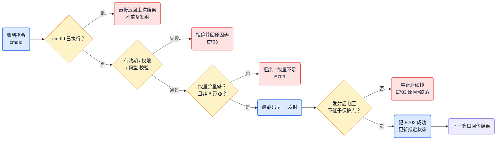

| ID      | 需求描述                                                          | 优先级 | 验收口径                     |
| ------- | ------------------------------------------------------------- | --- | ------------------------ |
| FR-1317 | 幂等：以 `cmdId` + 目标 + 码型版本 + 有效期去重；重复到达只执行一次，返回同一结果。           | P0  | 重复投递 20 次，仅 1 次发射        |
| FR-1318 | 重复点击抑制：同一用户同一动作在 3 s 内重复提交，只执行一次。                            | P0  | 连点 5 次，动作 1 次            |
| FR-1319 | 发射失败重试：同一 `cmdId` 最多重试 2 次，间隔 ≥1 s；仍失败记终态。                    | P0  | 构造遮挡，重试次数与终态正确          |
| FR-1320 | 码型规定的重复帧（部分空调要求连发 2～3 次）由固件按码型参数执行，不计入业务重试次数。                | P0  | 抓包帧数与码型定义一致             |
| FR-1321 | 发射电流、载波频率（38 kHz）、占空比在码型允许误差内；不同品牌差异由码型参数表驱动，不硬编码。          | P0  | 示波器抽测 5 个品牌码型           |
| FR-1322 | 发射结果必须在下一收件窗口回传（E702/E703），不得等下一次心跳。                          | P0  | 云端可见时延 ≤1 个收件周期          |
| FR-1323 | **红外只允许由超容供电**：电池支路与 IR 驱动物理隔离，B 形态下禁止发射；软件不得绕过。            | P0  | B 形态下发指令被拒；示波器验证无电池脉冲电流  |
| FR-1324 | 发射前校验超容电压：低于 `irMinV`（候选 3.0 V）拒绝发射并回原因码；不得"先发再掉电"。         | P0  | 拉低电压后下发，拒绝且原因码正确         |
| FR-1325 | 单帧发射后超容压降超预算（候选 >5 mV）时，暂停后续帧并上报储能异常（E307）。                 | P1  | 构造老化超容可触发               |

#### 4.13.3 为什么坚持"完整状态帧"

部分码库支持"只发温度+"这种增量键。看似省电，实则是**漂移的加速器**：一旦有一条指令没送到，后续所有增量都建立在错误基线上。

| 方式      | 单帧长度      | 能耗 | 漂移风险             | 结论    |
| ------- | --------- | -- | ---------------- | ----- |
| 增量键（只发温度+） | 短         | 低  | 高：一次丢失，后续全错      | 不采用   |
| 完整状态帧   | 长（约 2～3 倍） | 中  | 低：每次都是全量对齐       | **采用** |

| ID      | 需求描述                                                | 优先级 | 验收口径              |
| ------- | --------------------------------------------------- | --- | ----------------- |
| FR-1326 | 所有控制指令一律下发完整状态帧，包含开关、模式、目标温度、风速、扫风等支持字段。            | P0  | 20 次连续操作的帧内容自洽    |
| FR-1327 | 码型不支持某字段时（如无扫风），按码型能力表裁剪并在结果中注明"字段未支持"。            | P0  | 结果字段与码型能力一致       |

#### 4.13.4 单向红外的推定状态

**这是本机最容易出事、也最需要讲清的地方**。空调不会回话，所以"空调现在开没开"永远是推断出来的。

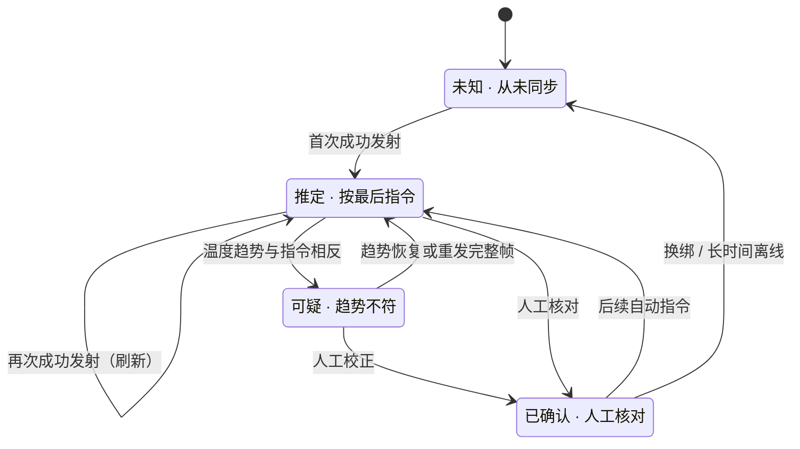

| 置信度 | 含义          | 平台展示             | 能否用于自动控制     |
| --- | ----------- | ---------------- | ------------ |
| 已确认 | 人工核对过实际状态   | "已确认（操作人/时间）"    | 可以           |
| 推定  | 按最后成功发射推算   | "推定（最后指令时间）"     | 可以，但需标注      |
| 可疑  | 温度趋势与推定不符   | "可疑（建议核对）"       | **不用于自动反向调整** |
| 未知  | 从未同步或长期离线   | "未知"             | 不可以          |

| ID      | 需求描述                                                           | 优先级 | 验收口径                |
| ------- | -------------------------------------------------------------- | --- | ------------------- |
| FR-1328 | 维护推定状态：开关、模式、目标温度、风速、扫风、最后同步时间、置信度、来源。                          | P0  | 字段完整，随心跳上报摘要        |
| FR-1329 | **不得把推定状态显示为实测状态**：所有界面必须标注"推定/已确认/可疑/未知"。                     | P0  | 界面走查，无"已开启"等无来源表述   |
| FR-1330 | 状态来源分三类：云端指令、本地规则、人工校正；每次变更记录来源与 `cmdId`。                      | P0  | 任一状态可回溯到具体来源        |
| FR-1331 | 重启、掉电、换绑后推定状态置"未知"，不得沿用旧值。                                     | P0  | 断电重启后显示未知           |

#### 4.13.5 漂移检测与自愈

漂移的三大来源：**人用原装遥控器、空调自身保护停机、断电**。本机不能"看见"，但可以"推断"。

| 手段       | 做法                              | 能发现什么                |
| -------- | ------------------------------- | -------------------- |
| 完整状态帧    | 每次全量对齐                          | 防止增量累积误差             |
| 温度趋势交叉验证 | 下发制冷后 15 min 内温度未下降 ≥0.5 ℃ → 标"可疑" | 指令未生效、被遥控器改回、空调故障    |
| 定期全量对齐   | 每日一次或每次开机后重发当前推定状态              | 静默漂移                 |
| 人工校正     | 小程序选择实际状态 → 重发完整帧               | 一切无法自动判断的情况          |

| ID      | 需求描述                                                            | 优先级 | 验收口径            |
| ------- | --------------------------------------------------------------- | --- | --------------- |
| FR-1332 | 温度趋势验证：制冷/制热指令后 T\_verify（默认 15 min）内温度未朝预期方向变化 ≥0.5 ℃，标"可疑"并报 E706。 | P0  | 构造遮挡/断电空调，可稳定触发 |
| FR-1333 | 连续 N 次（默认 3 次）发射后温度均无响应，报 E707（疑似未对准或空调故障）。                       | P0  | 遮挡 IR 或关空调电源，可稳定触发 |
| FR-1334 | 每日首次唤醒或每 24 h 重发一次当前推定状态，作为静默对齐。                                | P1  | 对齐记录可查          |
| FR-1335 | 人工校正后必须重发完整帧，并把置信度置"已确认"；校正记录含操作人与时刻。                            | P0  | 校正后状态与空调实际一致    |
| FR-1336 | 检测到"外部操作"的间接证据（温度突变且无本机指令记录）时，标"可疑"，不擅自改状态。                       | P1  | 用手动遥控器操作后可触发可疑  |

#### 4.13.6 温控闭环与压缩机保护

| 参数       | 默认    | 范围      | 说明                |
| -------- | ----- | ------- | ----------------- |
| 目标温度     | 26 ℃  | 16～30 ℃ | 制冷/制热分别设定         |
| 回差       | 1 ℃   | 0.5～2 ℃ | 防抖                |
| 最小启停间隔   | 3 min | 3～10 min | 压缩机保护，硬约束         |
| 每小时启停上限  | 6 次   | 3～10 次  | 防频繁启停             |
| T\_verify | 15 min | 5～30 min | 趋势验证窗口            |
| T\_vacant | 30 min | 10～120 min | 无人关空调延时（需人体条件）    |

| ID      | 需求描述                                        | 优先级 | 验收口径             |
| ------- | ------------------------------------------- | --- | ---------------- |
| FR-1337 | 最小启停间隔与每小时上限为**硬约束**，任何配置（含云端批量下发）不得突破。      | P0  | 尝试下发 1 min 间隔被拒  |
| FR-1338 | 制冷与制热的目标温度、回差分别配置，切换模式时重新校验限制。              | P0  | 模式切换后参数正确        |
| FR-1339 | 达到目标温度后停止压缩机（发"关"或"送风"），不得长期低频运行。           | P1  | 稳态后不再持续制冷        |
| FR-1340 | 违反硬约束时记录 E709 并回原因码，不得静默丢弃。                 | P0  | 拒绝原因可查、可统计       |

#### 4.13.7 安全红线（不得实现）

| 红线                                | 原因                          |
| --------------------------------- | --------------------------- |
| 不得控制电辅热、变频模块参数等厂家专用高危指令            | 误操作可能损坏设备或引发安全风险            |
| 不得在无人值守时下发"强力/极速"类高负荷模式并长时间保持      | 能耗与设备寿命风险                   |
| 不得绕过最小启停间隔"抢开"                     | 压缩机损坏风险                     |
| 不得向未绑定空间发射                         | 越权控制，等同入侵                   |
| 不得在码库未确认的机型上"盲发"                  | 可能误触发其他设备（见 4.9 的串扰）       |

| ID      | 需求描述                                              | 优先级 | 验收口径          |
| ------- | ------------------------------------------------- | --- | ------------- |
| FR-1341 | 码库只允许包含"开关/模式/温度/风速/扫风/睡眠"等白名单字段；高危指令不得入库。         | P0  | 码库审查，无高危字段    |
| FR-1342 | 未完成试码确认的机型，只能发射"开关"测试帧，不得发射温控帧。                    | P0  | 未确认机型下发调温被拒   |

#### 4.13.8 发射性能要求

| ID      | 需求描述                                          | 优先级 | 验收口径          |
| ------- | --------------------------------------------- | --- | ------------- |
| FR-1343 | 视距 3 m、偏角 ≤30°、常温条件下，单次发射成功率 ≥99%。             | P0  | 每机型 100 次，失败 ≤1 |
| FR-1344 | 发射距离：正视 5 m 内可用；反射路径 3 m 内可用（视基材）。             | P1  | 逐距离实测并记录      |
| FR-1345 | 发射角：水平 ±30°、垂直 ±20° 内有效；超出范围应提示"未对准"。          | P0  | 逐角度实测         |
| FR-1346 | 连续发射后的 LED 温升与驱动温升不超器件限值；不得因过热降功率而导致后期失败。      | P0  | 连续 100 帧后测温    |
| FR-1347 | 单帧能耗 ≤50 mJ（200 ms、占空 1/3、峰值 200 mA 口径），超预算须硬件复核。 | P0  | 示波器积分实测       |

## 05 非功能需求

**要点**：本机比同系列多两类非功能风险——**光生物安全**（发射管对着人）与**脉冲负载可靠性**（每次发射都是一次小型冲击）。

### 5.1 安规（Safety）

| 编号      | 项目        | 依据标准                           | 要求                                            | 验收           |
| ------- | --------- | ------------------------------ | --------------------------------------------- | ------------ |
| NFR-101 | 整机安全      | GB 4943.1-2022（等同 IEC 62368-1） | 按 ES1 能量源设计；可触及部件无危险电压；外壳阻燃等级不低于 V-1（建议 V-0）  | 第三方报告        |
| NFR-102 | 超容储能安全    | 按元器件 + 整机能量评估                  | 20 F 超容储能量按 ES2 评估：端子防直接短路、防反接；维修/报废前须放电至安全电压 | 设计评审 + 短路试验  |
| NFR-103 | USB 输入安全  | GB 4943.1 + 整机                 | 5 V SELV 输入；限流 ≤300 mA；防反灌；劣质适配器接入不得损坏电路或起火   | 反灌与过流试验      |
| NFR-104 | 一次锂电池安全   | GB 8897.4（等同 IEC 60086-4）      | CR2450 具备防反充隔离、防短路；**须验证发射瞬间脉冲不倒灌电池**         | 电池厂报告 + 脉冲试验 |
| NFR-105 | 温升        | GB 4943.1                      | 常温满载与 USB 边充边发工况下，可触及表面温升不超过限值                | 热电偶实测        |
| NFR-106 | 机械安全      | 整机                             | 无锐边、无夹手风险；支架承重 ≥3 倍整机重量；吊顶安装件防坠               | 拉力与结构评审      |
| NFR-107 | 标识与警示     | 整机                             | 铭牌含型号、电气参数、厂名、生产批次；电池与超容警示语；回收标识              | 铭牌评审         |
| NFR-108 | **红外光生物安全** | IEC 62471 / GB/T 20145         | 整机按 **豁免类（Class 1）** 评估：正常使用与近距离（≥20 cm）直视均不超限值；最坏工况（最高占空/最长帧/满电超容）送测 | **第三方检测报告**（不接受自测） |

### 5.2 EMC（电磁兼容）

本机射频压力与 SKU3 相当（仅 BLE），但多了两个干扰源：**38 kHz 红外载波的谐波**与**百毫安级脉冲电流**。前者是发射问题，后者是抗扰与电源完整性问题。

#### 5.2.1 EMI（发射）

| 编号      | 项目          | 依据标准                            | 限值/要求                             |
| ------- | ----------- | ------------------------------- | --------------------------------- |
| NFR-111 | 辐射骚扰        | GB/T 9254.1（等同 CISPR 32）Class B | 30 MHz～1 GHz、1～6 GHz 满足 Class B 限值 |
| NFR-112 | 传导骚扰        | GB/T 9254.1 Class B             | USB 供电经适配器时，电源端满足 Class B 限值        |
| NFR-113 | 谐波电流        | GB/T 17625.1                    | 若配套适配器功率 \>75 W 需评估；本机本身不适用        |
| NFR-115 | BLE 邻道与占用带宽 | 按 SRRC 型号核准要求                   | 2.4 GHz 频段功率、占用带宽、带外发射满足微功率设备要求    |
| NFR-116 | 红外载波谐波      | GB/T 9254.1                     | 38 kHz 载波的高次谐波不得导致 30 MHz～1 GHz 辐射超标；必要时加 RC 吸收与屏蔽 |

#### 5.2.2 EMS（抗扰）

| 编号      | 项目           | 依据标准          | 试验等级                               | 判定                            |
| ------- | ------------ | ------------- | ---------------------------------- | ----------------------------- |
| NFR-121 | 静电放电 ESD     | GB/T 17626.2  | 接触放电 ±4 kV，空气放电 ±8 kV              | 判据 B：可自恢复、不丢配置、**读数不跳变、不误发射** |
| NFR-122 | 电快速瞬变脉冲群 EFT | GB/T 17626.4  | 电源端 ±2 kV，信号/控制端 ±1 kV             | 判据 B；不产生虚假事件                 |
| NFR-123 | 浪涌 Surge     | GB/T 17626.5  | 线-线 ±1 kV；配适配器时线-地 ±2 kV           | 判据 B；不得永久损坏                   |
| NFR-124 | 射频辐射抗扰 RS    | GB/T 17626.3  | 80 MHz～1 GHz，3 V/m；1～6 GHz 按产品定位加测 | 判据 A：读数不异常、不误发射、不误报防拆          |
| NFR-125 | 射频传导抗扰 CS    | GB/T 17626.6  | 0.15～80 MHz，3 V                    | 判据 A                          |
| NFR-126 | 工频磁场         | GB/T 17626.8  | 3 A/m                              | 判据 A                          |
| NFR-127 | 电压暂降与短时中断    | GB/T 17626.11 | 按适配器工况；USB 插拔瞬断不得复位丢配置              | 判据 B                          |
| NFR-128 | 抗光源频闪        | 整机            | 100 Hz / 120 Hz 调光频闪下静置 1 h        | 照度读数波动 ≤±10%，不触发误事件           |
| NFR-129 | 脉冲负载抗扰       | 整机            | 连续 100 帧发射，监测 MCU 复位与 BLE 断链       | 复位 0 次；BLE 断链 0 次             |

**本机不适用项**：本机无 24 GHz 雷达通道，雷达杂散相关试验项不适用；红外载波谐波另见 NFR-116。

**特别提示**：ESD 与 RS 试验时必须同时观察**读数、防拆信号与红外驱动**——如果静电或射频让红外驱动误动作，现场表现就是"空调自己开了"，这比不动作更严重。因此 NFR-121/124 的判定标准中加入"不误发射"。

### 5.3 无线与频谱合规

| 编号      | 区域   | 项目         | 要求                                        |
| ------- | ---- | ---------- | ----------------------------------------- |
| NFR-131 | 中国大陆 | SRRC 型号核准  | 2.4 GHz BLE 须取得无线电发射设备型号核准证；红外发射管不属无线电发射设备 |
| NFR-132 | 中国大陆 | 微功率设备技术要求  | 2.4000～2483.5 GHz 满足微功率短距离设备限值；本机无雷达通道     |
| NFR-133 | 中国香港 | 无线电管理      | 2.4 GHz 一般属免牌照类别；保留测试报告备查                  |
| NFR-134 | 通用   | 频率容限与功率稳定性 | 全温区频率偏移、功率波动在核准限值内                        |
| NFR-135 | 通用   | 天线         | 板载天线，不可外接；不得用户自行更换（否则核准失效）                |

**本机无 24 GHz 通道，不涉及 SKU2 的频谱准入风险；但多一项红外光生物安全检测（NFR-108）。**

### 5.4 合规（中国大陆 / 中国香港）

#### 5.4.1 中国大陆

| 编号      | 合规项   | 要求                                                                     |
| ------- | ----- | ---------------------------------------------------------------------- |
| NFR-141 | 无线电   | SRRC 型号核准（见 5.3）；铭牌标注核准代码                                              |
| NFR-142 | 有害物质  | 满足 GB/T 26572 限量要求，提供 RoHS 报告与符合性声明                                    |
| NFR-143 | 电池    | 满足 GB 8897.4；提供 MSDS；不得使用汞、镉超限电池                                       |
| NFR-144 | 数据与隐私 | 遵循《个人信息保护法》《数据安全法》《网络安全法》：只采集空间级存在与照度，不采集影像、音频、身份信息；采集目的、范围、保留期须在告知中明示 |
| NFR-145 | 告知与同意 | 安装在有人活动的空间时，须提供可见的告知方式（点位说明、隐私告知卡、物业公示模板）                              |
| NFR-146 | 宣传口径  | 不得使用绝对化用语（最/第一/顶级）；不得宣称医疗、健康功效；节能率须标注工况与口径                             |

#### 5.4.2 中国香港

| 编号      | 合规项  | 要求                                                 |
| ------- | ---- | -------------------------------------------------- |
| NFR-147 | 无线电  | 按 OFCA 要求确认免牌照条件或申请相应许可；保留测试报告备查                   |
| NFR-148 | 个人资料 | 遵循《个人资料（私隐）条例》（PDPO）：收集目的明确、最小必要、保留期不超必要；提供查阅与更正渠道 |
| NFR-149 | 电气安全 | 参照 IEC 62368-1 体系；USB 适配器如随货，须符合当地安全要求             |
| NFR-150 | 标识   | 英文/繁体中文双语标识与警示语；回收与电池处置说明                          |

#### 5.4.3 两区域差异处理

| 差异点  | 大陆        | 香港          | 处理方式            |
| ---- | --------- | ----------- | --------------- |
| 无线准入 | SRRC 强制   | OFCA 免牌照/许可 | 分别送测，共用技术文件     |
| 语言   | 简体中文      | 繁体中文 + 英文   | 铭牌与手册分版印刷       |
| 隐私法规 | PIPL 为主   | PDPO 为主     | 告知模板分版，最小采集口径统一 |
| 包装   | 需 RoHS 标识 | 需回收说明       | 包装版型分区域，机身共用    |

### 5.5 环境与可靠性

| 编号      | 项目       | 要求                      | 说明                                    |
| ------- | -------- | ----------------------- | ------------------------------------- |
| NFR-161 | 工作温度     | -10～55 ℃                | 低温会使红外 LED 效率下降，须在 -10 ℃ 验证 3 m 发射成功率 |
| NFR-162 | 存储温度     | -20～70 ℃                | 超容低温容量衰减、电池高温自放电需评估                   |
| NFR-163 | 工作湿度     | 10%～95% RH（非凝露）         | 凝露会使湿度读数饱和、发射窗结露影响透射                  |
| NFR-164 | 防护等级     | IP30（设计目标），透气膜窗满足 IP30 粉尘阻挡 | USB 口与开关凹槽开盖状态不计入                     |
| NFR-165 | 胶贴可靠性    | 常温 5 年不脱落；持粘力 ≥3 倍整机重量  | 乳胶漆/瓷砖/金属/木饰面四基材分别验证                  |
| NFR-166 | 透气膜寿命    | 5 年内透气率衰减 ≤20%，不堵塞      | 高粉尘环境需清洁维护提示                          |
| NFR-167 | 支架与安装件   | 振动中不松脱、不偏转；俯仰锁定可靠        | 与防拆方案、红外对准联动                          |
| NFR-168 | 开关寿命     | ≥5000 次，老化后接触电阻 ≤300 mΩ | 镀金触点；振动中不得自行跳变                        |
| NFR-169 | USB 插拔寿命 | ≥500 次；长期插电 ≥2 年无异常     | 验证超容浮充寿命、发热、接口氧化                      |
| NFR-170 | 包装跌落     | 按 ISTA 1A/2A 执行         | 发射窗、透气膜与支架为易损件                        |
| NFR-171 | 外观隐私     | 无镜头形态、无麦克风孔、无可见工作灯      | 盲测 10 人，≥9 人不认为是摄像设备                  |
| NFR-172 | 发射窗耐久    | 5 年内透红外衰减 ≤10%          | 紫外线、清洁剂、粉尘后复测                          |

### 5.6 性能指标

| 编号      | 指标         | 口径                       | 目标值                    |
| ------- | ---------- | ------------------------ | ---------------------- |
| NFR-181 | 照度精度       | 0～2000 lux，标定后与标准照度计比对   | ±15%                   |
| NFR-182 | 照度量程       | 可测范围                     | 0.01～83000 lux；超量程标记无效 |
| NFR-183 | 照度响应（标准档）  | 0→500 lux 阶跃到事件发出        | P95 ≤10 s              |
| NFR-184 | 照度响应（快响应档） | 同上，采样 1～2 s              | P95 ≤3 s               |
| NFR-185 | 温度精度       | 15～35 ℃ 区间与标准温度计比对       | ±0.5 ℃（系统级）           |
| NFR-186 | 湿度精度       | 20～80 %RH 区间比对           | ±3 %RH（系统级）           |
| NFR-187 | 温度响应       | 20→30 ℃ 阶跃到事件发出          | P95 ≤5 min             |
| NFR-188 | 湿度响应       | 30→60 %RH 阶跃到事件发出        | P95 ≤10 min            |
| NFR-189 | 外壳热时间常数    | 阶跃响应达 63% 的时间            | ≤3 min                 |
| NFR-190 | 典型平均电流     | 10 帧/日、标准档采样            | ≤13 µA                 |
| NFR-191 | 无光续航（仅超容）  | 满电 3.5 V 放电至保护点，无红外发射    | ≥30 天                  |
| NFR-192 | 纯电池续航      | 完全无光、仅感知与心跳、50% 放电深度    | ≥2 年                   |
| NFR-193 | USB 补电时长   | 边充边采，2.5→3.5 V           | <10 min                |
| NFR-194 | 校时精度       | 单跳 2.4 GHz              | 门限 100 ms；校后 <20 ms    |
| NFR-195 | 配置回读一致率    | 逐条下发后读回                  | 100%                   |
| NFR-196 | 防拆告警时延     | 离开支架 → 上报                | ≤5 s                   |
| NFR-197 | 单帧发射成功率    | 视距 3 m、偏角 ≤30°、常温        | ≥99%                   |
| NFR-198 | 云控响应       | 云端受理 → 第一帧有效发射           | 目标 ≤30 s；上限 ≤60 s      |
| NFR-199 | 发射角        | 水平 / 垂直                  | ±30° / ±20° 内有效        |
| NFR-200 | 发射距离       | 正视 / 反射                  | 5 m / 3 m              |
| NFR-201 | 单帧能耗       | 200 ms、占空 1/3、峰值 200 mA  | ≤50 mJ                 |
| NFR-202 | 满电超容帧数     | 3.5→2.7 V 可用能量折算         | ≥1000 帧（按 44 mJ/帧，待实测） |
| NFR-203 | 快捷收件平均电流   | 60 s 档、10 ms 窄窗          | ≤2 µA                  |

### 5.7 寿命与可维护性

| 项       | 目标                          | 前提                  |
| ------- | --------------------------- | ------------------- |
| 整机服务期   | 有条件的五年（可用率按场景核算）            | 允许按计划 USB 补能；不等于免维护 |
| 超容      | 5 年内可用能量衰减 ≤20%             | 避免长期满充高温；脉冲负载会加速衰减  |
| 备用电池    | 有光场景基本不消耗；低光场景 1.5～2 年需更换   | 更换后须校时并恢复配置（FR-606） |
| 码库      | 支持云端增量更新，不依赖固件版本            | 码型包可回滚              |
| 标定有效期   | 建议 24 个月复标一次                | 平台按时间提醒；换机/移位须重标    |
| 维护方式    | 远程诊断为主，清洁与补能为辅，换机为兜底        | 90% 异常可远程判定         |

## 06 测试与验收

### 6.1 验收矩阵

| 域      | 覆盖需求                        | 关键用例                 | 通过标准                                |
| ------ | --------------------------- | -------------------- | ----------------------------------- |
| 组网与鉴权  | FR-301～FR-309               | TC-01～03、TC-35、TC-55 | 两条路径均可入网；伪造/扫 A 装 B 全拦截              |
| 红外控制   | FR-1301～FR-1347             | TC-80～TC-92         | 试码 ≥90%；单发 ≥99%；状态标注正确；压缩机保护不破       |
| 环境采样   | FR-1001～FR-1011             | TC-10～18、TC-51       | 照度 ≤10 s；温湿度响应达标；五类有效性正确            |
| 选点与对准  | FR-1101～FR-1112             | TC-11～13、TC-51、TC-80 | 试码通过率 ≥90%；未对准可识别                   |
| 能源     | FR-101～FR-112               | TC-20～23、TC-66～75    | 三态电流达标；B 形态红外停发；末次上报 ≥95%           |
| 通信与安全  | FR-201～FR-211               | TC-29、TC-49、TC-55    | 三通道互不阻塞；重放无效；无明文降级                  |
| 事件     | FR-401～FR-406               | TC-44、TC-45、TC-48    | 逐条可配可读回；硬约束拒绝率 100%；补报排序 100%       |
| 心跳与收件  | FR-501～FR-507、FR-520～FR-528  | TC-04、TC-47、TC-85    | 三周期判离线；云控 30/60 s 达标；断信标退化正确         |
| OTA    | FR-701～FR-706               | TC-24～26、TC-57       | 断点续传成功；断电 100 次不变砖；码库不丢             |
| 运维与超管  | FR-801～FR-809               | TC-33、TC-36、TC-44    | 会话限时生效；试码触发可用                       |
| 联动     | FR-901～FR-909               | TC-28、TC-31、TC-51    | 断云可用；无人不误关；无人体条件时降级正确               |
| 防拆     | FR-1201～FR-1211             | TC-64、TC-65          | 拆卸 ≤5 s 告警；碰动 50 次误报 0              |
| 认证     | NFR-101～NFR-172             | TC-38～42、TC-61～65    | 两区域报告齐备；光生物安全 Class 1                |

### 6.2 关键专项测试

| \#  | 专项         | 方法                              | 判定                       |
| --- | ---------- | ------------------------------- | ------------------------ |
| 1   | 试码通过率      | 20 个品牌机型，每点最多 3 次候选             | ≥90% 在 3 次内锁定            |
| 2   | 单发成功率      | 每机型 100 次，3 m / ≤30°            | 失败 ≤1 次                  |
| 3   | 角度与距离      | 水平 ±30°/±45°，垂直 ±20°，1/3/5 m   | 超范围提示"未对准"；范围内达标          |
| 4   | 遮挡与反射      | 遮挡发射窗；朝浅色墙反射                   | E707 可触发；反射路径 3 m 内可用      |
| 5   | 脉冲供电       | 示波器测电池支路与超容电压                   | 电池无脉冲电流；单帧压降 ≤5 mV        |
| 6   | B 形态禁发     | 切 B 形态后下发控制                     | 100% 拒绝；状态标"不可控"           |
| 7   | 幂等与重试      | 重复投递 20 次；连点 5 次；构造失败            | 仅 1 次发射；重试 ≤2 次           |
| 8   | 推定状态       | 遮挡、断电、原装遥控器改回、人工校正              | 四态流转正确；不显示"实测"            |
| 9   | 压缩机保护      | 下发 1 min 间隔；1 h 内第 7 次启停          | 全部拒绝并记 E709               |
| 10  | 云控响应       | 刚错过时隙 / 批量 10 条并发               | P95 ≤30 s；上限 ≤60 s         |
| 11  | 快捷收件能耗     | 60 s 档连续 24 h                    | 平均 ≤2 µA；开窗 ≤20 ms        |
| 12  | 码库许可证      | 逐仓库核对 LICENSE                   | GPL 类 0 条入固件               |
| 13  | 码型包回滚      | 注入坏包 / 不兼容包 / 满载                 | 原码型完好；可回滚                 |
| 14  | 光生物安全      | 最坏工况送第三方                        | Class 1 报告                |
| 15  | 随机断电       | 断电 500 次（含 OTA、码库写入、发射中）         | 变砖 0 次；配置、码型、推定状态不丢       |
| 16  | 防拆单判据 + 时间窗      | 碰动 50 次、拿走 20 次、胶贴脱落 20 次       | 误报 0；告警 20/20；原因码可区分      |
| 17  | 安装效率       | 3 人 × 3 天全流程（含试码）               | >40 点位/人日；返工率可查            |
| 18  | 现场试点       | ≥100 点位、≥30 天、形态 A / C 混合         | 控制投诉 ≤1 次/点位/月；离线 ≤1%     |

### 6.3 阶段交付与出口条件

| 阶段      | 周期           | 关键交付物                               | 出口条件                                    |
| ------- | ------------ | ----------------------------------- | --------------------------------------- |
| M0 需求冻结 | T0 – T+2W    | PRD 会签、事件主表、物模型初稿、IR 驱动与码库方案        | 三方会签；光生物安全送测路径确认；码库许可证清单完成               |
| M1 EVT  | T+3 – T+10W  | 功能样机、三态功耗、脉冲供电验证、快捷收件、防拆硬件方案        | 典型 ≤13 µA；单帧压降 ≤5 mV；B 形态禁发验证通过          |
| M2 DVT  | T+11 – T+20W | 发射性能、码库抽检、试码流程、推定状态、压缩机保护、四姿态回归      | 第 5 章指标达标或书面让步；试码 ≥90%                  |
| M3 PVT  | T+21 – T+26W | 小批试产、安装工艺（含试码与对准）、后台自检、认证送测          | 直通率 ≥95%；安装实测 >40 点/人日；光生物安全报告齐备         |
| M4 MP   | T+27 – T+30W | 量产固件、施工与试码手册、隐私告知卡、FAE 培训包          | 试点 30 天达标；两区域准入证据齐备                      |

## 07 风险与待决项

### 7.1 风险登记册

风险值 = 发生概率 × 影响程度（各 1～5 分）；15～25 高、8～14 中、1～7 低。

| 编号   | 风险                                     | 类别  | 概率  | 影响  | 等级       | 应对措施                                          | 责任       |
| ---- | -------------------------------------- | --- | --- | --- | -------- | --------------------------------------------- | -------- |
| R-01 | **红外打不到 / 打了没反应**（光学链路受遮挡、角度、反射率影响）    | 体验  | 4   | 4   | **16 高** | 试码作为选点必经步骤；支架 0～45°；E707 引导；方案阶段明示"无外置头"      | 产品 + 交付  |
| R-02 | **推定状态漂移被当成实测**（用户以为空调关了，其实还在转）        | 体验  | 4   | 4   | **16 高** | 完整状态帧；每日对齐；温度趋势验证；界面强制标注置信度；人工校正              | 产品 + FW  |
| R-03 | 码库知识产权风险（GPL 传染 / 来源不可追溯）              | 合规  | 3   | 5   | **15 高** | 许可证白名单；逐仓库判定；来源登记；抽检；GPL 类零容忍                 | 法务 + 固件  |
| R-04 | 红外脉冲把主控拉复位（电池支路未隔离）                   | 技术  | 3   | 5   | **15 高** | 物理隔离 + 超容唯一供电；B 形态禁发；单帧压降监测                   | 硬件       |
| R-05 | 云控响应达不到 30 s（信标丢失 / 父节点排队）             | 技术  | 3   | 4   | **12 中** | 窄窗 + 信标对齐；断信标退化；批量并发限流；云端显示实际收件周期             | FW + 网关  |
| R-06 | 码库覆盖不足导致"不可控"比例高                       | 依赖  | 4   | 3   | **12 中** | 开源 + 现场采集双轨；按项目机型清单预置；平台显示"不可控"而非"失败"          | 码库 + 产品  |
| R-07 | 压缩机频繁启停（策略配置不当）                        | 技术  | 3   | 4   | **12 中** | 最小间隔与每小时上限硬约束；E709；模板默认保守                     | FW       |
| R-08 | 防拆误报（静电、射频、打扫碰撞）                       | 技术  | 4   | 3   | **12 中** | 2 s 确认窗口；ESD/RS 纳入判定；维护模式                       | 硬件 + FW  |
| R-09 | 胶贴在劣质基材脱落（吊顶掉落）                        | 安全  | 3   | 4   | **12 中** | 禁用基材清单；现场拉拔试验；卡扣/螺接备选；脱落上报                    | 结构 + 交付  |
| R-10 | 光生物安全不达标（近距离直视）                        | 合规  | 2   | 5   | **10 中** | Class 1 设计；最坏工况送第三方；发射窗扩散角与结构遮挡              | 硬件 + 认证  |
| R-11 | 码库包与固件不兼容，写入后控制失效                      | 技术  | 2   | 5   | **10 中** | 双分区 + 原子切换；兼容性校验；失败回滚                          | FW       |
| R-12 | OTA 丢失码型或推定状态                           | 技术  | 2   | 5   | **10 中** | 码型分区独立；升级前后读回；断电专项                            | FW       |
| R-13 | 被误认为摄像头引发投诉                            | 体验  | 3   | 4   | **12 中** | 无孔化设计（除功能窗）；盲测；隐私告知卡                          | ID + 产品  |
| R-14 | 香港认证/隐私要求差异导致上市延后                      | 合规  | 2   | 3   | 6 低      | 与大陆并行送测；告知模板提前分版                              | 认证       |

### 7.2 待决项（M0 前关闭）

| 编号   | 事项                  | 决策方      | 现状 / 待定内容                                              |
| ---- | ------------------- | -------- | ------------------------------------------------------ |
| D-01 | **背面检测开关开孔与结构签核**（四款共用） | 结构 + 硬件  | **待确认**：统一背面件已确定拨动开关 + 螺纹槽 + 磁铁，但检测开关按柄开孔位置未在实物上确认；同时需签核**检测回路独立性**（COM 接地、NC 接 GPIO，不串电池/超容/负载） |
| D-02 | IR 驱动方案与峰值电流        | 硬件       | 峰值 200 mA、占空 1/3、串数待签核；须验证单帧压降 ≤5 mV                   |
| D-03 | 码库容量与预置范围           | FW + 产品  | Flash 512 KB 下的码型条数上限；按项目机型清单优先级                       |
| D-04 | 码库来源与授权             | 法务 + 固件  | 开源白名单已定；现场采集入库流程与授权链待法务确认                              |
| D-05 | 推定状态验证口径            | 产品 + 算法  | T\_verify 15 min、ΔT 0.5 ℃ 为候选，须按房间热惯性实测               |
| D-06 | 快捷收件时隙与信标机制         | FW + 网关  | 60 s 档默认；父节点信标精度与丢失退化策略待联调                             |
| D-07 | 光生物安全送测口径           | 认证 + 硬件  | Class 1；最坏工况定义（最高占空/最长帧/满电超容）待检测机构确认                  |
| D-08 | 压缩机保护参数             | 产品 + FW  | 3 min / 6 次每小时为默认；不同机型是否需差异化待现场数据                      |
| D-09 | 人体条件缺失时的默认模式        | 产品       | 默认"时段 + 温度"，是否允许项目改为"仅手动"待签核                          |
| D-10 | 能量分级门限              | 硬件 + FW  | 五档电压与帧预算须按 20 F/600 mAh 实装实测                          |
| D-11 | 密钥体系与轮换周期           | 安全 + 云   | 一机一密方案、轮换周期、吊销流程待定                                     |
| D-12 | 认证清单与送测排期           | 认证       | 大陆 SRRC + RoHS + 光生物安全；香港 OFCA + 安全                    |

## 08 附录

### 8.1 事件清单（全量分类）

**E1xx 环境感知**

| 编号   | 事件      | 定义                    |
| ---- | ------- | --------------------- |
| E101 | 照度变化    | 照度跨越阈值且超过滞回，携带当前值、方向、有效性 |
| E102 | 设备心跳    | 周期上报三读数、推定摘要、有效性与供电源 |
| E103 | 温度变化    | 温度变化 ≥tempDelta 并超滞回  |
| E104 | 湿度变化    | 湿度变化 ≥humiDelta 并超滞回  |
| E105 | 高温告警    | 温度 ≥tempThrHi 持续 3 个采样周期 |
| E106 | 低温告警    | 温度 ≤tempThrLo 持续 3 个采样周期 |
| E107 | 高湿告警    | 湿度 ≥humiThrHi 持续 3 个采样周期 |
| E108 | 低湿告警    | 湿度 ≤humiThrLo 持续 3 个采样周期 |
| E109 | 读数有效性变化 | 正常 ↔ 超量程/缺测/未标定/过期/降级 |
| E110 | 读数抖动异常  | 1 min 内跨阈值 ≥3 次        |
| E111 | 日统计     | 日均/最小/最大照度与温湿度极值      |
| E113 | 传感器疑似失效 | 读数长期无变化且与邻点偏差持续超限     |

**E2xx 通道与有效性**

| 编号   | 事件       | 定义                        |
| ---- | -------- | ------------------------- |
| E201 | 照度通道故障   | ALS 无响应、自检失败或 INT 常低       |
| E202 | 温湿度通道故障  | I²C 无响应、CRC 连续错误或读数固定不变   |
| E203 | 读数超量程    | 照度 >83000 lux 或温湿度超出量程     |
| E204 | 未标定      | K 值缺失或版本过期，照度不可用于控制      |
| E205 | 读数过期     | 超过 staleTimeout 无新读数       |
| E206 | 通道降级     | 低电或干扰导致采样周期被迫拉长           |
| E207 | 通道恢复     | 降级通道自检通过并稳定 M 个周期         |
| E208 | 凝露预警     | 湿度接近饱和且温度快速下降             |

**E3xx 能源与电源**

| 编号   | 事件        | 定义                      |
| ---- | --------- | ----------------------- |
| E301 | 能量采集恢复    | 采能回升至工作窗口并稳定            |
| E302 | 能量不足预警    | SOC 低于预警值（候选 30%，5% 回差） |
| E303 | 能量临界      | SOC 低于临界值，采样与红外开始退化     |
| E304 | 临终上报      | 触及预留储备门限，强制发末次读数与推定状态   |
| E305 | 上电启动      | 冷启动，携带 `bootCause` 与身份  |
| E306 | 保护性深休眠    | 强制停采停发，仅留能量监测与唤醒        |
| E307 | 储能异常      | 充电斜率异常、自放电过快或单帧压降超预算    |
| E308 | 采集源异常     | 采能长期低于地板值（遮挡、污损、背光）     |
| E309 | 安装补能不足    | 连续 48 h 日均补能低于门槛        |
| E310 | 采光面被遮挡    | 照度骤降并持续 ≥24 h           |
| E311 | 超容欠压      | 预警 / 保护两档，回升后报解除        |
| E312 | 备用电池低电    | 端电压低于门限                 |
| E313 | 备用电池耗尽/异常 | 耗尽或接触不良导致电压跳变           |
| E314 | 电池切入/退出   | 记录次数与累计供电时长             |
| E315 | 超容健康度下降   | 健康度跌破阈值，用于寿命预警          |

**E4xx 自检与安防**

| 编号   | 事件       | 定义                     |
| ---- | -------- | ---------------------- |
| E401 | 周期自检报告   | 汇总 ALS / 温湿度 / 电源 / 存储 / IR 驱动自检结果 |
| E404 | ALS 自检失败 | 无响应、量程异常或 INT 失效        |
| E405 | 温湿度自检失败  | I²C 异常、CRC 连续错误或读数不动    |
| E406 | IR 驱动自检失败 | 驱动无响应、波形缓存异常或发射后无电流反馈  |
| E407 | 防拆 / 脱落  | SPDT 离位 + 2 s 确认窗口成立，带原因码 |
| E408 | 采光窗遮挡    | 照度长期低于地板值且与邻点显著偏离      |
| E409 | 发射窗遮挡    | 发射成功但连续多次无温度响应，且码型已确认  |

**E5xx 生命周期与运维**

| 编号   | 事件      | 定义                 |
| ---- | ------- | ------------------ |
| E501 | 设备上线    | 入网成功或断链后重连成功       |
| E502 | 链路恢复补报  | 补报完成，携带丢失与补报条数     |
| E503 | 入网完成    | 首次配网完成，带网关与链路质量    |
| E504 | 配置生效    | 参数生效，含来源、状态与实际执行值  |
| E505 | 配置拒绝    | 非法值或触碰硬约束，回具体原因码   |
| E506 | OTA 状态  | 下载/校验/安装/成功/失败/回滚  |
| E507 | 时钟偏差    | 校时修正量              |
| E508 | 缓存溢出    | 队列满并丢弃，上报丢弃条数      |
| E509 | 白名单校验失败 | 非本项目、越界、被占用或 MAC 不一致 |
| E510 | 供能形态变更  | A/B/C 切换记录         |
| E511 | 位置绑定变更  | 位置或设备替换，含操作人与新旧值   |

**E6xx 环境联动**

| 编号   | 事件       | 定义                 |
| ---- | -------- | ------------------ |
| E601 | 照度阈值穿越   | 跨过设定阈值（带 20% 回差）   |
| E602 | 本地联动执行反馈 | 本地策略引擎执行结果         |
| E603 | 群组联动触发   | 广播触发记录，含跳数与 TTL    |
| E604 | 免开灯判定生效  | 照度充足跳过开灯，但仍上报照度    |
| E605 | 照明回路疑似故障 | 开灯后照度未按预期上升，连续 2 次 |
| E606 | 联动确认超时   | 广播重播 2 次仍无执行端确认    |

**E7xx 红外执行**

| 编号   | 事件       | 定义                          |
| ---- | -------- | --------------------------- |
| E701 | 红外指令受理   | 收到云端/本地指令并通过有效期、权限、码型校验     |
| E702 | 红外发射完成   | 一帧完整状态帧发完，含 `cmdId`、码型 ID 与耗时 |
| E703 | 红外发射失败   | 能量不足、码型缺失、驱动异常、电压跌落         |
| E704 | 码型未匹配    | 机型无可用码型，设备标"不可控"           |
| E705 | 推定状态变更   | 成功发射后推定状态变化，含新旧值与置信度        |
| E706 | 推定状态可疑   | 温度趋势与指令方向相反                 |
| E707 | 未对准      | 连续 N 次发射且温度无响应，且码型已确认       |
| E708 | 码库包更新    | 内置包/增量包写入、失败、回滚             |
| E709 | 压缩机保护拒绝  | 违反最小启停间隔或每小时上限              |
| E710 | 人工校正     | 小程序校正实际状态并重发完整帧             |

### 8.2 物模型核心属性

| 分组  | 属性                           | 类型           | 读写  | 说明                                              |
| --- | ---------------------------- | ------------ | --- | ----------------------------------------------- |
| 照度  | `lux`                        | uint32       | R   | 当前照度（lux）                                       |
| 照度  | `luxValid`                   | enum         | R   | VALID / OVER\_RANGE / MISSING / UNCALIBRATED / STALE |
| 照度  | `luxK`                       | float        | RW  | 标定系数 K 与版本                                      |
| 温度  | `temp`                       | int16        | R   | 当前温度（0.1 ℃）                                     |
| 温度  | `tempThrHi` / `tempThrLo`    | int16        | RW  | 高低温告警阈值                                         |
| 温度  | `tempOffset`                 | int16        | RW  | 与标准仪器比对的偏移                                      |
| 湿度  | `humi`                       | uint16       | R   | 当前湿度（0.1 %RH）                                   |
| 湿度  | `humiThrHi` / `humiThrLo`    | uint16       | RW  | 高低湿告警阈值                                         |
| 环境  | `validState`                 | enum         | R   | 正常 / 超量程 / 缺测 / 未标定 / 过期 / 降级                   |
| 环境  | `dewRisk`                    | enum         | R   | 无风险 / 关注 / 高风险                                  |
| 红外  | `irState`                    | enum         | R   | 未知 / 推定 / 可疑 / 已确认                              |
| 红外  | `irPower` / `irMode`         | enum         | R   | 推定开关状态 / 模式                                    |
| 红外  | `irTargetTemp` / `irFan`     | uint8/enum   | R   | 推定目标温度 / 风速                                    |
| 红外  | `irSource`                   | enum         | R   | CLOUD / LOCAL / MANUAL（最后状态来源）                  |
| 红外  | `irCodeId` / `irCodeVer`     | string       | R   | 当前锁定码型与版本                                      |
| 红外  | `irAim`                      | struct       | RW  | 距离 / 水平偏角 / 垂直偏角 / 遮挡                    |
| 红外  | `irFrameBudget`              | uint8        | RW  | 当日剩余帧预算                                         |
| 能源  | `powerSource`                | enum         | R   | HARVEST / BATTERY / USB\_CHARGING / USB\_ONLINE |
| 能源  | `energyLevel`                | uint8        | R   | L1～L5                                           |
| 能源  | `soc` / `vcap` / `vbat`      | uint8/uint16 | R   | 荷电 % / 超容 mV / 电池 mV                            |
| 能源  | `capUv`                      | enum         | R   | NORMAL / WARN / UV\_PROTECT                     |
| 能源  | `batStatus`                  | enum         | R   | 未接入 / 待机 / 供电 / 低电 / 耗尽 / 异常                    |
| 能源  | `bootCause`                  | enum         | R   | 开关 / 看门狗 / 供电恢复 / 软复位 / 未知                      |
| 安装  | `mountMode` / `tiltDeg`      | enum/int8    | RW  | 顶/壁/侧/倒装及倾角                                     |
| 安装  | `primaryUse`                 | enum         | RW  | LUX / THERMAL / IR（主用途）                          |
| 安装  | `locCode` / `whitelistState` | string/enum  | RW  | 四级位置码 / 白名单状态                                   |
| 安防  | `tamperState`                | enum         | R   | 在位 / 离位 / 疑似 / 已告警                              |
| 安防  | `deployState`                | enum         | R   | NORMAL / DETACHED\_PENDING / MAINTENANCE             |
| 通信  | `parentId` / `rssi`          | string/int8  | R   | 当前父节点与信号                                        |
| 通信  | `wWake`                      | uint16       | RW  | 唤醒窗口 100～500 ms                                 |
| 时间  | `clockSkew`                  | int16        | R   | 本次校时修正量                                         |

### 8.3 服务清单

| 服务                   | 优先级 | 入参 / 出参                                                       |
| -------------------- | --- | ------------------------------------------------------------- |
| `sendIrCommand`      | P0  | 入：`cmdId`、目标、开关/模式/温度/风速/扫风、有效期；出：受理结果、发射结果、推定状态           |
| `startIrTest`        | P0  | 入：候选码型 ID 或测试帧类型；出：发射结果（需现场确认动作）                         |
| `calibrateIrAim`     | P0  | 入：距离、水平/垂直偏角、遮挡情况；出：对准结论与建议                            |
| `setIrCodePack`      | P0  | 入：包 ID、版本、签名；出：写入/回滚结果与来源标记                            |
| `correctIrState`     | P0  | 入：实际开关/模式/温度/风速、操作人；出：重发结果与置信度                    |
| `setSamplePolicy`    | P0  | 入：三路采样周期、阈值、滞回、档位模板；出：生效确认与实际执行值                            |
| `setThresholds`      | P0  | 入：`tempThrHi/Lo`、`humiThrHi/Lo`、`luxDelta`；出：生效确认             |
| `setReportPolicy`    | P0  | 入：事件 ID 列表 + 三通道参数或模板 ID；出：逐条生效确认（含配置值与实际执行值）                |
| `setLinkageRule`     | P0  | 入：组 ID、时段、温度目标与回差、人体条件（可选）、`T_vacant`、最小间隔、目标动作；出：规则版本 |
| `bindLocation`       | P0  | 入：机身码、四级位置、姿态、主用途、`irAim`；出：白名单校验结果                    |
| `startSiteSurvey`    | P0  | 入：主用途、采样时长、试码候选；出：读数统计、K 值、代表性结论、试码结论                 |
| `startCalibration`   | P0  | 入：通道（照度/温度/湿度）、标准仪器读数；出：K 值或偏移、结果码                          |
| `enterMaintenance`   | P0  | 入：时长（≤30 min）、鉴权码；出：长窗口开启确认                                |
| `readDiagSnapshot`   | P0  | 入：无；出：三读数/有效性/推定状态/码型/帧预算/最近 8 条事件/防拆状态与待装态                     |
| `forceHeartbeat`     | P0  | 入：无；出：一帧完整状态                                                 |
| `rebootDevice`       | P0  | 入：原因码；出：重启确认与重启后自检结果                                         |
| `clearCache`         | P1  | 入：确认令牌；出：清理条数（计入 E508 对账）                                    |

### 8.4 参数默认值

| 参数               | 默认              | 可选范围                   | 备注                |
| ---------------- | --------------- | ---------------------- | ----------------- |
| `luxSamplePeriod` | 5 s             | 1/2/5/10/30/60 s       | 快响应档 1～2 s       |
| `tempSamplePeriod` | 60 s            | 30/60/300/600/1800 s   | 温控闭环依赖            |
| `tempDelta`      | 1.0 ℃           | 0.5/1.0/2.0 ℃          | —                 |
| `humiSamplePeriod` | 300 s           | 30/60/300/600/1800 s   | —                 |
| 目标温度             | 26 ℃            | 16～30 ℃                | 制冷/制热分别设定         |
| 回差               | 1 ℃             | 0.5～2 ℃                | 防抖                |
| 最小启停间隔           | 3 min           | 3～10 min              | **硬约束**           |
| 每小时启停上限          | 6 次             | 3～10 次                | **硬约束**           |
| `T_verify`       | 15 min          | 5～30 min              | 趋势验证窗口            |
| `T_vacant`       | 30 min          | 10～120 min            | 需人体条件             |
| 红外帧预算（日）         | 40 帧            | 0～60 帧                | 按能量等级自动下调         |
| `irMinV`         | 3.0 V           | 2.9～3.3 V             | 低于此值拒绝发射          |
| 最短发射间隔           | 1 s             | 0.5～5 s               | 同一 `cmdId` 重试除外   |
| `wWake`          | 300 ms          | 100～500 ms            | USB 形态可取上限        |
| 心跳周期             | 300 s           | 300～1800 s（2 h 候选）     | 低电延长              |
| 快捷收件周期           | 60 s            | 30/60/120 s            | 仅形态 A / C（B 形态停用） |
| 防拆确认窗口           | 2 s             | 1～10 s                | 双条件同时成立           |
| 标定有效期            | 24 个月           | 12～36 个月             | 到期提醒复标            |

### 8.5 整合来源与合规声明

| 来源                              | 用途                          |
| ------------------------------- | --------------------------- |
| SKU2-双鉴存在传感器-PRD\_V4.3          | 公共章节逐字移植基线；mermaid 作图方式与术语 |
| SKU4-温感红外空调控制器-PRD\_V1.5        | 本机红外码库、推定状态、快捷收件、压缩机保护的前序版本 |
| 澜潮\_微能量光照度温湿度传感器\_PRD\_v1.0（HTML） | 响应速度三维模型、ALS 阈值中断设计        |
| 公共元需求 001/002/003/004/006       | 能源、通信安全、组网鉴权、事件、心跳的通用条款     |
| 物模型定义总表 V4.68                   | 属性、事件、服务命名                  |

**说明**：本文为整合稿，所有数值分为三类——**实装基线**（如 20 F/600 mAh）、**实测目标**（如 ≤13 µA）、**候选值**（标注"候选/待实测"）。候选值不得用于对外承诺或投标话术。

**合规声明**：本方案为产品设计参考，涉及无线电准入、电气安全、电池运输、红外光生物安全与个人信息处理的具体实施，请结合公司合规与法务要求，并由具备资质的实验室与认证机构确认后执行。
